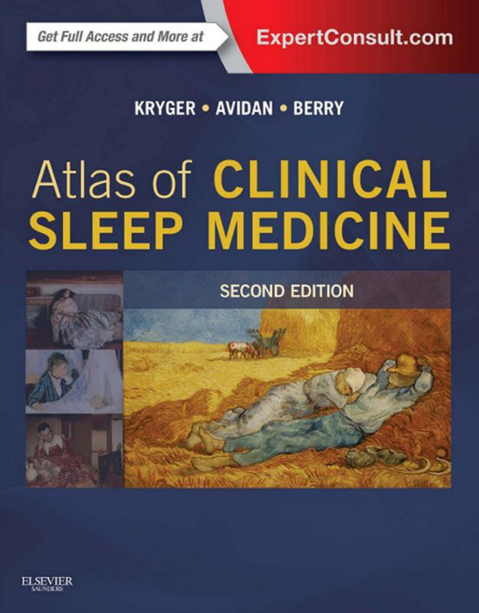
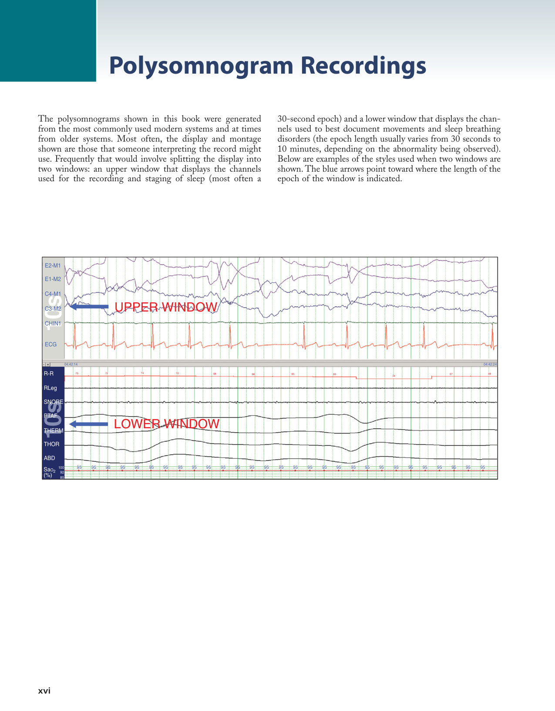
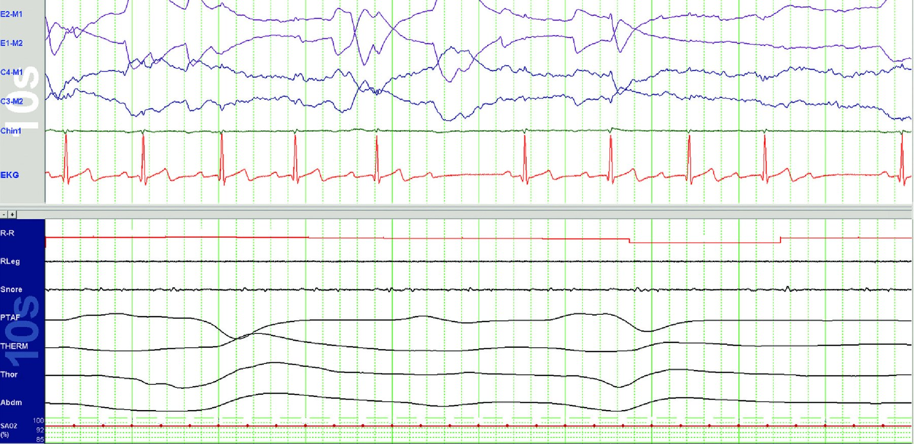
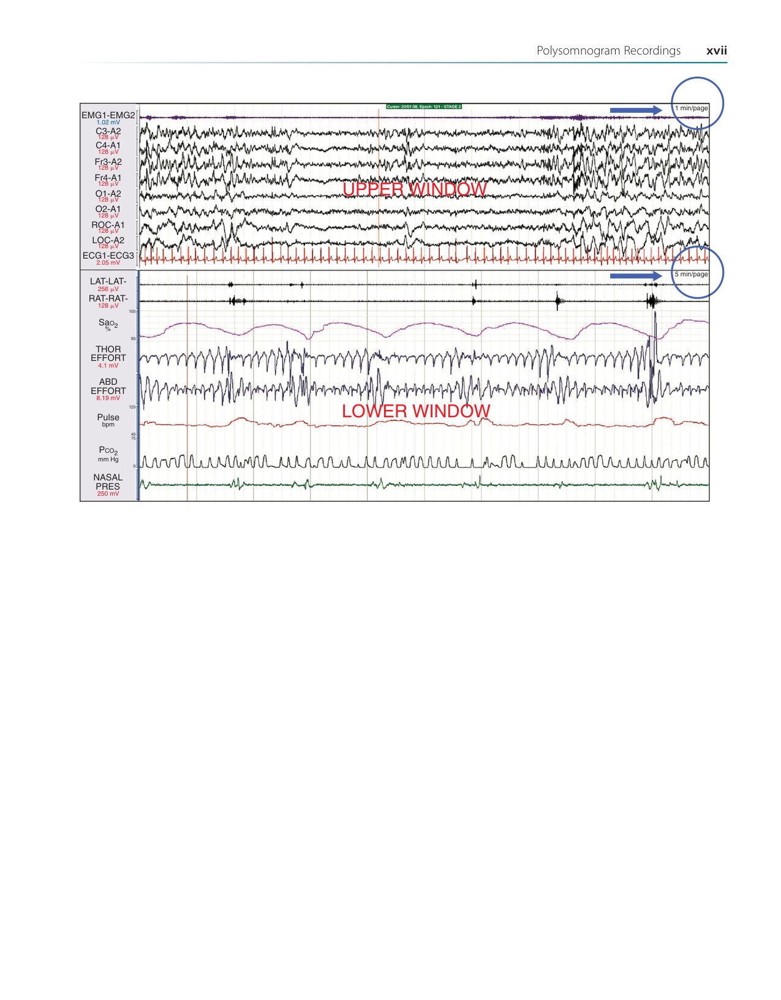
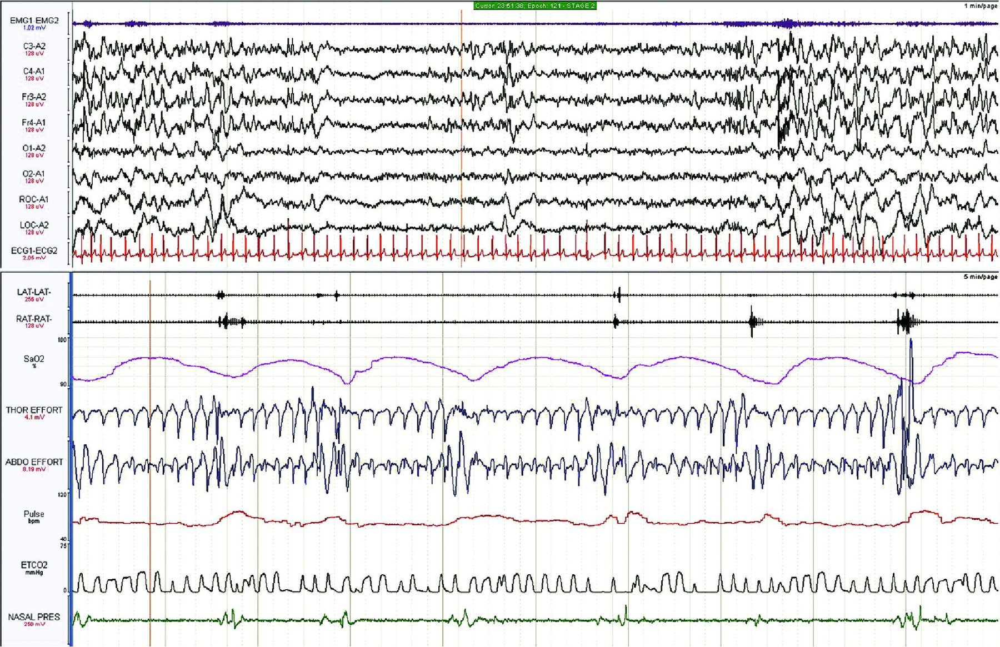

# Front Matter

<!-- pdf-page: 1 -->

<!-- pdf-page: 2 -->

## Atlas of CLINICAL

## SLEEP MEDICINE

<!-- pdf-page: 3 -->

<!-- pdf-page: 4 -->

## Atlas of CLINICAL

## SLEEP MEDICINE

## SECOND EDITION

### Meir H. Kryger, MD

Professor of Medicine Yale School of Medicine Pulmonary, Critical Care and Sleep Medicine

New Haven, Connecticut

### Alon Y. Avidan, MD, MPH

Professor of Neurology Director, UCLA Sleep Disorders Center

Director, UCLA Neurology Clinic David Geffen School of Medicine at UCLA

University of California, Los Angeles

Los Angeles, California

### Richard B. Berry, MD

Professor of Medicine Medical Director, UF Health Sleep Center

University of Florida

Gainesville, Florida

<!-- pdf-page: 5 -->

1600 John F. Kennedy Blvd. Ste 1800 Philadelphia, PA 19103-2899

ATLAS OF CLINICAL SLEEP MEDICINE ISBN: 978-0-323-18727-5

No part of this publication may be reproduced or transmitted in any form or by any means, electronic or mechanical, including photocopying, recording, or any information storage and retrieval system, without permission in writing from the publisher. Details on how to seek permission, further information about the Publisher’s permissions policies and our arrangements with organizations such as the Copyright Clearance Center and the Copyright Licensing Agency, can be found at our website: www.elsevier.com/permissions.

This book and the individual contributions contained in it are protected under copyright by the Publisher (other than as may be noted herein).

Knowledge and best practice in this field are constantly changing. As new research and experience broaden our understanding, changes in research methods, professional practices, or medical treatment may become necessary.

Notices

Practitioners and researchers must always rely on their own experience and knowledge in evaluating and using any information, methods, compounds, or experiments described herein. In using such information or methods they should be mindful of their own safety and the safety of others, including parties for whom they have a professional responsibility.

With respect to any drug or pharmaceutical products identified, readers are advised to check the most current information provided (i) on procedures featured or (ii) by the manufacturer of each product to be administered, to verify the recommended dose or formula, the method and duration of administration, and contraindications. It is the responsibility of practitioners, relying on their own experience and knowledge of their patients, to make diagnoses, to determine dosages and the best treatment for each individual patient, and to take all appropriate safety precautions.

To the fullest extent of the law, neither the Publisher nor the authors, contributors, or editors, assume any liability for any injury and/or damage to persons or property as a matter of products liability, negligence or otherwise, or from any use or operation of any methods, products, instructions, or ideas contained in the material herein.

Library of Congress Cataloging-in-Publication Data

Atlas of clinical sleep medicine / [edited by] Meir H. Kryger.—Second edition. p. ; cm. Includes bibliographical references and index. ISBN 978-0-323-18727-5 (hardcover : alk. paper) I. Kryger, Meir H., editor of compilation. [DNLM: 1. Sleep Disorders–diagnosis–Atlases. 2. Sleep–physiology–Atlases. WM 17] RC547 616.8′498–dc23 2013024104

Content Strategist: Helene Caprari Content Development Specialist: Angela Rufino Publishing Services Manager: Patricia Tannian Project Manager: Carrie Stetz Design Direction: Steven Stave

Printed in China

Last digit is the print number: 9 8 7 6 5 4 3 2 1

<!-- pdf-page: 6 -->

To Barbara Rosenblum Kryger, my wife, lifelong partner, and friend, who has been my muse,

my inspiration, and my support

M.H.K.

To my family, friends, current and former colleagues and trainees,

for their support and encouragement

A.Y.A.

To Catherine, David, and Sarah Berry, my wife, my son,

and my daughter; you are my greatest joy

R.B.B.

<!-- pdf-page: 7 -->

## Contributors

#### David F. Dinges, PhD

Professor and Director, Unit for Exemplary Psychiatry,

#### Takashi Abe, PhD

Postdoctoral Fellow, Division of Sleep and Chronobiology,

Department of Psychiatry, Perelman School of Medicine, University of Pennsylvania, Philadelphia, Pennsylvania

#### Richard P. Allen, PhD

Associate Professor, Department of Neurology, The Johns

Hopkins University, Baltimore, Maryland

#### Todd Arnedt, PhD

Associate Professor of Psychiatry and Neurology, Director,

Behavioral Sleep Medicine Program, University of Michigan Hospital and Health Systems, Ann Arbor, Michigan

#### Alon Y. Avidan, MD, MPH

Professor of Neurology; Director, UCLA Sleep Disorders

Center; Director, UCLA Neurology Clinic, David Geffen School of Medicine at UCLA, University of California–Los Angeles, Los Angeles, California

#### Ronny P. Bartsch, PhD

Instructor of Medicine, Division of Sleep Medicine,

Harvard Medical School and Brigham and Women’s Hospital, Boston, Massachusetts

#### Richard B. Berry, MD

Professor of Medicine, Department of Medicine, University

of Florida, Gainesville, Florida

#### Orfeu M. Buxton, MD

Assistant Professor, Division of Sleep Medicine, Harvard

Medical School; Associate Neuroscientist, Department of Medicine, Brigham and Women’s Hospital, Boston, Massachusetts

#### Muna Canales, MD

Assistant Professor of Medicine, Division of Nephrology,

Hypertension, and Renal Transplantation, Department of Medicine, University of Florida; Staff Physician, Malcolm-Randall VA Medical Center, Gainesville, Florida

#### Ronald D. Chervin, MD

Professor of Neurology, Michael S. Aldrich Collegiate

Professor of Sleep Medicine, Director, University of Michigan Sleep Disorders Center, University of Michigan Health System, Ann Arbor, Michigan

#### James M. Clinton, BS

Washington State University, Washington

#### Christopher J. Davis, PhD

Research Assistant Professor, Washington State University,

WWAMI Medical Education Program and the Sleep and Performance Research Center, Spokane, Washington

Chief, Division of Sleep and Chronobiology, Department of Psychiatry, Perelman School of Medicine, University of Pennsylvania, Philadelphia, Pennsylvania

#### Danny J. Eckert, PhD

Neuroscience Research Australia and the University of New

South Wales, School of Medical Sciences, Sydney, Australia

#### Jack D. Edinger, PhD

Professor, Department of Medicine, National Jewish Health,

Denver, Colorado; Adjunct Professor, Department of Psychiatry and Behavioral Sciences, Duke University Medical Center, Durham, North Carolina

#### Patrice Fort, MD

Researcher on the Sleep Team at the Centre of

Neuroscience at Lyon, Faculty of Medicine Laënnec, Lyon, France

#### Patrick M. Fuller, MD

Assistant Professor, Division of Sleep Medicine, Harvard

Medical School; Assistant Professor, Department of Neurology, Beth Israel Deaconess Medical Center, Boston, Massachusetts

#### Charlene Gamaldo, MD

Associate Professor, Department of Neurology, Johns

Hopkins University, Baltimore, Maryland

#### Charles F.P. George, MD

Professor of Medicine, Western University; Medical

Director, Sleep and Apnea Assessment Unit, London Health Sciences Centre, London, ON, Canada

#### Cathy Goldstein, MD

Assistant Professor of Neurology, University of Michigan

Sleep Disorders Center, Ann Arbor, Michigan

#### Ronald M. Harper, PhD

Distinguished Professor of Neurobiology, David Geffen

School of Medicine at UCLA and the Brain Research Institute, University of California–Los Angeles, Los Angeles, California

#### Don Hayes Jr, MD

Associate Professor of Pediatrics, Ohio State University

College of Medicine, Columbus, Ohio

#### Max Hirshkowitz, PhD

Associate Professor, Baylor College of Medicine,

Department of Medicine and Menninger Department of Psychiatry; Clinical Director, Sleep Disorders and Research Center, Michael E. DeBakey VA Medical Center, Houston, Texas

#### vii

<!-- pdf-page: 8 -->

viii Contributors

#### Michael J. Howell, MD

Assistant Professor, Department of Neurology, University of

#### Atul Malhotra, MD

Kenneth M. Moser Professor of Medicine, Chief of

Minnesota Medical School; Program Director, Clinical Sleep Medicine Fellowship, Minnesota Regional Sleep Disorders Center, Hennepin County Medical Center, Minneapolis, Minnesota

Pulmonary and Critical Care, Director of Sleep Medicine, University of California–San Diego, California

#### Raman Malhotra, MD

Assistant Professor of Neurology, Co-Director, SLUCare

#### Plamen Ch. Ivanov, PhD, DSc

Research Professor, Department of Physics, Boston

University; Division of Sleep Medicine, Harvard Medical School and Brigham and Women’s Hospital, Boston, Massachusetts

#### Shahrokh Javaheri, MD

Professor of Medicine Emeritus, University of Cincinnati;

Medical Director, Sleepcare Diagnostics, Cincinnati, Ohio

#### Levente Kapás, MD, PhD

Associate Professor, WWAMI Medical Education Program,

Department of Integrative Physiology and Neuroscience, Washington State University, Spokane, Washington

#### James M. Krueger, PhD, MDHC

Regents Professor, WWAMI Medical Education Program

and the Sleep and Performance Research Center, Washington State University, Spokane, Washington

#### Meir H. Kryger, MD

Professor of Medicine, Yale School of Medicine, Pulmonary,

Critical Care and Sleep Medicine, New Haven, Connecticut

#### Andrew D. Krystal, MD

Professor, Department of Psychiatry and Behavioral

Sciences; Director, Sleep Research Program; Clinical Director, Brain Stimulation Program; Duke University, Durham, North Carolina

#### Carol A. Landis, RN, PhD

Professor, Department of Biobehavioral Nursing and Health

Systems, University of Washington, Seattle, Washington

#### Kathryn A. Lee, RN, PhD

Professor and Associate Dean for Research, James and

Marjorie Livingston Endowed Chair, Department of Family Health Care Nursing, School of Nursing, University of California–San Francisco, San Francisco, California

#### Rachel Leproult, PhD

Neuropsychology and Functional Neuroimaging Research

Group (UR2NF) at the Center for Research in Cognition and Neurosciences (CRCN), Université Libre de Bruxelles, Brussels, Belgium

#### Pierre-Hervé Luppi, MD

Director of the Sleep Team at the Centre of Neuroscience

of Lyon, Faculty of Medicine Laënnec, Lyon, France

#### Michelangelo Maestri, MD

Sleep and Epilepsy Center, Neurocenter of Southern

Switzerland, Civic Hospital of Lugano, Lugano, Switzerland; Sleep Center, Neurologic Clinic, University of Pisa, Pisa, Italy

Sleep Disorders Center, Director, Sleep Medicine Fellowship, Saint Louis University School of Medicine, St. Louis, Missouri

#### Catherine McCall, MD

Resident, Harvard Longwood Psychiatry, Boston,

Massachusetts

#### W. Vaughn McCall, MD

Case Distinguished Chair, Professor of Psychiatry and

Health Behavior, Medical College of Georgia, Georgia Regents University, Augusta, Georgia

#### Wallace Mendelson, MD

Professor of Psychiatry (retired), University of Chicago,

Chicago, Illinois

#### Emmanuel Mignot, MD, PhD

Craig Reynolds Professor of Sleep Medicine, Director,

Stanford Center for Sleep Sciences and Medicine, Stanford University Medical School, Palo Alto, California

#### William C. Orr, PhD

President Emeritus, Lynn Health Science Institute; Clinical

Professor of Medicine, Oklahoma University Health Sciences Center, Oklahoma City, Oklahoma

#### Pier Luigi Parmeggiani, MD

Professor Emeritus, Department of Human and General

Physiology, University of Bologna, Bologna, Italy

#### Kathryn J. Reid, PhD

Research Associate Professor, Department of Neurology,

Northwestern University Feinberg School of Medicine, Chicago, Illinois

#### Dominic Roca, MD, PhD

Director, Connecticut Center for Sleep Medicine, Stamford

Hospital, and Columbia University College of Physicians and Surgeons, Stamford, Connecticut

#### Thomas Roth, PhD

Director, Sleep Disorders and Research Center, Henry Ford

Hospital, Detroit, Michigan

#### Chad Ruoff, MD

Clinical Assistant Professor and Assistant Program Director,

Stanford Center for Sleep Sciences and Medicine, Stanford University Medical School, Palo Alto, California

#### Rachel E. Salas, MD

Assistant Professor, Department of Neurology, Johns

Hopkins University, Baltimore, Maryland

#### Carlos H. Schenck, MD

Professor, Department of Psychiatry, University of

Minnesota Medical School; Senior Staff Psychiatrist, Minnesota Regional Sleep Disorders Center, Hennepin County Medical Center, Minneapolis, Minnesota

<!-- pdf-page: 9 -->

Contributors ix

#### Jason S. Schneiderman, PhD

Postdoctoral Fellow, Division of Sleep and Chronobiology,

#### Lauren Tobias, MD

Postdoctoral Fellow, Section of Pulmonary, Critical Care,

Department of Psychiatry, Perelman School of Medicine, University of Pennsylvania, Philadelphia, Pennsylvania

and Sleep Medicine, Yale University School of Medicine, New Haven, Connecticut

#### Colin M. Shapiro, MBB Ch, PhD, MRC Psych

Professor of Psychiatry, University of Toronto, Director of

#### Fred W. Turek, PhD

Charles E. and Emma H. Morrison Professor; Director,

Neuropsychiatry, Youthdale Child and Adolescent Sleep Centre, Toronto Western Hospital, Toronto, ON, Canada

Center for Sleep and Circadian Biology, Department of Neurobiology, Northwestern University, Evanston, Illinois

#### Amir Sharafkhaneh, MD, PhD

Associate Professor of Medicine, Program Director, Sleep

Fellowship Program, Baylor College of Medicine; Medical Director, Sleep Disorders and Research Center, Michael E. DeBakey VA Medical Center, Houston, Texas

#### Stephen H. Sheldon, DO

Professor of Pediatrics, Northwestern University Feinberg

School of Medicine, Director, Sleep Medicine Center, Ann and Robert H. Lurie Children’s Hospital of Chicago, Chicago, Illinois

#### Deena Sherman, BA

Toronto, ON, Canada

#### Jerome Siegel, PhD

Department of Psychiatry and Behavioral Sciences,

University of California–Los Angeles, VA Greater Los Angeles Healthcare System, Los Angeles, California

#### Andrea M. Spaeth, MA

Graduate Student, Department of Psychology, University of

Pennsylvania, Philadelphia, Pennsylvania

#### Mark Splaingard, MD

Clinical Professor of Pediatrics, Nationwide Children’s

Hospital, College of Medicine, The Ohio State University, Columbus, Ohio

#### Robert Stickgold, PhD

Associate Professor of Psychiatry, Department of Psychiatry;

Director, Center for Sleep and Cognition, Harvard Medical School and Beth Israel Deaconess Medical Center, Boston, Massachusetts

#### Keith C. Summa, PhD

Center for Sleep and Circadian Biology, Department of

Neurobiology, Northwestern University, Evanston, Illinois

#### Leslie Swanson, PhD

Clinical Assistant Professor, Department of Psychiatry,

University of Michigan Medical Center, Ann Arbor, Michigan

#### Éva Szentirmai, MD, PhD

Assistant Professor, WWAMI Medical Education Program,

Department of Integrative Physiology and Neuroscience, Washington State University, Spokane, Washington

#### Eve Van Cauter, PhD

Professor, Department of Medicine, University of Chicago,

Chicago, Illinois

#### Richard L. Verrier, PhD

Associate Professor of Medicine, Harvard Medical School;

Department of Medicine, Division of Cardiovascular Medicine, Beth Israel Deaconess Medical Center, Boston, Massachusetts

#### Erin J. Wamsley, PhD

Instructor, Department of Psychiatry, Harvard Medical

School, Boston, Massachusetts

#### Christine Won, MD

Director, Yale Sleep Center, Assistant Professor of

Medicine, Section of Pulmonary and Critical Care Medicine, Yale University School of Medicine, New Haven, Connecticut

#### H. Klar Yaggi, MD, MPH

Associate Professor of Medicine, Department of Medicine,

Section of Pulmonary, Critical Care, and Sleep Medicine, Yale University School of Medicine, New Haven, Connecticut; Director, VA Connecticut Center for Sleep Medicine, West Haven, Connecticut

#### Susie Yim Yeh, MD

Pulmonary, Critical Care, and Sleep Medicine, Kaiser

Permanente, Orange County, California

#### Kin M. Yuen, MD

Medical Director, Bay Sleep Clinic, Adjunct Clinical

Instructor, Stanford University, Menlo Park, California

#### Phyllis C. Zee, MD, PhD

Professor of Neurology, Neurobiology, and Physiology;

Director, Sleep Disorders Program, Northwestern University Feinberg School of Medicine, Chicago, Illinois

#### Marco Zucconi, MD

Clinical Responsible, Sleep Disorders Center, Department

of Clinical Neurosciences, San Raffaele Scientific Institute, Milan, Italy

<!-- pdf-page: 10 -->

## Foreword to the Second Edition

This second edition of the Atlas of Clinical Sleep Medicine updates the original Atlas in terms of advances in the field of sleep medicine yet maintains the synthesis of a broad knowledge base and a visual representation of that knowledge.

Since the first edition, several important advances have occurred in sleep medicine. In terms of standardization of sleep medicine procedures, new scoring rules for polysomnography were developed, and the process of updating our diagnostic system has begun and is virtually complete. The goal of the original scoring system, developed in 1960 by Rechtschaffen and Kales, was to standardize the scoring of sleep stages. As sleep research gave birth to sleep medicine, it became important to standardize the scoring not only of normal sleep, but also of abnormal events in sleep. The revised manual developed by the American Academy of Sleep Medicine has achieved that goal. This volume contains highlights of that revised manual. Another important methodologic change is the increased use of home sleep testing for obstructive sleep apnea. This initiative arose from the realization that many, but certainly not all, patients with obstructive sleep apnea can be evaluated in a home setting without the need for a more expensive and intrusive sleep laboratory study. The role of home testing is an evolving methodology in our field and is discussed as such in this text.

More important, the knowledge base of sleep medicine has continued to evolve. This second edition pays special attention

to the two areas that have seen significant strides. The first is pediatric sleep medicine, particularly the field of sleep breathing disorders. For many years pediatric sleep medicine was focused on the parasomnias. Today we recognize that virtually all sleep disorders are present in pediatric populations. Sleep disorders in children have different presentations, different risk factors, and different morbidities. As children go through critical periods in their development, the presence of a disorder that compromises cognitive function can have irreversible consequences. Clearly the need to recognize, diagnose, and treat pediatric sleep disorders is a high priority in sleep medicine.

The other big advance has occurred in our understanding of circadian physiology and the disorders of circadian desynchrony. This increase has resulted in a better understanding of the pathophysiology of medical conditions such as obesity and disorders such as shift-work disorder as well as the effective use of light and chronobiotic medications in the treatment of circadian disorders.

This second edition is intended to help the clinician keep abreast of all the changes in sleep medicine and their important implications for patient care.

Thomas Roth Detroit, Michigan

2013

#### xi

<!-- pdf-page: 11 -->

## Foreword to the First Edition

During the Renaissance, scientists were often also artists. They had the mental agility to move back and forth between the sciences and the arts with ease and, more importantly, to integrate them. This led to each one influencing the other. Science affected the way art was created, and science was depicted in creative artistic formats. With the evolution of art into new forms that did not have much to do with science and the separate specialization of science, these two important human endeavors drifted far apart. If one researches the history of sleep, until the 1950s it was encountered more frequently in the world of art than in the world of science. Artists depicted nightmares and night terrors, and authors described, with amazing accuracy, individuals who had various sleep disorders ranging from insomnia to sleep apnea. The description by Charles Dickens of Joe the fat boy in The Pickwick Papers describes the signs and symptoms of obstructive sleep apnea syndrome with uncanny accuracy.

In the 1950s, Drs. Aserinsky, Dement, and Kleitman ushered in the modern era of sleep research with their discovery of rapid eye movement (REM) sleep and the association of REM sleep and dreaming. This discovery promised to help gain insight into the nature of the mind-body connection. For the first time, scientists had a mental event, the dream, and a clear physiologic correlate, REM sleep. Also, the nightly occurrence of REM sleep and its associated visual hallucinations was thought to provide insights into the nature of mental disorders that are characterized by waking hallucinations. While neither of these hopes came to fruition, this new discipline shed light on the one third of our existence that was virtually unexplored. By analogy to geology, it was as though an additional third of the world’s land mass was discovered. Questions arose such as: What do the brain and body do in sleep? What is the biologic basis of the dreams and nightmares we all experience, and what is their significance? Why do some people have difficulty sleeping whereas others cannot even stay awake during the day? With the observation that the control of many physiologic processes differed as a function of state (wake, REM, and non-REM), the field of sleep medicine was born. Clearly one can have normal physiologic function while awake and serious pathophysiology while asleep.

Interestingly, as sleep medicine became a new discipline, artists were still fascinated with this mysterious third of

#### xii

existence. Thus, sleep medicine evolved in a parallel course with the depiction of sleep and dreams by authors and artists. The aim of this book is to meld the science of sleep with the arts. Previous atlases have depicted polysomnograms associated with various aspects of sleep physiology and sleep disorders. Several other edited books have provided the reader with a broad understanding of sleep and its disorders. In fact, Dr. Kryger has written and edited several of these texts. Here the goal is more integrative: it is to give the reader an intellectual as well as sensory appreciation of the science of sleep and the practice of sleep disorders medicine. Not only is this book different in its approach, the content is also broader. Along with an in-depth presentation of sleep physiology and pathophysiology, there are chapters on the history of sleep as well as the depiction of sleep in the arts. This book aims not only to inform how to take a history from a sleep disorder patient, but also to educate what other individuals with this sleep disorder look like, what the patient’s sleep study looks and sounds like, and how a patient’s disorder is depicted in the arts. Thus, one will not only gain a familiarity with the disorder, but also a comfort in knowing all aspects of the patient’s care management.

This book explains why sleep studies are run all night rather than sampling sleep for a few hours, what types of sleep studies are needed for which patients, and why highly prevalent sleep disorders went unnoticed by the medical community for decades. This book attempts to define the aspects of sleep that are essential to maximize an individual’s productivity and health.

For non-sleep clinicians, this book will not only make them comfortable with the science of sleep, it will give them a sense of what it is like to enter a sleep laboratory, what types of information can be gained from a sleep study, and, most importantly, what their patient will experience when a referral for a sleep study is made. For the sleep researcher/sleep clinician, this book will provide in-depth coverage of the sleep field with topics ranging from sleep history to basic sleep neurophysiology to the identification, diagnosis, and management of sleep medicine. For all of us, this book will not only stimulate our intellect, but also our senses.

Thomas Roth Detroit, Michigan

2009

<!-- pdf-page: 12 -->

## Preface to the Second Edition

The first edition of this Atlas was “put to bed” in December 2008. The book was geared toward the printed page. The world around us has changed so much since then. The smart phone was introduced just the year before. The first iPad was introduced after the book came out. There has been a revolution in the world of publishing, with the focus being on digital content. This book has been developed not just for a version on paper, but for electronic devices.

We learned a great deal from the first edition. Almost all the media have been technically improved or re-created so that information can be ported to a high-resolution electronic device.

The sleep medicine world around us has also changed. Since late 2007, the sleep medicine boards have been administered by the American Board of Medical Specialties. Pediatricians, ENTs, internists, neurologists, cardiologists, and family doctors have taken and succeeded at the new boards. Home sleep testing has taken the sleep world by storm. There is an updated manual for the scoring of sleep and an updated classification of sleep disorders. Emerging treatments for virtually every sleep disorder are becoming available. New

sophisticated tools not only for diagnosis and monitoring, but also for evaluation of treatment adherence and efficacy, are being introduced at an impressive rate. Our understanding of the relationship of genetics, sleep, metabolic diseases and the circadian system has exploded.

The overall goal of the Atlas, which is to intrigue clinicians, trainees, and scientists with a visually appealing sleep education resource, has not changed. It is to present knowledge about sleep and to use words, images, and video to enhance the presentation and teaching of sleep medicine. We hope that no matter where you read these words, this work will amplify and enrich your knowledge about sleep.

Meir H. Kryger, MD Hamden, Connecticut Alon Avidan, MD, MPH

Los Angeles, California

Richard B. Berry, MD

Gainesville, Florida

September 2013

#### xiii

<!-- pdf-page: 13 -->

## Preface to the First Edition

Our understanding of sleep and sleep disorders is fairly recent. Rapid eye movement (REM) sleep was first described in the same year as Watson and Crick published their important findings on the structure of DNA. Most people consider the discovery of REM the beginning of sleep science and sleep medicine. Up to that time, sleep was seldom mentioned by scientists but had been a topic for philosophers, such as Aristotle; playwrights, such as Shakespeare; novelists, such as Charles Dickens; and many visual artists, such as Vincent van Gogh. The visual artists did not simply portray sleep as a restful phase; at times it recorded the danger that sleep might bring.

In this book we are trying something new. We are trying to add to the knowledge about sleep by not simply focusing on words to transmit that knowledge, but also to use still and moving images and sounds to enhance the understanding of the science of sleep. I began by asking myself, “How would a great scientist and artist have tackled this job?” I immediately thought about Leonardo da Vinci and wondered how he would do such a project. I believe that he would have combined words with engaging visual imagery and whatever else was available in the scientific and communication universe of his day.

This book is substantially different than any book I’ve worked on before. Sleep medicine is a multidisciplinary field that is so much more than just sleep recordings—it is a perfect specialty in which to use multimedia for learning. Having grown up in medical school with Netter’s brilliant atlases, my goal was to produce a volume in the spirit of Netter while including more types of content (images, videos, sleep recordings) than is possible with a conventional book. Putting together this book was like working on a painting—a giant mural. We had ideas about the information we wanted to convey, and we pondered how to use multimedia to present the knowledge, with a book being the anchor. I would like to thank the authors for the brilliant job they have done in capturing sleep medicine in a visual form.

I have always believed that knowledge of a medical field is not simply mastering the clinical facts but also understanding the interaction of history, the arts, and the scientific base that lead to the clinical facts. The anatomic drawings of Leonardo da Vinci remind us of the potential beauty of learning about science.

This is not my first attempt at creating a multimedia platform for sleep disorders. Many years ago, I put together Journey into Sleep, a program that was CD-based that could link to Internet sites. The publishing world was convinced, as was I, that the physical book printed on paper was dead. We were all wrong. About a decade ago, it became apparent that CDs and DVDs as primary sources of content were doomed because the Internet was so much more convenient, and that is where people expect to find certain types of content. Physical books survived and have flourished. This book and its multimedia content were made possible by a flurry of recent technological changes: high-speed Internet, inexpensive mass storage, high-resolution graphics cards and computer displays,

#### xiv

digital photography, and sleep data acquisition systems. There are many photographs in the Atlas. Acquiring the images required a high-resolution camera that could fit into a pocket. Patients were delighted that their images would be used for teaching and they gave permission to include them.

Previously, sleep medicine atlases displayed data originally collected on paper, which resulted in images that could be changed with great difficulty, and they could not emphasize certain teaching points easily. The examples in this book represent what is actually seen in the modern sleep disorders center, warts and all, using various data acquisition systems. The traces shown are real, and the montages used are those that enhance understanding and clarity.

By using digital data acquisition and analysis systems, we are able to emphasize the important teaching points much more easily than when paper was used. We are able to change the time base, compress the data, and split the screen so that the neurophysiologic variables can be shown optimally, while the cardiorespiratory variables can be shown optimally as well using a different time base. It is as easy to see 8 hours on the screen as 30 seconds.

A clinician in sleep medicine uses information from several sources to establish a diagnosis and to determine optimal treatment. These sources include interviews with the patient, examination of the patient, evaluation of tests, and integration of this data with a knowledge base that includes understanding of the relevant pathophysiology. In a clinical learning setting, the mentor will transmit information to the trainee about each of these phases in the clinical interaction. In this book, we are attempting to emulate all parts of the process. We learn a great deal from what a patient tells us in his or her own words and from observing and evaluating the data. I hope that what is presented is helpful to the clinician and ultimately the patient. It is the patient who will benefit the most, and it is from the patient we learn the most.

We use the scoring rules recently published and explain them and show the reader not simply how to score but how to understand. We chose not to be constrained by the recommended epoch length and rules but to build from them and use the tools provided by modern systems to display the data as a clinician might in order to understand the signals coming from an ill patient.

The purpose of the book is to produce an atlas that would be useful for anyone wanting to learn about sleep. We hope that this work pleases the reader. We know it is not perfect, and as careful as we tried to be, we realize that readers will probably find errors. It is our hope that readers will provide us the feedback to help guide us as this book evolves.

#### TECHNICAL DETAILS

All of the images and videos of patients, and sleep traces were obtained digitally in working sleep disorder centers.

Most of the photos and patient interviews were taken with small digital cameras that could fit into a pocket. The photos

<!-- pdf-page: 14 -->

Preface to the First Edition xv

center. It is our hope that the reader will learn how to best interpret and understand what is seen. That is the purpose of this atlas. The digitized images were then processed by artists at Elsevier to supply a uniform look and feel so that the overall appearance of the records had some visual consistency.

were usually captured using 5 or 8 megapixels. The patient video interviews were also taken with the same digital camera with a screen size of 640 × 480 pixels at 29 frames per second. The videos of sleeping patients were taken from data captured during the sleep recording. The images are in black and white (there is no “color” when using an infrared light source in the dark) and were compressed to the MPEG 4 format during acquisition. Most of the videos shown are totally unedited. When editing was necessary, Adobe Premier Elements, Quicktime, or Microsoft Moviemaker was used.

Almost all the sleep recordings were captured using a screen resolution of 1600 × 1200 pixels. The data were stored in the highest resolution without compression, if possible. These are working polysomnographic traces and they may not be the perfect configuration as described in scoring manuals, but they represent what is actually seen in the sleep disorders

These photos and records span many years; thus, there is some variability in the resolution just as there is variability in the resolution of data acquisition systems. The screenshots obtained represent the spectrum of the most widely used data acquisition systems, including Compumedics, Grass, Nihon Kohden, and Respironics.

Meir H. Kryger, MD Hamden, Connecticut

December 2008

<!-- pdf-page: 15 -->

## Polysomnogram Recordings

70 72 74 72 68 66 65 60 34 67 68

The polysomnograms shown in this book were generated from the most commonly used modern systems and at times from older systems. Most often, the display and montage shown are those that someone interpreting the record might use. Frequently that would involve splitting the display into two windows: an upper window that displays the channels used for the recording and staging of sleep (most often a

E2-M1

E1-M2

C4-M1

## 10s

## 10s

### UPPER WINDOW

C3-M2

CHIN1

ECG

04:42:14

R-R

30-second epoch) and a lower window that displays the channels used to best document movements and sleep breathing disorders (the epoch length usually varies from 30 seconds to 10 minutes, depending on the abnormality being observed). Below are examples of the styles used when two windows are shown. The blue arrows point toward where the length of the epoch of the window is indicated.

04:42:24

95 95 95 95 95 95 95 95 95 95 95 95 95 95 95 95 95 95 95 95 95 95 95 95 95 95 95 95 95

RLeg

SNORE

PTAF

### LOWER WINDOW

THERM

THOR

ABD

100 92 85

SaO2 (%)

#### xvi

<!-- pdf-page: 16 -->

Polysomnogram Recordings xvii

1 min/page Cursor: 23:51:38, Epoch: 121 - STAGE 2

EMG1-EMG2

1.02 mV C3-A2

128 V C4-A1

128 V Fr3-A2

128 V Fr4-A1

### UPPER WINDOW

128 V O1-A2

128 V O2-A1

128 V ROC-A1

128 V LOC-A2

128 V ECG1-ECG3

2.05 mV

LAT-LAT-

256 V RAT-RAT-

128 V

100

SaO2 %

90

THOR EFFORT

4.1 mV

ABD EFFORT

8.19 mV

120

Pulse bpm

75 40

PCO2 mm Hg

0

NASAL PRES

250 mV

5 min/page

### LOWER WINDOW

<!-- pdf-page: 17 -->

## Acknowledgments

There were hundreds of people involved in the production of this book. Many I have never met. These range from authors and their editorial assistants and secretaries to the staff at Elsevier. It is not possible to name all the people that have played an important role in such a book. I thank them all.

We would like to thank the staff at Elsevier. We originally proposed a type of book that had not been produced before— a volume using still images and videos to teach about sleep. Elsevier encouraged the project from the very beginning. There were many technical and editorial challenges. We would like to thank Dolores Meloni, and later Helene Caprari, our editors at Elsevier, for their unwavering support. I would like to thank Angela Rufino, the developmental editor, who displayed never-ending calm and patience at every step. We would like to thank Linda McKinley, the production staff, and

the design staff for the beautiful work they have done. We would like to thank the technical staff for having developed innovative methods to deal with the technical challenges at every step of the way. We would like to thank Carrie Stetz, who carried the book to the finish line.

We would like to thank the authors who have done a magnificent job in visually presenting information that normally would be described in words. It was not an easy task for them, and we thank them for their achievements.

We also want to thank Tom Roth and Bill Dement, who have always been an inspiration to all of us. The sleep field will never forget their important contributions to the health and safety of people around the world.

We would like to thank our families for understanding that we were trying to create something new.

#### xix

<!-- pdf-page: 18 -->

## Video Contents

Videos are available at the Atlas of Clinical Sleep Medicine collection online at www.expertconsult.com.

#### Chapter 4

#### Video 4-1

#### Waking head and bill movements and REM

#### sleep movements in the platypus

#### Chapter 11

#### Video 11-1 Examples of cataplexy

#### Video 11-2 Suggested immobilization test

#### Video 11-3 Nocturnal frontal lobe epilepsy seizures

#### with dystonic posturing

#### Video 11-4 Nocturnal frontal lobe epilepsy seizure

#### with dystonic and clonic features occurring

#### at awakening

#### Video 11-5 Nocturnal frontal lobe epilepsy seizure

#### with dystonic and clonic features occurring

#### during sleep

#### Video 11-6 Hyperkinetic nocturnal frontal lobe

#### epilepsy seizures

#### Chapter 12

#### Video 12-1 Short confusional arousal

#### Video 12-2 Sleep-related eating disorder

#### Video 12-3 REM sleep behavior disorder

#### Video 12-4 REM sleep behavior disorder

#### Video 12-5 Bed alarm intervention for REM sleep

#### behavior disorder

#### Chapter 20

#### Videos 20-1 through 20-21 Patient interview videos

#### Chapter 21

#### Videos 21-1 through 21-47 Sleep laboratory findings

#### xxiii
