# 1 Sleep in Art and Literature

<!-- pdf-page: 19 -->

## Chapter 1

## Sleep in Art and Literature

### Colin M. Shapiro, Deena Sherman, and Meir H. Kryger

Like Mars, Apollo is unaware of the activities of the waking world. The effects of sleep in both paintings produce a comic

FIGURE 1-1. Mahla Shapiro, Light to Deep and Dreaming Sleep, 2008.

It appears that every man’s insomnia is as different from his neighbor’s as are their daytime hopes and aspirations.

—F. Scott Fitzgerald

The scientist explores the functions, mechanisms and pathologies of sleep (Fig. 1-1). Visual artists, on the other hand, are not concerned with these matters; instead, when representing sleep, a number of themes repeatedly emerge. They have intense fascination with mythology, dreams, religious themes, the parallel between sleep and death, reward, abandonment of conscious control, healing, a depiction of innocence and serenity, and the erotic.

The subject of sleep is revisited in art time and time again. Why do artists return to this inactive, common, basic human function? Certainly, a sleeping Venus is not as exciting as a dramatization of a bombing on a Spanish town or as uplifting as a starry night. The appeal of sleep lies in the fact that, although it is common, it is extremely complex. A sleeping woman takes on the posture of death but is very much alive. She is conscious but not cognizant. She lies physically in reality, but her thoughts run in fantasy. Sleep delights, frightens, regenerates, and may even lead to fatigue. It can overpower like a heavy, irrepressible fog or elude us like the sweet thrills of happiness.

Furthermore, although sleep is a basic human function, it is a unique experience for everybody. Thus, just as every man’s sleeplessness differs from his neighbor’s, so does his sleep. Sleep is a necessity and every person does it (or hopes to), but the actual experience cannot be shared. When one goes to

sleep, one falls alone, and when one enters dreamland, one walks by one’s self. Here lies the appeal for artists. This inactive state contains so many connotations, evokes a large array of emotions, and holds an abundance of internal activity. How does one execute through painting one’s experiences and thoughts on sleep? Artists encounter a great barrier to overcome in trying to convey a multifaceted action whose origins lie in inaction. It is extremely difficult for an artist to separate one sleeping figure who may represent strength in sleep from another that symbolizes vulnerability.

This chapter explores the various devices and methods artists use to articulate their explorations and understandings of sleep. Furthermore, it investigates the different themes and ideas that artists have had about this mysterious human experience.

#### MYTHOLOGY

One way artists explore sleep is through mythology. Artists take advantage of the viewer’s knowledge of and familiarity with the characters, stories, and settings of myth. This allows the artist to convey his or her definition of sleep by immersing it in these visual mythical cues. This is accomplished once the viewer recognizes these cues because it forces the viewer to ask, “What are the implications of sleep in the context of the story?”

An example of this is Sandro Botticelli’s Mars and Venus (Fig. 1-2). In this painting, the fully clothed Venus sits at the left, upright and alert, whereas the sleeping Mars on the right lies languidly, incapacitated, exposed, and vulnerable. Venus appears to be in control while Mars is reduced to being a plaything for the baby satyrs. Thus, this painting likens the state of sleep to weakness. It is a powerful force that can overtake the god of war. Sleep is undesirable because it is capable of lowering the defenses of someone as formidable as the god of war. The god of war becomes subject to humiliation. Furthermore, he has become prey to the outside world. This power of sleep is often not appreciated by patients, even those who suffer from sleep disorders, who may need to be reminded, for example, that sleep deprivation is used as a technique of torture. In other words, sleep is so highly necessary that “take those sleeping pills” may be the simplistic mantra.

Lorenzo Lotto’s Sleeping Apollo (Fig. 1-3) portrays sleep in a manner similar to that of Botticelli’s Mars and Venus. Once again, the sexes are divided; the naked female Muses are on the left and the slumbering Apollo sits on the right. Fame, who flies above Apollo, is ready to desert him and join the other Muses. The Muses have taken advantage of the sleeping Apollo to abandon their clothes and arts to frolic about.

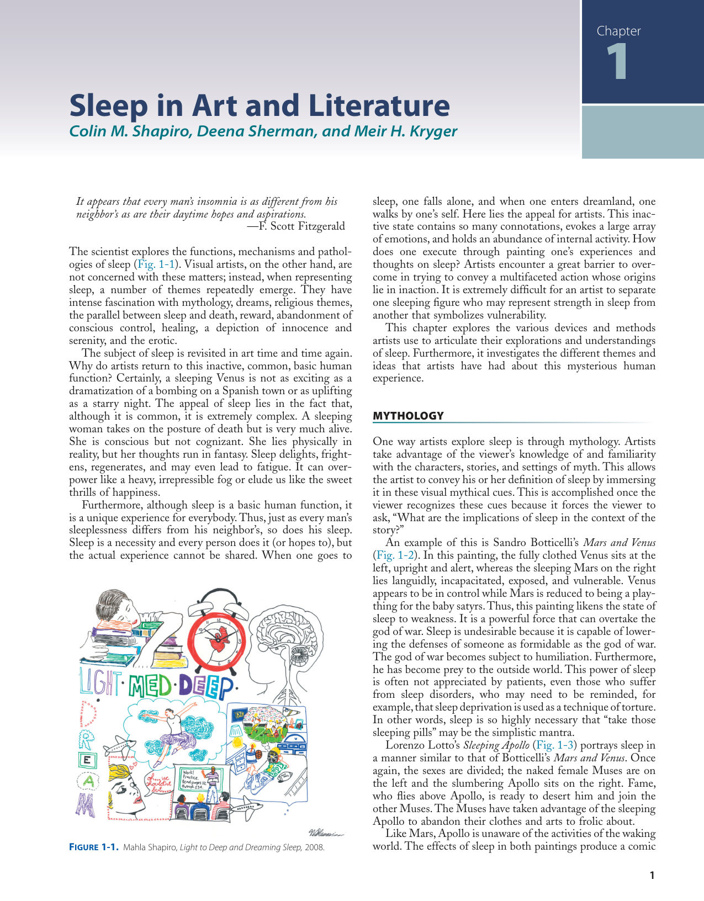

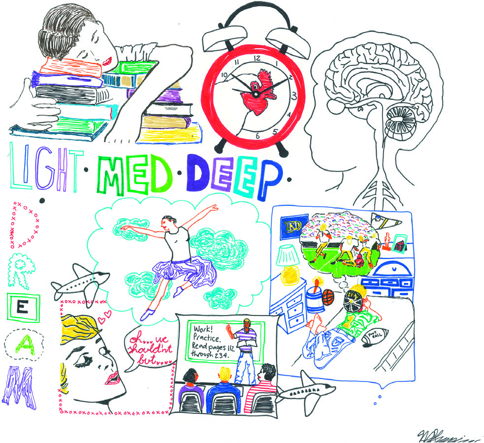

<!-- pdf-page: 20 -->

2 Sleep in Art and Literature

FIGURE 1-2. Sandro Botticelli, Mars and Venus, ca. 1483. National Gallery of London.

FIGURE 1-3. Lorenzo Lotto, Sleeping Apollo, ca. 1530. Szepmuveseti Museum, Budapest.

reaction. However, the way Mars and Apollo are portrayed in their sleep produces two decidedly different comic reactions. The sprawled, exposed sleeping Mars, with his own lance held by the baby satyrs, pointing at him, is an object to be ridiculed. The portrayal of sleeping Apollo is less negative. He sits more upright with what appears to be an instrument in his hand. He is depicted more like the dozing professor whose students have gone off to play.

Thus, sleep takes on a different meaning. The undignified position of Mars, the god of war, compounded with the connotations of strength, power, and chaos, portrays sleep as a weakening force that places one in a compromising position. On the other hand, in Sleeping Apollo, sleep appears not to take away strength or might, but reason. This is reinforced by the fact that Apollo is linked to reason and foresight. Sleep has removed him of rationality and made him completely oblivious to what has happened. This is further symbolized by the abandoning of the books and instruments of the Muses in front of him. Also, Apollo sits in the dark, enclosed by the trees; he is alone in the secluded realm of sleep and completely segregated from the outside world. Lack of rationality in sleep has become a key issue in the realm of forensic aspects of sleep, with recent media emphasis on the condition of sexsomnia and the consternation over the lack of mens rea in the sleeping state.

Giorgione’s Sleeping Venus (Fig. 1-4), instead of two figures, has one, the female figure, who is sleeping. As in the other

FIGURE 1-4. Giorgione, Sleeping Venus, ca. 1508. Gemäldegalerie Alte

Meister, Dresden, Germany.

two paintings, Venus lies in a pastoral setting; but unlike in Mars and Venus, she is alone, and she is the one who is sleeping and nude. The curves of her body emulate the undulating hills. She has her left hand covering her genitals. This is an extremely erotic picture.

Sleep has taken on a different meaning here. Venus has become not someone to laugh at, like Mars or Apollo. Her

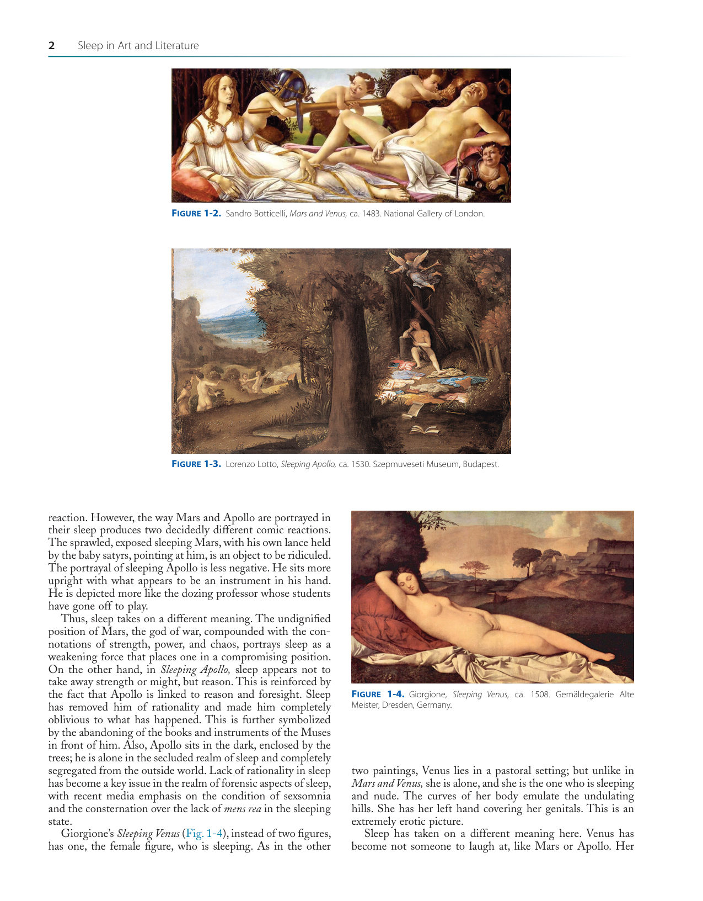

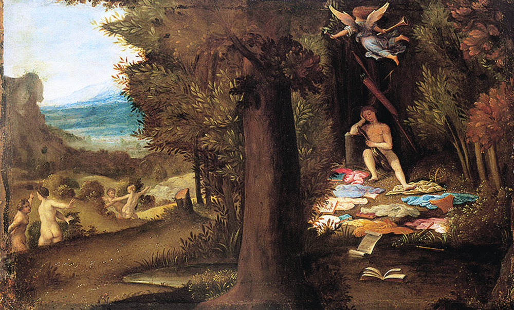

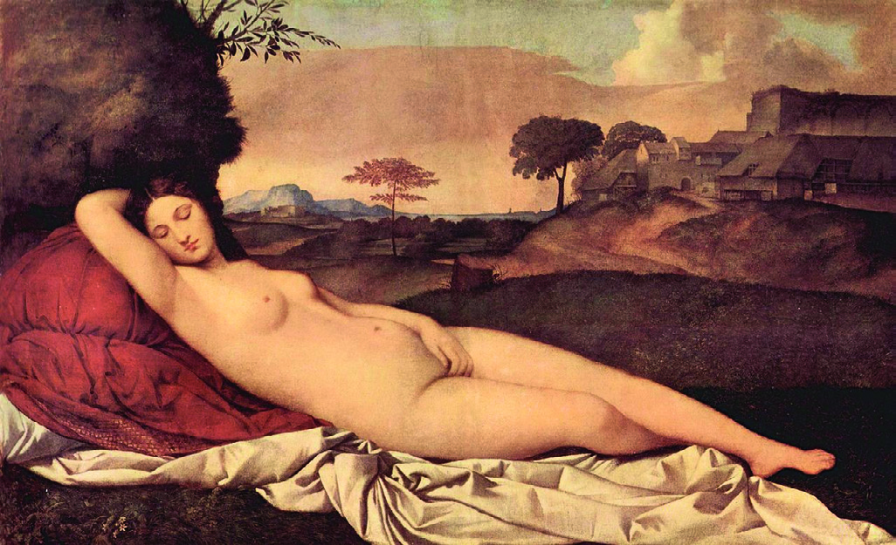

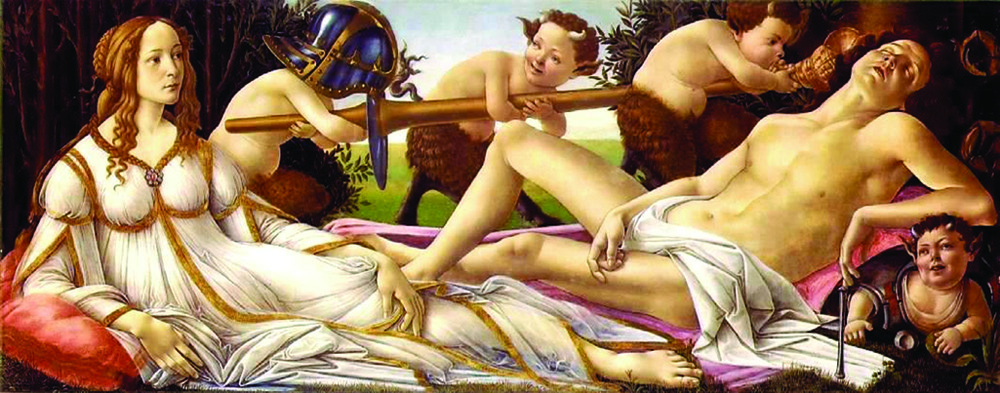

<!-- pdf-page: 21 -->

strength or power or reason has not been taken away from her because of sleep. Rather, sexuality—which Venus is associated with—has become enhanced by sleep. According to Maria Ruvoldt, the conscious placement of her hand over her genitals refers to her procreative powers. Also, she has her right arm up to expose her armpit. This gesture is commonly associated with seduction in certain periods in Western art. Moreover, because the curves of her body imitate the landscape, there is a direct connection between her and nature, thus further associating her with fecundity.

#### RELIGION

Instead of classical mythology, many artists have turned to the Bible in their representations of sleep. In his oil painting Earthly Paradise (Fig. 1-5), Pierre Bonnard depicts a slumbering Eve and an alert Adam. Bonnard uses the same pictorial language in his rendering of Eve: the exposed armpit and her rounded form alluding to nature. Her rendering and sleeping posture make her look thanatotic.

Although the pairing of the two biblical characters reminds us of Botticelli’s Mars and Venus, they are not similar to the two mythical characters. By using the same visual language as Giorgione, Bonnard allows the female sleeper to be the empowered, natural being, as opposed to Botticelli’s weakened male protagonist. One could argue, as the Art Institute of Chicago does, that “the male, seen as essentially intellectual, is able to transcend the earthly.” However, one can interpret this as Eve being given more power because she was given more attention in terms of her physiognomy, rather than the awakened Adam. She is foreshortened and is positioned closest to the viewer. Furthermore, her color is in great contrast to the rest of the painting so that she becomes a focal point, and detail is given to her face. On the other hand, Adam is rendered in shadow and only his profile is shown. Although he is standing—which could insinuate evolution— he is colored like the rest, to the point where he looks like a tree, or is simian-like.

FIGURE 1-6. Piero della Francesca, Dream of Constantine, ca. 1452. San Fran­

cesco, Arezzo, Italy.

In works such as Piero della Francesca’s Dream of Constantine (Fig. 1-6), sleep is depicted as the state in which the divine communicates with humans. This is a common occurrence in mythology and religious stories. Well-known instances are the Bible’s Jacob and his dream of the ladder that reached heaven, as well as the Egyptian Pharaoh’s prophetic dreams that would be interpreted by Joseph. Whatever the story, it is necessary that the protagonist enter the state of sleep in order to hear God speak to him. In this early Renaissance painting, Constantine is shown reposed in a tent and is flanked by his sentinels. There is—or what appears to be—an angel swooping from the upper left corner as if to deliver a divine message from God. This image depicts the moment, Laurie Schneider Adams tells us, when Constantine’s dream “revealed the power of the Cross, and led to his legal sanction of Christianity.” As opposed to Botticelli’s Mars and Venus and Giorgione’s Sleeping Venus, Constantine is neither emasculated nor empowered with sexual prowess. Sleep is depicted as a state wherein only the divine becomes revealed and the sleeper can realize higher states of consciousness. This is further exemplified by the contrast between Constantine and his guards. The leader is composed and peaceful in his rest as though receptive to a divine message. (This may be thought of as a foreshadowing of current research that links sleep in a critical way with the consolidation of memory.) The soldiers, on the other hand, appear languid and unaware of the angel that is delivering the message. The artist uses both this event and sleep as a way to demonstrate the former and to explore the latter. It is interesting to note that the title and content of the painting force the viewer to ask whether he or she is witnessing an event that is occurring in reality, or are we privy

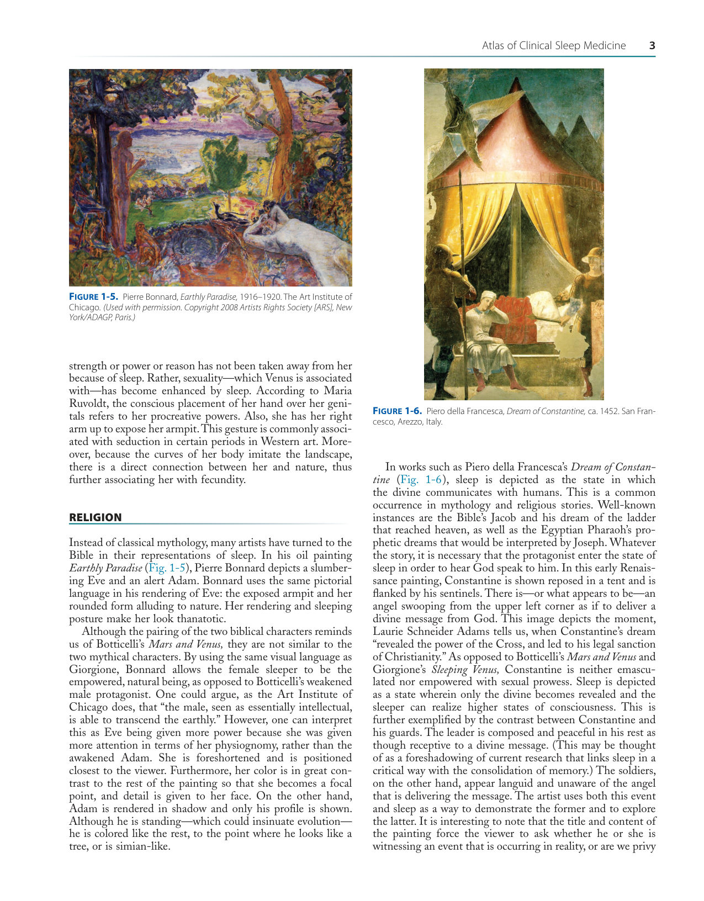

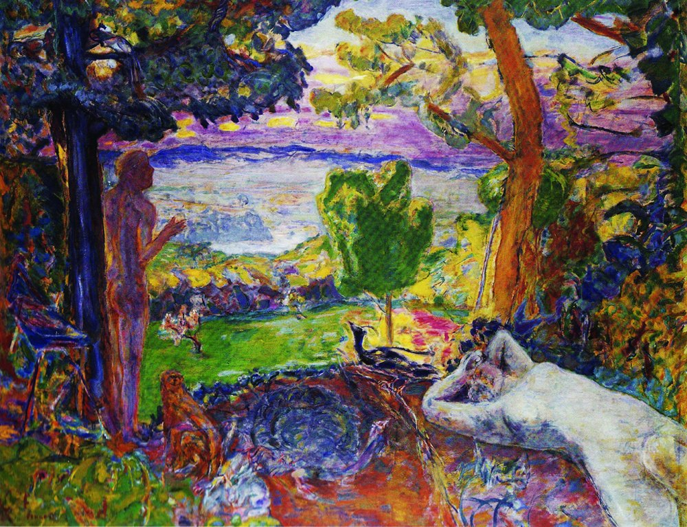

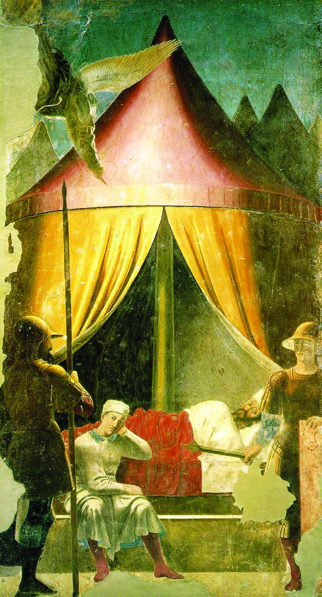

<!-- pdf-page: 22 -->

4 Sleep in Art and Literature

A

B

FIGURE 1-7. A, Michelangelo Merisi da Caravaggio, Rest on the Flight to

Egypt, ca. 1597. Doria Pamphilj Gallery, Rome. B, Michelangelo Merisi da Caravaggio, Penitent Magdalene, ca. 1595. Doria Pamphilj Gallery, Rome.

to the actual dream of Constantine? Are we the awake sleepers who are also in Constantine’s higher state and are witnessing the delivery of this divine message?

The power of sleep is expressed in two biblical images in masterpieces by Caravaggio. In one, Mary and the infant Jesus are sleeping in Rest on the Flight into Egypt (c. 1597) (Fig. 1-7, A). In the other, Mary Magdalene, wearing the clothes of a prostitute, is resting (Fig. 1-7, B). Now that she has abandoned her gold, jewelry, and alcohol she can sleep peacefully. The same model was apparently used for both, and the resting heads are in similar positions.

FIGURE 1-8. Jan Steen, The Dissolute Household, ca. 1668. Wellington

Museum, London.

#### REST

John Keats equated sleep with rest.

WHAT is more gentle than a wind in summer? What is more soothing than the pretty hummer That stays one moment in an open flower, and buzzes cheerily from bower to bower? What is more tranquil than a musk-rose blowing In a green island, far from all men’s knowing? More healthful than the leafiness of dales? More secret than a nest of nightingales? More serene than Cordelia’s countenance? More full of visions than a high romance? What, but thee Sleep? Soft closer of our eyes! Low murmurer of tender lullabies! Light hoverer around our happy pillows! Wreather of poppy buds, and weeping willows! Silent entangler of a beauty’s tresses! Most happy listener! when the morning blesses Thee for enlivening all the cheerful eyes That glance so brightly at the new sun-rise.

—From Sleep and Poetry

Although it may seem that only the mythical, powerful, and divine are depicted sleeping, there have been many examples of those in other social strata sleeping. Jan Steen’s The Dissolute Household (ca. 1668) (Fig. 1-8) represents what modern times would term a “dysfunctional family.” This family setting is the perfect example of indulgence of many types: gambling, gluttony, and prostitution. All order is lost in this household, where cards and oysters are strewn on the floor. The eye is immediately drawn to the woman at the table in restful sleep. Vernon Hyde Minor states that she is the wife of the man who is philandering with the prostitute. It is as though all the bawdiness has worn out the wife. This echoes the themes in Botticelli’s Mars and Lotto’s Apollo. Like Mars

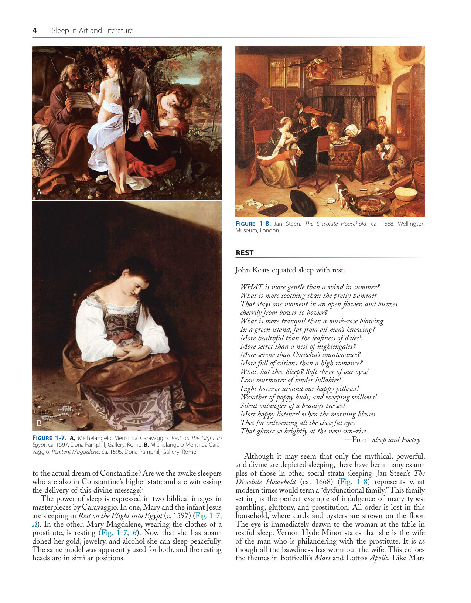

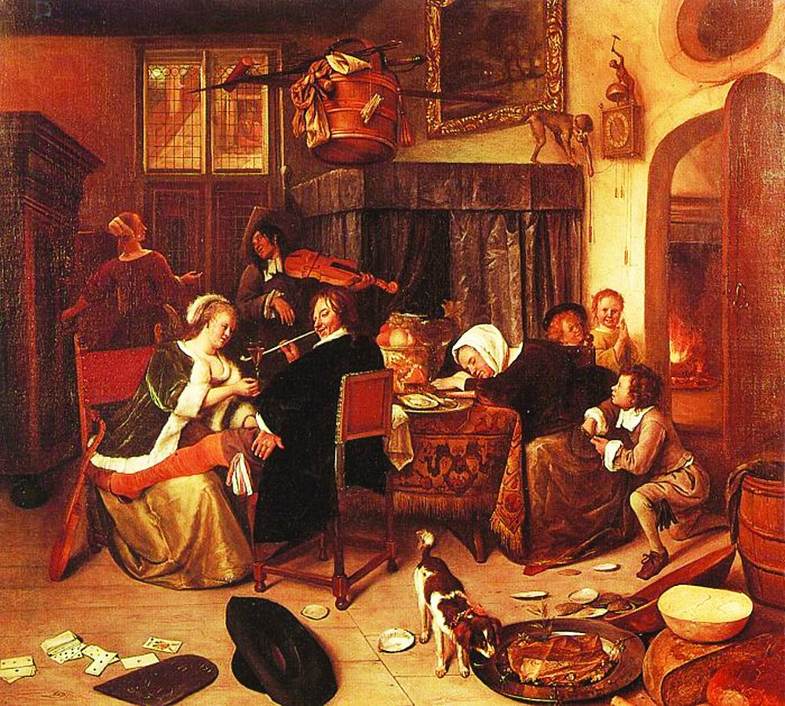

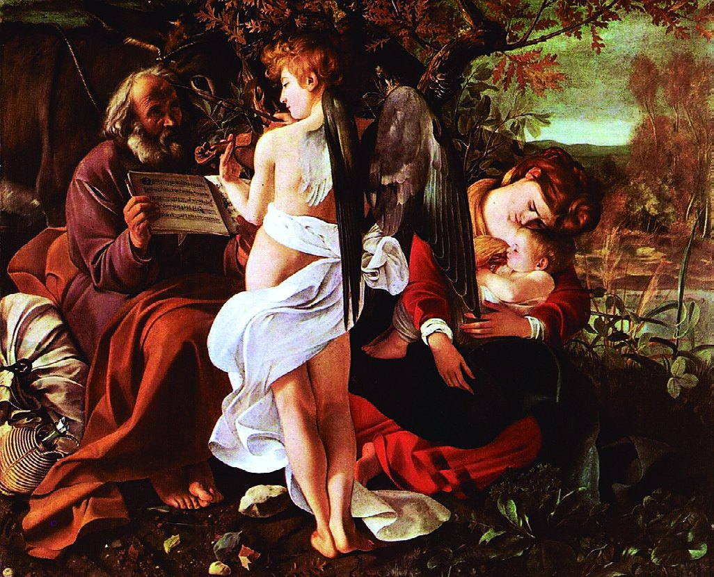

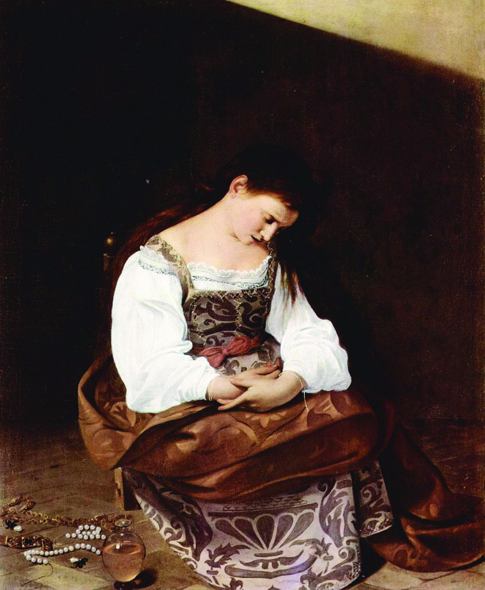

<!-- pdf-page: 23 -->

FIGURE 1-9. Laurent Delvaux and Peter Scheemakers, Cleopatra, ca. 1723.

Yale Center for British Art, New Haven, CT.

and Apollo, the weakened state of sleep/sleepiness/tiredness/ fatigue (overlapping but distinct states) has made the wife vulnerable enough to become both the fool and the cuckold. Amidst all the indulgence and disorder, a monkey in the upper right corner plays with the clock and essentially “stops time.” It is as though this morally challenged family is perpetually caught in this state of depravity. It insinuates that the only course of escape is to move into another state of being—sleep.

That sleep is a wondrous healing state of escape and rest and comfort for all is a common artistic theme, depicted in Laurent Delvaux and Peter Scheemakers’ Cleopatra (Fig. 1-9). Jean-François Millet produced Noonday Rest in 1866 (Fig. 1-10, A). In 1875 John Singer Sargent emulated (see the signature) this image in Noon (Fig. 1-10, B). Van Gogh, in turn, emulated the same theme in Noon: Rest from Work in 1890 (Fig. 1-10, C). The luxury of sleep and rest is the image in Repose (ca. 1911) of this wealthy woman painted by John Singer Sargent (Fig. 1-11).

In The Cradle (1872), Berthe Morisot portrays how complex something like sleep can be for the artist. The infant is peacefully asleep. The mother is calm, relaxed, and grateful—but vigilant as she watches over her baby (Fig. 1-12). The child peacefully asleep is a theme that recurs repeatedly in the visual arts.

John Everett Millais, in L’Enfant du Regiment, shows the healing power of sleep. In the midst of a battle, the injured child is sleeping. In this image we are confronted by violence, the bleeding bandaged arm, and peace of sleep that has overcome the violence (Fig. 1-13).

In all of these examples a clear contrast is established: sleep and awake, unaware and alert, empowered and weakened. By depicting opposites side by side, artists enabled viewers to define these conscious states by what they were not. This is an extremely effective way to explore sleep beyond the physical signs but difficult from an epistemologic perspective or psychological perspective. The alert poses of Botticelli’s Venus and of Bonnard’s Adam set against Mars and Eve, respectively, remind us of what sleep is not: a state of awareness and strength. For Lotto’s Apollo, Steen’s sleeping Wife, and even Giorgione’s Venus, sleep is not being part of the active world. In Giorgione’s Sleeping Venus, one could say that the landscape with the village painted in the right is Venus’s antithesis. It is a reminder that while Venus is asleep, life in the town must and does continue. In Millais’s L’Enfant sleep offers an escape from a dangerous world. And lastly, for Piero della Francesca’s Constantine, sleep is a demarcation between the blessed and the ignorant.

A

B

C

FIGURE 1-10. A, Jean-François Millet, Noonday Rest, 1866. Museum of Fine

Arts, Boston. B, John Singer Sargent, Noon (after Jean-François Millet), ca. 1875. Metropolitan Museum of Art, New York. C, Vincent Van Gogh, Noon: Rest from Work (after Jean-François Millet), 1890. Musée d’Orsay, Paris.

#### INNOCENCE

Sleep as a vulnerable state of innocence is frequently portrayed by artists. As an example the painter Gaspare Traversi in Teasing a Sleeping Girl shows four people watching an innocent girl sleep; one is teasing her with a feather (Fig. 1-14).

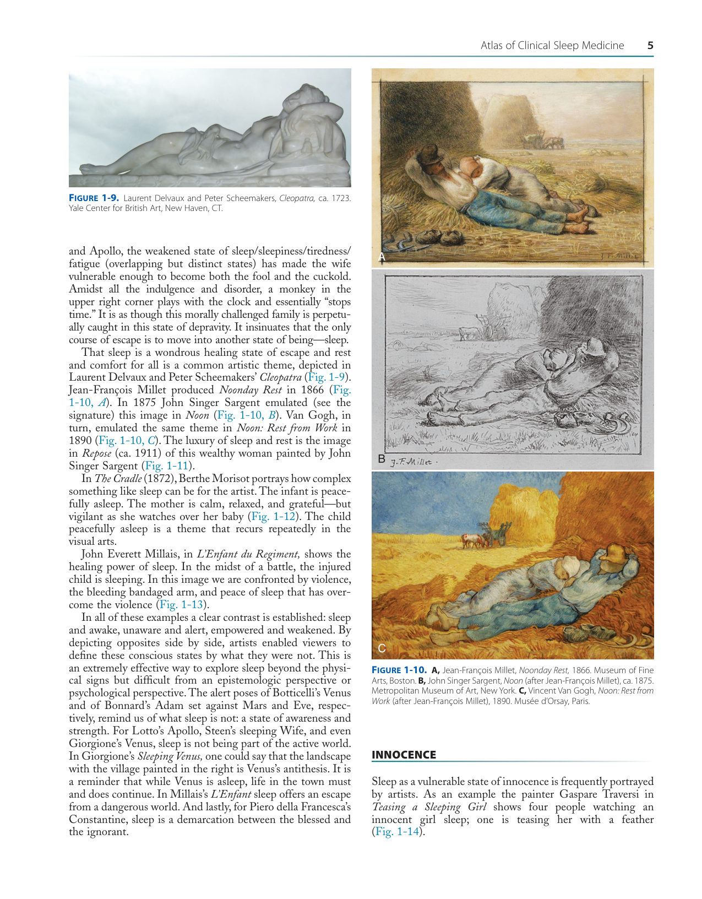

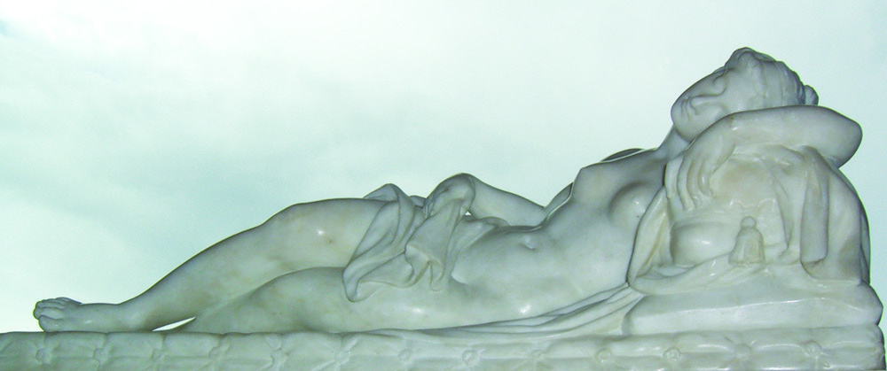

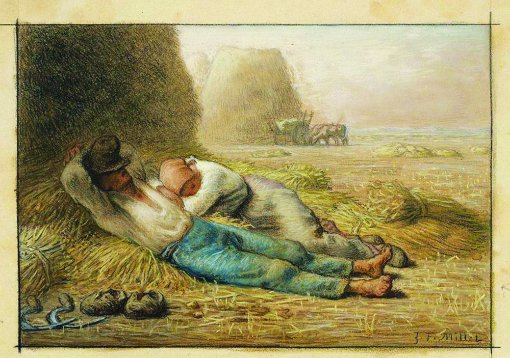

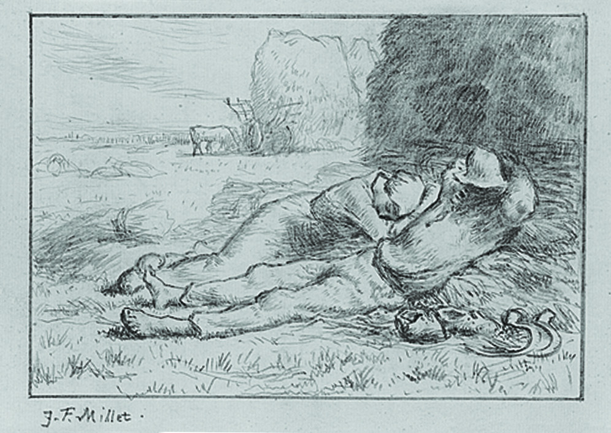

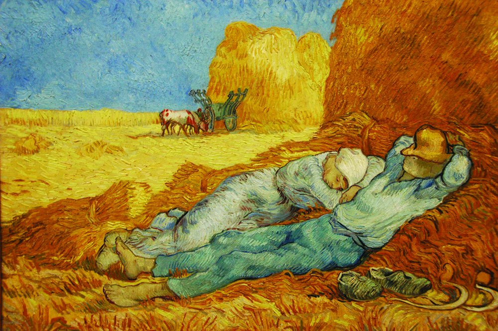

<!-- pdf-page: 24 -->

6 Sleep in Art and Literature

FIGURE 1-11. John Singer Sargent, Repose (Nonchaloire), 1911. National

Gallery of Art, Washington, DC.

FIGURE 1-12. Berthe Morisot, Le Berceau (The Cradle), 1872. Musée d’Orsay,

Paris.

#### DREAMS, DANGER, AND DEATH

The painting of dreams is an excellent way for artists to explore sleep. It allows them to not only share their unique experiences and move sleep from the external to the internal, but also to combine elements that would not normally share the same space.

FIGURE 1-13. John Everett Millais, L’Enfant du Regiment, ca. 1855. Yale Center

for British Art, New Haven, CT.

FIGURE 1-14. Gaspare Traversi, Teasing a Sleeping Girl, ca. 1760. Bequest of

Harry G. Sperling, 1971.

Francisco Goya, in The Sleep of Reason Brings Monsters (ca. 1799) (Fig. 1-15), clearly shows that dreams can be disturbing, with invasion of the dreams by monsters. Is this what awakens those with posttraumatic stress disorder? Henry Fuseli in The Nightmare (ca. 1781) shows a woman possibly in a state of sleep paralysis (Fig. 1-16). She has visions of a devil-like creature on her abdomen and a horse’s head peering at her from the left, but she cannot move.

Another example of dreaming is Henri Rousseau’s The Dream (1910) (Fig. 1-17, A) in which there is a nude female lounging on a Victorian couch in the middle of a jungle. Among many hidden menacing animals, there is one in the center that draws the viewer’s attention. It is an indefinable creature, which appears to be both human and animal, playing an instrument. The sky is light to indicate day; however, the moon is full and clearly visible. All these elements would not normally be together, yet the subject of dreaming allows them to be so. The juxtaposition of these things, combined with the realism in which they are rendered, evokes the feelings of

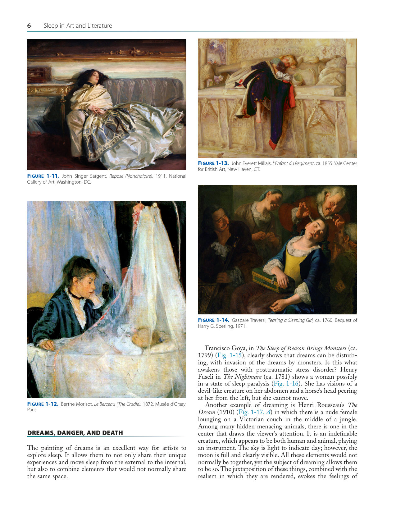

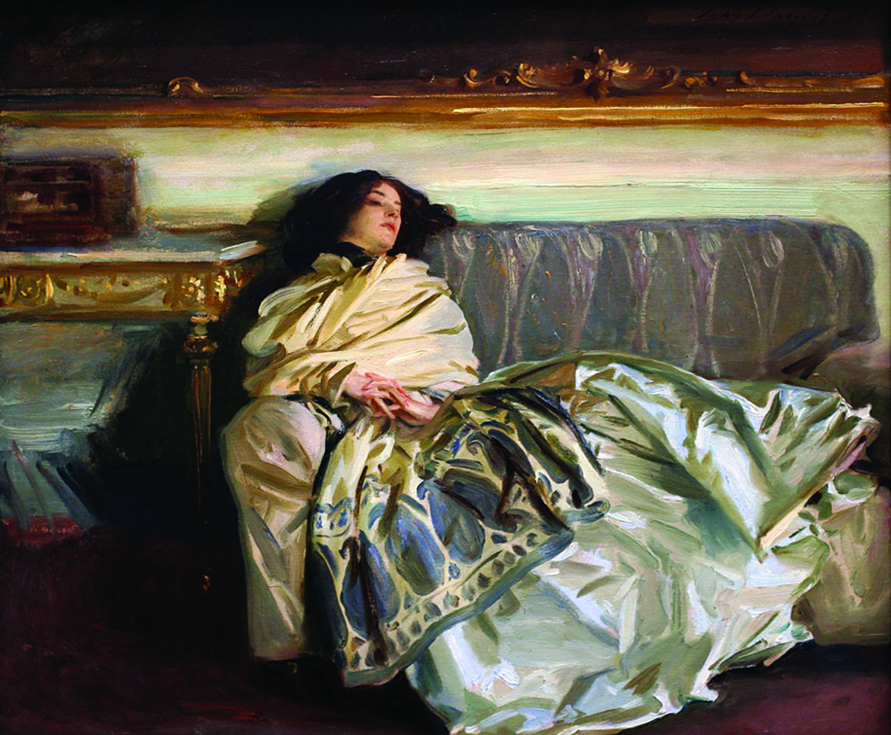

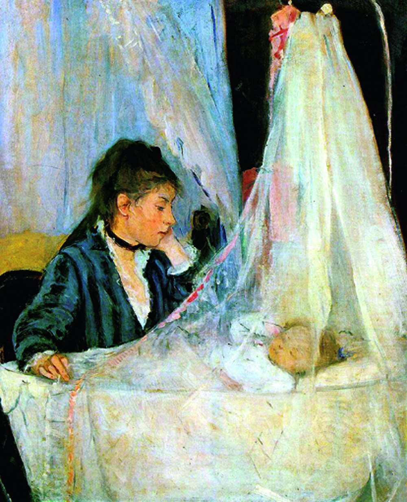

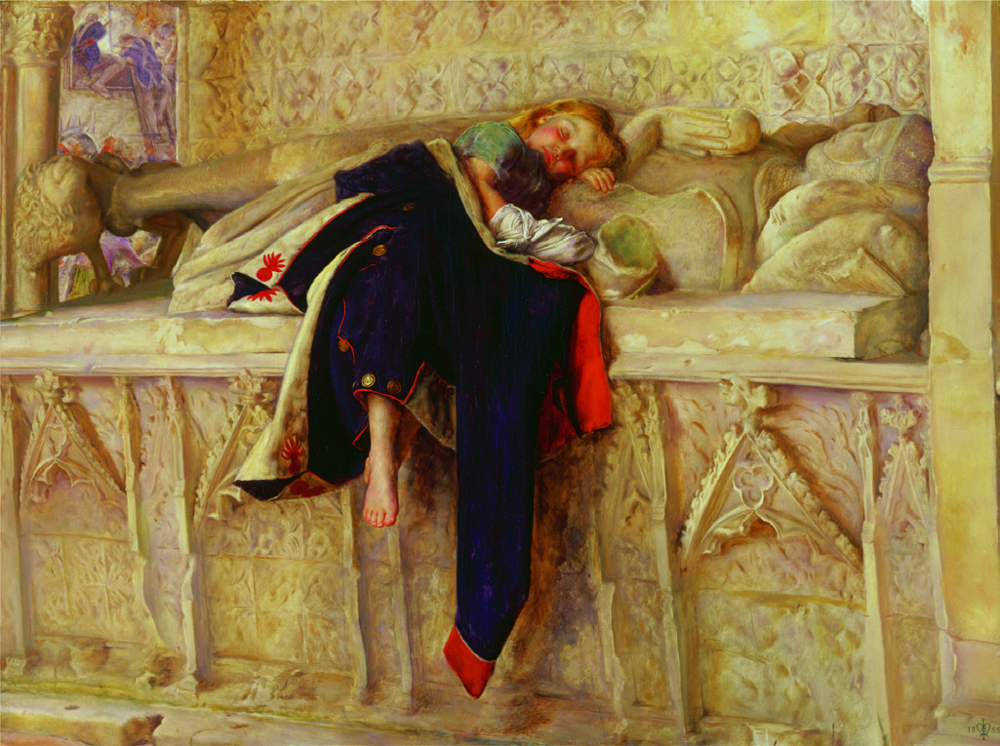

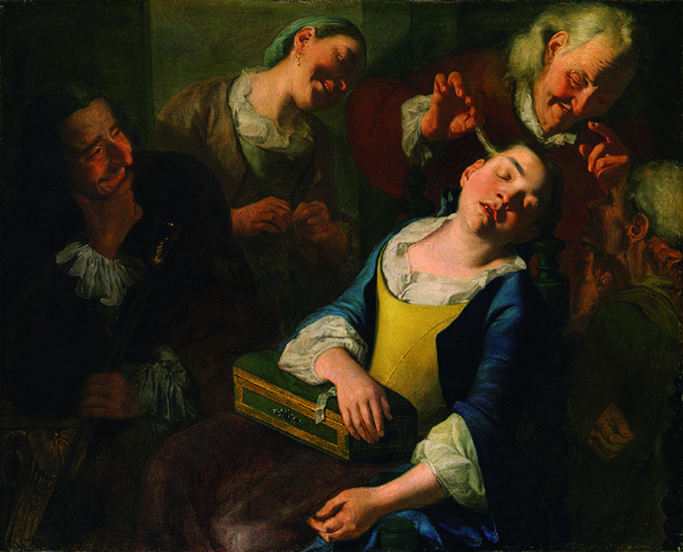

<!-- pdf-page: 25 -->

FIGURE 1-15. Francisco José de Goya, The Sleep of Reason Produces Monsters,

#43, 1799. From Los Caprichos.

FIGURE 1-16. Henry Fuseli, The Nightmare, 1781. Detroit Institute of the Arts,

Detroit.

eeriness and perplexity so often associated with dreams. Another dreamlike image by Rousseau is that of the Sleeping Gypsy (1897) (Fig. 1-17, B). This image is a dream about sleep. A lion lurks over the sleeper, but it does not seem to be attacking the sleeper. Is it because the lion is full? Is the lion protecting the sleeper? Are sleep and the dream protecting the sleeper? These works remind one that sleep may be restorative and positive, but there is a lurking danger of sleep as well.

As we have seen, artists throughout time have actualized sleep through myth, religion, class, and dreams. Another

A

B

FIGURE 1-17. A, Henri Rousseau, The Dream, 1910. Museum of Modern Art,

New York. B, Henri Rousseau, The Sleeping Gypsy, 1897. Museum of Modern Art, New York.

recurring theme is death. That sleep may be a reversible form of death, and death a form of sleep, has always fascinated writers and artists, and even in the nineteenth century sleep and death were equated by some physicians.

William Shakespeare equated sleep with death.

To be, or not to be: that is the question: Whether ’tis nobler in the mind to suffer The slings and arrows of outrageous fortune, Or to take arms against a sea of troubles, And by opposing end them? To die: to sleep: No more; and by a sleep to say we end The heart-ache and the thousand natural shocks That flesh is heir to, ’tis a consummation Devoutly to be wish’d. To die, to sleep; To sleep: perchance to dream: ay, there’s the rub; For in that sleep of death what dreams may come

—Hamlet, act 3, scene 1

Sleep that knits up the ravell’d sleave of care, The death of each day’s life, sore labour’s bath, Balm of hurt minds, great nature’s second course, Chief nourisher in life’s feast.

—Macbeth, act 2, scene 2

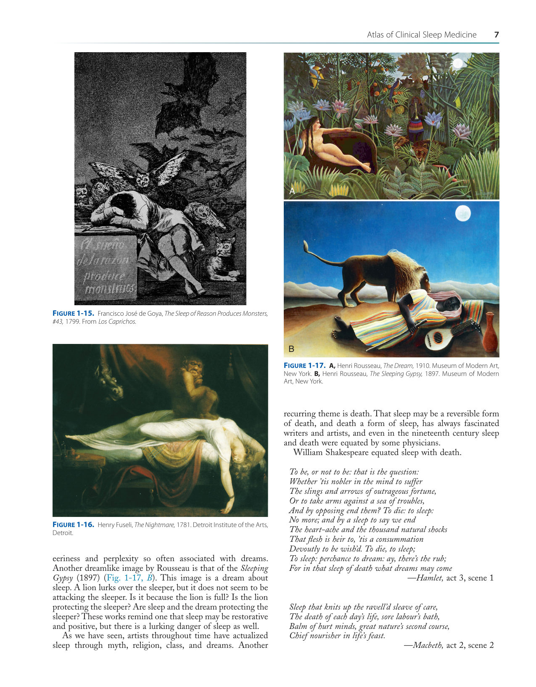

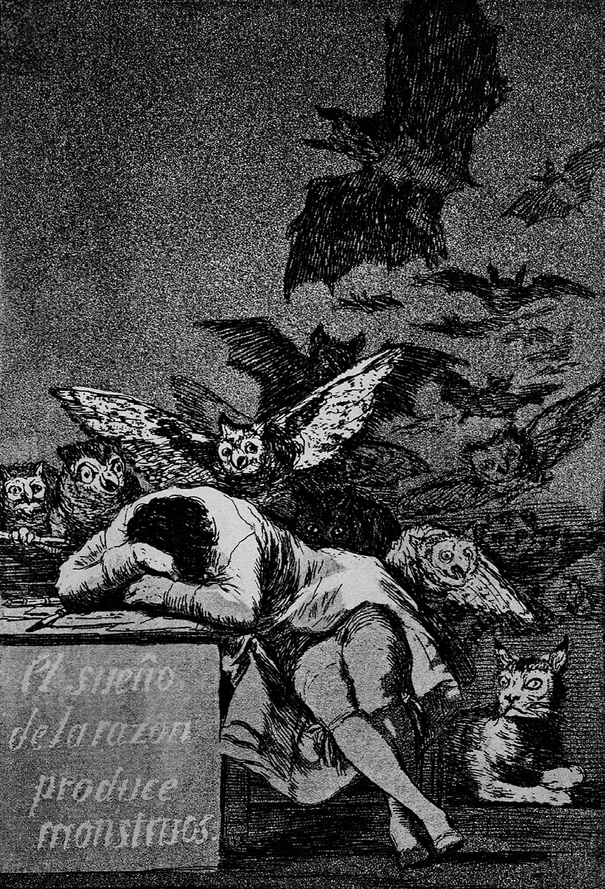

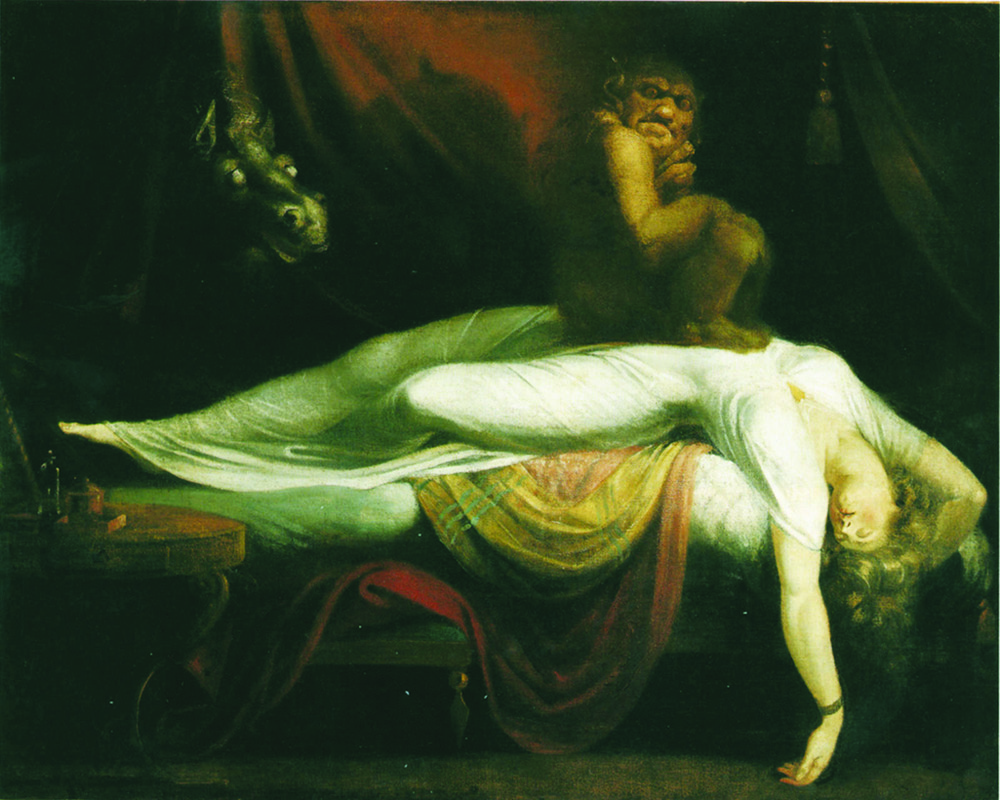

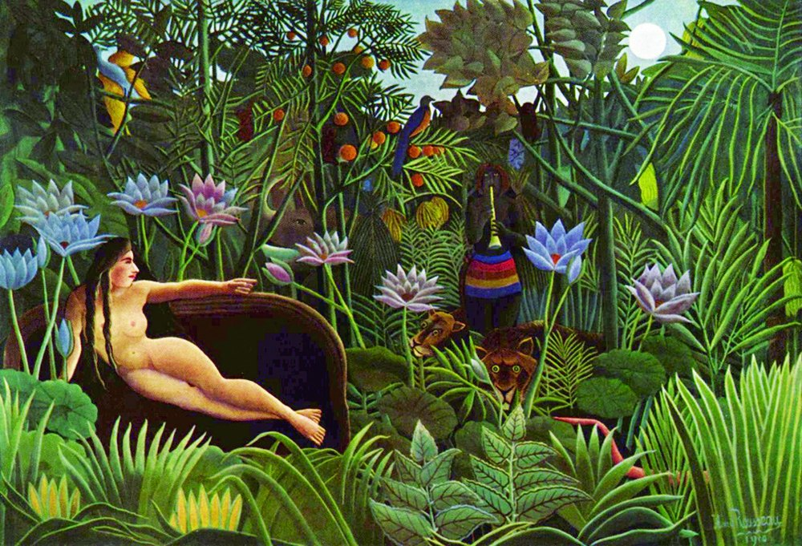

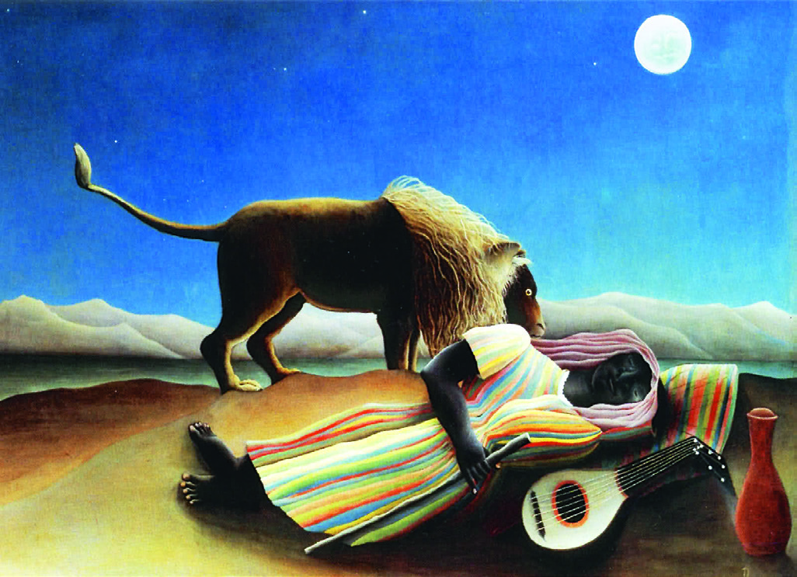

<!-- pdf-page: 26 -->

8 Sleep in Art and Literature

FIGURE 1-18. The Death of Bhisma, from Mahabharata, ca. 18th century.

Smithsonian Institute, Washington, DC.

Religion has, as noted earlier, contributed to views about sleep in general and artistic portraits in particular. For example, a bed made of arrows is not generally counted among the beds one would be happy to rest on. The bed of arrows, as shown in Figure 1-18, belongs to Bhishma, a hero of the Hindus. According to historical record, Bhishma’s bed of arrows was also his deathbed in a war that is said to have occurred around 6000 BCE. This emphasizes the perceived link of sleep and death. Bhishma’s body was so covered with arrows shot at him that when he lay down, the arrows made a bed. Only his head was not supported by arrows. So Bhishma asked Arjun, another war hero, to create a pillow of arrows for him. This Arjun did by putting the arrows into the ground for Bhishma’s head. An interesting aspect of Bhishma’s death is that he could control the exact time of his death.

The states of waking, dreaming, and deep sleep are associated with the syllable aum that Hindus chant when they meditate. When the sounds a-u-m that comprise aum are chanted, it is believed that one goes through all three states. Meditation is a means of connecting with one’s innermost self and is an integral part of Hinduism.

Urns containing the remains of the deceased have been frequently decorated by images of the dead person sleeping, as in the pre-Roman Etruscan examples from Siena, Italy (Fig. 1-19, A). Interestingly in the upper right example, the dead person is represented not as sleeping but awake and looking surprised. The death of a child often was also memorialized with a sculpture of a peacefully sleeping child, as in this sculpture in the Hermitage Museum (Fig. 1-16, B).

A more modern linking of sleep and death is shown by the painter John William Waterhouse in Sleep and His Half- Brother Death (1874). As one moves from foreground to background, one clearly goes from life to death. There is no mistaking which of the brothers is alive even though both have similar postures (Fig. 1-20).

As understanding of sleep through science, philosophy, literature, and art changes throughout time, so will the visual renderings related to sleep and dreams. Although one might at first glance think that the more we understand about sleep the less we will be fascinated and that there will be a commensurate decline in the involvement of all artists in the subject of sleep and dreams, this does not seem to be the case at all. Current artists seem to be engrossed by the subject, just as modern songwriters and poets have continued the compositions of librettists of opera and classical poets (who often wrote about sleep and dreams). Whatever the case, we will continue to dream.

A

B

FIGURE 1-19. A, Etruscan Funerary Urns. Museum Santa Maria della Scala,

Siena, Italy. B, Unknown artist, Sleeping Boy. Catherine Palace, Pushkin, Russia.

FIGURE 1-20. John William Waterhouse, Sleep and His Half-brother Death,

1874. Private collection.

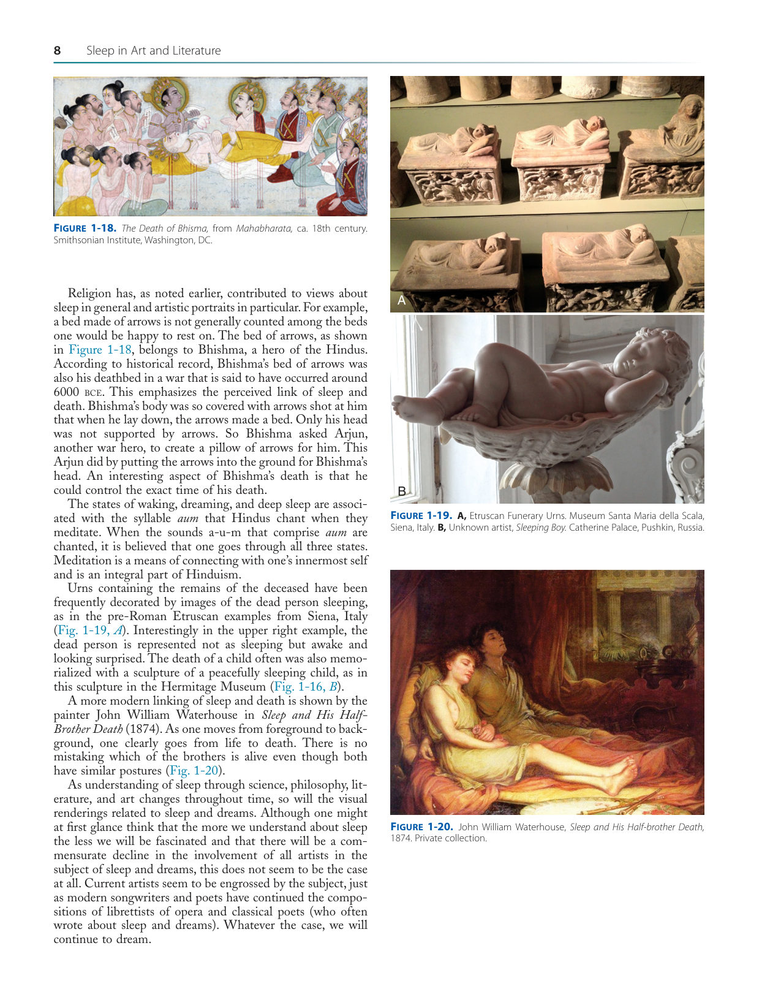

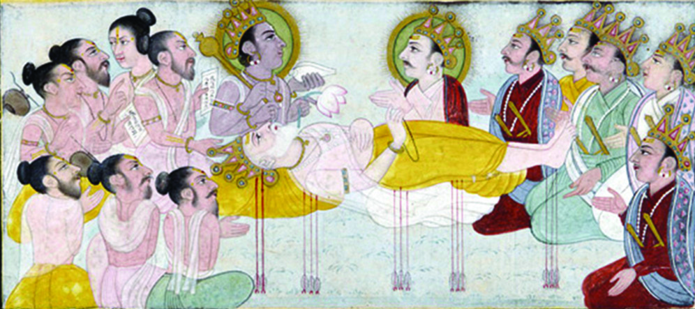

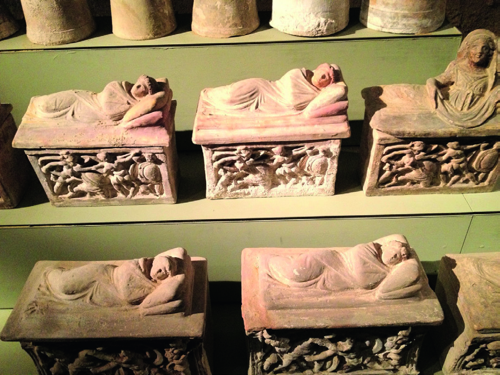

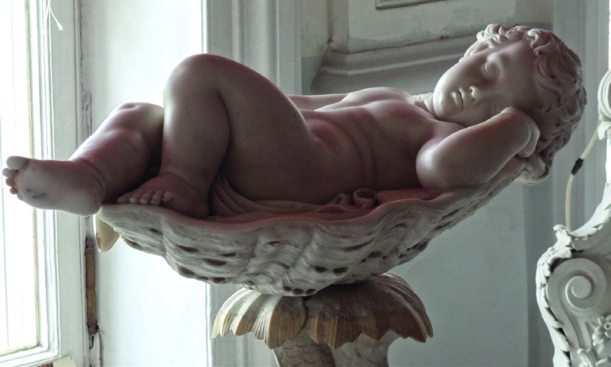

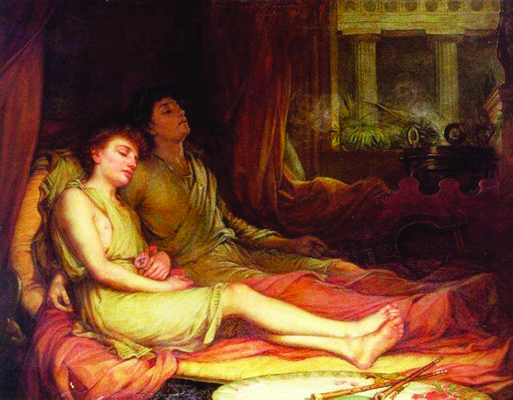

<!-- pdf-page: 27 -->

#### Selected Readings

Adams LS: Art across Time, vol 2. Boston, 1999, McGraw-Hill, pp 523, 582,

Shapiro CM: Who Needs to Sleep Anyway? How Animals Sleep. Windsor,

Ontario, Canada, 1996, Black Moss Press. Shapiro CM, Trajanovic NN, Fedoroff JP: Sexsomnia—A new parasomnia?

862. Arnason HH: History of Modern Art. New York, 1998, Harry N. Abrams. The Art Institute of Chicago: Master Paintings in The Art Institute of Chicago.

Can J Psychiatry 48(5):311–317, 2003. Shapiro CM, Vaccarino K: Sleep in art. In Shapiro CM, editor: Sleep Solutions

Manual, Pointe Claire, Quebec, Canada, 1995, Kommunicom Publications, pp 223–246.

Chicago, 1999, The Art Institute of Chicago, pp 121. Minor VH: Baroque & Rococo: Art & Culture. Englewood Cliffs, N.J., 1999,

Prentice Hall, pp 261. Ruvoldt M: The Italian Renaissance Imagery of Inspiration: Metaphors of Sex,

Sleep and Dreams. Cambridge, England, 2004, Cambridge University Press, pp 40, 94.
