# 3 Biology of Sleep

<!-- pdf-page: 40 -->

## Chapter 3

## Biology of Sleep

## SLEEP MECHANISMS

### Patrick M. Fuller, Phyllis C. Zee, and Orfeu M. Buxton

## 3.1

FIGURE 3.1-1. The basic circuitry, including key “nodes,” that underlies the regulation of sleep and wakefulness and the transitions between these

states in mammals. Current models of wakefulness and sleep hold that wakefulness is maintained by the combined excitatory influence of forebrain-projecting noradrenergic (locus coeruleus), histaminergic (tuberomammillary nucleus), serotoninergic (dorsal raphe), and cholinergic (not shown) cell groups located at or near the mesopontine junction. Sleep, on the other hand, is initiated and maintained by neurons in the median preoptic (MnPO) and ventrolateral preoptic (VLPO) nuclei via inhibitory projections to the more rostrally situated wakefulness-promoting cell groups. Hypocretin (orexin) neurons located in the lateral hypothalamus reinforce activity in the brainstem arousal pathways and also stabilize both sleep and wakefulness. Disruption of the hypocretin system leads to narcolepsy. The suprachiasmatic nuclei (SCN) determine the timing of the sleep-wake cycle and help to “consolidate” these behavioral states. The pineal gland, located in the epithalamus, produces melatonin, a hormone thought to function as a hypnotic signal. The cerebral cortex and medullary brainstem also contain subpopulations of γ-amino butyric acid (GABA)-ergic sleep-active neurons.

#### NERVOUS SYSTEM CONTROL

Although it is generally believed that in sleep, the entire brain is “asleep,” research suggests that sleep may also be a localized process and that the whole brain is not “asleep” at the same time. What is clear is that sleep is an active process, whose timing and length are controlled by structures in the nervous system (Figs. 3.1-1 and 3.1-2).

Sleep Wake

Pineal gland

Regulated by the SCN Site of melatonin production Melatonin production increases before sleep

Medullary GABA neurons

Sleep-active neurons

Lateral hypothalamus

Cells mainly active during wakefulness Orexin neurons Stabilize wakefulness

Tuberomammillary nucleus

Cells mainly active during wakefulness Histamine neurons

#### AROUSAL SYSTEMS

For many years, the nature of the circuitry that subserves the brain regions that promote wake/arousal and sleep remained elusive. The concept evolved that sleep control uses centers and processes that cause arousal and those that promote sleep (Figs. 3.1-3 and 3.1-4; see also Fig. 3.1-1).

Cerebral cortex

Thalamus

Site of sleep spindle generation

Dorsal raphe

Cells mainly active during wakefulness Serotonin neurons

Locus coeruleus

Cells mainly active during wakefulness Norepinephrine neurons

Preoptic area

Ventrolateral preoptic nucleus (VLPO) Median preoptic nucleus (MnPO) Cells active during sleep Galanin (Gal) neurons Gamma aminobutyric acid (GABA) neurons

Suprachiasmatic nucleus

Controls circadian timing of sleep/wakefulness Inputs via retinohypothalamic tract

<!-- pdf-page: 41 -->

A

Th

a

Aq

B

V3

O

A

Cat is comatose

Hy

V4

K.oculomet

FIGURE 3.1-2. An active role for the brain in sleep-wake behavior was first

indicated in 1916, when Baron Constantine von Economo performed a postmortem brain analysis on victims of a viral encephalitis—encephalitis lethargica, or von Economo’s “sleeping sickness”—that profoundly affected sleep-wake regulation. As seen here in the original drawing taken from von Economo’s clinicoanatomic studies, lesions at the junction of the midbrain and posterior hypothalamus (diagonal hatching) produced hypersomnolence. By contrast, lesions of the basal forebrain and anterior hypothalamus (horizontal hatching) produced profound insomnia. Von Economo also observed that lesions between these two sites (arrow), which included the lateral hypothalamic area, caused narcolepsy. O, optic nerve (second cranial nerve); VE, third ventricle; Hy, hypothalamus; Th, thalamus; V4, fourth ventricle; Aq, cerebral aqueduct; K, oculomet, oculomotor nerve (third cranial nerve). (From Von Economo C: Sleep as a problem of localization. J Nerv Ment Dis 1930;71:249–259.)

#### SLEEP-PROMOTING SYSTEMS

Neurons of the ventrolateral preoptic (VLPO) system and adjacent median preoptic nuclei (MnPO) are sleep-active neurons. Loss of VLPO neurons produces profound insomnia and sleep fragmentation (Figs. 3.1-5 and 3.1-6).

#### SLEEP DRIVE

Although significant progress has been made in delineating the neuronal circuitry that controls wakefulness and sleep, the basis of “sleep drive” has remained elusive. Sleep drive has been conceptualized as a homeostatic pressure that builds during the waking period and is dissipated by sleep. This homeostatic process, or “sleep homeostat,” thus represents the need for sleep (Fig. 3.1-7).

#### CONTROL OF RAPID EYE MOVEMENT SLEEP

Rapid eye movement (REM) sleep is a distinct state in which the function of the central nervous system and the autonomic nervous system differs from both wakefulness and non-REM (NREM) sleep (Fig. 3.1-8).

#### CONTROL OF THE TIMING OF SLEEP

In mammals, the circadian clock in the suprachiasmatic nuclei (SCN) of the anterior hypothalamus is critical for establishing

Awake

Asleep

B

Cerebral cortex

Cerebellum

Afferent collaterals

Thalamus

Subthalamus and hypothalamus

Bulb Pons Midbrain

Ascending reticular activating system in brainstem

FIGURE 3.1-3. Top, In 1935, Bremer uncovered evidence of an ascending

arousal system necessary for cortical arousal when he demonstrated that transection of the brainstem at the pontomesencephalic level (cerveau isole, A), but not the spinomedullary junction (encephale isole, B), produced coma in anesthetized cats. Bremer hypothesized that the resulting reduction in “cerebral tone” following the cerveau isole was due to interruption of ascending sensory inputs, that is, a passive deafferentation theory of sleep. Bottom, More than a decade after Bremer’s transection experiments, Moruzzi, a student of Bremer’s, and Magoun demonstrated that electrical stimulation of the rostral pontine reticular formation produced a desynchronized electroencephalogram, an electrophysiologic correlate of the conscious state, in anesthetized cats. Moruzzi and Magoun interpreted their experimental data as evidence for an active “waking center” in the mesopontine reticular formation, essentially refuting the deafferentation theory of sleep. Moruzzi and Magoun called this brainstem system the ascending reticular activating system. (Top, Modified from Bremer F: Bulletin de l’Académie Royale de Belgique 1937;4.)

the circadian rhythm of sleep-wake cycles. Regulation of sleep and wakefulness by the SCN is evident because the sleepwake cycle continues on an approximately 24-hour basis, even when environmental conditions are constant (i.e., in the absence of environmental time cues), but only if the SCN is intact. In humans, a clear circadian variation in sleep propensity and sleep structure has been demonstrated by uncoupling the rest-activity cycle from the output of the circadian pacemaker (Fig. 3.1-9).

<!-- pdf-page: 42 -->

24 Biology of Sleep

Thalamus Thalamus

Thalamus Thalamus

LHA (ORX. MCH) vPAG (DA)

vPAG

LHA (ORX.

LHA vPAG

LHA vPAG

(DA)

MCH)

LDT

LDT

FIGURE 3.1-4. In the 1970s and 1980s, the neurochemistry of several brainstem “arousal” centers was elaborated. A, In the contemporary view, the

ascending arousal system consists of noradrenergic (NE) neurons of the ventrolateral medulla and locus coeruleus (LC), cholinergic neurons (ACh) in the pedunculopontine tegmental/laterodorsal tegmental (PPT/LDT) nuclei, serotonergic (5-hydroxytryptamine [5-HT]) neurons in the dorsal raphe nucleus, dopaminergic neurons (DA) of the ventral periaqueductal gray matter (vPAG), and histaminergic neurons (His) of the tuberomammillary nucleus (TMN). Wakefulness-promoting glutamatergic neurons of the parabrachial nucleus also provide direct innervation of the hypothalamus, basal forebrain (BF), and cerebral cortex. These systems collectively produce cortical arousal via two pathways: a dorsal route through the thalamus and a ventral route through the hypothalamus and BF. The latter pathway receives contributions from the hypocretin (orexin, ORX) and melanin-concentrating hormone (MCH) neurons of the lateral hypothalamic area (LHA) as well as from γ-amino butyric acid (GABA)-ergic or cholinergic neurons of the BF. Note that all these ascending pathways traverse the region at the midbraindiencephalic junction, where von Economo observed that lesions caused hypersomnolence. As shown here, several putative brainstem arousal centers were identified and characterized nearly 30 years ago. It nevertheless remained unclear for many years how this arousal system was “turned off” so that sleep could be initiated and maintained. B, Although work by W.J.A. Nauta in 1946 provided support for the concept of sleep-promoting circuitry in the anterior hypothalamus/ preoptic area, it was not until the mid-1990s that the identity of this sleep-promoting circuitry was revealed. In these investigations, it was demonstrated that the median preoptic nucleus and ventrolateral preoptic nucleus (VLPO) contain sleep-active cells, the latter of which contains the inhibitory neurotransmitters GABA and galanin (Gal). The VLPO (open orange circle) projects to all the main components of the ascending arousal system. Inhibition of the arousal system by the VLPO during sleep is critical for the maintenance and consolidation of sleep. Recent work has revealed a node of GABAergic neurons in the parafacial zone of the rostral medulla that are also sleep active.

VLPO (Gal, GABA) LDT (ACh)

VLPO (Gal, GABA) LDT (ACh)

PPT (ACh)

PPT (ACh)

BF (ACh GABA) TMN (His) Raphe (5-HT)

BF (ACh

TMN (His) Raphe

GABA)

(5-HT)

LC (NE) LC

LC (NE) LC

Hypothalamus

Hypothalamus Hypothalamus

Pons

Medulla

A B

PPT

PPT

TMN

TMN

Raphe

Raphe

Cerebellum Cerebellum

Cerebellum Cerebellum

Hypothalamus

Pons

Medulla

FIGURE 3.1-5. The main sleep-promoting pathways from the ventrolateral preoptic nuclei (VLPO) and median preoptic nucleus (MnPO) inhibit the components

of the ascending arousal pathways in both the hypothalamus and the brainstem, including awake-active noradrenergic neurons of the ventrolateral medulla and locus coeruleus (LC), cholinergic neurons in the pedunculopontine tegmental/laterodorsal tegmental nuclei, serotonergic neurons in the dorsal raphe nucleus, dopaminergic neurons of the ventral periaqueductal gray matter, histaminergic neurons of the tuberomammillary nucleus (TMN), and glutamatergic neurons of the parabrachial nucleus. This interaction between the VLPO and MnPO and components of the arousal system is, to a large degree, mutually inhibitory, and as such these pathways function analogously to an electronic “flip” switch/circuit. By virtue of the self-reinforcing nature of these switches—that is, when each side is firing, it reduces its own inhibitory feedback—the flip switch is inherently stable in either end state, but it avoids intermediate states. The flip design thus ensures stability of the behavioral state and facilitates rapid switching between behavioral states. The LH (lateral hypothalamic) orexin (hypocretin) neurons likely play a stabilizing role for the switch. Specifically, it appears that LH orexin neurons actively reinforce monoaminergic arousal tone. The position of the orexin neurons outside the flip switch permits them to stabilize the behavioral state by reducing transitions during both sleep and wakefulness. Narcoleptic humans or animals that lack orexin have increased transitions in both states. VLPOex, extended ventrolateral preoptic nucleus; VLPOc, core ventrolateral preoptic nucleus. (Modified from Fuller PM, Gooley JJ, Saper CB: Neurobiology of the sleep-wake cycle: sleep architecture, circadian regulation, and regulatory feedback. J Biol Rhythms 2006; 21[6]:482–493.)

Sleep

VLPOc VLPOex

Homeostatic sleep drive Circadian “hypnotic” signal

VLPOc VLPOex

Orexin

TMN LC-raphe

Awake Orexin

TMN LC-raphe

Circadian “alerting” signal

<!-- pdf-page: 43 -->

Cx

RE

TC

FIGURE 3.1-6. During cortical arousal, the electroencephalogram directly reflects the collective synaptic potentials of inputs, largely to pyramidal

cells within the neocortex and hippocampus. The thalamocortical (TC) system has been widely considered to be a major source of this activity. In turn, the overall level of activity in the TC system is thought to be regulated by the ascending arousal system. Today, it is generally accepted that a brainstem cholinergic activating system, located in the pedunculopontine tegmental (PPT) and laterodorsal tegmental (LDT) nuclei (green circles), induces tonic and phasic depolarization effects on TC neurons to produce the low-voltage, mixed-frequency, fast activity of the waking and rapid eye movement (REM) sleep electroencephalogram (EEG). The PPT and LDT cease firing during non-REM (NREM) sleep, which hyperpolarizes the TC neurons to produce two important effects: 1) sensory transmission through the thalamus (Th) to the cortex is blocked; and 2) oscillatory activity between TC neurons, cortical neurons (Cx), and reticular thalamus (RE) neurons (inset) is unmasked to manifest several characteristics of the sleep EEG—slow-wave activity (0.5 to 4 Hz) and spindles. Thus the thalamus appears to be a critical relay for the ascending arousal system for “gating” sensory transmission to the cortex during sleep and wakefulness. In addition to the thalamus, a critical “relay” role for the basal forebrain in maintaining electrocortical and neurobehavioral arousal has also recently been demonstrated.

Th

LDT/PPT control of thalamocortical circuit

LDT

PPT

FIGURE 3.1-7. The cellular determinant of homeostatic sleep drive is unknown, although a putative endogenous somnogen, adenosine, is believed

to play a critical role. A, Adenosine is a naturally occurring purine nucleoside. It is hypothesized that adenosine accumulates during wakefulness, and upon reaching sufficient concentrations, it inhibits neural activity in wake-promoting circuitry of the basal forebrain (BF) via A1 receptors located on BF cholinergic neurons. It is likely that it activates sleep-promoting ventrolateral preoptic nuclei (VLPO) neurons, via A2A receptors, located adjacent to the BF. A role for adenosine and BF cholinergic neurons in sleep homeostasis has recently been challenged by Blanco-Centurion and colleagues. B, Mean BF extracellular adenosine values by hour during 6 hours of prolonged wakefulness and in the subsequent 3 hours of spontaneous recovery sleep in cats. Microdialysis values in the six animals are normalized relative to the second hour of wakefulness. MnPO, median preoptic nucleus. (Data from Porkka-Heiskanen T, Strecker RE, Thakkar M, et al: Adenosine: a mediator of the sleep-inducing effects of prolonged wakefulness. Science 1997;276[5316]:1265–1268.)

MnPO

BF

Cholinergic neurons

VLPO

A1

A2A

Prolonged waking B A

Adenosine

250

Adenosine (% of hour 2)

200

150

100

50

0 2 3 4 5 6 1 2 3 (hours)

1

Recovery

<!-- pdf-page: 44 -->

26 Biology of Sleep

SLD/PC (REM-on)

FIGURE 3.1-8. In this contemporary model of rapid eye movement (REM) sleep and non-REM sleep switching, two populations of mutually inhibitory

neurons in the upper pons form a switch for controlling transitions between REM and NREM (A) sleep. γ-Aminobutyric acid (GABA)-ergic ventrolateral periaqueductal gray matter (vlPAG , light green) neurons and laterodorsal tegmental/pedunculopontine (LPT/PPT, light green) neurons fire during non-REM states to inhibit entry into REM sleep, during which these neurons are inhibited by a population of GABAergic REM sleep–active neurons in the sublaterodorsal region (SLD; red). This mutually inhibitory relationship produces a REM-NREM flip switch, promoting rapid and complete transitions between these states. The core REM sleep switch is, in turn, modulated by other neurotransmitter systems (B). Noradrenergic neurons in the locus coeruleus (LC) and serotonergic neurons in the dorsal raphe (DR; dark green) inhibit REM sleep by actions on both sides of the flip switch (exciting REM-off neurons and inhibiting REM-on neurons); during REM sleep, they are silent (dashed lines), whereas cholinergic neurons (blue) promote REM sleep by having opposite actions on the same two neuronal populations. The hypercretin (orexin) neurons inhibit entry into REM sleep by exciting neurons in the REM-off population (and by presynaptic effects that excite monoaminergic terminals), whereas the ventrolateral preoptic nuclei (VLPO) neurons promote entry into REM sleep by inhibiting this same target. During REM sleep (C), a separate population of glutamatergic neurons in the SLD (red) activates a series of inhibitory interneurons in the medulla and spinal cord, which inhibit motor neurons and thereby produce the atonia of REM sleep. Withdrawal of tonic excitatory input from the REM-off regions may also contribute to the loss of muscle tone. At the same time, ascending projections from glutamatergic neurons in the parabrachial (PB) nucleus and pre-coeruleus (PC) area activate forebrain pathways that drive EEG desynchronization and hippocampal theta rhythms, thus producing the characteristic EEG signs of REM sleep. BF, basal forebrain; EEG, electroencephalogram. (Modified from Saper CB, Fuller PM, Pedersen NP, Lu J, Scammell TE: Sleep state switching. Neuron 2010;68[6]:1023–1042.)

vIPAG/LPT (REM-off)

A

orexin VLPO

vIPAG/LPT (REM-off)

B

REM EEG

BF

vIPAG/LPT (REM-off)

Medullary interneurons

REM atonia

C

LDT/PPT (REM-on)

LC/DR

SLD/PC (REM-on)

SLD/PC (REM-on)

Spinal interneurons

Motor neurons

<!-- pdf-page: 45 -->

FIGURE 3.1-9. The circadian rhythm of sleep-wake cycles is likely regulated at multiple levels in the hypothalamus. Top, A coronal section of the brain

shows the location (box) of the rat suprachiasmatic nucleus (SCN). A, The circadian clock in the SCN sends an indirect projection to the dorsomedial hypothalamic nucleus (DMH) via the subparaventricular zone (SPZ), which is critical for the circadian rhythm of sleep-wake cycles. The DMH, in turn, provides rhythmic output to brain regions critical for the regulation of sleep and wakefulness, hormone synthesis and release, and feeding. B, This multistage regulation of circadian behavior in the hypothalamus allows for the integration of multiple time cues from the environment to shape daily patterns of sleep and wakefulness. 5-HT, 5-hydroxytryptamine (serotonin); CRH, corticotrophin-releasing hormone; dSPZ, dorsal subparaventricular zone; GABA, γ-amino butyric acid; glu, glutamate; IGL, intergeniculate leaflet; LHA, lateral hypothalamic area; MCH, melanin-concentrating hormone; MRN, median raphe nucleus; NPY, neuropeptide Y; PACAP, pituitary adenylate cyclase-activating polypeptide; PVH, paraventricular hypothalamic nucleus; TRH, thyrotropin-releasing hormone; VLPO, ventrolateral preoptic nucleus; vSPZ, ventral subparaventricular zone. (Modified from Fuller PM, Gooley JJ, Saper CB: Neurobiology of the sleep-wake cycle: sleep architecture, circadian regulation, and regulatory feedback. J Biol Rhythms 2006;21[6]:482–493.)

dSPZ GABA

VLPO vSPZ

A

SCN

Melatonin

Light Sleep-wake state

glu PACAP

vSPZ

NPY, GABA

SCN

B

5-HT

Wakefulness, feeding Corticosteroid release

CRH

PVH

orexin MCH Sleep

glu

LHA

TRH

DMH

PVH

dSPZ

Feeding cues

DMH

IGL, MRN

Locomotor activity

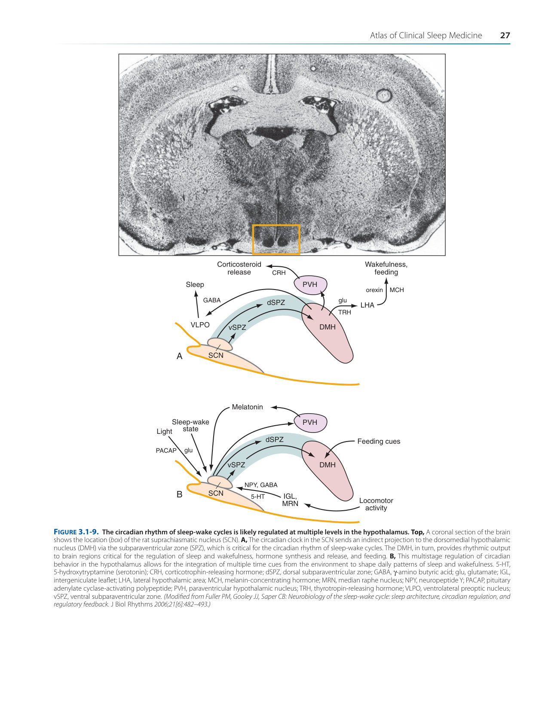

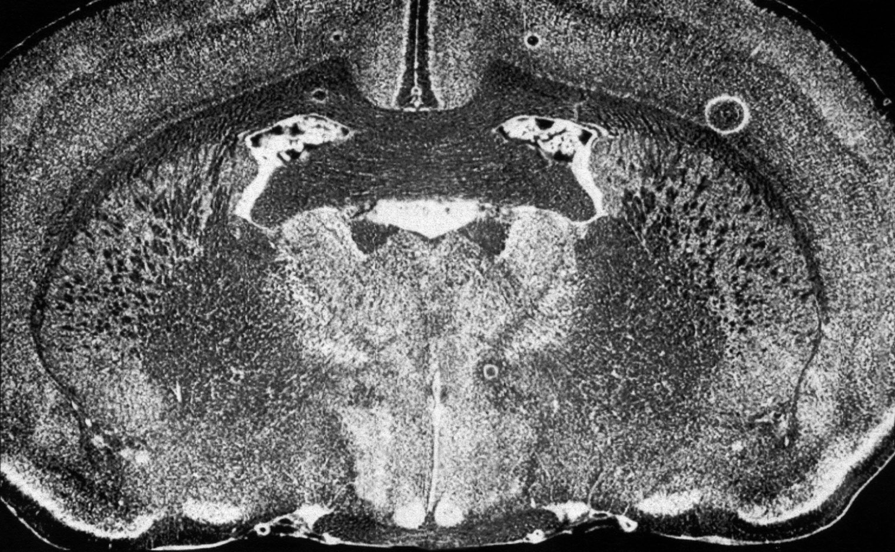

<!-- pdf-page: 46 -->

28 Biology of Sleep

#### Selected Readings

Anaclet C, Lin JS, Vetrivelan R, et al: Identification and characterization of

Lu J, Sherman D, Devor M, Saper CB: A putative flip-flop switch for control

of REM sleep. Nature 441(7093):589–594, 2006. Morairty S, Rainnie D, McCarley R, Greene R: Disinhibition of ventrolateral

a sleep-active cell group in the rostral medullary brainstem. J Neurosci 32(50):17970–17976, 2012. Basheer R, Strecker RE, Thakkar MM, McCarley RW: Adenosine and

preoptic area sleep-active neurons by adenosine: a new mechanism for sleep promotion. Neuroscience 123(2):451–457, 2004. Moruzzi G, Magoun H: Brainstem reticular formation and activation of the

sleep-wake regulation. Prog Neurobiol 73(6):379–396, 2004. Blanco-Centurion C, Xu M, Murillo-Rodriguez E, et al: Adenosine and sleep

EEG. Electroencephalogr Clin Neurophysiol 1:455–473, 1949. Nauta WJH: Hypothalamic regulation of sleep in rats: experimental study.

homeostasis in the basal forebrain. J Neurosci 26(31):8092–8100, 2006. Bremer F: Cerveau “isole” et physiologie du sommeil. Comptes Rendus de la

J Neurophysiol 9:285–316, 1946. Sherin JE, Elmquist JK, Torrealba F, Saper CB: Innervation of histaminergic

Société de Biologie (Paris) 118:1235–1241, 1935. Bremer F: Preoptic hypnogenic area and reticular activating system. Arch Ital

## LOCALIZATION AND NEUROCHEMISTRY OF SLEEP-WAKE

## PHYSIOLOGY AND PATHOPHYSIOLOGY

### Pierre-Hervé Luppi and Patrice Fort

## 3.2

Biol 111:85–111, 1973. Edgar DM, Dement WC, Fuller CA: Effect on SCN lesions on sleep in

squirrel monkeys: processes in sleep-wake regulation. J Neurosci 13(3):1065– 1079, 1993. Fuller PM, Sherman D, Pedersen NP, Saper CB, Lu J: Reassessment of the

structural basis of the ascending arousal system. J Comp Neurol 519(5):933– 956, 2011. Gerashchenko D, Wisor JP, Burns D, et al: Identification of a population of

sleep-active cerebral cortex neurons. Proc Natl Acad Sci U S A 105(29):10227– 10232, 2008.

tuberomammillary neurons by GABAergic and galaninergic neurons in the ventrolateral preoptic nucleus of the rat. J Neurosci 18(12):4705–4721, 1998. Sherin JE, Shiromani PJ, McCarley RW, Saper CB: Activation of

ventrolateral preoptic neurons during sleep. Science 271(5246):216–219, 1996. Steriade M, McCormick DA, Sejnowski TJ: Thalamocortical oscillations in

the sleeping and aroused brain. Science 262:679–685, 1993. Von Economo C: Sleep as a problem of localization. J Nerv Ment Dis 71:249–

259, 1930.

This subchapter outlines the mechanisms responsible for the succession of the three vigilance states: waking, rapid eye movement (REM, paradoxical) sleep, and non-REM (NREM, slow wave) sleep over a 24-hour period. The latest hypothesis on the mechanisms by which brain activity switches from an activated state during waking to a synchronized state during NREM sleep and to the activated state of REM sleep is presented.

It is proposed that the activated cortical state during waking is induced by the activity of multiple waking systems, including the serotonergic, noradrenergic, cholinergic, and hypocretin systems located at different subcortical levels. In contrast, the neurons inducing NREM sleep are all localized in a single small nucleus called the ventrolateral preoptic nucleus (VLPO), which is situated above the optic chiasm and the median preoptic nucleus (MnPo) located medially. These neurons all contain the inhibitory neurotransmitter γ-aminobutyric acid (GABA). The notion that the switch from waking to NREM sleep is due to the inhibition of the waking systems by the VLPO sleep-active GABAergic neurons is introduced.

At the onset of sleep, the sleep neurons are activated by the circadian clock localized in the suprachiasmatic nucleus (SCN) and a hypnogenic factor, adenosine, which progressively accumulates in the brain during waking. The switch from NREM to REM sleep is due to the activation of glutamatergic neurons located in the sublaterodorsal tegmental nucleus (SLD), which is inhibited during waking and NREM sleep by GABAergic neurons located in the ventrolateral periaqueductal gray matter (vlPAG).

#### WAKEFULLNESS

It is now clear that waking is induced and maintained by multiple redundant neuronal systems localized from the medulla oblongata to the forebrain.

#### NREM SLEEP-PROMOTING SYSTEMS

Only one population of neurons is involved in NREM sleep induction and maintenance. GABAergic neurons of the VLPO system are specifically active during NREM sleep. They induce and maintain NREM sleep by inhibitory projections to the different populations of waking neurons.

#### SLEEP HOMEOSTASIS

The neuronal network responsible for the three vigilance states is quite well known. However, the mechanisms at the origin of the switch between states is still unknown, and the mechanisms at the origin of the homeostatic pressure for NREM and REM sleep that builds up during long waking periods have not been identified.

#### REM SLEEP–PROMOTING SYSTEMS

In contrast to NREM sleep, REM sleep is generated by neurons located in the brainstem. Nevertheless, recent studies have shown that hypothalamic neurons control REM sleep by descending projections.

#### CIRCADIAN RHYTHM

The sleep-waking cycle of most animals is coupled with the light-dark cycle. Such coupling is under the control of the SCN located in the anterior hypothalamus. The SCN is an endogenous clock entrained by excitatory projections arising from specialized light-sensitive neurons of the retina.

<!-- pdf-page: 47 -->

#### EXPLANATORY DIAGRAMS

A putative endogenous somnogen, adenosine, is believed to play a critical role in the induction and maintenance of sleep. Adenosine is a naturally occurring purine nucleoside. It is hypothesized that adenosine progressively accumulates during waking and inhibits either directly cortical neurons— the wake-active cholinergic neurons of the BF (via A1 receptors)—or activates the NREM-active neurons of the VLPO neurons (via A2A receptors).

FIGURE 3.2-1. Network responsible for the waking state. 5HT, serotonin; AD, adenosine; Ach, acetylcholine; BF, basal forebrain; DPGi, dorsal paragigantocel­

lular reticular nucleus; dDpMe, dorsal deep mesencephalic reticular nucleus; DRN, dorsal raphe nucleus; GABA, γ-aminobutyric acid; GiV, ventral gigantocellular reticular nucleus; Glu, glutamate; Gly, glycine; HIS, histamine; Hcrt, hypocretin (orexin)-containing neurons; LC, locus coeruleus; Ldt, laterodorsal tegmental nucleus, LPGi, lateral paragigantocellular reticular nucleus; MCH, melanin-concentrating hormone; NE, norepinephrine; PH, posterior hypothalamus; PPT, pedunculopontine nucleus; REM, rapid eye movement sleep; SCN, suprachiasmatic nucleus; SLD, sublaterodorsal nucleus; SWS, slow-wave sleep; TMN, tuberomammillary nucleus; vlPAG, ventrolateral periaqueductal gray matter; VLPO, ventrolateral preoptic nucleus; Wk, wakefulness.

#### The Waking State

Figure 3.2-1 shows the network responsible for the waking

state. Waking state (Wk-on) neurons activate the cortex either directly or by means of a relay in the intralaminar thalamic nuclei.1-3 Direct pathways from the noradrenergic and serotonergic neurons to the cortex contributing to the waking state are not represented for sake of clarity of the figure. During the waking state, REM-off GABAergic neurons located in the vlPAG and the dorsal part of the deep mesencephalic nucleus (dDPMe) tonically inhibit SLD glutamatergic neurons. These REM-off GABAergic neurons are excited by monoaminergic and hypocretin inputs.

#### NREM Sleep

In contrast to the complex and extensive neurochemical network involved in waking, the neurons inducing NREM sleep are localized in the lateral preoptic area and the adjacent basal forebrain (BF; Fig. 3.2-2). As previously mentioned, a cluster of these neurons is localized in the VLPO. It has been demonstrated in rats that lesions including the VLPO induce insomnia for up to several weeks.4 The GABAergic neurons of the VLPO are active specifically during slow-wave sleep.5,6 Sherin and colleagues7 identified a population of neurons in the VLPO that showed expression of the proto-oncogene c-Fos, a marker of neuronal activation following recovery sleep in previously sleep-deprived rats.8

Waking

Intralaminar thalamic nuclei

Hcrt PH

AD BF Ach

MCH/GABA

SCN

VLPO GABA TMN HIS

ADA

Wk-on neurons

Wk/REM-on neurons

SWS-on neurons

REM-on neurons

REM-off neurons

Based on all data available, a reciprocal interaction of wakepromoting and NREM sleep-promoting neurons across the sleep-wake cycle has been suggested. This theory is supported by in vitro pharmacologic studies in rat brain slices that revealed that VLPO neurons are indeed inhibited by most of the waking transmitters.9 VLPO and MnPo neurons would be tonically inhibited by noradrenergic and cholinergic inputs during waking. At the onset of sleep, the GABAergic sleep neurons of the VLPO and the MnPo would be activated by the circadian clock, which is localized in the SCN, and the hypnogenic factor adenosine, which progressively accumulates in the brain during waking. The effect of this accumulation of adenosine is the target for one of the most commonly used psychoactive drugs, caffeine,10 which acts via antagonism of the A1 and A2A adenosine receptors. In turn, these sleep-active neurons begin to inhibit the wake-active neurons in the multiple arousal centres via the neurotransmitter GABA, leading to synchronization of the thalamocortical network. The decrease in sensory inputs is also necessary to let sleep occur since waking systems are excited by them.

CORTICAL ACTIVATION

vlPAG dDPMe GABA

GABA

Ldt PPT Ach

DRN 5HT

LC NE

DPGi GABA

SLD Glu Glu

GiV/LPGi

Gly/GABA

Inhibitory pathways

Adenosine A1 receptors

Excitatory pathways

Adenosine A2A receptors

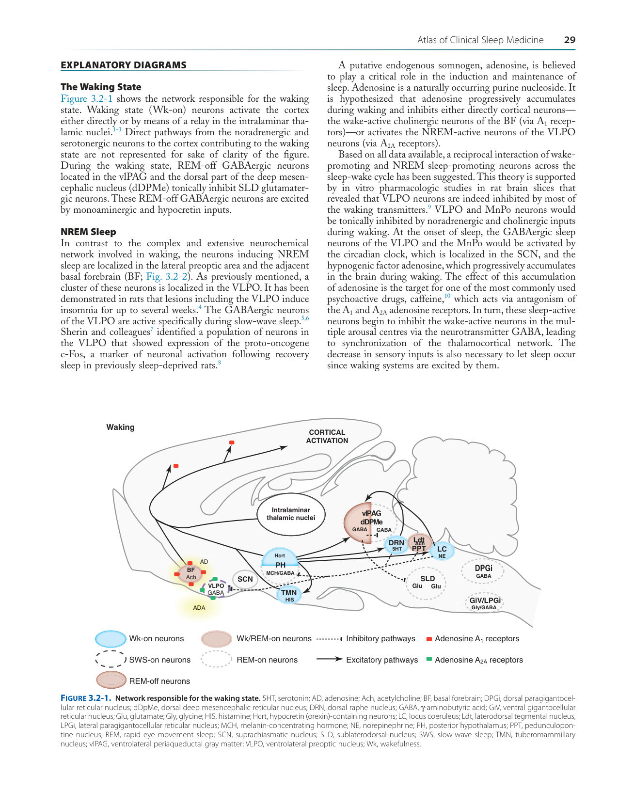

<!-- pdf-page: 48 -->

30 Biology of Sleep

Slow-wave sleep

CORTICAL SYNCHRONIZATION

AD

AD

Reticular thalamic nuclei

FIGURE 3.2-2. Network responsible for non–rapid eye movement (REM) sleep. 5HT, serotonin; AD, adenosine; Ach, acetylcholine; BF, basal forebrain; DPGi,

dorsal paragigantocellular reticular nucleus; dDpMe, dorsal deep mesencephalic reticular nucleus; DRN, dorsal raphe nucleus; GABA, γ-aminobutyric acid; GiV, ventral gigantocellular reticular nucleus; Glu, glutamate; Gly, glycine; Hcrt, hypocretin- (orexin) containing neurons; HIS, histamine; LC, locus coeruleus; Ldt, laterodorsal tegmental nucleus, LPGi, lateral paragigantocellular reticular nucleus; MCH, melanin-concentrating hormone; NE, norepinephrine; PH, posterior hypothalamus; PPT, pedunculopontine nucleus; SCN, suprachiasmatic nucleus; SLD, sublaterodorsal nucleus; SWS, slow-wave sleep; TMN, tuberomammillary nucleus; vlPAG, ventrolateral periaqueductal gray matter; VLPO, ventrolateral preoptic nucleus; Wk, wakefulness.

Hcrt PH

AD

MCH/GABA

BF Ach

VLPO SCN

TMN HIS

GABA

AD

Wk-on neurons

Wk/REM-on neurons

SWS-on neurons

REM-on neurons

REM-off neurons

vlPAG dDPMe GABA

GABA

Ldt PPT Ach

DRN 5HT

LC NE

DPGi GABA

SLD Glu Glu

GiV/LPGi

Gly/GABA

Inhibitory pathways

Adenosine A1 receptors

Adenosine A2A receptors

Excitatory pathways

In summary, VLPO and MnPo GABAergic neurons would be inhibited by noradrenergic and cholinergic inputs during waking. The majority would start firing at sleep onset (drowsiness) in response to excitatory, homeostatic (adenosine), and circadian drives (suprachiasmatic input). These activated neurons, through the reciprocal GABAergic inhibition of all wake-promoting systems, would be in a position to suddenly unbalance the “flip-flop” network, as required for switching from wakefulness (drowsiness) to a consolidation of NREM sleep. Conversely, the slow removal of excitatory influences would result in a progressive firing decrease in VLPO neurons and therefore an activation of wake-promoting systems leading to the awakening event.

#### Pontine Generator in REM Sleep

It was first shown that REM sleep persists after decortication, cerebellar ablation, or brainstem transections rostral to the pons. In contrast, transection at the posterior limit of the pons suppressed REM sleep.11 It was then demonstrated that a state resembling REM sleep is still visible in the “pontine cat,” a preparation in which all the structures rostral to the pons have been removed (Fig. 3.2-3).11 These results indicated that brainstem structures are necessary and sufficient to trigger and maintain the state of REM sleep, a concept still valid today. By using electrolytic and chemical lesions, it was then evidenced that the dorsal part of the pontis oralis (PnO) and caudalis (PnC) nuclei contains the neurons responsible for

REM sleep onset.11 Furthermore, bilateral injections in cats of a cholinergic agonist (carbachol) into the dorsal area of PnO and PnC (also named peri-locus coeruleus-α), pontine inhibitory area, subcoeruleus nucleus, and, more recently, the SLD in rats dramatically increases REM sleep quantities in cats.12 It was then shown by unit recordings in freely moving cats that many SLD neurons show a tonic firing selective to REM sleep (called “REM-on” neurons).12 It was believed that SLD REM-on neurons are cholinergic until we recently showed that they are glutamatergic.12

#### Network Responsible for REM Sleep

REM sleep onset is due to the activation of glutamatergic REM-on neurons localized in the SLD (Fig. 3.2-4). During wakefulness and NREM sleep, these REM-on neurons are inhibited by a tonic inhibitory GABAergic tone originating from REM-off neurons localized in the vlPAG and the dDpMe. These neurons would be activated during wakefulness by the hypocretin (orexin)-containing (Hcrt) neurons and the monoaminergic neurons. The onset of REM sleep is due to the activation by intrinsic mechanisms of REM-on GABAergic neurons localized in the posterior lateral hypothalamic area, the dorsal paragigantocellular reticular nucleus (DPGi), and the vlPAG. These neurons also inactivate the REM-off monoaminergic neurons during REM sleep. The disinhibited ascending SLD REM-on neurons in turn induce cortical activation via their projections to intralaminar

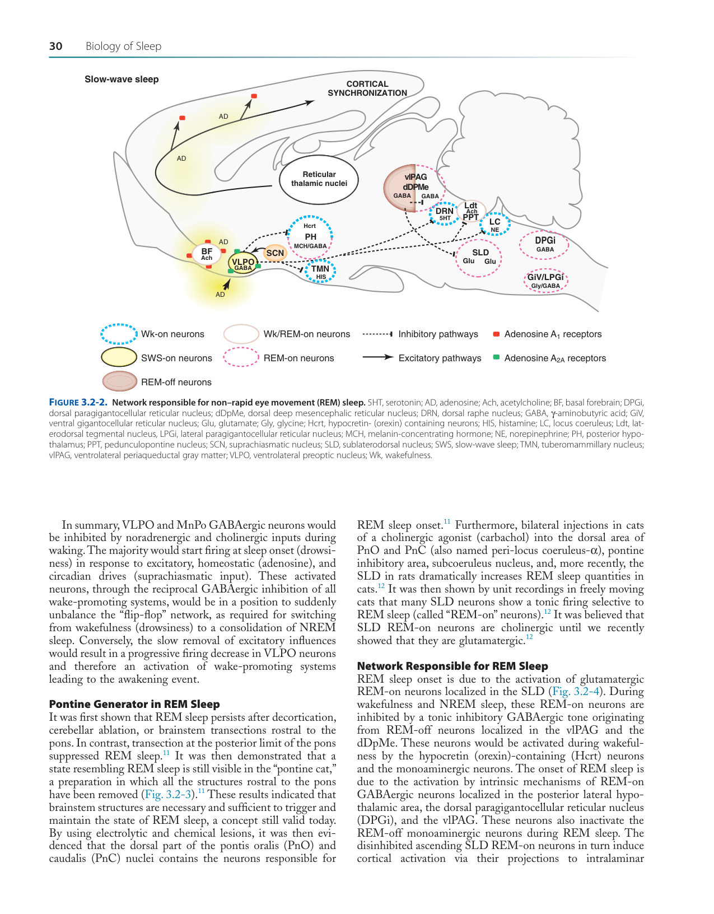

<!-- pdf-page: 49 -->

Waking

EMG

FRP

MY

C

SLD

Paradoxical sleep

EMG

FIGURE 3.2-3. Localization of the pontine generator responsible for rapid eye movement sleep (paradoxical [PS] sleep). A, Sagittal section of the brain

of a pontine cat. B, During PS, the cats display atonia in contrast during waking, as shown in the two photos on the left. C, Recordings of the electromyogram (EMG), local field potential in the pontine reticular formation (FRP), and ocular movements (MY) during waking and paradoxical sleep. D, Hypnograms of normal (a), pontine (b), and sectioned (c) cats. SLD, sublaterodorsal tegmental nucleus. (Modified from Jouvet M: Research on the neural structures and responsible mechanisms in different phases of physiological sleep [in Italian]. Arch Ital Biol 1962;100:125–206.)

A

B

FRP

MY

a

1 2 3 4

b

c

a: Intact animal b: Total decortication (pontine cat) c: Mesencephalic section

D

SWS-on neurons Adenosine A2A receptors

Paradoxical (REM) sleep

AD

AD

Intralaminar thalamic nuclei

Hcrt PH

MCH/GABA

VLPO SCN

BF Ach

GABA

TMN HIS

Wk-on neurons

REM-on neurons

CORTICAL ACTIVATION

vlPAG dDPMe GABA GABA

Ldt PPT Ach

DRN

LC NE

5HT

DPGi GABA

SLD Glu Glu

GiV/LPGi

Gly/GABA

Spinal motor neurons

Inhibitory pathways

Adenosine A1 receptors Wk/REM-on neurons

Excitatory pathways

Muscle atonia

FIGURE 3.2-4. Network responsible for rapid eye movement sleep (REM). 5HT, serotonin; AD, adenosine; Ach, acetylcholine; BF, basal forebrain; DPGi, dorsal

paragigantocellular reticular nucleus; dDpMe, dorsal deep mesencephalic reticular nucleus; DRN, dorsal raphe nucleus; GABA, γ-aminobutyric acid; GiV, ventral gigantocellular reticular nucleus; Glu, glutamate; Gly, glycine; Hcrt, hypocretin- (orexin) containing neurons; HIS, histamine; LC, locus coeruleus; Ldt, laterodorsal tegmental nucleus, LPGi, lateral paragigantocellular reticular nucleus; MCH, melanin concentrating hormone; NE, norepinephrine; PH, posterior hypothalamus; PPT, pedunculopontine nucleus; SCN, suprachiasmatic nucleus; SLD, sublaterodorsal nucleus; SWS, slow-wave sleep; TMN, tuberomammillary nucleus; vlPAG, ventrolateral periaqueductal gray matter; VLPO, ventrolateral preoptic nucleus; Wk, wakefulness.

REM-off neurons

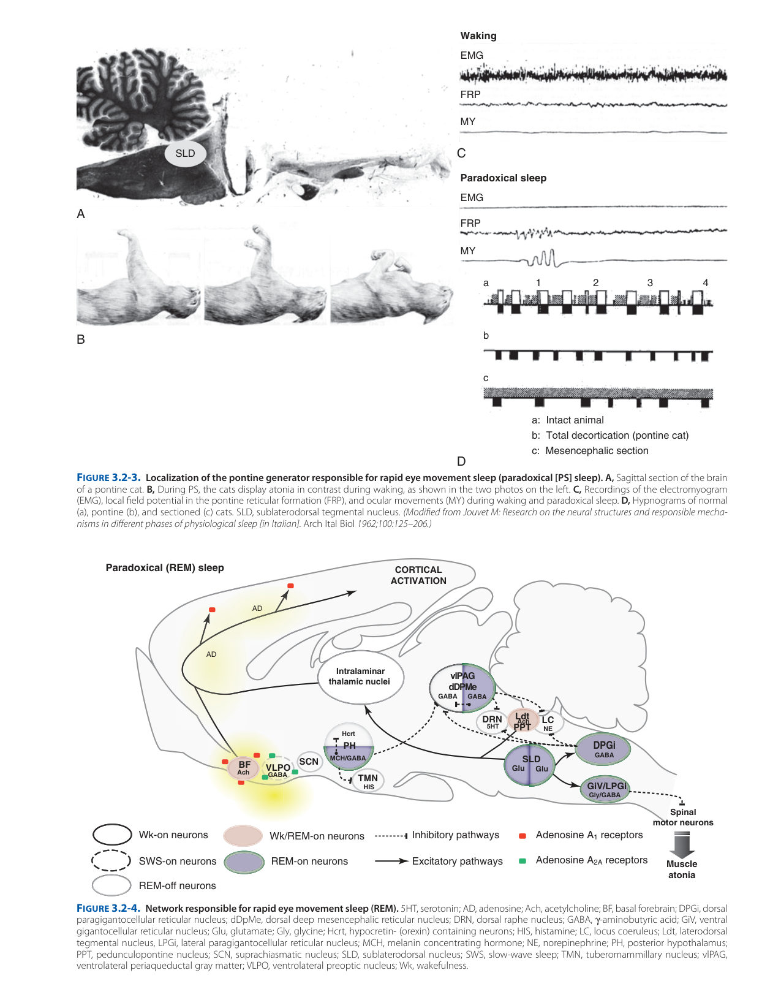

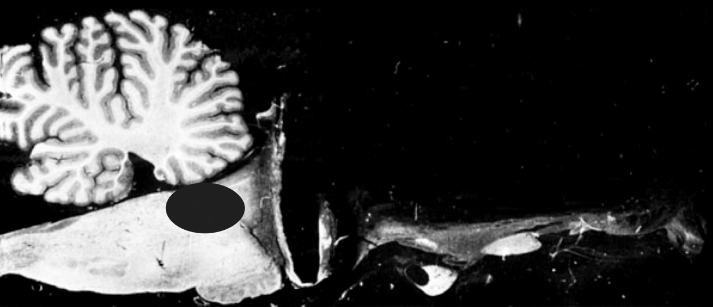

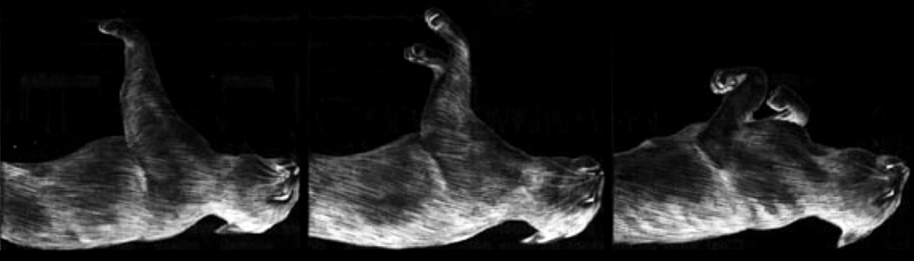

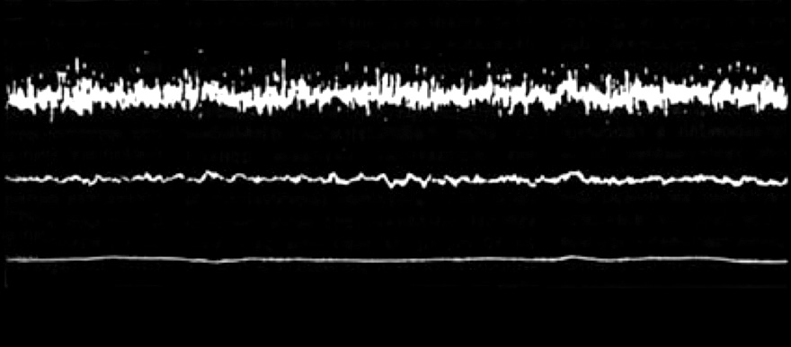

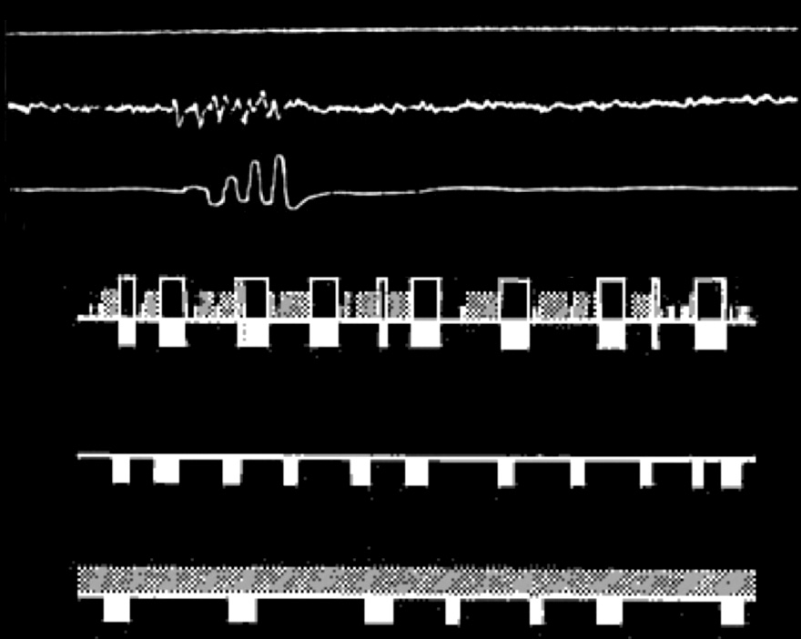

<!-- pdf-page: 50 -->

32 Biology of Sleep

Idiopathic RBD

CORTICAL ACTIVATION

Motor cortex

Intralaminar thalamic nuclei

FIGURE 3.2-5. Network responsible for rapid eye movement (REM) sleep during idiopathic REM sleep behavior disorder (RBD). 5HT, serotonin; Ach,

acetylcholine; BF, basal forebrain; DPGi, dorsal paragigantocellular reticular nucleus; dDpMe, dorsal deep mesencephalic reticular nucleus; DRN, dorsal raphe nucleus; GABA, γ-aminobutyric acid; GiV, ventral gigantocellular reticular nucleus; Glu, glutamate; Gly, glycine; Hcrt, hypocretin- (orexin) containing neurons; HIS, histamine; LC, locus coeruleus; Ldt, laterodorsal tegmental nucleus, LPGi, lateral paragigantocellular reticular nucleus; MCH, melanin-concentrating hormone; NE, norepinephrine; PH, posterior hypothalamus; PPT, pedunculopontine nucleus; SLD, sublaterodorsal nucleus; TMN, tuberomammillary nucleus; vlPAG, ventrolateral periaqueductal gray matter; Wk, wakefulness.

Hcrt PH

MCH/GABA

BF Ach

TMN HIS

Wk-on neurons

Degenerating neurons

Wk/REM-on neurons

vlPAG dDPMe GABA GABA

Ldt PPT Ach

DRN

LC NE

5HT

DPGi GABA

SLD Glu Glu

GiV/LPGi

Gly/GABA

Spinal motor neurons

REM-on neurons

Inhibitory pathways

Movements

Excitatory pathways

REM-off neurons

FIGURE 3.2-6. Network responsible for rapid eye movement (REM) sleep during REM sleep disorder (RBD) in narcoleptics. 5HT, serotonin; Ach, acetyl­

choline; BF, basal forebrain; DPGi, dorsal paragigantocellular reticular nucleus; dDpMe, dorsal deep mesencephalic reticular nucleus; DRN, dorsal raphe nucleus; GABA, γ-aminobutyric acid; GiV, ventral gigantocellular reticular nucleus; Glu, glutamate; Gly, glycine; Hcrt, hypocretin (orexin)-containing neurons; HIS, histamine; LC, locus coeruleus; Ldt, laterodorsal tegmental nucleus, LPGi, lateral paragigantocellular reticular nucleus; MCH, melanin concentrating hormone; NE, norepinephrine; PH, posterior hypothalamus; PPT, pedunculopontine nucleus; SCN, suprachiasmatic nucleus; SLD, sublaterodorsal nucleus; SWS, slow-wave sleep; TMN, tuberomammillary nucleus; vlPAG, ventrolateral periaqueductal gray matter; VLPO, ventrolateral preoptic nucleus; Wk, wakefulness.

RBD in narcoleptics

CORTICAL ACTIVATION

Motor cortex

Intralaminar thalamic nuclei

Hcrt

PH

MCH/GABA

BF Ach

SCN

VLPO

GABA

TMN HIS

Wk/REM-on neurons

Wk-on neurons

SWS-on neurons

Degenerated neurons

vlPAG dDPMe GABA GABA

Ldt PPT Ach

DRN

LC

5HT

NE

DPGi

GABA

SLD Glu Glu

GiV/LPGi

Gly/GABA

Spinal motor neurons

REM-on neurons

Inhibitory pathways

Movements

REM-off neurons

Excitatory pathways

Missing pathway

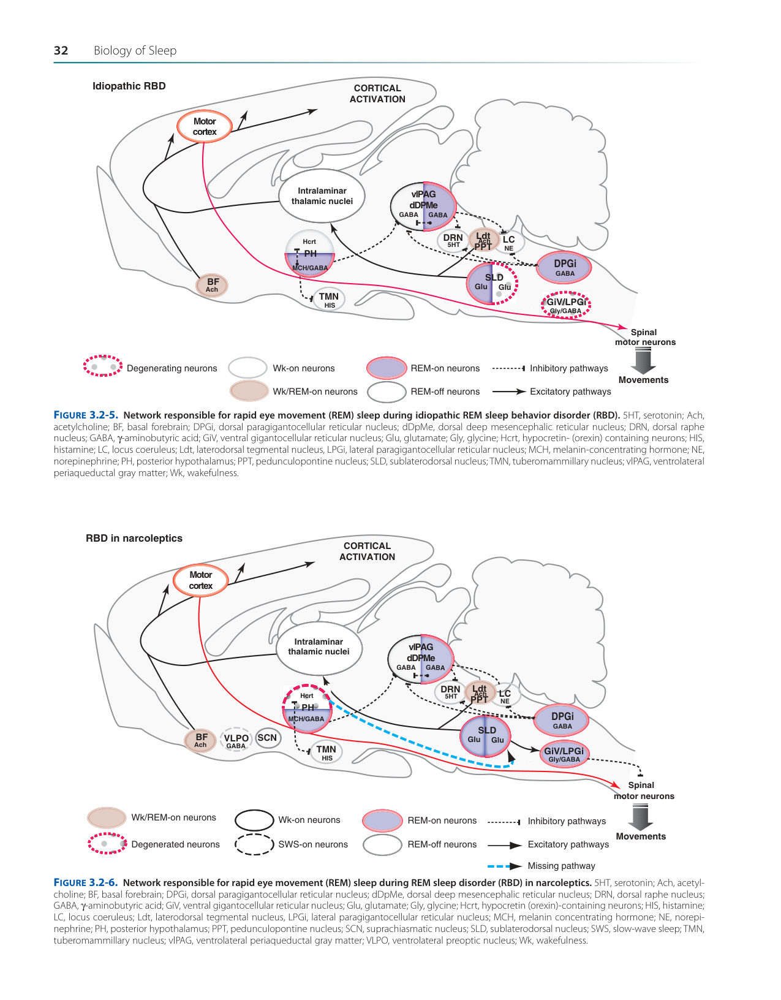

<!-- pdf-page: 51 -->

Cataplexy

CORTICAL ACTIVATION

Intralaminar thalamic nuclei

FIGURE 3.2-7. Network responsible for rapid eye movement (REM) sleep during cataplexy in narcoleptics. 5HT, serotonin; Ach, acetylcholine; BF, basal

forebrain; CA, central amygdala; DPGi, dorsal paragigantocellular reticular nucleus; dDpMe, dorsal deep mesencephalic reticular nucleus; DRN, dorsal raphe nucleus; GABA, γ-aminobutyric acid; GiV, ventral gigantocellular reticular nucleus; Glu, glutamate; Gly, glycine; Hcrt, hypocretin (orexin)-containing neurons; HIS, histamine; LC, locus coeruleus; Ldt, laterodorsal tegmental nucleus, LPGi, lateral paragigantocellular reticular nucleus; MCH, melanin concentrating hormone; NE, norepinephrine; PH, posterior hypothalamus; PPT, pedunculopontine nucleus; SLD, sublaterodorsal nucleus; TMN, tuberomammillary nucleus; vlPAG, ventrolateral periaqueductal gray matter; Wk, wakefulness.

Hcrt

MCH/GABA PH

BF Ach

CA

Glu

TMN HIS

Degenerated neurons

Wk-on neurons

Wk/REM-on neurons

vlPAG dDPMe GABA

GABA

Ldt PPT Ach LC NE

DRN 5HT

DPGi GABA

SLD Glu Glu

GiV/LPGi

Gly/GABA

Spinal motor neurons

Inhibitory pathways

REM-on neurons

Excitatory pathways

REM-off neurons

Muscle atonia

thalamic relay neurons in collaboration with wakefulness/ REM-on cholinergic and glutamatergic neurons from the laterodorsal tegmental nucleus and pedunculopontine nucleus, mesencephalic and pontine reticular nuclei, and the BF. Descending REM-on SLD neurons induce muscle atonia via their excitatory projections to glycinergic premotoneurons localized in the alpha and ventral gigantocellular reticular nuclei (Gia and GiV, respectively). The exit from REM sleep is due to the activation of waking systems because REM sleep episodes are almost always terminated by an arousal. The waking systems inhibit all GABAergic REM-on neurons. Because the duration of REM sleep is negatively coupled with the metabolic rate, we propose that the activity of the waking systems is triggered to end REM sleep to restore competing physiologic parameters, such as thermoregulation.12

#### Network Responsible for REM Sleep During

#### Idiopathic REM Behavior Disorder

In idiopathic REM behavior disorder patients, the descending, but not the ascending, SLD glutamatergic neurons may have degenerated (Fig. 3.2-5). Another possibility is that only the GiV glycinergic/GABAergic neurons did degenerate. Movements are induced during REM sleep by direct or indirect glutamatergic projections from the motor cortex to spinal and cranial motor neurons.12

#### Network Responsible for Paradoxical Sleep During

#### REM Behavior Disorder in Narcoleptics

In narcoleptics, the network responsible for muscle atonia is intact (Fig. 3.2-6). Phasic movements during REM sleep are induced by a phasic activation of motoneurons due to the

absence of an excitatory projection of the orexin-containing neurons to the descending SLD REM-on neurons.12

#### Network Responsible for Paradoxical Sleep

#### During Cataplexy in Narcoleptics

Cataplexy is induced by the activation of a direct or indirect pathway from the emotionally driven central amygdala to the descending SLD glutamatergic neurons (Fig. 3.2-7). In healthy subjects, the hypocretin neurons are excited. They excite GABAergic PS-off neurons located in the vlPAG/ dDPMe and, by this means, increase the inhibition of SLD glutamatergic neurons and counteract the excitation coming from the central amygdala.12

#### Acknowledgment

This work was supported by Centre National de la Recherche Scientifique and University Claude Bernard, Lyon, France.

#### References

1. Moruzzi G, Magoun HW: Brain stem reticular formation and activation

of the EEG. J Neuropsychiatry Clin Neurosci 7(2):251–267, 1949. 2. Fort P, Bassetti CL, Luppi PH: Alternating vigilance states: new insights

regarding neuronal networks and mechanisms. Eur J Neurosci 29(9):1741– 1753, 2009. 3. Jones BE: Basic mechanisms of sleep-wake states. In Kryger MH, Roth

T, Dement WC, editors: Principles and Practice of Sleep Medecine. Philadelphia, 1994, Saunders, W.B., pp 145–162. 4. Lu J, Greco MA, Shiromani P, Saper CB: Effect of lesions of the ven­

trolateral preoptic nucleus on NREM and REM sleep. J Neurosci 20(10):3830–3842, 2000. 5. Sherin JE, Elmquist JK, Torrealba F, Saper CB. Innervation of histamin­

ergic tuberomammillary neurons by GABAergic and galaninergic

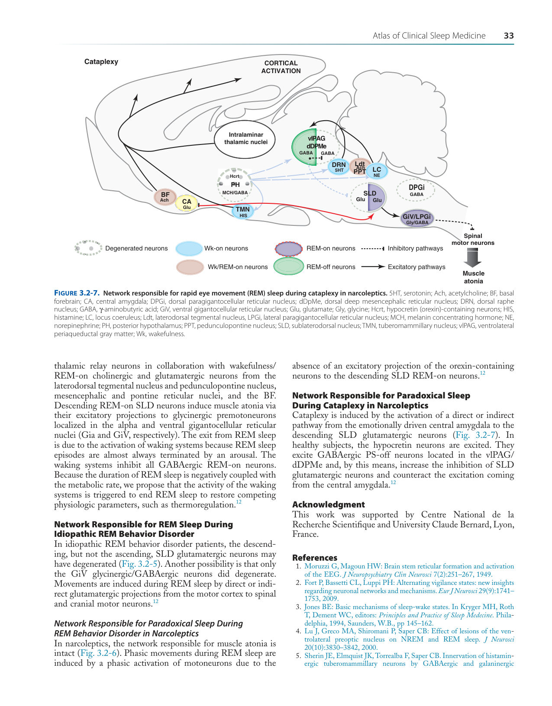

<!-- pdf-page: 52 -->

34 Biology of Sleep

neurons in the ventrolateral preoptic nucleus of the rat. J Neurosci 18(12):4705–4721, 1998. 6. Szymusiak R, Alam N, Steininger TL, McGinty D: Sleep-waking dis­

10. Fredholm BB, Chen JF, Masino SA, Vaugeois JM: Actions of adenosine

at its receptors in the CNS: insights from knockouts and drugs. Annu Rev Pharmacol Toxicol 45:385–412, 2005. 11. Jouvet M: Recherches sur les structures nerveuses et les mécanismes

charge patterns of ventrolateral preoptic/anterior hypothalamic neurons in rats. Brain Res 803(1–2):178–188, 1998. 7. Sherin JE, Shiromani PJ, McCarley RW, Saper CB: Activation of ven­

responsables des différentes phases du sommeil physiologique. Arch Ital Biol 100:125–206, 1962. 12. Luppi PH, Clement O, Sapin E, Gervasoni D, Peyron C, Leger L, et al:

trolateral preoptic neurons during sleep. Science 271(5246):216–219, 1996. 8. Morgan JI, Curran T: Stimulus-transcription coupling in the nervous

The neuronal network responsible for paradoxical sleep and its dysfunctions causing narcolepsy and rapid eye movement (REM) behavior disorder. Sleep Med Rev 15(3):153–163, 2011.

## CIRCADIAN RHYTHMS REGULATION

### Kathryn J. Reid, Phyllis C. Zee, and Orfeu M. Buxton

## 3.3

system: involvement of the inducible proto-oncogenes fos and jun. Annu Rev Neurosci 14:421–451, 1991. 9. Gallopin T, Fort P, Eggermann E, Cauli B, Luppi PH, Rossier J, et al:

Identification of sleep-promoting neurons in vitro. Nature 404(6781):992– 995, 2000.

FIGURE 3.3-1. The genetic mechanism of the circadian clock is similar in many species, from prokaryotic bacteria to fruit flies to mammals. The key

mechanism appears to involve an exquisitely timed transcription and translation feedback loop between nuclear gene expression and their protein products. In humans, dimers of PER and CRY proteins bind to dimers of CLOCK and ARNTL on the enhancer (E) box for PER genes and inhibit transcription of the PER and CRY genes. Reduced PER/CRY transcription to mRNAs and translation to proteins subsequently disinhibit CLOCK/ARNTL binding to the E-box, which leads to renewed transcription of PER and CRY.

All living creatures exhibit self-sustaining circadian (~24 hour) rhythms in physiology and behavior that are regulated by a central “clock” located in the suprachiasmatic nuclei (SCN) of the hypothalamus. This system is involved in the regulation of many physiologic functions that include core body temperature (CBT), sleep, and the timing of the production of hormones. The genetics of the circadian system at the cellular level has only recently been understood (Fig. 3.3-1). The central circadian clock, the SCN, also controls the timing of peripheral clocks in the liver, heart, and adrenal glands, for example, and these peripheral rhythms may then in turn feed back to the SCN (Fig. 3.3-2).

The sleep-wake cycle is the most apparent circadian rhythm in humans. Light, physical activity, and melatonin from the

Genetic components of mammalian circadian system

Nucleus

ARNTL CLOCK

PER 2 E-box PER 1

PER 3

CRY2

pineal gland are the primary synchronizing agents for the human circadian clock. In humans, light is the strongest time cue for the circadian clock. For optimal function, the timing of socially or work-imposed sleep and wake schedules should be designed and taken into account with the external physical environment and the circadian rhythms. Circadian rhythm sleep disorders (see Chapter 9) develop when the circadian clock or its entraining pathways are disrupted, or when the external environment is misaligned with the timing of the circadian clock (Figs. 3.3-3 and 3.3-4).

Light exposure, exercise, and exogenous melatonin administration can be used to shift the timing of the circadian clock. Phase-response curves to light and other synchronizing agents such as melatonin characterize the phase-shifting effects that

Cytoplasm

Degradation

p p

PERs

CKI

CRY1 CRYs

<!-- pdf-page: 53 -->

SCN SCN

Peripheral clocks Behavioral rhythms Systemic rhythms 15

Peripheral clocks

FIGURE 3.3-2. Communication routes of the mammalian circadian timing system. A, The suprachiasmatic nucleus (SCN) pacemaker entrains peripheral

clocks. Via transcriptional regulation of clock-controlled genes in target tissues, peripheral physiologic functions are reset and synchronized to the light-dark cycle. B, Pathways of interaction between central and peripheral clocks. The SCN resets physiologic rhythms via the entrainment of peripheral tissue clocks, but at the same time regulates behavioral and systemic (e.g., endocrine) functions in a more direct manner. Peripheral rhythms may, in turn, directly or indirectly feed back to the SCN. This interlocked balance system creates plasticity in the entrainment of the circadian timing system and promotes adaptation to complex changes in environmental parameters. (From Barclay J, Tsang A, Oster H: Interaction of central and peripheral clocks in physiological regulation. Prog Brain Res 2012; 199:163–181.)

Leptin ng/mL

10

5

0 0 4 8 12 ZT (hours) 16 20 24

Peripheral transcriptional rhythms

Physiologic rhythms

A

B

Peripheral transcriptional rhythms

Physiologic rhythms

FIGURE 3.3-3. The basic components of the circadian system. Photic information that reaches the suprachiasmatic nucleus (SCN) is transmitted from the

retina via the retinohypothalamic tract (RHT). The retinal ganglion cells (RGC) of the eye, melanopsin-containing photoreceptors, provide the primary photic input to the circadian clock, transmitting the signal to the neurons of the SCN. Melatonin is released from the pineal gland at night, and its output is regulated by the SCN via the superior cervical ganglion (SCG). In addition to its ability to synchronize circadian rhythms, melatonin can also promote sleep. Integrated timing information from the SCN is transmitted to sleep-wake centers in the brain. Thus the sleep-wake cycle is generated by a complex interaction of endogenous circadian and sleep processes as well as by social and environmental factors.

Circadian rhythms regulation

Light

RHT

RGC SCN

Pineal gland

Melatonin

Hypothalamic and brainstem Sleep-wake regulating centers

SCG

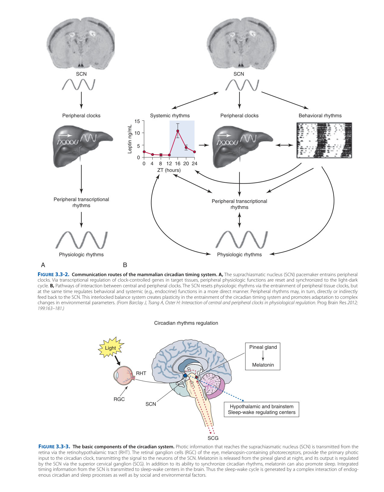

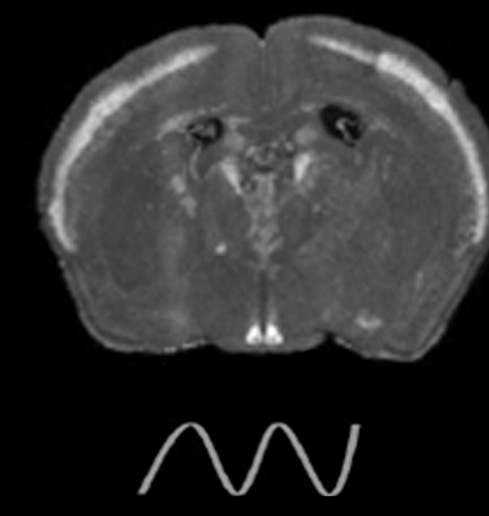

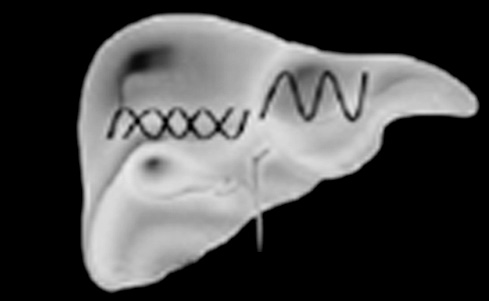

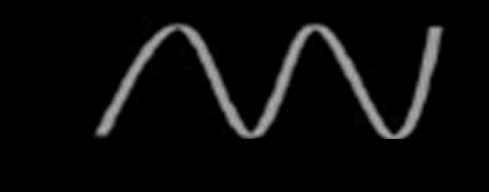

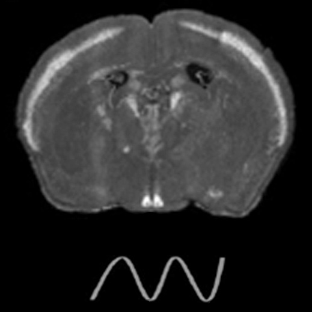

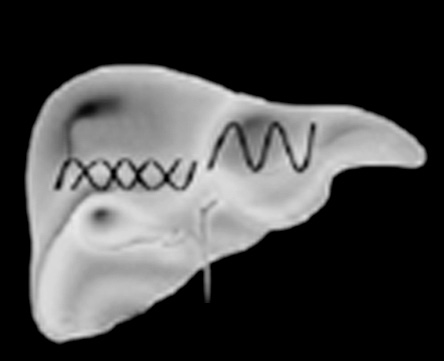

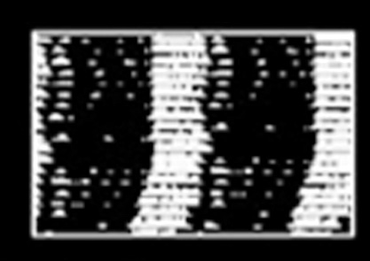

<!-- pdf-page: 54 -->

36 Biology of Sleep

Sleep-wake cycle: two-process model

Homeostatic sleep drive

FIGURE 3.3-4. At least two variables seem to play a role in the regulation of the timing of sleep. First is the homeostatic sleep drive, which increases the

longer a person is awake. The second is timing information from the suprachiasmatic nucleus (SCN). In this two-process model, the SCN promotes wakefulness by stimulating arousal networks. SCN activity appears to oppose the homeostatic sleep drive, thus the alerting mediated by the SCN increases during the day. The propensity to be awake or asleep at any time is related to the homeostatic sleep drive and the opposing SCN alerting signal. At normal bedtime, both the alerting drive and the sleep drive are at their highest level. The SCN has at least two types of melatonin receptors, MT1 and MT2, involved in the regulation of sleep. Stimulation of MT1 receptors is believed to decrease the alerting signal from the SCN, whereas MT2 stimulation is thought to be involved in synchronizing the circadian system. (Data from Dijk DJ, Edgar DM: Circadian and homeostatic control of wakefulness and sleep. In Turek FW, Zee PC, editors: Regulation of sleep and circadian rhythms. New York: Marcel Dekker, 1999;111–147.)

Circadian alerting signal (SCN)

Awake Asleep

Melatonin

9 am 3 am 3 pm 9 pm 9 am

1.0 Melatonin PRC Light PRC

3

Delay Advance

Phase shift with melatonin (hr)

2

Phase shift with light (hr)

0.5

1

0

0.0

1

0.5

2

3

1.0

12 21 18 15 0 3 Clock time 6 9 12

9 0 3 6 3 6 Hours before and after DLMO Time of melatonin or bright light

9 12 15

FIGURE 3.3-5. Human phase response curves to bright light and mela­

tonin. The light phase response curve (PRC) was generated from seven subjects who were exposed to approximately 3 days (73.5 h) of an ultradian light-dark cycle (2.5 hours awake in dim light [<100 lux] alternating with 1.5 hours of sleep in darkness). Subjects lived on the ultradian schedule on two different occasions, once with bright light pulses of about 3500 lux for 2 hours at the same time each day, and once without bright light pulses, counterbalanced. Phase shifts of the midpoint of the melatonin rhythm collected in dim light (<5 lux) before and after the 3 days were plotted against the time of the light pulse relative to each subject’s baseline dim light melatonin onset (DLMO) and were corrected for the free run, when the bright light was not applied. Upward arrow, average baseline DLMO; rectangle, average baseline sleep schedule; triangle: estimated time of body temperature minimum (DLMO + 7 hours). The solid line is a smoothed curve fit to the seven points. Subjects (n = 6), living at home, took 0.5 mg melatonin at the same time each day for 4 days. Phase shifts of the DLMO were plotted against the time of melatonin administration relative to each subject’s baseline DLMO. A smoothed curve was fit to the data after averaging the 70 data points into 3-hour “bins.” (Melatonin PRC calculated from data of Lewy AJ, Bauer VK, Ahmed S, et al: The human phase response curve [PRC] to melatonin is about 12 hours out of phase with the PRC to light. Chronobiol Int 1998;15[1]:71–83. Courtesy Eastman and Burgess, unpublished data, and Revell VL, Eastman CI: How to trick mother nature into letting you fly around or stay up all night. J Biol Rhythms 2005;20[4]:353–365.)

vary by circadian time of day (Fig. 3.3-5). Light exposure in the late evening, before the CBT reaches a minimum (Tmin), delays circadian rhythms; light in the morning, after Tmin has been reached, advances circadian rhythms. Exercise elicits phase advances in the early evening and phase delays in the late evening and mid nighttime hours. The response to melatonin is the opposite of the response to light; melatonin given in the evening will advance the circadian clock, whereas melatonin in the morning will delay it.

Circadian phase markers can be used to confirm the diagnosis of circadian rhythm sleep disorders and to determine circadian phase to correctly time treatment with light and/or melatonin (see Chapter 9). CBT can be determined using a rectal thermistor worn for 24 to 28 hours (see Fig. 9.1-2). The CBT minimum (Tmin) usually occurs about 2 to 3 hours before wake time, and it is generally easier to fall asleep on the declining part of the CBT rhythm and to wake on the rising portion. Dim light melatonin onset can be determined from plasma or saliva sampled at regular intervals (every 30 minutes) under dim light conditions (see Fig. 9.1-3). Dim light melatonin onset usually occurs about 2 to 3 hours before habitual sleep time in normal controls and in subjects with delayed sleep phase disorder.

#### Selected Readings

Barclay J, Tsang A, Oster H: Interaction of central and peripheral clocks in

physiological regulation. Prog Brain Res 199:163–181, 2012. Buxton OM, Lee CW, L’Hermite-Balériaux M, Turek FW, Van Cauter E:

Exercise elicits phase shifts and acute alterations of melatonin levels that vary with circadian phase. Am J Physiol 284(3):R714–R724, 2003. Czeisler CA, Allan JS, Strogatz SH, et al: Bright light resets the human

circadian pacemaker independent of the timing of the sleep-wake cycle. Science 233(4764):667–671, 1986. Czeisler CA, Weitzman E, Moore-Ede MC, et al: Human sleep: its duration

and organization depend on its circadian phase. Science 210(4475):1264– 1267, 1980. Lewy AJ, Bauer VK, Ahmed S, et al: The human phase response curve (PRC)

to melatonin is about 12 hours out of phase with the PRC to light. Chronobiol Int 15(1):71–83, 1998. Moore RY: A clock for the ages. Science 284(5423):2102–2103, 1999. Murphy PJ, Campbell SS: Physiology of the circadian system in animals and

humans. J Clin Neurophysiol 13(1):2–16, 1996.

<!-- pdf-page: 55 -->

Revell VL, Eastman CI: How to trick mother nature into letting you fly

Saper CB, Lu J, Chou TC, et al: The hypothalamic integrator for circadian

around or stay up all night. J Biol Rhythms 20(4):353–365, 2005. Rollag MD, Berson DM, Provencio I: Melanopsin, ganglion-cell photorecep­

rhythms. Trends Neurosci 28(3):152–157, 2005. Van Cauter E, Sturis J, Byrne MM, et al: Demonstration of rapid light-

tors, and mammalian photoentrainment. J Biol Rhythms 18(3):227–234, 2003.

induced advances and delays of the human circadian clock using hormonal phase markers. Am J Physiol 266(6, Pt 1):E953–E963, 1994.

## PHYSIOLOGIC REGULATION IN SLEEP

### Pier Luigi Parmeggiani, Ronny P. Bartsch, and Plamen Ch. Ivanov

## 3.4

FIGURE 3.4-1. Shivering and thermal tachypnea are absent during rapid eye movement (REM) sleep in the cat but are present during non-REM sleep.

EMG, electromyogram (neck muscles); Hp, hippocampus; O, occipital cortex; P, parietal cortex; RM, respiratory movements; Ta, ambient temperature. (From Parmeggiani PL, Rabini C: Sleep and environmental temperature. Arch Ital Biol 1970;108:369–387; used with permission from Università di Pisa.)

Physiologic regulation in mammals varies with the state of the brain and is affected by arousal and stage of sleep. This is the result of functional dominance of phylogenetically different structures of the brain in different behavioral states.

Physiologic events during non–rapid eye movement (NREM) sleep is functionally similar in different species. During rapid eye movement (REM) sleep, such events vary within and among species. Nervous system processes specific to REM sleep result in this autonomic variability and are not related to mental content or homeostatic control.

The basic features of NREM sleep are active thermoregulation and a decrease in the activity of antigravity muscles. The basic features of REM sleep are muscle atonia, rapid eye movements, and myoclonic twitches. The basic autonomic feature of NREM sleep is the functional prevalence of parasympathetic influences associated with quiescence of sympathetic activity. The basic autonomic feature of REM sleep is the great variability in sympathetic activity associated with phasic changes in tonic parasympathetic discharge.

During NREM sleep, mammals maintain homeostasis at a lower level of energy expenditure compared with quiet wakefulness. In contrast, REM sleep in all species is characterized by impaired homeostatic activity of physiologic functions (poikilostasis). The impairment of homeostatic control

Ta, 6 C

Hp

P

EMG

Ta, 36 C

NREM

O

Hp

EMG

RM

in REM sleep is more dramatic and evident in a function that depends on mechanisms strictly controlled by structures in the diencephalon (preoptic-hypothalamic area), such as temperature regulation in furred animals (Table 3.4-1 and Figs. 3.4-1 to 3.4-4).

TABLE 3.4-1 Thermoregulatory Responses

#### in Wakefulness and Sleep

RESPONSES WAKE NREM REM

Specific Behavioral Locomotion No locomotion No locomotion Posture Posture Postural atonia

Autonomic Vasomotion Vasomotion Inconsistent

vasomotion Piloerection Piloerection No piloerection Shivering Tg Shivering Tg (+) No shivering Tg Nonshivering Tg Nonshivering Tg Depressed

nonshivering Tg Thermal Tp Thermal Tp (+) No thermal Tp Sweating Sweating (+) Sweating (0,–)

Nonspecific Vigilance Arousal Arousal

+, strong; –, weak; 0, absent; NREM, non-REM; REM, rapid eye movement; Tg, thermogenesis; Tp, tachypnea.

NREM REM

500 V

2 sec

REM

500 V

2 sec

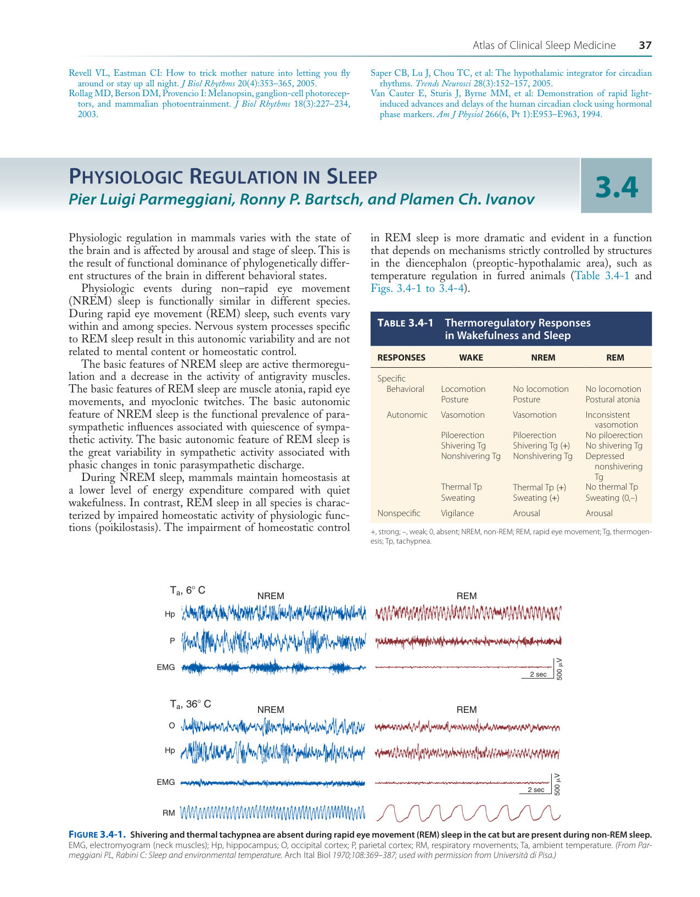

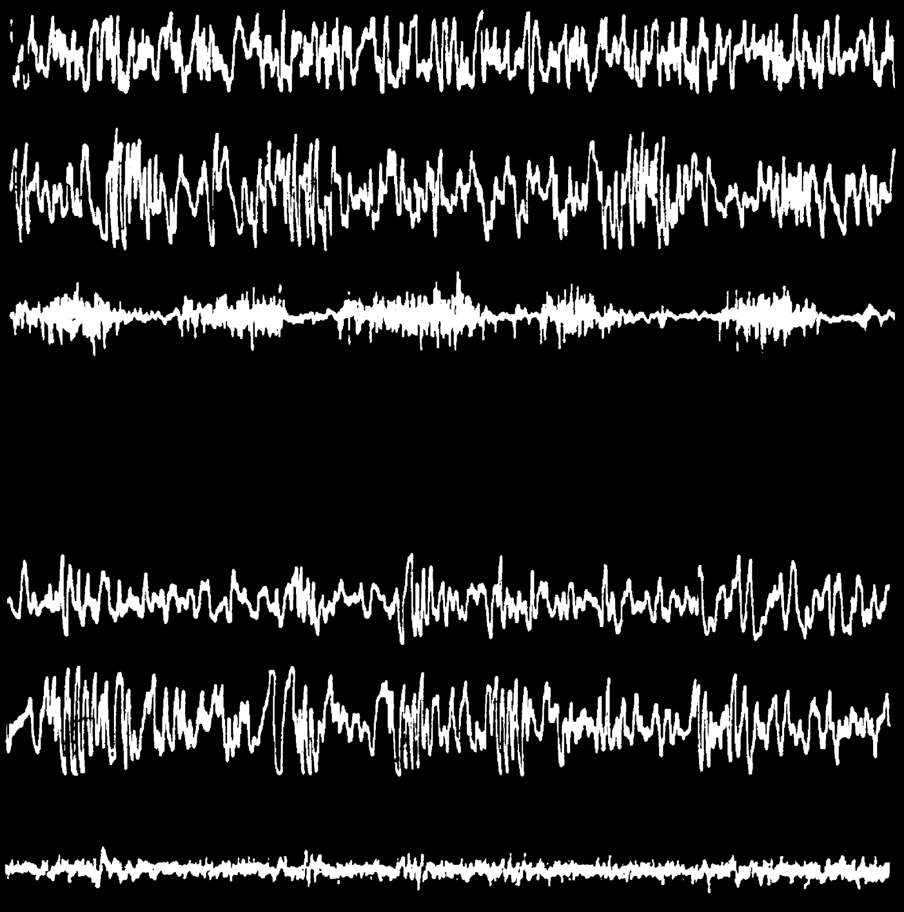

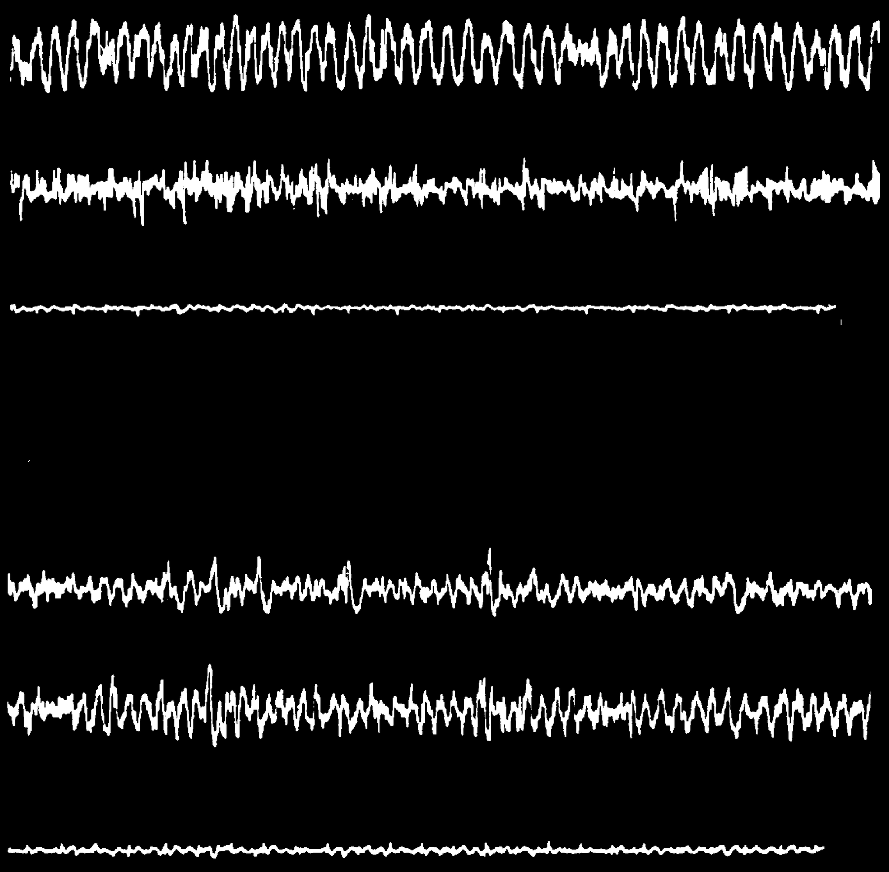

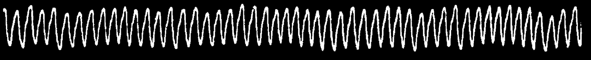

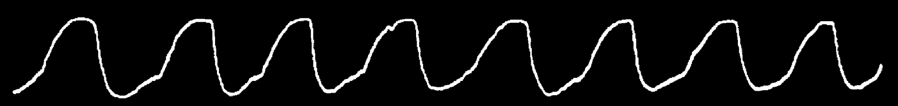

<!-- pdf-page: 56 -->

38 Biology of Sleep

In functions characterized by more widely distributed control mechanisms, such as respiration (Figs. 3.4-5 to 3.4-6) and circulation (Figs. 3.4-7 to 3.4-8), the features of functional impairment are rather more complex as a result of the persistence of more or less efficient reflex regulation or peripheral autoregulation.

0.30

Ta = 30 C

0.26

= Awake = SWS = PS

0.22

0.18

FIGURE 3.4-3. Preoptic-anterior hypothalamic diathermic warming (in a cat) elicits tachypnea during non–rapid eye movement (NREM) sleep and

is ineffective during REM sleep at neutral ambient temperature. Tachypnea disappears immediately at REM sleep onset (arrow) when hypothalamic temperature is still above threshold. EEG, electroencephalogram; EMG, electromyogram (neck muscle); HT, hypothalamic temperature (5 mm behind the warming electrode); RM, respiratory movements; mW, milliwatt. (From Parmeggiani PL, Franzini C, Lenzi P, Zamboni G: Threshold of respiratory responses to preoptic heating during sleep in freely moving cats. Brain Res 1973; 52:189–201.)

Nevertheless, it is evident that functional changes in REM sleep depend essentially on the suppression of a highly integrated homeostatic regulation operative in NREM sleep. Compared with REM sleep, volitional and instinctive drives during active wakefulness may also impose a load on, or interfere with, homeostatic mechanisms at central and/or effector levels to overwhelm their regulatory power. However, such homeostatic mechanisms are still operative and are capable of reestablishing the functional equilibrium that so well characterizes quiet wakefulness and NREM sleep.

NREM REM EEG

mW 83 mW 80

EMG

HT

39.12 39.09 39.06

RM

20 sec

MR (cal/g/min)

0.14

0.10

0.06

39 38 37 36 35 Thy ( C)

34 33 32

FIGURE 3.4-2. Metabolic rate (MR) vs. hypothalamic temperature

during wakefulness, non–rapid eye movement (NREM) sleep (slow-wave sleep [SWS]), and REM sleep (paradoxical sleep [PS]) at 30° C ambient temperature (Ta) in a kangaroo rat. The effect of the thermal stimulus decreases during NREM sleep and disappears during REM sleep. (Modified from Glotzbach SF, Heller HC: Central nervous regulation of body temperature during sleep. Science 1976;194:537–539; used with permission from the American Association for the Advancement of Science.)

40

Chest sweating (mg · min 1cm 2) 10 2

Phase 2

35

30

25

P I II

20

15

10

5

0

L+D SWS PS

40 35 30 25 20 15 10 5 Time (min)

0 20 15 5 10

FIGURE 3.4-4. Chest sweating in humans drops (P) just before the

onset of rapid eye movement (REM) sleep, is fully abolished during the initial part of REM sleep (I), and slowly and irregularly increases during the remainder of the REM episode (II). L+D, light and deep; PS, paradoxical sleep; SWS, slow-wave sleep. (Modified from Dewasmes G, Bothorel B, Candas V, Libert JP: A short-term poikilothermic period occurs just after paradoxical sleep onset in humans: characterization changes in sweating effector activity. J Sleep Res 1997;6:252–258.)

40

30

Vl (L/min)

20

10

100 90 80 PACO2 (mm Hg) 40 50 60

Sao2 (%)

FIGURE 3.4-5. Breath-by-breath response of minute inspired volume

ventilation ( VI) to decreasing arterial O2 saturation (SaO2) and to increasing alveolar partial pressure of CO2 (PACO2) in a sleeping dog. During rapid eye movement (REM) sleep, note the scatter of data points around calculated linear regression lines and the marked decrease of the ventilatory response to hypercapnia. Red circles, REM sleep; blue circles, non-REM sleep. (Modified from Phillipson EA: Regulation of breathing during sleep. Am Rev Resp Dis 1977;115:217–224.)

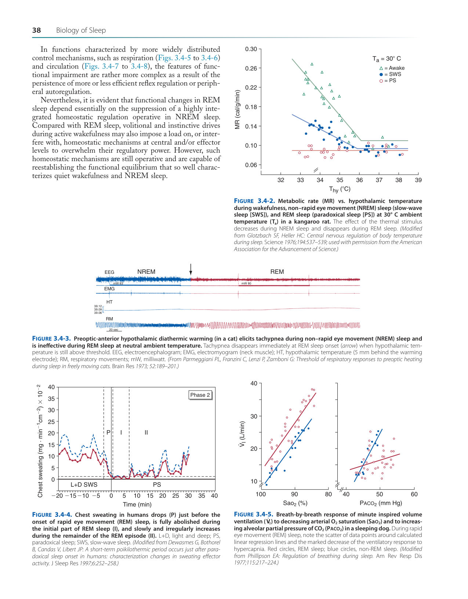

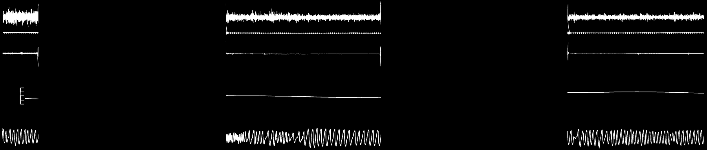

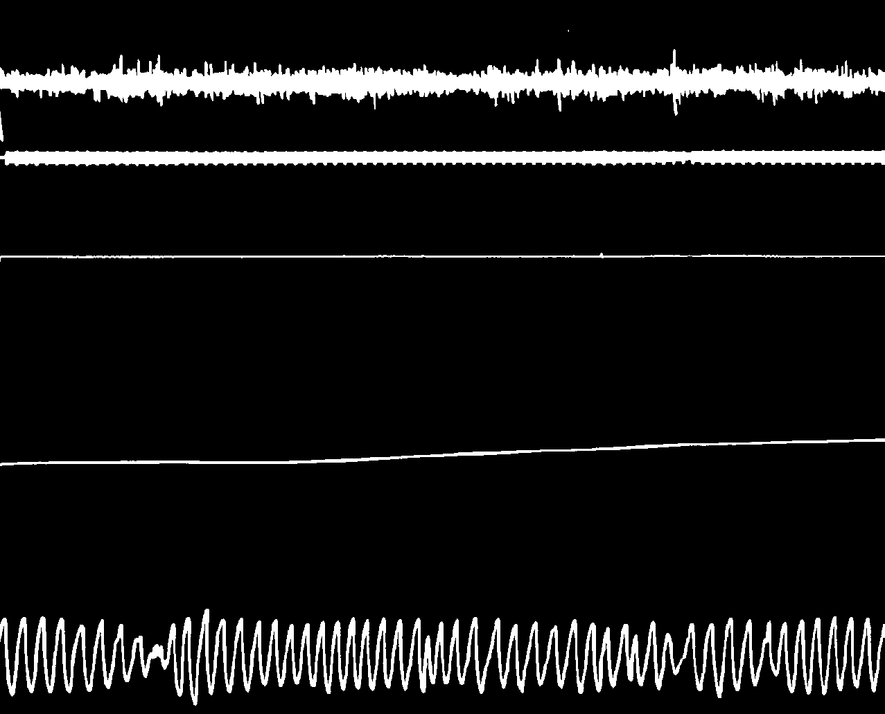

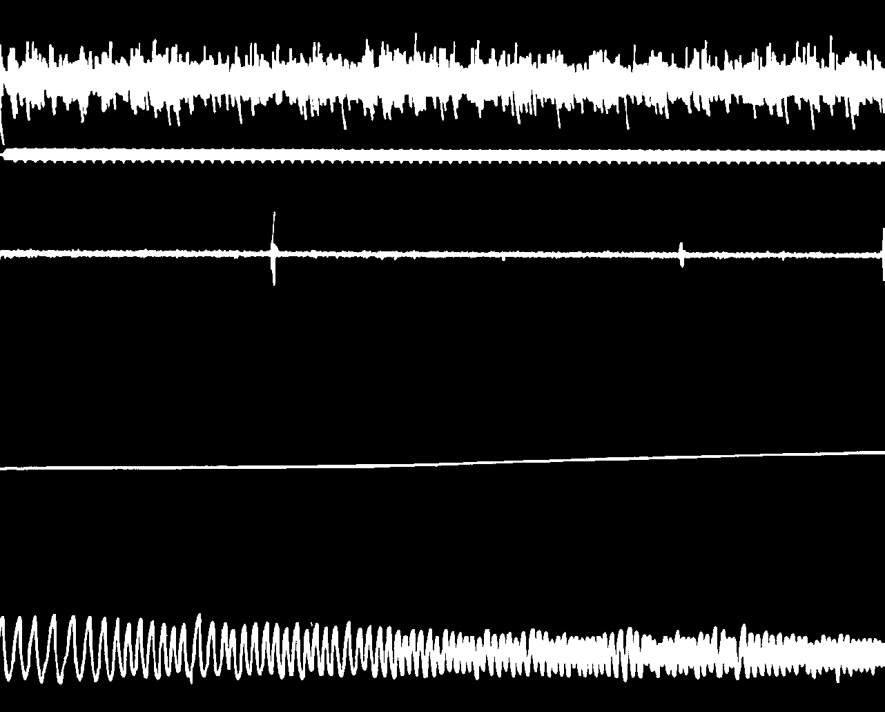

<!-- pdf-page: 57 -->

NREM REM

LOC

ROC

HP

NM

D

IE

FIGURE 3.4-6. Respiratory muscle activity during sleep at ambient thermal neutrality (in a cat). Postural activity of neck and intercostal muscles disap­

pears during the transition from non–rapid eye movement (NREM) sleep to REM sleep. Respiratory activity of intercostal muscles also disappears, whereas that of the diaphragm persists. LOC and ROC, left and right occipital cortices; HP, hippocampus; NM, neck muscles; D, diaphragm; IE, intercostalis externus muscle; RM, respiratory movements. (From Parmeggiani PL, Sabattini L: Electromyographic aspects of postural, respiratory and thermoregulatory mechanisms in sleeping cats. Electroenceph Clin Neurophysiol 1972;33:1–13.)

RM

400 V

3 sec

CAO

CA

Wake 114/min

132/min

NREM

105/min 123/min

REM

87/min 111/min

FIGURE 3.4-7. Spontaneous heart rate shown by electrocardiogram

across wakeful and sleeping states with and without bilateral common carotid artery (CA) occlusion (CAO) in a cat. During rapid eye movement (REM) sleep, note the bradyarrhythmia and the baroreceptor reflex response that barely exceeds the spontaneous heart rate during non-REM sleep. (Data from Azzaroni A, Parmeggiani PL: Mechanisms underlying hypothalamic temperature changes during sleep in mammals. Brain Res 1993;632:136–142.)

NREM REM

EEG

EMG

150 mL•min 1

PBF

80 mL•min 1 0

MBF

2 s

0

FIGURE 3.4-8. An episode of rapid eye movement (REM) sleep is char­

acterized by bradyarrhythmia and a decreased peak and mean blood flow in the common carotid artery (in a rabbit). EEG, electroencephalogram; EMG, electromyelogram; PBF, peak blood flow; MBF, mean blood flow; NREM, non-REM. (Data from Calasso M, Parmeggiani PL: Carotid blood flow during REMS. Sleep 2008;31:701–707.)

#### PHYSIOLOGIC SYSTEMS

#### INTERACTIONS AND VARIABILITY

#### DURING SLEEP

An added complexity to the above is that physiologic systems continuously interact, each has its own regulatory mechanisms, and the functions of these systems may be coupled. An example is the coupling between the systems that control the breathing pattern and those that control the heart rate. In normal control subjects, there is a continuous periodic modulation in the heart rate within each breathing cycle, and the amplitude of this modulation depends nonlinearly on the breathing frequency, a mechanism known as respiratory sinus arrhythmia. Another example is that central apnea may be associated with bradycardia and asystole, and obstructive apnea may be associated with severe bradycardia at the end of apneas and with tachycardia when breathing resumes. Recent studies have discovered an alternative form of cardiorespiratory coupling, called phase synchronization, that is characterized by the consistent occurrence of heart beats at the same relative phases within consecutive breathing cycles (Fig. 3.4-9). Cardiorespiratory coupling is strongly influenced by sleep regulation and is affected by age and pathology. The deeper the sleep, the greater the synchronization between the heart rate and breathing rhythm (see Fig. 3.4-9, A). A reduction in synchronization occurs with aging (Fig. 3.4-9, B). In patients with neuropathy, such as from diabetes, loss of synchronization may be evident.

When examined over time, the heart rate appears to be erratic, in part related to coupling of the cardiorespiratory system and changes in sympathetic and parasympathetic tone, which are in turn related to sleep or wake state (Fig. 3.4-10). One measure of the variability is the standard deviation (Fig. 3.4-11). Although physiologic functions such as heart rate may appear erratic, mathematical analyses yield robust selfsimilar patterns across time scales that change with sleep and under pathologic conditions (Fig. 3.4-12).

The principles presented here are clinically significant. Compensatory responses, such as those that occur in obstructive sleep apnea, require the functions present in wakefulness that are lost in sleep. Automatic reflexive control of somatic

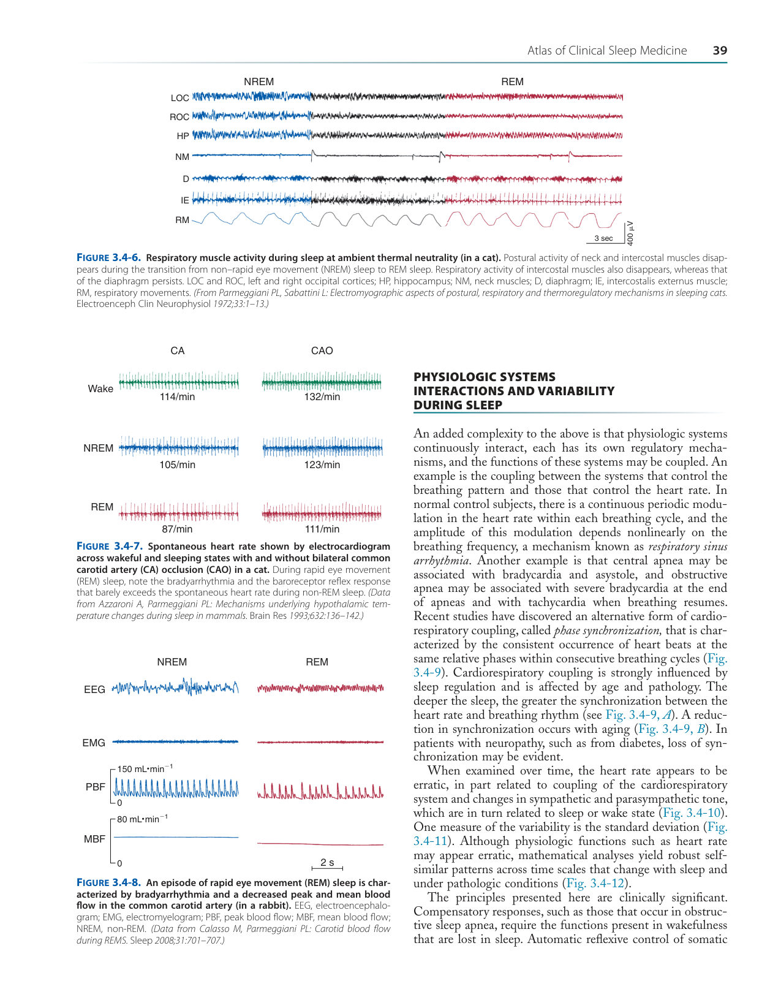

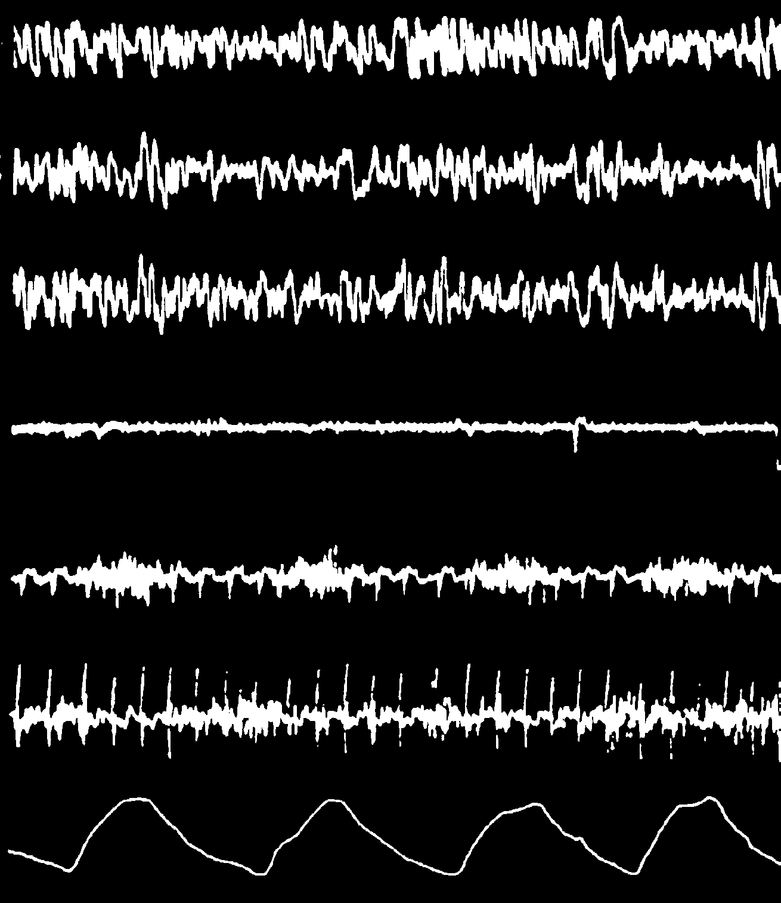

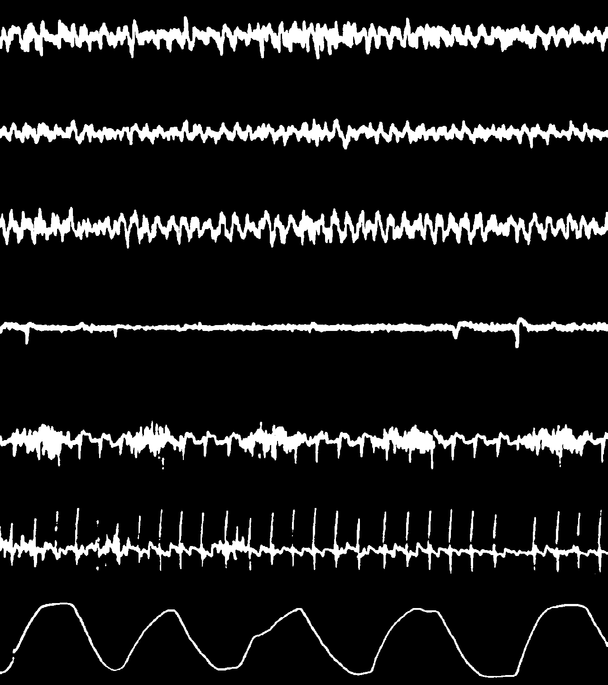

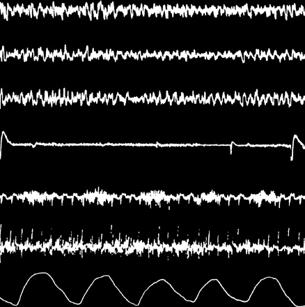

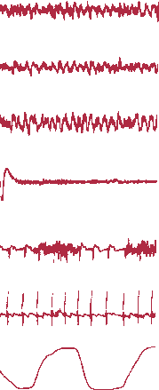

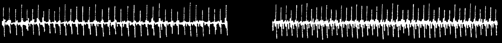

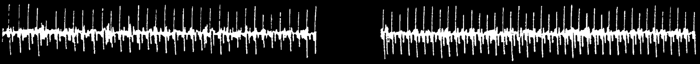

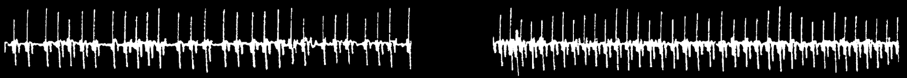

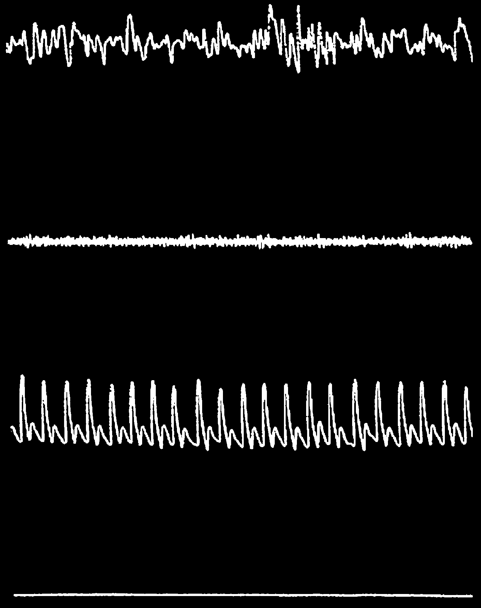

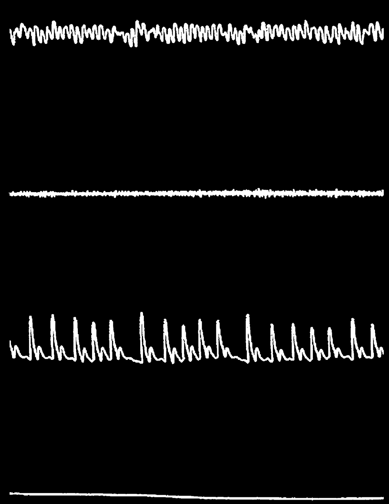

<!-- pdf-page: 58 -->

40 Biology of Sleep

Cardiorespiratory synchronization

Sleep-wake transition in heart rate variability

sleep-stage dependence

1.6

Awake

14

1.4

1.2

12

1.0

10

0.8

8

0.6

Synchronization strength (%)

6

4

2

0 A

Wake REM Deep

Light

Cardiorespiratory synchronization sleep-stage dependence across age groups

18

REM Wake Light sleep Deep sleep

16

Synchronization strength (%)

14

12

10

8

6

4

2

0

20-34 35-49 50-64 Age (years) 65-79 80

B

FIGURE 3.4-9. Changes in cardiorespiratory synchronization with sleep

stage and age. Methods from statistical physics have been developed to measure the strength of synchronization between the cardiovascular and respiratory systems. A, Cardiorespiratory phase synchronization increases significantly during deep sleep and light sleep, compared with rapid eye movement (REM) sleep and wakefulness, indicating a significant modulation in cardiorespiratory coupling because of sleep and relative to the stage of sleep. Surrogate test (red bars) indicates statistical significance of the results. B, In elderly subjects, suppression of parasympathetic tone and relative increase in sympathetic tone lead to reduction in synchronization across the entire sleep period, which is most pronounced during light and deep sleep. (Modified from Bartsch RP, Schumann AY, Kantelhardt JW, Penzel T, Ivanov PCh: Phase transitions in physiologic coupling. Proc Natl Acad Sci U S A 2012;109:10181–10186.)

and autonomic functions allows homeostatic behavior in NREM sleep without awareness, whereas the impaired homeostasis of REM sleep elicits physiologic disturbances and can impede compensatory reactions to these disturbances. Figure 3.4-13 summarizes some of the functional changes during sleep.

#### Acknowledgments

We are grateful to Dr. Roberto Amici and Dr. Meir Kryger for useful suggestions and technical help.

Heartbeat Interval (sec)

A 0 5000 10000 15000 20000 25000 0.4

1.6

Asleep

1.4

1.2

1.0

0.8

0.6

0.4

B 0 5000 10000 Beat number 15000

FIGURE 3.4-10. Changes in the degree of sympathetic and parasympa­

thetic activation during wakeful and sleeping states lead to changes in physiologic variability. The transition from wakefulness to a sleep state is typically associated with a decrease in the average heart rate (increased average interbeat interval). However, other key aspects of heart rate variability also change with sleep-wake transitions. A, Higher sympathetic tone during wakefulness is reflected in a smaller amplitude of beat-to-beat increments and in pronounced trends embedded in heartbeat variability. B, In contrast, dominant parasympathetic tone during sleep leads to a significantly higher amplitude of heartbeat interval increments and reduced trends. (Modified from Ivanov PCh, Bunde A, Amaral LA, et al: Sleep-wake differences in scaling behavior of the human heartbeat: analysis of terrestrial and long-term space flight data. Europhys Lett 1999;48:594–600.)

Standard deviation of heartbeat increments (sec)

Standard deviation of heartbeat intervals (sec)

0.06

Young Elderly

0.1

0.05

0.08

0.04

0.02

0.02

0.06

0.03

0.04

0.02

B A

Deep

Light REM Wake

Deep

Light REM Wake

FIGURE 3.4-11. Changes in sympathovagal balance associated with

sleep stages lead to changes in variability. A, The pattern in the standard deviation of heartbeat intervals reflects a gradual decrease of sympathetic tone with transitions from wakefulness to deep sleep in both young and elderly healthy subjects. B, In contrast, the standard deviation of the difference between consecutive beat-to-beat intervals does not significantly change with sleep stage. Both measures in A and B decrease as a result of suppressed parasympathetic (vagal) tone in elderly subjects, indicating that the standard deviation of heartbeat increments is a measure of parasympathetic tone during sleep, whereas the standard deviation of heartbeat intervals is a measure of both sympathetic and parasympathetic tone at different sleep stages. REM, rapid eye movement. (Modified from Schmitt DT, Stein PK, Ivanov PCh: Stratification pattern of static and scale-invariant dynamic measures of heartbeat fluctuations across sleep stages in young and elderly. IEEE Trans Biomed Eng 2009;56[5]:1564–1573.)

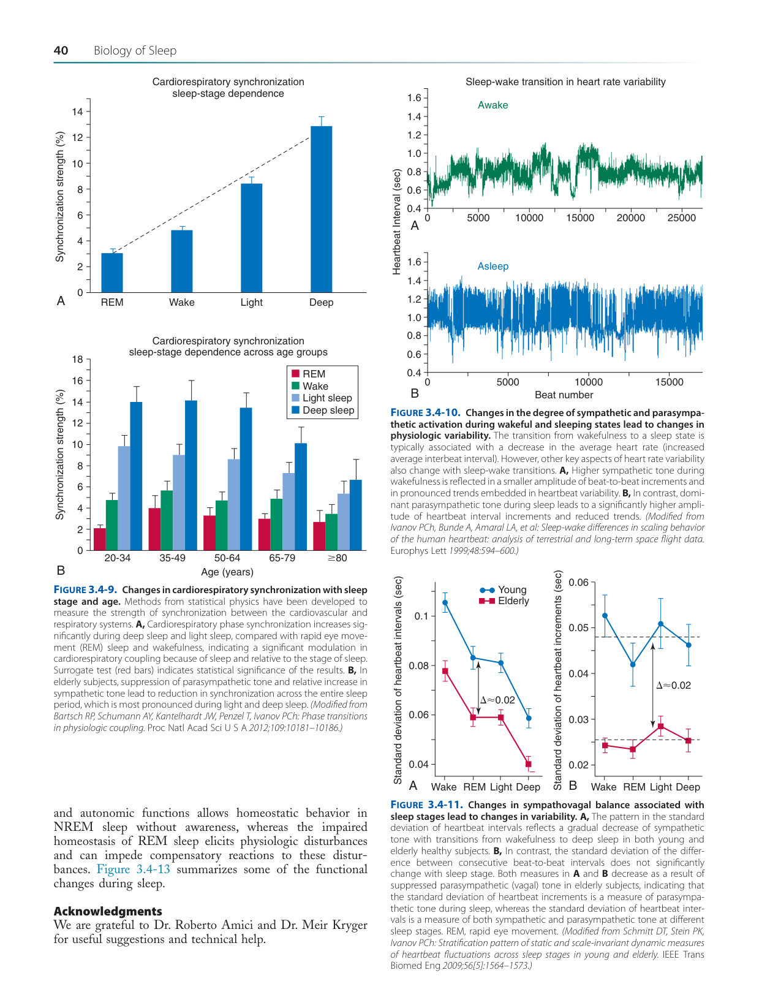

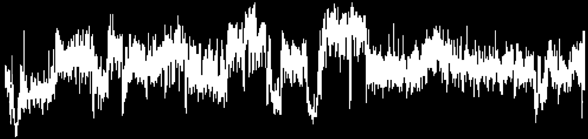

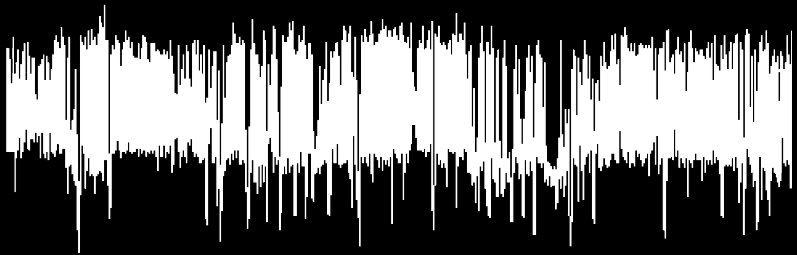

<!-- pdf-page: 59 -->

Self-similarity in healthy heart rate variability

PHYSIOLOGIC REGULATION IN SLEEP

NREM REM

FUNCTIONS

ENDOCRINE

GH early secretion PRL early secretion ACTH late secretion T late secretion TSH inhibition

BREATHING

Heartbeat Interval (sec) Scale of observation

A

Breakdown of self-similarity with sleep apnea

B

Time

FIGURE 3.4-12. Complex temporal organization of physiologic vari­

ability. A, Seemingly random heartbeat interval fluctuations are derived from a 30-minute electrocardiogram of a healthy subject during sleep (top panel). In fact, complex mathematical analyses and plots reveal a temporal organization characterized in the plot by arches (middle panel) that branch in a selfsimilar manner at smaller and smaller scales (bottom panel). Bright colors correspond to large heartbeat interval fluctuations, and white tracks (arches) show the evolution of heartbeat fluctuations in time and across scales of observation, from seconds to minutes. Such self-similar organization in heartbeat variability results from nonlinear feedback interactions between multiple sympathetic and parasympathetic inputs that underlie cardiac control during sleep and operate over a broad range of time scales. B, In sleep disorders such as sleep apnea, this self-similarity breaks down to a repetitive pattern at small and intermediate scales of observation. (Modified from Ivanov PC, Nunes Amaral LA, Goldberger AL, et al: From 1/f noise to multifractal cascades in heartbeat dynamics. Chaos 2001;11:641–652.)

#### Selected Readings

Azzaroni A, Parmeggiani PL: Mechanisms underlying hypothalamic tem­

perature changes during sleep in mammals. Brain Res 632:136–142, 1993. Bashan A, Bartsch RP, Kantelhardt JW, et al: Network physiology reveals

relations between network topology and physiological function. Nat Commun 3:702, 2012. Calasso M, Parmeggiani PL: Carotid blood flow during REMS. Sleep

31:701–707, 2008.

Regular decrease Effective Effective Active Tone maintained

Ventilation Reflexes proprioceptive Chemoceptive Intercostal muscles Upper airways muscles

Variable amplitude Overridden Overridden Inactive Tone reduced

CIRCULATION

Eurhythmic decrease Regular decrease Regular decrease Effective Effective

Heart rate Blood pressure Cardiac output Reflexes proprioceptive Chemoceptive

Variably arrhythmic Irregular oscillations Irregular oscillations Overridden Overridden

GASTROINTESTINAL

Decreased function Decreased function

RENAL

Decreased urine flow Decreased urine flow

SEXUAL

Penile erection

REGULATION POIKILOSTATIC HOMEOSTATIC

FIGURE 3.4-13. Overview of functional changes during sleep. ACTH,

adrenocorticotropic hormone; GH, growth hormone; NREM, non-REM; PRL, prolactin; REM, rapid eye movement; T, testosterone; TSH, thyroid-stimulating hormone.

Calasso M, Zantedeschi E, Parmeggiani PL: Cold-defense function of brown

adipose tissue during sleep. Am J Physiol 265:R1060–R1064, 1993. Dewasmes G, Bothorel B, Candas V, Libert JP: A short-term poikilothermic

period occurs just after paradoxical sleep onset in humans: characterization changes in sweating effector activity. J Sleep Res 6:252–258, 1997. Glotzbach SF, Heller HC: Central nervous regulation of body temperature

during sleep. Science 194:537–539, 1976. Ivanov PCh: Scale-invariant aspects of cardiac dynamics. Observing sleep

stages and circadian phases. IEEE Engineering Med Biol 26(6):33–37, 2007. Ivanov PCh, Hu K, Hilton MF, et al: Endogenous circadian rhythm in

human motor activity uncoupled from circadian influences on cardiac dynamics. Proc Natl Acad Sci U S A 104(52):20702–20707, 2007. Parmeggiani PL, Sabattini L: Electromyographic aspects of postural, respira­

tory and thermoregulatory mechanisms in sleeping cats. Electroenceph Clin Neurophysiol 33:1–13, 1972. Parmeggiani PL: Physiological regulation in sleep. In Kryger MH, Roth T,

Dement WC, editors: Principles and practice of sleep medicine. Philadelphia, 2000, WB Saunders, pp 169–178. Parmeggiani PL, Calasso M, Cianci T: Respiratory effects of preoptic-

anterior hypothalamic electrical stimulation during sleep in cats. Sleep 1981; 4:71–821981. Parmeggiani PL, Rabini C: Sleep and environmental temperature. Arch Ital

Biol 1970; 108:369–387. Parmeggiani PL: Systemic homeostasis and poikilostasis in sleep: is REM sleep a

physiological paradox? London, 2011, Imperial College Press. Parmeggiani PL, Franzini C, Lenzi P, Zamboni G: Threshold of respiratory

responses to preoptic heating during sleep in freely moving cats. Brain Res 1973; 52:189–201. Phillipson EA: Regulation of breathing during sleep. Am Rev Resp Dis 1977;

115:217–224. Schumann AY, Bartsch RP, Penzel T, et al: Aging effects on cardiac and

respiratory dynamics in healthy subjects across sleep stages. Sleep 33:943– 955, 2010.

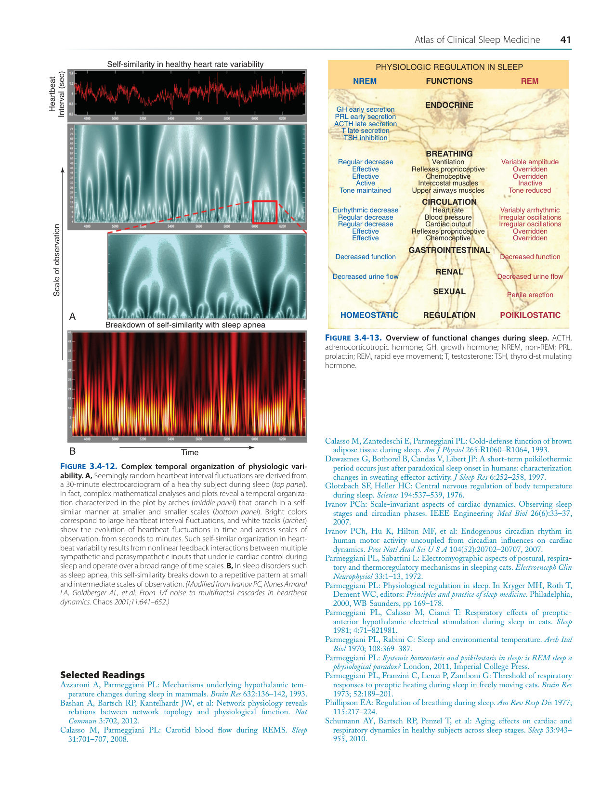

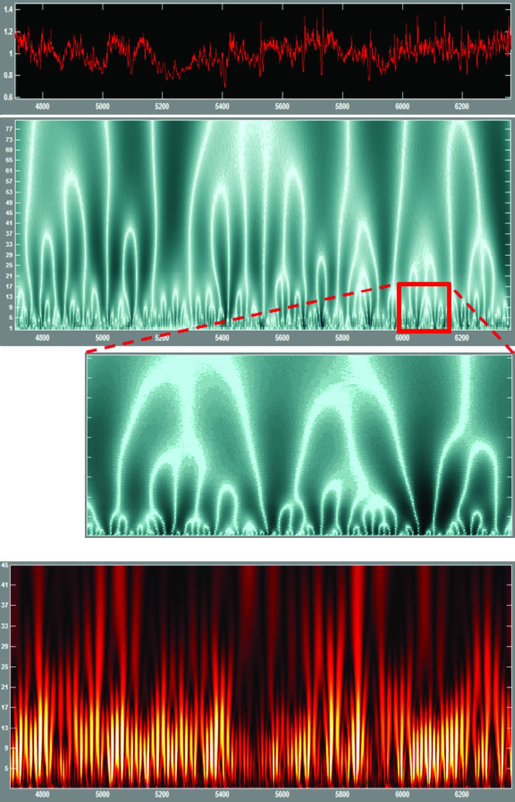

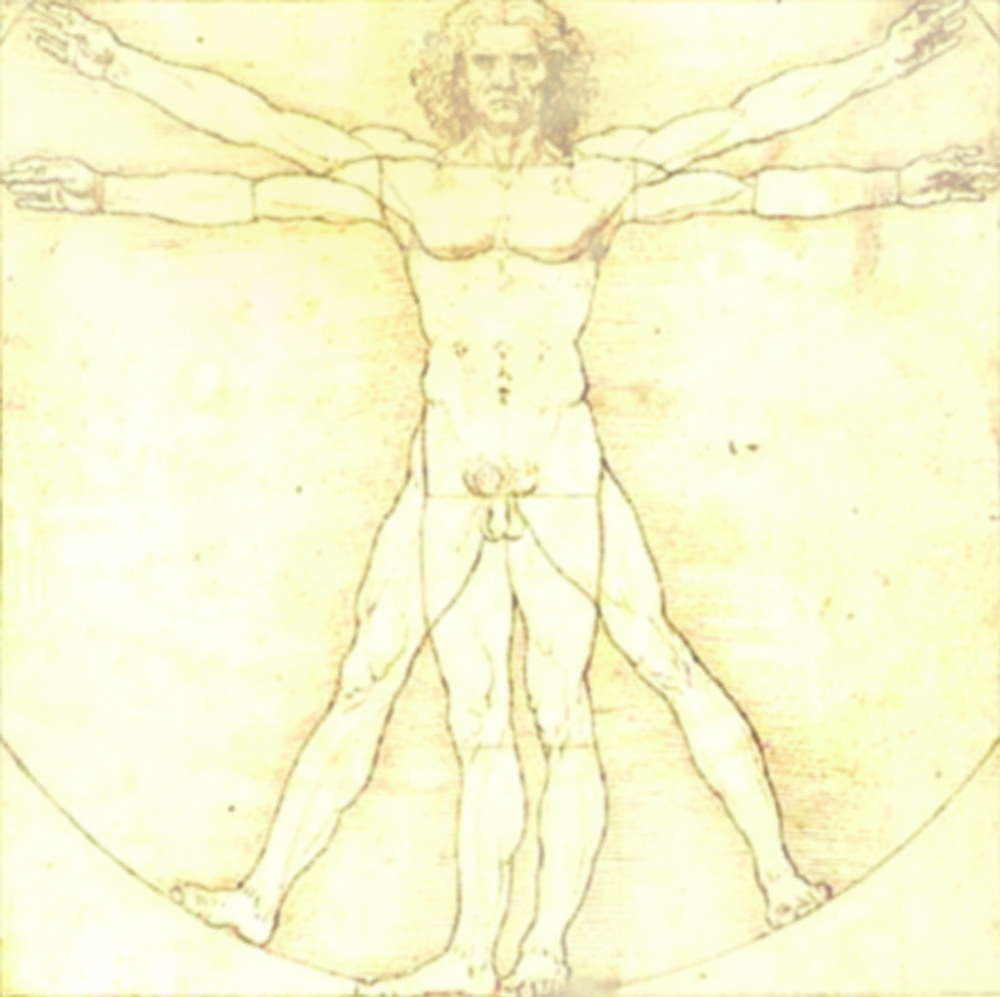

<!-- pdf-page: 60 -->

42 Biology of Sleep

## CYTOKINES, HOST DEFENSE, AND SLEEP

### James M. Clinton, Christopher J. Davis, and James M. Krueger

## 3.5

CYTOKINE BRAIN STIMULI THAT PROMOTE PRODUCTION/RELEASE SLEEP EFFECTS: PROMOTES

Inflammatory states are associated with profound changes in sleep, sleepiness, and fatigue. Cytokines produced by neurons and glia mediate these effects; these signaling molecules form biochemical networks within the brain and immune system and represent a diverse group of proteins and glycoproteins that behave like hormones and neuromodulators. Cytokines are evolutionarily old molecules and are highly conserved from flies to mice to humans. The dynamic changes in cytokines have been characterized during normal sleep and over the course of inflammatory conditions in animal models (Box 3.5-1 and Table 3.5-1) and during human pathology. Remarkably, an inflammatory challenge elicits changes in both central cytokine levels and behavior for many months.

BOX 3.5-1 Abbreviations Used in the Language

#### of Cytokines

A1AR: adenosine A1 receptor BDNF: brain-derived neurotrophic factor CRH: corticotropin-releasing hormone cry: cryptochrome EGF: epidermal growth factor GABA: γ-aminobutyric acid GHRH: growth hormone–releasing hormone glu: glutamic acid IL-1: interleukin-1β IL-4: interleukin-4 IL-10: interleukin-10 IL-37: interleukin 37 IL-1RA: IL-1 receptor antagonist NF-κB: nuclear factor κB NGF: nerve growth factor NO: nitric oxide NOS: nitric oxide synthase per: period PG: prostaglandins sIL-1R: soluble IL-1 receptor sTNFR: soluble TNF receptor TNF-α: tumor necrosis factor-α

TABLE 3.5-1 Effects of Cytokines on Sleep

In animals, infection often enhances non–rapid eye movement (NREM) sleep, whereas rapid eye movement (REM) sleep is inhibited. These responses usually begin to occur within hours of exposure and last from several days to weeks. Their magnitude, duration, and direction depend on the specific pathogen, host species, location of inflammatory site, and host physiologic status—for example, phase of circadian rhythm and prior sleep history. Figure 3.5-1 shows the NREM sleep response of mice induced by intranasal challenge with influenza virus. Although the virus does not replicate within the brain, influenza virus–positive and –negative sense RNA and viral protein can be detected in the brain within hours. These viral products induce cytokine production locally within the brain, including the hypothalamus and olfactory bulb, and these actions probably initiate the acute phase response. The virus also localizes in the lung, where it replicates and induces large increases in cytokines.

Systemically produced cytokines also influence brain functions such as sleep (Fig. 3.5-2) and are thought to be responsible for the longer-term maintenance of the acute phase sleep responses. The actions of systemic cytokines is likely mediated by vagal afferents because vagotomized mice have an attenuated sleep response to systemically administered proinflammatory cytokines. The molecular steps by which pathogens and associated inflammation alter sleep involve the amplification of those mechanisms responsible for physiologic sleep (Fig. 3.5-3).

Tumor necrosis factor (TNF) is but one of many such substances that collectively constitute the sleep homeostat, an ultracomplex neuronal and glial biochemical network. Hypothalamic and cerebral cortical levels of TNF mRNA or TNF protein have diurnal variations (twofold and tenfold, respectively) with higher levels associated with greater sleep propensity. Sleep loss is associated with enhanced brain TNF, and central or systemic TNF injection enhances sleep. Inhibition of TNF using the soluble TNF receptor, anti-TNF antibodies, or a TNF small inhibitory RNA reduces spontaneous sleep. Mice that lack TNF receptors have less spontaneous sleep, whereas injection of TNF into sleep regulatory circuits—for example, the hypothalamus—promotes sleep. In normal humans, plasma

IL-1β IL-1, TNF, NF-κB, sleep loss, pathogens, neuronal activity, stress, feeding NREM/EEG SWA

IL-6 IL-1, TNF, NF-κB, sleep loss, pathogens, stress NREM

TNF-α TNF, IL-1, NF-κB, sleep loss, pathogens, neuronal activity, stress,

NREM/EEG SWA

Nerve growth factor IL-1, TNF, NF-κB, sleep loss, neuronal activity, pathogens, stress NREM/REM

ambient temperature

Brain-derived neurotrophic factor Neuronal activity, stress, pathogens, sleep loss NREM/REM

Growth hormone–releasing hormone IL-1, sleep loss, microbes NREM/EEG SWA

EEG, electroencephalogram; IL, interleukin; NF-κB, nuclear factor κ-B; NREM, non–REM sleep; REM, rapid eye movement sleep; SWA, electroencephalogram slow-wave (0.50 to 4 Hz) activity; TNF-α, tumor necrosis factor-α.

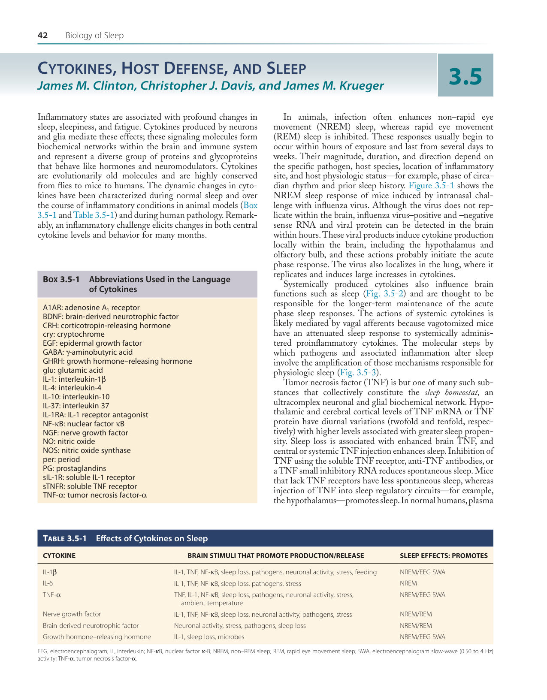

<!-- pdf-page: 61 -->

NREM sleep

65

60

FIGURE 3.5-2. Pathogens affect sleep via steps that involve systemic immunocytes, such as macrophages, or when they infiltrate the brain directly

via glia and neurons. Components of bacterial cell walls—such as lipopolysaccharide from gram-negative bacteria, muramyl peptides from either gram-negative or gram-positive bacterial peptidoglycan, and double-stranded RNA (dsRNA) from viruses—interact with toll-like receptors. This interaction leads to enhanced cytokine production. Cytokines released systemically reach the brain via specific blood-brain transporters, or they can signal the brain via vagal nerve afferents. Cytokines released in the brain directly interact with brain targets to enhance sleep. Several brain-regulated acute phase responses include sleep, fever, social withdrawal, reduced locomotor activity, and some serum protein anomalies. Systemically released cytokines also act on other organs, such as the liver and spleen, to affect a variety of additional acute phase reactants, such as plasma iron (Fe) and zinc (Zn) levels. CNS, central nervous system; NO, nitric oxide.

Percent recording time

55

50

Baseline Day 1 Day 2 Postinfection

Day 4 Day 8

FIGURE 3.5-1. Influenza virus infection greatly increases non–rapid-

eye-movement (NREM) sleep. By day 2 after intranasal inoculation of mice with influenza virus, NREM sleep increases. This increase persists for 1 week or more. The mice recover from the infection after about 2 weeks, and sleep returns to normal values at that time. The inset shows the detection of viral antigen within the olfactory bulb after inoculation. The cell shown has characteristics of microglia and appears to be activated. Microglia are responsible, in part, for the cellular host defenses in the brain. Such cells likely produce cytokines, which in turn are involved in sleep regulation.

Systemic targets

Toll-like receptors Macrophages

Viral dsRNA Peptidoglycan Muramyl peptides Lipopolysaccharide

Vagal afferents

Circulating cytokines

Blood-brain transport

Systemically regulated acute phase response Neutrophilia Fibrinogemia Plasma Fe, Zn

levels of TNF co-vary with electroencephalogram (EEG) slow-wave activity, and in multiple disease states plasma TNF increases in parallel with sleep propensity. For example, patients with obstructive sleep apnea have elevated circulating levels of several proinflammatory cytokines, including TNF, compared with healthy subjects. Following corrective surgery or sequestration of TNF, sleepiness and circulating TNF levels are reduced. Downstream mechanisms of TNF-enhanced sleep include nitric oxide, adenosine, prostaglandins, and activation of nuclear factor κB (NF-κB). The fact that many of the molecules implicated in physiologic sleep regulation (see Fig. 3.5-3) are also immunocyte regulatory components suggests an evolutionary link between sleep and host defenses.

Sleep may feed back to affect the efficacy of the host defenses and seems to be protective. Numerous studies in humans demonstrate that sleep loss alters many immune parameters, including antibody responses to vaccines, bacterial translocation from the intestine, lymphocyte mitogenesis, phagocytosis, antigen uptake, circulating immune complexes, circulating immunoglobulin, and natural killer cell and T-lymphocyte populations. Sleep loss and several sleep pathologies, such as sleep apnea and insomnia, affect circulating levels of various proinflammatory cytokines, such as TNF and interleukin-6, both of which are critical to the development of the acute phase response. Although such findings

#### Pathogens

Brain targets Sleep homeostat Cytokines Adenosine NO Prostaglandins

CNS-regulated acute phase response Sleep Fever Motor activity Ceruloplasmin Plasma glycoprotein

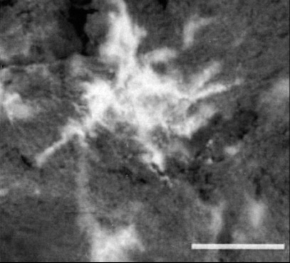

<!-- pdf-page: 62 -->

44 Biology of Sleep

Hours Minutes Milliseconds

Neural/glial network use/activity

Extracellular adenosine

CD39/CD73

Extracellular ATP

FIGURE 3.5-3. Pathogens act to amplify the production of many of the components of the sleep homeostat. Cytokines such as interleukins (IL-1, IL-4,

and IL-10), tumor necrosis factor (TNF), nerve growth factor, epidermal growth factor, and associated soluble and membrane-bound receptors all form part of the sleep biochemical regulatory network. Microbial products affect immunocyte and brain production of these substances. Within brain and immunocytes, adenosine triphosphate (ATP)—coreleased, for example, during neurotransmission—induces the release of IL-1 and TNF from glia. These substances induce their own production and multiple other substances via nuclear factor κ-B (NF-κB) activation. These actions are associated with gene transcription and translation and take several hours. Downstream events include well-known immune-response modifiers and regulators of the microcirculation, such as nitric oxide (NO), adenosine, and prostaglandins (PG); these, in turn, affect neurotransmission on an even faster time scale, leading to state oscillations within local networks. A1AR, adenosine A1 receptor; BDNF, brain-derived neurotrophic factor; COX, cyclooxygenase; CRH, corticotropin-releasing hormone; GABA, γ-aminobutyric acid; GHRH, growth hormone–releasing hormone; IL-1RA, IL-1 receptor antagonist; NOS, nitric oxide synthase; sIL-1R, soluble IL-1 receptor; sTNFR, soluble TNF receptor; TGF, tumor growth factor. (From Clinton JM, Davis CJ, Zielinski M, Jewett K, JM Krueger: Biochemical regulation of sleep and sleep biomarkers. J Clin Sleep Med 2010;7[5]:S38–S42.)

Purine type 2 receptors

IL-4, IL-10, IL-37, CRH, sTNFR, sIL-1R, IL-1RA, TGF, ghrelin, glucocorticoids

Sleep regulatory substances: IL-1, TNF, BDNF

Transcription factor: NF-kB

Excitatory neurons (glutamate)

A1AR

NOS

Local network state oscillations

Inhibitory neurons (GABA)

COX

NO

PG

GHRH

strongly suggest that sleep plays a role in host defenses, the important question of whether sleep and/or sleep loss alters microbial-associated morbidity or mortality remains unanswered. Some evidence suggests this is possible. Studies show that short sleepers are more susceptible to infection by a rhinovirus (the common cold) and that they respond with a weaker immune response to hepatitis B immunization. This is a difficult issue to address because it is not possible to isolate sleep as the independent variable; furthermore, there is a dearth of studies that experimentally induce infections in humans.

Although the precise function of sleep remains unknown, substantial evidence suggests that sleep plays an important role in the response to infection and that these effects are mediated by cytokines.

#### Selected Readings

Bossù P, Cutuli D, Palladino I, et al: A single intraperitoneal injection of

endotoxin in rats induces long-lasting modifications in behavior and

brain protein levels of TNF-alpha and IL-18. J Neuroinflammation 9:101, 2012. Clinton JM, Davis CJ, Zielinski M, Jewett K, Krueger JM: Biochemical

regulation of sleep and sleep biomarkers. J Clin Sleep Med 7(5):S38–S42, 2010. Krueger JM, Rector DM, Churchill L: Sleep and cytokines. Sleep Med Clinics

2:161–169, 2007. Imeri L, Opp MR: How (and why) the immune system makes us sleep. Nat

Rev Neurosci 10:199–210, 2009. Majde JA, Krueger JM: Links between the innate immune system and sleep.

J Allergy Clin Immunol 116:1188–1198, 2005. Motivala SJ, Irwin MR: Sleep and immunity: cytokine pathways linking sleep

and health outcomes. Curr Direct Psychol Sci 16:21–25, 2007. Olivadoti M, Toth LA, Weinberg J, Opp MR: Murine gammaherpesvirus

68: a model for Epstein-Barr virus infections and related diseases. Comp Med 57:44–50, 2007. Toth LA, Jhaveri K: Sleep mechanisms in health and disease. Comp Med

53:12–23, 2003. Zielinski MR, Krueger JM: Sleep and innate immunity. Front Biosci 3:632–

642, 2011.

<!-- pdf-page: 63 -->

## CONTROL OF BREATHING

### Danny J. Eckert, Dominic Roca, Susie Yim Yeh, and Atul Malhotra

## 3.6

#### NORMAL SLEEP

#### SLEEP APNEA

FIGURE 3.6-1. Central control of breathing. The central respiratory control centers are located in the pons and medulla, but the medulla is the location of

the primary respiratory control center. Transections below the medulla cease respiration. The dorsal respiratory group (DRG) contains the ventrolateral nucleus of the tractus solitaries (vl-NTS). This region is believed to be involved in inspiration. The ventral respiratory group (VRG) contains the pre-Botzinger complex (BOT), the nucleus ambiguous (NA), and the nucleus retroambigualis (NRA). These cells fire rhythmically in vitro, respond to hypoxia, and provide neural input to the phrenic nerve and the hypoglossal nucleus. Some controversy exists regarding the role of the parafacial respiratory group (PRG) and retrotrapezoid nucleus (RTN), which includes debate on the possibility of more than one oscillator that can drive breathing (the PRG and RTN are not included in the figure for simplicity.) The pneumotaxic center, which inhibits breathing during inspiration, is located in the nucleus parabrachialis medialis (NPBM) and Kolliker-Fuse (KF) nuclei of the dorsolateral pons. When this area is damaged, bradypnea and larger tidal volumes result.

The goal of the respiratory system is to supply oxygen, remove carbon dioxide, and maintain acid-base balance. The primary centers for central respiratory control are located in the pons and medulla (Fig. 3.6-1), and these centers receive input from a variety of sources to modulate the respiratory system (Fig. 3.6-2). Oxygen and carbon dioxide levels are two of the main signals that alter the respiratory system (Fig. 3.6-3). Sleep decreases the ventilatory response to hypoxia and hypercarbia, and this effect varies with the stage of sleep (Fig. 3.6-4).

Sleep also modifies muscle activation. This is most notable in the upper airway (Fig. 3.6-5). The genioglossus is the most studied of the upper respiratory muscles. It is primarily controlled by the hypoglossal nerve, which receives input from a variety of central sites, as well as feedback from upper airway mechanoreceptors (Fig. 3.6-6).

NPBM & KF

Pons

BOT

NA Medulla

VRG

NRA

Spinal cord

Sleep is associated with a number of respiratory disorders (see Chapter 11). Obstructive sleep apnea and central sleep apnea are two of the most common. Obstructive sleep apnea occurs when upper airway patency is compromised (Fig. 3.6-7). This reduction in upper airway patency is the result of a combination of factors that include anatomy, dilator muscle activity, arousal threshold, and response of the respiratory control system to perturbations (Fig. 3.6-8). Central sleep apnea is defined as an absence of airflow without respiratory effort and can be the manifestation of several processes: high-altitude–induced periodic breathing, narcotics, cardiovascular disease resulting in Cheyne-Stokes breathing, and sleep-wake transition breathing instability (Fig. 3.6-9). A variety of physiologic mechanisms result in central apneas (Fig. 3.6-10).

vI-NTS

VRG

DRG

DRG

<!-- pdf-page: 64 -->

46 Biology of Sleep

FIGURE 3.6-2. Modulators of breathing. The intrinsic central nervous system respiratory control is modulated by cells responsive to blood chemistry, specifi­

cally partial pressures of carbon dioxide (and/or H+ concentration) and oxygen. The primary central chemoreceptors (C) are located near the ventral surface of the medulla. The ventral medullary surface and the retrotrapezoid nucleus are two neuronal groups that are extremely sensitive to changes in H+ concentration. Carbon dioxide (CO2) is lipid soluble and quickly crosses the blood-brain barrier. The CO2 that enters the central nervous system is rapidly hydrated, and the H+ concentration rises; this activates these chemoreceptors, and ventilation increases. The primary peripheral chemoreceptors are the carotid and aortic bodies: the carotid bodies are located at the bifurcation of the common carotid arteries; the aortic bodies are located near the arch of the aorta (mainly relevant in nonhuman species). Both sets of chemoreceptors are sensitive to PO2 and, to a lesser extent, PCO2. Secondary modulators: The cerebral cortex is responsible for voluntary control of breathing. It sends signals through the corticospinal and corticobulbar tracts. Receptors in the lung are responsible for reacting to lung volume and irritants; they send feedback through the vagus nerve. Proprioceptors in muscles and tendons stimulate breathing, as evidenced by passive movements that increase respiratory rate.

Emotional stimuli acting through the limbic system

Peripheral chemoreceptors

, CO2 O2 , H

Central chemoreceptors CO2

, H

Pons

C

C

Pyramid

C C

Receptors in muscles and joints

Higher brain centers (cerebral cortex–voluntary control over breathing)

Respiratory centers (medulla and pons)

Stretch receptors in lungs

Receptors for touch, temperature, and pain stimuli

<!-- pdf-page: 65 -->

30

30

25

25

20

20

15

15

10

10

FIGURE 3.6-3. Response to hypercapnia and hypoxia. A, The rise in ventilation in response to increases in the partial pressure of carbon dioxide (PCO2) is

linear, approximately 2.5 L/min for each increase in PCO2. B, Ventilation increases as the partial pressure of oxygen (PO2) falls below 75 mm Hg. The response is more dramatic when the PO2 falls below 55 mm Hg. Ventilation increases greater than threefold when the PO2 has reached 40 mm Hg (75% saturation). As evident in the curves, response is rapid to changes in PCO2. In comparison, the response to hypoxia is blunted until a large decrease in PO2 occurs.

Minute ventilation, L/min

5

0

20 30 40 Arterial PCO2 (mm Hg) A B 50

Minute ventilation, L/min

5

0

120 100 40 Arterial PO2 (mm Hg) 1.0 .10

FIGURE 3.6-4. The response to hypercapnia and hypoxia is diminished during sleep. A, Hypercapnia was induced in 12 healthy subjects by using a

modified rebreathing technique and electroencephalography to assess the subjects’ stage of sleep. The graph represents the mean minute ventilation for all 12 subjects. The mean minute ventilation at baseline is indicated. The hypercapnic ventilatory response is reduced in stages 2 through 4 compared with wakefulness, and it is further decreased in rapid eye movement (REM) sleep. The blunting of chemoresponsiveness during REM sleep may be a major mechanism by which many forms of central apnea resolve during REM sleep. Cheyne-Stokes breathing and high-altitude periodic breathing tend to resolve during REM sleep; this may be secondary to the decrease in chemoresponsiveness associated with REM. *P < .05, REM different from stages 2 through 4. B, Isocapnic hypoxia was induced in 10 men, and electroencephalography was used to assess the subjects’ stage of sleep. The graphs show representative data from one subject. The response to hypoxia was blunted in stages 2 through 4 and further decreased in REM. PCO2, partial pressure of carbon dioxide; SaO2, hemoglobin saturation; VE , expired ventilation. (From Douglas NJ, White DP, Weil JV, et al: Hypercapnic ventilatory response in sleeping adults. Am Rev Resp Dis 1982;126[5]:758–762.)

20

Awake

*P < .05

Ventilation (L/min)

Stage 3/4

Stage 2

*P < .05

10

REM

0 30 40 End-tidal PCO2 (mm Hg) A 50

30 AWAKE

STAGE 2

20

10

VE (L/min)

0

30 STAGE 3/4

REM

20

10

0 100 90 SAO2 (%) B 80

100 90 80

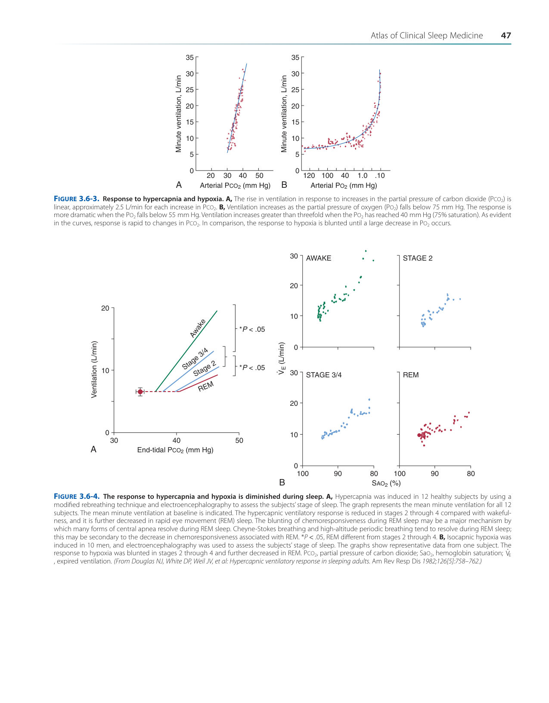

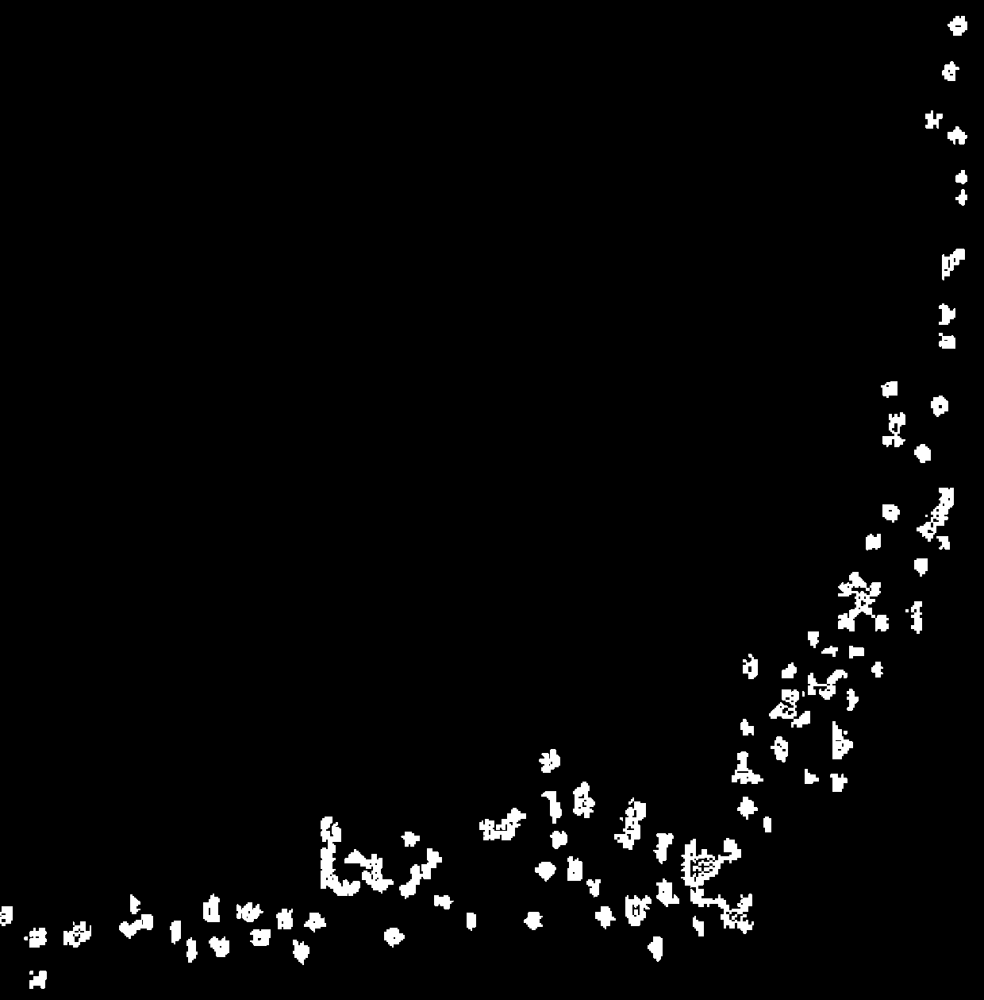

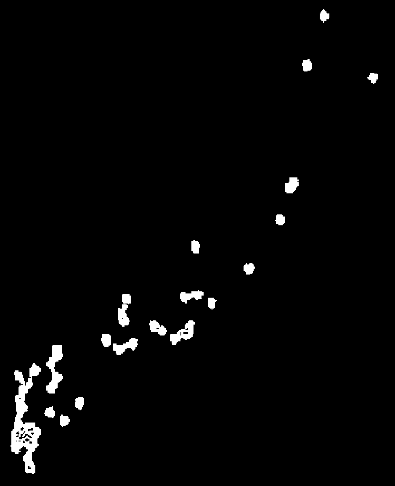

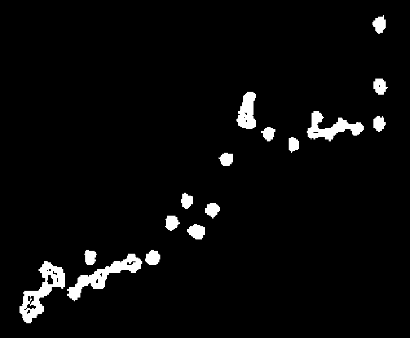

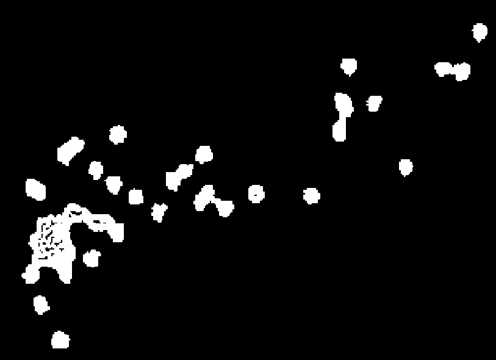

<!-- pdf-page: 66 -->

48 Biology of Sleep

Promotion of airway patency Promotion of airway collapse

Pharyngeal dilator muscle contraction (genioglossus)

Negative pressure on inspiration

FIGURE 3.6-5. The upper airway is vulnerable to collapse. The pharynx is composed of predominantly muscle, fat, and connective tissue. A relatively soft

structure, it has a tendency to collapse because it is devoid of bony support. The recumbent position, especially lying supine, exacerbates this tendency to close. Through reflex-driven protective mechanisms, pharyngeal dilator muscle activity is increased in sleep apnea, likely in compensation for anatomic deficiency. During sleep, reflex activation of pharyngeal muscles is reduced. Inspiration yields a negative airway pressure that creates a collapsing influence on the upper airway. All these factors tend to compromise the pharynx. As a result, patency requires activation of several muscles, including the genioglossus, tensor palatini, and stylopharyngeus. As the lung expands it helps to open the pharynx by longitudinal traction. This balance of forces can be weighted toward collapse by obesity and anatomy (e.g., a small mandible) to result in greater instability and sleep-disordered breathing.

Extraluminal positive pressure Fat deposition Retrognathia or micrognathia mandible

Lung volume (longitudinal traction)

FIGURE 3.6-6. The hypoglossal motor system. The hypoglossal nerve controls the genioglossus muscle (tongue). It is involved in many activities, including

speech and swallowing, and is the most studied pharyngeal dilator muscle. The activity of the hypoglossal nerve is affected by many factors such as cortical and brainstem stimulation, breathing pattern, chemoreceptor activation, and input from mechanoreceptors in the pharynx. Several neurochemical systems modulate sleep—the cholinergic (from the pedunculopontine and laterodorsal tegmenta [PPT/LDT]), adrenergic (from the locus coeruleus [LC] and subcoeruleus), serotonergic (from the raphe), and orexinergic (from the hypothalamus)—and they probably have significant roles in modulating genioglossal activity.

Orexin

PPT/LDT

Genioglossus

Local upper airway receptors

Cortex

LC raphe

XII

Nucleus of the solitary tract

Ventrolateral medulla

Cardiovascular and respiratory reflexes

<!-- pdf-page: 67 -->

5.0

2.5

EMGgg (Volts)

0.0

2.5

5.0

50

EMGsub ( V)

0

50

50

25

FIGURE 3.6-7. Upper airway muscles and arousal threshold. The tracing shows an experimental recording from a patient with obstructive sleep apnea.

The cessation of airflow (apnea) leads to both oxygen desaturation and electroencephalographic (EEG) arousal from sleep. Note the progressive increases in genioglossal muscle activity (electromyographic activity [EMG]) that occur with increasing respiratory efforts. Obstructive apnea is characterized by ongoing respiratory efforts; this is in contradistinction to central apnea, in which respiratory effort ceases during attenuated airflow. Respiratory effort leads to swings in intrathoracic pressure that can be estimated with an epiglottic catheter (epiglottic pressure channel [Pepi]). Negative intrathoracic pressure is believed to be the primary stimulus for respiratory arousal from sleep. Respiratory efforts, as sensed by mechanoreceptors in the chest wall, are believed to be an important contributor to respiratory effort–related arousal from sleep. If arousal occurs prematurely (low arousal threshold), insufficient respiratory stimuli accumulate to activate the genioglossus muscle. On the other hand, if arousal is markedly delayed (high arousal threshold), profound hypoxemia may develop. Ideally, increases in EMG are sufficient to restore airway patency prior to arousal from sleep. (Modified from Eckert DJ, Malhotra A: Pathophysiology of adult obstructive sleep apnea. Proc Am Thorac Soc 2008;5:144–153.)

EEG ( V)

0

25

50

0

Pepi (cm H2O)

50

2

Flow (L/sec)

0

2

100

95

SaO2 (%)

90 2 min

85

80

5.0

2.5

EMGgg (Volts)

0.0

2.5

5.0

50

EMGsub ( V)

0

50

50

25

EEG ( V)

0

25

50

0

Pepi (cm H2O)

50

Snoring Arousal threshold

2

Flow (L/sec)

0

2

100

95

SaO2 (%)

90

20 sec

85

80

AROUSAL

Snoring

APNEA

Oxygen desaturation

<!-- pdf-page: 68 -->

OBSTRUCTIVE HYPOPNEA-APNEA

Surface forces

UA narrowing/ collapse Breathing effort/ PO2, PCO2

UA dilator muscle activity

FIGURE 3.6-8. The potential cycle of ventilatory instability. Obstructive apnea leads to increases in breathing effort in association with hypoxemia and

hypercapnia. Respiratory effort can trigger arousal from sleep with resulting physiologic changes that can restore airway patency and yield hyperventilation. Upon return to sleep, the upper airway (UA) can again collapse, leading to repetitive apnea. Mechanisms listed outside the circle are associated with restoration of pharyngeal airway patency, whereas those on the inside tend to promote upper airway collapse. Many of these factors can clearly be interrelated. PCO2, partial pressure of carbon dioxide; PO2, partial pressure of oxygen. (Modified from Eckert DJ, Malhotra A: Pathophysiology of adult obstructive sleep apnea. Proc Am Thorac Soc 2008;5:144–153.)

Hypoventilation Arousal

PO2 Rapid

PCO2

Return to sleep Hyperventilation

Chemosensitivity UA dilator muscle activity/ responsiveness UA dilator muscle activity/ responsiveness

Rapid UA reopening UA resistance Lung volume

FIGURE 3.6-9. Various forms of central apnea. A, An experimentally induced arousal from sleep can yield hyperventilation based on a robust ventilatory

response to arousal. The electroencephalogram (EEG) shows an increase in frequency (underlined portion) typical of arousal. The hyperventilation leads to hypocapnia that can result in apnea if the partial pressure of carbon dioxide (PCO2) falls below the CO2 apnea threshold. The absence of respiratory effort, as seen in the epiglottic pressure channel (PEPI) defines central apnea.

100

EEG (mV)

100

55

Tone (dB)

0

20

PMASK (cm H2O)

10

20

PEPI (cm H2O)

10

45

PETCO2 (mm Hg)

0

2

VT (L)

0

1

Flow (L/s)

1

A

10s

<!-- pdf-page: 69 -->

EEG

SaO2

Arousal Arousal Arousal Arousal Arousal

Chest

Abdomen

EEG

SaO2

Chest

Abdomen

B

1 min

B, Narcotic-induced central apnea occurs in up to 50% of patients on long-term narcotic therapy. In the top panel, intermittent pauses are observed in the chest and abdominal respiratory belts that occur in central apnea. With reductions in the dose of the narcotic agent, as shown in the lower panel, the breathing pattern is normalized. These graphs illustrate the dose dependence of narcotic-induced central apnea. This breathing pattern is sometimes associated with low respiratory rates (bradypnea). C, Figure shows a crescendo-decrescendo (Cheyne-Stokes) pattern in association with central apnea, by which an absence of respiratory effort is seen in association with cessations in airflow. The arousal from sleep typically occurs at the peak of the hyperpnea that corresponds with paroxysmal nocturnal dyspnea reports in patients. This breathing pattern is seen in one third to one half of congestive heart failure patients with left ventricular dysfunction. Note that the intermittent desaturations that occur are delayed in time because of the slow circulation in congestive heart failure. SaO2, oxygen saturation. (From Eckert DJ, Jordan AS, Merchia P, Malhotra A: Central sleep apnea: pathophysiology and treatment. Chest 2007;131:595–607.)

EEG

SaO2

Airflow

Chest

Abdomen

C

FIGURE 3.6-9, cont’d.

1 min

<!-- pdf-page: 70 -->

52 Biology of Sleep

FIGURE 3.6-10. The complicated relationship between obstructive and central apnea. A considerable overlap is found in the pathogenesis and clinical

expression of these two entities. As seen in the green-shaded components of the diagram, central apnea leads to hypercapnia, which then yields hyperventilation. In turn, the carbon dioxide (CO2) levels fall with hypocapnia, leading to reductions in respiratory drive and again yielding central apnea. A number of factors can contribute to central apnea, based on lack of central drive (won’t breathe) or inability of the respiratory system to adequately translate neural drive to the respiratory muscles (can’t breathe). Obstructive apnea can also lead to arousal from sleep, which can yield a robust ventilatory response to arousal and subsequent central apnea. Obstructive or central apnea can occur during reduced central respiratory drive, depending on the prevailing upper airway (UA) mechanics. As a further example of the complex interaction between obstructive and central sleep apnea, the term complex sleep apnea or treatment-emergent central sleep apnea has been used to describe patients diagnosed with obstructive sleep apnea who develop central sleep apnea on the first night of continuous positive airway pressure (CPAP) therapy. Although the underlying mechanisms are poorly understood and these central apneas commonly recede over time, approximately 10% of patients may experience complex apnea on their first night of CPAP therapy. CNS, central nervous system; CCHS, congenital central hypoventilation syndrome. (From Eckert DJ, Jordan AS, Merchia P, Malhotra A: Central sleep apnea: pathophysiology and treatment. Chest 2007;131:595–607.)

“Can’t breathe” factors ( Respiratory motor output)

Loss of wakefulness stimulus

Chemosensitivity between eupnea CO2 and apnea threshold

Drive

Hypocapnia

Central apnea/hypopnea

Hyperventilation UA anatomy

Chemosensitivity

Hypercapnia

Ventilatory response to arousal

Arousal

“Won’t breathe” factors (CNS depression & CCHS)

Loss of behavioral inputs

Inhibitory reflexes

Obstructive apnea/hypopnea

Metabolic production

Arousal threshold

<!-- pdf-page: 71 -->

## CENTRAL AND AUTONOMIC REGULATION

## IN CARDIOVASCULAR PHYSIOLOGY

### Richard L. Verrier and Ronald M. Harper

## 3.7

#### OVERVIEW

Circulatory homeostasis during sleep requires coordination of two physiologic systems: the respiratory system, which is essential for oxygen and carbon dioxide exchange, and the cardiovascular system, which provides blood transport.

Non–rapid eye movement (NREM) sleep, the initial stage of sleep, is characterized by relative autonomic stability, with vagus nerve dominance and heightened baroreceptor gain. Because of coupling with respiratory activity and cardiorespiratory centers in the brain, modulation of heart rate variations is near sinusoidal, termed normal respiratory sinus arrhythmia (Fig. 3.7-1). Rapid eye movement (REM) sleep is initiated at 90-minute intervals and exhibits a more irregular pattern, with periodic surges in heart rate, arterial blood pressure, and other cardiovascular parameters. The challenge to homeostatic regulation is even greater in individuals who have diseased respiratory or cardiovascular systems, particularly in those with apnea or heart failure, or in infants, whose cardiorespiratory control systems may be underdeveloped.

REM sleep induces a near paralysis of accessory respiratory muscles and diminishes descending forebrain influences on

AW

QS

500

REM

400

ms

300

200 0

400

Successive intervals

FIGURE 3.7-1. The x-axis represents successive heartbeats and the intervals

between heartbeats from a healthy 4-month-old infant during non–rapid eye movement (NREM) sleep (also known as quiet sleep [QS]), rapid eye movement (REM) sleep, and wakefulness (AW). The y-axis represents time in milliseconds between those heartbeats. Note the rapid modulation of intervals during quiet sleep, contributed by respiratory variation; the lower frequency modulation during REM sleep; and epochs of sustained rapid heart rate during wakefulness.

brainstem control regions (see Chapter 3.4). Those reorganizations of control during REM sleep have the potential to interfere substantially with compensatory breathing mechanisms that assist arterial blood pressure management and to remove protective forebrain influences on hypotension or hypertension. The significant interaction between breathing and arterial blood pressure is evident in normalization of blood pressure by continuous positive airway pressure (CPAP) in patients with apnea-induced hypertension.

Patients with heart failure exhibit severe insular cortex and other brain gray matter loss, preferentially on the right side (Fig. 3.7-2), and impaired functional magnetic resonance (MR) signal responses to cold-pressor challenges and Valsalva maneuvers. In addition to an inability to mount appropriate heart rate responses, this injury appears to stem from disordered breathing and accompanying neural circulatory changes during sleep.

#### HEART RATE SURGES

REM-induced accelerations in heart rate consisting of abrupt, although transitory, 35% to 37% increases in rate, which are concentrated during phasic REM, were observed in canines (Fig. 3.7-3). These marked heart rate surges are accompanied

i

5

ii iii

0

i

iii

B A

FIGURE 3.7-2. Areas of gray matter loss (arrows), colored-coded by percent­

age change represented on the color bar, within the insular cortex (i) of heart failure patients (A, n = 9) and in the hippocampal region (ii) and cerebellum (iii) of obstructive sleep apnea patients (B, n = 21); gray matter loss was calculated from structural magnetic resonance imaging scans relative to controls. (A, From Woo MA, Macey PM, Fonarow GC, et al: Regional brain gray matter loss in heart failure. J Appl Physiol 2003;95:677–684. B, From Macey PM, Henderson LA, Macey KE, et al: Brain morphology associated with obstructive sleep apnea. Am J Resp Crit Care Med 2002;166:1382–1387.)

<!-- pdf-page: 72 -->

54 Biology of Sleep

Slow-wave

Awake REM sleep

Burst frequency (bursts/min)

*

sleep

30

200

Heart rate (bpm)

20

100 0

* *

10

200

Mean arterial pressure (mm Hg)

0 Awake 1 2 3 4 REM

100 0

200

Arterial pressure (mm Hg)

100 0

60

Circumflex coronary artery flow (mL/min)

30 0

60

Mean circumflex coronary artery flow (mL/min)

30 0

Surge Surge

EEG

50 V

EOG

100 V

1 min

FIGURE 3.7-3. Effects of rapid eye movement (REM) sleep, non-REM

(slow-wave) sleep, and quiet wakefulness on heart rate, phasic and mean arterial blood pressure, phasic and mean left circumflex coronary flow, electroencephalogram (EEG) recordings, and electrooculogram (EOG) recordings in a dog. Sleep spindles are evident during non-REM sleep, with eye movements during REM sleep, and with gross eye movements on awakening. Surges in heart rate and coronary flow occur during REM sleep. (From Kirby DA, Verrier RL: Differential effects of sleep stage on coronary hemodynamic function. Am J Physiol 1989;256:H1378–H1383.)

by a rise in arterial blood pressure and are abolished by cardiac sympathectomy. Nerve recordings of sympathetic pathways in human subjects further support the potential involvement of sympathetic activation in REM-associated accelerations in heart rate (Fig. 3.7-4).

In the normal heart, REM-related increases in heart rate are accompanied by increases in coronary blood flow, which are appropriate to the corresponding increase in cardiac metabolic demand. However, during severe coronary artery stenosis (baseline flow reduced by 60%), phasic decreases, rather than increases, in coronary arterial blood flow are found during REM sleep coincident with these heart rate surges (Fig. 3.7-5). Consequently, the flow changes may not match the metabolic requirements of the heart and can result in myocardial ischemia. This phenomenon could underlie the clinical entity known as nocturnal angina.

#### HEART RHYTHM PAUSES

Abrupt decelerations in heart rhythm occur predominantly during tonic REM sleep and are not associated with any preceding or subsequent change in heart rate or arterial blood pressure (Fig. 3.7-6). In some individuals afflicted with genetically based long QT3 syndrome, the pause can trigger

*

250

Burst amplitude (%)

200

150

100

* *

50

0 Awake 1 2 3 4 REM

cycle-length–dependent arrhythmias such as torsades de pointes.

#### PHYSIOLOGIC MECHANISMS THAT UNDERLIE

#### NOCTURNAL CARDIAC EVENTS

The physiologic mechanisms described provide a conceptual framework for understanding a number of cardiac syndromes that have increased prevalence during sleep (Table 3.7-1). These are also discussed in Chapter 14.

#### SUMMARY

Sleep states exert a major impact on cardiorespiratory function as a direct consequence of the significant variations in brain states that occur in the normal cycling between NREM and REM sleep. Dynamic fluctuations in central nervous system variables influence heart rhythm, arterial blood pressure, coronary artery blood flow, and ventilation. Whereas REM-induced surges in sympathetic and parasympathetic nerve activity with accompanying significant surges and pauses in heart rhythm are well tolerated in normal people, patients with heart disease may be at heightened risk for lifethreatening arrhythmias, myocardial ischemia, and infarction. During NREM sleep, in the severely compromised heart, the potential exists for hypotension that can impair blood flow through stenotic coronary vessels to trigger myocardial ischemia or infarction. Damage to central brain areas that regulate autonomic activity and that coordinate upper airway and diaphragmatic action can lead to enhanced sympathetic outflow, increasing risk in patients with heart failure and contributing to hypertension in patients with obstructive sleep

<!-- pdf-page: 73 -->

Slow-wave

sleep Awake REM sleep

Slow-wave

sleep

200

Heart rate (bpm)

100 0

200

Mean arterial pressure (mm Hg)

100 0

FIGURE 3.7-5. Effects of sleep stage on heart rate, mean and phasic arterial blood pressures, and mean and phasic left circumflex coronary artery

blood flow in a typical dog during stenosis. Note phasic decreases in coronary flow that occur during heart rate surges while the dog is in rapid eye movement (REM) sleep. EEG, electroencephalogram; EOG, electrooculogram. (From Kirby DA, Verrier RL: Differential effects of sleep stage on coronary hemodynamic function during stenosis. Physiol Behav 1989;45:1017–1020.)

200

Arterial pressure (mm Hg)

100 0

60

Circumflex coronary artery flow (mL/min)

30 0

60

Mean circumflex coronary artery flow (mL/min)

30 0

EEG

50 V

EOG

100 V

1 min

Surge Surge

TABLE 3.7-1 Patient Groups at Potentially Increased Risk for Nocturnal Cardiac Events

INDICATION (U.S. CASES/YEAR) POSSIBLE MECHANISM

Atrial fibrillation (2.5 million) 29% of episodes occur between midnight and 6:00 AM. Respiratory and

Nocturnal angina, ischemia, myocardial infarction (~250,000), lethal

arrhythmias, or cardiac arrest at night (~47,500)

The nocturnal pattern suggests a sleep state–dependent autonomic trigger

or respiratory distress. • Nondemand ischemia and angina peak between midnight and 6:00 AM. • Nocturnal onset of myocardial infarction is more frequent in older and

sicker patients and carries a higher risk of congestive heart failure.

Near-miss or siblings of SIDS victims “Crib death” commonly occurs during sleep, with characteristic

Family report of highly irregular breathing, excessive snoring, or apnea in

patients with coronary disease (5 to 10 million patients with apnea)

Long QT3 syndrome, Brugada syndrome, and sudden unexplained

nocturnal death syndrome

autonomic mechanisms are suspected.

Patients with hypertension or atrial or ventricular arrhythmias should be

screened for sleep apnea.

The profound cycle-length changes associated with sleep may trigger

pause-dependent torsades de pointes in these patients, who have an associated genetic basis for arrhythmias.

Patients on cardiac medications (13.5 million patients with cardiovascular

disease)

NREM, non–rapid eye movement; SIDS, sudden infant death syndrome.

cardiorespiratory symptoms. Passive smoking, including during gestation, increases the incidence of SIDS deaths.

β-Blockers and calcium channel blockers that cross the blood-brain barrier

may increase nighttime risk because poor sleep and violent dreams may be triggered. Medications that increase the Q-T interval may be conducive to pause-

dependent torsades de pointes during the profound cycle length changes in sleep. Because arterial blood pressure is decreased during NREM sleep, additional

lowering by antihypertensive agents may introduce a risk of ischemia and infarction as a result of lowered coronary perfusion.

<!-- pdf-page: 74 -->

56 Biology of Sleep

apnea. Coordination of cardiorespiratory control is especially pivotal in infancy, when developmental immaturity can compromise function and pose special risks. Throughout sleep, the coexistence of coronary disease and apnea is associated with heightened risk of cardiovascular events because of the challenge of dual control of the respiratory and cardiovascular systems.

50 V

ECG

105 150 150

1 mV

EMG

50 V

CA 1

## INTERACTIVE REGULATION OF SLEEP AND FEEDING

### Éva Szentirmai and Levente Kapás

## 3.8

LGN

5 V

Tonic

Phasic

DIA

5 sec

FIGURE 3.7-6. Representative polygraphic recording of a primary heart

rate deceleration during tonic rapid eye movement (REM) sleep. During this deceleration, heart rate decreased from 150 to 105 beats/min, or 30%. The deceleration occurred during a period devoid of pontogeniculooccipital (PGO) spikes in the lateral geniculate nucleus (LGN) or theta rhythm in the hippocampal (CA 1) leads. The deceleration is not a respiratory arrhythmia because it is independent of diaphragmatic (DIA) movement. The abrupt decreases in amplitude of hippocampal theta waves, PGO waves, and respiratory amplitude and rate are typical of transitions from phasic to tonic REM. ECG, electrocardiogram; EMG, electromyogram. (From Verrier RL, Lau RT, Wallooppillai U, et al: Primary vagally mediated decelerations in heart rate during tonic rapid eye movement sleep in cats. Am J Physiol 1998;43:R1136–R1141.)

#### Selected Readings

Javaheri S: Effects of continuous positive airway pressure on sleep apnea and

ventricular irritability in patients with heart failure. Circulation 101:392– 397, 2000. Kirby DA, Verrier RL: Differential effects of sleep stage on coronary hemo­

dynamic function. Am J Physiol 256:H1378–H1383, 1989. Macey PM, Henderson LA, Macey KE, et al: Brain morphology associated

with obstructive sleep apnea. Am J Resp Crit Care Med 166:1382–1387, 2002. Rowe K, Moreno R, Lau RT, et al: Heart rate surges during REM sleep are

associated with theta rhythm and PGO activity in cats. Am J Physiol 277:R843–R849, 1999. Shamsuzzaman AS, Gersh BJ, Somers VK: Obstructive sleep apnea: implica­

tions for cardiac and vascular disease. JAMA 290:1906–1914, 2003. Verrier RL, Harper RM: Central and autonomic mechanisms regulating

cardiovascular function. In Kryger MH, Roth T, Dement WC, editors: Principles and practice of sleep medicine, ed 5, Philadelphia, 2010, WB Saunders, pp 215–225. Verrier RL, Josephson ME: Cardiac arrhythmogenesis during sleep: mecha­

nisms, diagnosis, and therapy. In Kryger MH, Roth T, Dement WC, editors: Principles and practice of sleep medicine, ed 5, Philadelphia, 2010, WB Saunders, pp 1363–1369. Verrier RL, Mittleman MA: Sleep-related cardiac risk. In Kryger MH, Roth

T, Dement WC, editors: Principles and practice of sleep medicine, ed 5, Philadelphia, 2010, WB Saunders, pp 1353–1362. Woo MA, Macey PM, Fonarow GC, et al: Regional brain gray matter loss

in heart failure. J Appl Physiol 95:677–684, 2003.

The regulation of sleep and food intake are closely related. The mechanisms responsible for food-seeking behavior and the control of sleep are coordinated by partly overlapping hypothalamic neuronal systems. These systems receive information about the energy status of the body through hunger, adiposity, and satiety signals that arise from the peripheral and central nervous systems (Figure 3.8-1). These signals include classic brain-gut peptides, such as ghrelin and cholecystokinin (CCK), as well as neural and humoral signals that arise from the white and brown adipose tissues (Table 3.8-1).

Central administration of ghrelin stimulates wakefulness, food intake, and growth hormone release in rodents. In rats, plasma and hypothalamic ghrelin levels increase in response to sleep deprivation. Ghrelin receptor–deficient transgenic mice show impaired arousal responses to a novel environment or food restriction. In ghrelin-deficient mice, the integration of thermoregulatory and sleep responses to metabolic challenges is severely deteriorated. The wakefulness-promoting effect of ghrelin involves the activation of hypothalamic orexinergic and neuropeptide Y (NPY)-ergic mechanisms. Ghrelin also stimulates the hypothalamus-pituitary-adrenal (HPA) axis by stimulating corticotroph-releasing hormone (CRH) secretion in the paraventricular nucleus (Figure 3.8-2). NPY, orexin, and CRH have wakefulness-promoting effects. The hypothalamic NPY-orexin-ghrelin network plays an important role

Sleep-wake

Metabolic responses

Behavioral responses

Feeding

Intergrative Center

Hunger signal

Adiposity signal

Satiety signal

Fat cells

FIGURE 3.8-1. Mounting evidence supports the idea that mechanisms

responsible for feeding behavior and the control of sleep are coordinated by partly overlapping hypothalamic neuronal systems. These systems receive information about the energy status of the body through hunger, adiposity, and satiety signals.

<!-- pdf-page: 75 -->

TABLE 3.8-1 Relationship Between Sleep and Ghrelin, Leptin, and Cholecystokinin (CCK): Plasma and

#### Hypothalamic Levels

GHRELIN LEPTIN CCK

Effect of acute sleep

Elevated plasma and hypothalamic levels Reduced diurnal amplitude NA

deprivation

Relation to chronic short

Elevated plasma levels Reduced plasma levels NA

sleep duration in humans

CCK, cholecystokinin; KO, knockout; NA, not available; NREM, non–rapid eye movement; REM, rapid eye movement.

Effects on sleep Humans: no effect or increased sleep Rodents: central administration induces

wakefulness

Sleep in KO animals Normal diurnal rhythm, fragmented sleep

in ghrelin and ghrelin receptor–KO mice

Plasma levels in sleep

Enhanced nocturnal ghrelin levels in

disorders

night-eating syndrome

Increased NREM sleep, decreased

Peripheral administration increases

REM sleep

NREM sleep, central injection has no effect

Attenuated diurnal rhythm of sleep,

CCK-1 receptor–deficient rats have

increased and fragmented NREM sleep

normal sleep-wake activity

Reduced levels in narcolepsy and in

NA

night-eating syndrome

FIGURE 3.8-2. Hypothalamic ghrelinergic, orexinergic, and neuropeptide Y (NPY)-ergic neurons form a well-characterized circuit that is implicated

in the regulation of food intake and sleep. Circulating ghrelin and leptin can modulate the activity of the circuit through NPY in the arcuate nucleus. Ghrelin promotes wakefulness when injected into the lateral hypothalamus (LH), paraventricular nucleus (PVN), or medial preoptic area (MPA). Ghrelin administration and ghrelinergic neurons activate orexinergic cells in the LH and in NPY-containing cells in the arcuate nucleus. In the PVN, ghrelin facilitates corticotrophreleasing hormone (CRH) release indirectly through the stimulation of NPY-ergic neurons. Ghrelin microinjection into the LH may promote wakefulness through the stimulation of orexin release. In the PVN, ghrelin indirectly facilitates CRH release that leads to increased wakefulness. In the MPA, ghrelin’s wakefulnesspromoting effect might be mediated by nitric oxide (NO). Several actions of ghrelin are NO dependent, and NO-ergic mechanisms are implicated in sleep regulation.

CRH

Increased feeding

Paraventricular nucleus

Ghrelin CRH

Ghrelin

Nitric oxide

Dorsomedial hypothalamus Medial preoptic area Ventromedial hypothalamus

Orexin

Increased feeding

Orexin

Lateral hypothalamus

NPY

Arcuate nucleus

Leptin

in integrating circadian, visual, and metabolic signals (Figure 3.8-3). The ghrelin gene also codes for another biologically active peptide, obestatin; it has the opposite effects on both food intake and sleep as ghrelin. In humans, the effects of ghrelin on sleep are less clear. Systemic repeated bolus injections of ghrelin during the night enhance stage IV sleep and suppress rapid eye movement (REM) sleep in healthy male subjects, but ghrelin injections are ineffective in women. Epidemiologic studies suggest a relationship between sleep duration and plasma ghrelin levels. Habitual short sleep duration and sleep restriction to 4 hours per night are associated with elevated ghrelin plasma levels and increased hunger, which suggests that chronic sleep curtailment is a risk factor for obesity.

CCK elicits the complete behavioral sequence of the satiety syndrome, including the cessation of feeding, increased sleep, decreased motor activity, and social withdrawal. These actions are mediated by peripheral targets because central injections of CCK do not suppress feeding or promote sleep. Although the feeding-suppressive effects of CCK are mediated by the vagus nerve, sleep induction appears to be independent of the vagus and of pancreatic insulin. Animals that lack CCK-1 receptors do not show any gross alteration in their baseline sleep pattern, which suggests that in the absence of CCK signaling through the peripheral receptor subtype, normal sleep-wake activity can be maintained.

Adipokines are white adipose tissue–derived hormones that play a role in the regulation of sleep and feeding. The

<!-- pdf-page: 76 -->

58 Biology of Sleep

Circadian

signals

NPY

Wake

Visual signals

Orexin

Eating

## ENDOCRINE PHYSIOLOGY

### Rachel Leproult and Eve Van Cauter

## 3.9

Ghrelin

Metabolic signals

FIGURE 3.8-3. The hypothalamic ghrelin-orexin-neuropeptide Y (NPY)

circuit receives and integrates metabolic, circadian, and visual signals. Activation of the circuit has two main parallel outputs in rodents: increased wakefulness and increased feeding activity.

best-characterized adipokines are leptin and tumor necrosis factor (TNF). Both hormones suppress feeding and stimulate metabolism. Via saturable transport mechanisms, circulating leptin enters the brain, where leptin receptors are expressed in various hypothalamic nuclei and in the brainstem. Via these receptors, leptin stimulates melanocyte-stimulating hormone secretion and suppresses NPY-producing cells— two of the main effects that underlie leptin’s satiety effects. The effects of leptin itself on sleep are less well understood. Leptin plasma levels peak at night in humans; this diurnal rhythm appears to be entrained by eating, and sleep deprivation suppresses the nocturnal rise in leptin. Obese leptindeficient mice have increased amounts of non–rapid eye movement sleep (NREM) sleep, but sleep appears to be more fragmented. Injection of leptin in rats stimulates NREM sleep and suppresses REM sleep, whereas in mice it only stimulates NREM sleep. The most important source of circulating TNF in healthy subjects is adipose tissue. Its somnogenic effects have been demonstrated in multiple species, including rats, mice, and humans.

The recognition that adult humans have significant amounts of active brown adipose tissue (BAT) opened new directions in our understanding of the integration of sleep and metabolism. The function of brown adipocytes in metabolic processes is fundamentally different from that of white counterparts. White adipose tissue is responsible for storing excess energy in the form of fat, while BAT dissipates excess energy in the form of heat. The tightly regulated balance in the activities of the two fat tissues is critical in maintaining metabolic homeostasis. The ability of BAT to produce heat is due to the unique presence of uncoupling protein 1 (UCP-1) in the mitochondria. Recent evidence has revealed that the active BAT is a source of somnogenic signals. Pharmacologic stimulation of BAT enhances sleep, whereas UCP-1–deficient mutant mice have significantly less spontaneous sleep. BATderived signals appear to also be important for generating the optimal metabolic milieu for normal homeostatic sleep responses after sleep loss.

#### Selected Readings

Esposito M, Pellinen J, Kapás L, Szentirmai É: Impaired wake-promoting

mechanisms in ghrelin receptor deficient mice. Eur J Neurosci 35:233–243, 2012. Kapás L, Obál F Jr, Alföldi P, et al: Effects of nocturnal intraperitoneal

administration of cholecystokinin in rats: simultaneous increase in sleep, increase in EEG slow-wave activity, reduction of motor activity, suppression of eating, and decrease in brain temperature. Brain Res 438(1–2):155– 164, 1988. Sinton C, Fitch T, Gershenfeld HK: The effects of leptin on REM sleep and

slow wave delta in rats are reversed by food deprivation. J Sleep Res 8:197– 203, 1999. Spiegel K, Tasali E, Penev P, et al: Sleep curtailment in healthy young men

is associated with decreased leptin levels, elevated ghrelin levels, and increased hunger and appetite. Ann Intern Med 141:846–850, 2004. Szentirmai E, Krueger JM: Obestatin alters sleep in rats. Neurosci Lett 404(1–

2):222–226, 2006. Szentirmai É, Kapás L: Ghrelin regulation of sleep, circadian clock and body

temperature. Contemp Endocrinol 10:149–180, 2012. Szentirmai E, Kapás L, Krueger JM: Ghrelin microinjection into forebrain

sites induces wakefulness and feeding in rats. Am J Physiol Regul Integr Comp Physiol 292:R575–R585, 2007. Szentirmai É, Kapás L, Sun Y, Smith RG, Krueger JM: The preproghrelin

gene is required for normal integration of thermoregulation and sleep in mice. Proc Natl Acad Sci U S A 106(33):14069–14074, 2009.

#### OVERVIEW OF ENDOCRINE PHYSIOLOGY

#### Central Mechanisms that Control Pituitary

#### Hormone Secretion over the 24-Hour Day

Two interacting timekeeping processes in the central nervous system, process S and process C, can be affected by synchronizing factors; the activity of these processes controls the 24-hour profiles of hypothalamo-pituitary hormones. The pulsatile activity of hypothalamic releasing and/or inhibiting factors also affects the function of the pituitary gland. In addition, the autonomic nervous system and circulating levels of melatonin can affect the activity of the peripheral endocrine organs (Fig. 3.9-1).

Process S Sleep homeostat Effects depend on the amount

of prior wakefulness. Process C Circadian

Effects depend on time of day,

rhythmicity

irrespective of the presence of sleep or wakefulness, and is generated by a pacemaker in the suprachiasmatic nuclei (SCN) of the hypothalamus. Modulating

Can synchronize or

Light, body position, stress,

factors

desynchronize systems

food intake, and exercise can affect the patterns of pituitary hormone release.

<!-- pdf-page: 77 -->

Growth hormone ( g/L)

Circadian rhythm–SCN Sleep-wake homeostasis

15

10

5

A

0

Hypothalamic pulse generators

ANS

Cortisol ( g/dL)

20

All endocrine axes Pituitary

PRL GH TSH LH ACTH FSH

Cortisol Sex steroids

FIGURE 3.9-1. Schematic representation of the central mechanisms

involved in the control of temporal variations in pituitary hormone secretions over a 24-hour cycle. ACTH, adrenocorticotropic hormone; ANS, autonomic nervous system; FSH, follicle-stimulating hormone; GH, growth hormone; LH, luteinizing hormone; PRL, prolactin; SCN, suprachiasmatic nuclei; TSH, thyroid-stimulating hormone. (Modified from Van Cauter E, Copinschi G: Endocrine and other biological rhythms. In Degroot LJ, Jameson JL [eds]: Endocrinology, vol 1, ed 5, Philadelphia, 2006, Elsevier, pp 341–372.)

#### Temporal Variations of Plasma Levels

#### of Hormones

Levels of hormones can be related to the time of day, whether the person is asleep, and whether sleep deprivation is present.

Figure 3.9-2 shows data from a protocol in which male sub­

jects were studied for 53 hours including 8 hours of nocturnal sleep from 11:00 PM to 7:00 AM; 28 hours of continuous wakefulness (including a night of total sleep deprivation); and daytime recovery sleep from 11:00 AM to 7:00 PM, beginning 12 hours out of phase with the usual bedtime. From these studies it can be concluded that (1) growth hormone (GH) secretion is primarily controlled by the sleep-wake homeostasis and is maximal during slow-wave sleep (SWS); (2) cortisol secretion is almost entirely related to clock time (circadian rhythm), and its level is minimally affected by sleep or sleep deprivation; (3) secretion of thyroid-stimulating hormone is controlled by both sleep homeostasis and circadian rhythmicity; and (4) sleep onset, no matter when it occurs, has a stimulatory effect on the release of prolactin.

#### Glucose Regulation and Hunger

In the study illustrated in Figures 3.9-2 and 3.9-3, the subjects were fasting, and caloric intake was in the form of an intravenous glucose infusion at a constant rate. Despite the fact that exogenous glucose input was constant, the levels of glucose and insulin secretion rate increased during sleep, returned to baseline in the morning, then gradually increased during the day; the latter suggests a circadian effect. During daytime sleep, glucose and insulin also increased. Thus there is both a sleep and a circadian effect on glucose regulation and insulin secretion.

Leptin, a satiety hormone produced by fat cells, and ghrelin, a hunger hormone produced by gastric cells, demonstrate diurnal variation. The 24-hour variation in leptin levels

15

10

Plasma levels

5

B

0

4

TSH ( U/mL)

3

2

C

250

Prolactin (% of mean)

200

150

100

D

50

Nocturnal sleep 22 02 06 10 14 18 22 Clock time 02 06 10 14 18 22 18

Nocturnal sleep deprivation

Daytime sleep

FIGURE 3.9-2. Mean (+SEM) hormonal profiles obtained in a protocol

designed to delineate the respective contributions of the circadian rhythmicity and the sleep-wake homeostasis. The effects of the circadian modulation can be observed in the absence of sleep, and the effects of sleep can be observed at an abnormal circadian time. TSH, thyroid-stimulating hormone. (Modified from Van Cauter E, Spiegel K: Circadian and sleep control of hormonal secretions. In Zee PC, Turek FW [eds]: Regulation of sleep and circadian rhythms, vol 133 of Lung biology in health and disease [Lenfant C, series ed], New York: Marcel Dekker, 1999, pp. 397–426.)

depends on when meals are taken; levels are low in the morning, increase gradually during the day, and are highest at night. Ghrelin is also high at night. During the daytime, ghrelin levels decrease after eating, then increase in anticipation of the next meal (Fig. 3.9-4).

#### CONDITIONS THAT AFFECT HORMONES

#### AND METABOLISM

#### Aging

With aging comes a reduction in the amount of SWS. Because GH secretion is maximal in SWS, a reduction in GH levels during sleep is apparent in older people. The overall wave shape of the 24-hour cortisol profile remains relatively unchanged with aging. However, minimum cortisol values in the evening are elevated with aging (Fig. 3.9-5).

#### Disease States that Reduce Slow-Wave Sleep

In untreated obstructive sleep apnea (OSA) (see Chapter 13.2), sleep is fragmented and SWS is reduced. Nocturnal

<!-- pdf-page: 78 -->

60 Biology of Sleep

GH levels are also reduced in untreated OSA but are increased by continuous positive airway pressure (CPAP) treatment (Fig. 3.9-6). Treatment of OSA with CPAP can also reduce norepinephrine levels, as shown in young women with polycystic ovary syndrome (Fig. 3.9-7). In this study, an association was found between decreasing norepinephrine levels and increasing hours of CPAP use.1

Plasma glucose (% of mean)

120

110

100

90

80

FIGURE 3.9-4. Individual 24-hour profiles of leptin and ghrelin. The black bars represent the bedtimes. Identical meals were presented at 5-hour intervals

(unpublished data).

Insulin secretion rate (% of mean)

160

140

120

100

80

60

Nocturnal sleep 22 02 06 10 14 18 22 Clock time 02 06 10 14 18 22 18

Nocturnal sleep deprivation

Daytime sleep

FIGURE 3.9-3. Mean (+SEM) profiles of glucose and insulin secretion in

a group of normal young men. Subjects were studied over a 53-hour period, which included 8 hours of usual nocturnal sleep, 28 hours of continuous wakefulness (including one night of sleep deprivation), and a daytime recovery sleep period. (Modified from Van Cauter E, Blackman JD, Roland D, et al: Modulation of glucose regulation by circadian rhythmicity and sleep. J Clin Invest 1991;88:934–942.)

9

Leptin (ng/mL)

produce

6

suppresses

Fat cells

Appetite

3

increases

1200

Ghrelin (pg/mL) produce

800

Gastric cells

400

#### Sleep Deprivation

A meta-analysis of prospective studies has indicated an association between short sleep duration and diabetes prevalence, with the pooled relative risk estimated at 1.28, indicating an increased risk of 28% with short sleep duration (less than 5 to 6 hours per night).2

Multiple well-controlled laboratory studies have investigated the metabolic consequences of semichronic sleep restriction and have indicated an increased diabetes risk after sleep loss. The results of three of these studies are shown in

Figure 3.9-8.

Recurrent sleep restriction also affects multiple endocrine axes. As an example, after 1 week of sleep restriction to 5 hours per night, daytime testosterone levels decreased in young healthy men (Fig. 3.9-9), an effect that could be translated into 15 to 20 years of aging.

At the end of a week of sleep restriction versus sleep extension, marked differences are evident in the 24-hour levels of leptin (Fig. 3.9-10). This may translate into an increase in appetite.

In the epidemiologic study shown in Figure 3.9-11, a linear relation between duration of sleep and leptin levels (see Fig. 3.9-11, A) and an inverse relation between duration of sleep and ghrelin levels (see Fig. 3.9-11, B) were found. This would result in increased appetite.

Meal Meal Meal

21 1 5 9

13 17 21

Clock time

<!-- pdf-page: 79 -->

17-24 years old 70-83 years old

Plasma GH ( g/L)

8

8

4

4

FIGURE 3.9-5. Mean (+SEM) profiles of growth hormone (GH) and cortisol in young men and older men with a similar body mass index (24.1 ± 0.6 kg/

m2 and 24.1 ± 0.8 kg/m2, respectively). (Modified from Van Cauter E, Leproult R, Plat L: Age-related changes in slow-wave sleep and REM sleep and relationship with growth hormone and cortisol levels in healthy men. JAMA 2000;284:861–868.)

0

08 12 16 20 00 04 08

500

Plasma cortisol (nmol/L)

400

300

200

100

0

08 12 16 20 00 04 08

Clock time

0

08 12 16 20 00 04 08

500

400

300

200

100

0

08 12 16 20 00 04 08

Clock time

FIGURE 3.9-6. Nocturnal profiles (mean + SEM) of growth hormone (GH) before and after continuous positive airway pressure (CPAP) treatment.

(Modified from Saini J, Krieger J, Brandenberger G, et al: Continuous positive airway pressure treatment: effects on growth hormone, insulin and glucose profiles in obstructive sleep apnea patients. Horm Metab Res 1993;25[7]:375–381.)

12

8

4

Plasma GH ( g/L)

0

12

8

4

0

Untreated sleep apnea

On CPAP

22 0 23 1 2 3 4 5 6

Clock time

<!-- pdf-page: 80 -->

62 Biology of Sleep

Before CPAP After CPAP

Norepinephrine (pg/mL)

400

350

300

250

200

150

FIGURE 3.9-7. Mean (±SEM) 24-hour profiles of norepinephrine before and after 8 weeks of continuous positive airway pressure (CPAP) treatment

in women with polycystic ovary syndrome. Horizontal black bar indicates time in bed; vertical gray bars indicate meal times (9:00, 14:00, 19:00 for 20 min). (Data from Tasali E, Chapotot F, Leproult R, et al: Treatment of obstructive sleep apnea improves cardiometabolic function in young obese women with polycystic ovary syndrome. J Clin Endocrinol Metab 2011;96[2]:365–374.)

100

2:00 Clock time (h) 6:00 18:00

14:00

22:00 10:00 14:00

FIGURE 3.9-8. Results from the intravenous glucose tolerance test obtained in three laboratory studies that have investigated diabetes risk under

rested condition (blue bars) and after sleep restriction (red bars). (Combined data from Spiegel K, Leproult R, Van Cauter E: Impact of sleep debt on metabolic and endocrine function. Lancet 1999; 354:1435–1439; Leproult R, Van Cauter E: Role of sleep and sleep loss in hormonal release and metabolism. Endocr Dev 2010; 17:11–21; Nedeltcheva AV, Kessler L, Imperial J, et al: Exposure to recurrent sleep restriction in the setting of high caloric intake and physical inactivity results in increased insulin resistance and reduced glucose tolerance. J Clin Endocrinol Metab 2009; 94:3242–3250; Buxton OM, Pavlova M, Reid EW, et al: Sleep restriction for 1 week reduces insulin sensitivity in healthy men. Diabetes 2010; 59:2126–2133.)

Short sleep duration and diabetes risk (estimated by intravenous glucose tolerance test)

10

Insulin sensitivity [(mU/L) 1 × min 1]

5

0

800

600

Acute insulin response (mU × L 1 × min 1)

400

200

0

4000

3000

2000

Disposition index

1000

0

Rested After 6 nights 4 h bedtimes

n = 10

Rested After 14 nights 5.5 h bedtimes

Rested After 6 nights 5 h bedtimes

n = 11 n = 20

<!-- pdf-page: 81 -->

Serum testosterone (nmol/L)

30

Rested condition

Partial sleep restriction condition

25

20

15

FIGURE 3.9-9. Mean (±SEM) testosterone levels after resting condition (bedtimes from 22:00 to 8:00 for three nights, in blue) and after sleep restric­

tion (bedtimes from 00:30 to 05:30 for seven nights, in red). (Modified from Leproult R, Van Cauter E: Effect of 1 week of sleep restriction on testosterone levels in young healthy men. JAMA 2011;305[21]:2173–2174.)

10 14 14 18

22 02 06 10

FIGURE 3.9-10. Mean (±SEM) leptin profiles at the end of 1 week of sleep restriction (4 hours in bed per night) and at the end of 1 week of sleep

extension (12 hours in bed per night). (Data from Spiegel K, Leproult R, L’Hermite–Balériaux M, et al: Impact of sleep duration on the 24-hour leptin profile: relationships with sympatho-vagal balance, cortisol and TSH. J Clin Endocrinol Metab 2004;89[11]:5762–5771.)

4 hours in bed 3 h 49 min ± 5 of sleep

6.5

5.5

4.5

3.5

2.5

1.5

9 13 17 21 1 5 9

Clock time

24-Hour Plasma Leptin Levels (ng/ml)

12 hours in bed 9 h 3 min ± 15 of sleep

9 13 17 21 1 5 9

Clock time

FIGURE 3.9-11. Relationship between sleep duration and serum leptin (A) and ghrelin levels (B). (Modified from Taheri S, Lin L, Austin D: Short sleep dura­

tion is associated with reduced leptin, elevated ghrelin, and increased body mass index. PLoS Med 2004;1[3]:e62.)

Association between sleep duration and serum leptin levels

Adjusted leptin (ng/mL) (square root scale)

13.0 14.4 16.0 Adjusted leptin (ng/mL) (square root scale)

17.6 19.4

(57)

(59)

(76) (147) (167) (158)

(54)

6.0 6.5 7.0 7.5 8.0 8.5 9.0

Average nightly sleep (h) A

Association between sleep duration and serum ghrelin levels

Adjusted ghrelin (ng/mL) (square root scale)

729 784 841 900 961 1024 Adjusted ghrelin (pg/mL) (square root scale) 1089

(69)

(172)

(67)

(115) (144)

(89)

(150)

(50)

4.5 5.0 5.5 6.0 6.5 7.5 7.0 8.0

Total sleep time (h) B

<!-- pdf-page: 82 -->

64 Biology of Sleep

#### References

1. Tasali E, Chapotot F, Leproult R, Whitmore H, Ehrmann DA: Treatment

Van Cauter E, Holmback U, Knutson K, et al: Impact of sleep and sleep loss

on neuroendocrine and metabolic function. Horm Res 67(1):2–9, 2007. Van Cauter E, Leproult R, Plat L: Age-related changes in slow wave sleep

of obstructive sleep apnea improves cardiometabolic function in young obese women with polycystic ovary syndrome. J Clin Endocrinol Metab 96(2):365–374, 2011. 2. Cappucio FP, D’Elia L, Strazzullo P, Miller MA: Quantity and quality of

and REM sleep and relationship with growth hormone and cortisol levels in healthy men. JAMA 284:861–868, 2000. Van Cauter E, Spiegel K: Circadian and sleep control of hormonal secretions.

In Zee PC, Turek FW, editors: Regulation of sleep and circadian rhythms, vol. 133 of Lung Biology in Health and Disease (Lenfant C, ed), New York, 1999, Marcel Dekker, pp 397–426.

sleep and incidence of type 2 diabetes: a systematic review and metaanalysis. Diabetes Care 33:414–420, 2010.

#### Suggested Readings

Van Cauter E, Copinschi G: Endocrine and other biological rhythms. In

Degroot LJ, Jameson JL, editors: Endocrinology, 5th ed, vol 1, Philadelphia, 2006, Elsevier Saunders, pp 341–372.
