# 4 Normal Sleep

<!-- pdf-page: 83 -->

## Chapter 4

## Normal Sleep

## SLEEP IN ANIMALS AND THE PHYLOGENY OF SLEEP

### Jerome Siegel

## 4.1

FIGURE 4.1-1. Sleep time in mammals. Carnivores are shown in dark red, herbivores in green, and omnivores in blue. Sleep times in each of these differ

significantly, but carnivores sleep significantly more than herbivores. Sleep amount is an inverse function of body mass over all terrestrial mammals (black line). This function accounts for approximately 25% of the interspecies variance (bottom right) in reported sleep amounts. Herbivores are responsible for this relation because body mass and sleep time were significantly and inversely correlated in herbivores but were not correlated in carnivores or omnivores. (From Siegel JM: Clues to the functions of mammalian sleep. Nature 2005;437:1264–1271.)

The amount of sleep required by animals varies greatly. The horse sleeps less than 2 hours a day, and the big brown bat sleeps 20 hours a day. Rapid eye movement (REM) sleep amounts show even greater variation across species (Fig. 4.1-1). The platypus has the most REM sleep of any animal, approximately 8 hours a day (Video 4.1 and Fig. 4.1-2). Dolphins and other cetaceans do not appear to have any REM

Carnivores

Little brown bat

20

Big brown bat

Giant armadillo Long-nosed armadillo

Hours of sleep per day

Greater short-tailed shrew

European polecat Lion

Tiger Tenerec

15

Phalanger Platypus

R = –0.3, n.s.

Arctic fox Cat Desert hedgehog

Star-nosed mole

Cheetah Jaguar Dog Redfox

10

European hedgehog

Lesser short-tailed shrew

Short-nosed echidna

Eastern American mole

5

0

1 10 100 1000 10,000 0.001 0.01

0.1

Weight (kg)

Omnivores

20

Thick-tailed opossum Virginia opossum Owl monkey Arctic ground squirrel

Hours of sleep per day

Eastern American chipmunk Northern grasshopper mouse

15

Thirteen-lined ground squirrel Norway rat Patas monkey

House mouse

Cotton rat Mole rat

Deer mouse Tree shrew

Chimpanzee R = –0.3, n.s.

Potto

10

Human Pig

Baboon

Slow loris

Genet Galago

Macaque Grivet

5

Squirrel monkey

0

0.1

1 10 100 1000 10,000 0.001 0.01

Weight (kg)

sleep, birds have very little, and conclusive evidence for the presence of REM sleep in reptiles is lacking.

Recent findings undermine the idea that sleep has a vital universal neural or physiologic function across species. Dolphins and other cetaceans never have high-voltage slow waves in both sides of the brain, in contrast to all terrestrial mammals (Fig. 4.1-3). Instead, they have unihemispheric slow waves

Herbivores

20

Hours of sleep per day

Mountain beaver

Golden hamster

15

Mongolian gerbil

Three-toed sloth

Vole

Chinchilla

African striped mouse Degu Guinea pig Rabbit

10

Asiatic elephant African elephant

Gray hyrax

Giraffe

Goat Sheep Tapir

Tree hyrax Rock hyrax

5

Cow Horse Roe deer Donkey

R = –0.8, P < .001

0

1 10 100 1000 10,000 0.001 0.01

0.1

Weight (kg)

Carnivores Omnivores Herbivores

20

Hours of sleep per day

15

R = –0.3, n.s. R = –0.3, n.s.

10

R = –0.5

5

R = –0.8, P < .001

0

0.1

1 10 100 1000 10,000 0.001 0.01

Weight (kg)

<!-- pdf-page: 84 -->

66 Normal Sleep

FIGURE 4.1-2. Brainstem rapid eye movement (REM) sleep state in the platypus. REM and twitches can occur while the forebrain is showing a slow-wave

activity pattern. Electroencephalogram (EEG), electrooculogram (EOG), electromyogram (EMG), and EEG power spectra of samples show sleep-wake states in the platypus. (From Siegel JM, Manger PR, Nienhuis R, et al: Sleep and the platypus. Neuroscience 1999;91:391–400.)

Wake – Pool

EEG

EOG

EMG

EEG

EOG

EMG

Quiet sleep – Moderate voltage

EEG

EOG

EMG

Quiet sleep – High voltage

EEG

EOG

EMG

REM sleep – Moderate voltage

EEG

EOG

EMG

REM sleep – High voltage 2 sec

EEG

EOG

EMG

50

Wake – Burrow 2 6 10 14

50

2 6 10 14

50

2 6 10 14

50

2 6 10 14

50

2 6 10 14

100 uV

50

Power uV

10 14

2 6 Hz

with closure of the eye contralateral to the hemisphere with slow waves. Furthermore, killer whale and dolphin mothers and their calves are continuously active, and calves keep both eyes open for 2 or more months after birth. No rebound of inactive behavior follows. During this period, the calf ’s brain and body grow to their prodigious size and capacity without any apparent need for sleep. An equally remarkable observation has been made that adult dolphins working for reward can discriminate between visual stimuli presented at 30-second intervals on their left or right sides, 24 hours a day, for as long as 15 days. During this time their performance shows no progressive decline, and no rebound of inactivity follows the continuous vigilance task. In contrast, humans whose sleep is interrupted on a similar schedule are dramatically impaired, demonstrating the variability of sleep regulation across species.

Migrating birds experience greatly reduced sleep time with intact learning abilities, high rates of performance, and no subsequent sleep rebound. The polygynous pectoral sandpiper, was shown to greatly reduce its sleep time during a 3-week mating period without signs of performance decrement or sleep rebound. Such variation in sleep time may well be typical under natural conditions. In contrast, animal (or human) studies done under safe laboratory conditions of controlled temperature and ad libitum food availability may lead to the incorrect conclusion that sleep durations are fixed.

People of similar intelligence, age, sex, and body build can have very different sleep times. They also vary in their response to sleep loss: some are highly impaired and some are unable to resist sleep, whereas others show high levels of functioning

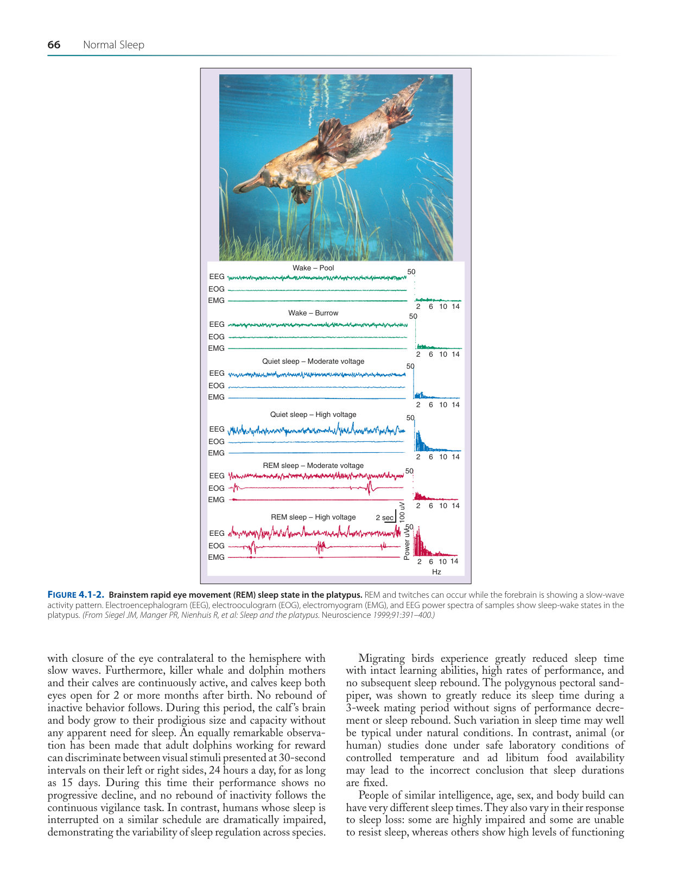

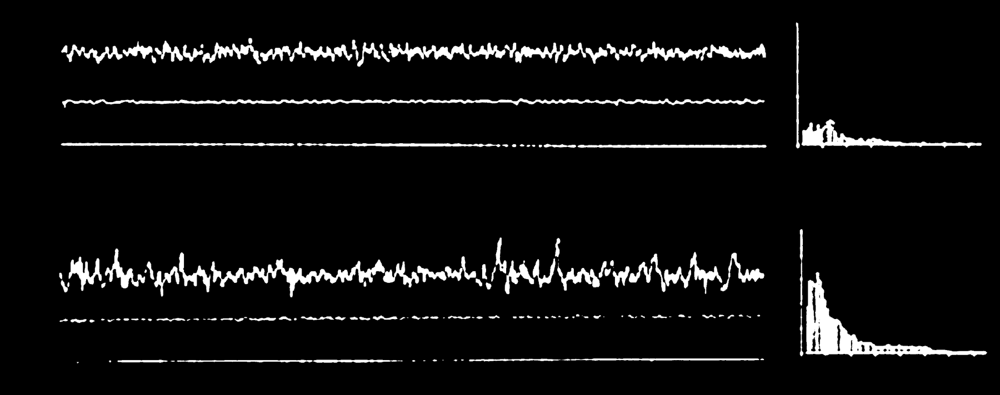

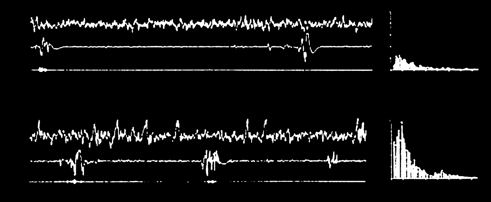

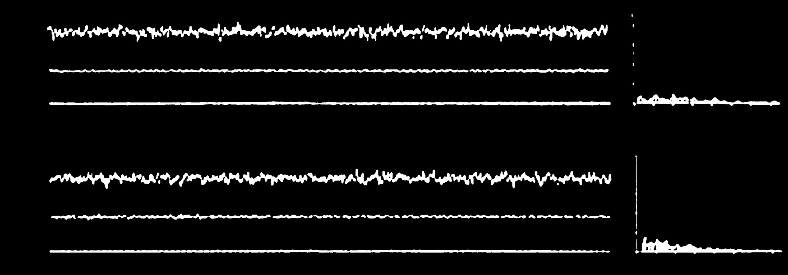

<!-- pdf-page: 85 -->

Right EEG Beluga

L

R

1 cm

100 V

1 min

FIGURE 4.1-3. Cetacean sleep: unihemispheric slow waves in cetaceans. Top, Immature beluga, adult dolphin, and section of adult dolphin brain. Electro­

encephalographic (EEG) readings of adult cetaceans, represented here by the beluga, are shown during sleep. All species of cetacean so far recorded have unihemispheric slow-wave activity. Top traces show left and right EEG activity. The spectral plots show 1 to 3 Hz power in the two hemispheres over a 12-hour period. The pattern in the cetaceans contrasts with the bilateral pattern of slow waves seen under normal conditions in all terrestrial mammals, represented here by the rat (bottom traces). (From Siegel JM: Clues to the functions of mammalian sleep. Nature 2005;437:1264–1271.)

Left EEG

Right EEG

Left EEG

Rat

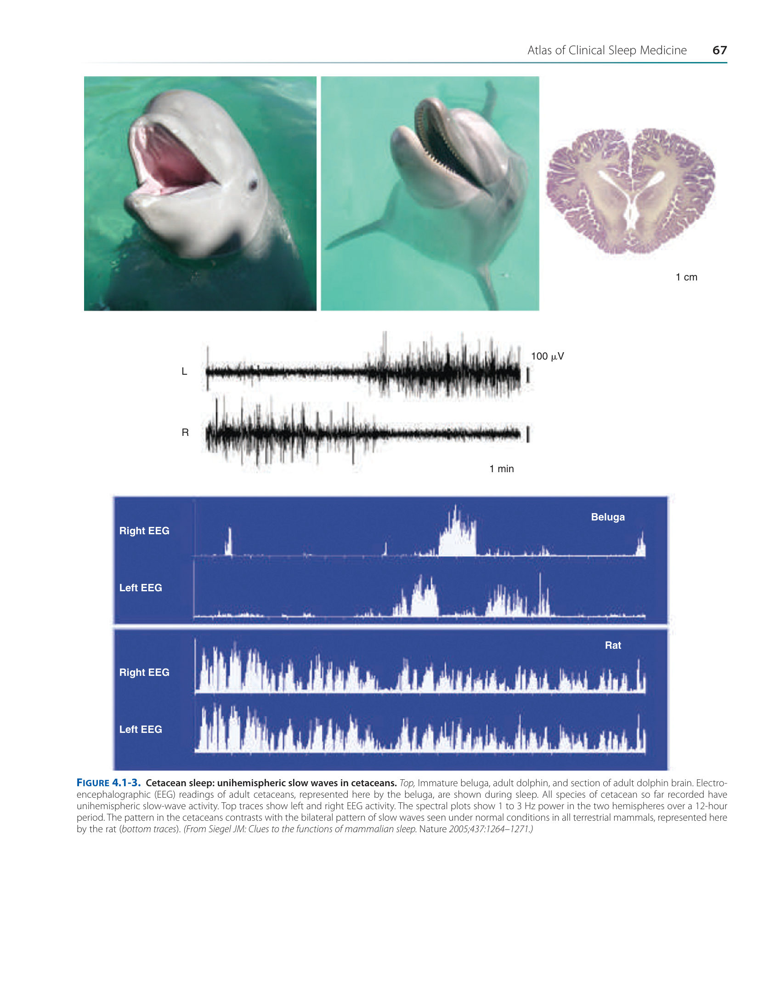

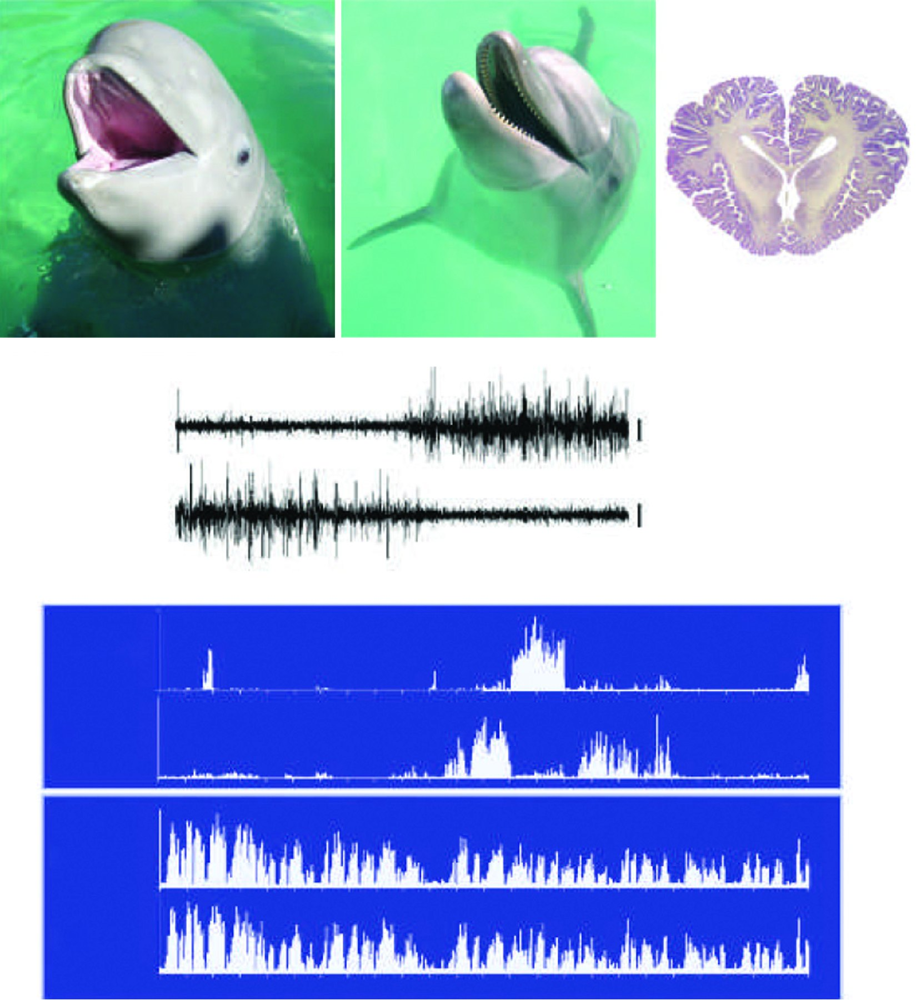

<!-- pdf-page: 86 -->

68 Normal Sleep

BUSHTAIL POSSUM Trichosaurus vulpecula

ELEPHANT Loxodonta africana

FIGURE 4.1-4. Sleep amount is not proportional to the relative size of the cerebral cortex or to the degree of encephalization, as illustrated by a

comparison between the bushtail possum and the elephant. REM, rapid eye movement [sleep]. (From Siegel JM: Clues to the functions of mammalian sleep. Nature 2005;437:1264–1271.)

1 cm 5 cm

18 hours of sleep, 6.6 hours of REM

3.6 hours of sleep, 1.8 hours of REM

despite sleep loss. The effect of sleep deprivation on performance is not strongly related to baseline sleep duration. Furthermore, human sleep duration is not linearly related to health; both high and low values are linked to shortened life span. Some evidence suggests that individuals with greater than normal spontaneous sleep durations are at greater risk than those with less than average sleep time. A report that sleep deprivation by the “disk over water” technique leads to death in rats may be related to the stress of frequent awakenings rather than sleep loss. Sleep deprivation has not been reported to cause death in mice or rats deprived by other techniques. Fatal familial insomnia and sleeping sickness can cause death in humans, but sleep loss or excess does not appear to be responsible; these diseases affect many body organs.

Numerous attempts have been made to correlate the variation in sleep time across species with physiologic variables such as body mass, life span, brain size, brain/body weight ratio, and litter size. However, such studies have not identified correlations that account for a significant amount of the crossspecies variance (Fig. 4.1-4 and Fig. 4.1-5). The few weak and inconsistent correlations that have been reported appear to be largely a function of the way the data are handled and which animals are excluded from the dataset. The definitive study of the phylogeny of REM and non-REM (NREM) sleep times in birds concluded that none of the physiologic parameters typically studied in mammals showed even a weak relationship with sleep time. However, one relation appears to be consistent across both birds and mammals: species that eat food with low caloric density, such as herbivores, sleep significantly less than those that eat more nutritionally dense foods (carnivores; see Fig. 4.1-5). In other words, if a species needs to eat more than 12 hours a day, it cannot sleep more than 12 hours; animals have evolved to adjust sleep time appropriately to such waking needs. Most species, including humans, can reduce sleep to acquire food, avoid predation, mate, be available to their young during critical periods, and to deal with other needs.

It does not appear to be the case that sleep intensity—as measured by electroencephalogram (EEG) synchrony, REM sleep time, or lack of responsiveness—is negatively correlated with sleep time. In other words, the horse and giraffe, which sleep 2 to 4 hours a day, do not sleep more deeply than the lion, which sleeps 12 to 14 hours a day. In the same way, elderly humans, who sleep 6 to 7 hours a day, do not sleep more deeply than teenagers, who sleep more than 10 hours a day. To the contrary, both developmentally and phylogenetically, the general tendency is for short sleepers to sleep less deeply than long sleepers.

So why do most of us feel so poorly when we reduce sleep? Natural selection has imposed a certain amount of sleep on us to restrict activity to appropriate times of day and to reduce long-term nonvital energy expenditure. The pressure to sleep operates by reducing brain activity. Although individuals with naturally short sleep are not at elevated risk of death compared with those who have naturally long sleep times, repeated sleep deprivation below the body’s programmed level is stressful and is likely to have significant health consequences. Certain hormonal processes are linked to sleep; these are not universal, but rather are species specific.

It has been argued that quiet waking could serve the energy conservation functions attributed to sleep without the risks associated with the sleep state. However, the brain consumes as much as 25% of the body’s energy at rest. This amount does not greatly differ between active and quiet waking, but it is greatly reduced in sleep. Animals with safe sleeping sites will achieve a selective advantage in reducing brain energy consumption by sleep. Animals with unsafe sleep sites do not sleep deeply.

Species whose environment has a severe seasonal variation in food availability have evolved to increase sleep during periods of food shortage and decrease sleep when food is available. Still others, who have safe sites, hibernate during periods of greatly reduced availability, achieving even more reduction in energy expenditure.

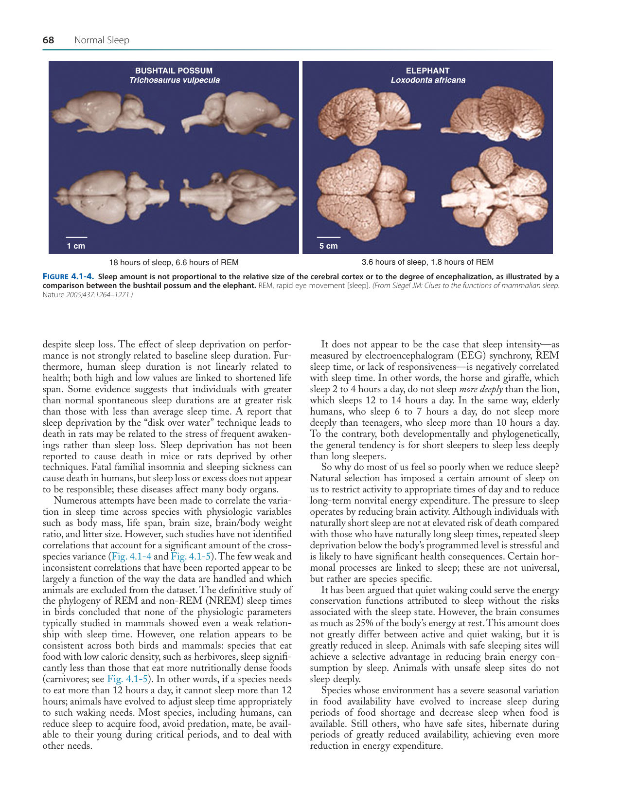

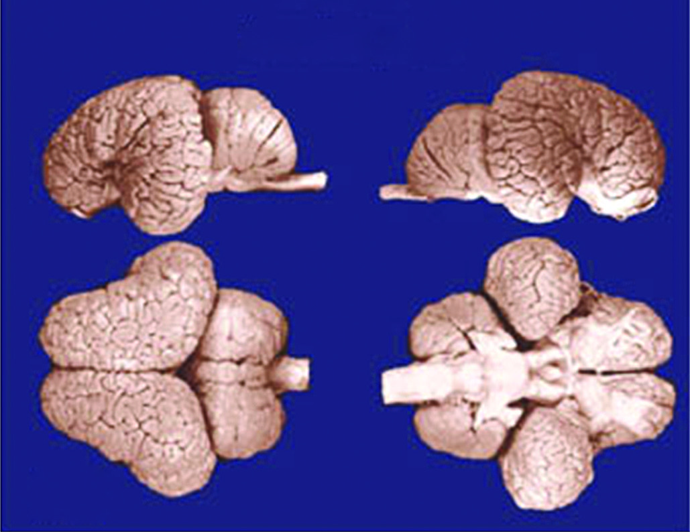

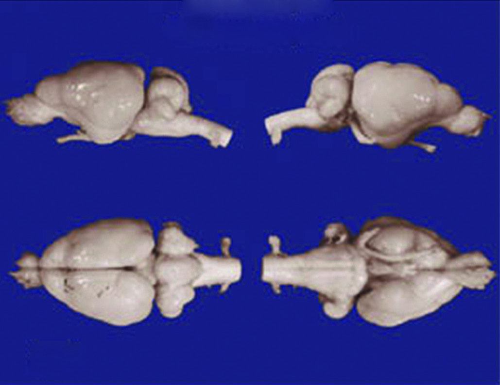

<!-- pdf-page: 87 -->

High Sleep Low Sleep

Rodentia

Golden mantled ground squirrel Spermophilus lateralis Degu Octodon degu

Total sleep 12.5 6.3 REM sleep 3.2 1.3 Body weight (kg) 3.3 1.3 Brain weight (kg) 0.030 0.016 Brain/body weight ratio 0.009 0.012 Life span 13 13 Caloric density of food +++ ++

Total sleep REM sleep Body weight Brain weight Brain/body weight ratio Life span Caloric density of food

15.9 7.7 3.0 0.9 0.193 0.240 0.003 0.0025 0.016 0.010 7 11 ++ +

Carnivora

Cat Genet Felis catus Genetta genetta

Body weight (kg) 0.0136 0.0424 Brain weight (mg) 0.238 1.061

Total sleep 20 15.0 REM sleep 3.9 1.15

Chiroptera

Big brown bat Greater short-nosed fruit bat Eptesicus fuscus Cynopterus sphinx

Brain/body weight ratio 0.025 Life span 20 10

0.0175

Total sleep 14.3 6.4 REM sleep 0.7 0.7 Body weight (kg) 0.120 3.3 Brain weight (kg) 0.003 0.011 Brain/body weight ratio 0.025 0.003 Life span 8 8 Caloric density of food +++ +

Caloric density of food +++ +

Aves

Burrowing owl Athene cunicularia Greylag goose Anser anser

FIGURE 4.1-5. Sleep, brain, and life span parameters across mammalian orders and the avian class. The strongest correlate of sleep time across species

is diet. Animals that eat food with high caloric density do not need to spend as much time ingesting food as animals that eat food with low caloric density. In zoos and laboratories, where most sleep studies have been done and animals are well fed, carnivores sleep more than omnivores, who sleep more than herbivores. However, food deprivation increases waking and decreases sleep in carnivores and omnivores. Flexibility in sleep time increases the likelihood that energy input and output will be equalized and that there will be time for other essential tasks, such as mating and care of young. +++ carnivores; ++ omnivores; + herbivores. Sleep durations in hours/24-hour period; life span in years. (Owl data from http://Birdsflight.com; degu data from http://www.Degus-international.org; greater short-nosed fruit bat data from http://designeranimals.wikispaces.com; photos of other animals courtesy of Wikipedia Commons site.)

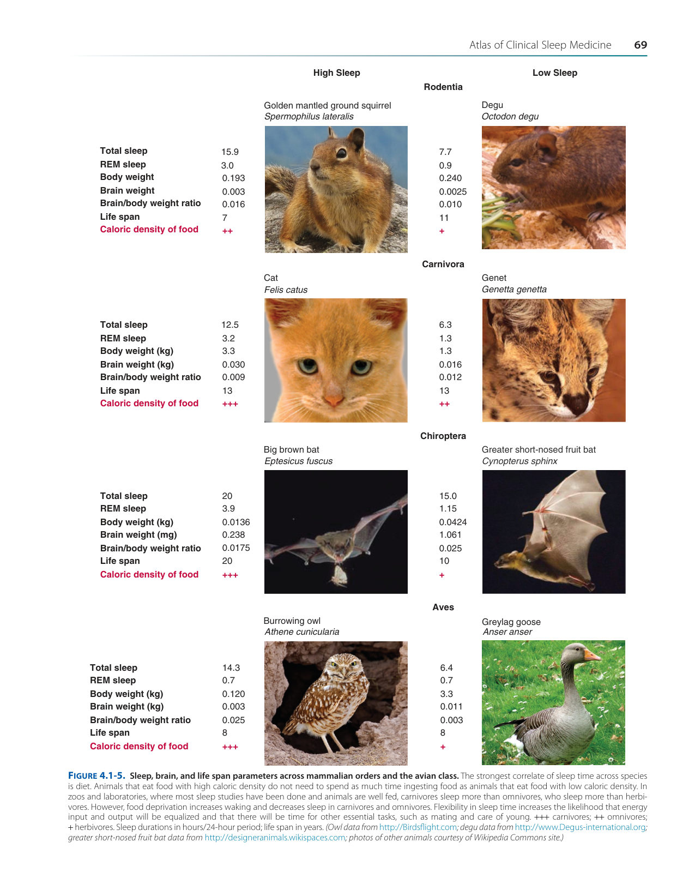

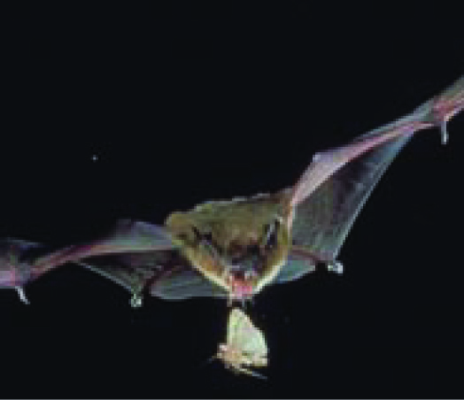

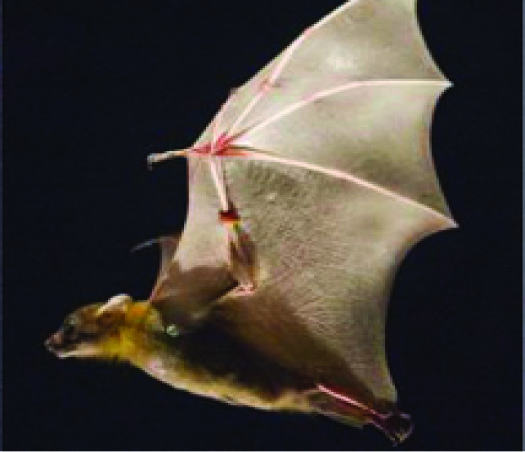

<!-- pdf-page: 88 -->

70 Normal Sleep

#### Selected Readings

Jones SG, Paletz EM, Obermeyer WH, Hannan CT, Benca RM: Seasonal

Ridgway S, Keogh M, Carder D, et al: Dolphins maintain cognitive perfor­

mance during 72 to 120 hours of continuous auditory vigilance. J Exp Biol 212:1519–1527, 2009. Roth TC, Lesku JA, Amlaner CJ, Lima SL: A phylogenetic analysis of the

influences on sleep and executive function in the migratory white-crowned sparrow (Zonotrichia leucophrys gambelii). BMC Neurosci 11:87, 2010. Kripke DF, Garfinkel L, Wingard DL, Klauber MR, Marler MR: Mortality

correlates of sleep in birds. J Sleep Res 15:395–402, 2006. Siegel JM: Clues to the functions of mammalian sleep. Nature 437:1264–

associated with sleep duration and insomnia. Arch Gen Psychiatry 59:131– 136, 2002. Lesku JA, Rattenborg NC, Valcu M, et al: Adaptive sleep loss in polygynous

1271, 2005. Siegel JM: Do all animals sleep? Trends Neurosci 31:208–213, 2008. Siegel JM: Sleep viewed as a state of adaptive inactivity. Nat Rev Neurosci

pectoral sandpipers. Science 337:1654–1658, 2012. Lyamin O, Pryaslova J, Lance V, Siegel J: Animal behaviour: continuous

10:747–753, 2009.

activity in cetaceans after birth. Nature 435:1177, 2005.

## NORMAL SLEEP IN HUMANS

### Alon Y. Avidan

## 4.2

All organisms have periods of activity and inactivity. This is true from viruses to the most complex of mammals. Such a pervasive finding suggests that sleep is basic to life (Box 4.2-1). This chapter reviews normal sleep, the function and neurophysiology of the evolution of sleep, and the ontogeny of sleep.

#### HOW MUCH SLEEP IS ENOUGH?

To sustain life, no more than 3 to 5 hours of sleep a night are required. However, this amount of sleep leads to sleepiness, impaired performance, and reduced executive functions. To sustain optimal alertness throughout the day, the requirement varies across individuals, with the mean being 7 to 8 hours for adult humans (Table 4.2-1).

#### NEUROPHYSIOLOGY OF SLEEP AND

#### WAKEFULNESS

The presumed function of rapid eye movement (REM), non-REM (NREM), and awake states is provided in Figure 4.2-1. Figure 4.2-2 describes the neurotransmitters involved in wakefulness-generating neural networks, which include glutamate, acetylcholine, norepinephrine, dopamine, histamine, hypocretin, and serotonin, and provides the function and location of each. The interaction of the neuromediators of sleep on brainstem structures responsible for arousal and sleep is described in Figures 4.2-3 and 4.2-4.

#### Wakefulness

Wakefulness is promoted by the ascending brain arousal systems; inhibition of these systems promotes sleep (Fig. 4.2-5). The brainstem reticular activating system (RAS) contains neurons that inhibit sleep-generating neurons and activate cortical neurons through ascending projections via the thalamus, hypothalamus, and basal forebrain. Descending projections from the reticular formation to the spinal cord are important for maintaining postural control and muscle tone.

BOX 4.2-1 What Is Sleep?

• Sleep has been defined behaviorally as a reversible state of

perceptual disengagement from and unresponsiveness to the environment. • Sleep is a complex state in which changes occur in

physiologic and behavioral processes compared with wakefulness. • Sleep is physiologic, necessary, temporary, reversible, and

cyclic.

TABLE 4.2-1 Sleep Stages

AGE FINDINGS

In utero At 30 weeks’ gestation, 80% “active sleep”

Newborns Sleep 16 to 18 h every 24 h Sleep 5 to 10 h during daytime Active sleep: 50% Quiet sleep Indeterminate sleep Establishment of major nocturnal sleep period

by 3 to 4 months

1 year Sleep 13 to 15 h every 24 h; 2 to 3 h during

daytime naps REM sleep: 30%

2 years 12 to 14 h; 1.5 to 2.5 h during daytime naps 25% REM sleep (fixed)

3 to 5 years 11 to 13 h sleep every 24 h Sleep 0 to 2.5 h during daytime naps

5 to 12 years Sleep 9 to 12 h every 24 h; usually no naps

Teenage years Sleep 8 to 9 h every 24 h; usually no naps

Second to seventh

Marked decline in amplitude of slow-wave

decade

sleep Gradual decline in amount of slow-wave sleep Other stages remain relatively fixed

Older adults

Decreased nocturnal sleep Increased napping Increased difficulty falling asleep Increased difficulty staying asleep Lighter sleep Increased awakening Changes in sleep timing and depth, melatonin

(>65 years)

secretion

<!-- pdf-page: 89 -->

REM SLEEP NREM SLEEP AWAKE

Brainstem REM-on neurons fire Forebrain sleep-on neurons fire Sleep-on neurons are inactive

FIGURE 4.2-1. The function of the two types of sleep. Our evolving understanding of the function of rapid eye movement (REM) and non-REM (NREM)

sleep and why we need both is based on some interesting hypotheses. First, NREM sleep may allow brain cells a chance to undergo repair. Second, interrupted release of monoamines during REM sleep may allow the brain’s receptors for these neurotransmitters to recover and regain full sensitivity, which may help with regulation of learning and mood. Third, the potent neuronal activity of REM sleep in early life may allow the brain to develop properly. (Modified from Joel M. Siegel: Why we sleep: the reasons that we sleep are gradually becoming less enigmatic. Scientific American, November 2003. Accessed online at http:// www.scientificamerican.com/article.cfm?id=why-we-sleep.)

NREM sleep may allow cells to repair membranes damaged by free radicals Free radicals can damage cell membranes when neurons are active as during the awake state

Rapid eye movements

Absence of vivid dreams Vivid dreams occur

Some receptors are inactive during REM sleep, which may be necessary for their proper functioning during wakefulness

#### Transition Between Wakefulness and Sleep

Key physiologic changes that occur during the transition from wakefulness into sleep are shown in Figures 4.2-6 through 4.2-8.

Brain control of the passage from sleep to wakefulness states may be modeled as a “flip” switch. According to this model, sleep- and wakefulness-generating neural networks are mutually inhibitory, such that when sleep networks are active, they inhibit wakefulness networks, and when wakefulness networks are active, they inhibit sleep networks. The “sleep switch” is modulated by the internal circadian timekeeping system and by hypocretin cells in the hypothalamus, both of which are believed to be important for stabilizing the switch to promote consolidated sleep and wakefulness.

#### SLEEP MECHANISMS: FROM WAKEFULNESS

#### INTO SLEEP

Normal sleep physiology can be divided into NREM and REM sleep stages. Sleep-generating networks vary between these stages.

#### Transition from Wakefulness into Non–Rapid

#### Eye Movement Sleep

The transition from wakefulness to NREM sleep is associated with inhibition of the RAS and thalamocortical disassociation mediated through the inhibitory neurotransmitter γ-aminobutyric acid (GABA; Fig. 4.2-8). NREM

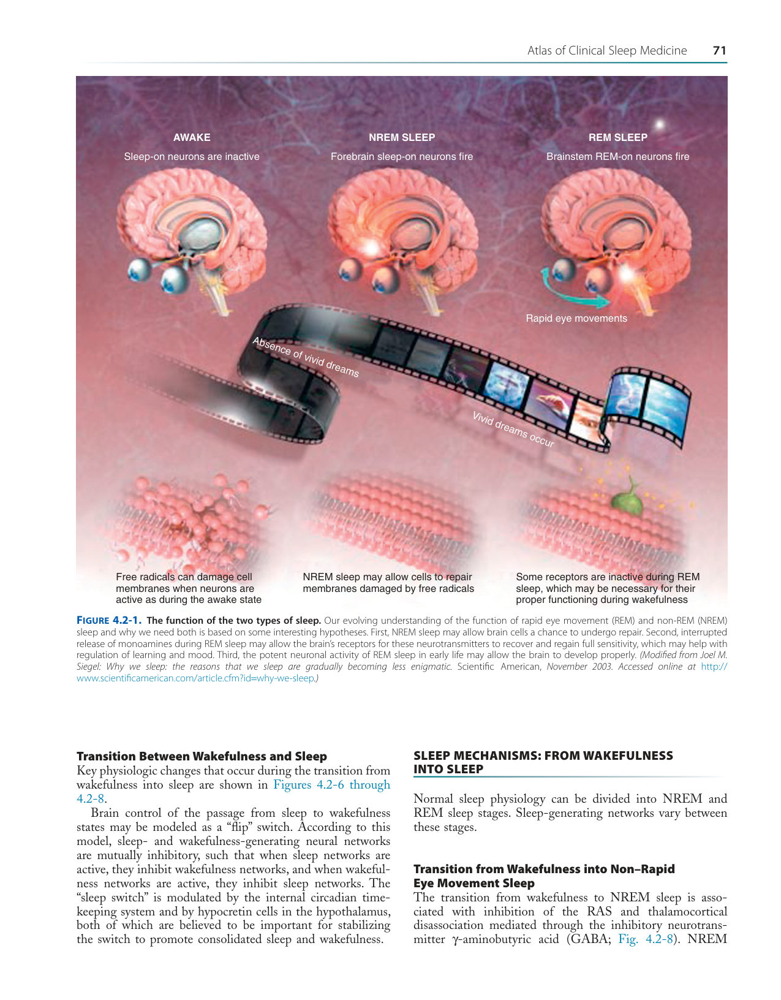

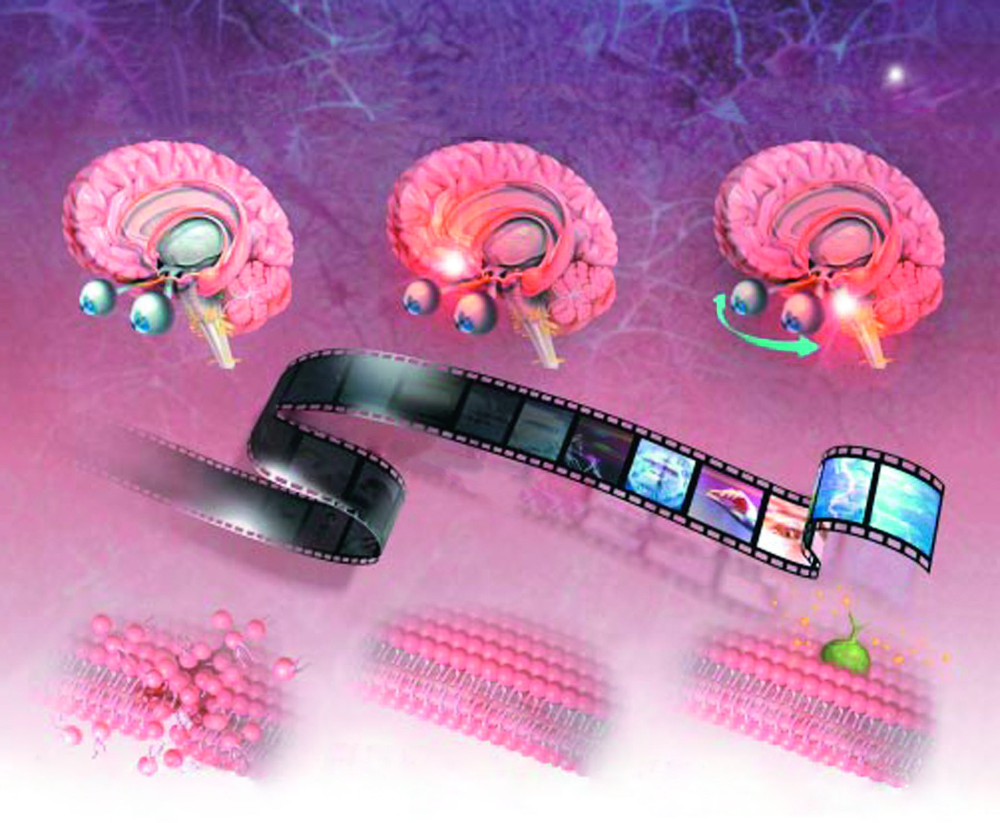

<!-- pdf-page: 90 -->

NEURONS LOCALIZATION AND FUNCTION

Noradrenergic (norepinephrine) Found in the locus coeruleus, project to the forebrain and cerebral cortex and are involved in attention and maintaining and enhancing cortical activation. Activities of locus coeruleus neurons are higher during wakefulness than during sleep.

Dopaminergic Localized to the substantia nigra and ventral tegmental areas. These neurons project to the striatum and frontal cortex, which when activated are important for behavioral arousal and movement. Although dopamine neurons are reported to show similar firing rates across sleep-wakefulness states, inputs to dopamine neurons from other arousal systems may influence sleep and wakefulness.

Cholinergic Found in the brainstem, excite thalamocortical cells, which result in arousal and information transfer to the cerebral cortex. Cholinergic cells, located in neurons in the basal forebrain, promote behavioral and cortical arousal.

Histaminergic Localized in the tuberomammillary nucleus of the caudal hypothalamus and provide excitatory input to the cerebral cortex; antihistamines that cross the blood-brain barrier produce drowsiness.

Glutamate and aspartate Excitatory amino acids found within many neurons projecting to the cerebral cortex, the forebrain, and brainstem. Released in the largest amounts during wakefulness; their antagonists produce sleep.

Orexin/hypocretin Localized in the lateral hypothalamus and project to widespread areas of the brainstem, thalamus, hypothalamus, and cerebral cortex; reported to have a role in brain arousal.

FIGURE 4.2-2. Neurochemistry of sleep and wakefulness. The key neurons responsible for sleep induction and arousal.

FIGURE 4.2-3. Brainstem-mediated arousal and sleep induction. The reticular activating system (RAS) oversees the wakefulness state through activity of

four subnuclei: (1) the locus ceruleus (LC), which releases norepinephrine (NE); (2) the dorsal raphe nuclei (DRN), which release serotonin (5-HT); (3) the pedunculopontine (PPT) nuclei; and (4) the laterodorsal tegmentum (LDT), which is associated with acetylcholine (Ach). The PPT-LDT neurons are active in wakefulness sa well as REM sleep and are believed to be the REM “on” switch. Lesions in the PPT-LDT area do not affect wakefulness but lead to loss of REM sleep. Slow-wave sleep (SWS) is modulated through the LC and DRN by decreasing the release of NE. Wakefulness is achieved through the combined activity of the PPT, LC, and DRN nuclei releasing Ach, NE, and 5-HT, respectively. The primary neurotransmitter of REM is Ach. SWS is achieved through suppression of the wakefulness neurotransmitters NE and 5-HT and release of Ach. GLY, glycine. (Modified from Webster HH, Jones BE: Neurotoxic lesions of the dorsolateral pontomesencephalic tegmentum-cholinergic cell area in the cat. II. Effects upon sleep-waking states. Brain Res 1988; 458[2]:285–302.)

Thalamus Cortex

REM OFF

LC

SWS

NE

NE

R A S

5HT

DRN

AWAKE

Ach

REM ON

PPT

Ach

REM

LDT

C3-A2

C4-A3

GLY

Atonia

LOC

ROC

EMG

Delta sleep – ½ to 2 cps-delta waves 75 V

Awake – low voltage-random, fast

50 V

1 sec

REM sleep – low voltage-random, fast with sawtooth waves

Sawtooth waves

Sawtooth waves

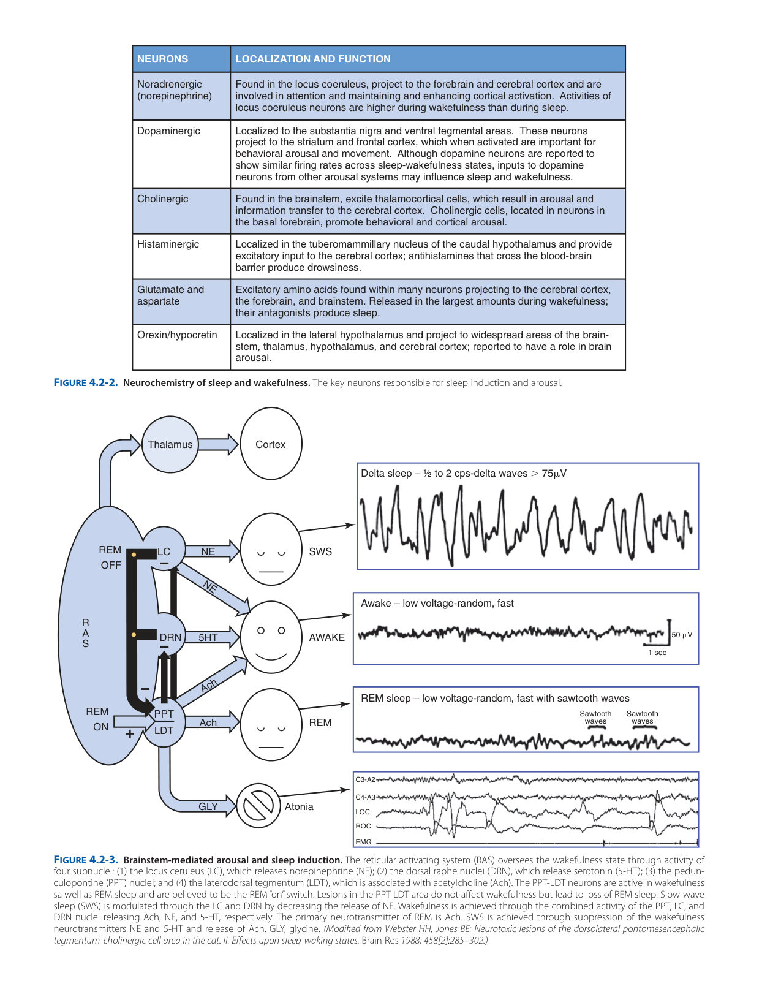

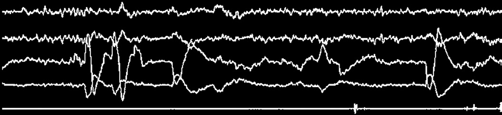

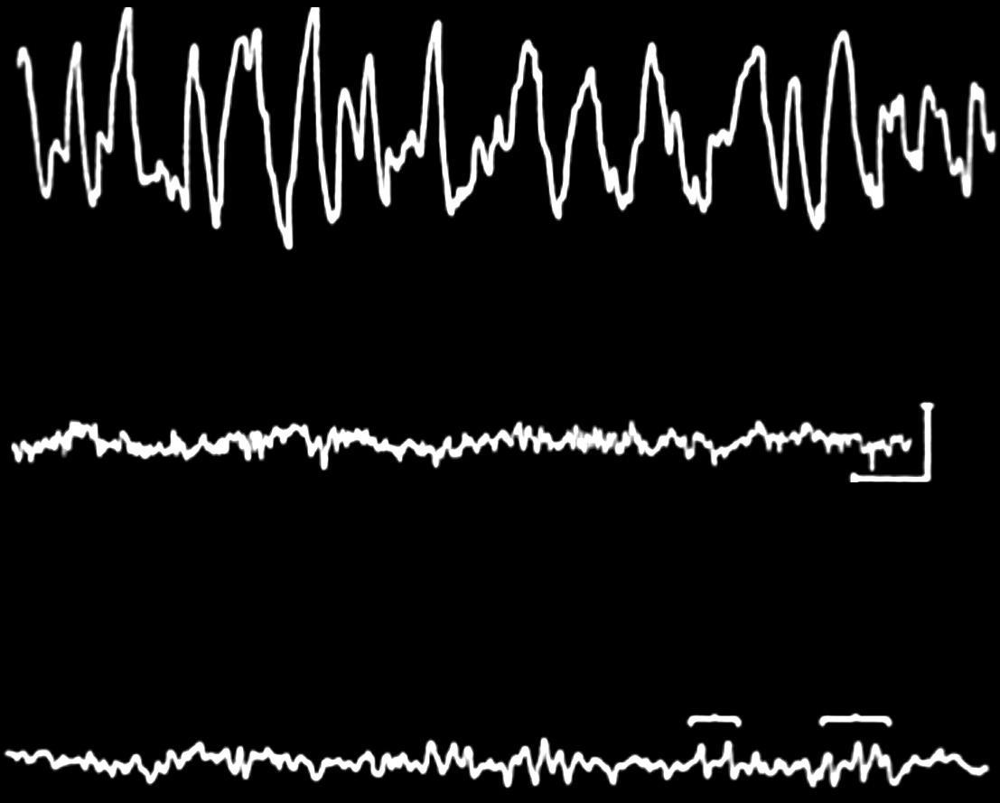

<!-- pdf-page: 91 -->

Thalamus

Thalamus

FIGURE 4.2-4. The brain in the awake state illustrates important arousal and sleep centers and pathways of neurotransmission. A, Cholinergic input

(orange) from the laterodorsal tegmental (LDT) and pedunculopontine (PPT) nuclei project through the thalamus and facilitate thalamocortical transmission of arousal signals. A second pathway projects through the hypothalamus to cortical centers and facilitates the processing of thalamocortical inputs that arise from midbrain centers, including the noradrenergic (blue) locus coeruleus (LC); the serotonergic (purple) dorsal raphe (Raphe); the histaminergic (pink) tuberomammillary nucleus (TMN); and the dopaminergic (yellow) ventral periaqueductal grey matter (VPAG). This pathway also receives input from the cholinergic (orange) basal forebrain (BF) and the peptidergic neurons of the lateral hypothalamus (LH) and perifornical neurons (PeF), which contain hypocretin or melaninconcentrating hormone (light green). The melatonergic (red) neural network affects arousal and sleep through regulation of circadian rhythms. This internal biologic clock originates in the suprachiasmatic nucleus (SCN), projects through the dorsomedial hypothalamus (DMH), and sends inhibitory signals to the γ-aminobutyric acid (GABA)-ergic (grey) ventrolateral preoptic nucleus (VLPO) of the hypothalamus. B, Artistic rendering of the human brain in the sleeping state illustrates important sleep and arousal centers and pathways of neurotransmission. The VLPO of the hypothalamus sends descending GABAergic inhibitory signals to the midbrain arousal centers that include the PeF, TMN, VPAG, raphe, LDT and PPT, and LC. During the early hours of dark periods, the pineal gland (Pin) releases melatonin (red), which has inhibitory effects on the SCN and DMH of the melatonergic system. Nuclei that control neural activity during REM sleep have been identified in the pontine midbrain. The pericoeruleus (PC) and parabranchial (PB) nuclei send glutaminergic (green) projections through the BF to affect cortical activity during REM sleep, and projections from the sublaterodorsal nucleus (SLD) send glutamatergic signals through the spinal cord to induce the atonia characteristic of REM sleep. (From Wafford KA, Bjarke E: Emerging anti-insomnia drugs: tackling sleeplessness and the quality of wake time. Nat Rev Drug Disc 2008;7:530–540.)

Thalamus

Thalamus

PeF

PeF

VLPO

VLPO

BF SCN

BF SCN

DMH

DMH

VPAG

VPAG

LH

LH

LDT

LDT

BF

BF

TMN

TMN

PPT

PPT

Raphe

Raphe

Pons

Cerebellum

Cerebellum

A

Pin

Pin

VLPO

VLPO

PeF

PeF

VPAG

VPAG

SCN

SCN

DMH

DMH

LDT

LDT

TMN

TMN

PPT

PPT

Raphe

Raphe

LC

LC

PC/PB SLD LC

PC/PB SLD LC

Pons

Pons

Cerebellum

Cerebellum

B

sleep in healthy adult humans is demarcated by an electroencephalographic (EEG) pattern that changes from a fast, low-amplitude, desynchronized waveform pattern to a higher amplitude synchronized waveform pattern. NREM sleep is divided into stages, referred to as N1 and N2, and slow-wave sleep (SWS). (Stages 3 and 4 are combined by the American Academy of Sleep Medicine [AASM] and are referred to as N3.) Stage N1 is a transitional stage typically observed at sleep onset. Stage N2 sleep consists of a dominant theta pattern with the presence of sleep spindles and K-complexes.

N3, or deep NREM sleep (SWS), is defined by a slow, high-amplitude, synchronized EEG waveform quantified by the amount of delta activity (0.5 to 2.5 Hz). Stage N3 sleep occurs mostly during the first half of the night. REM sleep is defined by a fast, low-amplitude, desynchronized theta EEG waveform, with characteristic sawtooth waves, and inhibition of skeletal muscle activity referred to as muscle atonia. REM sleep is divided into phasic and tonic REM sleep, each with its

own corresponding unique physiologic and electrographic properties (Fig. 4.2-9).

In healthy adult humans, NREM and REM sleep alternate throughout the night approximately every 80 to 120 minutes. The duration of REM episodes increases across the night. REM sleep is primarily a cholinergic (acetylcholine) state, during which neurons in the reticular formation are active, primarily those located in the pontine tegmentum, leading to cortical activation (Fig. 4.2-10).

#### Staging of Sleep

All animals sleep. When they do, they generally assume a posture that is instantly recognizable as one of sleeping or resting (Fig. 4.2-11). However, upon inspection, we cannot really tell if the animal is actually asleep; in addition, there are different “depths” of sleep. By using techniques that record the electrical activity of the nervous system, we can now categorize by stage the depth of sleep in humans and

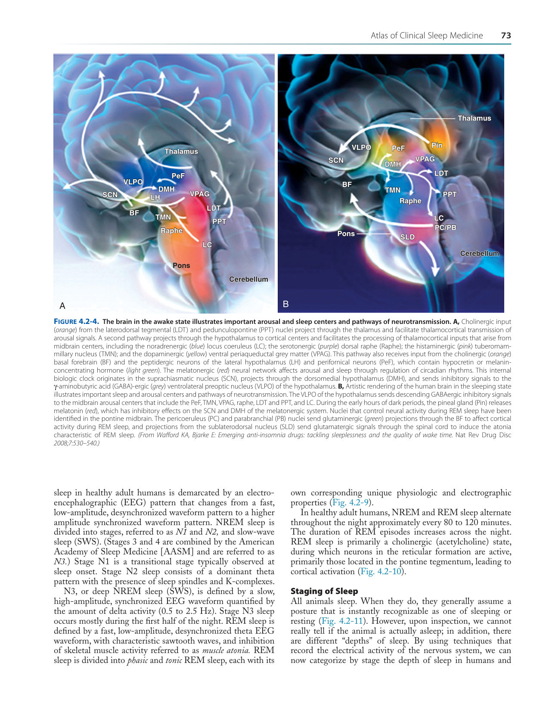

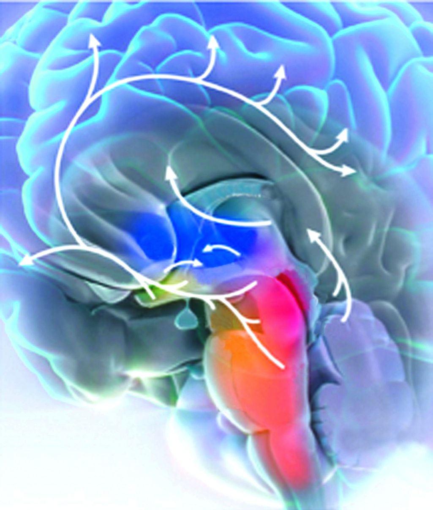

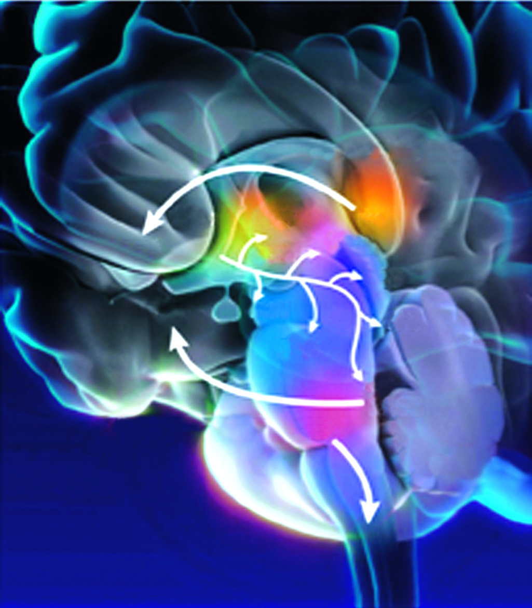

<!-- pdf-page: 92 -->

74 Normal Sleep

#### Hypocretin

#### VLPO

#### TMN

#### TMN

#### BF

#### PPT

#### LDT

#### PPT

#### LDT

#### SN

#### VTA

#### SN

FIGURE 4.2-5. Hypothalamic mechanisms in sleep-wake control. Importance of wakefulness- and sleep-promoting systems in the hypothalamus has been

recently emphasized. These systems innervate the ascending arousal systems (see Fig. 4.2-1) and excite and inhibit the system, respectively, to mediate the effects. A, Hypocretin neurons in the lateral hypothalamic area innervate all the ascending arousal systems as well as the cerebral cortex. B, Neurons of the ventrolateral preoptic (VLPO) area produce γ-aminobutyric acid and galanin, which inhibit all the arousal systems during non–rapid eye movement sleep. BF, basal forebrain; LC, locus coeruleus; LDT, laterodorsal tegmental nuclei; PPT, pedunculopontine; SN, substantia nigra; TMN, tuberomammillary nucleus; VTA, ventral tegmental area. (From Basic sleep concepts, science, deprivation, and mechanisms of neurotransmitters and neuropharmacology of sleep/wake regulations. In Nishino S [ed]: Encyclopedia of sleep. Palo Alto, CA, 2013, Stanford University School of Medicine, pp 395–406. Accessed online at http://dx.doi.org/10.1016/B978-0-12-378610- 4.00087-5.)

#### VTA

#### Raphe

#### Raphe

A B

#### LC

#### LC

other species. The AASM has standardized the rules for the staging of human sleep; in-depth discussion of this topic is provided in Chapter 18. In contrast to adult rules, the pediatric sleep-staging rules have not been rigorously defined by consensus; therefore with pediatrics, where relevant, this chapter focuses on the scoring rules developed by the AASM.

Sleep staging uses the frequency, amplitude, and pattern of data obtained by EEG (brain wave activity), electrooculography (EOG, eye movements), and electromyography (EMG, muscle tone), which together score the record as stage W, N1, N2, N3, or R.

Additional representative 30-second fragments are shown in Figures 4.2-12 through 4.2-16. The technical details and scoring rules are reviewed in Chapter 18 (Table 4.2-2). Specific features of sleep-stage EEG frequencies are shown in

Figure 4.2-17. Unique sleep-stage EEG rhythms and charac­

teristics outlined in Figures 4.2-18 through 4.2-20 summarize sleep-stage scoring rules according to the traditional Rechtschaffen and Kales system (R&K) as well as the current system developed by the AASM.

#### NORMAL SLEEP

Figures 4.2-21 and 4.2-22 show the proportion of the night spent in the various sleep stages in adults; predictable changes are shown in Figure 4.2-23. Sleep histograms summarize sleep laboratory recordings and demonstrate the progression of stages during the night. The typical histogram shows how a night of sleep for a patient is organized (Fig. 4.2-24). The y-axis corresponds to the various stages of NREM sleep, alter­

TABLE 4.2-2 Sleep Staging: Classic vs. Updated

#### Definitions

UPDATED

TERMS USED TO DESCRIBE TYPE OF SLEEP

CLASSIC STAGE

STAGE DEFINITIONS

DEFINITIONS

NREM “Light sleep” 1 N1 2 N2 “Deep sleep” or slow-

3 4

N3

wave sleep

REM REM sleep, dreaming

REM R

sleep, paradoxical sleep

NREM, non–rapid eye movement; REM, rapid eye movement

nating with REM sleep. Most SWS occurs in the first part of the night, and most REM sleep occurs in the last part. The sleep architectural changes typically seen across the life span are depicted by the sleep histograms shown in

Figure 4.2-25.

In normal individuals, sleep is entered by way of NREM sleep, with the first NREM episode occurring at about 90 minutes. Thereafter, NREM and REM alternate about every 90 minutes. Figure 4.2-26 shows that the slow waves in stage N3 in a child often have a very high amplitude; the other stages more closely resemble those of an adult. Figure 4.2-27 shows REM sleep in the same patient.

Text continued on p. 87

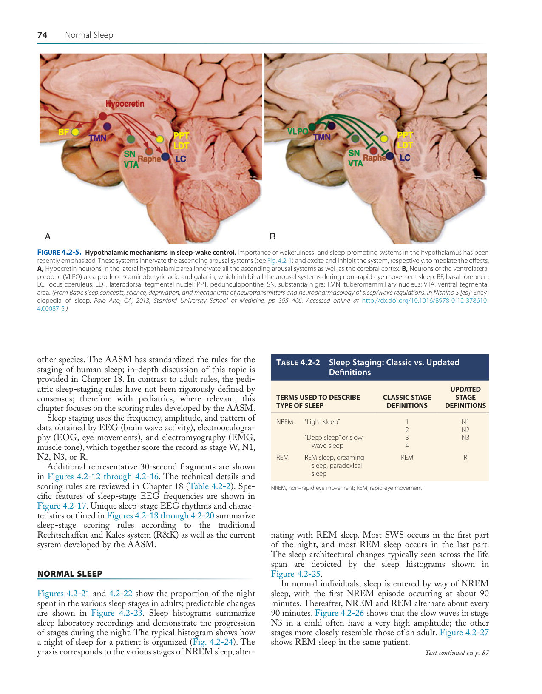

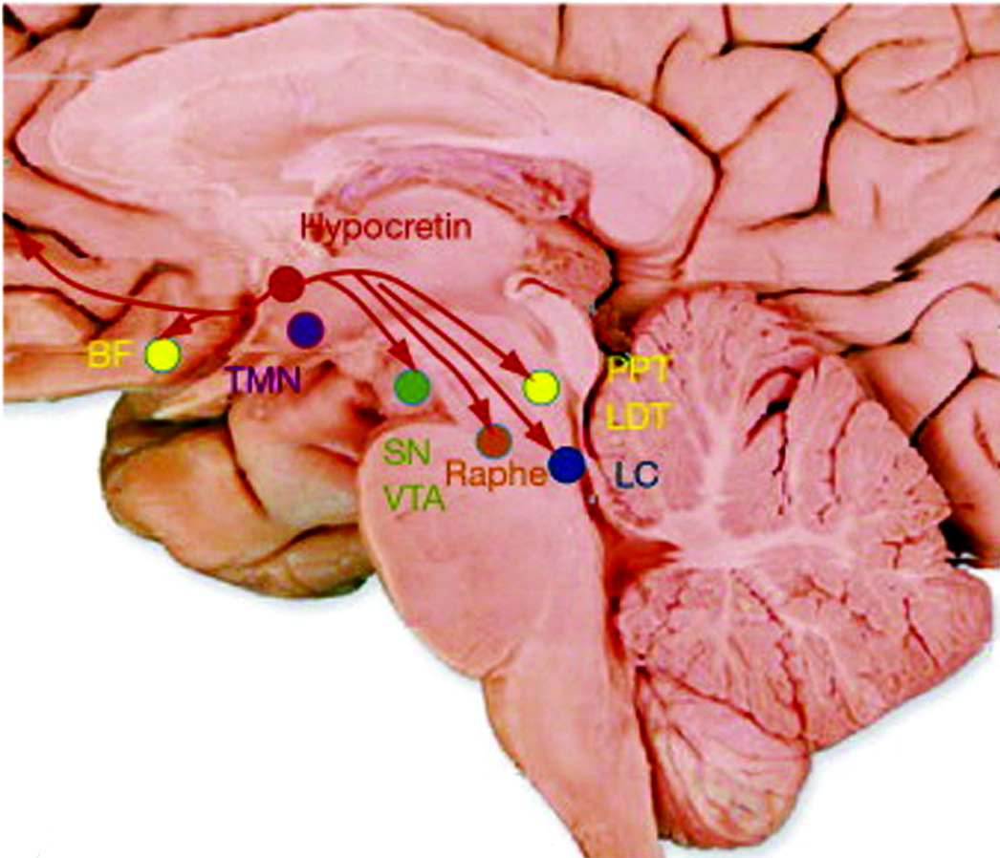

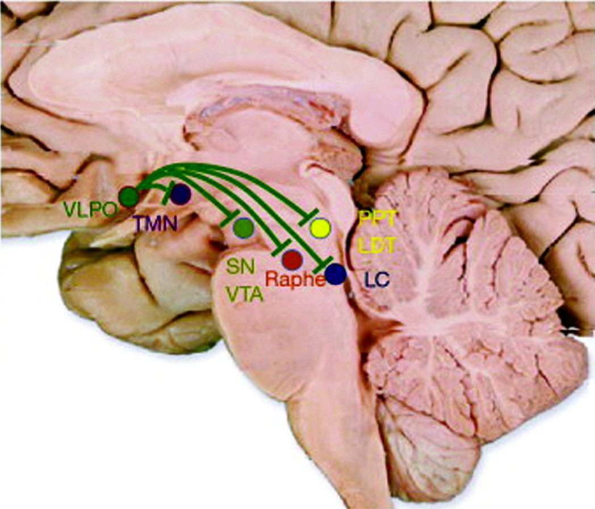

<!-- pdf-page: 93 -->

Wave peak

Sleep spindle Amplitude

Awake

0 200 220 240 Time (min) 260 280 300

N1 (Stage 1)

N2 (Stage 2)

A

a

c

Awake Stage 1 Stage 2 Stage 3 Stage 4

Time (n)

B

5

Eye movements (per min)

0

Awake Stage 1 Stage 2 Stage 3 Stage 4

EEG sleep stage

Systolic blood pressure (torr)

120 110 100 90

Breaths (per min)

10

5

30

Pulse (beats/min)

25

20

4

Body movements (number)

2

C

Wave trough 1 cycle 1 s 13 cycles

REM

(Stage 4)

(Stage 3)

N3

FIGURE 4.2-6. In mammals, the two types of sleep are rapid eye movement (REM) and non-REM (NREM). These sleep types are defined in terms of

electrophysiologic signs detected with a combination of electroencephalography (EEG), electrooculography (EOG), and electromyography (EMG), the measurement of which in humans is collectively termed polysomnography. REM sleep—also known as paradoxical, active, or desynchronized sleep—is characterized by awakelike and “activated” (high-frequency, low-amplitude, or “desynchronized”) signals in the EEG; singlets and clusters of REMs in the EOG; and very low muscle tone (atonia) in the EMG. Note that the term desynchronized for the activated states of waking and REM has been rendered obsolete by the discovery of highly synchronized γ-frequency (30 to 80 Hz) activity in these states. NREM sleep is divided into four stages that correspond to increasing depth of sleep, as indicated by progressive dominance of the EEG by high-voltage, low-frequency “synchronized” wave activity. Such low-frequency waves dominate the deepest stages of NREM (stages 3 and 4, also termed slow-wave sleep). Stage 2 NREM is characterized by distinctive sleep spindles, K-complex waveforms, and a slow (<1 Hz) oscillation, which influences their timing. A shows the characteristic waveforms of the different sleep stages. Changes in peripheral physiology associated with the sleep stages is shown in C. NREM and REM sleep alternate in each of the four or five cycles that occur in each night of adult human sleep. Early in the night, NREM sleep is deeper and occupies a disproportionately large amount of time, especially in the first cycle, when the REM epoch may be short or aborted. Later in the night, NREM sleep is shallow, and more of each cycle is devoted to REM (red bars). B illustrates these changes over the course of a night’s sleep. A depicts, in detail, features of an early-night sleep cycle in which NREM reaches its greatest depth at stages 3 and 4 (delta-sleep), whereas C depicts a late-night cycle in which NREM descends only to stage 3. The constant period length of the NREM-REM cycle indicates that it is timed by a reliable oscillator, the amplitude of which varies according to extrinsic factors. The cyclic organization of sleep varies within and among species. The period length of each REM-NREM epoch increases with brain size across species, and the depth and proportion of the NREM phase in each cycle increases with brain maturation within species. NREM sleep complexity is a function of brain systems, such as the thalamocortical circuitry, that reach their maximum development in mature humans only to decline in postmature age. It can therefore be concluded that the differentiation of sleep is a function of brain differentiation, a rule that indicates both mechanistic and functional links between sleep and other brain functions. (From Pace-Schott EF, Hobson JA: The neurobiology of sleep: genetics, cellular physiology and subcortical networks. Nat Rev Neurosci 2002;3:591–605.)

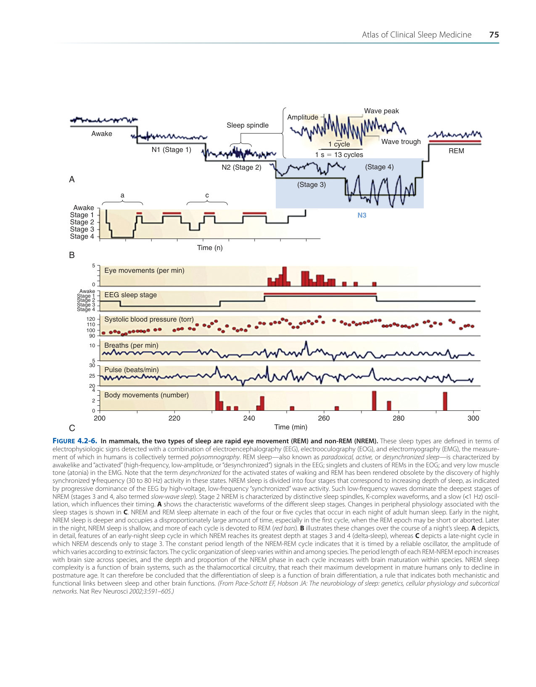

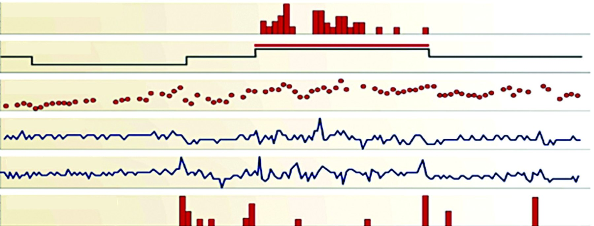

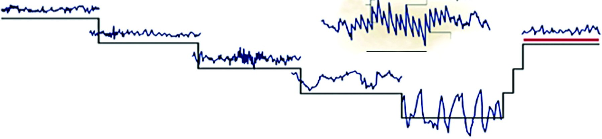

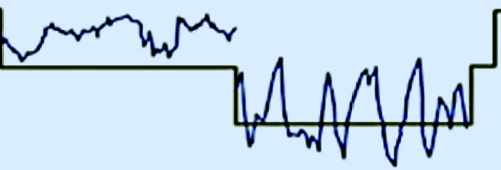

<!-- pdf-page: 94 -->

76 Normal Sleep

Stage N1 Stage W Stage N2 Stage R

Awake NREM sleep

REM sleep

Stage N3

FIGURE 4.2-7. The relationship between human sleep, level of consciousness, and electroencephalogram patterns. Stages of sleep are characterized

by differences in the frequency and amplitude of electroencephalogram (EEG) waves. N1 is composed of light sleep with low-amplitude waveforms. N2 is characterized by sleep spindles (the higher frequency waves) and K-complexes (not shown). N3 is composed of slow-wave sleep (SWS) with high-amplitude waves and a deeper level of unconsciousness. These stages comprise non–rapid eye movement (REM) sleep. The final stage is REM sleep, which is associated with mixed EEG frequency (all waves shown) and, in some individuals, with low-amplitude sawtooth waves (not shown) and a higher level of consciousness. (From Bryan PA, Trider J, Curtis N: Sick and tired: does sleep have a vital role in the immune system? Nat Rev Immunol 2004;4:457–467.)

EEG

High

Level of consciousness

Low

Light

Type of sleep

Tonic REM with periods of phasic activity

Slow-wave Intermediate

90-minute cycles throughout the night

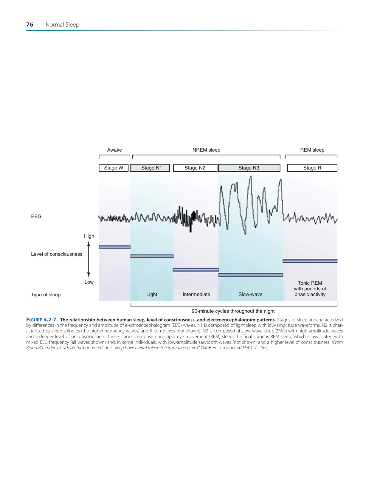

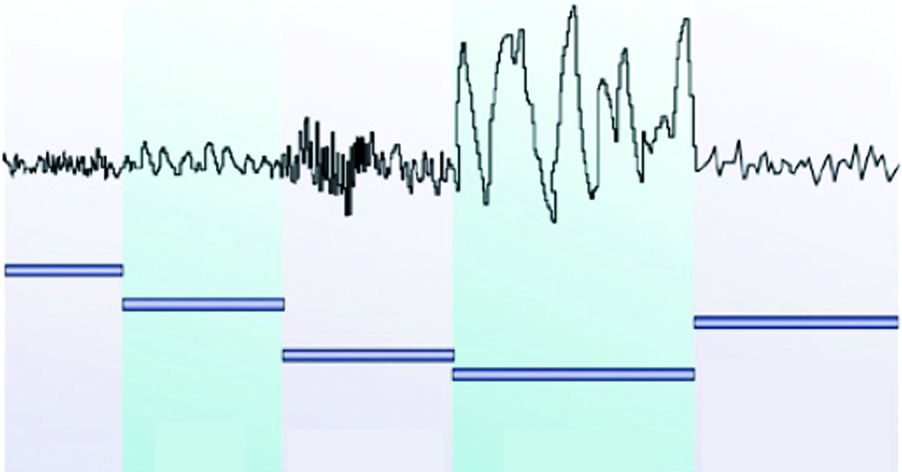

<!-- pdf-page: 95 -->

Forebrain areas key to the neuropsychology of dreaming

Prefrontal cortex: Ventromedial Dorsolateral

Anterior limbic structures:

Posterior cortices: Inferior parietal Visual association

Amygdala, anterior cingulate, ventral striatum

FIGURE 4.2-8. Brain regions of current interest to the neurobiology of sleep. The bottom tier of subcortical regions (blue boxes) control sleep-wake transi­

tions and, within sleep, REM-NREM sleep alternation. The top tier includes areas that are key to the generation of the electroencephalographic (EEG) rhythms of sleep, the subjective experience of sleep mentation or dreaming, and sleep’s effects on cognition (considered in schematic representations of the regulatory circuits that control sleep-wake and REM-NREM transitions along with their key inputs and outputs). REM, rapid eye movement; NREM, non–rapid eye movement. (From Pace-Schott EF, Hobson JA: The neurobiology of sleep: genetics, cellular physiology and subcortical networks. Nat Rev Neurosci 2002;3:591–605.)

Origin and expression of circadian rhythms

Hypothalamic nuclei: • Suprachiasmatic • Subparaventricular • Dorsomedial

Thalamocortical control of NREM sleep rhythms; EEG activation and deactivation

Hippocampal-cortical control of memory consolidation

Pontine control of the REM-NREM cycle

Diencephalic control of sleep onset

Mesopontine nuclei: • Laterodorsal tegmental • Pedunculopontine • Dorsal raphe • Locus coeruleus

Hypothalamic nuclei: • Ventrolateral preoptic • Lateral • Tuberomammillary • Basal forebrain

REM sleep - phasic components REM sleep - tonic components

FIGURE 4.2-9. Rapid eye movement (REM) sleep. Tonic versus phasic REM sleep. EEG, electroencephalography; EMG, electromyography.

Ponto-geniculo-occipital waves Rapid eye movements Middle ear muscle activity Tongue movements Muscle twitches Cardiovascular variability Dreaming

EEG desynchronization EMG atonia High arousal threshold Elevated brain temperature Hippocampal theta rhythm Poikilothermia Olfactory bulb activity Increased penile tumescence/vaginal engorgement Dreaming

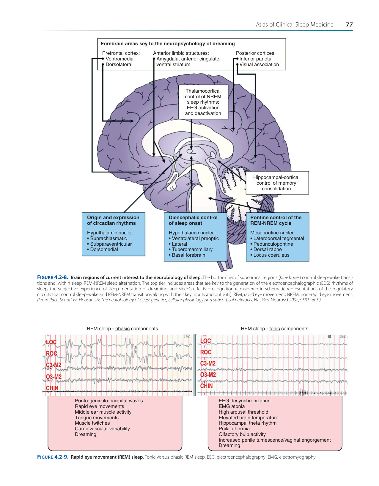

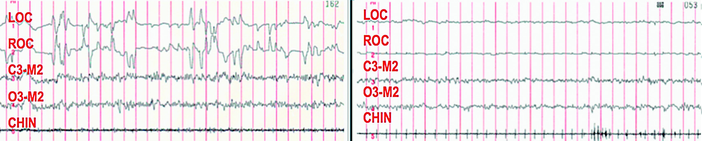

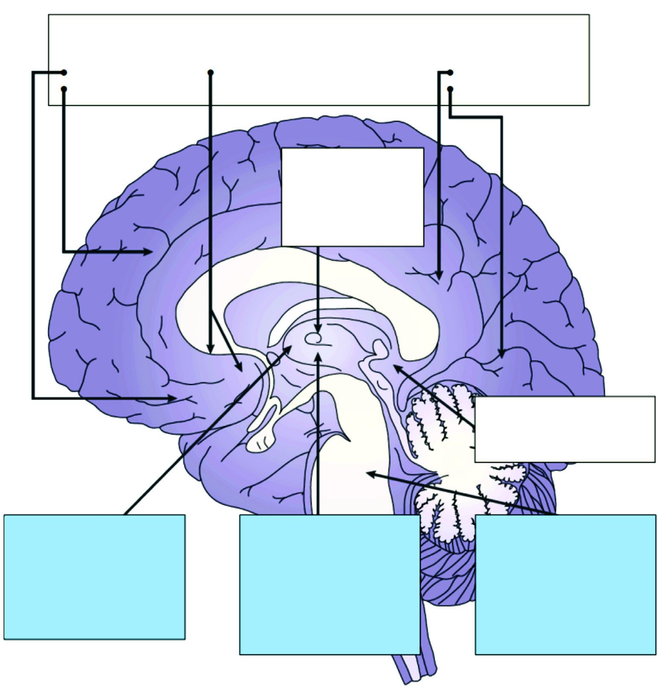

<!-- pdf-page: 96 -->

78 Normal Sleep

Motor neurons Motor neurons

REM sleep

Hypocretin Thalamus

TMN

PPT REM-on

LDT neurons

Raphe LC

REM sleep atonia

RPT REM-gating neurons

PPT/LDT

LC

Pons REM-on neurons

Medullary interneurons

FIGURE 4.2-10. Rapid eye movement (REM) sleep and REM sleep atonia pathways. A, REM sleep is driven by a distinct population of brainstem cholinergic

pedunculopontine and laterodorsal tegmental (PPT/LDT) neurons. During wakefulness and non-REM sleep, these cells are inhibited by norepinephrine (NE), serotonin (5-HT), and histamine; during REM sleep, the aminergic neurons fall silent, thus disinhibiting the PPT/LDT REM-generating neurons. These PPT/LDT cholinergic neurons produce the atonia of REM sleep by activating the medial medulla, which inhibits motor neurons. The medial medulla also reduces excitatory signals from the locus coeruleus (LC) that normally increase motor tone. In vitro experiments suggest that hypocretin neurons excite cholinergic neurons, although recent in vivo experiments have shown that hypocretin neurons likely inhibit REM-on cholinergic neurons through activation of inhibitory GABAergic interneurons. B, Early work had shown that motor neuron hyperpolarization during REM sleep was accompanied by the release of glycine onto motor neurons, and NE and 5-HT release onto motor neurons is decreased during atonia. Stimulation of cholinoceptive neurons in the pontine reticular formation ventral to the LC and LDT elicit REM sleep with muscle atonia. Some of these GABAergic REM sleep–gating neurons are located in the more rostral pontomesencephalic tegmentum (RPT) by what appears to be a disinhibition of the REM sleep effector neurons. The effector neurons would use glutamate as a neurotransmitter and give rise, in part, to descending projections into the medullary reticular formation and/or spinal cord. GABA, γ-aminobutyric acid; TMN, tuberomammillary nucleus. (From Neurotransmitters and neuropharmacology of sleep/wake regulations. In Nishino S [ed]: Encyclopedia of sleep: basic sleep concepts, science, deprivation, and mechanisms. Palo Alto, CA, 2013, Stanford University School of Medicine, pp 395–406.)

A B

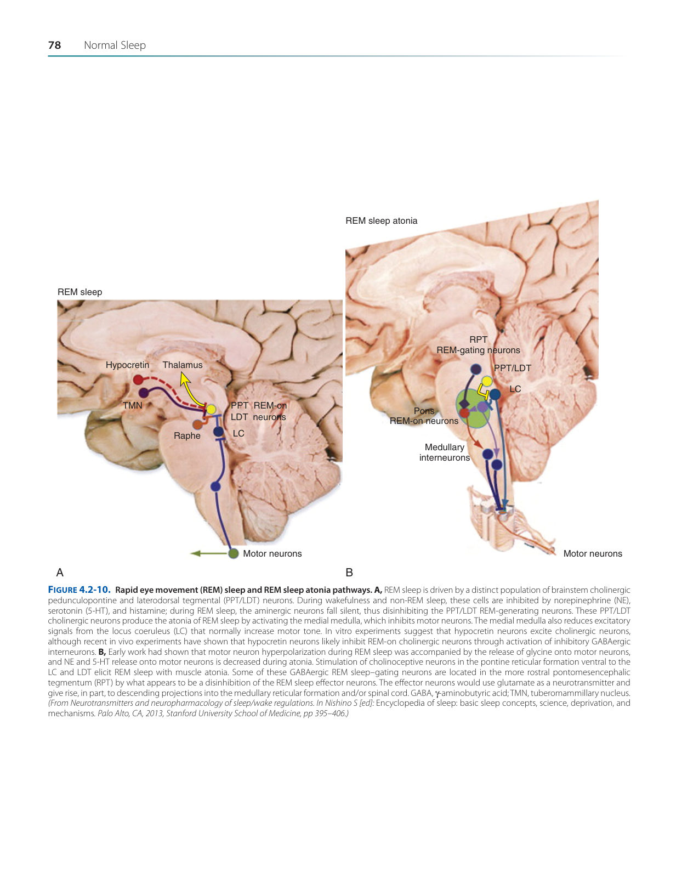

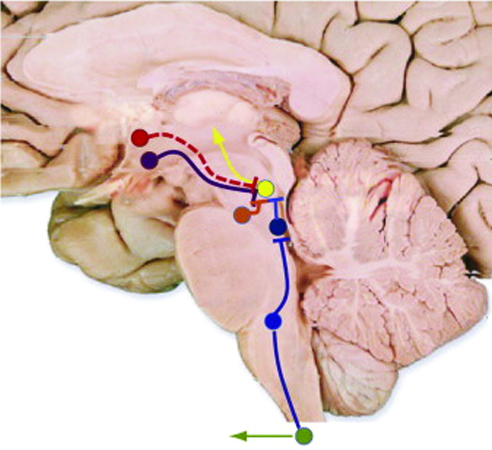

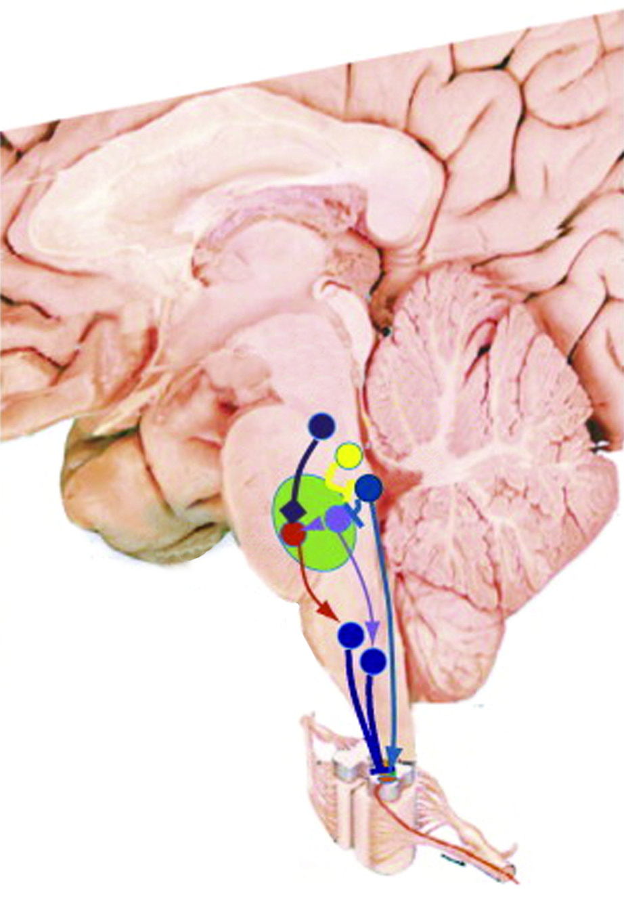

<!-- pdf-page: 97 -->

FIGURE 4.2-12. Stage W (wakefulness). This fragment is a 30-second epoch. The two top channels represent the channels that monitor eye movements.

The next six channels are used to record the electroencephalogram (EEG). The first three of these (F4-M1, C4-M1, O2-M1) are recommended for scoring sleep. The others are backups in case electrodes malfunction. The bottom channel is the chin electromyogram. The key finding that indicates this is wakefulness is the presence of alpha rhythm over the occipital region (monitored by the O leads) occupying more than 30 seconds of the epoch.

FIGURE 4.2-11. Animals assume a recognizable posture when sleeping.

E2-M1

E1-M2

F4-M1

C4-M1

## 30s

02-M1

F3-M2

C3-M2

01-M2

Chin1

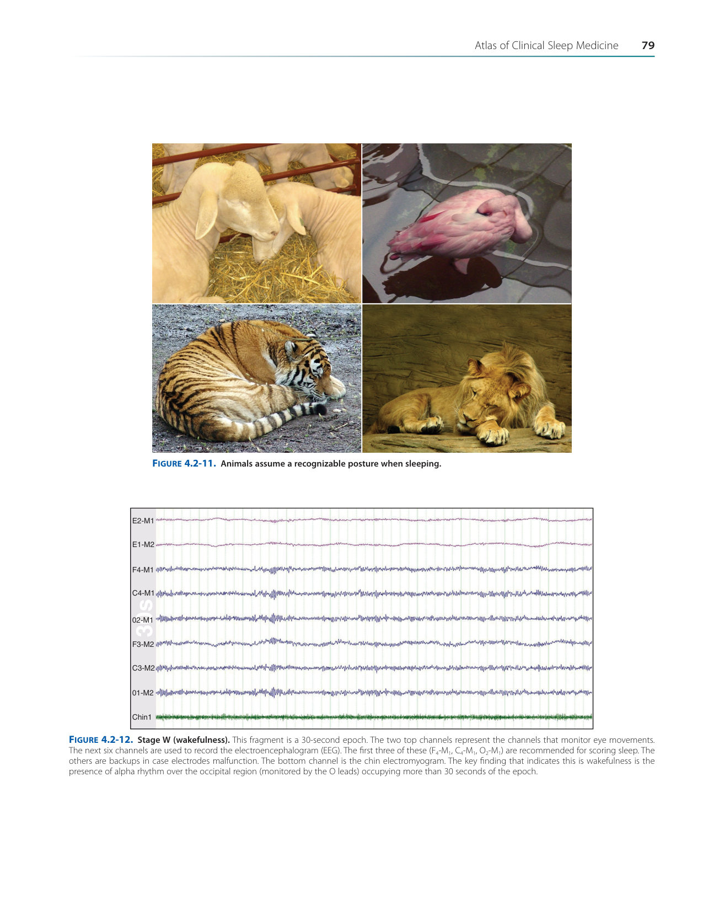

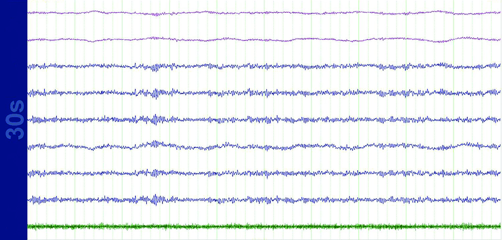

<!-- pdf-page: 98 -->

80 Normal Sleep

FIGURE 4.2-13. Stage N1. A mixed frequency, low-amplitude pattern has replaced the alpha rhythm for >50% of the epoch.

E2-M1

E1-M2

F4-M1

C4-M1

## 30s

02-M1

F3-M2

C3-M2

01-M2

Chin1

FIGURE 4.2-14. Stage N2. A train of sleep spindles (asterisk) toward the beginning of the epoch is followed shortly by a K-complex (dagger).

E2-M1

E1-M2

F4-M1

C4-M1

## 30s

02-M1

F3-M2

C3-M2

01-M2

*

Chin1 †

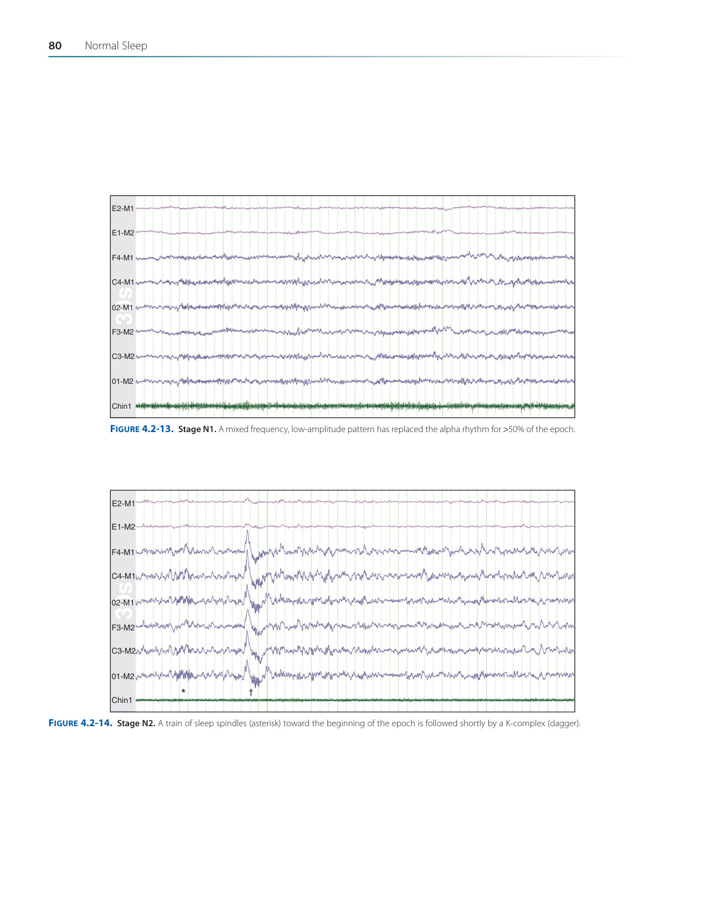

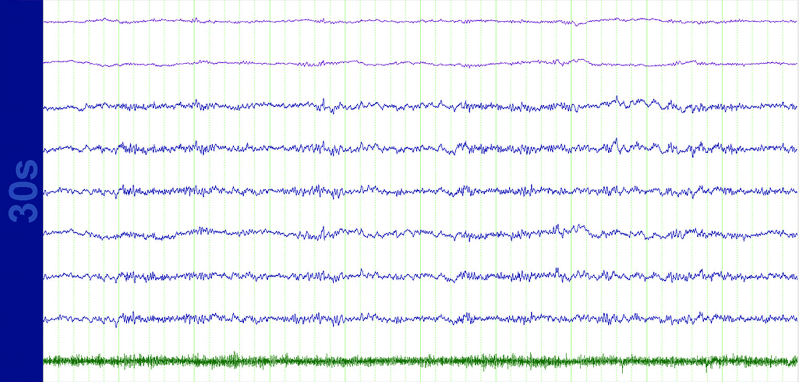

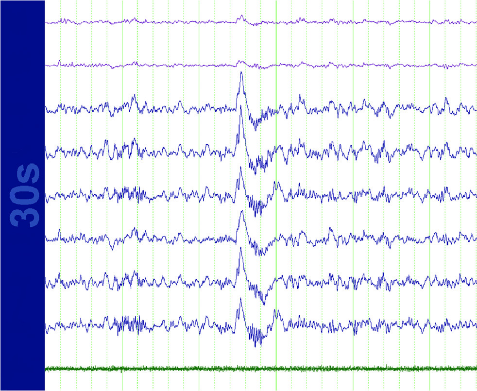

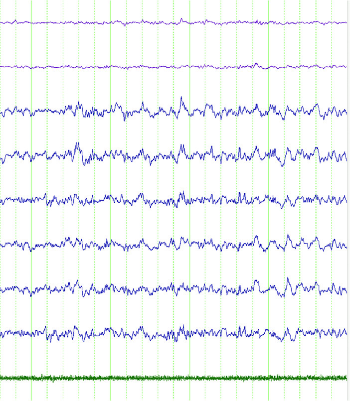

<!-- pdf-page: 99 -->

FIGURE 4.2-16. Stage R. Rapid eye movements (*) and a mixed-frequency, low-amplitude electroencephalogram are shown; muscle tone (chin electromyo­

gram) is absent (†). Note that some of the activity of the eyes has spilled over into the two frontal (F) leads (#).

E2-M1

E1-M2

F4-M1

C4-M1

## 30s

02-M1

F3-M2

C3-M2

01-M2

Chin1

FIGURE 4.2-15. Stage N3. More than 20% of the epoch consists of slow-wave activity.

E2-M1

*

E1-M2

F4-M1

#

C4-M1

## 30s

02-M1

#

F3-M2

C3-M2

01-M2

†

Chin1

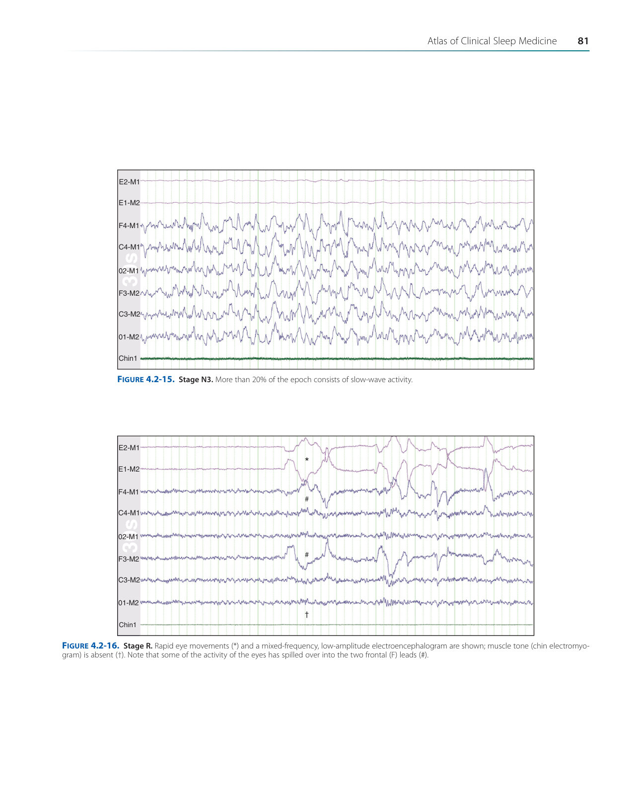

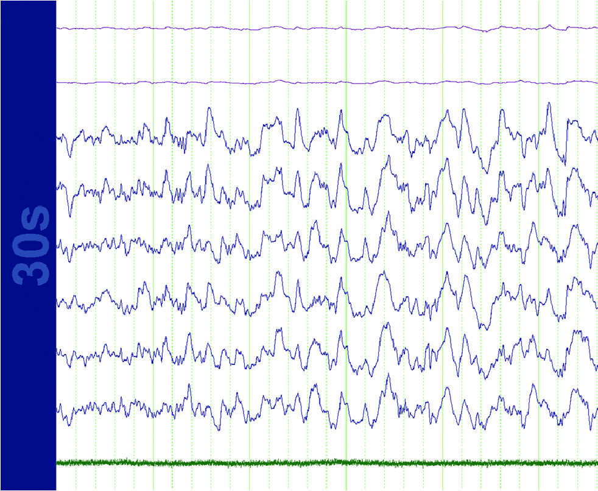

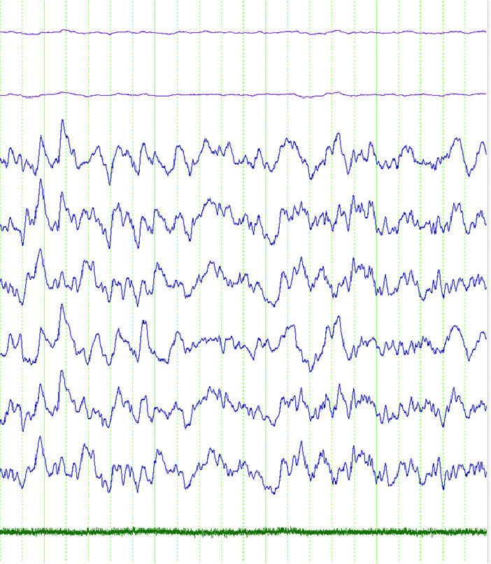

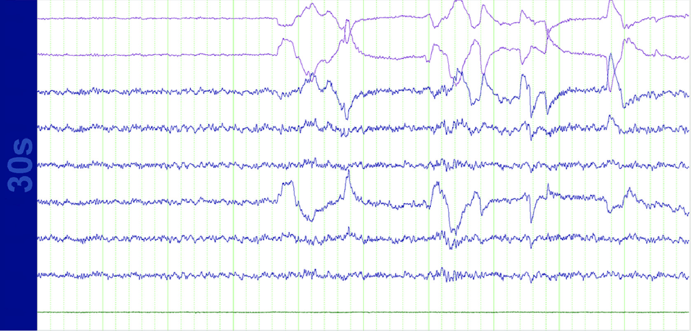

<!-- pdf-page: 100 -->

82 Normal Sleep

REM sleep: low voltage − random, test with sawtooth waves Sawtooth waves Sawtooth waves

Awake: low voltage − random, test

Drowsy: 8 to 12 cps − alpha waves

N1: 3 to 7 cps − theta waves Theta waves

N2: 12 to 14 cps − sleep spindles and K complexes

Sleep spindle

Delta sleep: (N3) 1/2 to 2 cps − delta waves 75 V

50 V

1 sec

K complex

FIGURE 4.2-17. Features of sleep-stage electroencephalogram frequencies. cps, cycles per second.

<!-- pdf-page: 101 -->

EEG rhythm Characteristics 1 s

Examples

Best seen

Slow waves 0.5–2 Hz; amplitude 75 V

Frontal

LOC-A1

ROC-A1

F4-A1

C4-A1

O2-A1

FIGURE 4.2-18. Sleep figures encountered on an electroencephalogram (EEG). Note that although all slow waves are in the delta frequency range, not

all delta waves are slow waves. (Modified from Vaughn BV, Giallanza P: Technical review of polysomnography. Chest 2008;134:1310–1319.)

Spindle 8–12 Hz

Central

K-complex Diphasic; large amplitude, duration 0.5 s

Frontal

LOC-A1

ROC-A1

F4-A1

C4-A1

O2-A1

LOC-A1

ROC-A1

F4-A1

C4-A1

O2-A1

Properties Stage Wake (W) N1 (Stage 1) N2 (Stage 2) N3 (Stages 3 and 4) REM Sleep

Duration 10 minutes 20 minutes The first REM period is very short, lasting about 5 minutes, the second is about 10 minutes, and the third is roughly 15 minutes. The final REM period usually lasts for 30 minutes, but sometimes lasts 1 hour

Low voltage, mixed frequency Theta activity Vertex sharp waves

EEG Eyes open: Low voltage, mixed frequency Alpha attenuates

Eyes closed: Low voltage, high frequency. More than 50% alpha activity

EOG

Eye blinks, voluntary control, SREM when drowsy

SREM

EMG

Tonic activity High-medium EMG activity

Tonic activity, High EMG activity Under voluntary control

Low voltage, mixed frequency At lease one K complex/sleep spindle

Low voltage, mixed frequency Presence of sawtooth waves Desynchronized EEG (in all other stage, the EEG is synchronized)

Stage 3 20–50% high amplitude delta activity

Stage 4 50% high amplitude delta activity

Mirrors EEG

Occasional SREM

Phasic REM

Tonic activity, Low EMG activity

T-REM: relatively reduced P-REM: episodic EMG twitching

Tonic activity, Low EMG activity

30-45 minutes

Arousal threshold Lowest Lower Low Highest

Physiologic changes Progressive reduction of physiologic activity, blood pressure, heart rate slow down T-REM Muscle paralysis,, increased cerebral blood flow P-REM Irregular breathing, variable heart rate, REM, phasic muscle twitching

2-5% %TST 44-55% 3-8% 20-25% 10-15%

Sleep walking, night terrors Parasomnias & movement disorders

Dreaming

Hypnic jerks in transition to N1

Hypnic jerks Confusional arousals, somniliquy

Vivid, bizarre, and detailed dreams

Diffuse dreams

REM sleep behavior disorder, REM nightmares

FIGURE 4.2-19. Sleep-stage electroencephalographic (EEG) rhythms and characteristics summarize sleep-stage scoring rules according to both the traditional

Rechtschaffen and Kales system and the current system developed by the American Academy of Sleep Medicine. MT, movement time; REM, rapid eye movement; P-REM, phasic REM; SREM, slow-rolling eye movements; T-REM, tonic REM; TST, total sleep time.

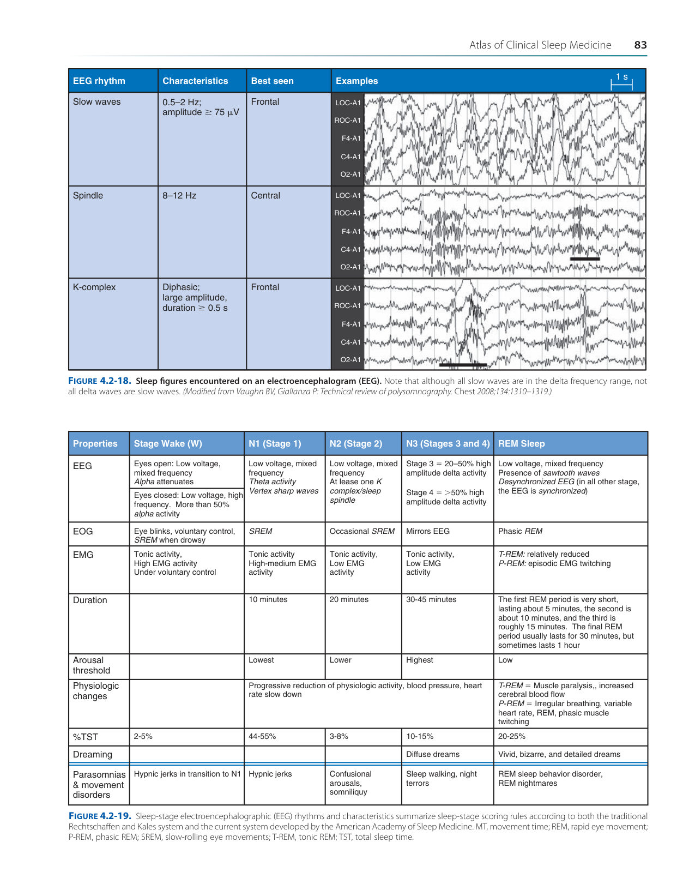

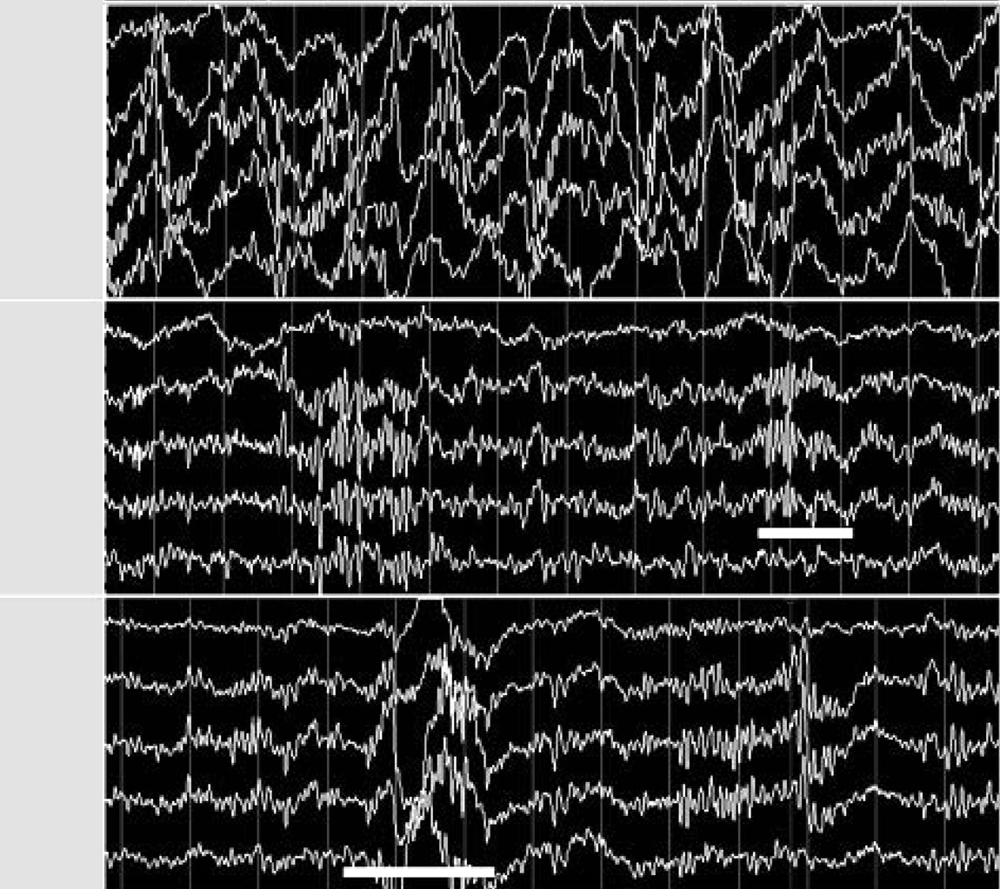

<!-- pdf-page: 102 -->

84 Normal Sleep

FIGURE 4.2-20. Sleep-stage electroencephalographic (EEG) rhythms and characteristics summarize sleep-stage scoring rules according to the traditional

Rechtschaffen and Kales (R&K) system as well as the current system developed by the American Academy of Sleep Medicine (AASM).

Differences R & K Manual

EEG electrodes Score sleep stages using central (C3, C4) leads

Major body movements Movement time can be scored if more than half the epoch is obscured

Slow-wave sleep Consists of both stage 3 and stage 4 sleep with delta wave amplitude measured using central leads

Terminology of stages Stage 1, stage 2, stage 3, stage 4, and stage REM sleep

Reference electrode Left and right ear or mastoid, termed A1 or A2

Scoring stage 2 (or N2) sleep 3-minute rule that states if greater than 3 minutes pass in between spindles or K complexes, then score stage 1 sleep

AASM Scoring Manual

Score using frontal, central, and occipital leads

No movement time staging exists

Only recognizes stage N3 sleep with delta wave amplitude measured using frontal leads

Stage N1, stage N2, stage N3, and stage R sleep

Left and right mastoid, termed M1 or M2

No 3-minute rule exists

FIGURE 4.2-21. Proportion of the night spent in the various sleep stages in adults. Wakefulness in sleep usually makes up less than 5% of the night. Stage

N1 sleep generally makes up 2% to 5% of sleep; stage N2, 45% to 55%; and stage N3, 3% to 15%. Non–rapid eye movement sleep is therefore usually 75% to 80% of sleep. Stage R sleep is usually 20% to 25% of sleep and occurs in three to six discrete episodes.

R 25%

N3 15% R N1 N2 W N3

W 5%

N2 50%

N1 5%

<!-- pdf-page: 103 -->

6 14 22 6 14 22 6 Corresponding time of day

EEG slow-wave activity (%)

Sleep Wakefulness Wakefulness

100

50

Homeostatic sleep pressure

A

20.0

FIGURE 4.2-22. Circadian and homeostatic regulation of sleep and wakefulness in humans. A, Increase of homeostatic sleep pressure during wakefulness

and its dissipation during sleep as reflected in electroencephalographic (EEG) slow-wave activity during daytime naps and nocturnal sleep. Circadian variation in wake-sleep propensity as reflected in B, the latency to sleep onset after 18 hours, 40 minutes of wakefulness; C, wakefulness in sleep opportunities, measured during forced desynchrony of the sleep-wake cycle; D, endogenous circadian rhythms of melatonin; and E, core body temperature. (A, Data from Dijk DJ, Beersma DGM, Daan S: EEG power density during nap sleep: reflection of an hourglass measuring the duration of prior wakefulness. J Biol Rhythms 1987; 2:207–219. B through E, Data from Dijk DJ, Duffy JF, Riel E, Shanahan TL, Czeisler CA: Ageing and the circadian and homeostatic regulation of human sleep during forced desynchrony of rest, melatonin and temperature rhythms. J Physiol 1999;516[Pt 2]:611–627.)

Sleep latency (min)

3.0

B

Wakefulness in sleep (%)

20

C

0

1

Plasma melatonin (z-scores)

0

D

1

Body temperature (C)

37.0

36.5

0 120 E

Circadian drive for wakefulness

240 0 120 240 0 Circadian phase (degrees)

FIGURE 4.2-23. Predictable sleep changes among different ages. REM, rapid eye movement; SW, slow-wave; SWS, slow-wave sleep.

Age Predictable sleep changes

Fetal sleep 80% “active sleep” at 30 weeks

Newborns 16-18 hours sleep Active sleep – 50% Quiet sleep Indeterminate sleep Establishment of major nocturnal sleep period by 3-4 months

One year 12-13 hours two naps 30% REM sleep

Two years 10-12 hours nap(s) 25% REM (fixed)

Older adults 65 years Decreased nocturnal sleep Increased napping Increased difficulty falling asleep Increased difficulty staying asleep Lighter sleep

Second decade Marked decline in SW activity (amplitude) More gradual decline in SWS over adult life Other stages remain relatively fixed

<!-- pdf-page: 104 -->

86 Normal Sleep

Total sleep time

REM latency

Sleep onset time (sleep latency)

Normal wakings at night

Awake

REM

NREM 1

Sleep stages

2

3

4

1 2 3 4 5 6 7 8 9 10

Deep sleep (NREM 3 and 4) early in the night More deep sleep

Light sleep (NREM 1 and 2) and dreaming (REM) sleep during most of the night (REM mainly late in the night)

FIGURE 4.2-25. Illustrative histograms showing the changes in sleep with aging. Shown are a child (A), a young to middle-aged adult (B), and an older

adult (C). Slow-wave sleep is maximal in children and decreases with aging. It is minimal or absent in the elderly. The same holds true for rapid eye movement sleep, which diminishes to a lesser extent and becomes more fragmented with aging. Older adults also have prolonged sleep latency compared with younger subjects; in addition, arousals are more frequent, and sleep efficiency is reduced ([total sleep time/total recording time] × 100).

Stage

W

R

N1

N2

N3

Slow-wave sleep most common first third of night

8 7 6 5 4 3 2 1

0 A Hours in bed

Stage

W

R

N1

N2

N3

0 C Hours in bed

Stage

W

R

N1

N2

N3

Adults have less slow-wave sleep than children

8 7 6 5 4 3 2 1

0 B Hours in bed

Older adults have little slow-wave sleep and many awakenings

8 7 6 5 4 3 2 1

<!-- pdf-page: 105 -->

E2-M1

E1-M2

F4-M1

C4-M1

02-M1

FIGURE 4.2-26. Stage N3 in a child. This epoch is obtained from the record of a 10-year-old boy. Notice the very high amplitude of the slow waves.

## 30s

F3-M2

C3-M2

01-M2

Chin1

FIGURE 4.2-27. Stage R in the child shown in Figure 4.2-26. The overall pattern is similar to this stage in an adult.

E2-M1

E1-M2

F4-M1

C4-M1

## 30s

02-M1

F3-M2

C3-M2

01-M2

Chin1

#### Factors that Affect Sleep

Many diseases, medications, lifestyle choices, and habits can adversely affect sleep (Table 4.2-3). Figure 4.2-28 shows the changes in the quantity of the sleep stages throughout the life span. Figures 4.2-29 and 4.2-30 outline the age-specific changes in specific sleep stages. As a function of time (in years), Figures 4.2-31 and 4.2-32 highlight the changes in sleep, confirming the observed trend in reduction in SWS and reduced sleep efficiency.

#### Sleep Changes in Children

From conception to adolescence, sleep undergoes some dramatic changes. Major alterations in sleep organization across infancy, childhood, and adolescence are depicted in Figures 4.2-33 through 4.2-40. Maturation of the neonatal EEG is shown (see Figs. 4.2-34 and 4.2-35), depicting the appearance of key electrographic findings that start to differentiate the unique components of NREM sleep. Although infants spend a significant amount of time sleeping throughout the day, with multiple nighttime awakenings (see Fig. 4.2-33), sleep begins to consolidate into one to two naps by 1 year of age, to one

TABLE 4.2-3 Factors that Affect Sleep

FACTOR EXAMPLES CROSS-REFERENCE

Medical diseases Heart failure, COPD Chapter 14

Psychiatric

Depression,

Chapter 17

diseases

schizophrenia

Sleep disorders Sleep apnea, narcolepsy,

Chapters 11, 13

RLS

Medications Antidepressants Chapters 6, 17

Habits Alcohol, caffeine Chapter 6

Lifestyle Voluntary sleep

Chapter 9

restriction, shift work

COPD, chronic obstructive pulmonary disease; RLS, restless legs syndrome

nap in the preschool period, to eventually all nighttime sleep by school age (see Fig. 4.2-40).

Over time, sleep architecture exhibits developmental changes with decreases in total sleep time (see Fig. 4.2-36) and SWS and increases in stage N2 sleep from childhood

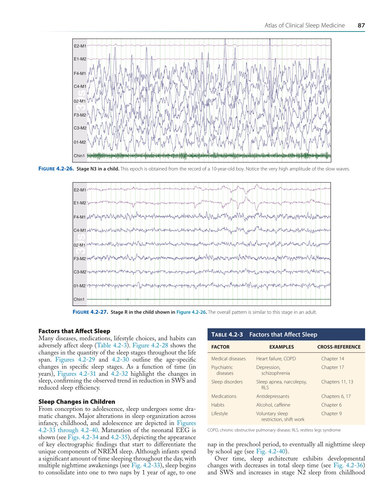

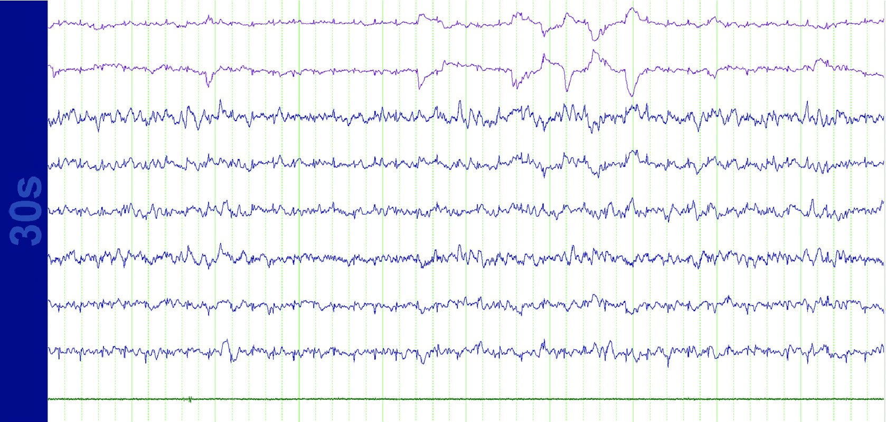

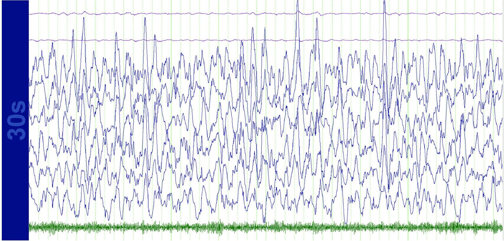

<!-- pdf-page: 106 -->

88 Normal Sleep

Minutes

500

Sleep latency

WASO

400

REM

300

Stage N3

200

FIGURE 4.2-28. Changes in sleep stages with age. REM, rapid eye movement; WASO, wake after sleep onset. (Modified from Ohayon M, Carskadon MA, Guil­

leminault C, et al: Meta-analysis of quantitative sleep parameters from childhood to old age in healthy individuals: developing normative sleep values across the human lifespan. Sleep 2004;27:1255–1273.)

100

5 0

45 35 25 15 10

Stage N2

Stage N1

Age (y) 85 65 75 55

FIGURE 4.2-29. Age-related changes in sleep stages occur with different chronologies for slow-wave sleep (stage N3) and rapid eye movement (REM)

sleep. From young adulthood to midlife, deep slow-wave sleep is replaced by lighter stages of sleep without significant changes in sleep fragmentation or REM sleep. From midlife to late life, sleep is more fragmented at the expense of decreases in both lighter stages of sleep (N1 + N2) and REM sleep. (Modified from Van Cauter E, et al: Age-related changes in slow wave sleep and REM sleep and relationship with growth hormone and cortisol levels in healthy men. JAMA 2000;284:861–868.)

Wake

60

% of sleep period

40

20

0

16-25 26-35 36-50 51-60 61-70 71-83

Stage N3

20

% of sleep period

10

0

16-25 26-35 36-50 51-60 61-70 71-83

Sleep stages in men during normal aging

Stages N1 N2

80

60

40

20

16-25 26-35 36-50 51-60 61-70 71-83

REM sleep

20

10

0

16-25 26-35 36-50 51-60 61-70 71-83

Age (y) Age (y)

<!-- pdf-page: 107 -->

Sleep changes with aging

NON-REM

AWAKE

NON-REM

AWAKE REM

NON-REM AWAKE REM

REM

Infancy

Old age

Adulthood

FIGURE 4.2-31. Human sleep and age. The marked preponderance of rapid eye movement (REM) sleep in the last trimester of pregnancy and the first year

of life decreases progressively as waking time increases. Note that non-REM (NREM) sleep time, such as waking time, increases after birth. Despite its early decline, REM sleep continues to occupy approximately 1.5 hours per day throughout life. This suggests that its strongest developmental contribution is to early brainmind development but that it subsequently plays an equally indispensable part in brain-mind maintenance. (From Roffwarg HP, Muzio JN, Dement WC: Ontogenetic development of the human sleep-dream cycle. Science 1966;152:604–619.)

24

Hours in day

16

REM sleep

8

0

HUMAN SLEEP AND AGE

Awake

NREM sleep

1 0 Birth Conception Death 1

10 20 100

Age (y)

<!-- pdf-page: 108 -->

90 Normal Sleep

Younger Older Awake

FIGURE 4.2-32. Age-related changes in sleep architecture. The most dramatic changes include a reduction in slow-wave sleep (delta sleep) and rapid eye

movement (REM) sleep and an increase in stage N1 and N2 sleep. Sleep efficiency and sleep continuity also decrease (evidence level C). NREM, non-REM sleep; SWS, slow-wave sleep. (Modified from Timby BK: Fundamental nursing skills and concepts, ed 8, Philadelphia, 2001, Lippincott Williams & Wilkins; and Williams RL, et al: EEG of human sleep: clinical applications. New York, 1974, Wiley & Sons.)

REM sleep

Deep sleep

11 PM to 6 AM 11 PM to 6 AM

700

600

500

Total sleep (min)

400

300

200

100

10 20 30 40 50 60 70 80 Age (y)

Total time in bed

NREM stage N1

REM

NREM stage N2

NREM—SWS

TABLE 4.2-4 Variables that Increase or Decrease

#### Sleep with Age

INCREASE DECREASE

Sleep latency Rapid eye movement sleep

Arousals, awakenings, stage shifts Sleep efficiency

Stages N1, N2 Slow-wave sleep (worse in men)

Napping Slow-wave sleep amplitude

Resistance to sleepiness, sleep

deprivation

Phase advancement

through adolescence (see Fig. 4.2-37). By adolescence the total sleep obtained falls short of what is recommended for healthy daytime functioning because of a variety of factors (see Fig. 4.2-39), among them the tendency toward a delayed sleep-phase pattern (see Fig. 4.2-40). Although the development of sleep is a dramatic and relatively rapid process during the first decades of life, changes in sleep continue across the life span (see Figs. 4.2-30 to 4.2-32).

#### Sleep Changes with Aging

Sleep in older people is affected by underlying medical conditions, changes related to vision, and environmental changes,

as shown in Figure 4.2-41. Figure 4.2-42 shows the changes in sleep that are frequently seen in older people. The corresponding changes in sleep structure that occur with healthy aging is depicted in Table 4.2-4 and is independent of medical conditions or medications. General observations reveal curtailment in deep NREM sleep, more frequent awakenings from sleep, and increased time spent awake in bed (see Figs. 4.2-31 and 4.2-32). Such sleep disturbances may be exacerbated by age-related comorbidities such as pain, cardiovascular disease, psychiatric conditions, nocturia (especially in the setting of prostate disease or Parkinson disease), and sleep disorders such as sleep apnea and movement disorders of sleep. Estimates reveal that between 40% and 70% of older adults have chronic sleep problems, and up to 50% of the cases are undiagnosed or untreated by primary care physicians. Unfortunately, these sleep problems become more significant in geriatric patients with dementia. Aging is also associated with some predictable changes in circadian physiology.

Aging is accompanied by a reduction in the amount of time spent in SWS and an increase in lighter levels of sleep. The proportion of REM sleep is generally preserved, but the latency to the first REM period decreases, and the overall amount of REM sleep may decrease as a result of an overall reduction in nocturnal sleep time. Older adults also take longer to initiate sleep and have a reduced total sleep time, frequent awakenings, and early morning awakenings and are more likely to nap. The prevalence of napping in older adults

<!-- pdf-page: 109 -->

FIGURE 4.2-33. Actogram data demonstrating rest/activity in representative infants. Dark bars represent activity; the same activity scale is used in each

plot. In infants exposed to dim lighting, day/night differences in rest/activity patterns in synchrony with the light/dark cycle are generally not apparent until about 20 days after discharge from the hospital. (From Jenni OG, Carskadon MA: Sleep behavior and sleep regulation from infancy through adolescence: normative aspects. Sleep Med Clin 2007; 2[3]:321–329.)

0

50

100

150

200

age [days]

250

300

350

400

5 11 17 22 5

time of day [h]

<!-- pdf-page: 110 -->

92 Normal Sleep

26 28 30 32 34 36 38 40 42 44 46 48 50 52 54 Conceptional age (weeks)

Frontal sharp wave transients

Temporal alpha bursts

Temporal theta bursts

Beta delta complexes

Tracé alternant

Occipital dominant alpha rhythm

Vertex transients

Sleep spindles

FIGURE 4.2-34. Maturation of the electroencephalogram. Development, appearance, and disappearance of electroencephalographic landmarks from

prematurity to 3 months postterm. Sleep spindles and vertex transients generally appear around 48 weeks of conception. (From Hrachovy RA: Development of normal EEG. In Levin KH, Luders HO [eds]: Comprehensive clinical neurophysiology. Philadelphia, 2000, WB Saunders, pp 387–413.)

FIGURE 4.2-35. Maturation and consolidation of neonatal sleep. (From Hrachovy RA: Development of normal EEG. In Levin KH, Luders HO [eds]: Comprehensive

clinical neurophysiology. Philadelphia, 2000, WB Saunders, pp 387–413.)

REM

Awake

NREM

Asynchronous Synchronous

27-28 29-30 31-33 34-35 36-37 38-40 Conceptional age (weeks)

<!-- pdf-page: 111 -->

Sleep duration from age 0 to 12

22

20

18

16

14

FIGURE 4.2-36. Sleep duration during the first 12 years of life. Plot of the sleep duration data from age 0 to 12 years. Data are presented as the mean ±

1.96 standard deviation. (From Galland BC, Taylor BJ, Elder DE, Herbinson P: Normal sleep patterns in infants and children: a systematic review of observational studies. Sleep Med Rev 2012;16[3]:213–222.)

12

Hours

10

8

6

0–2 months

12 months

1–2 years

2–3 years

3 months

6 months

9 months

4

2

0

Infant

4–5 years

10 years

12 years

11 years

6 years

7 years

8 years

9 years

Toddler Child

FIGURE 4.2-37. Nighttime and total sleep duration during the first 15 years of life. Data from percentiles of total (A) and nighttime (B) sleep duration

(time in bed) per 24 hours in 493 healthy children studied longitudinally from age 1 month to 16 years (Zurich Longitudinal Studies). These data from Swiss mothers provide a useful baseline for examining childhood and early adolescent sleep patterns. The investigators noted a significant cohort change in Swiss mothers’ reports, in which those who enrolled in the project in the mid-1980s reported about 30 minutes less sleep than those enrolled in the mid-1970s, an effect most evident in the younger children. Nighttime sleep duration is relatively stable across the early childhood years, as total sleep falls when children drop their daytime naps. After the first year, the dropping of naps from two to one per day and then no routine napping by about 4 years is a common feature of sleep development for Western children. Racial/cultural differences in this pattern, with naps sustained further into childhood in African Americans, has been reported (Crosby et al, 2005). (Modified from Iglowstein I, Jenni OG, Molinari L, et al: Sleep duration from infancy to adolescence: reference values and generational trends. Pediatrics 2003;11:302–307.)

TOTAL SLEEP DURATION

7 8 9 10 11 12 13 14 15 16 17 18 19 20

98

Total sleep duration (hours)

75

25

98

2

75

25

2

1 3 5 9 1 1.5 2 3 4 5 6 7 8 9 10111213141516

Age (months) Age (years)

A

NIGHTTIME SLEEP DURATION

14

Nighttime sleep duration (hours)

98

13

12

11

10

75

98

9

75

8

25

25

7

2

6

2

5

1 3 5 9 1 1.5 2 3 4 5 6 7 8 9 10111213141516

Age (months) Age (years)

B

<!-- pdf-page: 112 -->

94 Normal Sleep

Sleep

Newborn infant

1 year old

4 years old

10 years old

Adult

6 PM Midnight 6 AM

Time of day Noon 6 PM

FIGURE 4.2-39. Sleep in adolescence. Sleep timing from preadolescence through adolescent development, depicting the key factors that affect sleep in

adolescence. Sleep timing is long and timed at an early hour for preadolescents. Maturational changes as a result of the circadian phase delay that arise from the circadian timing system, as well as the slowed rise of sleep pressure originating from sleep-wake homeostasis, force for a delay of the timing of sleep. In addition, psychosocial factors such as self-selected bedtimes, the impact of academic pressures on sleep, and the proliferation of use of technology and social networking in the evening also contribute to and push for a delay in the timing of sleep even further. Unfortunately, societal pressures that require for an even earlier rise time—specifically, pushing for an early start to the school day—are the forces that influence the curtailment of time available for sleep. As a result, adolescents whose sleep time is too short are asked to be awake at an inappropriate circadian phase, worsening the total sleep deprivation. (From Carskadon MA: Sleep in adolescents: the perfect storm. Pediatr Clin North Am 2011;58[3]:637–647.)

Adolescent development and sleep: the perfect storm

Preadolescence

Circadian phase delay

A d o l e s c e n c e

Sleep timing

Slowed rise of sleep pressure

Bioregulatory pressure delay Psychosocial pressure delay

Screen time & social networking

Bedtime autonomy Academic pressure

Societal pressure early rise

School start time

Late to bed, early to rise ≥ short sleep

<!-- pdf-page: 113 -->

Sleepy– go to bed

Wake up

Standard phase

Not sleepy– stay up late

Wake up

FIGURE 4.2-40. Delayed sleep-phase pattern in adolescents. (Modified from Ancoli-Israel: All I want is a good night’s sleep. St Louis, 1996, Mosby–Year Book.)

Delayed sleep phase

6 PM 9 PM 12 AM 3 AM 6 AM 9 AM Noon Time of day

FIGURE 4.2-41. Sleep in older people is affected by underlying problems. Medical, psychiatric, and sleep disorders can cause arousal and disrupt sleep.

In addition, changes in the visual system (green boxes) and changes in light exposure and other environmental factors can result in circadian rhythm changes (purple boxes). (From Avidan AY: Clinical neurology of insomnia in neurodegenerative and other disorders of neurological function. Rev Neurol Dis 2007;4:21–34.)

Sun/ambient light exposure

Retina-macula

Lens Retino-hypothalamic tract

Cataracts

Macular degeneration

Decreased light exposure

Suprachiasmatic

nucleus Pineal gland

SCN

Excessive noise Inappropriate light exposure

Melatonin level

Underlying Sleep Disorders: OSA, RLS, PLMD and Psychiatric Disorders

ranges from 25% to 80%. Studies that have used the multiple sleep latency test to assess the extent of daytime sleepiness in older persons have shown that, given the opportunity, older adults tend to fall asleep during the day faster than younger patients. This daytime sleepiness suggests that older adults may not be getting sufficient sleep at night. This is interpreted to mean that the need for sleep in older adults is not reduced, but rather that the ability to sleep is changed.

When assessing the gender differences in the sleep of healthy elderly patients, data reveal that women fall asleep more easily and maintain sleep better than men. Recent studies to evaluate the effects of menopause on sleep have found associated subjective complaints of insomnia. Menopause, when assessed objectively, was found to prolong sleep latency, reduce REM sleep, and reduce total sleep time.

#### SLEEP CHARACTERISTICS THAT CHANGE

#### WITH AGE AND THEIR POSSIBLE

#### NEUROPHYSIOLOGIC MECHANISMS

Age-associated changes in sleep EEG include the following findings: • SWS and total sleep time are reduced (Fig. 4.2-43). • Wake after sleep onset increases. • The number and duration of arousals increases. • Time spent in SWS declines. • Sleep efficiency declines. • Men show larger reductions in SWS across all ages. • Women show relatively stable levels of SWS until the time

of menopause, at which time an age-related decline is reported.

<!-- pdf-page: 114 -->

96 Normal Sleep

May take longer to initiate sleep

Circadian rhythm may advance, leading to early sleep and early awakening

More likely to develop sleep disorders

FIGURE 4.2-42. Aging and sleep. Older adults experience sleep disruption because of a variety of medical, sleep-related, and psychosocial factors. REM, rapid

eye movement; SWS, slow-wave sleep.

Increased need to nap during the day

#### ALTERATIONS

#### IN SLEEP WITH

#### AGING

Amount of REM sleep may also decrease

Latency to the first REM period tends to decrease

Reduction in the amount of SWS

Overall reduction in nocturnal sleep time

Sleep fragmentation

Decreased sleep efficiency

Decrement in the amplitude of the low-frequency waves in SWS More time in the lighter stages of sleep

FIGURE 4.2-43. As a result of physiologic, hormonal, and environmental changes, older adults tend to sleep less efficiently. Although they may be in

bed 8 hours, at 55 years of age and older, both men and women may be in actual sleep for just 7 hours or less. Frequent disruptions and poor sleep rob the older person of the continuous sleep necessary to experience the deeper stages of sleep and reap their benefits. (Modified from Ohayon MM, Carskadon MA, Guilleminault C, Vitiello MV: Meta-analysis of quantitative sleep parameters from childhood to old age in healthy individuals: developing normative sleep values across the human lifespan. Sleep 2004; 27[7]:1255–1273.)

100

90

80

Percent

70

Men Women

60

10 20 30 40 50 60

Changes with age: sleep efficiency

70 Age

<!-- pdf-page: 115 -->

• SWS in men is reported to be significantly lower than that

Sleepy– go to bed

of women throughout the life span. • Percentage of stage N2 sleep is reported to be increased in

Wake up

older adults. • The frequency and duration of nocturnal awakenings is

Standard phase

increased in older adults. • REM sleep changes with age are less consistent.

Sleepy–go to bed early

Wake up

Advanced phase

6 PM 9 PM 12 AM 3 AM 6 AM 9 AM Noon Time of day

FIGURE 4.2-44. Advance sleep-phase syndrome. (Modified from Ancoli-

Israel: All I want is a good night’s sleep. St Louis, 1996, Mosby–Year Book.)

Sleeptiming, Circadian Changes, & Melatonin Rhythm in

Older Adults and Young Adults

Reduced circadian amplitude

Awakening at an earlier circadian time closer to melatonin midpoint

Earlier clock hour for circadian melatonin phase

Advanced sleep onset and wake time. Shorter sleep duration.

FIGURE 4.2-45. Sleep timing and circadian changes in older adults. Part

of the explanation of the tendency toward advancement of the circadian rhythms in older adults is due to underlying changes in circadian physiology. Circadian melatonin rhythm and sleep timing for young adults (black solid line, box) and older adults (red line, open box) are shown. Older adults generally show reduced circadian amplitude and earlier timing of sleep and circadian phase compared with young adults. Older adults also awaken at an earlier biologic time such that waking time occurs closer to the melatonin maximum. (From Wright KP, Frey DJ: Age-related changes in sleep and circadian physiology: from brain mechanisms to sleep behavior. In Avidan AY, Alessi C (eds): Geriatric sleep medicine. Informa Healthcare, 2008.)

#### CIRCADIAN CHARACTERISTICS THAT

#### CHANGE WITH AGE

Age-related changes in the circadian system have been reported to include an advance in circadian timing (Fig. 4.2-44) and a reduction in circadian amplitude (Fig. 4.2-45). These changes may be related to changes in the master circadian clock in the suprachiasmatic nucleus and/or to changes in input and output pathways of the suprachiasmatic nucleus.

#### Selected Readings

Carskadon MA, Dement WC: Normal human sleep: an overview. In Kryger

MH, Roth T, Dement WC, editors: Principles and practice of sleep medicine, New York, 2005, Elsevier, pp 13–23. Crosby B, LeBourgeois MK, Harsh J: Racial differences in reported napping

and nocturnal sleep in 2- to 8-year-old children. Pediatrics 115:225–232, 2005. Iber C, Ancoli-Israel S, Chesson A, Quan SF: The AASM manual for the

scoring of sleep and associated events: rules, terminology, and technical specifications, Westchester, IL, 2007, American Academy of Sleep Medicine. Shepard JW: Atlas of sleep medicine, Armonk, NY, 1991, Futura. Walczak T, Chokroverty S: Electroencephalography, electromyography

and electrooculography: general principles and basic technology. In Chokroverty S, editor: Sleep disorders medicine, ed 2, Boston, 1999, Butterworth-Heinemann. Ancoli-Israel S: Sleep problems in older adults: putting myths to bed. Geri­

atrics 52:20–30, 1997. Bliwise DL: Normal aging. In Kryger MH, Roth T, Dement WC, editors:

Principles and practice of sleep medicine, ed 4, Philadelphia, 2005, Elsevier, pp 24–38. Bliwise DL: Sleep in normal aging and dementia. Sleep 16:40–81, 1993. McLaughlin Crabtree V, Williams NA: Normal sleep in children and ado­

lescents. Child Adolesc Psychiatr Clin North Am 18:799–811, 2009. Wright, K, Frey DJ: Age-related changes in sleep and circadian physiology:

from brain mechanisms to sleep behavior. In Avidan AY, Alessi C, editors: Geriatric sleep medicine, New York, 2008, Informa Healthcare.

