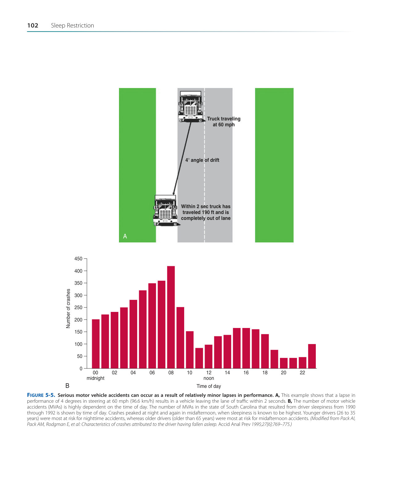
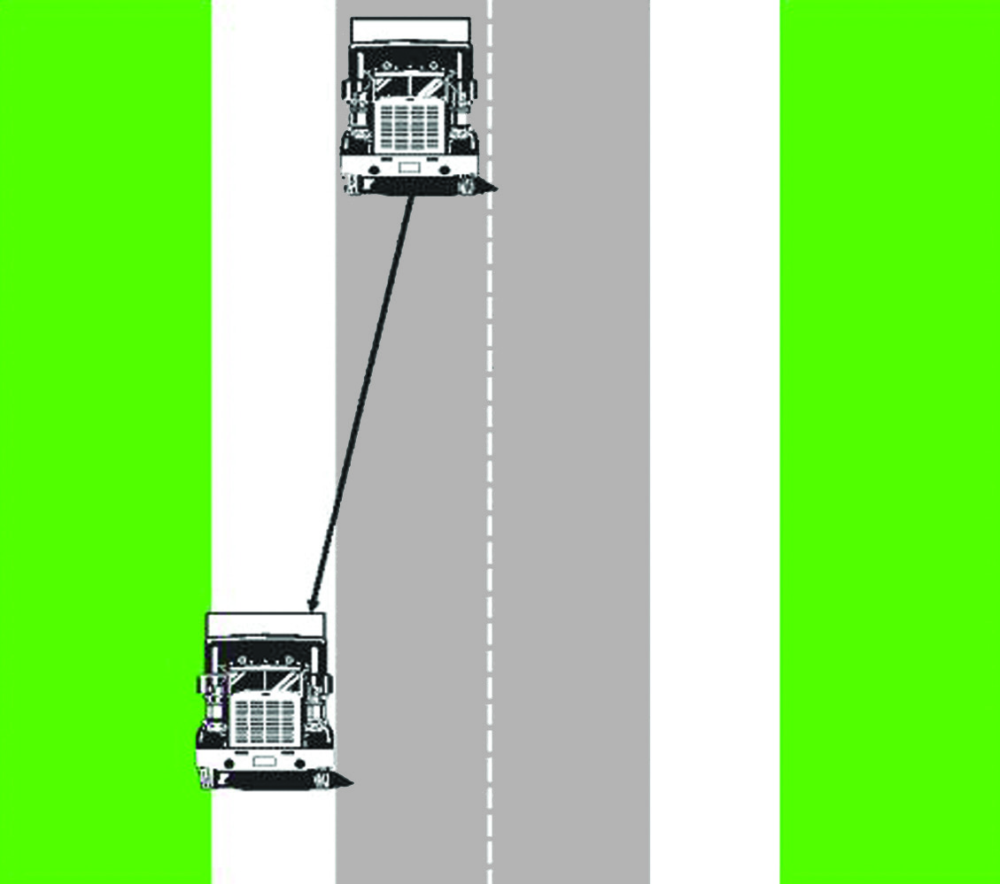

# 5 Sleep Restriction

<!-- pdf-page: 116 -->

## Chapter 5

## Sleep Restriction

### Andrea M. Spaeth, Takashi Abe, Jason S. Schneiderman,

### and David F. Dinges

Time of going to bed A B C

#### SLEEP RESTRICTION

Excessive daytime sleepiness can result from various sleep pathologies, including sleep-disordered breathing, insomnia, and narcolepsy. Daytime sleepiness can also be due to chronic insufficient sleep associated with lifestyle factors. Nearly 30% of adults in the United States self-report sleeping 6 hours or less per night on average. Time-use surveys indicate that the primary predictor of sleep duration is paid work time and travel time; however, leisure activities and a person’s chronotype (being an “early bird” or a “night owl”) also influence time spent sleeping (Fig. 5-1). When sleep time is limited by social or work obligations, a subsequent increase is found in the frequency of sleep episodes, duration of sleep, and the intensity of sleep. In addition to the circadian rhythm, this homeostatic drive influences the propensity for sleep (Fig. 5-2). As sleep debt is accrued through chronic sleep restriction, feelings of sleepiness increase (Fig. 5-3, B), the latency to fall asleep decreases (Fig. 5-4, C), and individuals experience “microsleeps” when attempting to stay alert. This leads to instability of attention, decreased alertness, impaired working memory, and slowed reaction speed; these deficits persist even after a night of recovery sleep (see Fig. 5.4). Lapses in attention and reduced reaction times caused by sleepiness can lead to errors in the workplace and car accidents (Fig. 5-5).

150

25%

Adjusted change in activity (min)

Work time Travel time

100

20%

Relative frequency

50

15%

0

10%

50

5%

100

0%

150

<4.5 <5.5 <6.5 <7.5 <8.5 <9.5 <10.5 <11.5 11.5

Sleep time (hr) 04 05 06 07 08 09 10 11 12

#### INDIVIDUAL DIFFERENCES IN

#### VULNERABILITY TO SLEEP RESTRICTION

Large interindividual differences are seen in the physiologic response to sleep loss and in the magnitude of decrements in neurobehavioral performance during sleep deprivation. Strong evidence suggests these differences are systematic and phenotypic (Fig. 5-6). According to results of psychomotor vigilance test (PVT) performance during sleep loss, approximately one third of healthy adults are highly vulnerable to the neurobehavioral effects of sleep deprivation, another third are somewhat vulnerable, and the remaining third are much less vulnerable (i.e., resistant to the effects of sleep loss). Neither demographic factors (age, sex, IQ), baseline functioning, various aspects of habitual sleep timing, circadian chronotype, nor other investigated factors to date have accounted for the robust and stable differences in neurobehavioral responses to sleep restriction. Because of the phenotypic nature of these interindividual differences, recent research has focused on understanding what genetic polymorphisms may underlie varying physiologic responses and neurobehavioral vulnerabilities to sleep loss (Fig. 5-7).

25%

No work < 8 h work time 8 h work time

No work < 8 h work time 8 h work time

20%

Relative frequency

15%

10%

5%

0%

18 04 03 02 01 00 23 22 21 20 19

Wake up time

FIGURE 5-1. A, Work time and travel time are the primary activities that are reciprocally related to sleep time among Americans. The average sleep time for

adults who worked 8 hours or more each day was 7 hours and 32 minutes per day; those who worked fewer than 8 hours per day slept 8 hours and 7 minutes per day, and those who did not work slept 8 hours and 50 minutes per day. B, Distribution of wake time. C, Distribution of bedtime. Adults who worked 8 hours or more awoke an average of 0.68 hours earlier than those who worked fewer than 8 hours (P < .0001) and 1.31 hours earlier than individuals who were not working. However, no significant differences in bedtime were found between groups. Watching television is the primary activity people engage in before going to bed, which suggests that adults may be able to extend sleep duration by reducing television viewing and going to bed at an earlier time. (Modified from Basner M, Fomberstein KM, Razavi FM, et al: American time use survey: sleep time and its relationship to waking activities. Sleep 2007;30[9]:1085–1095; and Basner M, Dinges DF: Dubious bargain: trading sleep for Leno and Letterman. Sleep 2009;32[6]:747–752.)

<!-- pdf-page: 117 -->

FIGURE 5-2. Schematic representation of the oppositional interplay of circadian and homeostatic drives in the regulation of alertness, performance,

and related neurobehavioral functions. The homeostatic drive for sleep accumulates throughout wakefulness and progressively downregulates neurobehavioral performance and alertness while increasing subjective sleepiness. Unlike the circadian system, which is limited by its amplitude, the homeostatic drive for sleep can accumulate far beyond the levels typically encountered in a 24-hour day (illustrated by the increasing density of downward arrows). In opposition to these influences on performance and alertness is the endogenous circadian rhythmicity of the biologic clock. Through its promotion of wakefulness, the circadian system modulates the enhancement of performance and alertness. The improvement in waking neurobehavioral functions by the circadian drive is an oscillatory output that periodically involves robust opposition to the homeostatic drive, alternated with periods of withdrawal of the circadian drive for wakefulness. Critical modulators of neurobehavioral functions other than the sleep and circadian drives are subsumed in the schematic under the broad categories of endogenous and exogenous stimulation. These factors can include endogenous (e.g., anxiety) or exogenous (e.g., environmental light) wake-promoting processes that oppose the homeostatic drive for sleep. Alternatively, they can include endogenous (e.g., narcolepsy) or exogenous (e.g., rhythmic motion) sleep-promoting processes that oppose the circadian drive for wakefulness either directly or indirectly by exposing the sleep drive. The neurobiologic underpinnings of these exogenous and endogenous processes are undoubtedly diverse, and few of their interactions with the circadian and homeostatic systems have been studied systematically. (Modified from Goel N, Van Dongen HP, Dinges DF: Circadian rhythms in sleepiness, alertness and performance. In Kryger MH, Roth T, Dement WC: Principles and practice of sleep medicine, ed 5, Philadelphia, 2011, Elsevier.)

Increased behavioral capability

Endogenous factors (e.g., stress, anxiety, urgency, motivation?)

Reduced behavioral capability Time

HOMEOSTATIC DRIVE FOR SLEEP

Performance, alertness, threat detection, risk taking, mood and morale, behavioral efficiency

Exogenous factors (e.g., caffeine, noise, workload, physical activity)

CIRCADIAN DRIVE FOR WAKEFULNESS

<!-- pdf-page: 118 -->

100 Sleep Restriction

16

2.5

FIGURE 5-3. Four different neurobehavioral assays serve to measure cognitive performance capability and subjective sleepiness. Each panel displays

group averages of performance for subjects in the 8-hour (blue), 6-hour (green), and 4-hour (red) chronic sleep period conditions across 14 days and in the 0-hour (black) sleep condition across 3 days. Subjects were tested every 2 hours each day; data points represent the daily average (07:30 to 23:30) expressed relative to baseline (BL). A shows psychomotor vigilance test (PVT) performance lapses; B shows Stanford Sleepiness Scale (SSS) self-ratings; C shows digit symbol substitution task (DSST) correct responses; and D shows serial addition/subtraction task (SAST) correct responses per minute. Upward curve movement corresponds to worse performance on the PVT, greater sleepiness on the SSS, and better performance on the DSST and SAST. The curves through the data points represent statistical nonlinear, model-based, best-fitting profiles of the response to sleep deprivation for subjects in each of the four experimental conditions. The mean (± standard error) ranges of neurobehavioral functions for 1 and 2 days of 0 hours of sleep (total sleep deprivation) are shown as light and dark shaded bands, respectively, allowing comparison of the 3-day total sleep deprivation condition and the 14-day chronic sleep restriction conditions. For the DSST and SAST, these bands are curved parallel to the practice effect displayed by the subjects in the 8-hour sleep period condition to compensate for different amounts of practice on these tasks. (From Van Dongen HP, Maislin G, Mullington JM, Dinges DF: The cumulative cost of additional wakefulness: dose-response effects on neurobehavioral functions and sleep physiology from chronic sleep restriction and total sleep deprivation. Sleep 2003; 26[2]:117–126.)

14

12

0 hours

10

PVT lapses

4 hours 6 hours

8

6

4

2

8 hours

0

B A

9

6

DSST correct responses

3

0

3

6

9

12

BL 2 4 6 8 Days of sleep restriction D C

10 12 14

2.0

SSS sleepiness score

1.5

1.0

0.5

0.0

3.0

2.0

1.0

SAST throughput

0.0

1.0

2.0

3.0

BL 2 4 6 8 Days of sleep restriction 10 12 14

<!-- pdf-page: 119 -->

FIGURE 5-4. Daily means (± standard error) of lapses (A), Maintenance of Wakefulness Test (MWT) sleep-onset latency (C), and PVT fastest 10% reaction time

(E) in the sleep-restriction group (n = 142, 4 hours time in bed (TIB) for 5 nights [SR1-SR5], red lines, E) and the control group (n = 17, 10 hours TIB on all nights, blue line). All subjects had 10 hours TIB (2200 to 0800) on baseline day 2 (B2). Sleep restriction on SR1 to SR5 was from 0400 to 0800. Data are plotted to show deficits in neurobehavioral functions increasing (upward) on the ordinate. Relative to the control condition, sleep restriction degraded neurobehavioral function over a matter of days (increased PVT lapses [>500 ms reaction times], decreased MWT sleep-onset latencies, and slowed reaction time). Sleep-restricted subjects (n = 142) were randomized to either 0 hours TIB (n = 13), 2 hours TIB (n = 27), 4 hours TIB (n = 29), 6 hours TIB (n = 25), 8 hours TIB (n = 21), or 10 hours TIB (n = 27) during the night following sleep restriction. Least squares means (± standard error) are shown as diamonds for each recovery night sleep-dose subgroup, controlling for covariates (i.e., baseline, cumulative deficits during sleep restriction, age, and sex). For comparison, horizontal dotted lines show baseline night values (B2, 10 hours TIB), and horizontal dashed lines show control group means (n = 17) on day 8 (10 hours TIB), which is the study-day equivalent to the day following the recovery night. These neurobehavioral outcomes showed improvement as recovery sleep doses increased (decreased PVT lapses [B], increased MWT sleep-onset latencies [D], and increased reaction speed [F]). However, even at the highest sleep-recovery dose, functioning did not return to baseline or control condition levels. (Modified from Banks S, Van Dongen HPA, Maislin G, Dinges DF: Neurobehavioral dynamics following chronic sleep restriction: dose-response effects of one night for recovery. Sleep 2010;33[8]:1013–1026.)

12

10

PVT Lapses

8

6

4

2

A

0

0

10

MWT (min)

20

30

C

230

220

PVTf10 (ms)

210

200

190 B2 SR1 SR2 SR3 Protocol night SR4 SR5

E

25

20

PVT Lapses

15

10

5

B

0

0

5

MWT (min)

10

15

20

D

25

255

245

PVTf10 (ms)

235

225

215

205

195

0h 2h 4h 6h 8h 10h Recovery night TIB

F

<!-- pdf-page: 120 -->

102 Sleep Restriction

FIGURE 5-5. Serious motor vehicle accidents can occur as a result of relatively minor lapses in performance. A, This example shows that a lapse in

performance of 4 degrees in steering at 60 mph (96.6 km/h) results in a vehicle leaving the lane of traffic within 2 seconds. B, The number of motor vehicle accidents (MVAs) is highly dependent on the time of day. The number of MVAs in the state of South Carolina that resulted from driver sleepiness from 1990 through 1992 is shown by time of day. Crashes peaked at night and again in midafternoon, when sleepiness is known to be highest. Younger drivers (26 to 35 years) were most at risk for nighttime accidents, whereas older drivers (older than 65 years) were most at risk for midafternoon accidents. (Modified from Pack AI, Pack AM, Rodgman E, et al: Characteristics of crashes attributed to the driver having fallen asleep. Accid Anal Prev 1995;27[6]:769–775.)

A

450

400

350

Number of crashes

300

250

200

150

100

50

0

00 midnight 12 noon

Time of day B

Truck traveling at 60 mph

4 angle of drift

Within 2 sec truck has traveled 190 ft and is completely out of lane

02 04 06 08 10 14 16 18 20 22

<!-- pdf-page: 121 -->

FIGURE 5-6. Individuals exposed to total sleep deprivation on three separate occasions with at least 2 weeks between each session. Two sessions

were preceded by a week of sleep extension (12 hours time in bed [TIB]/night), and one session was preceded by a week of sleep restriction (6 hours TIB/night). Subjective sleepiness was assessed by the Karolinska Sleepiness Scale (KSS), and alertness was assessed by the psychomotor vigilance test (PVT) using the number of lapses (>500 ms reaction times) as the measure of impairment. Responses during sleep deprivation following 7 days of sleep extension are marked by boxes (the average of the two sessions), and responses during sleep deprivation following 7 days of sleep extension are marked by diamonds. The abscissa of each panel shows the 21 individual subjects, labeled A through U. The subjects are ordered by the magnitude of their impairment, with the most resistant subjects on the left and the most vulnerable subjects on the right. Subjects differed substantially in their responses to sleep deprivation; however, the responses were relatively stable within subjects between exposures to sleep deprivation. The intraclass correlation coefficient values showed that 67.5% to 92.2% of the variance in the neurobehavioral data was explained by stable variations among individuals. Interestingly, individuals who were more impaired by sleep loss based on PVT performance were not the same individuals who self-reported greater levels of sleepiness on the KSS; similarly, those less impaired by sleep loss based on PVT performance were not the same individuals who self-reported a lower amount of sleepiness. This indicates that an individual’s subjective assessment of how sleepy he or she feels may not accurately reflect how alert the person is during sleep deprivation. (From Van Dongen HP, Baynard MD, Maislin G, Dinges DF: Systematic interindividual differences in neurobehavioral impairment from sleep loss: evidence of trait-like differential vulnerability. Sleep 2004;27[3]:423–433.)

9

8

7

KSS-1 sleepiness score

(greater impairment )

6

5

4

3

2

1

T R E J H K UQ I O S C A P DG L F BM Subjects A

120

100

PVT performance lapses (greater impairment )

80

60

40

20

0

UOQN F C AG B J HM T K S I R L E Subjects B

<!-- pdf-page: 122 -->

104 Sleep Restriction

Mean KSS sleepiness score

*†

Mean PVT lapses

*

6

8

5

6

4

4

3

2

FIGURE 5-7. Presence of the human leukocyte antigen (HLA) DQB1*0602 allele is closely associated with hypocretin deficiency and narcolepsy with

cataplexy, a neurologic disorder characterized by excessive daytime sleepiness, fragmented sleep, and shortened rapid eye movement (REM) sleep latency. Data presented represent healthy adults (those without narcolepsy), with and without the DQB1*0602 allele, during a protocol involving 1 baseline (B) night of sleep (10 hours time in bed [TIB]/night) followed by 5 nights of sleep restriction (SR1-5; 4 hours TIB/night). Mean (± standard error) hourly self-ratings of sleepiness (A) using the Karolinska Sleepiness Scale (KSS) and ratings of neurobehavioral performance (B) using the psychomotor vigilance test (PVT) are shown. KSS and PVT scores all increased with sleep restriction (asterisk; P < .05). Overall, DQB1*0602-positive subjects (red circles) were more sleepy, as indicated by higher KSS scores than DQB1*0602-negative subjects (open circles) (dagger; P < .05); by contrast, there were no differential responses in lapses at baseline or during sleep restriction between groups. Mean (± standard error) hourly slow-wave energy (SWE) derived from the C3 channels during baseline (C) and sleeprestriction nights 1 and 5 (D) are shown. SWE showed a typical pattern of dissipation across the baseline night and increased from SR1 to SR5 (asterisk; P < .05) in all three channels for both groups (asterisk; P < .05). SWE derived from C3 was lower in DQB1*0602-positive subjects (red circles) compared with DQB1*0602- negative subjects (open circles) during baseline (dagger; P < .05) but was similar between groups during sleep restriction. This indicates that the presence of DQB1*0602 may predict interindividual differences in baseline sleep homeostatic pressure (consistent with its association with narcolepsy) and subjective feelings of sleepiness but does not predict interindividual differences in the homeostatic response to sleep loss or neurobehavioral deficits during sleep restriction. (From Goel N, Banks S, Mignot E, Dinges DF: DQB1*0602 predicts interindividual differences in physiologic sleep, sleepiness, and fatigue. Neurology 2010;75(17):1509–1519.)

2

B SR1 SR2 SR3 SR4 SR5 Day

A

1800

200 400 600 800 1000 1200 1400 1600

SWE C3 ( v2)

*†

5 6 Time (h) in baseline sleep episode

1 2 3 4

C

0

B SR1 SR2 SR3

SR4 SR5 Day

B

150

SWE C3 (% baseline)

*

130

110

90

SR1H1 SR1H2 SR5H1 SR5H2 Time (h) in SR sleep episode

D

#### Selected Readings

Banks S, Van Dongen HPA, Maislin G, Dinges DF: Neurobehavioral

dynamics following chronic sleep restriction: dose-response effects of one night for recovery. Sleep 33(8):1013–1026, 2010. Basner M, Dinges DF: Dubious bargain: trading sleep for Leno and Letter­

man. Sleep 32(6):747–752, 2009. Basner M, Fomberstein KM, Razavi FM, et al: American time use survey:

sleep time and its relationship to waking activities. Sleep 30(9):1085–1095, 2007. Goel N, Banks S, Mignot E, Dinges DF: DQB1*0602 predicts interindi­

vidual differences in physiologic sleep, sleepiness, and fatigue. Neurology 75(17):1509–1519, 2010.

Goel N, Van Dongen HP, Dinges DF: Circadian rhythms in sleepiness,

alertness and performance. In Kryger MH, Roth T, Dement WC: Principles and practice of sleep medicine, ed 5, Philadelphia, 2011, Elsevier. Pack AI, Pack AM, Rodgman E, et al: Characteristics of crashes attributed

to the driver having fallen asleep. Accid Anal Prev 27(6):769–775, 1995. Van Dongen HP, Baynard MD, Maislin G, Dinges DF: Systematic interin­

dividual differences in neurobehavioral impairment from sleep loss: evidence of trait-like differential vulnerability. Sleep 27(3):423–433, 2004. Van Dongen HP, Maislin G, Mullington JM, Dinges DF: The cumulative

cost of additional wakefulness: dose-response effects on neurobehavioral functions and sleep physiology from chronic sleep restriction and total sleep deprivation. Sleep 26(2):117–126, 2003.
