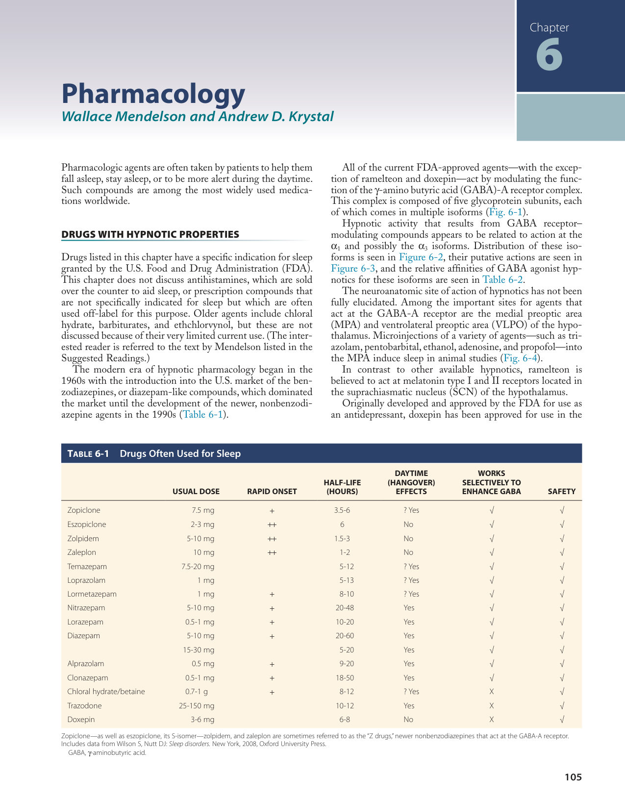
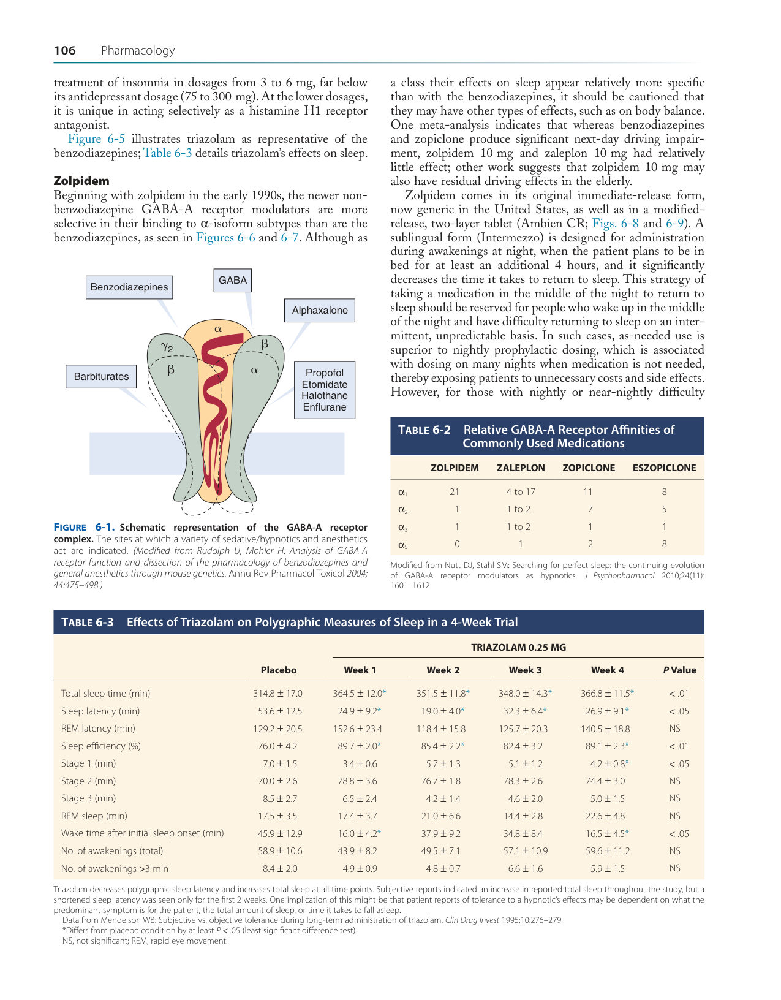
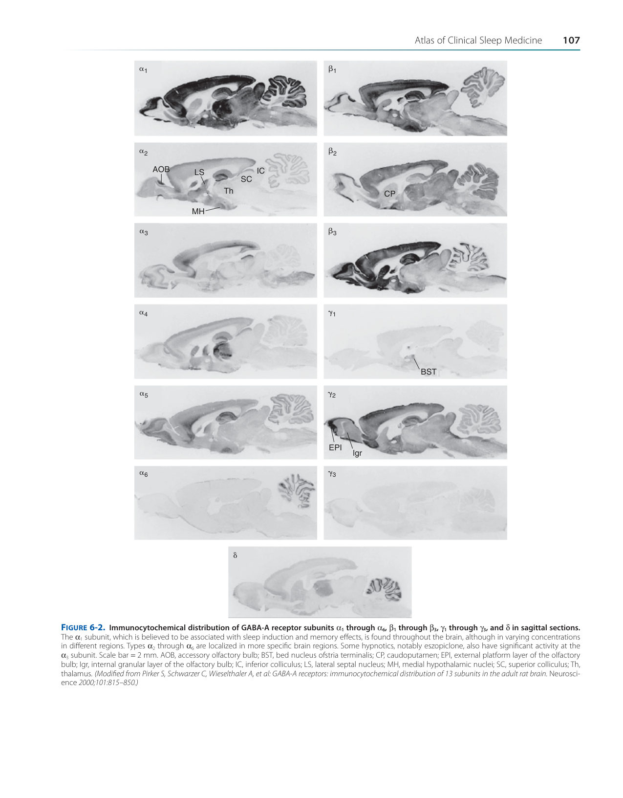
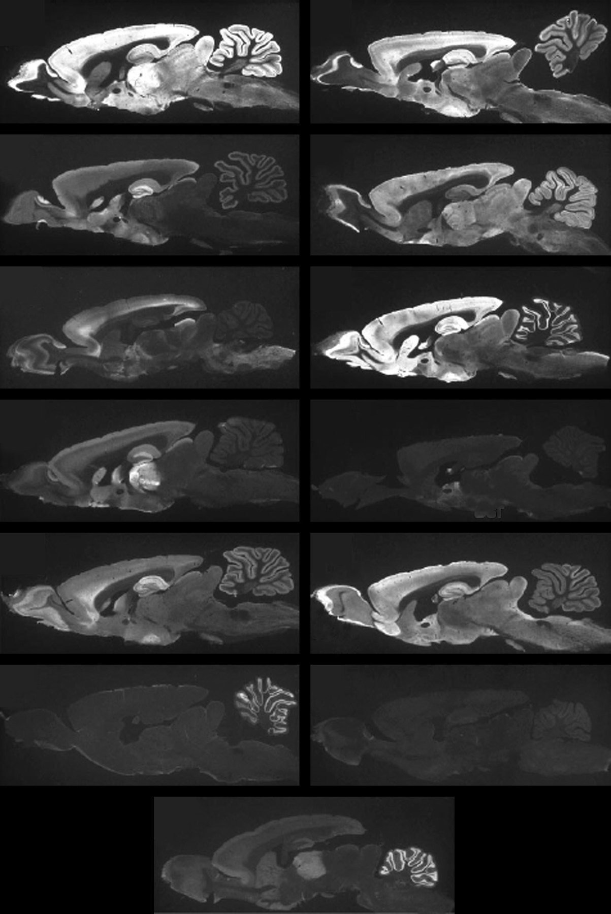
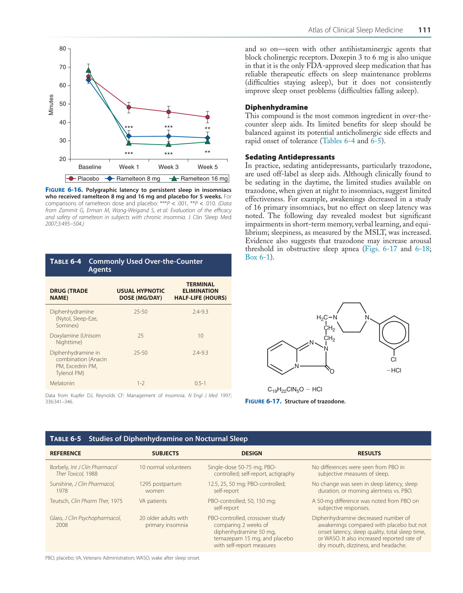
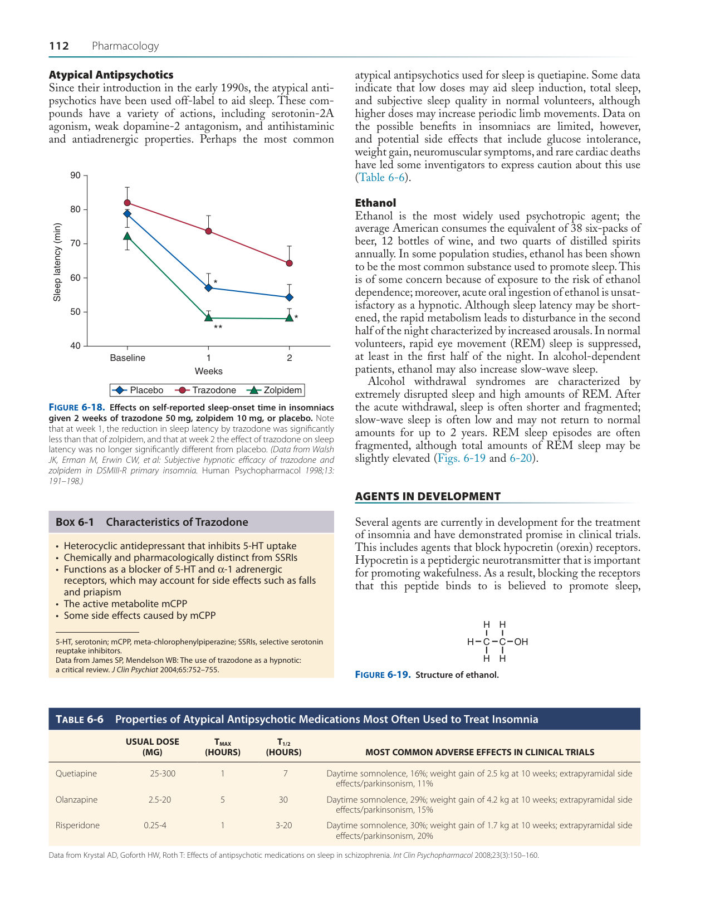
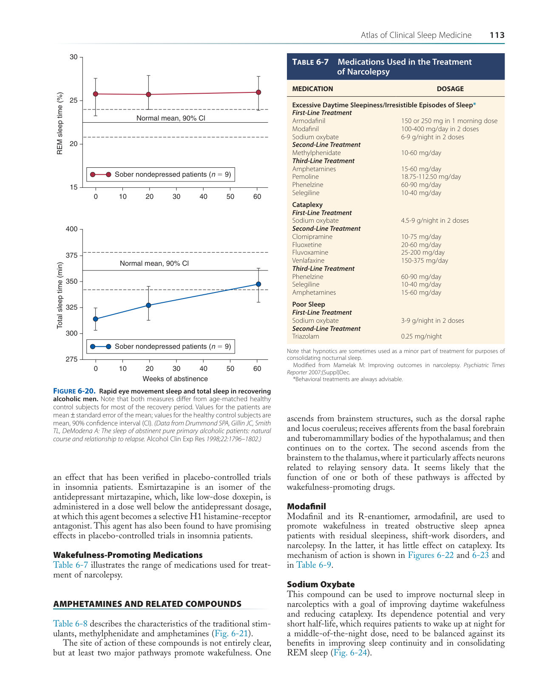
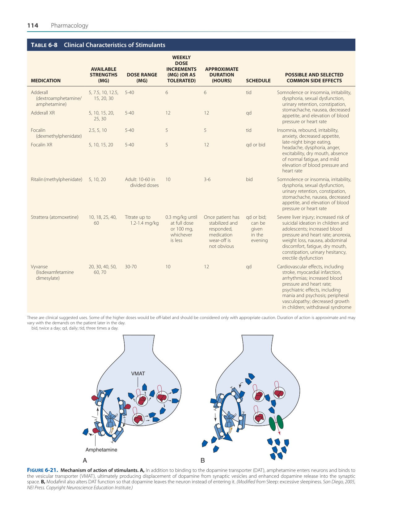
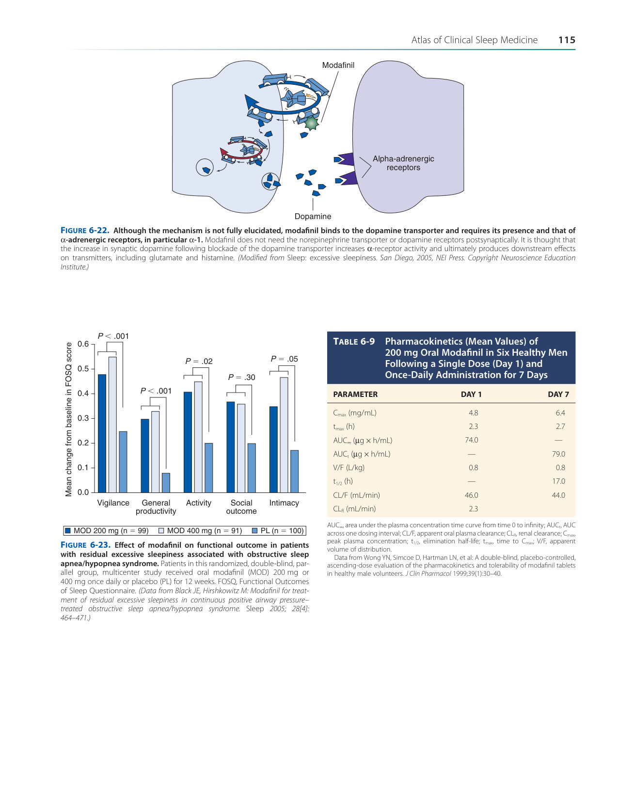

# 6 Pharmacology

<!-- pdf-page: 123 -->

## Chapter 6

## Pharmacology

### Wallace Mendelson and Andrew D. Krystal

Zopiclone 7.5 mg + 3.5-6 ? Yes √ √

Pharmacologic agents are often taken by patients to help them fall asleep, stay asleep, or to be more alert during the daytime. Such compounds are among the most widely used medications worldwide.

#### DRUGS WITH HYPNOTIC PROPERTIES

Drugs listed in this chapter have a specific indication for sleep granted by the U.S. Food and Drug Administration (FDA). This chapter does not discuss antihistamines, which are sold over the counter to aid sleep, or prescription compounds that are not specifically indicated for sleep but which are often used off-label for this purpose. Older agents include chloral hydrate, barbiturates, and ethchlorvynol, but these are not discussed because of their very limited current use. (The interested reader is referred to the text by Mendelson listed in the Suggested Readings.)

The modern era of hypnotic pharmacology began in the 1960s with the introduction into the U.S. market of the benzodiazepines, or diazepam-like compounds, which dominated the market until the development of the newer, nonbenzodiazepine agents in the 1990s (Table 6-1).

TABLE 6-1 Drugs Often Used for Sleep

USUAL DOSE RAPID ONSET

All of the current FDA-approved agents—with the exception of ramelteon and doxepin—act by modulating the function of the γ-amino butyric acid (GABA)-A receptor complex. This complex is composed of five glycoprotein subunits, each of which comes in multiple isoforms (Fig. 6-1).

Hypnotic activity that results from GABA receptor– modulating compounds appears to be related to action at the α1 and possibly the α3 isoforms. Distribution of these isoforms is seen in Figure 6-2, their putative actions are seen in

Figure 6-3, and the relative affinities of GABA agonist hyp­

notics for these isoforms are seen in Table 6-2.

The neuroanatomic site of action of hypnotics has not been fully elucidated. Among the important sites for agents that act at the GABA-A receptor are the medial preoptic area (MPA) and ventrolateral preoptic area (VLPO) of the hypothalamus. Microinjections of a variety of agents—such as triazolam, pentobarbital, ethanol, adenosine, and propofol—into the MPA induce sleep in animal studies (Fig. 6-4).

In contrast to other available hypnotics, ramelteon is believed to act at melatonin type I and II receptors located in the suprachiasmatic nucleus (SCN) of the hypothalamus.

Originally developed and approved by the FDA for use as an antidepressant, doxepin has been approved for use in the

DAYTIME (HANGOVER)

WORKS SELECTIVELY TO ENHANCE GABA SAFETY

HALF-LIFE

(HOURS)

EFFECTS

Eszopiclone 2-3 mg ++ 6 No √ √

Zolpidem 5-10 mg ++ 1.5-3 No √ √

Zaleplon 10 mg ++ 1-2 No √ √

Temazepam 7.5-20 mg 5-12 ? Yes √ √

Loprazolam 1 mg 5-13 ? Yes √ √

Lormetazepam 1 mg + 8-10 ? Yes √ √

Nitrazepam 5-10 mg + 20-48 Yes √ √

Lorazepam 0.5-1 mg + 10-20 Yes √ √

Diazepam 5-10 mg + 20-60 Yes √ √

15-30 mg 5-20 Yes √ √

Alprazolam 0.5 mg + 9-20 Yes √ √

Clonazepam 0.5-1 mg + 18-50 Yes √ √

Chloral hydrate/betaine 0.7-1 g + 8-12 ? Yes X √

Trazodone 25-150 mg 10-12 Yes X √

Doxepin 3-6 mg 6-8 No X √

Zopiclone—as well as eszopiclone, its S-isomer—zolpidem, and zaleplon are sometimes referred to as the “Z drugs,” newer nonbenzodiazepines that act at the GABA-A receptor.

GABA, γ-aminobutyric acid. Includes data from Wilson S, Nutt DJ: Sleep disorders. New York, 2008, Oxford University Press.

<!-- pdf-page: 124 -->

106 Pharmacology

treatment of insomnia in dosages from 3 to 6 mg, far below its antidepressant dosage (75 to 300 mg). At the lower dosages, it is unique in acting selectively as a histamine H1 receptor antagonist.

a class their effects on sleep appear relatively more specific than with the benzodiazepines, it should be cautioned that they may have other types of effects, such as on body balance. One meta-analysis indicates that whereas benzodiazepines and zopiclone produce significant next-day driving impairment, zolpidem 10 mg and zaleplon 10 mg had relatively little effect; other work suggests that zolpidem 10 mg may also have residual driving effects in the elderly.

Figure 6-5 illustrates triazolam as representative of the

benzodiazepines; Table 6-3 details triazolam’s effects on sleep.

TABLE 6-3 Effects of Triazolam on Polygraphic Measures of Sleep in a 4-Week Trial

#### Zolpidem

Beginning with zolpidem in the early 1990s, the newer nonbenzodiazepine GABA-A receptor modulators are more selective in their binding to α-isoform subtypes than are the benzodiazepines, as seen in Figures 6-6 and 6-7. Although as

GABA

Benzodiazepines

Alphaxalone

2

Propofol Etomidate Halothane Enflurane

Barbiturates

FIGURE 6-1. Schematic representation of the GABA-A receptor

complex. The sites at which a variety of sedative/hypnotics and anesthetics act are indicated. (Modified from Rudolph U, Mohler H: Analysis of GABA-A receptor function and dissection of the pharmacology of benzodiazepines and general anesthetics through mouse genetics. Annu Rev Pharmacol Toxicol 2004; 44:475–498.)

Zolpidem comes in its original immediate-release form, now generic in the United States, as well as in a modifiedrelease, two-layer tablet (Ambien CR; Figs. 6-8 and 6-9). A sublingual form (Intermezzo) is designed for administration during awakenings at night, when the patient plans to be in bed for at least an additional 4 hours, and it significantly decreases the time it takes to return to sleep. This strategy of taking a medication in the middle of the night to return to sleep should be reserved for people who wake up in the middle of the night and have difficulty returning to sleep on an intermittent, unpredictable basis. In such cases, as-needed use is superior to nightly prophylactic dosing, which is associated with dosing on many nights when medication is not needed, thereby exposing patients to unnecessary costs and side effects. However, for those with nightly or near-nightly difficulty

TABLE 6-2 Relative GABA-A Receptor Affinities of

#### Commonly Used Medications

ZOLPIDEM ZALEPLON ZOPICLONE ESZOPICLONE

α1 21 4 to 17 11 8

α2 1 1 to 2 7 5

α3 1 1 to 2 1 1

α5 0 1 2 8

Modified from Nutt DJ, Stahl SM: Searching for perfect sleep: the continuing evolution of GABA-A receptor modulators as hypnotics. J Psychopharmacol 2010;24(11): 1601–1612.

Placebo Week 1 Week 2 Week 3 Week 4 P Value

TRIAZOLAM 0.25 MG

Total sleep time (min) 314.8 ± 17.0 364.5 ± 12.0* 351.5 ± 11.8* 348.0 ± 14.3* 366.8 ± 11.5* < .01

Sleep latency (min) 53.6 ± 12.5 24.9 ± 9.2* 19.0 ± 4.0* 32.3 ± 6.4* 26.9 ± 9.1* < .05

REM latency (min) 129.2 ± 20.5 152.6 ± 23.4 118.4 ± 15.8 125.7 ± 20.3 140.5 ± 18.8 NS

Sleep efficiency (%) 76.0 ± 4.2 89.7 ± 2.0* 85.4 ± 2.2* 82.4 ± 3.2 89.1 ± 2.3* < .01

Stage 1 (min) 7.0 ± 1.5 3.4 ± 0.6 5.7 ± 1.3 5.1 ± 1.2 4.2 ± 0.8* < .05

Stage 2 (min) 70.0 ± 2.6 78.8 ± 3.6 76.7 ± 1.8 78.3 ± 2.6 74.4 ± 3.0 NS

Stage 3 (min) 8.5 ± 2.7 6.5 ± 2.4 4.2 ± 1.4 4.6 ± 2.0 5.0 ± 1.5 NS

REM sleep (min) 17.5 ± 3.5 17.4 ± 3.7 21.0 ± 6.6 14.4 ± 2.8 22.6 ± 4.8 NS

Wake time after initial sleep onset (min) 45.9 ± 12.9 16.0 ± 4.2* 37.9 ± 9.2 34.8 ± 8.4 16.5 ± 4.5* < .05

No. of awakenings (total) 58.9 ± 10.6 43.9 ± 8.2 49.5 ± 7.1 57.1 ± 10.9 59.6 ± 11.2 NS

No. of awakenings >3 min 8.4 ± 2.0 4.9 ± 0.9 4.8 ± 0.7 6.6 ± 1.6 5.9 ± 1.5 NS

Triazolam decreases polygraphic sleep latency and increases total sleep at all time points. Subjective reports indicated an increase in reported total sleep throughout the study, but a shortened sleep latency was seen only for the first 2 weeks. One implication of this might be that patient reports of tolerance to a hypnotic’s effects may be dependent on what the predominant symptom is for the patient, the total amount of sleep, or time it takes to fall asleep.

Data from Mendelson WB: Subjective vs. objective tolerance during long-term administration of triazolam. Clin Drug Invest 1995;10:276–279. *Differs from placebo condition by at least P < .05 (least significant difference test).

NS, not significant; REM, rapid eye movement.

<!-- pdf-page: 125 -->

1 1

2 2

FIGURE 6-2. Immunocytochemical distribution of GABA-A receptor subunits α1 through α6, β1 through β3, γ1 through γ3, and δ in sagittal sections.

The α1 subunit, which is believed to be associated with sleep induction and memory effects, is found throughout the brain, although in varying concentrations in different regions. Types α2 through α6 are localized in more specific brain regions. Some hypnotics, notably eszopiclone, also have significant activity at the α3 subunit. Scale bar = 2 mm. AOB, accessory olfactory bulb; BST, bed nucleus ofstria terminalis; CP, caudoputamen; EPI, external platform layer of the olfactory bulb; Igr, internal granular layer of the olfactory bulb; IC, inferior colliculus; LS, lateral septal nucleus; MH, medial hypothalamic nuclei; SC, superior colliculus; Th, thalamus. (Modified from Pirker S, Schwarzer C, Wieselthaler A, et al: GABA-A receptors: immunocytochemical distribution of 13 subunits in the adult rat brain. Neuroscience 2000;101:815–850.)

AOB LS

IC

Th SC

MH

3 3

4 1

5 2

6 3

CP

BST

lgr EPI

<!-- pdf-page: 126 -->

108 Pharmacology

DISTRIBUTION

Cerebral cortex Hippocampus Amygdala Basal ganglia Hypothalamus Septal and basal forebrain

Cerebral cortex Reticular thalamic nucleus Cerebral cortex Hippocampus

α1

Entire brain

Sedative Anticonvulsant Memory

ROLE

FIGURE 6-3. Anatomic distribution and actions of the α-isoforms.

CTX

CC MPA

10 15 15 9 9 3 3

CPU

7 7 6 6 1 1

F

0.4 mm

VP

OX

FIGURE 6-4. Typical injection sites of triazolam into the medial preoptic

area (MPA) in rats. Injection in these sites produced shortened sleep latency and increased total sleep, whereas injections into surrounding areas had no effect. CC, corpus callosum; CPU, caudate putamen; CTX, cortex; F, fornix; OX, optic chiasm; VP, ventral pallidum. (Modified from Mendelson WB, Monti D: Effects of triazolam and nifedipine injections into the medial preoptic area on sleep. Neuropsychopharmacology 1993; 8:227–232.)

N

CH3

N

N

Cl

N

Cl

FIGURE 6-5. Structure of triazolam.

α1 α2 α3 α5

Sleep/wake switch Anxiolytic

Sleep Anxiolytic Antidepressant

Learning Memory

Zolpidem and zaleplon

α1

α1

Benzodiazepines

α1 α2 α3 α5

FIGURE 6-6. Binding of benzodiazepines, zolpidem, and zaleplon to

the α-subunit of the GABA receptor. The benzodiazepines, such as triazolam and estazolam, bind to all of the α-unit isoforms of the GABA-A receptor complex, which may explain why they have a wide range of pharmacologic effects in addition to sleep induction. The newer nonbenzodiazepine GABA receptor agonists such as zolpidem have relatively greater selectivity for the α1 subunit, which may correspond to their higher ratio of sleep/nonsleep effects. (Modified from Sleep: excessive sleepiness. San Diego, 2005, NEI Press. Copyright Neuroscience Education Institute, reprinted with permission.)

N

N CH3 COOH

C OH H

H3C

C H HO

O

COOH

CH3

N

H3C

2

FIGURE 6-7. Structure of zolpidem.

<!-- pdf-page: 127 -->

with middle-of-the-night awakenings, nightly dosing with an agent intended to prevent these awakenings is indicated.

100

#### Zopiclone and Eszopiclone

Zopiclone and eszopiclone are addressed in Figures 6-10 through 6-12.

90

80

70

60

#### Zaleplon

Zaleplon is addressed in Figures 6-13 and 6-14.

50

Zolpidem extended release 12.5 mg Placebo Zolpidem extended release 12.5 mg Placebo

Zolpidem plasma concentrations (ng/mL)

40

30

20

10

0.0 0

8.0 5.5 5.0 6.5 6.0 7.5 7.0 4.5 4.0 3.0 3.5 2.5 2.0 1.0 1.5 0.5

Time (h)

10 mg zolpidem tartrate immediate release 12.5 mg Ambien-CR

FIGURE 6-8. Plasma concentrations following administration of zolpi­

dem two-layer, modified-release (Ambien-CR) 12.5 mg and zolpidem 10 mg. Note the higher plasma concentrations of the modified-release preparation in the second half of the night. (Data from Amin J, Lee A, Gerlovin M, German D [eds]: Monthly prescribing reference: diagnosis and treatment of insomnia. Prescribing Reference, 2006. Available at www.empr.com.)

TST

120

* * * * *

100

Increase in TST (min)

*

80

60

40

20

*P .0001

0

Month 1

Month 2 Month 3

Month 4 Month 5 Month 6

Zolpidem extended release 12.5 mg Placebo

SOL

* † ‡ * §

40

35

30

Decrease in SOL (min)

*

25

20

15

*P .0001 †P .0009 ‡P .0004 §P .0014

10

5

0

Month 1

Month 2 Month 3

Month 4 Month 5 Month 6

#### Ramelteon

Ramelteon has a different mechanism of action than all other hypnotics on the market in the United States, with the exception of doxepin. It has little affinity for GABA-A receptors. Instead, it acts as an agonist at melatonin type I and II receptors. It has been hypothesized that the anatomic site of action is the SCN, at which agonism at the type I receptors may decrease the waking signal from the SCN. Agonism at the type II receptors has been hypothesized to alter the clocklike functions of the SCN (Figs. 6-15 and 6-16).

#### Doxepin

Doxepin at dosages of 3 and 6 mg selectively blocks histamine H1 receptors. Although other medications block these receptors, such as diphenhydramine and many antidepressants and antipsychotics, doxepin at 3 and 6 mg is the only agent that blocks these receptors without significantly affecting other receptors. As a result, it has effects on sleep with relatively few of the side effects—dry mouth, constipation, blurred vision,

WASO

80

* * * * * *

70

Decrease in WASO (min)

60

50

40

30

20

*P .0001

10

0

Month 1

Month 2 Month 3

Month 4 Month 5 Month 6

Zolpidem extended release 12.5 mg Placebo

NAW

2.0

* * * * *

1.8

1.6

Decrease in NAW (min)

*

1.4

1.2

1.0

0.8

0.6

0.4

0.2

*P .0001

0.0

Month 2 Month 3

Month 4 Month 5 Month 6

Month 1

FIGURE 6-9. Sample efficacy data for zolpidem modified-release 12.5 mg given 3 to 7 nights per week over 6 months. Data taken from a patient’s

morning questionnaire. NAW, number of nocturnal awakenings; SOL, sleep onset latency; TST, total sleep time; WASO, wake after sleep onset. (Data from Krystal A, Erman M, Zammit GK, et al: Long-term efficacy and safety of zolpidem extended-release 12.5 mg, administered 3 to 7 nights per week for 24 weeks, in patients with chronic primary insomnia. Sleep 2008;31:79–90.)

<!-- pdf-page: 128 -->

110 Pharmacology

C1 O

NC

N

N

N

N

N N

N N CH3 C

O N

O

FIGURE 6-10. Structure of eszopiclone, the S-isomer of racemic zopi­

clone. (From data on file, Sepracor Inc.)

25

20

ESZ concentration (ng/mL)

15

10

5

0 0

24 22 20 18 16 12 14 10 8 4 6 2 Tmax

Time (hr)

2 mg ESZ, elderly adults, day 7 3 mg ESZ, adults, day 7

FIGURE 6-11. Pharmacokinetics of eszopiclone (ESZ) 2 mg and 3 mg.

(From data on file, Sepracor Inc.)

35

30

25

Minutes (median)

20

15

* * * *

10

5

0

Baseline Night 1 Night 15 Night 29 DB average

Placebo Eszopiclone 2 mg Eszopiclone 3 mg

FIGURE 6-12. Polygraphically measured latency to persistent sleep on

nights 1, 15, and 29 in a study of eszopiclone 2 mg and 3 mg given to insomniacs for 1 month. Both doses also increased total sleep time and sleep efficiency throughout the treatment period. The 3-mg dose, but not the 2-mg dose, also improved sleep maintenance. DB average, average across nights 1, 15, and 29. (Data from Zammit GK, McNabb LJ, Caron J, et al: Efficacy and safety of eszopiclone across six weeks of treatment for primary insomnia. Curr Med Res Opin 2004;20:1979–1991.)

H3C CH2CH3

N

O

Zaleplon

FIGURE 6-13. Structure of zaleplon.

70

60

Median sleep latency (min)

50

* *

40

*** *** *** ** ** **

*

30

**** ** ***

*

Baseline 0

Week 1 Week 2 Week 3 Week 4

Placebo Zaleplon 5 mg

Zaleplon 10 mg

Zolpidem 10 mg Zaleplon 20 mg

FIGURE 6-14. Sleep latency in insomniacs given zaleplon for 28 nights.

Median sleep latency was significantly reduced during weeks 1 through 4 with zaleplon 10 mg and zaleplon 20 mg compared with placebo. Sleep latency was significantly reduced during weeks 1 through 3 with zaleplon 5 mg and zolpidem 10 mg (*P < .05, **P < .01, ***P < .001). Zaleplon versus placebo: Dunnett test; zolpidem versus placebo: F test. (Data from Elie R, Ruther E, Farr I, et al: Sleep latency is shortened during 4 weeks of treatment with zaleplon, a novel nonbenzodiazepine hypnotic. J Clin Psychiat 1999;60:536–544.)

H5C2CONHCH2CH2 O H

FIGURE 6-15. Structure of ramelteon.

<!-- pdf-page: 129 -->

and so on—seen with other antihistaminergic agents that block cholinergic receptors. Doxepin 3 to 6 mg is also unique in that it is the only FDA-approved sleep medication that has reliable therapeutic effects on sleep maintenance problems (difficulties staying asleep), but it does not consistently improve sleep onset problems (difficulties falling asleep).

70

60

Minutes

50

REFERENCE SUBJECTS DESIGN RESULTS

40

***

***

**

30

*** **

***

20

Baseline Week 1 Week 3 Week 5

Placebo Ramelteon 8 mg Ramelteon 16 mg

FIGURE 6-16. Polygraphic latency to persistent sleep in insomniacs

who received ramelteon 8 mg and 16 mg and placebo for 5 weeks. For comparisons of ramelteon dose and placebo: ***P < .001, **P < .010. (Data from Zammit G, Erman M, Wang-Weigand S, et al: Evaluation of the efficacy and safety of ramelteon in subjects with chronic insomnia. J Clin Sleep Med 2007;3:495–504.)

TABLE 6-4 Commonly Used Over-the-Counter

#### Agents

TERMINAL ELIMINATION HALF-LIFE (HOURS)

DRUG (TRADE NAME)

USUAL HYPNOTIC

DOSE (MG/DAY)

Diphenhydramine

25-50 2.4-9.3

(Nytol, Sleep-Eze, Sominex)

Doxylamine (Unisom

25 10

Nighttime)

Diphenhydramine in

25-50 2.4-9.3

combination (Anacin PM, Excedrin PM, Tylenol PM)

Melatonin 1-2 0.5-1

Data from Kupfer DJ, Reynolds CF: Management of insomnia. N Engl J Med 1997; 336:341–346.

TABLE 6-5 Studies of Diphenhydramine on Nocturnal Sleep

#### Diphenhydramine

This compound is the most common ingredient in over-thecounter sleep aids. Its limited benefits for sleep should be balanced against its potential anticholinergic side effects and rapid onset of tolerance (Tables 6-4 and 6-5).

#### Sedating Antidepressants

In practice, sedating antidepressants, particularly trazodone, are used off-label as sleep aids. Although clinically found to be sedating in the daytime, the limited studies available on trazodone, when given at night to insomniacs, suggest limited effectiveness. For example, awakenings decreased in a study of 16 primary insomniacs, but no effect on sleep latency was noted. The following day revealed modest but significant impairments in short-term memory, verbal learning, and equilibrium; sleepiness, as measured by the MSLT, was increased. Evidence also suggests that trazodone may increase arousal threshold in obstructive sleep apnea (Figs. 6-17 and 6-18;

Box 6-1).

H2C N N

CH2

CH2

N

N

Cl

N

HCl

O

C19H22ClN5O HCl

FIGURE 6-17. Structure of trazodone.

Borbely, Int J Clin Pharmacol

10 normal volunteers Single-dose 50-75 mg, PBO-

Ther Toxicol, 1988

Sunshine, J Clin Pharmacol,

1295 postpartum

1978

women

self-report

Teutsch, Clin Pharm Ther, 1975 VA patients PBO-controlled; 50, 150 mg;

self-report

Glass, J Clin Psychopharmacol,

20 older adults with

2008

primary insomnia

PBO, placebo; VA, Veterans Administration; WASO, wake after sleep onset.

No differences were seen from PBO in

controlled; self-report, actigraphy

subjective measures of sleep.

12.5, 25, 50 mg; PBO-controlled;

No change was seen in sleep latency, sleep

duration, or morning alertness vs. PBO.

A 50-mg difference was noted from PBO on

subjective responses.

PBO-controlled, crossover study

Diphenhydramine decreased number of

comparing 2 weeks of diphenhydramine 50 mg, temazepam 15 mg, and placebo with self-report measures

awakenings compared with placebo but not onset latency, sleep quality, total sleep time, or WASO. It also increased reported rate of dry mouth, dizziness, and headache.

<!-- pdf-page: 130 -->

112 Pharmacology

#### Atypical Antipsychotics

Since their introduction in the early 1990s, the atypical antipsychotics have been used off-label to aid sleep. These compounds have a variety of actions, including serotonin-2A agonism, weak dopamine-2 antagonism, and antihistaminic and antiadrenergic properties. Perhaps the most common

atypical antipsychotics used for sleep is quetiapine. Some data indicate that low doses may aid sleep induction, total sleep, and subjective sleep quality in normal volunteers, although higher doses may increase periodic limb movements. Data on the possible benefits in insomniacs are limited, however, and potential side effects that include glucose intolerance, weight gain, neuromuscular symptoms, and rare cardiac deaths have led some inventigators to express caution about this use (Table 6-6).

90

5-HT, serotonin; mCPP, meta-chlorophenylpiperazine; SSRIs, selective serotonin reuptake inhibitors. Data from James SP, Mendelson WB: The use of trazodone as a hypnotic: a critical review. J Clin Psychiat 2004;65:752–755.

FIGURE 6-19. Structure of ethanol.

80

Sleep latency (min)

70

60

*

50

** *

40

Baseline 1 Weeks

2

Trazodone Placebo Zolpidem

FIGURE 6-18. Effects on self-reported sleep-onset time in insomniacs

given 2 weeks of trazodone 50 mg, zolpidem 10 mg, or placebo. Note that at week 1, the reduction in sleep latency by trazodone was significantly less than that of zolpidem, and that at week 2 the effect of trazodone on sleep latency was no longer significantly different from placebo. (Data from Walsh JK, Erman M, Erwin CW, et al: Subjective hypnotic efficacy of trazodone and zolpidem in DSMIII-R primary insomnia. Human Psychopharmacol 1998;13: 191–198.)

BOX 6-1 Characteristics of Trazodone

• Heterocyclic antidepressant that inhibits 5-HT uptake
• Chemically and pharmacologically distinct from SSRIs
• Functions as a blocker of 5-HT and α-1 adrenergic

receptors, which may account for side effects such as falls and priapism • The active metabolite mCPP • Some side effects caused by mCPP

#### Ethanol

Ethanol is the most widely used psychotropic agent; the average American consumes the equivalent of 38 six-packs of beer, 12 bottles of wine, and two quarts of distilled spirits annually. In some population studies, ethanol has been shown to be the most common substance used to promote sleep. This is of some concern because of exposure to the risk of ethanol dependence; moreover, acute oral ingestion of ethanol is unsatisfactory as a hypnotic. Although sleep latency may be shortened, the rapid metabolism leads to disturbance in the second half of the night characterized by increased arousals. In normal volunteers, rapid eye movement (REM) sleep is suppressed, at least in the first half of the night. In alcohol-dependent patients, ethanol may also increase slow-wave sleep.

Alcohol withdrawal syndromes are characterized by extremely disrupted sleep and high amounts of REM. After the acute withdrawal, sleep is often shorter and fragmented; slow-wave sleep is often low and may not return to normal amounts for up to 2 years. REM sleep episodes are often fragmented, although total amounts of REM sleep may be slightly elevated (Figs. 6-19 and 6-20).

#### AGENTS IN DEVELOPMENT

Several agents are currently in development for the treatment of insomnia and have demonstrated promise in clinical trials. This includes agents that block hypocretin (orexin) receptors. Hypocretin is a peptidergic neurotransmitter that is important for promoting wakefulness. As a result, blocking the receptors that this peptide binds to is believed to promote sleep,

H

H

C

C

OH

H

H

H

TABLE 6-6 Properties of Atypical Antipsychotic Medications Most Often Used to Treat Insomnia

Quetiapine 25-300 1 7 Daytime somnolence, 16%; weight gain of 2.5 kg at 10 weeks; extrapyramidal side

USUAL DOSE

TMAX (HOURS)

(MG)

T1/2 (HOURS) MOST COMMON ADVERSE EFFECTS IN CLINICAL TRIALS

Olanzapine 2.5-20 5 30 Daytime somnolence, 29%; weight gain of 4.2 kg at 10 weeks; extrapyramidal side

effects/parkinsonism, 11%

Risperidone 0.25-4 1 3-20 Daytime somnolence, 30%; weight gain of 1.7 kg at 10 weeks; extrapyramidal side

effects/parkinsonism, 15%

Data from Krystal AD, Goforth HW, Roth T: Effects of antipsychotic medications on sleep in schizophrenia. Int Clin Psychopharmacol 2008;23(3):150–160.

effects/parkinsonism, 20%

<!-- pdf-page: 131 -->

TABLE 6-7 Medications Used in the Treatment

#### of Narcolepsy

MEDICATION DOSAGE

25

Normal mean, 90% Cl

REM sleep time (%)

20

Sober nondepressed patients (n 9)

15

0 10

20 30 40 50 60

400

375

Normal mean, 90% Cl

Total sleep time (min)

350

325

300

Sober nondepressed patients (n 9)

275

0 10 Weeks of abstinence

20 30 40 50 60

FIGURE 6-20. Rapid eye movement sleep and total sleep in recovering

alcoholic men. Note that both measures differ from age-matched healthy control subjects for most of the recovery period. Values for the patients are mean ± standard error of the mean; values for the healthy control subjects are mean, 90% confidence interval (CI). (Data from Drummond SPA, Gillin JC, Smith TL, DeModena A: The sleep of abstinent pure primary alcoholic patients: natural course and relationship to relapse. Alcohol Clin Exp Res 1998;22:1796–1802.)

an effect that has been verified in placebo-controlled trials in insomnia patients. Esmirtazapine is an isomer of the antidepressant mirtazapine, which, like low-dose doxepin, is administered in a dose well below the antidepressant dosage, at which this agent becomes a selective H1 histamine-receptor antagonist. This agent has also been found to have promising effects in placebo-controlled trials in insomnia patients.

#### Wakefulness-Promoting Medications

Table 6-7 illustrates the range of medications used for treat­

ment of narcolepsy.

#### AMPHETAMINES AND RELATED COMPOUNDS

Table 6-8 describes the characteristics of the traditional stim­

ulants, methylphenidate and amphetamines (Fig. 6-21).

The site of action of these compounds is not entirely clear, but at least two major pathways promote wakefulness. One

Excessive Daytime Sleepiness/Irresistible Episodes of Sleep* First-Line Treatment Armodafinil 150 or 250 mg in 1 morning dose Modafinil 100-400 mg/day in 2 doses Sodium oxybate 6-9 g/night in 2 doses Second-Line Treatment Methylphenidate 10-60 mg/day Third-Line Treatment Amphetamines 15-60 mg/day Pemoline 18.75-112.50 mg/day Phenelzine 60-90 mg/day Selegiline 10-40 mg/day

Cataplexy First-Line Treatment Sodium oxybate 4.5-9 g/night in 2 doses Second-Line Treatment Clomipramine 10-75 mg/day Fluoxetine 20-60 mg/day Fluvoxamine 25-200 mg/day Venlafaxine 150-375 mg/day Third-Line Treatment Phenelzine 60-90 mg/day Selegiline 10-40 mg/day Amphetamines 15-60 mg/day

Poor Sleep First-Line Treatment Sodium oxybate 3-9 g/night in 2 doses Second-Line Treatment Triazolam 0.25 mg/night

Note that hypnotics are sometimes used as a minor part of treatment for purposes of consolidating nocturnal sleep.

Modified from Mamelak M: Improving outcomes in narcolepsy. Psychiatric Times Reporter 2007;(Suppl)Dec.

*Behavioral treatments are always advisable.

ascends from brainstem structures, such as the dorsal raphe and locus coeruleus; receives afferents from the basal forebrain and tuberomammillary bodies of the hypothalamus; and then continues on to the cortex. The second ascends from the brainstem to the thalamus, where it particularly affects neurons related to relaying sensory data. It seems likely that the function of one or both of these pathways is affected by wakefulness-promoting drugs.

#### Modafinil

Modafinil and its R-enantiomer, armodafinil, are used to promote wakefulness in treated obstructive sleep apnea patients with residual sleepiness, shift-work disorders, and narcolepsy. In the latter, it has little effect on cataplexy. Its mechanism of action is shown in Figures 6-22 and 6-23 and in Table 6-9.

#### Sodium Oxybate

This compound can be used to improve nocturnal sleep in narcoleptics with a goal of improving daytime wakefulness and reducing cataplexy. Its dependence potential and very short half-life, which requires patients to wake up at night for a middle-of-the-night dose, need to be balanced against its benefits in improving sleep continuity and in consolidating REM sleep (Fig. 6-24).

<!-- pdf-page: 132 -->

114 Pharmacology

TABLE 6-8 Clinical Characteristics of Stimulants

WEEKLY

DOSE INCREMENTS

AVAILABLE STRENGTHS

APPROXIMATE

DOSE RANGE

(MG) (OR AS TOLERATED)

DURATION

POSSIBLE AND SELECTED

MEDICATION

(MG)

(MG)

(HOURS) SCHEDULE

COMMON SIDE EFFECTS

Adderall

5, 7.5, 10, 12.5,

5-40 6 6 tid Somnolence or insomnia, irritability,

15, 20, 30

2.5, 5, 10 5-40 5 5 tid Insomnia, rebound, irritability,

(dextroamphetamine/ amphetamine)

Adderall XR 5, 10, 15, 20,

5-40 12 12 qd

25, 30

Focalin

dysphoria, sexual dysfunction, urinary retention, constipation, stomachache, nausea, decreased appetite, and elevation of blood pressure or heart rate

Focalin XR 5, 10, 15, 20 5-40 5 12 qd or bid

(dexmethylphenidate)

anxiety, decreased appetite, late-night binge eating, headache, dysphoria, anger, excitability, dry mouth, absence of normal fatigue, and mild elevation of blood pressure and heart rate

30-70 10 12 qd Cardiovascular effects, including

Ritalin (methylphenidate) 5, 10, 20 Adult: 10-60 in

divided doses

Strattera (atomoxetine) 10, 18, 25, 40,

Titrate up to

0.3 mg/kg until

60

1.2-1.4 mg/kg

at full dose or 100 mg, whichever is less

Vyvanse

20, 30, 40, 50,

10 3-6 bid Somnolence or insomnia, irritability,

dysphoria, sexual dysfunction, urinary retention, constipation, stomachache, nausea, decreased appetite, and elevation of blood pressure or heart rate

Once patient has

qd or bid;

Severe liver injury; increased risk of

stabilized and responded, medication wear-off is not obvious

can be given in the evening

suicidal ideation in children and adolescents; increased blood pressure and heart rate; anorexia, weight loss, nausea, abdominal discomfort, fatigue, dry mouth, constipation, urinary hesitancy, erectile dysfunction

These are clinical suggested uses. Some of the higher doses would be off-label and should be considered only with appropriate caution. Duration of action is approximate and may vary with the demands on the patient later in the day.

(lisdexamfetamine dimesylate)

60, 70

stroke, myocardial infarction, arrhythmias; increased blood pressure and heart rate; psychiatric effects, including mania and psychosis; peripheral vasculopathy; decreased growth in children; withdrawal syndrome

FIGURE 6-21. Mechanism of action of stimulants. A, In addition to binding to the dopamine transporter (DAT), amphetamine enters neurons and binds to

the vesicular transporter (VMAT), ultimately producing displacement of dopamine from synaptic vesicles and enhanced dopamine release into the synaptic space. B, Modafinil also alters DAT function so that dopamine leaves the neuron instead of entering it. (Modified from Sleep: excessive sleepiness. San Diego, 2005, NEI Press. Copyright Neuroscience Education Institute.)

bid, twice a day; qd, daily; tid, three times a day.

VMAT

E

Amphetamine

A B

E

<!-- pdf-page: 133 -->

Modafinil

E

E

FIGURE 6-22. Although the mechanism is not fully elucidated, modafinil binds to the dopamine transporter and requires its presence and that of

α-adrenergic receptors, in particular α-1. Modafinil does not need the norepinephrine transporter or dopamine receptors postsynaptically. It is thought that the increase in synaptic dopamine following blockade of the dopamine transporter increases α-receptor activity and ultimately produces downstream effects on transmitters, including glutamate and histamine. (Modified from Sleep: excessive sleepiness. San Diego, 2005, NEI Press. Copyright Neuroscience Education Institute.)

Alpha-adrenergic receptors

Dopamine

P .001

0.6

Mean change from baseline in FOSQ score

P .05

P .02

0.5

P .30

P .001

0.4

0.3

0.2

0.1

0.0

Vigilance General productivity Activity Social outcome Intimacy

MOD 200 mg (n 99) MOD 400 mg (n 91) PL (n 100)

FIGURE 6-23. Effect of modafinil on functional outcome in patients

with residual excessive sleepiness associated with obstructive sleep apnea/hypopnea syndrome. Patients in this randomized, double-blind, parallel group, multicenter study received oral modafinil (MOD) 200 mg or 400 mg once daily or placebo (PL) for 12 weeks. FOSQ, Functional Outcomes of Sleep Questionnaire. (Data from Black JE, Hirshkowitz M: Modafinil for treatment of residual excessive sleepiness in continuous positive airway pressure– treated obstructive sleep apnea/hypopnea syndrome. Sleep 2005; 28[4]: 464–471.)

TABLE 6-9 Pharmacokinetics (Mean Values) of

#### 200 mg Oral Modafinil in Six Healthy Men

#### Following a Single Dose (Day 1) and

#### Once-Daily Administration for 7 Days

PARAMETER DAY 1 DAY 7

Cmax (mg/mL) 4.8 6.4

tmax (h) 2.3 2.7

AUC∞ (µg × h/mL) 74.0 —

AUCt (µg × h/mL) — 79.0

V/F (L/kg) 0.8 0.8

t1/2 (h) — 17.0

CL/F (mL/min) 46.0 44.0

CLR (mL/min) 2.3

AUC∞, area under the plasma concentration time curve from time 0 to infinity; AUCt, AUC across one dosing interval; CL/F, apparent oral plasma clearance; CLR, renal clearance; Cmax, peak plasma concentration; t1/2, elimination half-life; tmax, time to Cmax; V/F, apparent volume of distribution.

Data from Wong YN, Simcoe D, Hartman LN, et al: A double-blind, placebo-controlled, ascending-dose evaluation of the pharmacokinetics and tolerability of modafinil tablets in healthy male volunteers. J Clin Pharmacol 1999;39(1):30–40.

<!-- pdf-page: 134 -->

116 Pharmacology

Total sleep time (min)

400

350

300

Night Rec day

250

50

200

Percent of normal

0

GHB COD RIT VIL PEM MOD PRO DEX MET Normal

FIGURE 6-24. Relative efficacy of drugs for treating narcolepsy, pre­

sented in terms of percentage of normal levels of sleepiness. The lightest shading denotes baseline values, the darkest denotes treatment values or the normal values (extreme right). A comparison among drugs in a blind protocol has not been performed. COD, codeine; DEX, dextroamphetamine; GHB, γ-hydroxybutyrate; MET, methylphenidate; MOD, modafinil; PEM, pemoline; PRO, protriptyline; RIT, ritanserin; VIL, viloxazine. (Data from Mitler MM, Hajdukovic R: Relative efficacy of drugs for the treatment of sleepiness in narcolepsy. Sleep 1991;14:218–220.)

#### Caffeine

Caffeine, a xanthine derivative, is probably the most widely consumed stimulant. It acts primarily as a nonspecific antagonist for adenosine receptors. Because cholinergic neurons in the basal forebrain are under tonic inhibition by adenosine, it is believed that caffeine indirectly reduces this inhibition and hence increases some aspects of central nervous system cholinergic function. Caffeine has a half-life of 3.5 to 5 hours. Very large doses, equivalent to 12 cups of coffee per day, can produce a syndrome that includes agitation, tremors, and, not surprisingly, sleep disturbance (Fig. 6-25).

#### Selected Readings

Amin J, Lee A, Gerlovin M, German D, editors: Monthly Prescribing Refer­

ence Diagnosis and Treatment of Insomnia. Prescribing Reference, 2006. Available at www.empr.com. Angier N: An ancient medicine. New York Times Dec. 11, 2007. Glass JR, Sproule BA, Herrmann N, Busto UE: Effects of 2-week treatment

with temazepam and diphenhydramine in elderly insomniacs: a randomized, placebo-controlled trial. J Clin Psychopharmacol 28(2):182–188, 2008. Herring WJ, Snyder E, Budd K, et al: Orexin receptor antagonism for treat­

ment of insomnia: a randomized clinical trial of suvorexant. Neurology 79(23):2265–2274, 2012. Krystal AD, Durrence HH, Scharf M, et al: Efficacy and safety of doxepin

1 mg and 3 mg in a 12-week sleep laboratory and outpatient trial of elderly subjects with chronic primary insomnia. Sleep 33(11):1553–1561, 2010. Krystal AD, Lankford A, Durrence HH, et al: Efficacy and safety of doxepin

3 and 6 mg in a 35-day sleep laboratory trial in adults with chronic primary insomnia. Sleep 34(10):1433–1442, 2011. Krystal AD, Richelson E, Roth T: Review of the histamine system and the

clinical effects of H(1) antagonists: basis for a new model for understanding the effects of insomnia medications. Sleep Med Rev 17(4):263–272, 2013. Krystal AD, Roth T, Pong A, Stet L, Ivgy-May N: Efficacy and safety of

esmirtazapine in elderly patients with primary insomnia in a 2-week sleep laboratory trial. Sleep 35:A222–A223, 2012.

90

Sleep efficiency (%)

80

70

60

Night Rec day

50

2.2

REM sleep time (log)

2.0

1.8

1.6

Night Rec day

1.4

Placebo Caffeine

FIGURE 6-25. Effects of caffeine on sleep in two groups of moderate

caffeine consumers. One group was studied at habitual bedtime, the other during daytime recovery sleep (Rec day) after one night of sleep deprivation. In both groups, subjects received 100 mg of caffeine 3 hours before bedtime and a second 100 mg 1 hour before bedtime. Caffeine had a greater effect on recovery sleep. (Data from Carrier J, Fernandez-Bolanos M, Robillard R, et al: Effects of caffeine are more marked on daytime recovery sleep than on nocturnal sleep. Neuropsychopharmacology 2007;32:964–972.)

Mendelson WB: The use and misuse of sleeping pills, New York, 1980, Plenum

Press. Mendelson WB: Hypnotic medications: mechanisms of action and pharma­

cologic effects. In Kryger MH, Roth T, Dement WC, editors: Principles and practice of sleep medicine, Philadelphia, 2005, Elsevier, pp 444–451. Monique AJ, Mets ER, Volkerts BO, Verster JC: Effect of hypnotic

drugs on body balance and standing steadiness. Sleep Med Rev 14:259–267, 2010. Roth AJ, McCall WV, Liguori A: Cognitive, psychomotor and polysomno­

graphic effects of trazodone in primary insomniacs. J Sleep Res 20:552–558, 2011. Roth T, Krystal A, Steinberg FJ, Singh NN, Moline M: Novel sublingual

low-dose zolpidem tablet reduces latency to sleep onset following spontaneous middle-of-the-night awakening in insomnia in a randomized, double-blind, placebo-controlled, outpatient study. Sleep 36(2):189–196, 2013. Rudolph U, Mohler H: Analysis of GABAA receptor function and dissection

of the pharmacology of benzodiazepines and general anesthetics through mouse genetics. Annu Rev Pharmacol Toxicol 44:475–498, 2004. Verster JC, Veldhuijzen DS, Patat A, Olivier B, Volkerts ER: Hypnotics and

driving safety: meta-analyses of randomized controlled trials applying the on the road driving test. Current Drug Safety 1:63–71, 2006.
