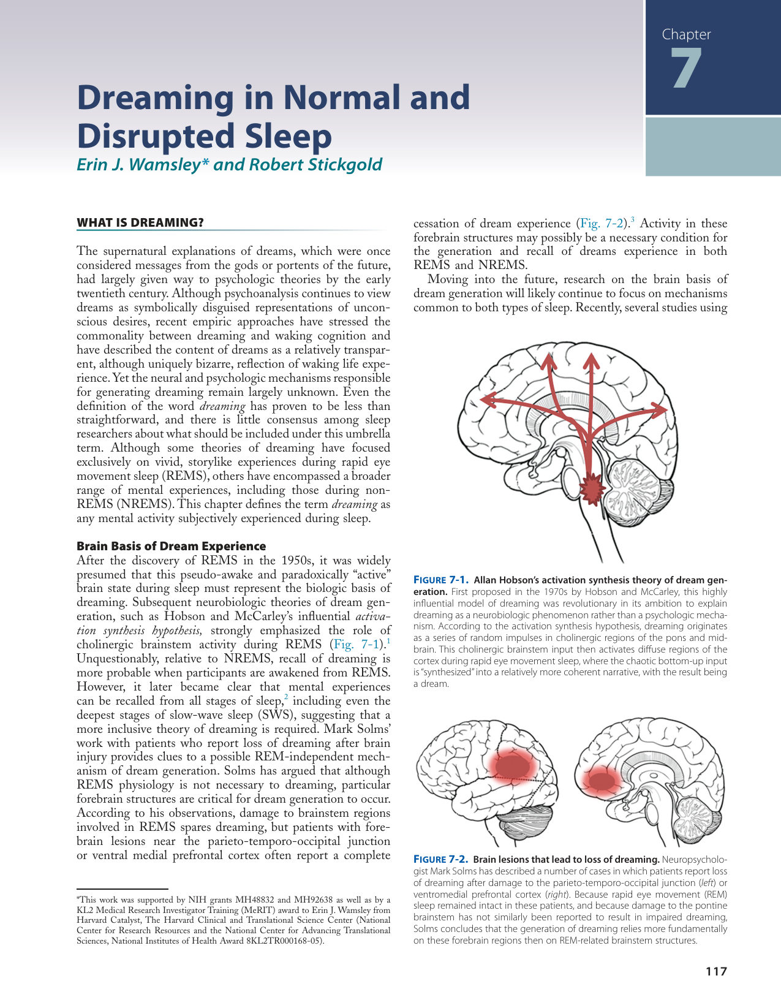
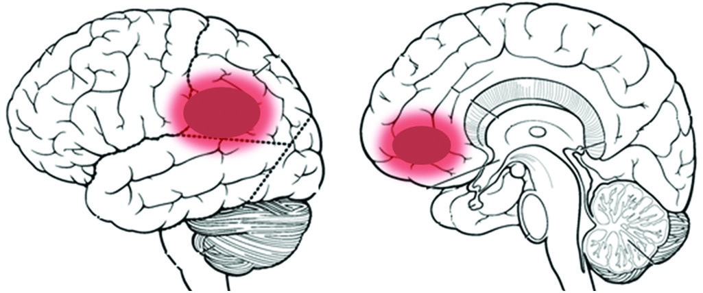
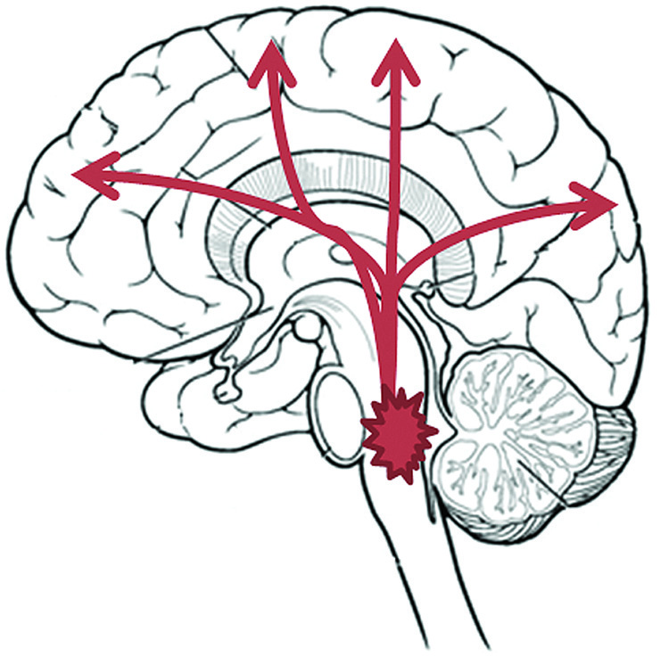
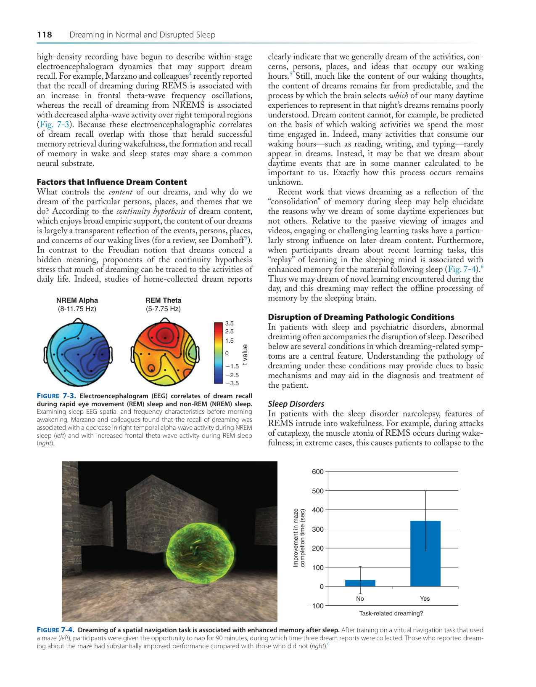
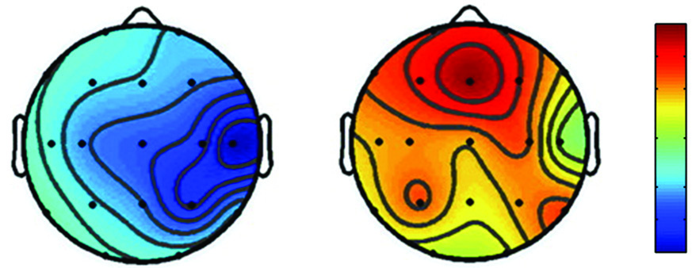
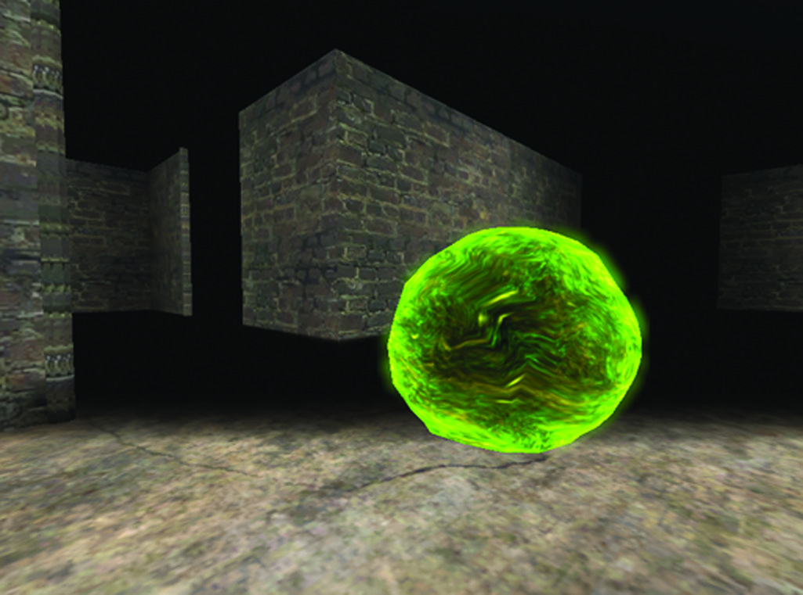
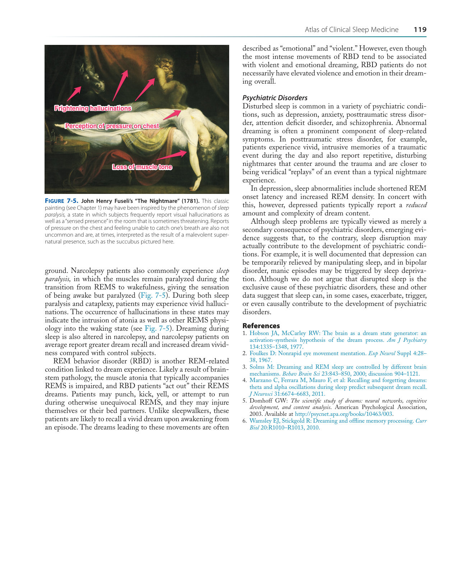
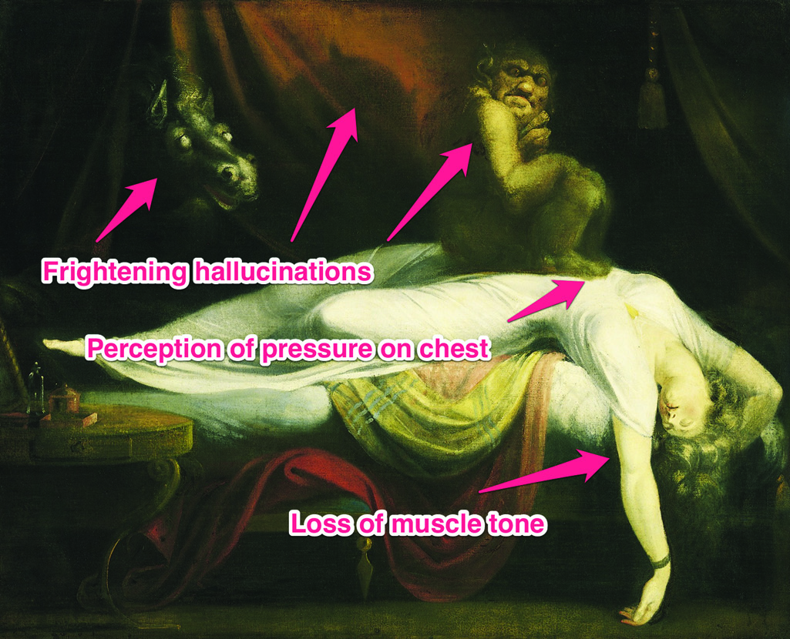

# 7 Dreaming in Normal and Disrupted Sleep

<!-- pdf-page: 135 -->

## Chapter 7

## Dreaming in Normal and

## Disrupted Sleep

### Erin J. Wamsley* and Robert Stickgold

#### WHAT IS DREAMING?

The supernatural explanations of dreams, which were once considered messages from the gods or portents of the future, had largely given way to psychologic theories by the early twentieth century. Although psychoanalysis continues to view dreams as symbolically disguised representations of unconscious desires, recent empiric approaches have stressed the commonality between dreaming and waking cognition and have described the content of dreams as a relatively transparent, although uniquely bizarre, reflection of waking life experience. Yet the neural and psychologic mechanisms responsible for generating dreaming remain largely unknown. Even the definition of the word dreaming has proven to be less than straightforward, and there is little consensus among sleep researchers about what should be included under this umbrella term. Although some theories of dreaming have focused exclusively on vivid, storylike experiences during rapid eye movement sleep (REMS), others have encompassed a broader range of mental experiences, including those during non- REMS (NREMS). This chapter defines the term dreaming as any mental activity subjectively experienced during sleep.

#### Brain Basis of Dream Experience

After the discovery of REMS in the 1950s, it was widely presumed that this pseudo-awake and paradoxically “active” brain state during sleep must represent the biologic basis of dreaming. Subsequent neurobiologic theories of dream generation, such as Hobson and McCarley’s influential activation synthesis hypothesis, strongly emphasized the role of cholinergic brainstem activity during REMS (Fig. 7-1).1 Unquestionably, relative to NREMS, recall of dreaming is more probable when participants are awakened from REMS. However, it later became clear that mental experiences can be recalled from all stages of sleep,2 including even the deepest stages of slow-wave sleep (SWS), suggesting that a more inclusive theory of dreaming is required. Mark Solms’ work with patients who report loss of dreaming after brain injury provides clues to a possible REM-independent mechanism of dream generation. Solms has argued that although REMS physiology is not necessary to dreaming, particular forebrain structures are critical for dream generation to occur. According to his observations, damage to brainstem regions involved in REMS spares dreaming, but patients with forebrain lesions near the parieto-temporo-occipital junction or ventral medial prefrontal cortex often report a complete

*This work was supported by NIH grants MH48832 and MH92638 as well as by a KL2 Medical Research Investigator Training (MeRIT) award to Erin J. Wamsley from Harvard Catalyst, The Harvard Clinical and Translational Science Center (National Center for Research Resources and the National Center for Advancing Translational Sciences, National Institutes of Health Award 8KL2TR000168-05).

cessation of dream experience (Fig. 7-2).3 Activity in these forebrain structures may possibly be a necessary condition for the generation and recall of dreams experience in both REMS and NREMS.

Moving into the future, research on the brain basis of dream generation will likely continue to focus on mechanisms common to both types of sleep. Recently, several studies using

FIGURE 7-1. Allan Hobson’s activation synthesis theory of dream gen­

eration. First proposed in the 1970s by Hobson and McCarley, this highly influential model of dreaming was revolutionary in its ambition to explain dreaming as a neurobiologic phenomenon rather than a psychologic mechanism. According to the activation synthesis hypothesis, dreaming originates as a series of random impulses in cholinergic regions of the pons and midbrain. This cholinergic brainstem input then activates diffuse regions of the cortex during rapid eye movement sleep, where the chaotic bottom-up input is “synthesized” into a relatively more coherent narrative, with the result being a dream.

FIGURE 7-2. Brain lesions that lead to loss of dreaming. Neuropsycholo­

gist Mark Solms has described a number of cases in which patients report loss of dreaming after damage to the parieto-temporo-occipital junction (left) or ventromedial prefrontal cortex (right). Because rapid eye movement (REM) sleep remained intact in these patients, and because damage to the pontine brainstem has not similarly been reported to result in impaired dreaming, Solms concludes that the generation of dreaming relies more fundamentally on these forebrain regions then on REM-related brainstem structures.

<!-- pdf-page: 136 -->

118 Dreaming in Normal and Disrupted Sleep

FIGURE 7-4. Dreaming of a spatial navigation task is associated with enhanced memory after sleep. After training on a virtual navigation task that used

a maze (left), participants were given the opportunity to nap for 90 minutes, during which time three dream reports were collected. Those who reported dreaming about the maze had substantially improved performance compared with those who did not (right).6

high-density recording have begun to describe within-stage electroencephalogram dynamics that may support dream recall. For example, Marzano and colleagues4 recently reported that the recall of dreaming during REMS is associated with an increase in frontal theta-wave frequency oscillations, whereas the recall of dreaming from NREMS is associated with decreased alpha-wave activity over right temporal regions (Fig. 7-3). Because these electroencephalographic correlates of dream recall overlap with those that herald successful memory retrieval during wakefulness, the formation and recall of memory in wake and sleep states may share a common neural substrate.

#### Factors that Influence Dream Content

What controls the content of our dreams, and why do we dream of the particular persons, places, and themes that we do? According to the continuity hypothesis of dream content, which enjoys broad empiric support, the content of our dreams is largely a transparent reflection of the events, persons, places, and concerns of our waking lives (for a review, see Domhoff 5). In contrast to the Freudian notion that dreams conceal a hidden meaning, proponents of the continuity hypothesis stress that much of dreaming can be traced to the activities of daily life. Indeed, studies of home-collected dream reports

NREM Alpha

REM Theta

(8-11.75 Hz)

(5-7.75 Hz)

3.5 2.5 1.5

t value

0

1.5 2.5 3.5

FIGURE 7-3. Electroencephalogram (EEG) correlates of dream recall

during rapid eye movement (REM) sleep and non-REM (NREM) sleep. Examining sleep EEG spatial and frequency characteristics before morning awakening, Marzano and colleagues found that the recall of dreaming was associated with a decrease in right temporal alpha-wave activity during NREM sleep (left) and with increased frontal theta-wave activity during REM sleep (right).

clearly indicate that we generally dream of the activities, concerns, persons, places, and ideas that occupy our waking hours.5 Still, much like the content of our waking thoughts, the content of dreams remains far from predictable, and the process by which the brain selects which of our many daytime experiences to represent in that night’s dreams remains poorly understood. Dream content cannot, for example, be predicted on the basis of which waking activities we spend the most time engaged in. Indeed, many activities that consume our waking hours—such as reading, writing, and typing—rarely appear in dreams. Instead, it may be that we dream about daytime events that are in some manner calculated to be important to us. Exactly how this process occurs remains unknown.

Recent work that views dreaming as a reflection of the “consolidation” of memory during sleep may help elucidate the reasons why we dream of some daytime experiences but not others. Relative to the passive viewing of images and videos, engaging or challenging learning tasks have a particularly strong influence on later dream content. Furthermore, when participants dream about recent learning tasks, this “replay” of learning in the sleeping mind is associated with enhanced memory for the material following sleep (Fig. 7-4).6 Thus we may dream of novel learning encountered during the day, and this dreaming may reflect the offline processing of memory by the sleeping brain.

#### Disruption of Dreaming Pathologic Conditions

In patients with sleep and psychiatric disorders, abnormal dreaming often accompanies the disruption of sleep. Described below are several conditions in which dreaming-related symptoms are a central feature. Understanding the pathology of dreaming under these conditions may provide clues to basic mechanisms and may aid in the diagnosis and treatment of the patient.

#### Sleep Disorders

In patients with the sleep disorder narcolepsy, features of REMS intrude into wakefulness. For example, during attacks of cataplexy, the muscle atonia of REMS occurs during wakefulness; in extreme cases, this causes patients to collapse to the

600

500

400

Improvement in maze completion time (sec)

300

200

100

0

No Yes

100

Task-related dreaming?

<!-- pdf-page: 137 -->

described as “emotional” and “violent.” However, even though the most intense movements of RBD tend to be associated with violent and emotional dreaming, RBD patients do not necessarily have elevated violence and emotion in their dreaming overall.

Frightening hallucinations

Frightening hallucinations

Perception of pressure on chest

Perception of pressure on chest

Loss of muscle tone

Loss of muscle tone

FIGURE 7-5. John Henry Fuseli’s “The Nightmare” (1781). This classic

painting (see Chapter 1) may have been inspired by the phenomenon of sleep paralysis, a state in which subjects frequently report visual hallucinations as well as a “sensed presence” in the room that is sometimes threatening. Reports of pressure on the chest and feeling unable to catch one’s breath are also not uncommon and are, at times, interpreted as the result of a malevolent supernatural presence, such as the succubus pictured here.

ground. Narcolepsy patients also commonly experience sleep paralysis, in which the muscles remain paralyzed during the transition from REMS to wakefulness, giving the sensation of being awake but paralyzed (Fig. 7-5). During both sleep paralysis and cataplexy, patients may experience vivid hallucinations. The occurrence of hallucinations in these states may indicate the intrusion of atonia as well as other REMS physiology into the waking state (see Fig. 7-5). Dreaming during sleep is also altered in narcolepsy, and narcolepsy patients on average report greater dream recall and increased dream vividness compared with control subjects.

REM behavior disorder (RBD) is another REM-related condition linked to dream experience. Likely a result of brainstem pathology, the muscle atonia that typically accompanies REMS is impaired, and RBD patients “act out” their REMS dreams. Patients may punch, kick, yell, or attempt to run during otherwise unequivocal REMS, and they may injure themselves or their bed partners. Unlike sleepwalkers, these patients are likely to recall a vivid dream upon awakening from an episode. The dreams leading to these movements are often

#### Psychiatric Disorders

Disturbed sleep is common in a variety of psychiatric conditions, such as depression, anxiety, posttraumatic stress disorder, attention deficit disorder, and schizophrenia. Abnormal dreaming is often a prominent component of sleep-related symptoms. In posttraumatic stress disorder, for example, patients experience vivid, intrusive memories of a traumatic event during the day and also report repetitive, disturbing nightmares that center around the trauma and are closer to being veridical “replays” of an event than a typical nightmare experience.

In depression, sleep abnormalities include shortened REM onset latency and increased REM density. In concert with this, however, depressed patients typically report a reduced amount and complexity of dream content.

Although sleep problems are typically viewed as merely a secondary consequence of psychiatric disorders, emerging evidence suggests that, to the contrary, sleep disruption may actually contribute to the development of psychiatric conditions. For example, it is well documented that depression can be temporarily relieved by manipulating sleep, and in bipolar disorder, manic episodes may be triggered by sleep deprivation. Although we do not argue that disrupted sleep is the exclusive cause of these psychiatric disorders, these and other data suggest that sleep can, in some cases, exacerbate, trigger, or even causally contribute to the development of psychiatric disorders.

#### References

1. Hobson JA, McCarley RW: The brain as a dream state generator: an

activation-synthesis hypothesis of the dream process. Am J Psychiatry 134:1335–1348, 1977. 2. Foulkes D: Nonrapid eye movement mentation. Exp Neurol Suppl 4:28–

38, 1967. 3. Solms M: Dreaming and REM sleep are controlled by different brain

mechanisms. Behav Brain Sci 23:843–850, 2000; discussion 904–1121. 4. Marzano C, Ferrara M, Mauro F, et al: Recalling and forgetting dreams:

theta and alpha oscillations during sleep predict subsequent dream recall. J Neurosci 31:6674–6683, 2011. 5. Domhoff GW: The scientific study of dreams: neural networks, cognitive

development, and content analysis. American Psychological Association, 2003. Available at http://psycnet.apa.org/books/10463/003. 6. Wamsley EJ, Stickgold R: Dreaming and offline memory processing. Curr

Biol 20:R1010–R1013, 2010.

