# 8 Impact, Presentation, and Diagnostic Considerations

<!-- pdf-page: 138 -->

## Chapter 8

## Impact, Presentation, and

## Diagnostic Considerations

### Cathy Goldstein, Leslie Swanson, Todd Arnedt, and

### Ronald D. Chervin

FIGURE 8-1. Disasters in which sleepiness has been implicated. Sleepiness has been indicated as a contributing factor in the Three Mile Island nuclear

meltdown (March 28, 1979), Bhopal pesticide release disaster (December 3, 1984), space shuttle disaster (January 28, 1986), Chernobyl nuclear power plant explosion (April 26, 1986), and Exxon Valdez oil spill (March 24, 1989).

#### IMPACT

Disordered sleep is common, and its effect on health and well-being has become increasingly recognized over the past several decades. Unfortunately, the public, patients, and health care professionals often fail to recognize and diagnose these common, treatable disorders. Many catastrophic disasters with devastating effects have been attributed to disordered sleep or sleepiness (Fig. 8-1).

In our busy, 24-hour society, chronic sleep deprivation is ubiquitous. Across the life span, external factors encroach on sleep time. For example, adolescents have a circadian tendency for later sleep and wake times. However, early school schedules truncate the sleep period and cause sleep deprivation, with significant consequences (Box 8-1). For adults in the workforce, increased commute times, long workdays, and nontraditional shifts in combination with social and family

BOX 8-1 Impact of Sleep Problems on Adolescents

• One in 10 high school seniors has nodded off while driving

at some point during a 1-year period. • Half of adolescents admitted to driving drowsy over the

past year, and 11% drive drowsy one or two times a week. • More than 25% of teenagers have had an accident or near

accident because of drowsy driving. • 28% of high school students admit to falling asleep at least

once a week while in school.

Exxon Valdez Three Mile Island

Space Shuttle Challenger

obligations restrict available time for sleep. Almost one half of surveyed workers report sleep times less than 7 hours per night on workdays. When individuals curtail sleep, they experience daytime sleepiness that affects their productivity, quality of life, and safety (Box 8-2). National surveys have shown that one third of drivers in the United States have fallen asleep at the wheel (Box 8-3). Furthermore, sleep duration and timing may have an impact on health outside of accidents (Table 8-1).

Although numerous population-based surveys have shown that sleep disorders are common, they often remain undiagnosed (Fig. 8-2). Failure to recognize, evaluate, and treat

BOX 8-2 Influence of Sleep Problems on Workplace

#### Productivity and Daily Activities

• One third of workers report falling asleep or becoming very

sleepy at work. • More than 1 in 10 employees arrive late to work because of

sleepiness or a sleep problem. • Insomnia, which affects up to 30% of adults, is associated

with increased absenteeism and accidents. • 28% report experiencing sleepiness that interferes with

their daily activities. • 14% have missed a family, leisure, or work function because

they were too sleepy or had a sleep problem. • 20% note having sex less often or losing interest in sex

because of sleepiness.

Chernobyl

Bhopal

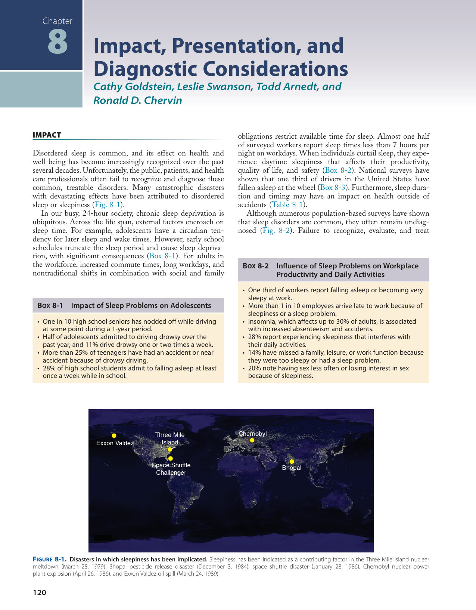

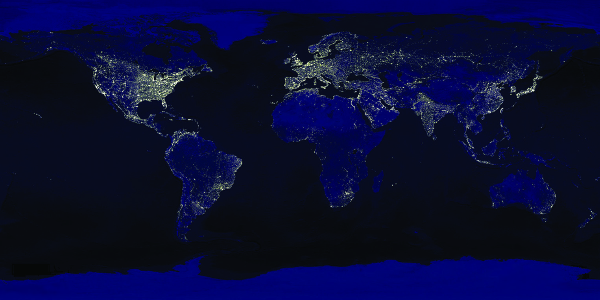

<!-- pdf-page: 139 -->

TABLE 8-1 Health Risks Associated with Short and Long Sleep and Shift Work*

METABOLIC VASCULAR CANCER MORTALITY

Short sleep ↑ Obesity ↑ Hypertension ↑ Breast, colorectal, prostate cancer ↑ ↑ Diabetes ↑ Coronary heart disease ↑ Stroke

Long sleep ↑ BMI ↑ Hypertension ↓ Breast cancer ↑ ↑ Diabetes ↑ Coronary heart disease ↑ Stroke

Shift work ↑ Obesity ↑ Cardiovascular disease ↑ Breast, colon, prostate, endometrial cancer ↑ (Women only) ↑ Metabolic syndrome

From Cappuccio FP, Cooper D, D’Elia L, Strazzullo P, Miller MA: Sleep duration predicts cardiovascular outcomes: a systematic review and meta-analysis of prospective studies. Eur Heart J 2011;32[12]:1484–1492; Calhoun DA, Harding SM: Sleep and hypertension. Chest 2010;138[2]:434–443; Knutson KL: Sleep duration and cardiometabolic risk: a review of the epidemiologic evidence. Best Pract Res Clin Endocrinol Metab 2010;24[5]:731–743; Costa G, Haus E, Stevens R: Shift work and cancer—considerations on rationale, mechanisms, and epidemiology. Scand J Work Environ Health 2010;36[2]:163–179; Tucker P, Marquie J, Folkard S, Ansiau D, Esquirol Y: Shiftwork and metabolic dysfunction. Chronobiol Int 2010;29(5):549–555; and Luyster FS, Strollo PJ, Zee PC, Walsh JK: Sleep: a health imperative. Sleep 2012;33[6]:727–734.

BMI, body mass index. *Sleep duration of 7-8 hours in most studies.

BOX 8-3 Dangers of Drowsy Driving

The U.S. National Highway Safety Administration conservatively estimates that each year driver fatigue causes: • More than 100,000 police-reported crashes • At least 4% of fatal crashes • More than 1550 deaths • More than 71,000 injuries • $12.5 billion in monetary losses

50

40

% of Patients

30

Inso

20

RLS

10

OSA 0

20 30-39 50-59 Age 70-79

FIGURE 8-2. The percentage of patients in a primary practice with

symptoms of sleep disorders. Most were undiagnosed. Inso, insomnia; OSA, obstructive sleep apnea; RLS, restless legs syndrome. (Modified from Kushida CA, Nichols DA, Simon RD, et al: Symptom-based prevalence of sleep disorders in an adult primary care population. Sleep Breath 2000;4[1]:9–14.)

someone with a sleep disorder increases health care costs, and sleep disorders are likely to cause or worsen other medical disorders. For example, untreated obstructive sleep apnea (OSA) promotes hypertension. Sleep disorder symptoms are sometimes incorrectly diagnosed as another disorder, such as a mood disorder, with a consequent delay in appropriate therapeutic intervention. As illustrated in Figure 8-3, a Canadian study showed that, compared with matched controls, 181 patients with untreated OSA sought heath care more frequently and spent nearly twice as many nights in the hospital during the 10 years before diagnosis with OSA, resulting in higher costs. Care for insomnia and losses that stem from it

Physician claims in 10 years before diagnosis

$800,000

Actual costs in Canadian dollars (1.38 per US dollars)

$700,000

$600,000

$500,000

$686,365

$400,000

$300,000

Mean $3792 109 visits

$356,376

$200,000

Mean $1969 60 visits

$100,000

$0

Controls

Patients

FIGURE 8-3. Use of health care is high in the decade before the diag­

nosis of sleep apnea. (Ronald J, Delaive K, Roos L, Manfreda J, et al: Health care utilization in the 10 years prior to diagnosis in obstructive sleep apnea syndrome patients. Sleep 1999;22[2]:225–229.)

also accrue substantial costs (Fig. 8-4). In addition, a longitudinal study of adults showed that a history of insomnia was associated with an increased risk for the development of several psychiatric conditions (Fig. 8-5).

#### PRESENTATION AND DIAGNOSTIC

#### CONSIDERATIONS

#### Clinical Evaluation

Accurate and detailed clinical histories and physical exams of patients with disordered sleep are the cornerstones to proper evaluation, diagnosis, and treatment. Patients’ complaints typically fall into one of the following categories: symptoms suggestive of sleep-disordered breathing (SDB; snoring, witnessed apnea); difficulty falling asleep or staying asleep (insomnia); excessive sleepiness; or abnormal behaviors, movements, and sensations before sleep onset, while sleeping, or during awakenings from sleep. In fact, the second edition of the International Classification of Sleep Disorders (ICSD) has categorized sleep diagnoses in line with the presenting symptoms (Box 8-4).

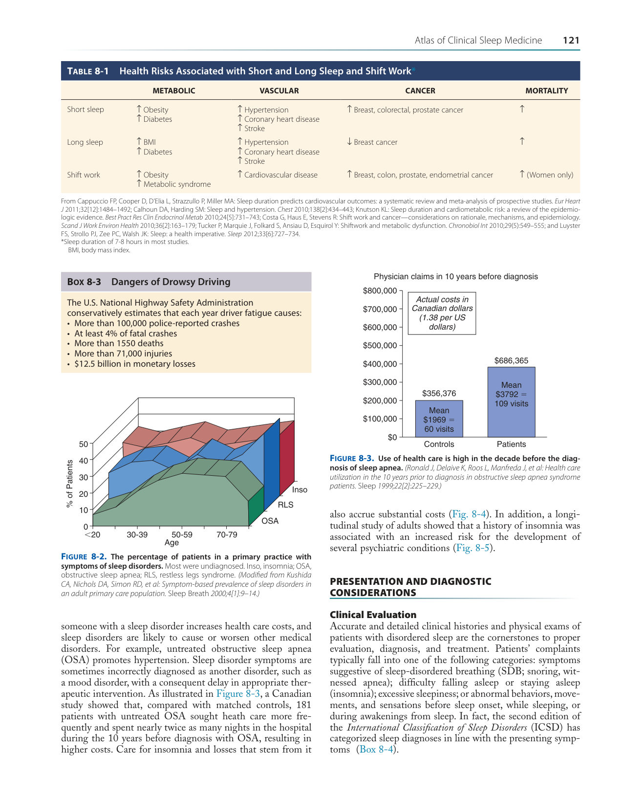

<!-- pdf-page: 140 -->

122 Impact, Presentation, and Diagnostic Considerations

#### Direct Costs of Insomnia

BOX 8-4 Classification Schema of Sleep Disorders

350

1. Insomnia
2. Sleep-related breathing disorders
3. Hypersomnias of central origin
4. Circadian rhythm sleep disorders
5. Parasomnias
6. Sleep-related movement disorders

Health care consultations

300

250

Transportation to care

200

Total annual cost in Canadian dollars (million)

Prescriptions

150

Over-the-counter medications

100

Alcohol use as sleep aid

50

0

FIGURE 8-4. A questionnaire survey of a community sample of 948

adults from Quebec estimates the total annual cost of insomnia at $6.6 billion. The above chart depicts direct costs. Indirect costs, absenteeism, and productivity loss (not shown) were estimated at $970.6 million and $5 billion respectively. (Modified from Daley M, Morin C, LeBlanc M, Grégoire J, Savard J: The economic burden of insomnia: direct and indirect costs for individuals with insomnia syndrome, insomnia symptoms, and good sleepers. Sleep 2009;32[1]:55–64.)

20

Insomnia (n = 240) No insomnia (n = 739)

15.9

16

13.7

Incidence per 100

12

8

7.1 7.1

4.7 4.1

4.6

4

0.6

0

Alcohol abuse/ dependence Any anxiety Major depression Drug abuse/ dependence

FIGURE 8-5. Incidence rates (per 100) of new-onset psychiatric disor­

ders during a 3.5-year follow-up period for adults with and without a history of insomnia. (Modified from Breslau N, Roth T, Rosenthal L, Andreski P: Sleep disturbance and psychiatric disorders: a longitudinal epidemiological study of young adults. Biol Psychiatry 1996;39:411–418.)

#### History of the Present Illness

A history should include the onset of symptoms, their evolution over time, and associations (e.g., weight change, new comorbidities, precipitating factors, new medications). Obtaining elements of the history from a bedmate can add key insight. The clinician should assess the sleep schedule, including bedtime, sleep-onset latency, awakenings (with length and action taken), wake time and any use of an alarm

Modified from American Academy of Sleep Medicine: The international classification of sleep disorders: diagnostic and coding manual, ed 2, West Chester, 2005, American Academy of Sleep Medicine.

BOX 8-5 Sleep-Disordered Breathing Symptoms

Areas of inquiry that may point to the presence of sleepdisordered breathing: • Snoring frequency and loudness • Witnessed apneas while sleeping • Daytime sleepiness, tiredness, lack of energy, fatigue • Unrefreshing sleep • Snore or gasp arousals • Nocturnal headaches • Nocturnal sweating • Excessive movement in bed • Nocturia • Dry mouth or water by bedside

BOX 8-6 Factors to Evaluate in Insomnia

• Current symptoms, onset, triggers, frequency, duration,

symptom severity, daytime consequences • Current typical sleep schedule: bedtimes, rise times, sleep

latency, frequency of nocturnal awakenings, wake after sleep onset, early morning awakenings, total sleep time (compare weekdays to weekends, with or without hypnotics when applicable) • Current prescription or over-the-counter medications used • Behaviors and thoughts in response to insomnia symptoms

(both during the night and following day) • Sleep hygiene • Presence of comorbidities: sleep disorders, chronic medical

conditions, psychiatric disorders (especially mood or anxiety disorders), or substance use disorders

clock, naps (time, duration, quality), and changes in these habits between school or work nights and days off. Sleep-Disordered Breathing. SDB is highly prevalent and can worsen many other sleep disorders. Every patient should be asked about its symptoms (Box 8-5). Assessment of body mass index (Fig. 8-6), Mallampti score (Fig. 8-7), tonsillar size (Fig. 8-8) and Friedman classification (Fig. 8-9) should be done for all patients visiting a sleep clinic. Insomnia. In the evaluation of a patient with insomnia, it is critical to clarify the specific nature of insomnia symptoms (difficulties falling asleep, staying asleep, waking too early in the morning, consistently waking feeling unrefreshed); their frequency, severity, and duration; daytime consequences; and any potential triggers for the current episode (Box 8-6). The

<!-- pdf-page: 141 -->

BODY MASS INDEX

Weight (pounds)

Underweight BMI under 18.5 Normal weight BMI 18.5-24.9 Overweight BMI 25-29.9 Obesity BMI 30-39.9 Extreme obesity BMI 40 and over

4'5" 4'6" 4'7" 4'8" 4'9" 4'10" 4'11" 5'0" 5'1" 5'2" 5'3" 5'4" 5'5" 5'6" 5'7" 5'8" 5'9" 5'10"

Height (ft/in)

5'11"

6'0" 6'1" 6'2" 6'3" 6'4" 6'5" 6'6" 6'7" 6'8" 6'9" 6'10"

FIGURE 8-6. Body mass index. (Data from NHLBI Obesity Education Initiative Expert Panel on the Identification, Evaluation, and Treatment of Overweight and Obesity

in Adults: Clinical Guidelines: The Evidence Report. NIH Publication No. 98-4083, September 1998, pp 139-140. National Institutes of Health.)

BOX 8-7 Common Causes of Insomnia

• Stress (interpersonal, occupational, financial)
• Lifestyle factors (poor sleep habits, excessive caffeine use)
• Environmental conditions (noise, extreme temperatures)
• Mental health disorders (depression, substance abuse)
• Medical disorders (hyperthyroidism, cardiovascular

conditions, joint and low back pain) • Neurologic disorders (Parkinson or Alzheimer disease) • Other sleep disorders (obstructive sleep apnea, restless legs

syndrome, circadian rhythm sleep disorders) • Medication use, side effects, and discontinuation

answers to these simple questions are often clues to the practitioner about the possible causes of insomnia, which are many and varied (Box 8-7). In particular, these inquiries may differentiate specific insomnia diagnoses from disorders of sleep timing (circadian rhythm sleep disorders [CRSDs], Chapter 9.1) or decreased sleep requirement (short sleeper). For example, an individual with a delayed sleep phase may report difficulties with sleep onset when sleep is attempted at a conventional bedtime but may have no problem with sleep

onset at the preferred, later time on the weekends. Conversely, a patient with an advanced sleep phase may chronically experience early morning awakenings but may sleep well from 8 PM to 4 AM (Fig. 8-10). In these settings, a diagnosis of CRSD, rather than insomnia, would lead to more effective medical management. Furthermore, the practitioner must investigate whether adequate opportunity for sleep is allowed by the patient’s schedule.

When insomnia is a chronic complaint, clinicians should use the model developed by Spielman and colleagues to help frame the assessment and differentiate factors that put the patient at risk for the development of insomnia (predisposing factors), that likely triggered the current episode (precipitating factors), and that are currently active in maintaining the insomnia over time (perpetuating factors; Fig. 8-11, Box 8-8). Excessive Sleepiness. Causes of excessive daytime sleepiness (EDS) include OSA and other disorders that disrupt sleep, as well as sleep deprivation, misalignment between sleep-wake propensity and sleep-wake timing (CRSDs), and central hypersomnias (Fig. 8-12). Questions about these potential etiologies must be part of the history (Box 8-9). Insufficient sleep syndrome is a likely contributor to EDS, whenever an individual fails to obtain the amount of sleep he

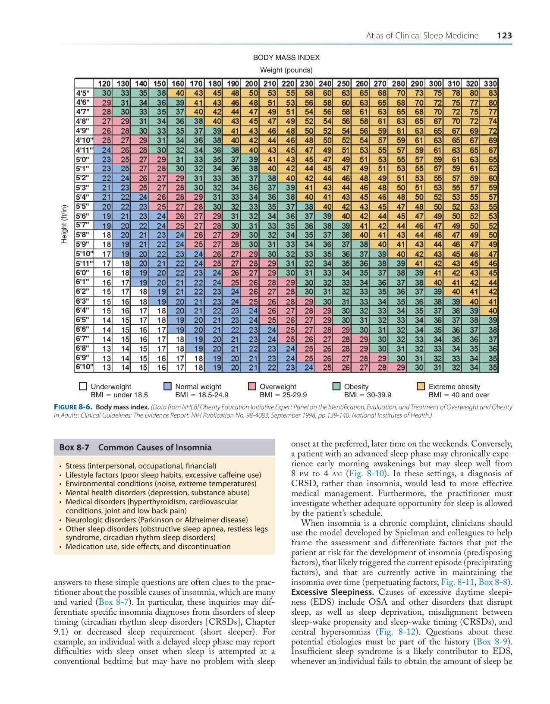

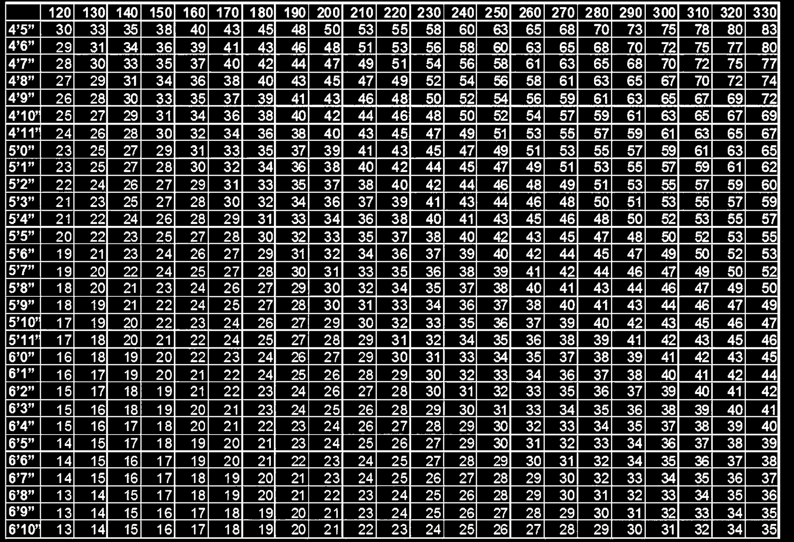

<!-- pdf-page: 142 -->

124 Impact, Presentation, and Diagnostic Considerations

I II III IV

FIGURE 8-7. Mallampati classification. Class is determined by looking at the anatomy of the oral cavity as the patient protrudes the tongue. It describes

tongue size relative to oropharyngeal size. The test is conducted with the patient in the sitting position, the head held in a neutral position, the mouth wide open and relaxed, and the tongue protruding to maximum. The subsequent classification is assigned based on the pharyngeal structures that are visible. Scoring is as follows: Class 1, full visibility of tonsils, uvula, and soft palate; class 2, visibility of hard and soft palate, upper portion of tonsils and uvula; class 3, soft and hard palate and base of the uvula are visible; class 4, only hard palate visible. (Modified from Mallampati SR, Gatt SP, Gugino LD, et al. A clinical sign to predict difficult tracheal intubation: a prospective study. Can Anesth Soc J 1985;32:429–434.)

Tonsils, size 1, are hidden within the pillars Tonsils, size 2, extend to the pillars

Tonsils, size 3, extend beyond the pillars but not to the midline

Tonsils, size 4, extend to the midline

FIGURE 8-8. Tonsil size grading. (From Friedman M, Ibrahim H, Bass L. Clinical

staging for sleep-disordered breathing. Otolaryngol Head Neck Surg 2002:127:13–21.)

BOX 8-8 Common Perpetuating Factors in Insomnia

#### Behavioral

• Inconsistent sleep schedules (irregular bedtimes and rise

times) • Sleep-incompatible behaviors (reading, watching television,

eating, planning, ruminating) • Inappropriate sleep hygiene (excessive caffeine intake,

napping)

#### Cognitive

• Anticipatory anxiety about sleep in the evening
• Excessive concern and worry about next-day consequences

of inadequate sleep • Unrealistic expectations about nightly sleep needs (“I need

8 hours of sleep to feel refreshed and function optimally.”)

or she requires to achieve optimal alertness. A discrepancy exists between sleep duration on days off from work or school. Long sleepers may be particularly vulnerable to sleep deprivation and resultant hypersomnolence, because they require at least 10 hours of sleep per night. Therefore, a long sleeper will undergo chronic partial sleep loss when sleeping a duration that may otherwise be considered normal by conventional standards.

CRSDs may cause excessive sleepiness in two different ways. A sleep period that is truncated because of high alertness during the time allotted for sleep will result in chronic sleep deprivation. An individual who tries to sustain wakefulness during a time when the sleep propensity is high may also demonstrate excessive sleepiness at this time (see Fig. 8-10).

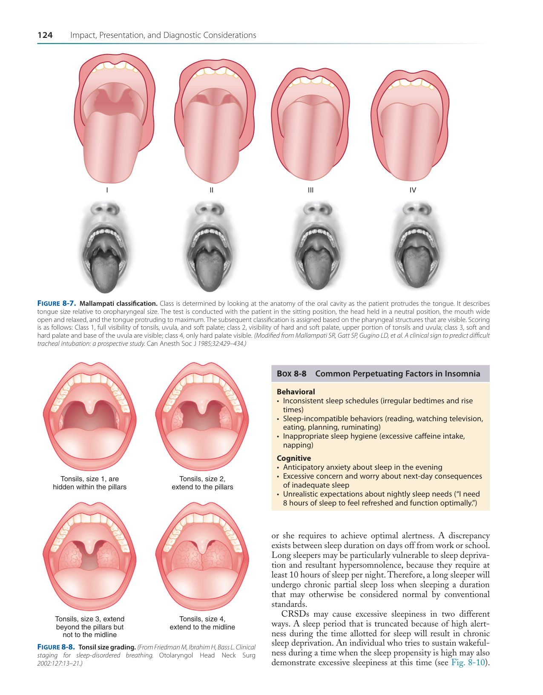

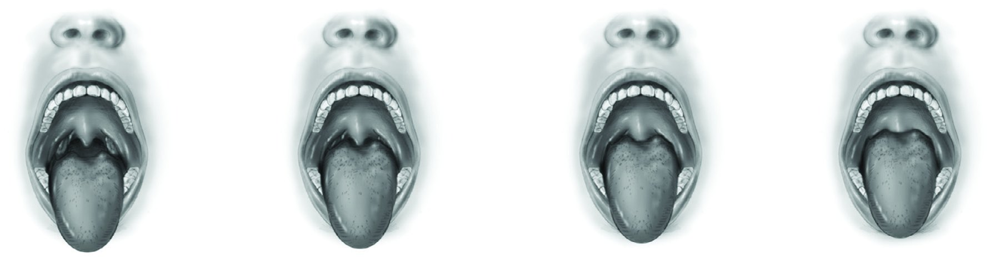

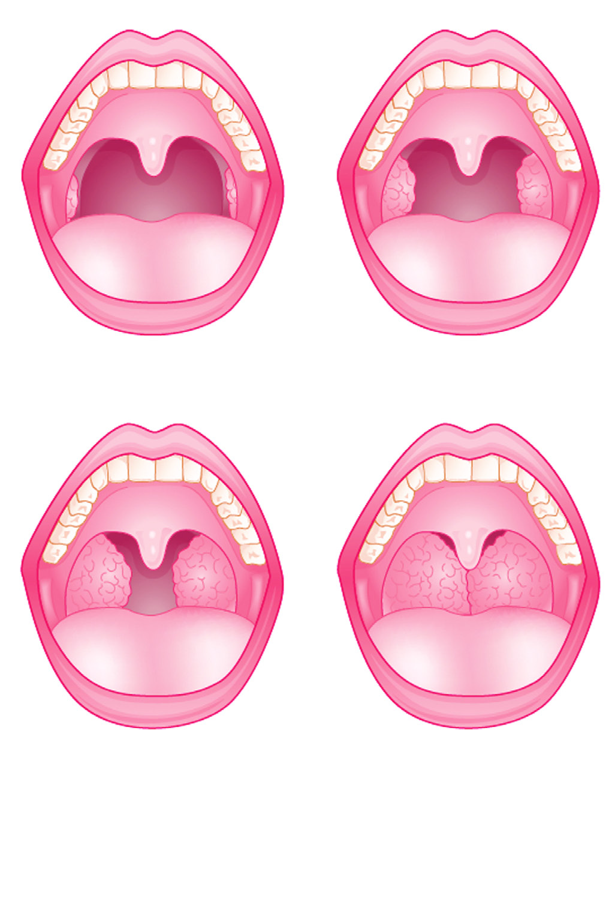

<!-- pdf-page: 143 -->

CRSDs may be grouped into those disorders in which an abnormality of the intrinsic timekeeper results in a circadian preference outside the typical range (advanced sleep-phase type, delayed sleep-phase type, free-running type, and irregular sleep-wake type) versus those in which externally imposed factors require alertness when the body has a tendency for sleep, such as jet lag or shift work.

intrusion phenomena are key symptoms in narcolepsy and are not present in idiopathic hypersomnia (Fig. 8-13). Cataplexy is an abrupt loss of muscle tone that lasts less than a minute, triggered by positive strong emotions. The axial muscles are most frequently involved, weakness is typically bilateral, and consciousness is retained. The presence of knee buckling

BOX 8-9 Areas of Inquiry to Evaluate

2000 2200 2400 0200 0400 0600 0800 1000 1200 1400 1600 1800 2000

Two central hypersomnias, narcolepsy and idiopathic hypersomnia, may be differentiated by sleep quality and duration, nap characteristics, and other associated symptoms (Table 8-2). Despite the amount of sleep patients with either condition obtain, they remain excessively sleepy. In addition to excessive sleepiness, rapid eye movement (REM) sleep

Friedman palate position I allows visualization of the entire uvula and tonsils/pillars

Friedman palate position II allows visualization of the uvula but not the tonsils

Friedman palate position III allows visualization of the soft palate but not the uvula

Friedman palate position IV allows visualization of the hard palate only

FIGURE 8-9. Friedman classification. (From Friedman M, Ibrahim H, Bass L.

Clinical staging for sleep-disordered breathing. Otolaryngol Head Neck Surg 2002:127:13–21.)

#### Hypersomnolence

• Inquiries to rule out sleep breathing disorders
• Sleep schedule and sleep quality
• Improvement in sleepiness when longer amounts of sleep

can be obtained (weekends, vacation) • Time sleepiness is most pronounced • Level of alertness on awakening • Episodes of muscle weakness with strong emotions

(cataplexy) • Sleep paralysis, hallucinations when falling asleep or

awakening (hypnagogic and hypnopompic hallucinations) • Duration of naps and whether they are refreshing • Whether the sleepiness ever goes away for a period of time • Whether an illness preceded the development of sleepiness

TABLE 8-2 Factors Differentiating Narcolepsy from

#### Idiopathic Hypersomnia

IDIOPATHIC HYPERSOMNIA NARCOLEPSY

Nocturnal sleep

With long sleep time

Normal

(≥10 hours), without long sleep time (<10 hours)

duration

Sleep quality Deep and

Fragmented but

unrefreshing

transiently refreshing

Naps Hours long,

Short, refreshing; dreaming

unrefreshing

may be present

Other features “Sleep drunkenness”/

REM intrusion phenomena

prolonged sleep inertia upon awakening

(cataplexy, sleep paralysis, hypnagogic and hypnopompic hallucinations)

From Vernet C, Leu-Semenescu S, Buzare M, Arnulf A. Subjective symptoms in idiopathic hypersomnia: beyond excessive sleepiness. J Sleep Res 2010;19:525–534; Ahmed I, Thorpy M. Clinical features, diagnosis, and treatment of narcolepsy. Clin Chest Med 2010;31:371–381.

REM, rapid eye movement.

FIGURE 8-10. Circadian misalignment. The blue outlined area notes time spent in bed. The pink rectangle represents the time of highest sleep propensity

in a patient with advanced sleep phase, whereas the green represents the time of highest sleep propensity in a patient with delayed sleep phase. As displayed, when attempting sleep from 11 PM to 7 AM, the advanced sleep phase patient will suffer from early morning awakenings, whereas the delayed sleep phase patient will have marked difficulty falling asleep. This may result in chronic partial sleep loss if the individual continues to attempt sleep during this time period. Furthermore, these patients are trying to maintain wakefulness at times when sleep propensity is high (the evening in patients with advanced sleep phase and the late morning in delayed sleep phase).

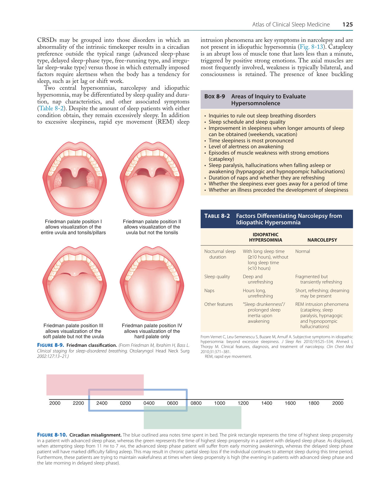

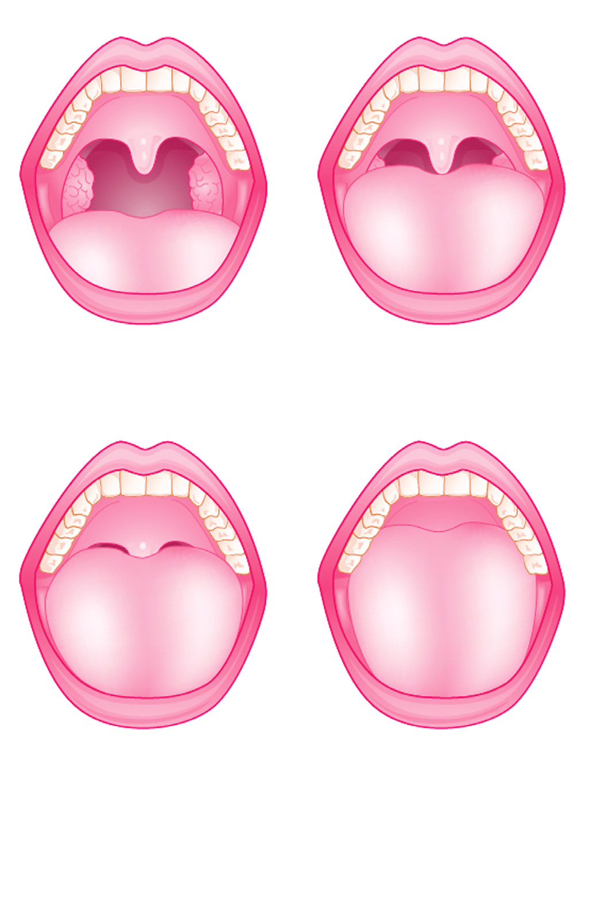

<!-- pdf-page: 144 -->

126 Impact, Presentation, and Diagnostic Considerations

of the sleep period? • Do you remain in bed? • Are your eyes open or closed? • Do you recall vivid dreaming during parasomnia? • Are the behaviors repetitive?

FIGURE 8-11. Model of acute and chronic insomnia. (Adapted from Spiel­

man A. Psych Clin North Am 1987;10:541–553.)

when telling or hearing a joke is highly suggestive of cataplexy and is seen in the majority of patients with this disease. Sleep paralysis is the perception of being paralyzed when awakened from sleep (sometimes during a dream). Hypnagogic and hypnopompic hallucinations refer to the symptom of vivid dream imagery upon sleep onset or awakening. Frequent leg movements during sleep and dream enactment behaviors may also be reported by bedmates of patients with narcolepsy. In idiopathic hypersomnia, sleep drunkenness refers to the marked difficulty these patients experience awakening from sleep. The time course of hypersomnias is also important. If the symptoms are intermittent with intervening periods of normal alertness, a recurrent insomnia, such as Kleine-Levin syndrome or menstrual-related hypersomnia, may be considered. Questions about illnesses may also provide insight because temporal associations between viral respiratory infections and certain central hypersomnias have been reported. Abnormal Sleep-Related Behaviors and Movements. A detailed account from a bedmate of a patient’s abnormal behaviors or movements during sleep can be most helpful in assessment for parasomnias and sleep-related movement disorders. In the evaluation of a patient with a parasomnia (see

Threshold

Precipitating factors Perpetuating factors

100

Predisposing factors

80

Insomnia intensity

60

40

20

0

Premorbid Acute insomnia Early insomnia Chronic insomnia

Chapter 12), a clinician should obtain information on the behavior, the age at which it first appeared, and the sleep period in which it occurs. Moreover, any injuries that have resulted from the parasomnia are important to note (Box 8-10). Such clues can help to distinguish REM sleep behavior disorder (RBD) from non-REM (NREM) parasomnias. The NREM parasomnias, or disorders of arousal from NREM sleep, encompass sleepwalking, confusional arousals, and night terrors. These behaviors typically begin in childhood, occur during the first third of the sleep period, and are rarely remembered by the patient. Eyes are usually open. With night terrors in particular, a disturbing image may accompany the behavior, but more involved dream content is usually not described. When confused behavior occurs upon the final awakening from sleep, a diagnosis of severe sleep inertia, considered a variant of confusional arousals, can sometimes be made.

In contrast to NREM parasomnias, RBD usually begins after age 50 years, events occur in the second half of the sleep period, eyes are closed, and the behavior correlates with a vivid dream that the patient is able to recall if awakened. Dream content is typically violent in nature (Fig. 8-14). During RBD dream-enactment episodes, the patient does not typically leave the bed. Other disturbing phenomena during REM sleep are recurrent episodes of sleep paralysis (in the absence of other symptoms of narcolepsy) and nightmares. Recently, a new parasomnia has been described in which atypical sexual behaviors occur during sleep. This has been noted as a manifestation of both NREM and REM parasomnias. Eating can also occur during the sleep period. A history of bizarre food and even

BOX 8-10 Parasomnia History

Questions to ask for evaluation of abnormal behaviors during the expected sleep period: • How has someone else described any abnormal noises or

behaviors that occur during your sleep? • How old were you at the first occurrence? • Do the behaviors occur during the first half or second half

FIGURE 8-12. Causes of excessive sleepiness in the absence of sleep-disordered breathing or other disorder disrupting sleep quality.

Excessive sleepiness

Sleep timing Sleep deprivation Central hypersomnias

Behaviorally insufficient sleep syndrome

Circadian rhythm sleep disorders Narcolepsy Long sleeper

Recurrent hypersomnia Idiopathic hypersomnia

<!-- pdf-page: 145 -->

inedible substance consumption with little or no recollection are clues to a diagnosis of sleep-related eating disorder. This is in contrast to night eating syndrome, in which eating may occur during the typical time for sleep, but the patient is fully alert while eating. Clinical attention also may be sought for involuntary micturition, groaning, a sensation of the head exploding, or hallucinations during sleep or arousals from sleep. These symptoms are also consistent with parasomnias.

highly stereotyped behavior, shorter duration of episodes, occurrence of daytime seizures, and presence of tongue biting and incontinence (Table 8-3).

FIGURE 8-14. Dream content in REM sleep behavior disorder. (Modified from Olsen EJ, Boeve BF, Silber MH. Rapid eye movement sleep behavior disorder: demo­

graphic, clinical, and laboratory findings in 93 cases. Brain 2000;1234:331–339.)

Untreated OSA may exacerbate parasomnias. Therefore the history for a patient with a parasomnia should also include questions about symptoms of SDB. Nocturnal seizures are distinguished from REM and NREM parasomnias by a

TABLE 8-3 Discrimination of Parasomnias from

#### Nocturnal Frontal Lobe Seizures

NOCTURNAL FRONTAL

PARASOMNIA

LOBE SEIZURE

Behaviors Crying or sobbing, waxing and

Bicycling movements,

waning quality, physical or verbal interaction with the environment, modification of event by witness, speaking in coherent sentences, scratching face and face rubbing

thrashing, grunting, grimacing, dystonic postures

Duration 60 seconds (range, 11 seconds

37 seconds (range, 9

to 14 minutes)

seconds to 2 minutes)

Offset Tapering off or indistinct offset Distinct offset

Events per

2 (range, 1 to 5) 7 (range, 1 to 10)

night

In a study of 44 subjects (23 with parasomnias, 21 with nocturnal frontal lobe epilepsy), the above factors were statistically significant (P < .001) in differentiating parasomnia from seizure. Parasomnias typically displayed different behavior seminology, longer duration, less abrupt event conclusion, and lower frequency per night compared with nocturnal frontal lobe seizures. Values are median (range).

Modfied from Derry CP, Harvey AS, Walker MC, Duncan JS, Berkovic SF. NREM arousal parasomnias and their distinction from nocturnal frontal lobe epilepsy: a video EEG analysis. Sleep 2009;32:1637–1644.

2% 2%

9%

30% 57%

Patients may come to medical attention with discomfort in the legs that can make sleep onset troublesome. Specific questions should be asked if restless legs syndrome (RLS) is suspected (Box 8-11). A bedmate may note repetitive kicking at night, suggestive of periodic limb movements of sleep. In the setting of RLS symptoms, this finding can support the diagnosis. However, the leg movements by themselves— without associated RLS symptoms, nighttime sleep disruption, or daytime impairment—does not carry clear clinical significance. Grinding sounds may be noted at night by a bedmate, or a patient may note jaw soreness on awakening.

Sleep paralysis

Cataplexy

#### Excessive

#### daytime

#### sleepiness

Hypnagogic hallucinations Sleep disruption

FIGURE 8-13. Symptoms of narcolepsy with cataplexy. The classic tetrad

of narcolepsy included excessive daytime sleepiness, cataplexy, sleep paralysis, and hypnagogic hallucinations. Cataplexy is reported by around 70% of patients, hypnagogic hallucinations in 30%, and sleep paralysis in 25%. Because of the significant nocturnal sleep disruption reported in these patients, narcolepsy is now considered to be a pentad of symptoms. As may as 40% of patients may also report automatic behavior, actions they are amenstic to occurring in a condition of extreme drowsiness before sleep attack. (From Overeseem S, Mignot E, vanDijk JG, Lammers GJ. Narcolepsy: clinical features, new pathologic insights, and future perspectives. J Clin Neurophysiol 2001;18:78–105.)

Defense against attack by people

Defense against attack by animals

Adventure dreams

Sports dreams

Aggression by dreamer

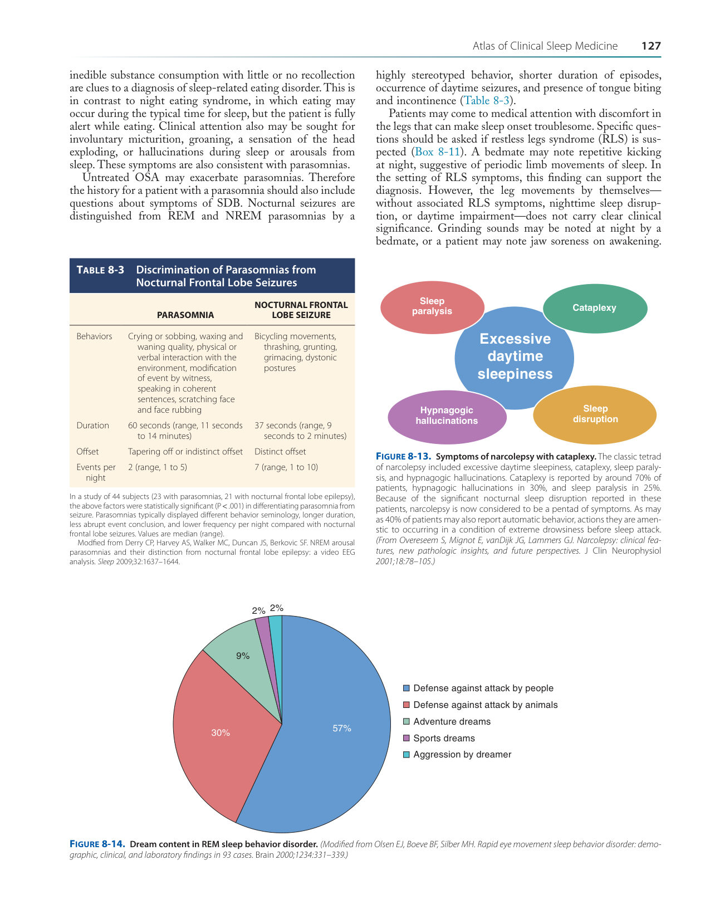

<!-- pdf-page: 146 -->

128 Impact, Presentation, and Diagnostic Considerations

BOX 8-11 Restless Legs Syndrome Symptoms

TABLE 8-4 Commonly Used Medications for Medical

#### And Psychiatric Disorders with

#### Sleep-Related Side Effects

Questions to ask when restless legs syndrome is suspected: • How would you describe the unpleasant sensation? • Is the discomfort accompanied by an urge to move the

MEDICATION SLEEP-RELATED ADVERSE EVENTS

Selective serotonin reuptake

Insomnia, REM sleep behavior disorder,

inhibitors

restless legs syndrome, periodic limb movements of sleep

legs? • Do the symptoms become worse at rest? • Do the symptoms improve with movement? • At what time of day are these sensations most pronounced? • Are you inadvertently kicking a bed partner while you

sleep? • Do you have a family history of these problems? • Do your symptoms worsen with caffeine or in prolonged,

confined environments (such as a plane trip)?

These symptoms should prompt further evaluation for bruxism. Other movements at night, such as rocking or head banging, are rarely reported by adult patients but may be encountered more frequently in children. Impact of Sleep Disorders on the Patient. The impact that disordered sleep has on daily life must be assessed. The history should include effects on driving, work, mood, and family. The duration and impact of these problems on personal and professional lives should also be assessed.

#### Medical History

Medical conditions may precipitate sleep disorders and, conversely, sleep disorders may exacerbate certain medical conditions; therefore a thorough evaluation of the medical history is crucial. For example, SDB is seen more commonly in patients with obesity, diabetes, refractory hypertension, heart disease, and stroke and has the potential to worsen each of these conditions or increase risk for them. Acromegaly may result in SDB in patients who otherwise may have low risk for sleep apnea. Neurologic disorders such as Chiari malformations, amyotrophic lateral sclerosis, other neuromuscular diseases, and multisystem atrophy (MSA) often manifest SDB as part of the disease course. A multitude of illnesses— and in particular, psychiatric and pain-related diagnoses— may be comorbid with insomnia. RBS is a parasomnia that occurs in a high percentage of patients with α-synucleinopathy neurodegenerative disorders (dementia with Lewy bodies, Parkinson disease, and MSA) and often is a heralding symptom before onset of more specific symptoms. Therefore, in patients with RBD, the clinician should continually assess for neurologic signs and symptoms. RLS may be a feature of anemia, chronic kidney disease, venous insufficiency, neuropathy, degenerative spine disease, Parkinson disease, or multiple sclerosis. Furthermore, many medical conditions can result in sleep disruption secondary to symptoms of the disease state. In addition, medications often contribute to disordered sleep, and their association with sleep symptoms should be carefully assessed (Table 8-4).

A social history can sometimes contribute to a determination of the cause of disordered sleep. The frequency, amount, and timing of alcohol consumption can affect sleep. Alcohol reduces sleep latency and results in lighter, disrupted sleep during the second half of the sleep period. Alcohol also worsens OSA. Tobacco is a stimulant and can contribute to insomnia when taken before bedtime or in the middle of the

Serotonin norepinephrine

Insomnia and sedation, restless legs

reuptake inhibitor antidepressants

syndrome, periodic limb movements of sleep

Tricyclic antidepressants Sedation, REM sleep behavior disorder,

restless legs syndrome

Antipsychotics Typically sedating

β-Blocker antihypertensives Insomnia, nightmares, REM sleep

behavior disorder (bisoprolol)

α-Agonist antihypertensives Sedation, nightmares

Antiepileptics Typically sedating (felbamate and

lamotrigine may cause insomnia)

Narcotics Sedation, obstructive and central sleep

apnea

H1 antihistamines Sedation

Pseudoephedrine-

Insomnia

containing nasal decongestants

Stimulants Insomnia

Corticosteroids Insomnia

Carbidopa/levodopa and

Sedation (low doses), insomnia (high

dopamine agonists

doses)

Metoclopramide Restless legs syndrome

Modified from Conroy DA, Brower KJ. Alcohol, toxins, and medications as a cause of sleep dysfunction. Handb Clin Neurol 2011;98:587–612; Rottach KG, Scaner BM, Kirch MH, et al. Restless legs syndrome as side effect of second generation antidepressants. J Psychiatric Res 2009;43:70–75; Webster LR, Choi Y, Desai H, Webster L, Grant BJ. Sleep-disordered breathing and chronic opioid therapy. Pain Med 2008;9:425–32; Gagnon JF, Postuma RB, Montplaisir J. Update on the pharmacology of REM sleep behavior disorder. Neurology 2006;67:742–747.

REM, rapid eye movement.

night. Assessment of caffeine use is a key part of the social history because caffeine is an adenosine receptor antagonist and its consumption may result in insomnia. The timing of intake is important because the half-life of caffeine may be up to 5 hours. Illicit drug use is important to identify because many substances of abuse have stimulating or sedating properties that can promote sleep disturbance, somnolence, or exacerbation of SDB. Occupation plays an important role in sleep in multiple ways. A nontraditional work schedule with concurrent sleep complaints should prompt further investigation into shift-work disorder. Furthermore, a long commute may contribute to insufficient sleep, and jobs that require frequent travel across multiple time zones may result in recurrent jet lag.

Family history is a critical component of the evaluation. For example, people who have a first-degree relative with OSA are about twice as likely to have this disease. First-degree relatives of patients with narcolepsy with cataplexy have an increased risk for this hypersomnia. Familial patterns have also been described in RLS, NREM parasomnias (in particular, sleepwalking), and certain CRSDs.

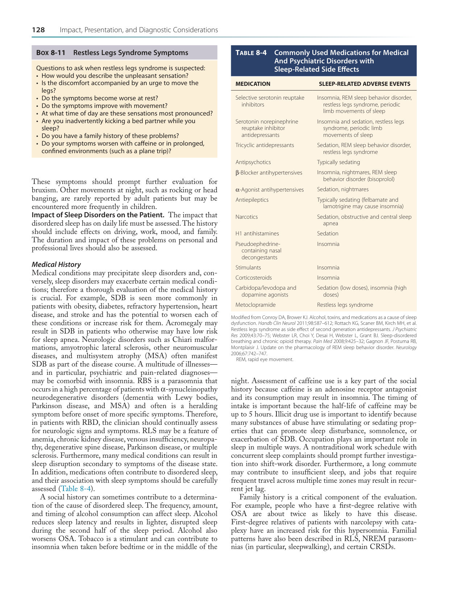

<!-- pdf-page: 147 -->

morbidity frequently coexists and can contribute to daytime sleepiness and disrupted nocturnal sleep.

BOX 8-12 Minimum Physical Examination in Patients

#### with Sleep Disorders

• Height, weight, body mass index, blood pressure
• General appearance and level of alertness
• HEENT (hearing, eye, ear, nose, throat) exam
• Cardiovascular exam
• Pulmonary exam
• Extremity exam
• Neurologic exam

BOX 8-13 Sleep Apnea Upper Airway Exam

The hearing, eye, ear, nose, and throat (HEENT) exam should include: • Neck circumference: A neck circumference over 43 cm is a

common finding in adults with obstructive sleep apnea (OSA). • Skeletal features: Features such as maxillary deficiency and

retrognathia may cause OSA. • Nasal airway: Evaluate nasal airflow, the internal and

external nasal valves, nasal turbinates, and presence of a deviated nasal septum. Nasal obstruction contributes to sleep-disordered breathing and also hinders treatment with continuous positive airway pressure. • Oral exam: Mallampati score should be noted because

higher scores are correlated OSA. An erythematous uvula as a result of vibrational trauma from snoring is a common finding in patients with OSA, and scalloping of the tongue suggests the oral cavity is too small. The presence and size of tonsils should be recorded, because surgical outcomes are generally better in OSA patients with large tonsils. A high, arched hard palate is a common finding in patients with OSA and indicates the oral cavity is too narrow.

#### Physical Examination

A complete physical examination is required to evaluate a patient with disordered sleep (Box 8-12). A detailed head, eyes, ears, nose, and throat (HEENT) exam is required in an evaluation for disordered sleep, because specific anatomic findings predispose to upper airway obstruction (Box 8-13). This is reviewed in greater detail in Chapters 13.1, 13.2, and 13.3.

Complete cardiovascular and pulmonary examinations are performed to evaluate for pathology that can either contribute to, or arise from, SBD (see Chapter 13). Physical findings such as peripheral edema may suggest heart failure, a known consequence of untreated OSA. Conversely, people with heart failure frequently have disrupted sleep from central sleep apnea. Attention to findings suggestive of neuromuscular pathology—such as muscle fasciculations, atrophy, or neuropathy—may identify patients at higher risk for OSA, sleep-related hypoventilation, or other sleep disorders.

A full neurologic exam is also indicated in the evaluation for RLS, parasomnia, hypersomnia, and insomnia because these conditions may be comorbid with or secondary to neurologic disease. Assessment of affect and mood to help identify psychiatric disorders is important because mental health

#### Self-Administered Instruments

#### Sleep Diaries

Sleep diaries completed daily by patients can provide subjective information on sleep-wake patterns and are widely used in both clinical and research settings. Typical entries include bedtime, rise time, estimate of sleep latency, nighttime awakenings, estimate of time spent awake after sleep initiation, naps, caffeine intake, use of sleep aids, and ratings of sleep quality and level of fatigue. Summary scores are calculated from the data.

Recently, a panel of clinical sleep medicine experts developed a consensus sleep diary designed for use as a standardized assessment tool. The core version of this diary is shown in Figure 8-15. Research has demonstrated modest to poor correlations between sleep diaries and objective measures (e.g., overnight polysomnography or actigraphy), with total sleep time underestimated and sleep latency overestimated in diaries versus objective measurement. Thus, diaries are a good representation of patients’ perception of their sleep but may not accurately reflect objective sleep measures.

#### Epworth Sleepiness Scale

The Epworth Sleepiness Scale (ESS; Figs. 8-16 and 8-17) is a simple patient-completed subjective measure of tendency to doze in soporific situations. A total score of 10 or above is often interpreted to suggest EDS. A mean score of about 16 is commonly reported by narcoleptics, whereas a score of about 6 has been reported among normal subjects. Patients with insomnia also often have normal scores. The ESS alone can provide a concise screening tool, and it can be useful when a patient or response to treatment are assessed serially in time. However, ESS scores by themselves do not completely assess daytime sleepiness. Results correlate poorly with 1) patients’ perceptions about how much sleepiness has been a problem, 2) other measures of disordered sleep on polysomnography, 3) results of objective sleepiness testing on the Multiple Sleep Latency Test, and 4) likelihood of OSA on polysomnography.

#### Apnea Questionnaires

The Berlin Apnea Questionnaire may help identify patients at risk for OSA and is often used in research to estimate the frequency of OSA. This questionnaire has a sensitivity of 0.86 and a specificity of 0.77 to correctly diagnose OSA, compared with polysomnography, in patients who fall into the high-risk category (Fig. 8-18). Another commonly used and more easily scored instrument is the STOP-BANG assessment, which combines four short-question items regarding snore, tiredness, obstruction, and pressure (STOP) with four simple observations about body mass index, age, neck circumference, and gender (BANG). Answering yes to three or more items on the STOP-BANG indicates a high risk of OSA. Sensitivity ranges from 0.83 (for apnea-hypopnea index cutoff value of >5) to 1.0 (for apnea-hypopnea index cutoff value of >30;

Fig. 8-19).

Other disease-specific screening questionnaires, such as instruments designed to assess effects of sleep disorders and quality of life measures, may also be useful.

<!-- pdf-page: 148 -->

130 Impact, Presentation, and Diagnostic Considerations

Today’s date

1. What time did you get into bed?

10:15 p.m.

2. What time did you try to go to sleep?

11:30 p.m.

55 min.

FIGURE 8-15. The core version of the consensus sleep diary. (Modified from Carney C, Buysse DJ, Ancoli-Israel S, et al. Sleep 35[2]:287–302, 2012.)

3. How long did it take you to fall asleep?

4. How many times did you wake up, not counting your final awakening?

3 times

5. In total, how long did these awakenings last?

1 hour

10 min.

6. What time was your final awakening?

6:35 a.m.

7. What time did you get out of bed for the day?

7:20 a.m.

8. How would you rate the quality of your sleep?

Very poor Poor Fair Good Very good

Very poor Poor Fair Good Very good

Very poor Poor Fair Good Very good

9. Comments (if applicable)

I have a cold

Very poor Poor Fair Good Very good

Very poor Poor Fair Good Very good

Very poor Poor Fair Good Very good

Very poor Poor Fair Good Very good

Very poor Poor Fair Good Very good

FIGURE 8-16. Epworth Sleepiness Scale. (Modified from Johns MW: A new method for measuring daytime sleepiness: The Epworth Sleepiness Scale. Sleep 14[6]:540–

545, 1991.)

#### Epworth Sleepiness Scale

Using the following scale, circle the most appropriate number for each situation.

0 would doze less than once a month 1 slight chance of dozing 2 moderate chance of dozing 3 high chance of dozing

Situation

Sitting and reading Watching TV Sitting, inactive in a public place (in a theater or in a meeting) As a passenger in a car for an hour without a break Lying down to rest in the afternoon (when circumstances permit) Sitting and talking to someone Sitting quietly after a lunch without alcohol In a car, while stopped for a few minutes in the traffic

Add the 8 numbers you have circled TOTAL

Chance of Dozing

0 1 2 3 0 1 2 3 0 1 2 3 0 1 2 3 0 1 2 3 0 1 2 3 0 1 2 3 0 1 2 3

<!-- pdf-page: 149 -->

PICTORAL EPWORTH SLEEPINESS SCALE

FIGURE 8-17. Pictorial Epworth sleepiness scale. (From Johns MW. A new method for measuring daytime sleepiness: the Epworth sleepiness scale. Sleep

1991;14:540–545.)

Total sleepiness score /24

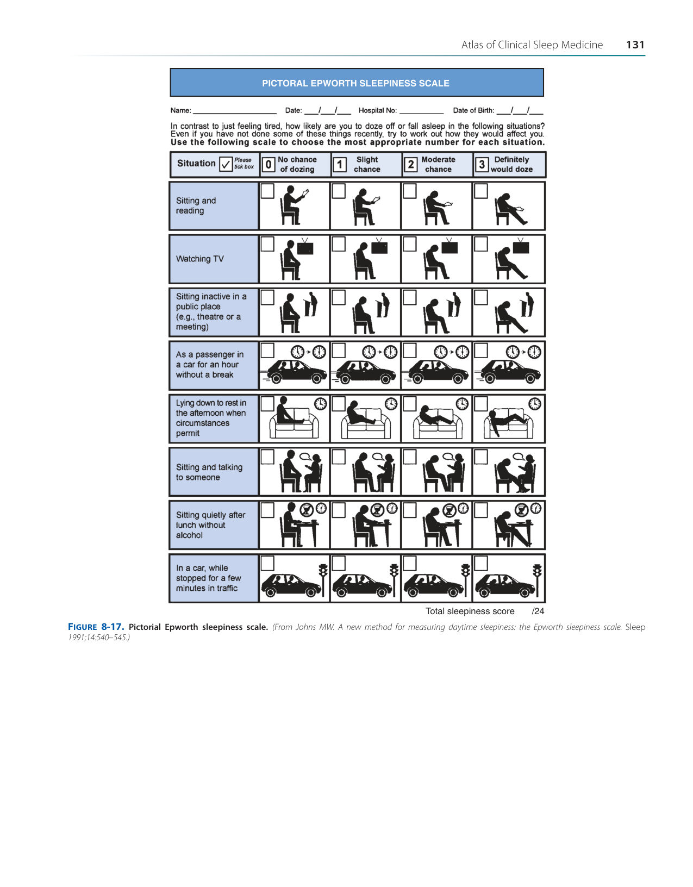

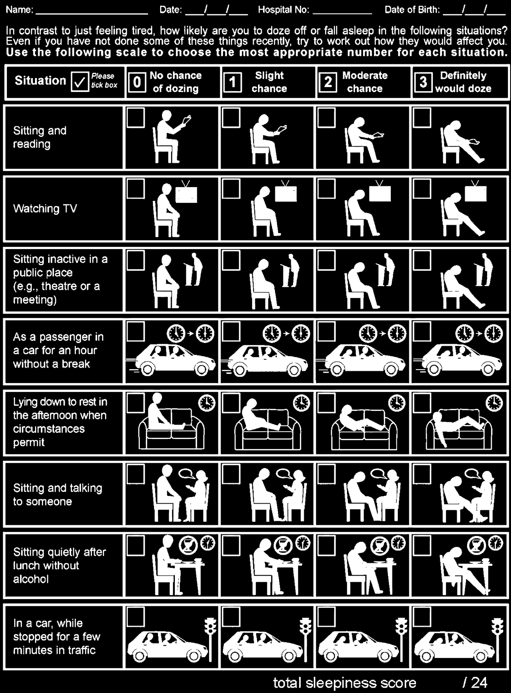

<!-- pdf-page: 150 -->

132 Impact, Presentation, and Diagnostic Considerations

#### Modified Berlin Apnea Questionnaire

BOX B: Category 2 SLEEPINESS

BOX A: Category 1 SNORING

Are you tired or fatigued after waking up more than 3-4 times a week?

Do you snore?

Is snoring louder than talking?

During the day, are you tired or fatigued more than 3-4 times a week?

Is snoring present more than 3-4 times a week?

Has snoring ever bothered others?

FIGURE 8-18. Modified Berlin Apnea Questionnaire. (Data from Netzer NC, Stoohs RA, Netzer CM, et al: Using the Berlin Questionnaire to identify patients at risk

for obstructive sleep apnea syndrome. Ann Intern Med 1999;131[7]:485–491.)

#### Start here

#### End here

Has anyone noticed the stopping of breathing during sleep more than 3-4 times a week?

Add up the number of positive answers

If more than 2, this category is positive.

BOX D: FILL THIS IN LAST: Check positive categories

Category 1 SNORING Category 2 SLEEPINESS Category 3 RISK FACTORS

Add up the number of positive answers

If 2 or more, the chance that apnea is present is high.

Do you have trouble staying awake while driving?

Add up the number of positive answers

If 2 or more, this category is positive.

BOX C: Category 3 RISK FACTORS

Do you have high blood pressure?

Is your BMI more than 30, or is your neck collar size more than 17 inches?

Do you have a very small jaw or a large overbite?

Add up the number of positive answers

If 2 or more, this category is positive.

FIGURE 8-19. STOP-Bang questionnaire. (Modified from Chung F, Yegneswaran B, Liao P, et al. STOP questionnaire: a tool to screen patients for obstructive sleep

apnea. Anesthesiology 2008;108[5]:812–821.)

The STOP-BANG Questionaire

#### Snoring

#### Tired

#### Observed

#### Blood pressure

#### BMI

Body mass index >35?

#### Age

Age over 50 years old?

#### Neck

#### circumference

#### Gender

Gender male?

Do you snore loudly (louder than talking or loud enough to be heard through closed doors)?

Do you often feel tired, fatigued, or sleepy during the daytime?

Has anyone observed you stop breathing during your sleep?

Do you have or are you being treated for high blood pressure?

Neck circumference greater than 40 cm?

<!-- pdf-page: 151 -->

#### Selected Readings

American Academy of Sleep Medicine: The international classification of sleep

Rosen RC, Zozula R, Jahn EG, Carson JL: Low rates of recognition of sleep

disorders in primary care: comparison of a community-based versus clinical academic setting. Sleep Med 2(1):47–55, 2001. Sateia MJ, Doghramji K, Hauri PJ, Morin CM: Evaluation of chronic insom­

disorders: diagnostic and coding manual, ed 2, West Chester, IL, 2005, American Academy of Sleep Medicine. Anic-Labat S, Guilleminault C, Kraemer HC, et al: Validation of a cataplexy

nia: an American Academy of Sleep Medicine review. Sleep 23(2):243–308, 2000. Spielman AJ: Assessment of insomnia. Clin Psych Rev 6:11–26, 1986. Spielman AJ, Caruso LS, Glovinsky PB: A behavioral perspective on insom­

questionnaire in 983 sleep-disordered patients. Sleep 22(1):77–87, 1999. Knab B, Engel RR: Perception of waking and sleeping: possible implications

for the evaluation of insomnia. Sleep 11(3):265–272, 1988. Mahowald MW, Schenck CH: Non–rapid eye movement sleep parasomnias.

nia treatment. Psychiatr Clin North Am 10(4):541–553, 1987. Walters AS: Toward a better definition of the restless legs syndrome. The

Neurol Clin 23(4):1077–1106, 2005. National Sleep Foundation: Sleep in America Polls, 2006 and 2008. Available

at www.sleepfoundation.org. Ozminkowski RJ, Wang S, Walsh JK: The direct and indirect costs of

untreated insomnia in adults in the United States. Sleep 30:263–273, 2007.

International Restless Legs Syndrome Study Group. Mov Disord 10(5):634–642, 1995.
