# 9 Circadian System Disorders

<!-- pdf-page: 152 -->

## Chapter 9

## Circadian System Disorders

## Circadian Rhythm Disorders

### Kathryn J. Reid and Phyllis C. Zee

## 9.1

00:00 18:00 12:00 06:00 00:00 18:00 12:00 06:00 00:00

Circadian rhythm sleep disorders (CRSDs) are sleep disorders in which a misalignment between the timing of the sleep-wake cycle and the circadian clock or an alteration in the circadian clock results in insomnia, sleepiness, and impaired daytime function. Circadian disorders of sleep include delayed sleepphase type, advanced sleep-phase type, free-running sleep type, irregular sleep-wake type, shift-work type, and jet lag type.

#### DELAYED SLEEP-PHASE TYPE/DELAYED

#### SLEEP-PHASE DISORDER

Delayed sleep-phase disorder (DSPD) is characterized by difficulty falling asleep and waking at the desired time and excessive daytime sleepiness (EDS). This disorder is relatively common in adolescents, with a reported prevalence of approximately 7%, and in the general population, with a prevalence of roughly 0.17%. Individuals with DSPD typically have a delayed sleep-wake cycle, with sleep onset between 2 and 6

AM and wake time between 10 AM and 2 PM (Fig. 9.1-1).

In addition to a delay in the sleep-wake cycle, a delay is seen in other circadian rhythm phase markers, such as core body temperature and the dim-light melatonin rhythm (Fig. 9.1-2).

Determination of the endogenous melatonin rhythm can serve as a useful marker for the timing of circadian rhythms to aid in assessing the severity of the circadian delay and in optimally timing treatment interventions (Fig. 9.1-3).

Treatment for DPSD is aimed at realigning the sleep-wake cycle to the conventional or desired time; this can be achieved in several ways. Behavioral interventions should be used initially to improve sleep. For example, patients with DSPD should be encouraged to practice good sleep hygiene and to avoid excessive light exposure in the evening, which may perpetuate or even exacerbate the delay in the sleep-wake cycle. Chronotherapy can also be used, which requires patients to progressively delay their sleep and wake time by 3 hours every few days until they reach their desired sleep time. This approach is limited in that it requires flexibility in the patient’s schedule, and once the desired sleep time is reached, it can be difficult to maintain. Another alternative is to manipulate the circadian clock with exposure to bright light or to administer exogenous melatonin, which should be used in conjunction with good sleep hygiene practices. Bright light exposure in the morning can be used to phase-advance the timing of the circadian clock and the sleep-wake cycle. Bright light exposure of 2500 lux for approximately 2 hours in the morning

FIGURE 9.1-1. An example of the rest-activity cycle in a patient with delayed sleep-phase disorder recorded with wrist-activity monitoring. The dark

lines indicate activity; yellow bars indicate light level. Where the black lines are absent, it can be inferred that the patient is asleep. The data are plotted twice to make it easier to see the rest-activity cycle over several days. Time is plotted across the x-axis and is between midnight and midnight over 2 days. The y-axis indicates the day of the week. For this individual, the average sleep onset is at about 4 AM, and the wake time is around 12 PM.

Tue/Wed

Wed/Thu

Thu/Fri

Fri/Sat

Sat/Sun

Sun/Mon

Mon/Tue

Tue/Wed

Wed/Thu

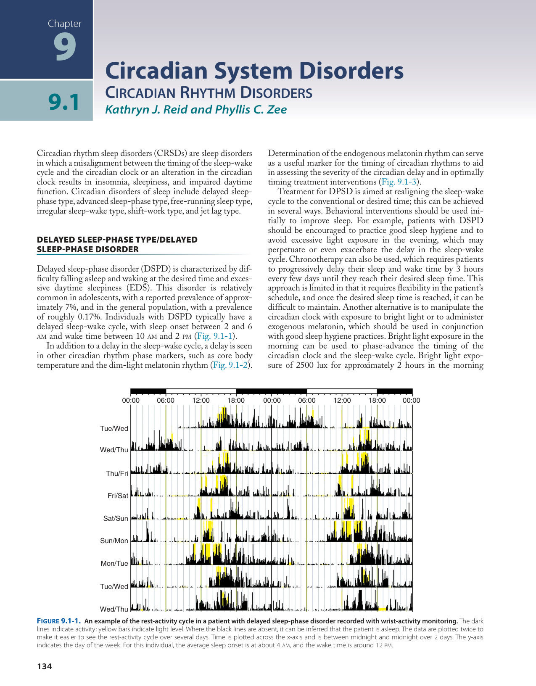

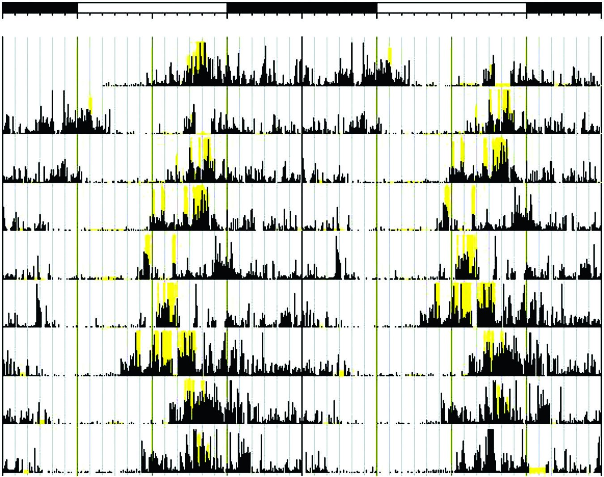

<!-- pdf-page: 153 -->

37.8

37.6

37.4

37.2

Tmin

37

36.8

FIGURE 9.1-2. A 24-hour core body temperature (CBT) rhythm in an individual with delayed sleep-phase disorder. Time is indicated on the x-axis, and

temperature in degrees Celsius is shown on the y-axis. The temperature minimum (Tmin) occurs at about 9 AM. The declining portion of the CBT rhythm begins at about 3 AM, and the rising portion begins at about 11 AM. This rhythm would make it difficult for this person to fall asleep earlier than 3 AM or to wake before 11 AM, and if he did wake before 11 AM to get to work or class, he would most likely feel extremely sleepy because his CBT would still be low.

Core body temperature (°C)

36.6

36.4

36.2

36

0:10

1:10

2:10

3:10

4:10

5:10

6:10

7:10

8:10

9:10

10:10

11:10

12:10

13:10

14:10

15:10

16:10

17:10

18:10

19:10

20:10

21:10

22:10

23:10

Time

FIGURE 9.1-3. A 24-hour melatonin profile obtained under dim light conditions in a patient with delayed sleep-phase disorder. The arrow indicates

the time of dim light melatonin onset (DLMO) at about 3 AM, which is much later than normal (in normal controls, DLMO is usually between 8 and 10 PM). Because sleep onset usually occurs about 2 hours after the DLMO, this person may not be sleepy until around 2 AM, making it difficult to fall asleep earlier than 4 AM.

70.0

60.0

50.0

Melatonin (pg/mL)

40.0

30.0

DLMO

20.0

10.0

0.0

2000

2430

2130

2000

2300

330

500

630

800

930

1100

1230

1400

1530

1700

1830

2000

Time

starting at 6 AM has been successful in phase-advancing the sleep-wake cycle. Exogenous melatonin administered in the evening 5 to 7 hours before habitual sleep time has been shown to phase-advance the sleep-wake cycle and improve quality of life in patients with DSPD.

#### ADVANCED SLEEP-PHASE TYPE/ADVANCED

#### SLEEP-PHASE DISORDER

Advanced sleep-phase disorder (ASPD) is characterized by a difficulty staying awake in the evening and waking too early in the morning before the desired time (Fig. 9.1-4). In addition to an advance in the sleep-wake cycle, an advance

is seen in other circadian rhythm phase markers, such as core body temperature and the dim-light melatonin rhythm (Fig. 9.1-5). The prevalence of ASPD in the general population is unknown and is believed to be rare, but it has been reported to be more common in older adults. ASPD has a genetic basis; in familial ASPD, the PER2 gene seems to be involved.

Treatment for ASPD typically involves using bright light to phase-delay the circadian clock and the sleep-wake cycle. Bright light exposure for several hours in the evening, typically between 7 and 9 PM, has been used successfully to phasedelay circadian rhythms and reduce feelings of sleepiness in the evening. Hypnotic medications can also be used to maintain sleep in the early morning.

<!-- pdf-page: 154 -->

136 Circadian System Disorders

00:00 18:00 12:00 06:00 00:00 18:00 12:00 06:00 00:00

Fri/Sat

Sat/Sun

Sun/Mon

Mon/Tue

Tue/Wed

FIGURE 9.1-4. An example of the rest-activity cycle in a patient with advanced sleep-phase disorder recorded with wrist-activity monitoring. This

patient has a sleep-onset time that ranged between 8 and 9 PM and a wake time between 4 and 5 AM on most days.

Wed/Thu

Thu/Fri

Fri/Sat

Sat/Sun

Sun/Mon

FIGURE 9.1-5. This 24-hour profile of melatonin levels indicates a patient with a dim light melatonin onset (DLMO) at about 2 PM (arrow), which is

much earlier than normal (8 to 10 PM). Because sleep onset usually occurs about 2 hours after the DLMO, this person will likely be very sleepy at around 4 PM.

70.0

60.0

50.0

Melatonin (pg/mL)

40.0

30.0

DLMO

20.0

10.0

0.0

800

1030

1330

1530

1700

1830

2010

2130

2300

2430

200

330

500

630

800

Time

NON–24-HOUR SLEEP-WAKE DISORDER,

#### FREE-RUNNING TYPE, AND

#### NONENTRAINED TYPE

Non–24-hour sleep-wake disorder is characterized by a progressive delay in the circadian clock and in the sleep-wake cycle that results in insomnia and sleepiness, depending on when sleep is attempted, in relation to the phase of the circadian clock. This disorder is most commonly seen in blind individuals but has also been reported after brain injury and in normal-sighted individuals (Fig. 9.1-6).

Treatment of non–24-hour sleep-wake disorder depends on the timing of the circadian clock relative to the desired bedtime. Because this disorder is usually reported in blind individuals who may or may not have circadian light perception, melatonin is most commonly used to treat this disorder. If the patient free-runs, treatment usually starts when the patient’s sleep-wake cycle has reached the desired time. At this point, melatonin is given about 1 hour before the desired bedtime, in conjunction with keeping a regular sleep and work

schedule, to try to entrain the sleep-wake cycle to the desired time.

#### IRREGULAR SLEEP-WAKE TYPE AND

#### IRREGULAR SLEEP-WAKE DISORDER

Patients with irregular sleep-wake disorder have at least three sleep periods across the day and night and lack a single, consolidated sleep period. This disorder is most commonly seen in institutionalized older adults and in children with intellectual disabilities (Fig. 9.1-7). Irregular sleep-wake disorder is thought to be the result of either dysfunction in the internal circadian pacemaker or a reduction in activity, light, or other important social cues that influence timing and amplitude of circadian rhythms. Treatment for irregular sleep-wake disorder aims to consolidate the nocturnal sleep period. Several approaches have been used, including increasing the exposure to circadian synchronizing agents, such as light and activity levels. In children with intellectual

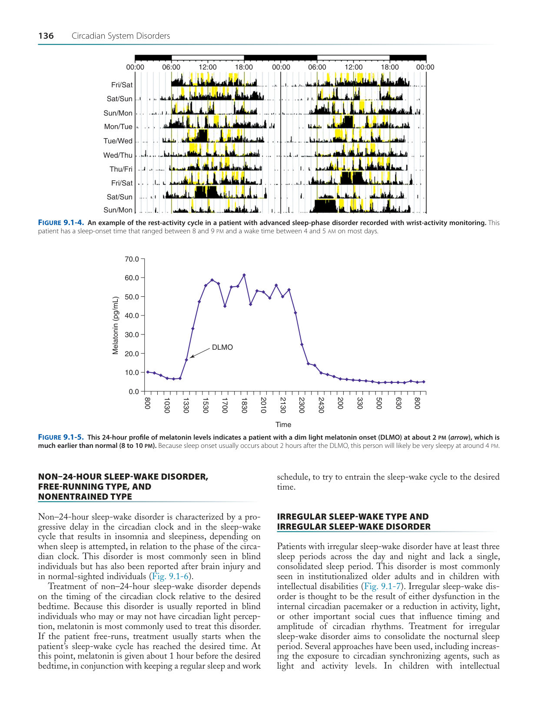

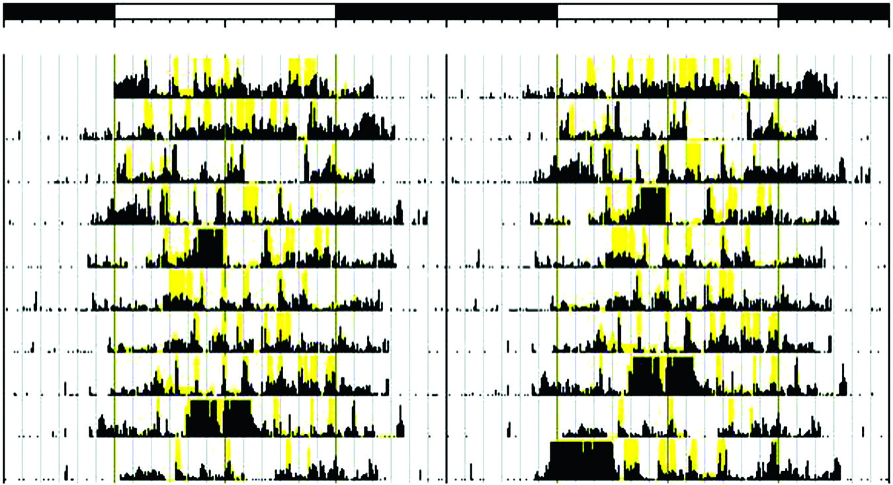

<!-- pdf-page: 155 -->

00:00 18:00 12:00 06:00 00:00 18:00 12:00 06:00 00:00

Wed/Thu Tue/Wed

Fri/Sat Thu/Fri

FIGURE 9.1-6. An example of the rest-activity cycle in a patient with a free-running disorder recorded with wrist-activity monitoring. The rest-activity

cycle in those with free-running disorder typically progressively delays each day, so that at certain times the rest period occurs during the daytime. If the individual with free-running disorder attempts to sleep at night, when the circadian propensity for sleep has shifted to the daytime, he or she may experience insomnia at night and excessive daytime sleepiness.

Sat/Sun Sun/Mon Mon/Tue Tue/Wed Wed/Thu

Fri/Sat Thu/Fri

Sat/Sun Sun/Mon Mon/Tue Tue/Wed Wed/Thu

Fri/Sat Thu/Fri

00:00 18:00 12:00 06:00 00:00 18:00 12:00 06:00 00:00

FIGURE 9.1-7. An example of the rest-activity cycle in a 75-year-old woman with irregular sleep-wake disorder recorded with wrist-activity monitor­

ing. Unlike the other rest-activity cycles shown, there is no consolidated sleep period; instead, multiple short naps/sleeps are taken across the 24-hour period.

Sun/Mon

Mon/Tue

Tue/Wed

Wed/Thu

disabilities, daily exogenous melatonin administration has been successful.

#### SHIFT-WORK TYPE AND SHIFT-WORK

#### DISORDER

Shift-work sleep disorder is characterized by insomnia and sleepiness associated with the work schedule. This sleep disturbance should not be better explained by another current sleep disorder, medical or neurologic disorder, mental disorder, medication use, or substance use disorder. The prevalence of shift-work sleep disorder is estimated to be about 10% of the night and rotating shift-work population (Fig. 9.1-8).

Treatment for shift-work sleep disorder aims to phaseshift, usually delay, the circadian clock so that the patient is able to be alert at night and sleep during the day. This can be achieved in several ways. It is recommended that night workers try to avoid bright light on the commute home from work, because light at this time will phase-advance the circadian clock. Bright light exposure during the first part of the night shift has been successful in improving alertness at night

because of the immediate alerting effects of light and the phase-delaying of the circadian clock. Prophylactic napping is recommended when possible, either before or during the night shift, to improve alertness. In addition, intermittent low-dose caffeine, either alone or in conjunction with napping, has been shown to improve alertness during the night shift. If clinically indicated, wakefulness-promoting agents such as modafinil and armodafinil have been approved by the U.S. Food and Drug Administration for the treatment of excessive sleepiness associated with shift work. For patients with comorbid insomnia, short-acting hypnotics may be useful to improve sleep quality during the day.

#### JET LAG TYPE AND JET LAG DISORDER

Jet lag disorder is characterized by insomnia or excessive daytime sleepiness associated with transmeridian jet travel across at least two time zones and is associated with impaired daytime function, general malaise, and somatic symptoms such as gastrointestinal disturbance within 1 to 2 days of travel. This sleep disturbance should not be better explained

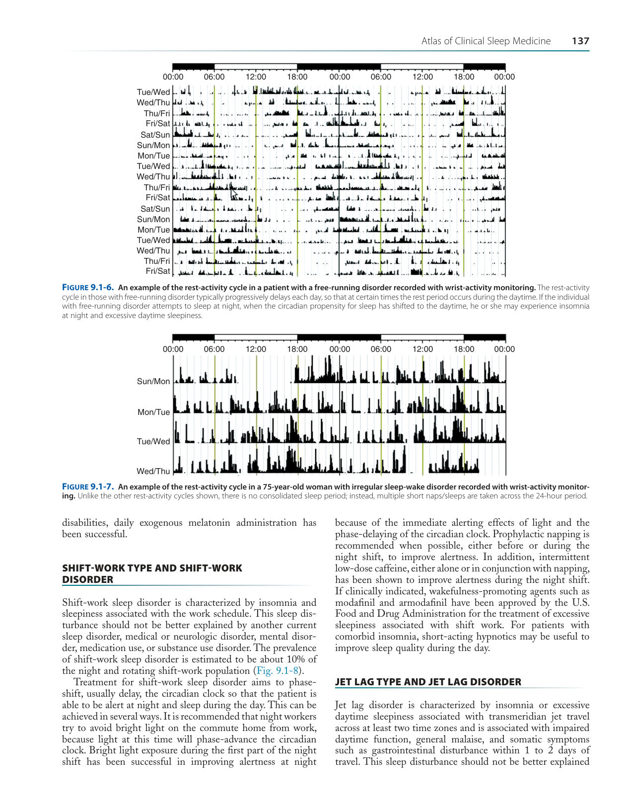

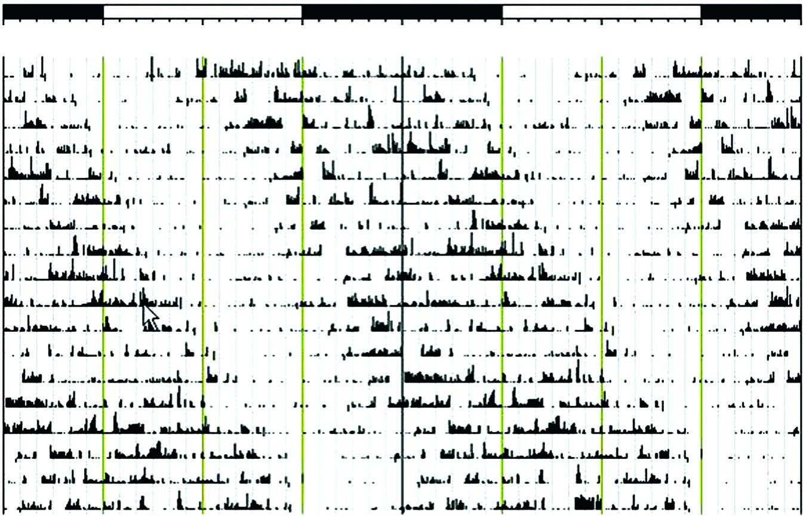

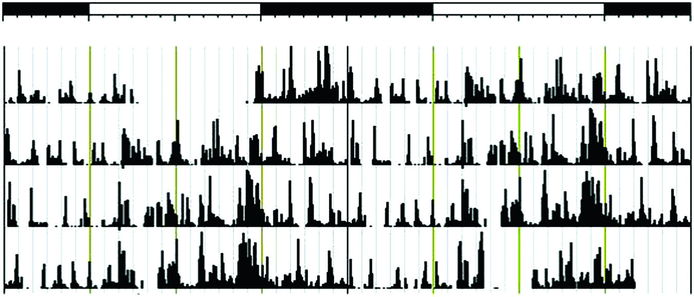

<!-- pdf-page: 156 -->

138 Circadian System Disorders

Time of Day (24 h)

20 21 22 23 0 1 2 3 4 5 6 7 8 9 10 11 12 13 14 15 16 17 18 19 20

Day 1 – Day off

Sleep

Day 2 – Day off

Day 3 – Night shift 1 Night shift Sleep

Day 4 – Night shift 2

Day 5 – Night shift 3

FIGURE 9.1-8. Changes in the timing of the circadian clock in a typical night worker. Sleep periods are represented by the light purple bars. Nighttime

shift-work periods are represented by the light pink bars. The triangles represent the timing of the minimum temperature (Tmin). The solid triangles show where the Tmin is likely to be on each day. The open triangle shows where the Tmin needs to phase-delay for complete reentrainment to occur. The symptoms caused by the misalignment between the daytime sleep period and the circadian clock will diminish greatly if the Tmin falls within the daytime sleep period. Because the circadian clock does not shift quickly, the shift worker is sleeping during the day, when the core temperature rhythm is high. As a result, night workers do not typically sleep as long during the day, so that the daytime sleep periods are only about 6 hours long. (Modified from Reid KJ, Burgess HL: Circadian sleep disorders. Prim Care 2005;32[2]:449-473.)

Day 6 – Night shift 4

Day 7 – Night shift 5

TABLE 9.1-1 Summary of the Clinical Presentation, Preferred Sleep-Wake Times, and Treatment Options for Each

#### of the Circadian Rhythm Sleep Disorders

CIRCADIAN RHYTHM SLEEP DISORDER CLINICAL PRESENTATION

PREFERRED SLEEP-WAKE

Delayed sleep-phase

Difficulty falling asleep at the

Bedtime: 2 to 6 AM Wake time: 10 AM to 1 PM

disorder

desired time Difficulty waking up in the

morning Daytime sleepiness

Advanced sleep-phase

Early evening sleepiness Waking up too early in the

Bedtime: 6 to 9 PM Wake time: 2 to 5 AM

disorder

morning

Free-running disorder/

Alternating periods of

Bedtime: delayed each day Wake time: delayed each day

nonentrained disorder

insomnia and excessive sleepiness or both, with short asymptomatic periods

Irregular sleep-wake

Insomnia or excessive

Irregular pattern of sleep and

rhythm disorder

sleepiness

wake times with no consolidated nocturnal sleep period Three or more sleep periods/day

Shift-work sleep

Difficulty falling asleep or

disorder

maintaining sleep associated with the work schedule Sleepiness at work

Jet lag disorder Sleep initiation and

maintenance insomnia Daytime sleepiness Decreased performance Gastrointestinal complaints

NA, not applicable.

by another current sleep disorder, medical or neurologic disorder, mental disorder, medication use, or substance use disorder. The most commonly reported symptoms of jet lag disorder include disturbed sleep and fatigue during the day.

TIMES TREATMENT OPTIONS

Bright light therapy: 2000-2500 lux for 2-3 h before or at

rising time; dark goggles from 4 PM to bedtime (optional) Melatonin: 0.3-3 mg at night, 5-7 h before habitual sleep

time

Bright light therapy: 2500 lux for 4 h starting from 8 PM or

4000 lux for 2-3 h starting from 8 to 9 PM

Sleep hygiene Melatonin: 10 mg 1 h before bedtime; maintenance dose

of 0.5 mg 1-2 h before desired bedtime

Increase circadian time cues such as social interaction,

physical activities, and light exposure during the day Bright light therapy: 2500 to 3000 lux for 2 h in the

morning Melatonin: 3 mg at 6:30 PM

NA Bright light therapy: 5000-10,000 lux beginning early

during night shift and terminating 2 h before end of shift (continuous or intermittent); avoidance of morning bright light with dark goggles Melatonin: 1-3 mg before bedtime Wakefulness-promoting agents: caffeine (avoid caffeine

close to bedtime) armodafinil or modafinil about 1 h before the work shift (specific indication is excessive sleepiness in the setting of shift-work sleep disorder) Strategic short naps (20-30 min) during work if allowed

NA Timed light exposure: on eastward flights when phase-

advancing, minimize morning light and maximize afternoon light; on westward flights, stay awake while it is light out Melatonin: 2-5 mg before bedtime on arrival; repeat up to

4 nights Hyponotics: zolpidem 10 mg, up to 3 nights

Jet lag disorder can be treated by speeding the adjustment of the circadian clock to the new time zone or by treating the symptoms of insomnia and sleepiness. An example of how to speed the phase adjustment to an eastward and westward return flight is described in Figure 9.1-9. It has even

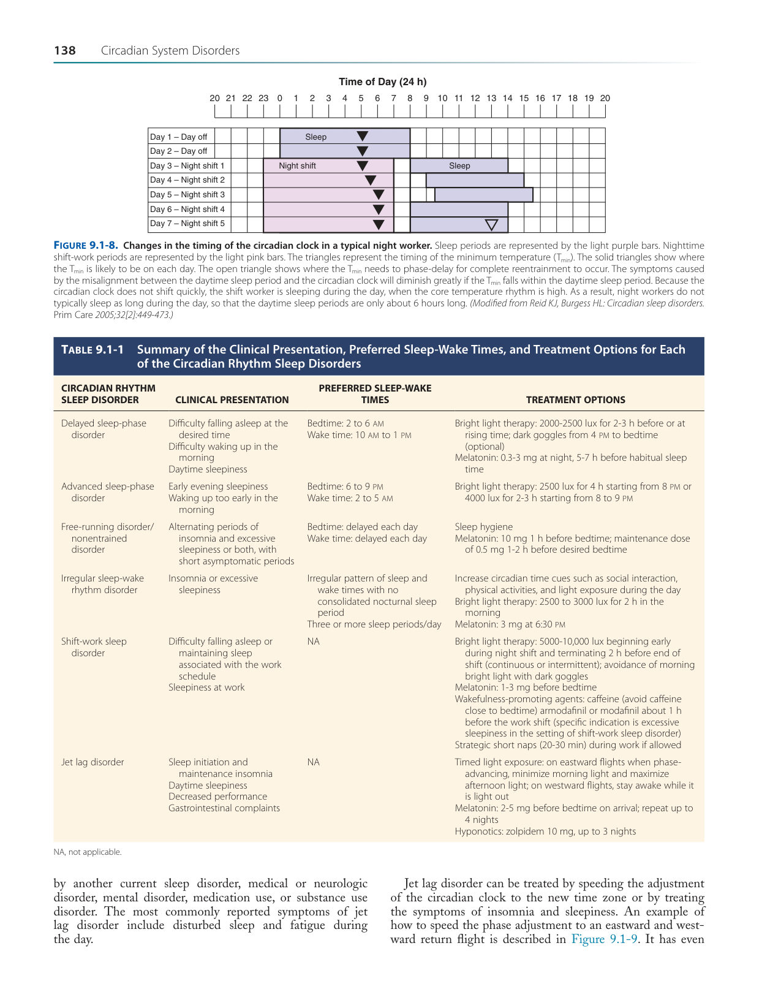

<!-- pdf-page: 157 -->

Jet Lag Plan: Los Angeles to Paris

Time of day (24 h)

Los Angeles

12 13 14 15 16 17 18 19 20 21 22 23 24 1 2 3 4 5 6 7 8 9 10 11 12

Sunset Sunrise

Paris

21 22 23 24 1 2 3 4 5 6 7 8 9 10 11 12 13 14 15 16 17 18 19 20 21

Days

16 17 18 19 20 21 22 23 24 1 2 3 4 5 6 7 8 9 10 11 12 13 14 15 16

0

Flight

1

2

3

4

D

D

5

D

D

6

L

L

7

L

L

8

9

Goal

A

Paris

L

L

L

L

D

D

D

D

L

L

L

L

D

D

D

L

L

L

L

D

D

D

D

L

L

L

L

D

D

L L L L

L L

Jet Lag Plan: Paris to Los Angeles

Time of day (24 h)

7 8 9 10 11 12 13 14 15 16 17 18 19 20 21 22 23 24 1 2 3 4 5 6 7

Los Angeles

Sunset Sunrise

FIGURE 9.1-9. Circadian misalignment that will occur following an eastward flight from Los Angeles to Paris and following the westward return

flight from Paris to Los Angeles. The shaded bars represent sleep times. The home and transitional temperature minimums are shown as triangles. L represents when to seek light, and D shows when to seek dark. A, Los Angeles to Paris is an eastward flight across nine time zones. Such eastward flights are particularly difficult to adjust to, and phase delays often result. This traveler, who normally sleeps from 11 PM to 7 AM in Los Angeles (temperature minimum at 4 AM) arrives in Paris in the early morning. Phase-advancing in these circumstances will be extremely difficult, and managing light exposure can be used to help phase delay. Even if travelers seek and avoid light at the correct times, they are still likely to experience jet lag for 6 to 7 days, until the temperature minimum falls into the desired sleep times. B, Jet lag plan for someone who travels nonstop from Paris to Los Angeles. Light exposure on arrival in Los Angeles is beneficial; if travelers have a flexible schedule, such that they go to sleep in a dark bedroom at 7 PM to ensure they avoid light after the temperature minimum, they will likely experience jet lag for only 3 to 4 days. (Modified from Burgess HJ: Using bright light and melatonin to reduce jet lag. In Perlis M, Aloia M, Kuhn B [eds]: Behavioral treatments for sleep disorders. Philadelphia, 2011, Elsevier.)

Days

0

L

L

1

Flight

2

3

4

5

6

Goal

B

Flight

L L

L

L

L L

L

L

L L

L L L L

L L L L

been recommended that, if possible, the adjustment to the new time zone start before departure. Once the circadian clock has realigned to the new time zone, the symptoms of jet lag disorder should dissipate. The duration of symptoms depends on the number of time zones crossed and the

direction of travel, but symptoms typically resolve within 1 to 2 weeks.

Table 9.1-1 provides a summary of the clinical presentation,

preferred sleep-wake times, and treatment options for each of the CRSDs described above. Most of the recommended

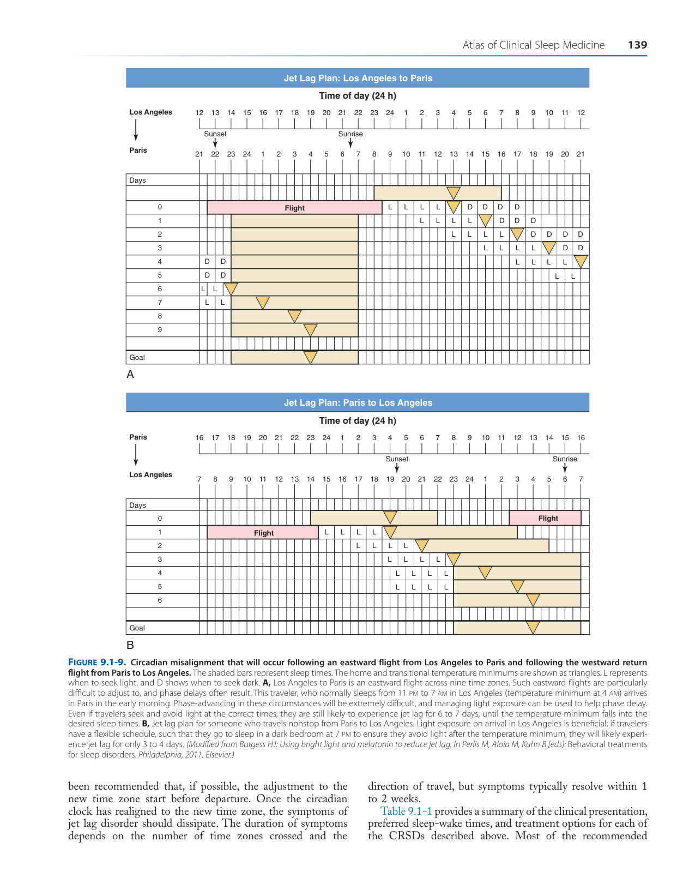

<!-- pdf-page: 158 -->

140 Circadian System Disorders

treatments for CRSDs are derived from small, single-center studies; however, more large-scale, multicenter, placebocontrolled clinical trials are needed to assess the efficacy and effectiveness of the currently available treatments and to develop improved behavioral and pharmacologic strategies.

Nagtegaal JE, Kerkhof GA, Smits MG, et al: Delayed sleep phase syndrome:

a placebo-controlled cross-over study on the effects of melatonin administered five hours before the individual dim light melatonin onset. J Sleep Res 7(2):135–143, 1998. Okawa M, Mishima K, Hishikawa Y, et al: Circadian rhythm disorders in

sleep-waking and body temperature in elderly patients with dementia and their treatment. Sleep 14(6):478–485, 1991. Reid KJ, Burgess HJ: Circadian rhythm sleep disorders. Prim Care 32(2):449–

#### Selected Readings

Burgess HJ: Using bright light and melatonin to reduce jet lag. In Perlis M,

473, 2005. Rosenthal NE, Joseph-Vanderpool JR, Levendosky AA, et al: Phase-shifting

## Circadian Desynchrony and Health

### Keith C. Summa and Fred W. Turek

## 9.2

Aloia M, Kuhn B, editors: Behavioral treatments for sleep disorders, Philadelphia, 2011, Elsevier. Drake CL, Roehrs T, Richardson G, Walsh JK, Roth T: Shift work sleep

disorder: prevalence and consequences beyond that of symptomatic day workers. Sleep 27(8):1453–1462, 2004. Hayakawa T, Uchiyama M, Kamei Y, et al: Clinical analyses of sighted

patients with non–24-hour sleep-wake syndrome: a study of 57 consecutively diagnosed cases. Sleep 28(8):945–952, 2005. Lack L, Wright H: The effect of evening bright light in delaying the circadian

rhythms and lengthening the sleep of early morning awakening insomniacs. Sleep 16(5):436–443, 1993. Lockley SW, Skene DJ, James K, et al: Melatonin administration can entrain

the free-running circadian system of blind subjects. J Endocrinol 164(1):R1– R6, 2000. Morgenthaler TI, Lee-Chiong T, Alessi C, et al: Practice parameters for the

clinical evaluation and treatment of circadian rhythm sleep disorders. An American Academy of Sleep Medicine report. Sleep 30:1445–1459, 2007.

effects of bright morning light as treatment for delayed sleep phase syndrome. Sleep 13(4):354–361, 1990. Sateia M, editor: The international classification of sleep disorders: diagnostic and

coding manual, ed 2, Westchester, IL, 2005, American Academy of Sleep Medicine. Schrader H, Bovim G, Sand T: The prevalence of delayed and advanced sleep

phase syndromes. J Sleep Res 2(1):51–55, 1993. Toh KL, Jones CR, He Y, et al: An hPer2 phosphorylation site mutation in

familial advanced sleep phase syndrome. Science 291(5506):1040–1043, 2001. van Geijlswijk IM, Korzilius HP, Smits MG: The use of exogenous melatonin

in delayed sleep phase disorder: a meta-analysis. Sleep 33(12):1605–1614, 2010. Weitzman ED, Czeisler CA, Coleman RM, et al: Delayed sleep phase syn­

drome: a chronobiological disorder with sleep-onset insomnia. Arch Gen Psychiatry 38(7):737–746, 1981.

#### THE CIRCADIAN SYSTEM

Circadian rhythms are fundamental, nearly ubiquitous processes that enable organisms to anticipate and appropriately prepare for predictable changes in the environment that arise from Earth’s rotation about its axis every 24 hours. Endogenous molecular clocks in organisms as diverse as cyanobacteria, bread mold, plants, flies, mice, and humans have evolved to provide timekeeping and to enable synchronization of internal physiologic processes to the external environment. In humans and other multicellular organisms, these circadian clocks are found in nearly all cells and tissues in the body, where they impose temporal regulation to ongoing molecular and biochemical pathways. In mammals, the master circadian pacemaker in the suprachiasmatic nucleus (SCN) of the hypothalamus organizes cellular oscillators in different tissues into proper phase relationships to one another to coordinate biologic processes and optimize physiologic functioning in the context of the environmental day-night cycle. The SCN communicates with downstream “clocks” in peripheral tissues by a variety of mechanisms that may be direct, including neural and hormonal signaling, or indirect, including regulation of daily body temperature rhythms and behaviors, such as sleepwake and fasting-feeding cycles (Fig. 9.2-1). Humans are likely unique among species in their ability to routinely and voluntarily subvert SCN-mediated circadian timing programs by conscious control of sleep-wake and fasting-feeding behaviors, which feed back and influence peripheral oscillators and the central circadian clock.

#### Disruption of the Circadian System

In the past 150 years, with the advent and widespread use of electrical lighting, humans have had the opportunity to routinely undermine the normal relationship to natural cycles of light and darkness experienced throughout evolutionary history (Fig. 9.2-2). More recently, rapid transcontinental jet travel has further enhanced the ability of people to separate their internal clocks from the external local environment. Disruption of the proper internal temporal organization achieved by the circadian system causes physiologic dysfunction and promotes susceptibility to numerous mental and physical diseases.

The first indication that disrupted circadian organization may be detrimental to health came from studies of shift workers, who are now known to be at increased risk for a number of chronic conditions that include diabetes, cardiovascular disease, cancer, and gastrointestinal disease. Animal models of shift work that use repeated exposure to phase shifts of the light-dark cycle remain an important experimental tool for measuring and characterizing the adverse consequences of environmental disruption of circadian rhythms. In addition, the development of genetic models in mice via mutations or targeted disruptions of genes critical for the circadian clock has enabled the study of mechanisms that link the circadian clock machinery with disease pathways at the molecular level. Both environmental and genetic approaches are being used in parallel to fully delineate the relationships between circadian disruption and disease pathogenesis. This chapter highlights a few of the adverse health consequences that have been associated with circadian disruption in recent studies.

<!-- pdf-page: 159 -->

Light

SCN

ANS HPA

Behavior

via hormones, neural signals

FIGURE 9.2-1. The master circadian pacemaker in mammals is located in the hypothalamic suprachiasmatic nucleus (SCN). The molecular components

of the circadian clock are expressed autonomously in individual SCN neurons and in cells and tissues throughout the body, including other brain regions. The SCN synchronizes to the environmental light-dark cycle and organizes rhythms in other central and peripheral tissues through a variety of mechanisms that include neural and hormonal signaling, daily body temperature rhythms, and the 24-hour regulation of behaviors such as feeding and locomotor activity. The SCN achieves internal temporal order by establishing and maintaining rhythms in different tissues at specific phase relationships presumed to optimize physiologic functioning in the context of daily environmental cycles associated with the rising and setting of the sun. Circadian disruption impairs these internal timekeeping mechanisms. For example, exposure to jet lag causes transient desynchronization between rhythms in different tissues that lasts for at least several days, until proper phase relationships between tissues are reestablished. ANS, autonomic nervous system; HPA, hypothalamus-pituitary-adrenal axis. (From Arble DM, Ramsey KM, Bass J, Turek FW: Circadian disruption and metabolic disease: findings from animal models. Best Pract Res Clin Endocrinol Metab 2010;24[5]:785-800.)

Peripheral tissues

Lung

Heart

Liver

#### METABOLISM

Metabolism is the field in which the greatest strides to link the circadian clock to abnormal physiologic function have been made. In 2005, it was reported that mice harboring a mutation in the core circadian gene Clock are obese and develop aspects of the metabolic syndrome seen in humans (Fig. 9.2-3). This finding established an interaction between metabolic processes and the circadian clock at the molecular and genetic levels, which has ignited intense interest in the field and has subsequently catalyzed a number of studies that have consistently demonstrated intimate and bidirectional relationships among the circadian clock system, energy regulation, and metabolism. This interaction is evident and physiologically relevant at the level of individual cells in peripheral tissues involved in glucose metabolism. Experiments using mice genetically engineered to have a nonfunctional circadian clock only in pancreatic islet cells revealed severe defects of insulin secretion that resulted in the rapid development of diabetes early in life (Fig. 9.2-4). Thus circadian clock genes are integral to the regulation of metabolism and perform critical functions in peripheral tissues relevant for chronic metabolic diseases such as diabetes and obesity.

More recently, a conserved circadian rhythm of oxidation of a class of proteins called peroxiredoxins was described in organisms that belong to all domains of life, from cyanobacteria to bread mold, flies, mice, and humans. This redox rhythm appears to reflect the activity of an ancient, evolutionarily conserved circadian oscillator critical for

oxidative metabolism and respiration that emerged some 2.5 billion years ago. Although it may be premature to speculate on how this exciting finding may affect medicine, it certainly underscores how tightly linked circadian rhythms and metabolic processes are.

The timing of food intake has emerged as yet another node at the intersection of circadian rhythms and metabolism. In the pivotal study that established this link, groups of normal mice were given access to a high-fat diet either during the dark phase only (“right-timed” feeding for nocturnal mice) or the light phase only (“wrong-timed” feeding). The mice fed in the light phase gained significantly more weight than the dark-fed mice, in spite of the fact that overall caloric intake and physical activity were similar in each group (Fig. 9.2-5). Subsequent mouse studies have shown that limiting access to a high-fat diet to an 8-hour window during the dark phase (i.e., the “right” time of day) prevents the development of diet-induced obesity, inflammation, hepatic steatosis, and elevated insulin levels without changing overall daily caloric intake. Although these findings need to be replicated in humans, they suggest that manipulation of meal timing may offer a nonpharmacologic approach for combating obesity and metabolic diseases.

#### CARDIOVASCULAR DISEASE

An early pitfall and challenge for the circadian rhythms field was the observation that lesions of the master circadian clock

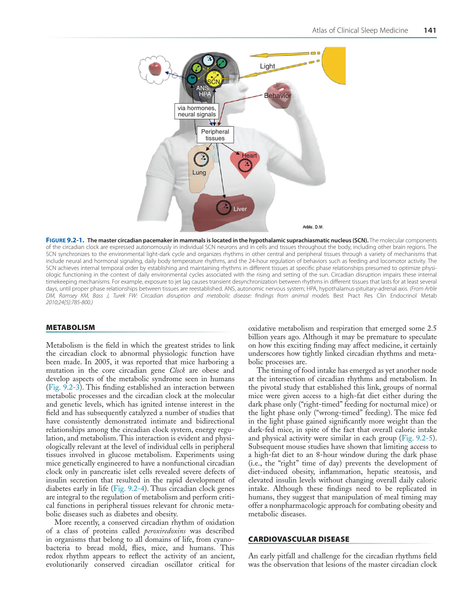

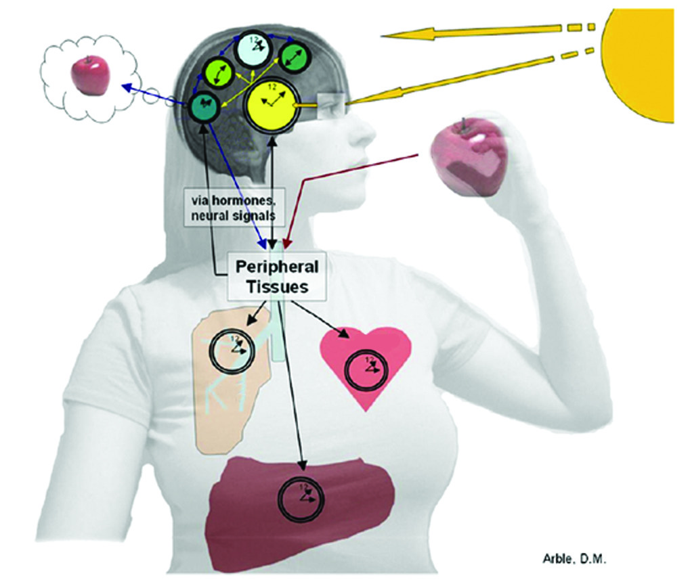

<!-- pdf-page: 160 -->

142 Circadian System Disorders

FIGURE 9.2-2. A composite image of Earth viewed from space at night. The widespread use of electrical lighting has fundamentally transformed the

relationship between humans and the natural cycles of light and darkness driven by Earth’s rotation about its axis. Similarly, rapid intercontinental plane travel has enabled humans to experience “jet lag,” which arises from the dissociation between internal time, as dictated by the circadian clock, and external time, as determined by the sun and social conventions. Modern society makes it challenging, if not impossible, to maintain the body’s natural 24-hour rhythms properly in sync with day and night. The adverse consequences of chronically disrupted circadian rhythms, including exposure to light at night, are only beginning to become apparent. (From http://earthobservatory.nasa.gov.)

FIGURE 9.2-3. Mice that harbor a mutation in the core circadian gene Clock develop obesity and metabolic syndrome, a finding that provided the

first link between circadian rhythms and metabolism at the genetic level. A, Dr. Fred W. Turek poses with an obese Clock mutant mouse (left) and a lean wild-type (WT) littermate mouse (right). B, Clock mutant (CL) mice exhibit significantly increased body weight after 10 weeks on either regular chow (left) or high-fat diets (right). (A, From Pearson H: Sleep it off. Nature 2006;443:261-263. B, Modified from Turek FW, Joshu C, Kohsaka A, et al: Obesity and metabolic syndrome in circadian Clock mutant mice. Science 2005;308:1043-1045.)

A B

50

#### *

Body weight (g)

#### *

40

30

20 WT CL Regular

WT CL High fat

FIGURE 9.2-4. Pancreatic islet cells from mice that carry genetic mutations of core circadian genes Clock (A) and ARNTL (formerly BMAL1; B) exhibit

significant reductions in insulin secretion in response to glucose stimulation. This insulin secretion defect is also present in mice with a disrupted circadian clock system only in pancreatic cells, indicating that the circadian clock works autonomously within cells of the pancreas to regulate insulin secretion in response to glucose. These animals develop diabetes at an early age and are being used to examine and characterize the molecular mechanisms that underlie the relationships between circadian clock genes and metabolic processes critical for maintaining glucose homeostasis, energy balance, and metabolic health. (Modfied from Marcheva BM, Ramsey KM, Buhr ED, et al: Disruption of the clock components CLOCK and BMAL1 leads to hypoinsulinemia and diabetes. Nature 2010;466:627-631.)

Islet glucose-stimulated insulin release

*

2.5

Insulin release (% content)

Wild-type Mutant ClockD19/D19

2.0

**

1.5

1.0

0.5

0

20 0

2 A

5 8 Glucose (mmol/L)

12

3

Insulin release (% content)

Wild-type Mutant Bmal1–/–

*

2

1

2 B

5 8 Glucose (mmol/L)

12

20

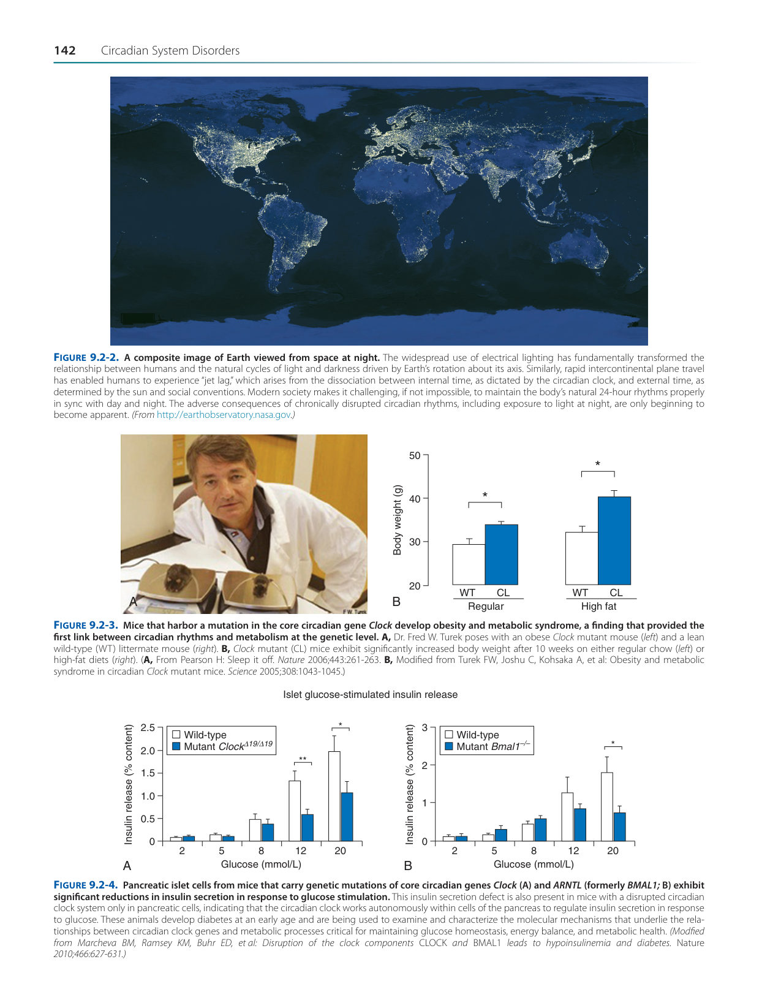

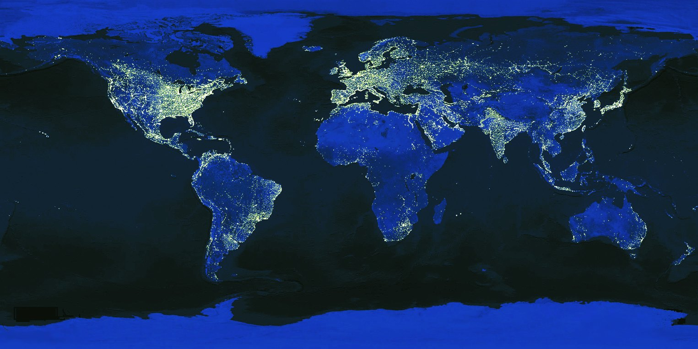

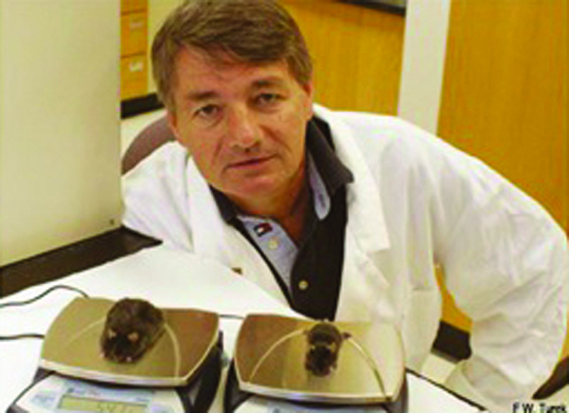

<!-- pdf-page: 161 -->

renal pathology in a 24-hour light-dark cycle, lending further support to the hypothesis that pathology develops because of a mismatch between the internal circadian clock and the external environment. Rather surprisingly, this latter finding suggests that chronically disrupted internal timing may be worse than having no master biologic clock at all.

#### CANCER

Weekly body weights Dark Light

in the SCN failed to elicit any obvious morbidity or mortality, suggesting that circadian rhythms are dispensable for survival, at least in the laboratory setting. It soon became apparent, however, that organisms presented with a genetic or physiologic “challenge” responded much more poorly when subjected to disruption of circadian organization. The first such demonstration involved a study that used hamsters with a genetic predisposition to develop cardiomyopathy. All these hamsters develop and succumb to cardiomyopathy at a relatively young age, but those subjected to chronic circadian disruption by repeated weekly shifting of the light-dark cycle had about a 10% reduction in lifespan compared with those animals maintained in stable lighting conditions (Fig. 9.2-6). These findings, as well as others, have led to a model that posits circadian disruption worsens disease severity, exacerbates disease progression, and/or predisposes to disease development, which may in part explain why shift workers exhibit increased incidence for a number of chronic diseases.

In a more systematic characterization of cardiovascular function, a study that used hamsters carrying a mutation in the circadian gene CSNK1E (casein kinase 1 epsilon) found that cardiovascular and renal disease developed in animals that had a mismatch between the endogenous length of the internal circadian clock, termed the period, and the environmental light-dark cycle. Mutant hamsters, called tau mutants, carry two copies of the abnormal CSNK1E gene and have an internal clock length of 20 hours. On a typical 24-hour environmental daily cycle, these animals fail to match their internal rhythms to the light-dark cycle and develop significant cardiovascular and renal pathology. However, if they are placed in a 20-hour light-dark cycle (10 hours of light followed by 10 hours of darkness) that matches their internal clock, no cardiovascular or renal disease develops. This finding indicates that desynchronization between the internal circadian clock and the external environment contributes to the pathogenesis of cardiovascular and renal disease. In addition, surgical destruction of the biologic clock in the SCN of tau mutant hamsters also prevents the development of cardiovascular and

The first indication that circadian timing may have relevance for the treatment of cancer came from early studies by Halberg and colleagues, who demonstrated that the time of administration of certain chemotherapeutic agents influences both the tolerance to and effectiveness of the drug. Surprisingly, when mice injected with leukemia cells were given the drug arabinosylcytosine (ara-C) in a rhythmic pattern, according to predetermined 24-hour tolerance profiles, they survived significantly longer than mice treated with an equal dose administered at constant levels throughout the day (drug administration occurred every 3 hours over a 24-hour period). More recently, the timing of maximal tolerance to the drug has been shown to frequently coincide with the timing of its optimal effectiveness, indicating that modifying drug treatment according to circadian timing may be a useful way to increase cancer treatment efficacy while simultaneously decreasing adverse events. To date, at least 40 anticancer agents, from many different pharmacologic classes, have been shown to have tolerance and effectiveness profiles modulated by circadian timing in mice or rats (Fig. 9.2-7). At present, the specific time of maximal tolerance and/or effectiveness for a given drug cannot be predicted a priori based on any known circadian factor or property of the drug, but it is presumed to be related to biochemical rhythms in pathways related to drug metabolism and the cell cycle. In spite of the obvious clinical relevance of these findings, the use of circadian principles in designing chemotherapeutic regimens for cancer patients remains challenging and is not routinely done at present.

FIGURE 9.2-5. Temporally restricted feeding schedules significantly affect energy balance in mice. A, Mice were fed a high-fat diet only during the dark

phase (“right-timed” feeding for nocturnal mice) or only during the light phase (“wrong-timed” feeding). This was achieved by manually switching animals between two habituated cages at every light-dark transition (i.e., every 12 hours on a standard 12-hour light/12-hour dark cycle). For the dark-fed group, food was provided only in the cage the animal occupied during the dark phase, and vice versa for the light-fed group. B, Mice gained more weight when fed during the light phase only. This elevated weight gain occurred in the absence of any significant differences in food intake or locomotor activity. This study provided the first direct evidence that the timing of food intake significantly affects body weight regulation in mammals, suggesting that manipulation of eating patterns may offer a useful nonpharmacologic strategy for combating obesity and its comorbid metabolic and cardiovascular diseases. (Modfied from Arble DM, Bass J, Laposky AD, Vitaterna MH, Turek FW: Circadian timing of food intake contributes to weight gain. Obesity (Silver Spring) 2009;17[11]:2100-2102.)

High fat dark

High fat

High fat light High fat

A

35

* * * * *

Light fed Dark fed

30

Body weight (g)

25

20

15

Week 6 Week 5 Week 4

Week 3

Week 2 Week 1 Baseline

B

<!-- pdf-page: 162 -->

144 Circadian System Disorders

1.0

Experimental Control

0.8

Experimental Control

8 12 16 20 0 4 8

8 12 16 20 0 4 8

0.6

1

1

FIGURE 9.2-6. Hamsters with a genetic predisposition for developing cardiomyopathy have an increased mortality rate when exposed to chronic

phase shifts of the light-dark cycle. A, Representative activity records from cardiomyopathic hamsters divided into control and experimental groups; control animals were exposed to a stable 14-hour light/10-hour dark cycle, and experimental animals were subjected to weekly inversions of the light-dark cycle. Control animals maintained consolidated activity during the dark phase (black tick marks represent revolutions of a running wheel in the animal’s cage), whereas experimental animals moved their activity patterns in response to phase shifts to ensure that activity occurred during the dark. This repeated switching of the activity pattern in response to the phase shifts is indicative of chronic circadian disruption. Other studies have shown that molecular rhythms in different tissues resynchronize at different rates over at least several days in response to phase shifts of the light-dark cycle. B, Experimental animals demonstrate a decrease in mortality rate of about 11% compared with controls, suggesting that circadian disruption exacerbates the genetic predisposition to disease and results in an earlier onset of mortality. (Modified from Penev PD, Kolker DE, Zee PC, Turek FW: Chronic circadian desynchronization decreases the survival of animals with cardiomyopathic heart disease. Am J Physiol Heart Circ Physiol 1998;275:H2334-H2337.)

10

10

20

20

Days

30

30

40

40

50

50

60

60

B A

Conditional survival probability

0.4

0.2

0

450 0

200 250 300 350 400 Age (days)

The administration of drugs at the correct time of day requires real-time monitoring of rhythms in people and advances in drug delivery technologies to enable the appropriate drug-infusion profiles at odd hours. Individual differences in circadian patterns at molecular and behavioral levels, the variable impact of cancers and cancer treatments on the circadian clock and behaviors that subsequently affect the clock, and gender differences in responses to timed chemotherapeutic regimens further complicate potential chronotherapeutic strategies and warrant additional investment in research and clinical trials. Nevertheless, ongoing clinical research aspires to take advantage of the underlying circadian timing of the patient to optimize cancer treatment strategies and improve outcomes. Indeed, this is an area with much potential for growth in the future. Importantly, whereas cancer is the field most obviously relevant for chronotherapeutics, the scientific advances that occur are expected to be applicable to other biomedical disciplines, in which enhancement in the pharmacokinetics of drug administration based on circadian principles may, in turn, yield improvement in outcomes.

The links between circadian rhythms and cancer exist on levels beyond the role of timing in modulating treatment tolerance and/or efficacy. In 2007, the World Health Organization International Agency for Research on Cancer concluded that “shift work that involves circadian disruption is probably carcinogenic to humans” on the basis of “limited evidence in humans for the carcinogenicity of shift work that involves night work” and “sufficient evidence in experimental animals for the carcinogenicity of light during the daily dark period (biologic night).” This classification, based on a comprehensive review of evidence and discussion by a panel of experts, reflects the potential connection between disrupted

rhythms and cancer that has been reported in several studies involving shift workers.

Although it is unknown how exactly circadian disruption may increase the risk of cancer development, recent evidence suggests linkages at the molecular and genetic levels between the circadian clock machinery and proteins involved in the cell cycle and in repair of damaged DNA. Thus desynchronization of circadian rhythms may impair the critical pathways necessary for regulating cell growth and division and maintaining the integrity of the genome. Damage to these pathways may result in uncontrolled cell division and/or irreversible damage to the genome, leading to carcinogenesis. Future research will attempt to identify and characterize the nature of these molecular interactions between the circadian clock and biologic pathways implicated in cancer; this is expected to yield new therapeutic targets and innovative treatment strategies.

#### INFLAMMATORY BOWEL DISEASE/COLITIS

Recent evidence also suggests that disruption of circadian organization may help explain a long-standing clinical problem in the field of gastroenterology: what causes exacerbations or flare-ups of inflammatory bowel disease (IBD)? Mice exposed to chronic circadian disruption as a result of repeated exposure to weekly phase shifts of the light-dark cycle experienced increased morbidity and mortality in a mouse model of IBD induced by dextran sodium sulfate, a chemical that causes inflammation in the colon. In this model, disease onset occurred earlier in “shifted” mice and reached greater pathologic severity (Fig. 9.2-8). Similarly, sleep-disrupted mice also

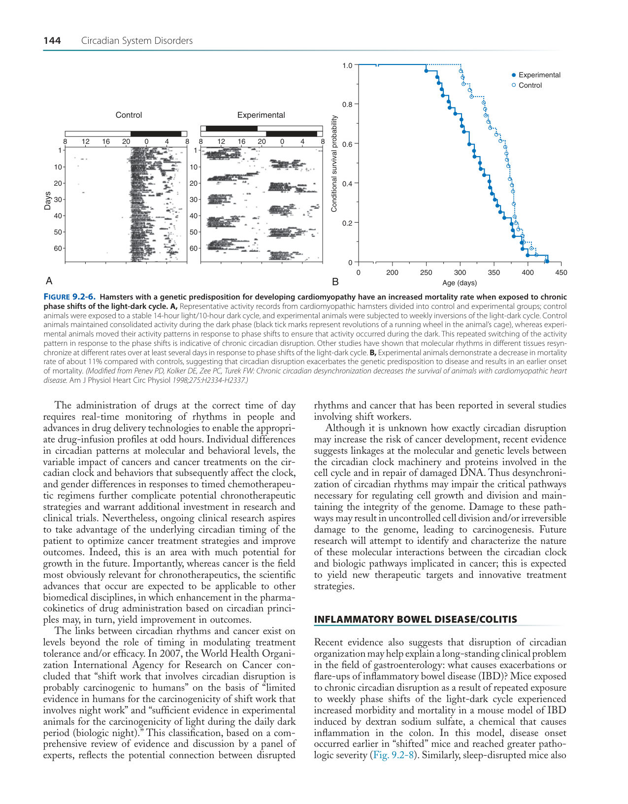

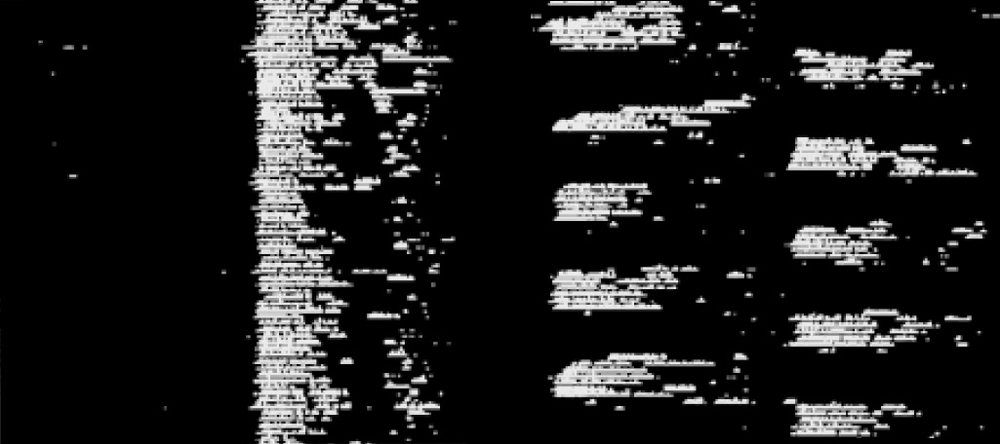

<!-- pdf-page: 163 -->

HALO Antimetabolites

Gemcitabine

0

L-alanosine

200%

Topoisomerase inhibitors

Improvement

Irinotecan

21

3

Mitoxantrone

Etoposide

Intercalating agents

FIGURE 9.2-7. The timing of administration of chemotherapeutic drugs often influences their effectiveness and tolerability in rodents. The time of

optimal tolerability and maximal survival improvement of 16 anticancer agents tested in male B6D2F1 mice entrained to a 12-hour light/12-hour dark cycle. Time is plotted in hours after light onset (HALO), and survival benefit is indicated as the percent improvement from the worst compared with the best time of drug delivery. The red trace depicts the daily body temperature rhythm, which is used as a phase reference for the circadian clock in mammals. (From Lévi F, Okyar A, Dulong S, Innominato PF, Clairambault J: Circadian timing in cancer treatments. Am Rev Pharmacol Toxicol 2010; 50:377-421.)

Theprubicin

Alkylating agents

Peptichemio Cisplatin

Carboplatin Oxaliplatin

18

Nitrosoureas or related

Mitomycin-C Cystemustin

Mitotic spindle poisons

Docetaxel

Vinorelbine

15

Cytokines

Interleukin-2

Small kinase inhibitors

Seliciclib

0%

35.0 C

6

37.5 C

9

12

FIGURE 9.2-8. Repeated exposure to phase shifts augments disease severity in a mouse model of colitis. Groups of mice—some subjected to a 12-week

chronic phase-shifting paradigm, some left in a stable light-dark cycle—were exposed to the colitis-inducing chemical dextran sodium sulfate (DSS), which was added to the drinking water on treatment day 1. Disease severity was determined by measuring weight loss. No weight loss was observed in any of the control animals that did not receive DSS (open squares and triangles), indicating that exposure to phase shifts alone fails to result in weight loss from colitis or other causes. Of the animals receiving DSS, those previously exposed to chronic circadian disruption experienced an earlier onset of disease and increased severity. This finding supports the hypothesis that the adverse effects of circadian disruption are often only apparent in the response to a physiologic challenge, such as DSS or a genetic predisposition to disease. *P < .05, phase-shifted DSS vs. nonshifted DSS; †P < .05, nonshifted DSS vs. nonshifted H2O; ‡P < .05, phase-shifted DSS vs. phase-shifted H2O. repeated measures analysis of variance. The open circles denote animal deaths, of which more occurred in the phase-shifted DSS group than in the nonshifted DSS group (5 vs. 2); (Modified from Preuss F, Tang Y, Arble DM, et al: Adverse effects of chronic circadian desynchronization in animals in a “challenging” environment. Am J Physiol Regul Integr Comp Physiol 2008;295:R2034-R2040.)

5%

0%

% Average body weight loss

*

5%

10%

15%

Non-shifted H2O control Phase-shifted H2O control Non-shifted DSS Phase-shifted DSS

20%

25%

Treatment day 4 3 2 1 0

†

*

‡

†

† † †

*

‡

*

‡

* * *

‡ ‡ ‡

10 9 8 7 6 5

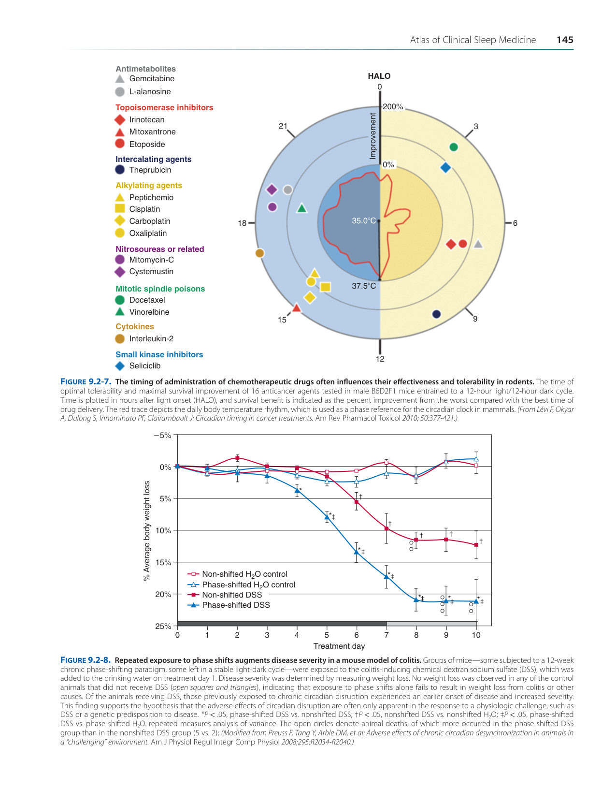

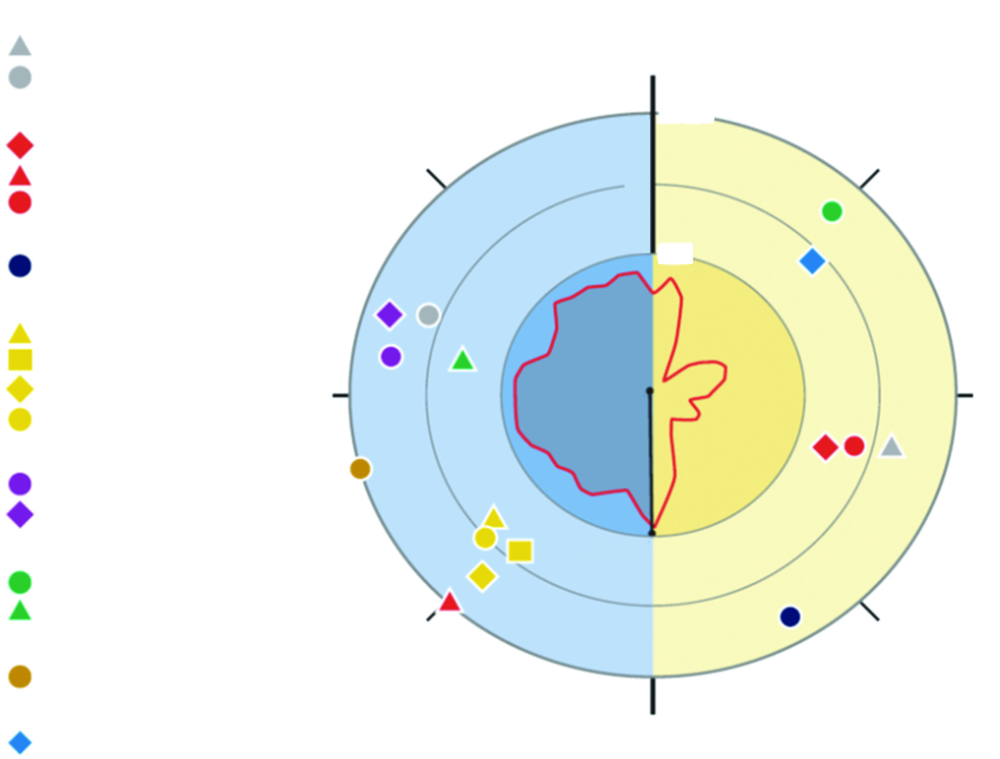

<!-- pdf-page: 164 -->

146 Circadian System Disorders

developed increased inflammation and pathology in this model of chemically induced colitis. Together, these findings indicate that disruption of circadian rhythms and/or sleep-wake cycles may be a predisposing or initiating factor that leads to exacerbations of IBD.

Control Phase delays Phase advances

Birth Mating Pregnancy

#### PREGNANCY OUTCOMES

24 12 12

Reproductive abnormalities have been described in genetic models of mice that carry mutations of core circadian clock genes and in human females engaged in shift work. Female Clock mutant mice have irregular estrous cycles and have a high rate of full-term pregnancy failures. Similar reproductive and gestational problems have been described in other mouse lines that harbor mutations of different circadian clock genes. In humans, night-shift work in females has been associated with increased menstrual problems, reduced fertility, and adverse pregnancy outcomes. In a study that explored the impact of environmental circadian disruption on pregnancy outcomes in mice, it was found that repeated exposure to phase shifts of the light-dark cycle during gestation drastically reduced the proportion of matings that resulted in pregnancies carried to term (Fig. 9.2-9). This observation argues for an important role of circadian organization in establishing and/or maintaining successful pregnancies in mammals, and it provides additional evidence for the overall importance of circadian rhythms in reproductive health.

#### CONCLUSIONS

The selected examples in this chapter of how disruption of circadian rhythms contributes to adverse physiologic consequences relevant for disease development and pathology are based on recent, exciting work in the field but are not meant to be comprehensive or to represent the full breadth of the linkages between circadian desynchrony and disease. Indeed, numerous other diseases and disorders, from many, if not all, medical disciplines, exhibit circadian rhythm disturbances and/or associations with altered circadian timekeeping. As the evidence linking circadian disruption to disease continues to grow and mature, it is becoming apparent that temporal disorganization, at organismal as well as at tissue and/or cellular levels, predisposes individuals for the development and/ or progression of disease. These findings may enable a new era of “circadian medicine,” in which knowledge of the body’s internal timekeeping processes is both incorporated into an understanding of disease pathophysiology and exploited in novel, evidence-based therapeutic strategies.

#### Selected Readings

Arble DM, Bass J, Laposky AD, Vitaterna MH, Turek FW: Circadian timing

of food intake contributes to weight gain. Obesity (Silver Spring) 17(11):2100–2102, 2009. Bass J, Takahashi JS: Circadian integration of metabolism and energetics.

Science 330(6009):1349–1354, 2010. Edgar RS, Green EW, Zhao Y, et al: Peroxiredoxins are conserved markers

of circadian rhythms. Nature 485(7399):459–464, 2012.

0 24 0 0 24 12 Hours

A

11/12

9/18 4/18*

Nonproductive matings Pregnancies carried to term

B

FIGURE 9.2-9. Female mice exposed to shifts in the light-dark cycle

after mating display a significant reduction in the proportion of pregnancies carried to term. A, Female mice maintained in a standard 12-hour light/12-hour dark cycle were allowed to mate and were then randomized into one of three groups: 1) a control group maintained in a constant 12-hour light/12-hour dark cycle that matched the previous one; 2) a phase-delay group exposed to a 6-hour delay in the light-dark cycle every 5 days for the expected duration of gestation; and 3) a phase-advance group exposed to a 6-hour advance in the light-dark cycle every 5 days for the expected duration of gestation. All mice were monitored daily for the expected duration of pregnancy plus at least 1 week. B, Reproductive success, defined as the proportion of matings leading to a full-term pregnancy, was significantly reduced in the females exposed to phase shifts of the light-dark cycle, and phase advances had a particularly adverse effect. Matings were scored as nonproductive if no pregnancy was evident via gentle palpation on gestation day 18 and no live birth occurred in the cage. These findings suggest that internal circadian organization has an important role in the establishment and maintenance of pregnancy in mice, which may have important implications for the reproductive health of females in general. (From Summa KC, Vitaterna MH, Turek FW: Environmental perturbation of the circadian clock disrupts pregnancy in mice. PLoS ONE 2012;7[5]:e37668.)

Hatori M, Vollmers C, Zarrinpar A, et al: Time-restricted feeding without

reducing caloric intake prevents metabolic diseases in mice fed a high-fat diet. Cell Metab 15(6):848–860, 2012. Kondratov RV, Antoch MH: The clock proteins, aging and tumorigenesis.

Cold Spring Harb Symp Quant Biol 72:477–482, 2007. Lévi F, Okyar A, Dulong S, Innominato PF, Clairambault J: Circadian timing

of cancer treatments. Annu Rev Pharmacol Toxicol 50:377–421, 2010. Marcheva B, Ramsey KM, Buhr ED, et al: Disruption of the clock compo­

nents CLOCK and BMAL1 leads to hypoinsulinaemia and diabetes. Nature 466(7306):627–631, 2010. Martino TA, Oudit GY, Herzenberg AM, et al: Circadian rhythm disorga­

nization produces profound cardiovascular and renal disease in hamsters. Am J Physiol Regul Integr Comp Physiol 294(5):R1675–R1683, 2008. Miller BH, Olson SL, Turek FW, et al: Circadian clock mutation disrupts

estrous cyclicity and maintenance of pregnancy. Curr Biol 14(15):1367– 1373, 2004. Penev PD, Kolker DE, Zee PC, Turek FW: Chronic circadian desynchroni­

zation decreases the survival of animals with cardiomyopathic heart disease. Am J Physiol 275(6 Pt 2):H2334–H2337, 1998. Preuss F, Tang Y, Laposky AD, et al: Adverse effects of chronic circadian

desynchronization in animals in a “challenging” environment. Am J Physiol Regul Integr Comp Physiol 295(6):R2034–R2040, 2008. Straif K, Baan R, Grosse Y, et al, on behalf of the WHO International

Agency for Research on Cancer Monograph Working Group:

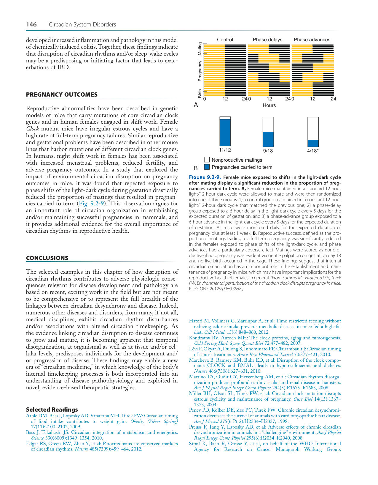

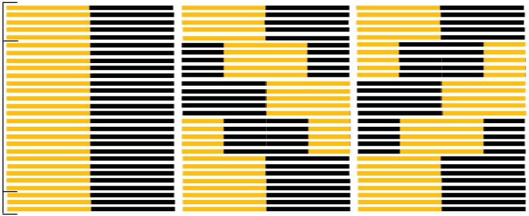

<!-- pdf-page: 165 -->

Carcinogenicity of shift work, painting and fire-fighting. Lancet Oncol 8(12):1065–1066, 2007. Summa KC, Vitaterna MH, Turek FW: Environmental perturbation of the

Tang Y, Preuss F, Turek FW, Jakate S, Keshavarzian A: Sleep deprivation

worsens inflammation and delays recovery in a mouse model of colitis. Sleep Med 10(6):597–603, 2009. Turek FW, Joshu C, Kohsaka A, et al: Obesity and metabolic syndrome in

circadian clock disrupts pregnancy in the mouse. PLoS One 7(5):e37668, 2012.

circadian Clock mutant mice. Science 308(5724):1043–1045, 2005.
