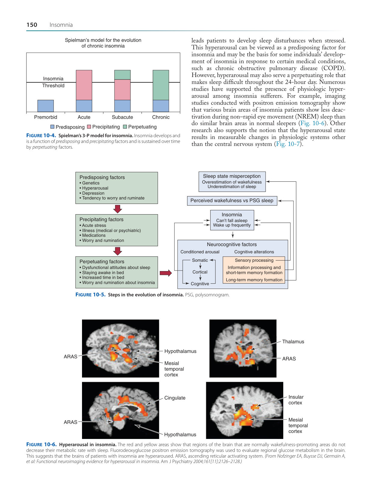
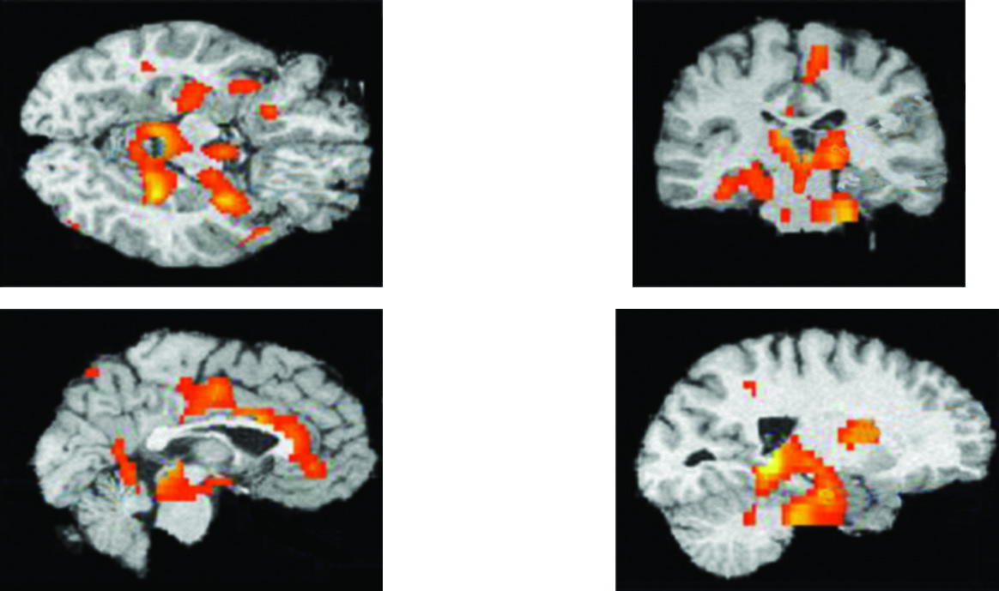
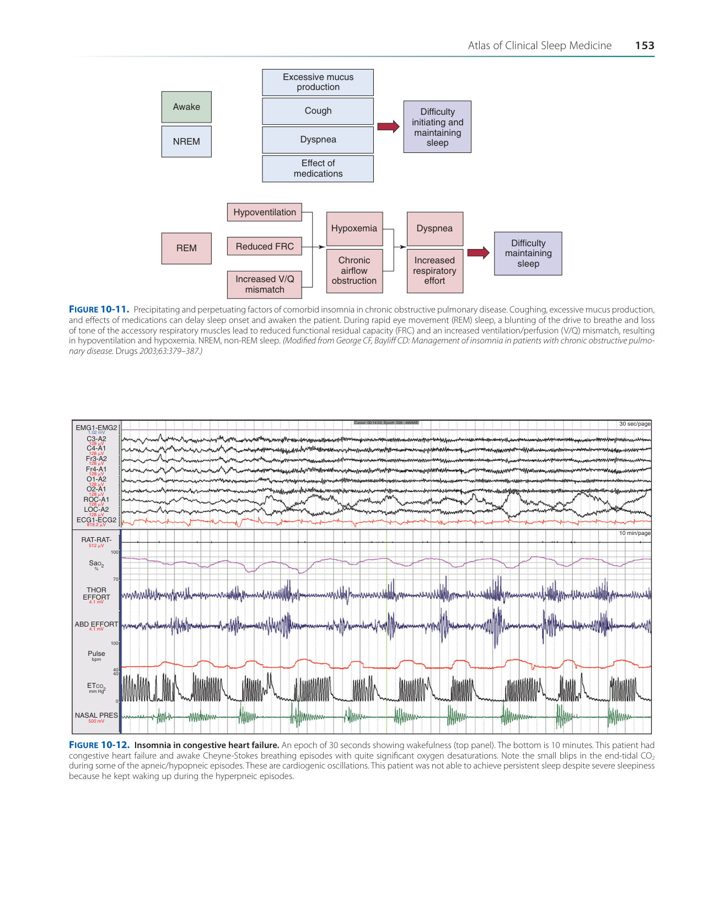
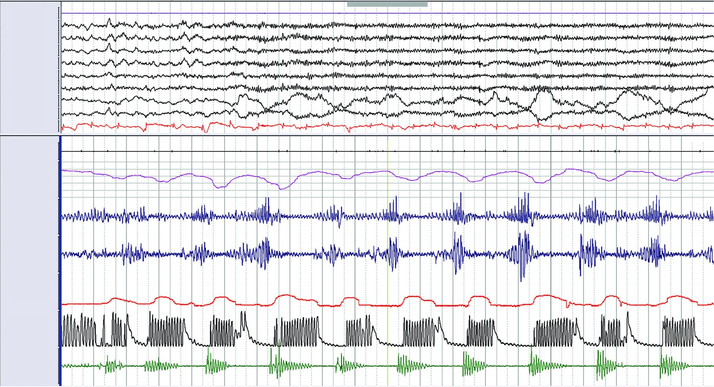
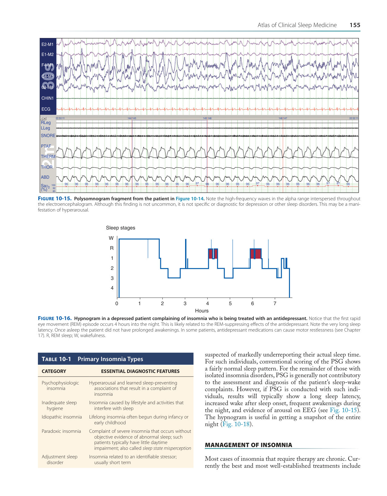
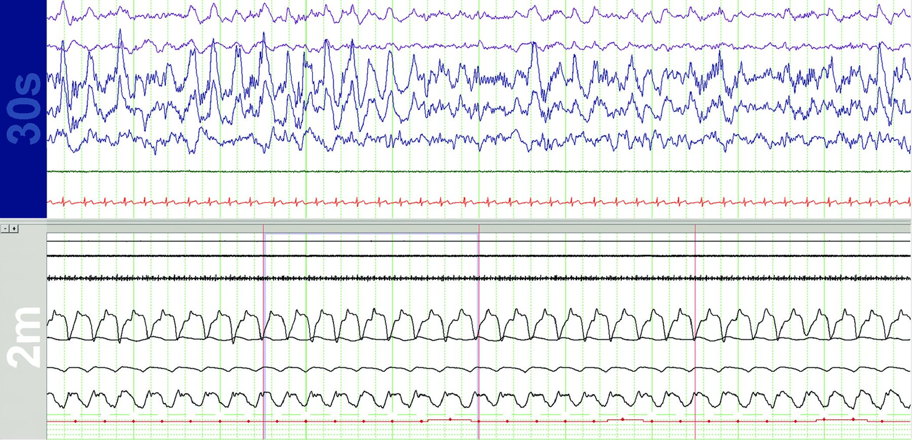
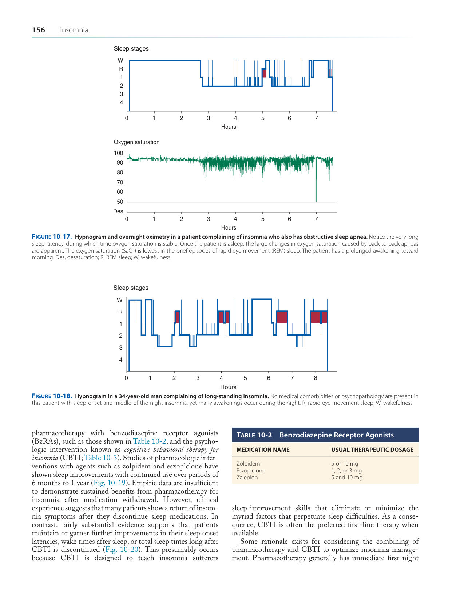
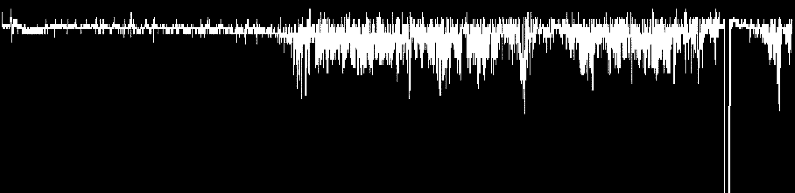
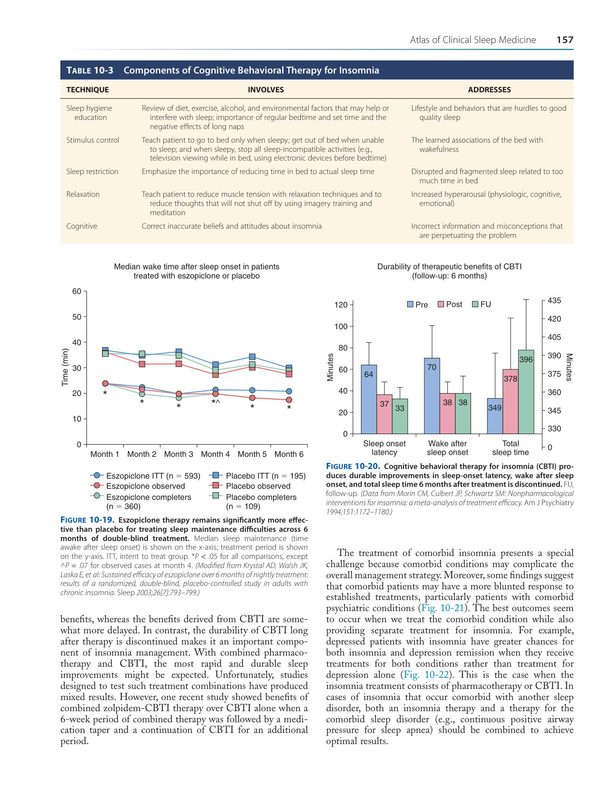

# 10 Insomnia

<!-- pdf-page: 166 -->

#### Chapter

## 10 Insomnia

### Jack D. Edinger, Meir H. Kryger, and Thomas Roth

#### OVERVIEW

The term insomnia refers to a condition characterized by difficulties initiating and/or maintaining sleep, accompanied by clinically significant daytime impairment or distress related to the ongoing sleep difficulties. Insomnia may occur as an independent sleep disorder, or it may evolve as a symptom of a medical condition, psychiatric illness, or other sleep disorder. However, even when insomnia initially arises as a symptom of another disorder, it often develops partial or total independence over time and eventually warrants separate clinical attention. Given this observation, it is best to use the term comorbid insomnia when prominent, clinically significant insomnia symptoms are observed concurrent to another medical, psychiatric, or sleep disorder.

The sleep and waking symptoms of insomnia are varied and can change over time. Insomnia sufferers may come to medical attention solely with sleep onset difficulties or sleep maintenance problems, or they may be seen with a combination of these. Unrefreshing or nonrestorative sleep may accompany these other symptoms but is relatively rare as an isolated symptom and may connote another underlying primary sleep disorder (e.g., obstructive sleep apnea). Isolated sleep-onset complaints are relatively infrequent but occur most commonly in younger age groups, whereas sleep maintenance and mixed onset and maintenance problems are more common presentations of insomnia, particularly in middleaged and older adults. Yet insomnia symptoms are not necessarily stable within individuals but may vary over time, in that patients who come to medical attention with isolated sleep onset difficulties may later develop sleep maintenance difficulties or a mixture of sleep onset and maintenance problems. Common daytime consequences of insomnia include impaired cognitive function, fatigue or tiredness, feelings of sleepiness, reduced motivation and initiative, and depressed mood or irritability. In addition, adults may display increased proneness for accidents at work or while driving, whereas poor school performance and behavioral problems, such as hyperactivity, are common among school-age children and adolescents.

Many patients with insomnia come to sleep disorder centers for evaluation and management. For a majority of such patients, a clinical interview that includes a thorough sleep history and mental status along with a medical history and examination provides sufficient information for case conceptualization and treatment planning. Polysomnography (PSG) is not routinely indicated for the evaluation of insomnia complaints, unless symptoms suggest another primary sleep disorder, such as obstructive sleep apnea (OSA) or periodic limb movement disorder (PLMD), which requires PSG for diagnosis and subsequent management.

#### CLASSIFICATION

Historically, a great deal of controversy and confusion has accompanied the diagnostic classification of insomnia because several nosologies use differing approaches to insomnia classification or subtyping. Included among these are the insomnia classification systems contained in the International Classification of Diseases (ICD), the diagnostic and statistical manuals of the American Psychiatric Association (APA; DSM-III-R, DSM-IV, and DSM-IV-TR), and the previous and current versions of the International Classification of Sleep Disorders (ICSD, ICSD-R, and ICSD-2, respectively). These three nosologic systems differ markedly in regard to the numbers and types of insomnia diagnoses they describe. As a consequence, application of these different diagnostic schemes to the same insomnia patient population provides notably discordant diagnostic results.

In addition, the putative distinction between primary and secondary insomnias propagated by many past and current insomnia classification schemes had complicated insomnia diagnostic practice as well. Historically, the term primary insomnia has been used to connote a form of insomnia that exists as an independent sleep disorder, whereas the term secondary insomnia has been used to connote the symptom of insomnia that arises from a coexisting medical, psychiatric, or sleep disorder. However, both research and clinical experience have shown that patients assigned primary and secondary insomnia diagnoses often have myriad overlapping symptoms that make it difficult, if not impossible, to reliably discriminate between them. Furthermore, although some patients may have a true secondary insomnia that results from another coexisting disorder, others may have insomnia that is partially related or unrelated to the putative primary coexisting condition. Unfortunately, we have no reliable methods or assays for differentiating among these distinctive “secondary” subtypes. Hence, as recommended by the 2005 National Institutes of Health consensus statement concerning the manifestations and management of insomnia, it seems best to use the more globally descriptive term, comorbid insomnia for forms of insomnia accompanied by another primary sleep disorder or sleep-disruptive medical or psychiatric condition.

Considerable collaboration has occurred between the organizations developing the insomnia classification scheme included in subsequent editions of the APA’s Diagnostic and Statistical Manual (i.e., the DSM-5) and the ICSD-3. This collaboration has resulted in much greater concordance between the insomnia classification schemes included in these two systems, and it has eliminated the primary versus secondary insomnia distinction in favor of the single diagnosis of insomnia disorder, which can be applied to all insomnia patients with and without sleep-disruptive comorbidities. Of course,

<!-- pdf-page: 167 -->

Prevalence of insomnia by nosology

Insomnia across the lifespan

in the general population

25

35

30

20

25

20

15

15

Proportion (%)

10

5

0

DSM ICD RDC Any insomnia

FIGURE 10-1. Prevalence of insomnia by diagnostic nosology. Preva­

lence estimates of insomnia diagnoses in the general population vary as a function of the diagnostic criteria and nosology used for ascertainment. DSM, Diagnostic and Statistical Manual of Mental Disorders, fourth edition; ICD, International Classification of Diseases (version 9); RDC, research diagnostic criteria. (Mofidied from Roth T, Coulouvrat C, Hajak G, et al: Prevalence and perceived health associated with insomnia based on DSM-IV-TR; International Statistical Classification of Diseases and Related Health Problems, rev 10; and Research Diagnostic Criteria/International Classification of Sleep Disorders, ed 2 criteria: results from the America Insomnia Survey. Biol Psychiatry 2011;69[6]:592–600.)

both systems advocate the assignment of comorbid diagnoses when they apply, but they eliminate the need to ascertain cause/effect relationships between insomnia symptoms and coexisting conditions, thus simplifying the overall diagnostic process.

#### EPIDEMIOLOGY

Approximately 30% to 40% of adults have some degree of disturbed sleep during any given year. Estimates of the prevalence of those who meet formal criteria for an insomnia diagnosis vary from between 4% and 22%, depending upon the specific diagnostic criteria used (Fig. 10-1). Insomnia is more prevalent in women than in men, but the propensity to develop insomnia increases in both genders with advancing age, largely because of the increased occurrence of sleepdisruptive comorbidities that comes with aging (Fig. 10-2). Isolated sleep maintenance complaints are more common than isolated sleep onset complaints, although a sizeable percentage of insomnia sufferers have mixed complaints (Fig. 10-3). Insomnia symptoms may vary over time, but a substantial proportion of those who develop insomnia have persistent sleep difficulties that fail to remit without intervention.

#### PATHOPHYSIOLOGY OF INSOMNIA

Much about the etiology and pathophysiology of insomnia remains unknown. However, it is recognized that various factors may contribute to the development of insomnia, including comorbid sleep disorders, psychiatric and medical illnesses, certain medications and illicit substances, sleepdisruptive environmental circumstances, and a range of psychologic and behavioral factors. Although no single model

% Reporting insomnia

10

5

0

15-19

20-99 30-39 40-49 50-59 60-69 >70

Males

Females

FIGURE 10-2. Percentages of men and women who report insomnia.

Insomnia is more common in women than in men in all age groups. (Data from Ohayon MM, Caulet M, Guilleminault C: How a general population perceives its sleep and how this relates to the complaint of insomnia. Sleep 1997;20[9]:715–723.)

Prevalence of insomnia symptoms

35 40 45

30

Percent

25

20

15

10

5

0

Long sleep latency Frequent awaking Early AM awakening

Nonrefreshing sleep

FIGURE 10-3. Of the main insomnia symptoms, the most common is

sleep maintenance difficulties. Note that the prevalences add up to more than 100%; therefore many patients have more than one insomnia symptom. (Data from Ancoli-Israel S, Roth T. Characteristics of insomnia in the United States: results of the 1991 National Sleep Foundation Survey: I. Sleep 22[suppl 2]:S347-S353.)

explains all forms of insomnia, some theories and models are helpful. Spielman’s 3-P model highlights the roles of predisposing, precipitating, and perpetuating factors and is useful in helping understand the evolution of insomnia. According to this model, insomnia propensity may exist as a latent trait in predisposed or vulnerable individuals but typically does not become manifest until precipitating circumstances, such as a serious illness or stressful life event, push the individual over the insomnia threshold. Once the insomnia is present, it evolves from an acute to a more chronic problem, as the individual develops maladaptive responses to the sleep-wake disturbance that only serve to perpetuate it (Fig. 10-4). This model serves as a useful heuristic for understanding the evolution of chronic insomnia and has served as the basis for more complex theoretic models proposed for explaining the development and nature of insomnia complaints (Fig. 10-5).

One of the underlying assumptions of current theories is that insomnia patients are in a state of hyperarousal over the 24-hour period and that this propensity toward hyperarousal

<!-- pdf-page: 168 -->

150 Insomnia

Spielman’s model for the evolution

of chronic insomnia

Insomnia Threshold

FIGURE 10-6. Hyperarousal in insomnia. The red and yellow areas show that regions of the brain that are normally wakefulness-promoting areas do not

decrease their metabolic rate with sleep. Fluorodeoxyglucose positron emission tomography was used to evaluate regional glucose metabolism in the brain. This suggests that the brains of patients with insomnia are hyperaroused. ARAS, ascending reticular activating system. (From Nofzinger EA, Buysse DJ, Germain A, et al: Functional neuroimaging evidence for hyperarousal in insomnia. Am J Psychiatry 2004;161[11]:2126–2128.)

Premorbid

Acute Subacute Chronic

Predisposing Precipitating Perpetuating

FIGURE 10-4. Spielman’s 3-P model for insomnia. Insomnia develops and

is a function of predisposing and precipitating factors and is sustained over time by perpetuating factors.

Predisposing factors • Genetics • Hyperarousal • Depression • Tendency to worry and ruminate

Precipitating factors • Acute stress • Illness (medical or psychiatric) • Medications • Worry and rumination

Perpetuating factors • Dysfunctional attitudes about sleep • Staying awake in bed • Increased time in bed • Worry and rumination about insomnia

FIGURE 10-5. Steps in the evolution of insomnia. PSG, polysomnogram.

ARAS

Mesial temporal cortex

ARAS

Hypothalamus

leads patients to develop sleep disturbances when stressed. This hyperarousal can be viewed as a predisposing factor for insomnia and may be the basis for some individuals’ development of insomnia in response to certain medical conditions, such as chronic obstructive pulmonary disease (COPD). However, hyperarousal may also serve a perpetuating role that makes sleep difficult throughout the 24-hour day. Numerous studies have supported the presence of physiologic hyperarousal among insomnia sufferers. For example, imaging studies conducted with positron emission tomography show that various brain areas of insomnia patients show less deactivation during non–rapid eye movement (NREM) sleep than do similar brain areas in normal sleepers (Fig. 10-6). Other research also supports the notion that the hyperarousal state results in measurable changes in physiologic systems other than the central nervous system (Fig. 10-7).

Sleep state misperception Overestimation of wakefulness Underestimation of sleep

Perceived wakefulness vs PSG sleep

Insomnia Can’t fall asleep Wake up frequently

Neurocognitive factors

Conditioned arousal Cognitive alterations

Somatic Sensory processing

Information processing and short-term memory formation

Cortical

Cognitive Long-term memory formation

Thalamus

Hypothalamus ARAS

Insular cortex Cingulate

Mesial temporal cortex

<!-- pdf-page: 169 -->

Comorbid with sleep disorders (10%)

Isolated insomnia disorder (15%)

Hypothalamicpituitary axis activation

Increased metabolic rate

Hyperarousal state

Sympathetic nervous system activation

Functional neuroanatomic changes

FIGURE 10-7. Studies have documented a hyperarousal state in insom­

nia patients. Increases in cortisol (hypothalamic-pituitary activation), increases in heart rate response (sympathetic nervous system activation), an increased 24-hour metabolic rate, and changes that indicate increased metabolic rate are seen in regions of the brain that promote wakefulness.

BOX 10-1 Criteria for Defining Insomnia

• Difficulty falling asleep or
• Difficulty staying asleep or
• Early morning awakening or
• Nonrefreshing or nonrestorative sleep

The above occur with daytime consequences or distress that lasts at least 1 month despite opportunity and circumstances to sleep.

#### TYPES OF INSOMNIA

The insomnia features described in Box 10-1 are found in three groups of patients (Fig. 10-8): 1) patients in whom a medical or psychiatric condition coexists with the insomnia (comorbid insomnia); 2) patients in whom the primary sleep disorder may include symptoms of insomnia (primary sleep disorders); and 3) patients in whom insomnia exists in the absence of a psychiatric, medical, or other primary sleep disorder (isolated insomnia disorder).

#### Comorbid Insomnia

Comorbid insomnia refers to a disorder in patients who have a medical or psychiatric condition and also have insomnia symptoms (Fig. 10-9). Some of the diseases that frequently have comorbid insomnia are listed in Boxes 10-2 and 10-3. As noted earlier, the term secondary insomnia, previously used to refer to such conditions, is not always accurate. If the insomnia symptoms are indeed secondary, they should resolve with effective treatment of the presumed primary, or causative medical or psychiatric illness. Typically, that does not happen. For example, in patients successfully treated for depression, insomnia is the most common residual symptom (Fig. 10-10).

In comorbid insomnia, the precipitating factor is often the physiologic consequence (typically an arousal from sleep) of

Comorbid with other illnesses, medications, etc. (35%)

Comorbid with psychiatric disorders (40%)

FIGURE 10-8. Approximate distribution of types of insomnia. Those

with primary insomnia make up only a small portion of the population of people with insomnia. (Data from Ford DE, Kamerow DB: Epidemiologic study of sleep disturbances and psychiatric disorders: An opportunity for prevention? JAMA 1989;262[11]:1479–1484.)

BOX 10-2 Medical Conditions Comorbid with

#### Insomnia

• Cardiovascular disease (congestive heart failure and stroke)
• Pulmonary disease (asthma, chronic obstructive pulmonary

disease) • Gastrointestinal disease (peptic ulcer disease,

gastroesophageal reflux) • Endocrine disease (diabetes mellitus) • Renal failure • Neurologic disease (Alzheimer and Parkinson diseases) • Pain from any source (arthritis, fibromyalgia) • Urologic disorders (nocturia) • Perimenopause and menopause • Cancer

BOX 10-3 Psychiatric Conditions Comorbid with

#### Insomnia

• Anxiety disorder
• Depression
• Schizophrenia
• Alcohol and drug abuse

the comorbid disorder. An example is COPD, discussed in Chapter 13.4. Figure 10-11 shows that the precipitating factor for insomnia in COPD is a biologic response to the disorder (e.g., cough, dyspnea) that disturbs sleep, and that with treatment, some of the COPD-perpetuating factors may be resolved, only to be replaced by other perpetuating factors, such as medications (bronchodilators and corticosteroids) and some of the psychophysiologic factors mentioned above. Thus in individuals predisposed to insomnia, the COPD-related arousal will lead to insomnia, whereas in those not so predisposed, the COPD will result in only a brief arousal with a rapid return to sleep.

Similarly, in congestive heart failure (Fig. 10-12), the abnormal breathing pattern can initiate insomnia. Therapy for

<!-- pdf-page: 170 -->

152 Insomnia

Medical conditions comorbid with insomnia

70

60

50

40

FIGURE 10-9. In a study of 3445 patients with chronic medical conditions, a substantial proportion of patients with common comorbidities had mild

or severe insomnia even in the absence of depression. The mean age of the studied population of patients was 54 years. (Data from Katz DA, McHorney CA: Clinical correlates of insomnia in patients with chronic illness. Arch Intern Med 1998;158:1099–1107.)

Patients with disease with insomnia (%)

30

20

10

0

Hip disease Obstructive airway disease

Angina pectoris Congestive heart failure

Myocardial infarction Prostate disease Diabetes mellitus

Mild insomnia Severe insomnia

Disturbed sleep Fatigue Interest Guilt Concentration Mood Weight Psychomotor Suicidal ideation

Residual symptoms in remitters to 8 weeks of depression

treatment with fluoxetine 20 mg

50

45

40

37

Patients (%)

30

27 25 22

20

10

0

15 15

7 4

FIGURE 10-10. Sleep disturbance/insomnia is the most common residual symptom in patients who remit from depression with treatment. (Data

from Nierenberg AA, Keefe BR, Leslie VC, et al: Residual symptoms in depressed patients who respond acutely to fluoxetine. J Clin Psychiatry 1999;60[4]:221–225.)

heart failure may improve the breathing pattern, but the low cardiac output state could still be associated with increased catecholamine levels that could interfere with sleep and cause hyperarousal.

Sleep difficulties are present in most patients with psychiatric disorders, and it is estimated that approximately 40% of all patients with insomnia have a coexisting psychiatric problem (see Box 10-3). These sleep complaints of insomnia patients are related to both their disease and the treatment of their disease (see Chapter 17). Anxiety and mood disorders are the most common diseases comorbid with insomnia among those patients seen in clinical practice (Fig. 10-13).

In depressed patients and in patients with insomnia that occurs in isolation, evidence of hyperarousal may be found in the sleep hypnogram, primarily in the form of excessive sleep

fragmentation (Fig. 10-14), and in the electroencephalogram (EEG; Fig. 10-15). At times medications can alter the hypnogram of a patient with depression by enhancing sleep onset difficulties and/or suppressing rapid eye movement (REM) sleep (Fig. 10-16).

#### PRIMARY SLEEP DISORDERS THAT PRESENT

#### WITH INSOMNIA

Several primary sleep disorders often have insomnia as the initial complaint (Box 10-4). Insomnia is a classic symptom in patients with restless legs syndrome (RLS; see Chapter 11.2). Disturbed sleep is a feature of narcolepsy, and many patients, especially women, have insomnia as a manifestation

<!-- pdf-page: 171 -->

Excessive mucus production

Awake

Cough

Difficulty initiating and maintaining sleep

Dyspnea

NREM

Effect of medications

FIGURE 10-11. Precipitating and perpetuating factors of comorbid insomnia in chronic obstructive pulmonary disease. Coughing, excessive mucus production,

and effects of medications can delay sleep onset and awaken the patient. During rapid eye movement (REM) sleep, a blunting of the drive to breathe and loss of tone of the accessory respiratory muscles lead to reduced functional residual capacity (FRC) and an increased ventilation/perfusion (V/Q) mismatch, resulting in hypoventilation and hypoxemia. NREM, non-REM sleep. (Modified from George CF, Bayliff CD: Management of insomnia in patients with chronic obstructive pulmonary disease. Drugs 2003;63:379–387.)

Hypoventilation

Reduced FRC

REM

Increased V/Q mismatch

Hypoxemia

Dyspnea

Difficulty maintaining sleep

Chronic airflow obstruction

Increased respiratory effort

FIGURE 10-12. Insomnia in congestive heart failure. An epoch of 30 seconds showing wakefulness (top panel). The bottom is 10 minutes. This patient had

congestive heart failure and awake Cheyne-Stokes breathing episodes with quite significant oxygen desaturations. Note the small blips in the end-tidal CO2 during some of the apneic/hypopneic episodes. These are cardiogenic oscillations. This patient was not able to achieve persistent sleep despite severe sleepiness because he kept waking up during the hyperpneic episodes.

EMG1-EMG2

1.02 mV C3-A2

128 V C4-A1

128 V Fr3-A2

128 V Fr4-A1

128 V O1-A2

128 V O2-A1

128 V ROC-A1

128 V LOC-A2

128 V ECG1-ECG2

819.2 V

RAT-RAT-

512 V

100

SaO2 %

70

THOR EFFORT

4.1 mV

ABD EFFORT

4.1 mV

100

Pulse bpm

40 40

ETCO2 mm Hg

0

NASAL PRES

500 mV

Cursor: 00:14:53, Epoch: 209 - AWAKE 30 sec/page

10 min/page

<!-- pdf-page: 172 -->

154 Insomnia

Psychiatric comorbidities associated with sleep disturbance

60

50

40

30

FIGURE 10-13. Psychiatric comorbidities associated with insomnia. Insomnia is found in most psychiatric disorders, and about 40% of chronic insomniacs

have comorbid psychiatric disease. Anxiety disorders are the most common psychiatric comorbidities associated with insomnia, followed by depression. (Data from Ford DE, Kamerow DB: Epidemiologic study of sleep disturbances and psychiatric disorders: An opportunity for prevention? JAMA 1989;262[11]: 1479–1484.)

Chronic insomniacs (%)

20

10

0

No psychiatric disorder

Anxiety disorder

Major depression Dysthymia Alcohol abuse Other psychiatric disorder

Drug abuse

FIGURE 10-14. Hypnogram of sleep onset and sleep maintenance insomnia in a 23-year-old man with untreated depression. Note the long sleep

latency and several prolonged episodes of wakefulness during sleep. Depression cannot be diagnosed from a sleep study. R, rapid eye movement sleep; W, wakefulness.

Sleep stages

W

R

1

2

3

4

0 1 2 3 4 Hours 5 8 9 6 7

BOX 10-4 Primary Sleep Disorders that May Present

#### with Insomnia

• Movement disorders (restless legs syndrome, periodic limb

movements in sleep) • Obstructive sleep apnea syndrome • Narcolepsy • Central sleep apnea syndrome • Cheyne-Stokes respiration • Delayed sleep-phase syndrome

of sleep apnea syndrome; these entities are covered elsewhere in this text. Patients with delayed sleep-phase syndrome do not technically fit the criteria for insomnia. Although such patients may complain of difficulty in falling asleep, they show a normal, undisturbed sleep pattern when sleeping

in phase with their endogenous (delayed) circadian sleep propensities.

It is also important to note that other circadian rhythm disorders, such as phase-advance syndrome and shift-work disorder, commonly manifest initially with insomnia symptoms as well. Patients with sleep apnea may come to medical attention with insomnia, giving them the hypnogram and overnight oximetry pattern shown in Figure 10-17.

#### Isolated Insomnia Disorder

Insomnia occurs in the absence of sleep-disruptive comorbidities in approximately 15% of those patients encountered clinically. Historically such patients have been assigned the diagnosis of primary insomnia in the DSM nosologies. Within previous versions of the ICSD, multiple diagnostic labels have been used for these patients, as shown in Table 10-1. However, both the DSM-5 and ICSD-3 assign such patients the diagnosis of insomnia disorder.

PSGs are not generally performed in cases of isolated insomnia disorder, except for some cases of patients who are

<!-- pdf-page: 173 -->

E2-M1

E1-M2

F4-M1

C4-M1

02-M1

CHIN1

22:50:11 144 145 145 146 146 147 22:52:11

## 30s

## 2m

ECG

SaO2 100 96 96 96 96 96 96 96 96 96 96 96 96 96 96 96 96 96 96 96 96 96 96 96 96 96 97 97 97 97

RLeg

LLeg

SNORE

PTAF

THERM

THOR

ABD

92 85 (%)

FIGURE 10-15. Polysomnogram fragment from the patient in Figure 10-14. Note the high-frequency waves in the alpha range interspersed throughout

the electroencephalogram. Although this finding is not uncommon, it is not specific or diagnostic for depression or other sleep disorders. This may be a manifestation of hyperarousal.

FIGURE 10-16. Hypnogram in a depressed patient complaining of insomnia who is being treated with an antidepressant. Notice that the first rapid

eye movement (REM) episode occurs 4 hours into the night. This is likely related to the REM-suppressing effects of the antidepressant. Note the very long sleep latency. Once asleep the patient did not have prolonged awakenings. In some patients, antidepressant medications can cause motor restlessness (see Chapter 17). R, REM sleep; W, wakefulness.

Sleep stages

W

R

1

2

3

4

0 1 2 3 4 Hours 5 6 7

TABLE 10-1 Primary Insomnia Types

CATEGORY ESSENTIAL DIAGNOSTIC FEATURES

Psychophysiologic

Hyperarousal and learned sleep-preventing

insomnia

associations that result in a complaint of insomnia

Inadequate sleep

Insomnia caused by lifestyle and activities that

hygiene

interfere with sleep

Idiopathic insomnia Lifelong insomnia often begun during infancy or

early childhood

Paradoxic insomnia Complaint of severe insomnia that occurs without

objective evidence of abnormal sleep; such patients typically have little daytime impairment; also called sleep state misperception

Adjustment sleep

Insomnia related to an identifiable stressor;

disorder

usually short term

suspected of markedly underreporting their actual sleep time. For such individuals, conventional scoring of the PSG shows a fairly normal sleep pattern. For the remainder of those with isolated insomnia disorders, PSG is generally not contributory to the assessment and diagnosis of the patient’s sleep-wake complaints. However, if PSG is conducted with such individuals, results will typically show a long sleep latency, increased wake after sleep onset, frequent awakenings during the night, and evidence of arousal on EEG (see Fig. 10-15). The hypnogram is useful in getting a snapshot of the entire night (Fig. 10-18).

#### MANAGEMENT OF INSOMNIA

Most cases of insomnia that require therapy are chronic. Currently the best and most well-established treatments include

<!-- pdf-page: 174 -->

156 Insomnia

Sleep stages

W R 1 2 3 4

0 1 2 3 4

FIGURE 10-17. Hypnogram and overnight oximetry in a patient complaining of insomnia who also has obstructive sleep apnea. Notice the very long

sleep latency, during which time oxygen saturation is stable. Once the patient is asleep, the large changes in oxygen saturation caused by back-to-back apneas are apparent. The oxygen saturation (SaO2) is lowest in the brief episodes of rapid eye movement (REM) sleep. The patient has a prolonged awakening toward morning. Des, desaturation; R, REM sleep; W, wakefulness.

Oxygen saturation

100

90

80

70

60

50

Des

0 1 2 3 4

Hours 5 6 7

Hours 5 6 7

FIGURE 10-18. Hypnogram in a 34-year-old man complaining of long-standing insomnia. No medical comorbidities or psychopathology are present in

this patient with sleep-onset and middle-of-the-night insomnia, yet many awakenings occur during the night. R, rapid eye movement sleep; W, wakefulness.

Sleep stages

W

R

1

2

3

4

0 1 2 3 4 Hours 5 8 6 7

pharmacotherapy with benzodiazepine receptor agonists (BzRAs), such as those shown in Table 10-2, and the psychologic intervention known as cognitive behavioral therapy for insomnia (CBTI; Table 10-3). Studies of pharmacologic interventions with agents such as zolpidem and eszopiclone have shown sleep improvements with continued use over periods of 6 months to 1 year (Fig. 10-19). Empiric data are insufficient to demonstrate sustained benefits from pharmacotherapy for insomnia after medication withdrawal. However, clinical experience suggests that many patients show a return of insomnia symptoms after they discontinue sleep medications. In contrast, fairly substantial evidence supports that patients maintain or garner further improvements in their sleep onset latencies, wake times after sleep, or total sleep times long after CBTI is discontinued (Fig. 10-20). This presumably occurs because CBTI is designed to teach insomnia sufferers

TABLE 10-2 Benzodiazepine Receptor Agonists

MEDICATION NAME USUAL THERAPEUTIC DOSAGE

Zolpidem 5 or 10 mg Eszopiclone 1, 2, or 3 mg Zaleplon 5 and 10 mg

sleep-improvement skills that eliminate or minimize the myriad factors that perpetuate sleep difficulties. As a consequence, CBTI is often the preferred first-line therapy when available.

Some rationale exists for considering the combining of pharmacotherapy and CBTI to optimize insomnia management. Pharmacotherapy generally has immediate first-night

<!-- pdf-page: 175 -->

TABLE 10-3 Components of Cognitive Behavioral Therapy for Insomnia

TECHNIQUE INVOLVES ADDRESSES

Sleep hygiene

Review of diet, exercise, alcohol, and environmental factors that may help or

Lifestyle and behaviors that are hurdles to good

education

interfere with sleep; importance of regular bedtime and set time and the negative effects of long naps

quality sleep

Stimulus control Teach patient to go to bed only when sleepy; get out of bed when unable

The learned associations of the bed with

to sleep; and when sleepy, stop all sleep-incompatible activities (e.g., television viewing while in bed, using electronic devices before bedtime)

wakefulness

Sleep restriction Emphasize the importance of reducing time in bed to actual sleep time Disrupted and fragmented sleep related to too

Cognitive Correct inaccurate beliefs and attitudes about insomnia Incorrect information and misconceptions that

Relaxation Teach patient to reduce muscle tension with relaxation techniques and to

reduce thoughts that will not shut off by using imagery training and meditation

much time in bed

Increased hyperarousal (physiologic, cognitive,

emotional)

Median wake time after sleep onset in patients

treated with eszopiclone or placebo

60

50

40

Time (min)

30

#### *

#### *

#### *

#### *^

#### *

#### *

20

10

0

Month 1

Month 2 Month 3 Month 4 Month 5 Month 6

Eszopiclone ITT (n 593) Eszopiclone observed Eszopiclone completers (n 360)

Placebo ITT (n 195) Placebo observed Placebo completers (n 109)

FIGURE 10-19. Eszopiclone therapy remains significantly more effec­

tive than placebo for treating sleep maintenance difficulties across 6 months of double-blind treatment. Median sleep maintenance (time awake after sleep onset) is shown on the x-axis; treatment period is shown on the y-axis. ITT, intent to treat group. *P < .05 for all comparisons, except ^P = .07 for observed cases at month 4. (Modified from Krystal AD, Walsh JK, Laska E, et al: Sustained efficacy of eszopiclone over 6 months of nightly treatment: results of a randomized, double-blind, placebo-controlled study in adults with chronic insomnia. Sleep 2003;26[7]:793–799.)

benefits, whereas the benefits derived from CBTI are somewhat more delayed. In contrast, the durability of CBTI long after therapy is discontinued makes it an important component of insomnia management. With combined pharmacotherapy and CBTI, the most rapid and durable sleep improvements might be expected. Unfortunately, studies designed to test such treatment combinations have produced mixed results. However, one recent study showed benefits of combined zolpidem-CBTI therapy over CBTI alone when a 6-week period of combined therapy was followed by a medication taper and a continuation of CBTI for an additional period.

are perpetuating the problem

Durability of therapeutic benefits of CBTI

(follow-up: 6 months)

435

Pre Post FU

120

420

100

405

80

390

Minutes

Minutes

396

70

60

375

64

378

40

360

38 38

37 33

349

345

20

330

0

Sleep onset latency

Wake after sleep onset

Total sleep time

0

FIGURE 10-20. Cognitive behavioral therapy for insomnia (CBTI) pro­

duces durable improvements in sleep-onset latency, wake after sleep onset, and total sleep time 6 months after treatment is discontinued. FU, follow-up. (Data from Morin CM, Culbert JP, Schwartz SM: Nonpharmacological interventions for insomnia: a meta-analysis of treatment efficacy. Am J Psychiatry 1994;151:1172–1180.)

The treatment of comorbid insomnia presents a special challenge because comorbid conditions may complicate the overall management strategy. Moreover, some findings suggest that comorbid patients may have a more blunted response to established treatments, particularly patients with comorbid psychiatric conditions (Fig. 10-21). The best outcomes seem to occur when we treat the comorbid condition while also providing separate treatment for insomnia. For example, depressed patients with insomnia have greater chances for both insomnia and depression remission when they receive treatments for both conditions rather than treatment for depression alone (Fig. 10-22). This is the case when the insomnia treatment consists of pharmacotherapy or CBTI. In cases of insomnia that occur comorbid with another sleep disorder, both an insomnia therapy and a therapy for the comorbid sleep disorder (e.g., continuous positive airway pressure for sleep apnea) should be combined to achieve optimal results.

<!-- pdf-page: 176 -->

158 Insomnia

Average effect size for insomnia severity index

total score across patient groups

Large

Moderate

FIGURE 10-21. Those with comorbid insomnia, and particularly those with comorbid psychiatric illnesses, show a more blunted response to insom­

nia treatment than do those with isolated insomnia disorder. GAD, generalized anxiety disorder; MDD, major depressive disorder.

Isolated insomnia disorder GAD MDD Perimenopause Rheumatoid arthritis

Small

FIGURE 10-22. Combined cognitive behavioral therapy for insomnia (CBTI) and antidepressant therapy produces greater changes in insomnia and

depression remission than does antidepressant therapy alone in patients who have comorbid depression and insomnia. EsCIT, escitalopram. (Modified from Manber R, Edinger JD, Gress JL, et al: Cognitive behavioral therapy for insomnia enhances depression outcome in patients with comorbid major depressive disorder and insomnia. Sleep 2008;31[4]:489–495.)

Depression and insomnia remission: combined CBTI/escitalopram vs. escitalopram (EsCIT) alone

Depression remission

70

60

50

40

30

20

10

0

EsCIT CBTI

EsCIT only

Remitted Nonremitted

Insomnia remission

70

60

50

40

30

20

10

0

EsCIT CBTI EsCIT only

Remitted Nonremitted

#### Selected Readings

American Psychiatric Association: Diagnostic and statistical manual of mental

disorders, ed 4, Washington, DC, 1994, American Psychiatric Association. Breslau N, Roth T, Rosenthal L, Andreski P: Sleep disturbance and psychi­

atric disorders: a longitudinal epidemiological study of young adults. Biol Psychiatry 39(6):411–418, 1996. Chang PP, Ford DE, Mead LA, et al: Insomnia in young men and subsequent

depression: the Johns Hopkins Precursors Study. Am J Epidemiol 146(2):105–114, 1997. Edinger JD, Wyatt JK, Stepanski EJ, et al: Testing the reliability and validity

of DSM-IV-TR and ICSD-2 insomnia diagnoses: results of a multimethod/multi-trait analysis. Arch Gen Psychiatry 68(10):992–1002, 2011. Ford DE, Kamerow DB: Epidemiologic study of sleep disturbances and

psychiatric disorders: An opportunity for prevention? JAMA 262(11):1479– 1484, 1989. Katz DA, McHorney CA: The relationship between insomnia and health-

related quality of life in patients with chronic illness. J Fam Pract 51(3):229– 235, 2002. Krystal AD, Walsh JK, Laska E, et al: Sustained efficacy of eszopiclone over

6 months of nightly treatment: results of a randomized, double-blind,

placebo-controlled study in adults with chronic insomnia. Sleep 26(7):793– 799, 2003. Leshner A: National Institutes of Health State of the Science Conference

statement on Manifestations and Management of Chronic Insomnia in Adults, June 13–15, 2005. Sleep 28(9):1049–1057, 2005. Manber R, Edinger, JD, Gress, JL, et al: Cognitive behavioral therapy

for insomnia enhances depression outcome in patients with comorbid major depressive disorder and insomnia. Sleep 31(4):489–495, 2008. Nofzinger EA, Buysse DJ, Germain A, et al: Functional neuroimaging evi­

dence for hyperarousal in insomnia. Am J Psychiatry 161(11):2126–2128, 2004. Ohayon MM: Epidemiology of insomnia: what we know and what we still

need to learn. Sleep Med Rev 6(2):97–111, 2002. Perlis ML, Smith MT, Andrews PJ, Orff H, Giles DE: Beta/Gamma EEG

activity in patients with primary and secondary insomnia and good sleeper controls. Sleep 24(1):110–117, 2001. Vgontzas AN, Bixler EO, Lin HM, et al: Chronic insomnia is associated

with nyctohemeral activation of the hypothalamic-pituitary-adrenal axis: clinical implications. J Clin Endocrinol Metab 86(8):3787–3794, 2001.
