# 11 Neurologic Disorders

<!-- pdf-page: 177 -->

#### Chapter

## 11 Neurologic Disorders

## CENTRAL NERVOUS SYSTEM HYPERSOMNIAS

### Chad Ruoff and Emmanuel Mignot

## 11.1

#### OVERVIEW

Excessive daytime sleepiness (EDS) is one of the most common complaints encountered in sleep disorder clinics. If the patient or bedmate reports symptoms suggestive of sleepdisordered breathing (SDB), the clinician will almost reflexively order a diagnostic polysomnogram (PSG) test. If the workup is not suggestive of SDB or EDS persists despite adequately treating the SDB, the sleep clinician should conduct a thorough investigation for other causes that may include medical or psychiatric illnesses and/or alcohol or drug use, circadian rhythm disorders, inadequate sleep hygiene with irregular sleep schedule, and insufficient sleep times. In the absence of any of these conditions, the sleep clinician should next evaluate for one of the central nervous system (CNS) hypersomnias. This chapter provides an overview of the classification, clinical features, pathophysiology, evaluation, diagnosis, and treatment for the commonly encountered CNS hypersomnias and includes a brief review of Kleine-Levin syndrome (KLS).

#### CLASSIFICATION AND PREVALENCE

The classification of CNS hypersomnias is being revised for the International Classification of Sleep Disorders, third edition (ICSD-3). The ICSD-3 will further subdivide narcolepsy with and without cataplexy into narcolepsy with and without hypocretin deficiency. The terms type 1 narcolepsy and type 2 narcolepsy may be introduced to denote the presence or absence of hypocretin deficiency, respectively, to parallel the accepted nomenclature for diabetes. For the purpose of this chapter, we refer to the current (second) International Classification of Sleep Disorders (ICSD-2), summarized in

Box 11.1-1.

The prevalence of hypersomnia disorders, depending on the classification system used, ranges between 0.3% and 1.5% of the general population. The prevalence of narcolepsy with cataplexy is between 0.02% and 0.04% of the general population. These figures have been well established in population samples. In contrast, no prevalence data have been systematically ascertained for other CNS hypersomnias.

#### CLINICAL FEATURES AND EPIDEMIOLOGY

CNS hypersomnias may manifest as a variety of symptoms, including cataplexy, sleep paralysis, hypnagogic and hypnopompic hallucinations, EDS, disrupted nocturnal sleep, automatic behaviors, and sleep inertia. Narcolepsy typically manifests more of these symptoms than idiopathic hypersomnia (IH) does, but these symptoms, excluding

BOX 11.1-1 Classification of Central Nervous System

#### Hypersomnias in the International

Classification of Sleep Disorders,

#### Second Edition

Narcolepsy with cataplexy* Narcolepsy without cataplexy† Narcolepsy due to a medical condition Recurrent hypersomnia

Kleine-Levin syndrome Menstrual-related hypersomnia Idiopathic hypersomnia with long sleep time Idiopathic hypersomnia without long sleep time Behaviorally induced insufficient sleep syndrome Hypersomnia due to medical condition Hypersomnia due to a drug or substance Hypersomnia not due to a substance or known physiologic

condition Physiologic hypersomnia unspecified

*In the third edition of the International Classification of Sleep Disorders and/ or the fifth edition of the Diagnostic and Statistical Manual of Mental Disorders, “type 1 narcolepsy,” narcolepsy/hypocretin deficiency, may replace “narcolepsy with cataplexy,” which is generally associated with human leukocyte antigen (HLA) marker DQB1*06:02 and cataplexy.

†“Type 2 narcolepsy,” narcolepsy not likely the result of hypocretin abnormalities, may replace narcolepsy without cataplexy, which is not generally associated with HLA DQB1*06:02 or cataplexy.

cataplexy, may also occur outside the context of a CNS hypersomnia in the general population (Fig. 11.1-1).

#### Cataplexy

Except for cataplexy, which is pathognomonic for narcolepsy with hypocretin deficiency, no symptoms are unique to CNS hypersomnias. Typical cataplexy is described as the sudden onset of a transient loss of skeletal muscle tone that may last from seconds to minutes, most often triggered by positive emotions, such as laughter and joking. Cataplexy occurs in 60% to 70% of narcoleptic patients. The challenge in recognizing cataplexy is that normal subjects can endorse cataplexylike symptoms. The prudent clinician should then inquire about the presence of cataplexy with a vague, initial question such as, “Does anything unusual happen when you tell a joke or a funny story, hear something funny or laugh, or make some witty verbal remark?” It is often helpful for the clinician to ask patients to describe their first and last episode, inquiring about emotional triggers, muscle groups affected, duration, and frequency of attacks (Fig. 11.1-2). Awareness is maintained throughout the episode. Although difficult to ascertain, reflexes are abolished during a cataplectic episode. Recovery is usually complete and immediate, although abrupt transitions from wakefulness to sleep may follow an episode.

<!-- pdf-page: 178 -->

160 Neurologic Disorders

Idiopathic hypersomnia (IH)

Narcolepsy

Severe sleepiness

Sleepiness

Cataplexy

No cataplexy

Naps are frequent and typically restorative

Long periods of nonrestorative sleep

Generally wake up feeling refreshed

Often wake up irritable or very drowsy (sleep inertia)

Hallucinations, sleep paralysis, vivid dreams

Classically, no REMrelated phenomenon

Disrupted nocturnal sleep RBD, PLMS, OSA

Rule out other sleep disorders

Never remits

Reports of remission

Comorbidities include obesity, nocturnal eating, precocious puberty, psychiatric illnesses, psychosocial impairment, and cognitive disorders

Comorbidities may be contributing to clinical picture (e.g., difficult to differentiate from psychiatric hypersomnias)

FIGURE 11.1-1. Comparison of narcolepsy and idiopathic hypersom­

nia. Narcolepsy can be described as a “pentad of symptoms” that includes sleepiness, cataplexy, sleep paralysis, hallucinations, and disrupted nocturnal sleep; it is uncommon for a patient to manifest all symptoms. RBD, rapid eye movement (REM) sleep behavior disorder; PLMS, periodic limb movements in sleep; OSA, obstructive sleep apnea.

Cataplexy typically starts in teens and adolescents. It usually manifests within 5 years of the onset of excessive sleepiness, although it can be delayed for more than 20 years after the onset of sleepiness. Interestingly, cataplexy symptoms often abate with advancing age, which may reflect the ability of the individual to learn and subsequently avoid triggers for cataplexy, or it may show the effectiveness of treatment. In children, however, cataplexy can occur without any recognizable trigger; these events are referred to as “cataplectic facies” (Fig. 11.1-3), which may result in facial muscle weakness, dropped eyelids and facial grimaces with the eyes kept open, facial slackening, mouth opening and/or tongue protrusion, and a sort of “drunken, droopy look” (Video 11-1). In a rare manifestation of cataplexy, so-called status cataplecticus, the episodes may persist for hours and may confine the patient to bed. Rebound cataplexy, which may result in status cataplecticus, occurs after the abrupt discontinuation of an antidepressant and usually results in more intense and frequent cataplectic attacks.

#### Sleep Paralysis and Hallucinations

Although cataplexy, sleep paralysis, and hallucinations are all regarded as rapid eye movement (REM)-related phenomenon, described as an abnormal dissociated state between REM sleep and wakefulness, cataplexy is the only REMrelated phenomenon specific for narcolepsy with hypocretin

deficiency. Sleep paralysis and hallucinations—which may be precipitated by stress, sleep deprivation, and an irregular sleep-wake schedule—are reported in 20% to 60% of narcolepsy cases and less commonly in IH. Sleep paralysis and hallucinations are reported in approximately 6% to 20% of the general population, respectively. Sleep paralysis, often a very frightening experience, is a transient episode that lasts from seconds to a few minutes, in which patients find that they are unable to perform any voluntary movements. Paralysis should be clearly differentiated from a strong desire not to move. Dreamlike, unpleasant visual hallucinations are common and may also invoke auditory and tactile senses; these may be perceived as so realistic that the patient acts upon them (e.g., checking the front door after “hearing” the doorbell ring; calling the police to report an intruder in the house, only to realize it was a hallucination). Psychiatric illnesses may coexist with narcolepsy and other hypersomnias and should be part of the differential diagnosis in the evaluation of CNS hypersomnias, particularly when hallucinations and paralysis are part of the symptom complex.

#### Excessive Daytime Sleepiness

Prevalence of EDS in the general population ranges from 4% to 30%, depending on how sleepiness is defined. Patients often have a difficult time distinguishing sleepiness from fatigue. Sleepiness should be characterized in terms of 1) time of day, 2) frequency, 3) circumstances in which it occurs, 4) precipitating factors, and 5) alleviating factors. Involuntary sleep episodes, or “sleep attacks,” may occur during sedentary activities and during unusual circumstances, such as while eating or talking. Sleep attacks occur more often in narcolepsy than in IH. Brief naps are typically more refreshing for narcoleptics compared with individuals who have IH, who may report prolonged episodes of nonrefreshing sleep. Subjects with IH frequently report waking up in an irritable or confused state, a constellation of symptoms commonly referred to as sleep drunkenness or sleep inertia, which is estimated to occur in up to 50% of IH cases, compared with about 1% of the general population. Severe sleepiness may result in “automatic behaviors,” in which the patient performs usual activities—such as talking, writing, or driving—in a semiautomatic manner; this lasts from seconds to up to 30 minutes, for which the individual is amnestic afterward. These episodes are typically associated with “microsleeps,” transient episodes of sleep, and may result in a dramatically impaired performance, such as writing or talking in a nonsensical fashion.

#### Disrupted Nocturnal Sleep

Although daytime symptoms such as sleepiness and cataplexy represent the primary complaints of narcoleptic patients, disrupted nocturnal sleep affects approximately 50% of narcoleptic patients and can be very disabling. The sleep clinician should therefore focus on nocturnal symptoms as well as daytime symptoms. Patients usually report trouble maintaining sleep, rather than trouble initiating sleep, with frequent nighttime awakenings. In addition, vivid dreaming, REM behavior disorder (RBD), and other REM-related symptoms can disturb sleep. Despite these complaints and findings, narcoleptics do not sleep more than normal individuals over the 24-hour day. Individuals with IH, on the other hand, typically report sleeping soundly and efficiently and, in some cases, for prolonged periods.

<!-- pdf-page: 179 -->

Narcolepsy

Non-narcolepsy

80

80

70

70

Patients (%)

Patients (%)

60

60

50

50

40

40

30

30

1/day to several/week 1/week 1/month 1/year or less C

20

10

0

During athletics

Laughter

Excitement

Startled

Anger

Witty remark

Joking

Surprise

Stressed

Sex

A

70

60

50

Patients (%)

40

30

20

10

0

5-30 seconds 30 seconds to 2 minutes 2 minutes 0

20

10

0

Jaw dropping/sagging

Head/shoulders

Injured from weakness

Slurred speech

Legs/knees

Arms

B

70

60

50

Patients (%)

40

30

20

10

D

FIGURE 11.1-2. Characterization of cataplexy: emotional triggers, muscle groups affected, duration, and frequency. A, Comparison of emotional trig­

gers for typical cataplexy and cataplexy-like episodes (e.g., physiologic muscle weakness) in narcoleptics (n = 63) and nonnarcoleptic subjects (n = 416/909). Surprisingly, cataplexy-like symptoms were claimed by 46% of the nonnarcolepsy subjects. Cataplexy is best differentiated from other types of muscle weakness when triggered by only three typical situations: when hearing or telling a joke, while laughing, or when angry. B, Muscle groups affected in typical cataplexy. The most commonly affected muscle groups involve the legs/knees. A typical episode is often indiscernible from normal behavior by an observer; it results in the knees buckling, arms dropping to the sides, slurred speech, and/or a slight dropping of the jaw. C, Duration of cataplexy episodes. Cataplexy typically lasts from a few seconds to nearly 30 seconds. D, Frequency of cataplexy episodes in narcolepsy cases. Episodes typically occur from once per day to several times per week. All subjects (n = 351) were human leukocyte antigen (HLA) DQB1*06:02 positive. (A, Modified from Anic-Labat S, Guilleminault C, Kraemer HC, et al: Validation of a cataplexy questionnaire in 983 sleep-disordered patients. Sleep 1999;22[1]:77-87. B, C, and D, Modified from Okun ML, Lin L, Pelin Z, Hong S, Mignot E: Clinical aspects of narcolepsy-cataplexy across ethnic groups. Sleep 2002;25[1]:27-35.)

#### Kleine-Levin Syndrome

KLS is a rare sleep disorder that primarily affects adolescent boys more than girls. It is characterized by relapsing and remitting periods of severe hypersomnia, cognitive impairment, derealization, and apathy. More than half of affected individuals experience hyperphagia, hypersexuality, or depressed mood and, less commonly, hallucinations and delusional thoughts. These alarming symptomatic periods last from a few days to several weeks and stand in stark contrast to asymptomatic periods, during which the patient acts entirely normal. Flulike symptoms are typically associated with the first episode and occasionally with relapses, which occur every 1 to 12 months. Intriguingly, the syndrome generally persists for years before spontaneously resolving by age 30. The differential diagnosis for KLS should include psychiatric illness, such as bipolar disorder, and menstrual-related hypersomnia.

The pathophysiologic mechanism of KLS remains unknown, but imaging studies have revealed widespread abnormalities that include the hypothalamus and thalamus, possibly mediating sleepiness, and other cortical areas (Fig. 11.1-4). Treatment is largely supportive, but stimulants and mood stabilizers may be beneficial in some cases.

#### PATHOPHYSIOLOGY

Our understanding of the pathophysiology of CNS hypersomnias is mostly limited to narcolepsy. The cause of narcolepsy was discovered as a result of research in canines and rodents (see Fig. 11.1-3). In humans, narcolepsy with cataplexy is due to the loss of hypocretin neurons in the posterior hypothalamus (Fig. 11.1-5). Hypocretin-1 is deficient in the

<!-- pdf-page: 180 -->

162 Neurologic Disorders

FIGURE 11.1-3. Cataplexy. A, Cataplexy in Doberman Pinschers. B, Cataplexy in mice. C, “Cataplectic facies” in a child watching a cartoon. D, Head-dropping

and slumping of a child in a chair. E, A cataplectic episode in an adult demonstrating buckling of the knees and falling to the floor. (A, Courtesy Emmanuel Mignot. B, From Scammell TE, Willie JT, Guilleminault C, Siegel JM: International Working Group on Rodent Models of Narcolepsy: A consensus definition of cataplexy in mouse models of narcolepsy. Sleep 2009;32[1]:111-116. C, From Serra L, Montagna P, Mignot E, Lugaresi E, Plazzi G: Cataplexy features in childhood narcolepsy. Mov Disord 2008;23[6]:858-865. D, From Macleod S, Ferrie C, Zuberi SM: Symptoms of narcolepsy in children misinterpreted as epilepsy. Epileptic Disord 2005;7[1]:13-17. E, From Overeem S, Mignot E, van Dijk JB, Lammers GJ: Narcolepsy: clinical features, new pathophysiologic insights, and future perspectives. J Clin Neurophysiol 2001;18[2]:78-105.)

A B

D C

E

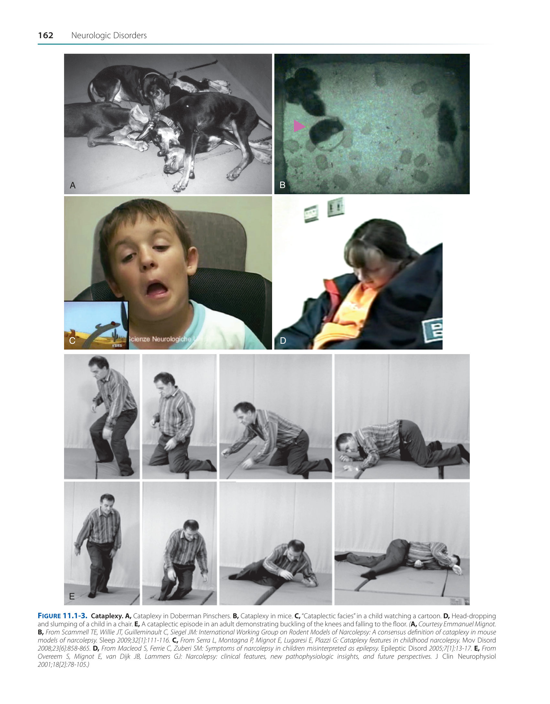

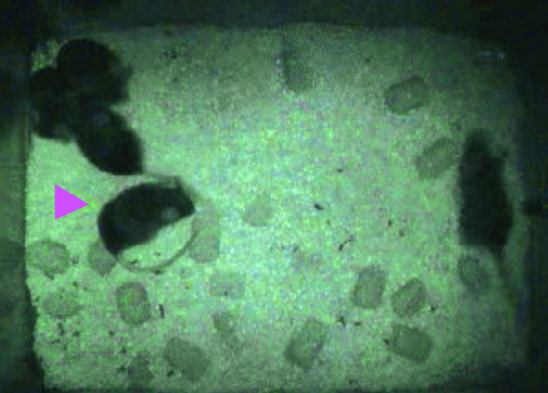

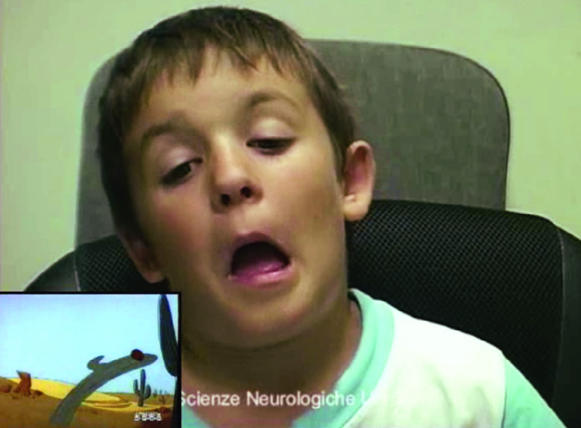

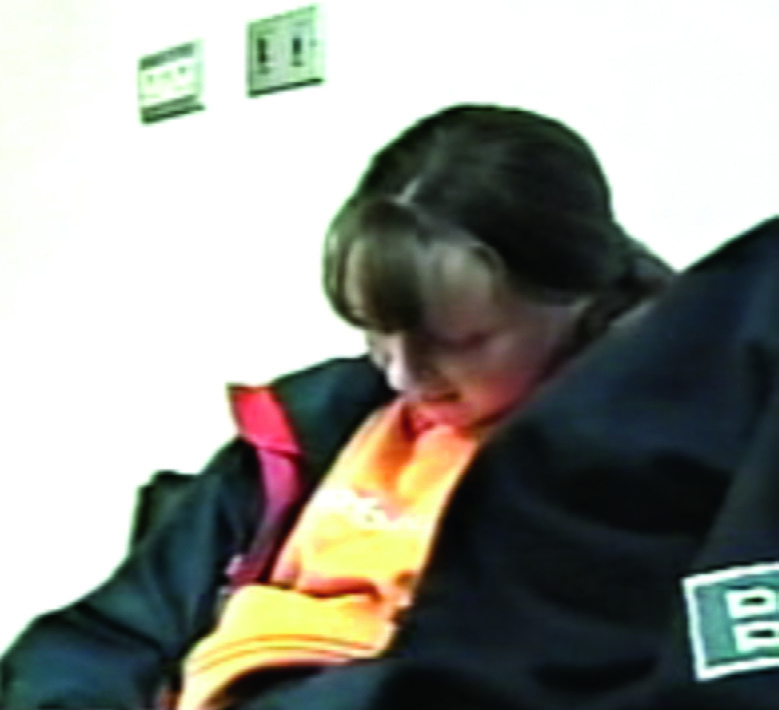

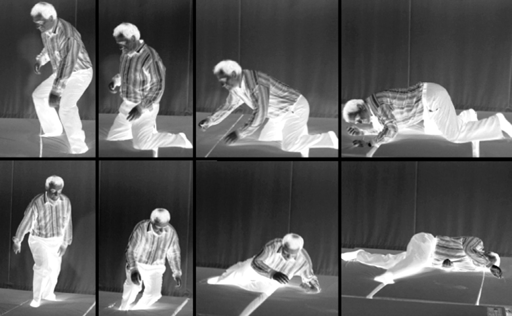

<!-- pdf-page: 181 -->

A B C

FIGURE 11.1-4. Coregistered positron emission tomography (PET)/magnetic resonance images (MRI) from a patient with Kleine-Levin syndrome

during a symptomatic and asymptomatic period. A, In a symptomatic phase, 18F-fluorodeoxyglucose (FDG)-PET demonstrates a decrease in glucose metabolism compared with the asymptomatic phase in the thalamus, hypothalamus, caudate nuclei, and striatum. These overall findings are similar to prior single-photon emission computed tomography findings. B, Regions of interest (bilateral caudate nuclei, striatum, and thalami) by MRI. C, FDG-PET in an asymptomatic phase. (Modified from Lo YC, Chou YH, Yu HY: PET findings in Kleine-Levin syndrome. Sleep Med 2012;13[6]:771-772.)

cerebrospinal fluid (CSF) in most patients who have narcolepsy with cataplexy and in some cases of secondary narcolepsy and neurologic disorders. In contrast, CSF hypocretin levels are normal with IH and periodic hypersomnias.

In most cases of narcolepsy, mounting environmental and genetic evidence suggests that an autoimmune mechanism underlies the destruction of the hypocretin cell neurons (Fig. 11.1-6, A to D). As for many other autoimmune diseases, infections have been identified as potential triggers for narcolepsy, such as group A Streptococcus and influenza A. Seasonality in the incidence of narcolepsy has been well documented. Titers for antistreptolysin (ASO) antibodies, a marker for recent Streptococcus infection, are elevated in early-onset narcolepsy cases compared with late-onset cases. Most interestingly, the 2009 pandemic H1N1 outbreak was associated with an increased incidence of narcolepsy in children, and some cases developed after H1N1 vaccination with Pandremix.

In addition to environmental triggers for the development of narcolepsy, clear genetic risk factors for its development also exist. Monozygotic twins are 25% to 32% concordant for narcolepsy, and first-degree relatives of people with narcolepsy carry a 1% risk of developing the disorder. A major susceptibility factor for narcolepsy is a specific allele for one of the many human leukocyte antigen (HLA) genes located on human chromosome 6. HLA genes encode for specific protein complexes (major histocompatibility complexes) found on the surface of immune cells that present antigens to other immune cells, such as T cells (antigen-presenting cells [APCs]). DQB1*06:02, an allele of the HLA gene DQB1, is the most specific genetic marker for narcolepsy and is found in almost 99% of cases with hypocretin deficiency, which are typically associated with cataplexy, versus 12% to 38% of the general population, depending on ethnicity (Fig. 11.1-7). In addition to HLA, polymorphisms in the T-cell receptor (TCR) α-locus, P2RY11 purinergic receptors, OX40, and Cathepsin-H, which are all involved in immune

processes, increase the susceptibility for narcolepsy (see Fig. 11.1-6, E).

These findings suggest that a single peptide unique to hypocretin cells is mistakenly recognized by the immune system as foreign via several proposed immune pathways, leading to the autoimmune destruction of the hypocretin cell neurons (Fig. 11.1-8). In contrast, secondary cases of narcolepsy, referred to as narcolepsy due to a medical condition in the ICSD-2, may be due to a direct insult to the hypocretin system, rather than an autoimmune mechanism, a theory supported by the fact that most tumors associated with narcolepsy are located in the hypothalamus (Fig. 11.1-9). In other cases, narcolepsy may be the result of complex pathology, whether associated with cataplexy or hypocretin deficiency or neither, including myotonic dystrophy; ataxia, deafness, narcolepsy, and dementia; Prader-Willi syndrome; Niemann-Pick disease; and various other pathologies.

Although hypocretin deficiency has been identified as the cause of narcolepsy, the pathophysiologic mechanisms underlying sleepiness, cataplexy, and other REM-related phenomenon in narcolepsy are complicated and, at times, controversial. A simplistic model depicts the hypocretin system sending widespread projections throughout the CNS, such as monoaminergic nuclei to promote wakefulness and motor neurons and the ventrolateral periaqueductal gray matter/lateral pontine tegmentum (vlPAG/LPT) to maintain muscle tone (Fig. 11.1-10).

#### EVALUATION AND DIAGNOSIS

#### Epworth Sleepiness Scale and

#### Fatigue Severity Scale

The clinician must first differentiate sleepiness from fatigue and exhaustion. The severity of the symptom can then be further characterized with subjective scales such as the

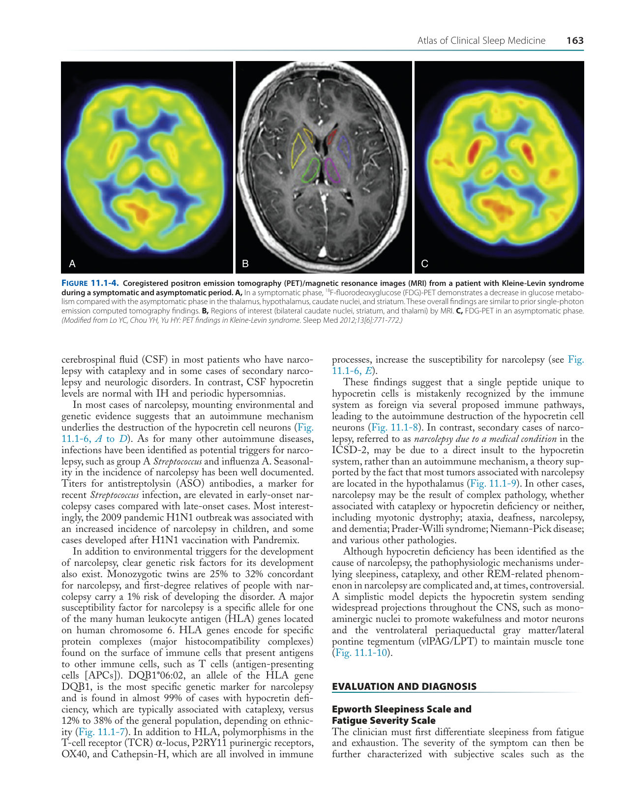

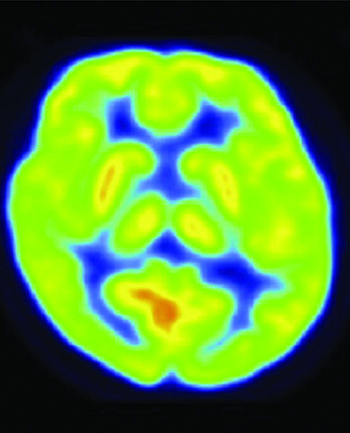

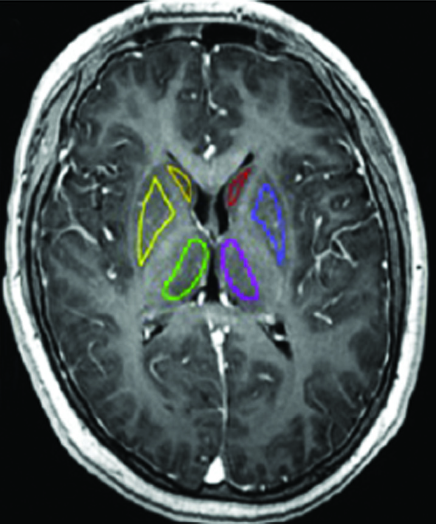

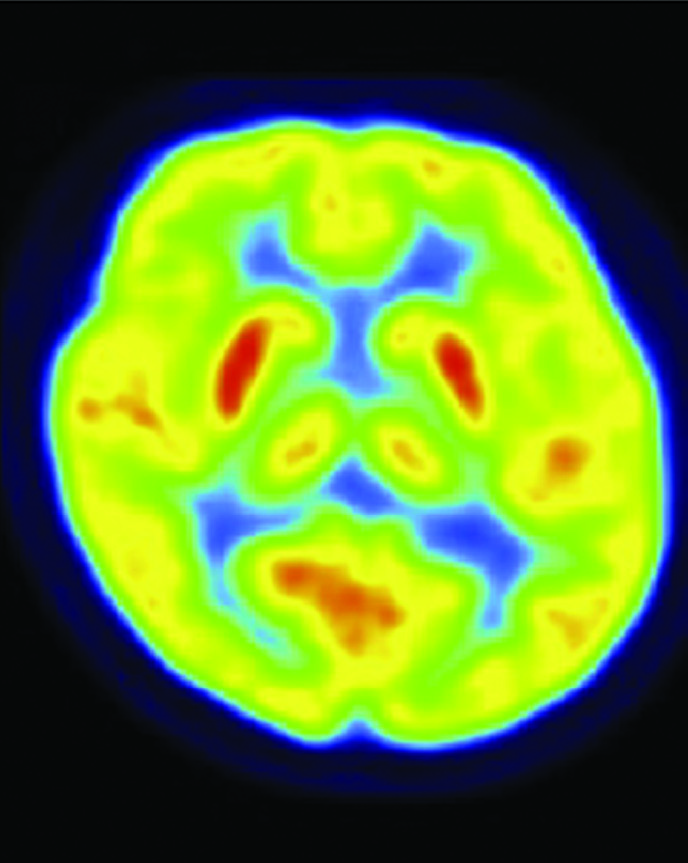

<!-- pdf-page: 182 -->

164 Neurologic Disorders

FIGURE 11.1-5. Hypocretin peptides and neurons in the lateral hypothalamus of narcoleptics versus controls and cerebrospinal fluid hypocretin

levels in central nervous system hypersomnias and other conditions. A, Dramatic reduction of hypocretin mRNA (gene expression) in the lateral hypothalamus in a narcoleptic (left) versus a control brain (right). B, Dramatic reduction of hypocretin-stained peptides (hypocretin cells) in the lateral hypothalamus in a narcoleptic (left) versus a control brain (right). Narcoleptics have an 85% to 95% reduction in the number of hypocretin neurons. f, fornix.

f f

A

A

1 cm 1 cm

50 m

B

B

Epworth Sleepiness Scale (see Chapter 8, Fig. 8-16) and the Fatigue Severity Scale (Box 11.1-2).

#### Overnight Polysomnography, Multiple Sleep

#### Latency Test, and Maintenance of

#### Wakefulness Test

A PSG is routinely performed to characterize sleep architecture and evaluate for sleep disorders such as SDB and periodic limb movements during sleep (PLMS). In narcolepsy/ hypocretin deficiency, the PSG typically shows sleep fragmentation, increased stage 1 sleep, and, in 50% of cases, a

sleep-onset REM period (SOREMP), defined as a REM latency of 15 minutes or less (Fig. 11.1-11). A SOREMP on the PSG is diagnostic for narcolepsy, but the PSG shows no findings diagnostic for IH. A high sleep efficiency and/or prolonged total sleep time on the PSG in the proper clinical context may be suggestive of IH.

If the overnight PSG is not diagnostic for a sleep disorder to account for the EDS, then a multiple sleep latency test (MSLT), which measures the tendency of a patient to fall asleep, or, alternatively, a maintenance wakefulness test (MWT), which measures the ability to maintain wakefulness,

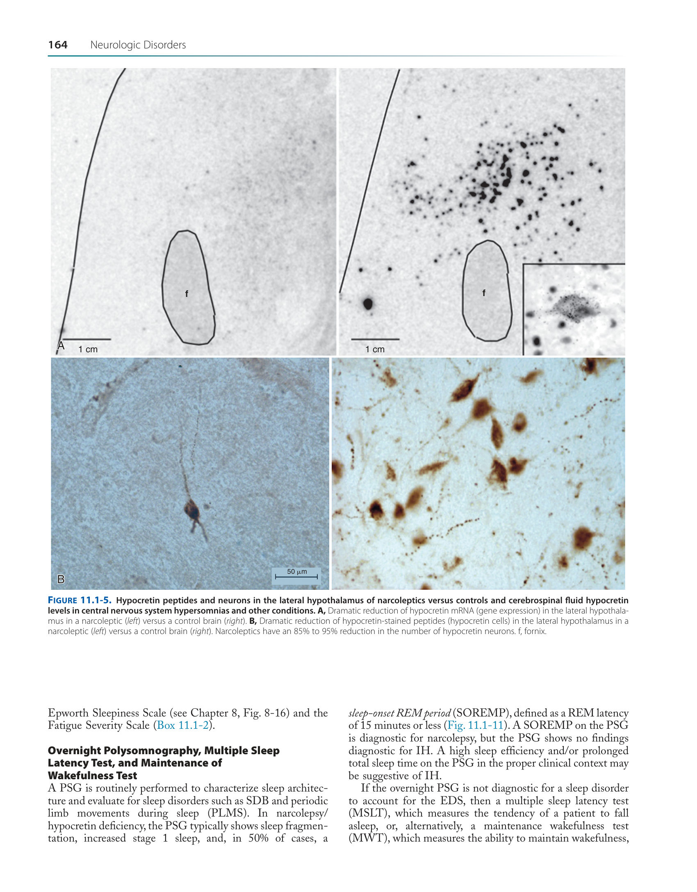

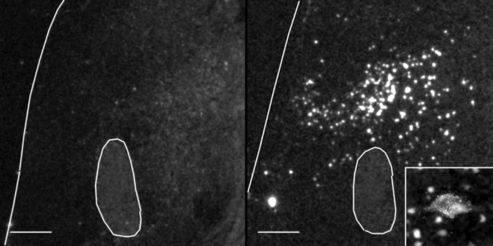

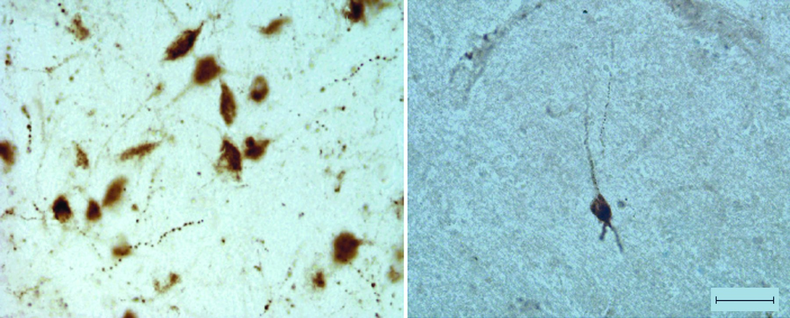

<!-- pdf-page: 183 -->

Other sleep disorders Narcolepsy/hypersomnia Controls

700

600

(17%)

47 17 194 10 (56%) 37 (31%) 32 (43%) 38 (46%) 22 (22%)

500 (18%)

CSF hypocretin-1 (pg/mL)

400

16 12 12

C, Cerebrospinal fluid (CSF) hypocretin levels and HLA DQB1*06:02 status in controls, central nervous system hypersomnias, and other sleep disorders. Each point represents the crude concentration of hypocretin-1 (normal, >200 pg/mL; low, <110 pg/mL) in a single person, with the total number of subjects noted (digits without parentheses) in each range and median value, denoted with a horizontal bar in each group. HLA-DQB1*06:02 positivity is a percentage, denoted in parentheses. Normal hypocretin levels were noted in most of the controls and in all the periodic hypersomnias, idiopathic hypersomnias, and other sleep disorders. Almost all hypocretin-deficient narcolepsy cases are HLA DQB1*06:02 positive, whereas healthy control subjects are DQB1*06:02 positive in up to 38% of cases (18% in this figure). No consistent data are available for HLA DQB1*06:02 status in idiopathic hypersomnia and secondary narcolepsy. (A, Modified from Peyron C, Faraco J, Rogers W, et al: A mutation in a case of early onset narcolepsy and a generalized absence of hypocretin peptides in human narcoleptic brains. Nat Med 2000;6:991-997. B, Modified from Thannickal TC, Moore RY, Nienjuis R, et al: Reduced number of hypocretin neurons in human narcolepsy. Neuron 2000;27[3]:469-474. C, Modified from Nishino S, Mignot E: Narcolepsy and cataplexy. Handb Clin Neurol 2011;99:783-814.)

300

200

30

100

9 (100%) 129 13 (92%) (100%)

0

Atypical cataplexy

HLA negative/cataplexy

Neurologic disorders

Typical cataplexy

Daytime

Nighttime

Famiy proband

C

FIGURE 11.1-5, cont’d.

12 (20%)

Restless legs syndrome

No cataplexy

Obstructive sleep apnea

Idiopathic hypersomnia

Periodic hypersomnia

Secondary etiologies

Undocumented hypersomnia

Insomnia

BOX 11.1-2 Fatigue Severity Scale

Patients are instructed to choose a number from 1 to 7 that indicates their degree of agreement with each statement; 1 indicates strongly disagree, and 7 means strongly agree.

1. My motivation is lower when I am fatigued.
2. Exercise brings on my fatigue.
3. I am easily fatigued.
4. Fatigue interferes with my physical functioning.
5. Fatigue causes frequent problems for me.
6. My fatigue prevents sustained physical functioning.
7. Fatigue interferes with carrying out certain duties and

responsibilities. 8. Fatigue is among my three most disabling symptoms. 9. Fatigue interferes with my work, family, or social life.

Modified from Krupp LB, LaRocca NG, Muir-Nash J, Steinberg AD: The Fatigue Severity Scale application to patients with multiple sclerosis and systemic lupus erythematosus. Arch Neurol 1989;46:1121-1123.

is performed. The MSLT is a series of four to five naps across the day taken in 2 hour intervals and is typically used for diagnostic purposes, whereas the MWT is a series of four 40-minute trials across the day in 2-hour intervals, routinely performed to document the ability of a person (e.g., an airline pilot) to maintain wakefulness after a prescribed therapy, such as after the successful treatment of SDB with a continuous positive airway pressure (CPAP) machine. During each nap of an MSLT, the patient is instructed to try to fall asleep and is given 20 minutes to do so; if no sleep is observed, the “nap” is ended. If the patient falls asleep, the nap continues for another 15 minutes, and the presence or absence of REM sleep (SOREMP) in each nap is recorded (Fig. 11.1-12). A regular sleep schedule and adequate sleep time, ideally documented with a sleep diary and/or actigraphy, should be maintained for 2 weeks before the MSLT. Medications that affect the ability to fall asleep, such as stimulants, or those that affect the propensity to enter REM sleep, such as

<!-- pdf-page: 184 -->

166 Neurologic Disorders

Anti-streptolysin O antibodies in patients with narcolepsy and matched controls

ASO values

≥800 IU/mL 200-400 IU/mL 400-800 IU/mL

Interval from disease onset

1999 1998 1997 2011 2010 2009 2008 2007 2006 2005 2004 Year 2003 2002 2001

8

Recent patients

7

Narcolepsy onset (average count/month)

Long-standing disease

6

5

4

3

2

1

0

J F M A M J J A S O N D

Month

A

B

40

Occurrences of narcolepsy onset

30

20

10

0

1996 2000

New patients

#### *

Controls

70 60

50 ASO-positive subjects (%)

40 30 20 10 0

Controls - age and season matched to above patients (n 134) Long-standing - more than 10 years from first symptom (n 67) Recent patients - symptoms began 1-3 years before the test (n 48) New patients - less than 1 year from first symptom (n 19)

*P .001 (ASO positivity in patients with new and recent onset vs patients with long-standing disease or controls)

40

H1N1 occurrences (count 1000)

30

20

10

0

FIGURE 11.1-6. Environmental triggers and genetic factors in narcolepsy. A, Seasonality and the incidence of narcolepsy in China. Data as mean ±

standard error of the mean of monthly occurrences, corrected by the number of days per month and leap years, in percentage of 12 months across the year (mean of 15-year data). Onset of disease is approximately sixfold to sevenfold more frequent in the late spring and early summer versus late fall or early winter (shaded areas). B, Antistreptolysin O (ASO) antibodies in patients with narcolepsy with hypocretin deficiency (n = 200) and age-matched controls (n = 200). Higher ASO titers were seen in narcoleptics, particularly closer to disease onset, compared with controls. This suggests that streptococcal infections are probably a significant environmental trigger for narcolepsy. C, The 2009 H1N1 pandemic in China was associated with a threefold increase in narcolepsy onset. Monthly counts of onset occurrences over a 15-year period (raw data) with a 3-month moving average trend line are depicted in red (n = 629 diagnosed with narcolepsy/ hypocretin deficiency at People’s Hospital, Beijing University, China). Note the clear seasonal fluctuations of the trend line with lower onset counts in fall and winter (shaded areas) and higher onset counts in spring and summer. Number of H1N1 infections documented by governmental statistics is depicted in green. The peak of infections was followed by a large increase in incident narcolepsy cases in 2010, which was largely independent of H1N1 vaccination (only 8 of 142 patients recalled receiving the vaccination), followed by an abrupt decline in both infections and narcolepsy cases in 2011.

C

<!-- pdf-page: 185 -->

Post H1N1 vaccination narcolepsy cases

Narcolepsy Dx

Odds ratio (95% confidence interval)

Vaccinated

Unvaccinated

Sweden

Children 44

38

6

4.19 (1.76-12.1)

Adults 52 26 26 1.21 (0.67-2.17)

D, H1N1 vaccination with Pandremix was associated with an increased incidence of the diagnosis (Dx) of childhood narcolepsy in Sweden, Ireland, and Finland. All cases that underwent HLA typing were found to be HLA DQB1*06:02 positive. E, Known narcolepsy loci involved in immune processes and increased narcolepsy susceptibility. HLA DQB1*06:02, a specific allele for one of the many HLA genes located on human chromosome 6, is tightly associated with hypocretin deficiency. These HLA genes encode for major histocompatibility complexes that present antigens to other immune cells. Polymorphisms in the T-cell receptor (TCR)-α locus, P2RY11 purinergic receptors, TNFSF4 (formerly OX40), and CTSH (Cathepsin-H) are all involved in immunity, and all increase the risk of narcolepsy. TCR is the receptor for HLA antigen presentation on T cells. Purinergic receptors, which are known to have immune-modulatory effects—such as chemotaxis, maturation, and regulated cell death—are poorly understood. OX40, for example, is a co-stimulatory molecule for T- and B-cell activation. CTSH, a member of the papain-like family, participates in intracellular protein degradation. Mutations in DNMT1, a widely expressed DNA methyltransferase involved in development, have been identified in autosomal-dominant cerebellar ataxia, deafness, and narcolepsy (ADCA-DN). (A and C, Modified from Han F, Lin L, Warby SC, et al: Narcolepsy onset is seasonal and increased following the 2009 H1N1 pandemic in China. Ann Neurol 2011;70[3]:410-417. B, Modified from Aran A, Lin L, Nevsimalova S, et al: Elevated anti-streptococcal antibodies in patients with recent narcolepsy onset. Sleep 2009;32[8]:979-983. D, Data from Partinen M, et al: Increased incidence and clinical picture of childhood narcolepsy following the 2009 H1N1 pandemic vaccination campaign in Finland. PLoS One 2012;7(3):e33723. E, Courtesy Dr. Juliette Faraco.)

Ireland

Finland

Squalene/alpha-tocopherol (AS03)-based vaccine with A H1N1/CA/07/2009

D

P2YR11, DNMT1

CTSH

E

FIGURE 11.1-6, cont’d.

Children 24 19 5 13 (4.8-34.7)

Adults 3 2 1 18.8 (1.7-207.4)

*4-19 yrs 53 46 7 12.7 (6.1-30.8)

* HLA typing performed in 34 children, all of which were DQB1*06:02 positive. Only 1 in 16,000 vaccinated developed narcolepsy.

Known narcolepsy loci

CD4 OX40

TCR-

DQ-

OX40L

antidepressants, should be discontinued for at least 2 weeks before the MSLT. Ideally, a blood or urine drug screen should be performed on the day of the MSLT. Most of the technical procedures of the MWT and MSLT are similar, except in the MWT, the subject is instructed to try to stay awake. The MWT trial is terminated after maintaining wakefulness for 40 minutes or after the first epoch of unequivocal sleep.

Current MSLT criteria for narcolepsy include a mean sleep latency (MSL) of 8 minutes or less and two or more

SOREMPs. A diagnosis of IH usually requires an MSL of 8 minutes or less and fewer than two SOREMPs on the MSLT. However, in IH, if total daily sleep times are extremely prolonged, a normal MSLT can also be found. Importantly, however, an MSL of 8 minutes or less is found in approximately 22% of the general adult population. An MSL of 8 minutes or less and two or more SOREMPs is found in 4% of the general adult population regardless of symptoms; therefore MSLT findings must be interpreted in conjunction with the clinical history.

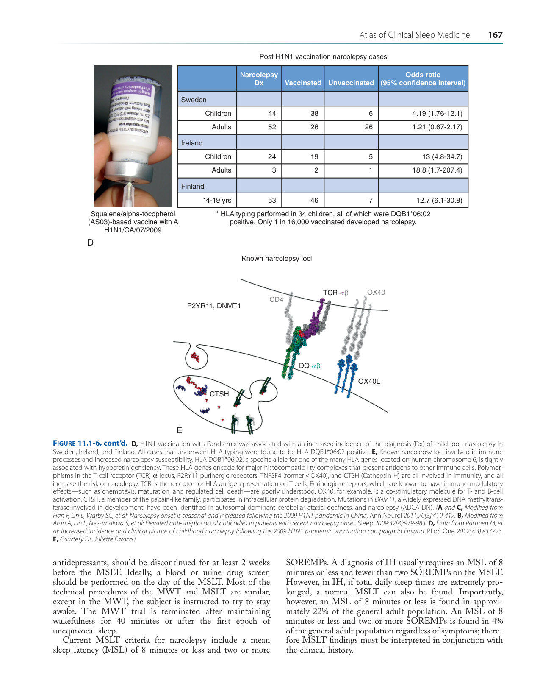

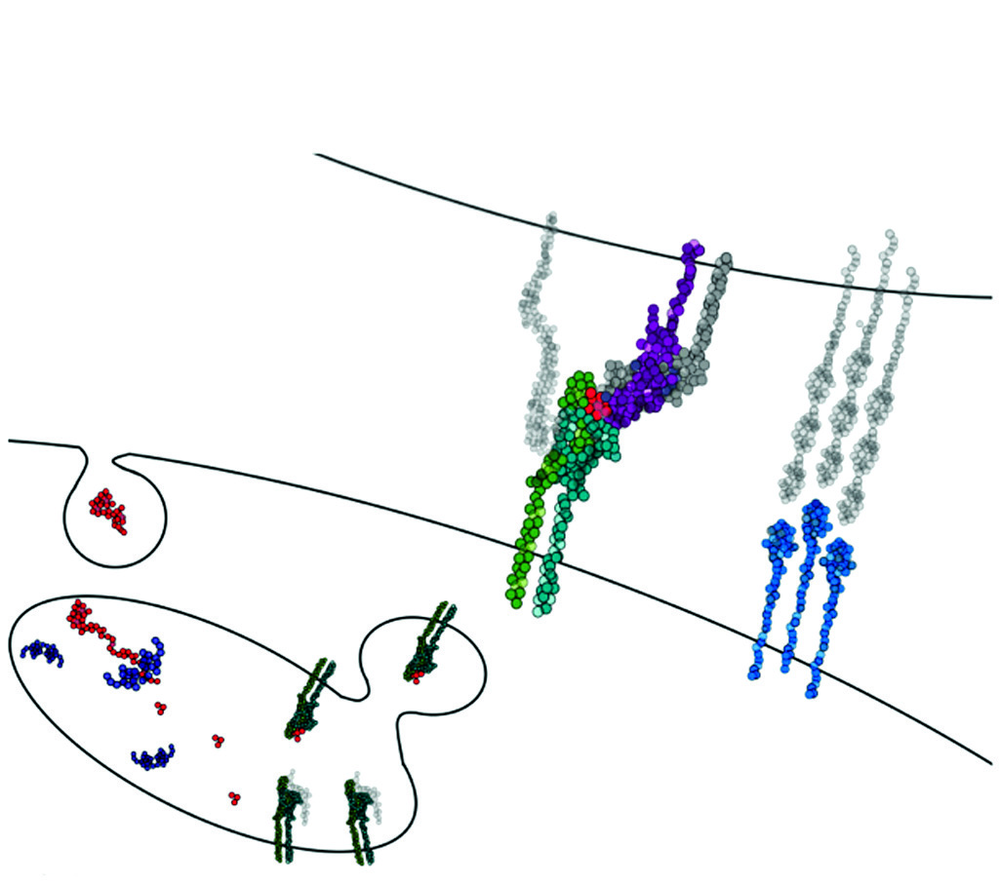

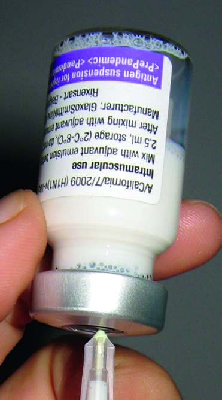

<!-- pdf-page: 186 -->

Chromosome 6

0 1000 2000 3000 4000kb Class III Class I

Class II

DQB1*06:02 -chain DQA1*01:02 -chain DRB1*15:01 (Whites and Asians) DRB1*15:03 (African Americans) DRB1*11:01 (African Americans) These -chains form heterodimers with a monomorphic DR -chain. However, these heterodimers are not involved in narcolepsy. The most important genetic factor in narcolepsy is HLA DQB1*06:02. The -chain forms a heterodimer (in gray) with an -chain that binds specific regions of peptides (in yellow) with the peptide-binding pocket (in green). This HLA-peptide complex is presented to T cells with the T-cell receptor recognition surface (in blue).

C4 HSP40

TNF- , 21A B1 C2

DP DQ

DR B C E A GF

DQB1 DQA1

12kb 85kb 160kb

Structure of genes around HLA

DRB1 DRA

Genomic map of the DQ and DR region

FIGURE 11.1-7. Human leukocyte antigens (HLA) involved in narcolepsy susceptibility. The HLA genes are located on chromosome 6 and are distributed

over more than 4000 kilobases (kb). Antigen-presenting cells, macrophages, and dendritic cells have HLA class I (A, B, and C) and II (DQ, DR, and DP) protein; the locations of genes enclosing these proteins are shown. The HLA gene family is divided into two classes and is located in major histocompatibility complex (MHC) class I (A, B, and C) and class II (DQ, DR, and DP) regions. Close to the HLA genes in the MHC class III region are genes that encode complements 2 and 4, tumor necrosis factor (TNF), and heat shock protein (HSP40). The HLA DR and DQ genes are located very close to each other. HLA class II DR and DQ genes are heterodimers encoded by two genes each: one generates an α-chain, the other a β-chain. All these genes are located within a small genetic distance, leading to extremely high linkage disequilibrium. DRA is monomorphic and does not contribute significantly to HLA diversity, in contrast with DQA1, DQB1, and DRB1, which have several hundred possible alleles. The most important genetic factor in narcolepsy is HLA DQB1*06:02. In whites and Asians, the associated DR2 subtype DRB1*15:01 is typically observed with DQB1*06:02 (and DQA1*01:02) in narcoleptic patients. In African Americans, either DRB1*15:03, a DNA-based subtype of DR2, or DRB1*11:01, a DNA-based subtype of DR5, is observed most frequently, together with DQB1*06:02—the most specific marker for narcolepsy across all ethnic groups. DQB1*06:02 forms a heterodimer (in gray) with an α-chain that binds specific regions of peptides with the peptide-binding pocket (in green). This HLA-peptide complex is presented to T cells with the T-cell receptor recognition surface (in blue). (Modified from Nishino S, Mignot E: Narcolepsy and cataplexy. Handb Clin Neurol 2011;99:783-814; and Jones EY, Fugger L, Strominger JL, Siebold C: MHC class II proteins and disease: a structural perspective. Nat Rev Immunol 2006;6:271-282.)

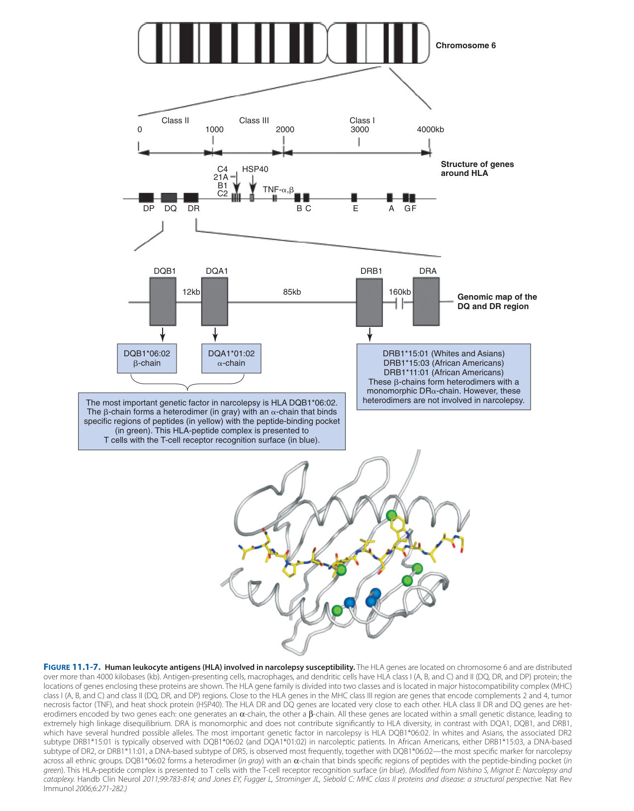

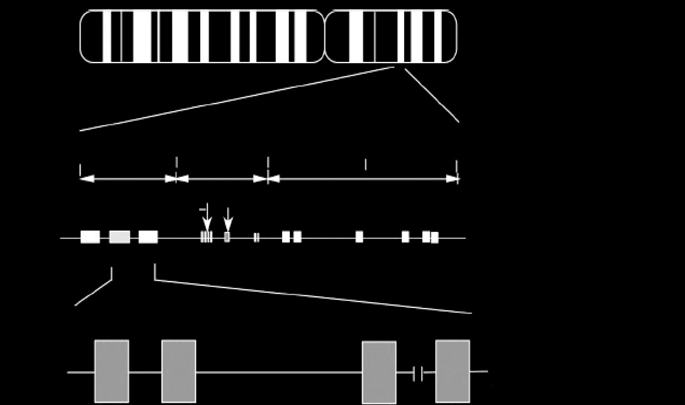

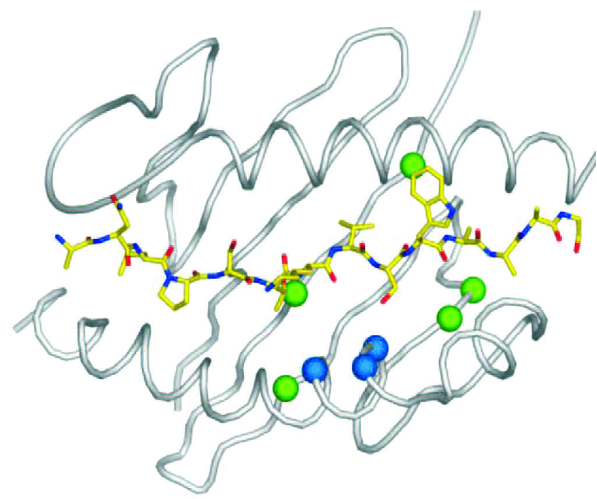

<!-- pdf-page: 187 -->

Periphery

Brain

Blo

H1N1

od-

vi

Fever Strep

brai

n b

iv TCR

Hcrt neuron

arri

T cell

er

i

FIGURE 11.1-8. Potential pathways for a role of influenza A or streptococcal infections in the development of the autoimmune destruction of hypo­

cretin cells. A peripheral H1N1 influenza or Streptococcus pyogenes (Strep) infection could stimulate autoreactive T cells or B cells via several different mechanisms. Selected resting autoreactive T cells and B cells may have reactivity toward hypocretin (Hcrt) cells, having escaped negative selection in the thymus. These could be activated in the following ways. (i) Molecular mimicry, T cells. Antigens from the virus or bacteria are presented, for example, by major histocompatibility complex (MHC) DQA1*01:02-DQB1*06:02 on an antigen-presenting cell (APC). The T cell recognizes the antigen and is activated. The same T cell, or a clone, migrates to the brain, where it recognizes an Hcrt cell–specific antigen (cross-reactivity), thereby inducing the autoimmune attack. (ii) Molecular mimicry, B cells. An autoreactive B cell can be activated if it also recognizes an antigen from the pathogen. This process requires signals from activated T cells (T-cell help). (iii) Superantigens from Streptococcus cross-link the MHC and T-cell receptor (TCR) molecules independent of antigen specificity, activating the autoreactive T cell. (iv) Bystander activation. Resting autoreactive cells are activated as a result of general immune activation independent of specific antigens. (v) Lymphocyte migration to the central nervous system (CNS). Once activated, the T cells can migrate to the brain. Depending on the type of T cell, a variety of mechanisms could account for the autoimmune attack. MHC class II expression is restricted to microglia, but MHC class I molecules are expressed in various brain cells, including neurons. (vi) Opening of the blood-brain barrier. Fever and other factors associated with the general immune response allow lymphocytes to penetrate the bloodbrain barrier more easily and also allow antibodies to access the CNS. (vii) Production of autoantibodies. This can also occur as a secondary response to Hcrt cell death via APCs from the brain that have phagocytosed the dead neurons. Red dots indicate processes in which release of cytokines or cytotoxic substances plays an important role. H1N1, H1N1 influenza A virus or epitopes from adjuvanted vaccines. (Modified from Kornum BR, Faraco J, Mignot E: Narcolepsy with hypocretin/orexin deficiency, infections, and autoimmunity of the brain. Curr Opin Neurobiol 2011;21:897-903.)

iii

T cell MHC TCR

i

ii

B cell

v vii

vi

ii

B cell

FIGURE 11.1-9. Neurologic diseases and location of brain lesions in 113 cases of secondary narcolepsy. A, Neurologic diseases by category reported

as secondary narcolepsy. Tumors, inherited disorders, and head trauma are the three most frequent causes. The percentage of cataplexy (CA) or sleep-onset rapid eye movement periods (SOREMP) is denoted in each category with a dashed line. B, Location of brain lesions in symptomatic cases with narcolepsy associated with brain tumor; lesions in the hypothalamus and adjacent structures are the most common location. Included are 113 symptomatic cases of narcolepsy. (Modified from Kanbayashi T, Sagawa T, Takemura F, et al: The pathophysiologic basis of secondary narcolepsy and hypersomnia. Curr Neurol Neurosci Rep 2011;11[2]:235-241.)

Multiple 9% Other 1%

Posterior fossa 6% Inherited disorders 34%

Tumor 29%

SOREMP

CA

CA

SOREMP

CA

CA

CA CA CA

Vascular 5%

SOREMP SOREMP

CA

CA

Encephalopathy 3% Degeneration 3%

Head trauma 16%

Demyelinating 9% A B

Frontal lobe 3%

Temporal lobe 3%

Brainstem 9%

Hypothalamus 70%

<!-- pdf-page: 188 -->

170 Neurologic Disorders

FIGURE 11.1-10. A theoretic and simplified model for the hypocretin system in the promotion of wakefulness and control of muscle tone. A, Hypo­

cretin neurons in the lateral hypothalamus innervate wake-promoting nuclei, including neurons that produce histamine (HA, tuberomammillary nucleus), norepinephrine (NE, locus ceruleus), serotonin (5-HT, dorsal raphe), dopamine (DA, ventral tegmental area), and acetylcholine (Ach, basal forebrain, pedunculopontine, and laterodorsal tegmental nuclei). In addition, the hypocretin neurons provide direct, excitatory inputs to the cortex, thalamus, and spinal cord. GABA, γ-aminobutyric acid. B, Several pathways suppress atonia during normal wakefulness (left). Atonia is driven by neurons in the sublaterodorsal tegmental nucleus (SLD) that activate neurons in the spinal cord and medial medulla (MM) that inhibit motor neurons using GABA and glycine. During wakefulness, this atonia system is inhibited by neurons in the ventrolateral periaqueductal gray matter/lateral pontine tegmentum (vlPAG/LPT) and by monoaminergic neurons, such as NE and 5-HT. The hypocretin neurons are active during wakefulness and are silent during rapid eye movement sleep. They help maintain normal muscle tone by exciting monoamine neurons, motor neurons, and neurons in the vlPAG/LPT. In narcolepsy (right), the loss of the hypocretin neurons plus strong, positive emotions can trigger cataplexy. Positive emotions may activate neurons in the amygdala that excite the SLD and inhibit the vlPAG/LPT. The SLD may also be activated by cholinergic inputs and a sudden withdrawal of monoamine tone. The SLD then excites neurons in the medial medulla and spinal cord that strongly hyperpolarize motor neurons, resulting in cataplexy. Normally, the effects of the hypocretin system and a continued monoaminergic drive to the pons and directly to motor neurons would counter this triggering of atonia, but in the absence of hypocretin, these excitatory drives are lost, and cataplexy occurs. Solid pathways from filled nuclei are active; dashed pathways from unfilled nuclei are inactive. Green pathways are excitatory; red pathways are inhibitory. (Modified from Burgess CR, Scammel TE: Narcolepsy: neural mechanisms of sleepiness and cataplexy. J Neurosci 2012;32[36]:12305-12311.)

HA Ach, GABA

A

Hypocretin

v|PAG /LPT

Spinal interneuron

SLD

NE, 5-HT NE, 5-HT

MM

Motor neuron

B

Thalamus 5-HT

NE

Ach

DA

Hypocretin

Hypocretin

v|PAG /LPT

Spinal interneuron

SLD

Ach Amygdala

MM

Motor neuron

Normal muscle tone Cataplexy

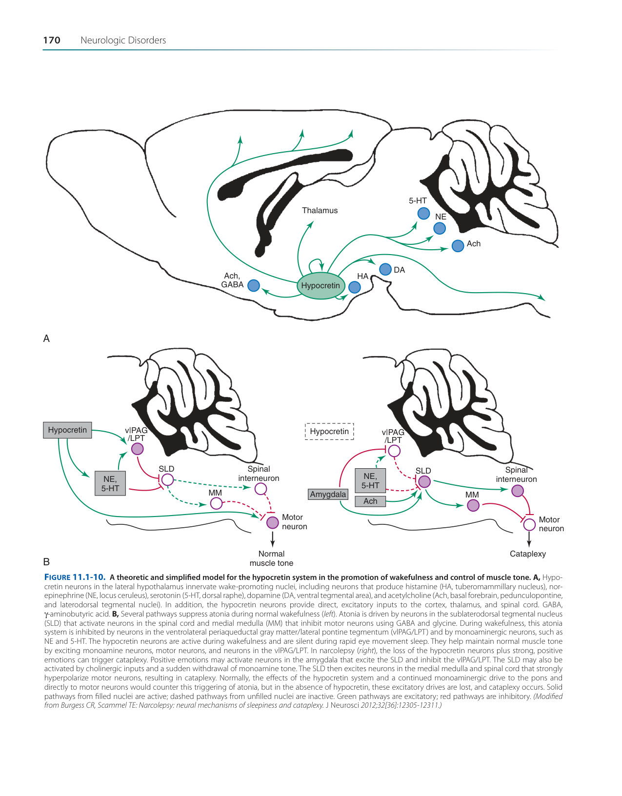

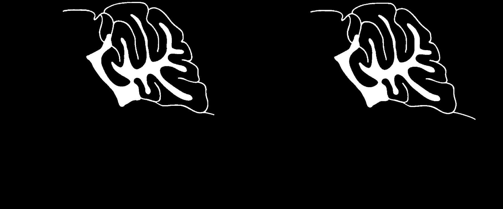

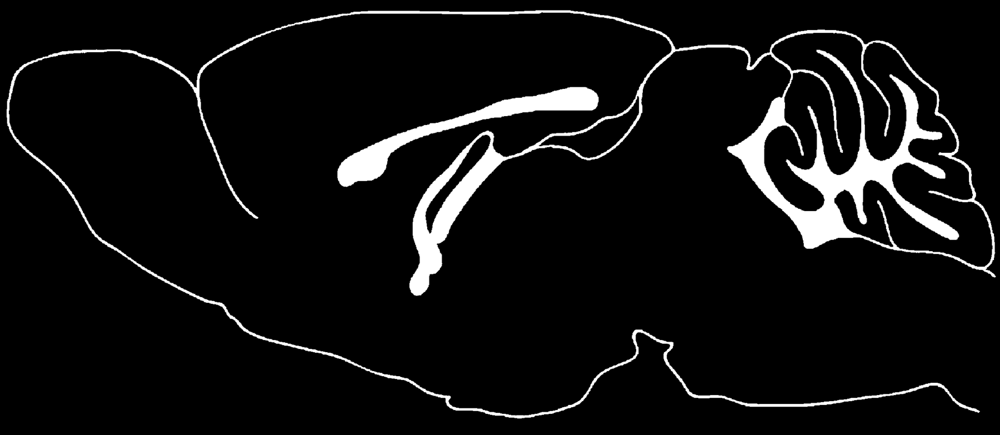

<!-- pdf-page: 189 -->

Stage wake Stage N1 Stage N2 Stage N3

Stage REM

22:17:44 23:17:44 00:17:44 01:17:44 02:17:44 03:17:44 04:17:44 05:17:44 06:17:44

F4-M1

22:33:44 22:34:44 22:35:44 22:36:44 22:37:44 22:38:44

C4-M1

O2-M1

LEOG-M2

REOG-M1

CHIN

FIGURE 11.1-11. A sleep-onset rapid eye movement period during an overnight polysomnogram performed in a patient with excessive daytime

sleepiness and cataplexy. The sleep hypnogram (top) and selected fragments from epochs of the recording (bottom), starting from “lights out,” demonstrate the rapid onset of rapid eye movement (REM) sleep. A normal REM latency is typically defined as 90 to 120 minutes; in this recording, it is 2.5 minutes. A REM latency of 15 minutes or less is diagnostic for narcolepsy.

#### Cerebrospinal Fluid Hypocretin Measurement

#### and HLA Typing

HLA typing alone is not diagnostic for narcolepsy because 12% to 38% of the general population is positive. If the patient is DQB1*06:02 negative, however, it essentially eliminates the possibility of hypocretin deficiency because 99% of patients, mostly those with cataplexy, are HLA DQB1*06:02 positive. For this reason, HLA typing is a useful first step before performing a lumbar puncture for CSF hypocretin measurement as a diagnostic test. Because most patients with hypocretin deficiency (95%) have a positive MSLT and cataplexy, biologic confirmation is not necessary in most cases. In other instances, however, such as when the MSLT is unexpectedly negative, the case is difficult (poor treatment response, atypical or no cataplexy), or other factors make the MSLT impossible to interpret (shift work, severe sleep apnea, secondary pathology), CSF hypocretin measurement is the best diagnostic test to conduct.

The most difficult decision pertains to the use of CSF hypocretin measurement in patients who do not have cataplexy. This is mostly useful when a definitive diagnosis is needed to essentially confirm a lifelong diagnosis. Hypocretin

deficiency, in these cases, is more common when symptoms are severe; onset is recent, and cataplexy has not yet developed; and PSG findings are rich in REM abnormalities.

#### Other Workup

Additional workup that includes imaging, laboratory testing, and specialty referral to a psychiatrist or neurologist may be required when a secondary pathology is suspected.

#### TREATMENT

Treatment of CNS hypersomnias generally requires both behavioral and pharmacologic treatments. Behavioral treatments include the maintenance of a regular sleep schedule and naps. Educating the patient and family about the disease helps foster a supportive network (support groups, school adaptation) and treatment compliance. Pharmacologic management includes medications to treat EDS, cataplexy, and other REM-related phenomena and disrupted nocturnal sleep. Medications include stimulants, antidepressants, and sodium oxybate (Table 11.1-1). A conservative

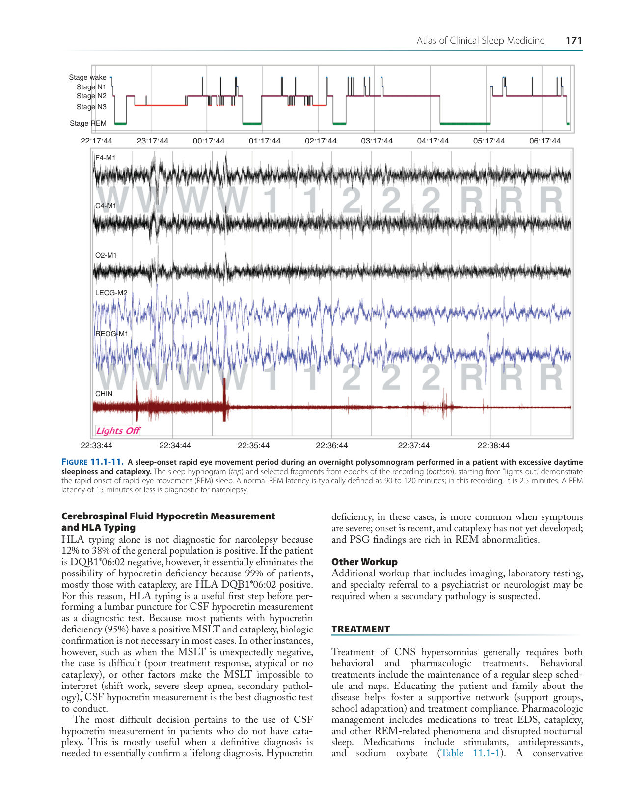

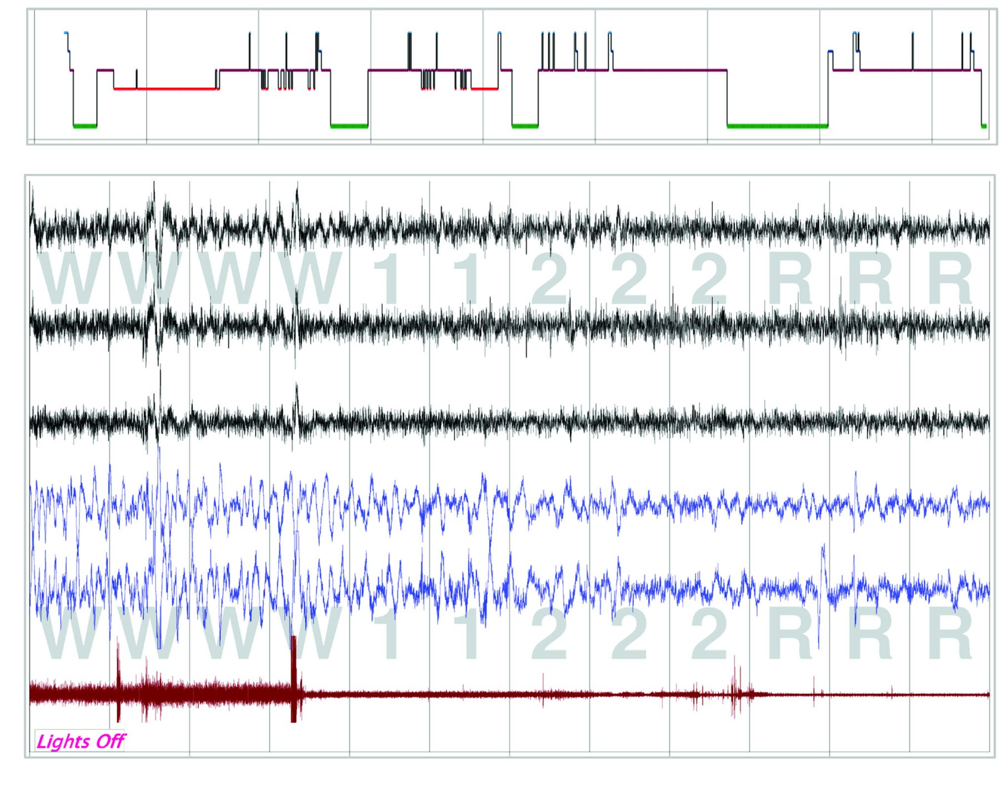

<!-- pdf-page: 190 -->

172 Neurologic Disorders

NAP 1 NAP 2 NAP 3 NAP 4 NAP 5

16:59:23 16:59:53 17:00:23 17:00:53 17:01:23 17:01:53

Lights on

Lights out Stage wake

Stage N2 Stage N1

Stage REM

08:37:23 09:37:23 10:37:23 11:37:23 12:37:23

F4-M1

C4-M1

NAP 5

O2-M1

LEOG-M2

REOG-M1

CHIN

13:37:23 14:37:23 15:37:23 16:37:23

FIGURE 11.1-12. A multiple sleep latency test (MSLT) diagnostic for narcolepsy from the patient shown in Figure 11.1-11. The sleep hypnogram (top)

shows that the patient attained rapid eye movement (REM) sleep on four of the five naps. Selected epochs from the NAP 5 recording (bottom), starting from “lights out,” show the patient immediately falling asleep (sleep latency, 0 min) and entering REM sleep 1 minute later (REM latency, 1 min). The calculated mean sleep latency of all five naps was 1.6 minutes. Given the MSLT findings and sleep onset REM period (SOREMP) on the polysomnogram, the patient was diagnosed with narcolepsy with cataplexy.

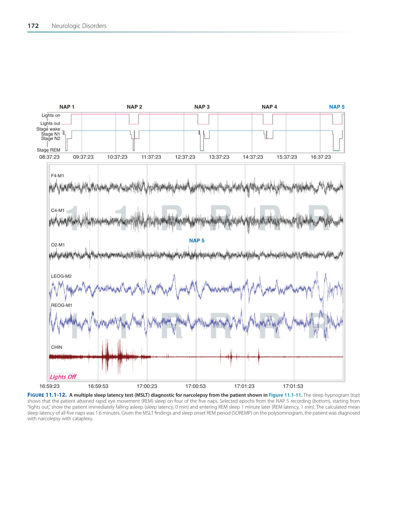

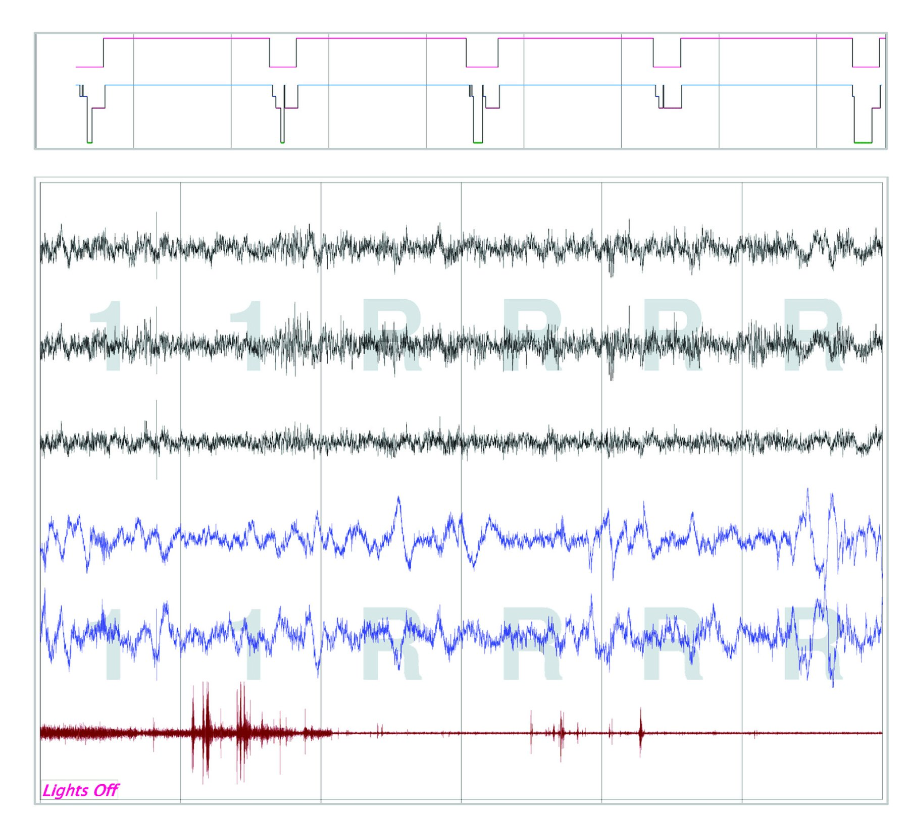

<!-- pdf-page: 191 -->

TABLE 11.1-1 Pharmacologic Agents for Central Nervous System Hypersomnias

PHARMACOLOGIC PROPERTIES USUAL DAILY DOSE

OTHER CONSIDERATIONS AND COMMON/ SERIOUS SIDE EFFECTS

COMPOUND (CLASS)

Stimulants Modafinil Mode of action controversial, but

Modafinil, 100-400 mg in the

Headaches are possible but minimized by starting at

morning or as divided doses R-modafinil, 50-250 mg in the

morning

*All antidepressants are immediately effective on cataplexy. Abrupt discontinuation of antidepressants may lead to rebound cataplexy.

likely involves relatively selective DA reuptake inhibition Minimal, if any, addiction

potential Less effective than amphetamine-

based stimulants

Methyphenidate Blocks monoamine uptake No effect on reverse efflux or

doses

VMAT Potential for addiction, especially

for immediate-release compounds More effective than modafinil

D-amphetamine sulfate Increases monoamine release Primary effects of usual dosages

doses

due to reverse efflux of dopamine through the dopamine transporter as well as inhibition of monoamine storage via the VMAT

Antidepressants* Clomipramine (tricyclic) Monoamine uptake blocker Anticholinergic effects Desmethylclomipramine is an

active metabolite

Fluoxetine (SSRI) Specific serotonin reuptake

blocker Active metabolite norfluoxetine

has more adrenergic effects

Venlafaxine (SNRI) Specific serotonin and adrenergic

reuptake blocker Short half-life; extended-release

formulation preferred Mild stimulant effect

Atomoxetine (NRI) Specific adrenergic reuptake

blocker (norepinephrine) Mild stimulant effect

Other Sodium oxybate Debatable mechanism but

probably involves dopamine release and may act on γ-aminobutyric acid or specific γ-hydroxybutyrate receptors Treats all aspects of narcolepsy,

including disrupted nocturnal sleep, excessive daytime sleepiness, cataplexy, and other REM-related phenomena

lower doses and slow uptitration May decrease efficacy of oral contraceptives Monitor blood pressure and heart rate Possible allergic effects (e.g., rash); monitor especially

in children R-enantiomer of modafinil (R-modafinil) has a longer

half-life and is approximately 2 times more potent once steady state is achieved

10-60 mg daily or as divided

Low cost Various preparations and formulas can have different

interindividual effects Monitor blood pressure and heart rate Immediate release (5-10 mg) can be helpful on an

as-needed basis to counter gaps in alertness during the daytime (e.g., sleep inertia or after a meal) in hypersomniacs

5-60 mg daily or as divided

Use similar to methylphenidate Monitor blood pressure and heart rate Preference given to longer lasting formulations Can be more effective than methylphenidate in

some patients At higher doses may partially treat cataplexy due to

adrenergic effects

10-150 mg Side effects (e.g., dry mouth, blurred vision,

orthostatic hypotension, anorexia, sweating, constipation, and drowsiness) tend to limit use, but cost is low Contraindicated in patients with cardiovascular

conduction abnormalities and in those with open-angle glaucoma

20-60 mg Less potent than clomipramine but lacks

anticholinergic and antihistaminergic effects Very long half-life, so more stable effect on cataplexy Useful with concomitant anxiety disorder

37.5-150 mg, max 300 mg/day Side effects include gastrointestinal upset (main

reason for discontinuation) and transient constipation Potential withdrawal side effects on abrupt cessation

(e.g., sudden electric shock–like feelings)

10-60 mg, usually as divided

Side effects include urinary retention and reduced

doses, max 80 mg/day

appetite Monitor pulse and blood pressure Short half-life Indicated for attention deficit hyperactivity

4.5-9 g (at a minimum divided

Side effects include nausea, weight loss, parasomnia,

into bi-nightly doses)

enuresis, and psychiatric complications Use with caution in presence of hypoventilation or

significant sleep apnea Decreasing dosage may be helpful with parasomnia-

like behavior or enuresis Uptitration and/or trinightly divided dosing can be

helpful with disrupted nocturnal sleep and/or inadequate sleep time Immediate effects on disrupted nocturnal sleep Complete effects on cataplexy and daytime

sleepiness may take several weeks Only FDA-indicated treatment for cataplexy

FDA, Food and Drug Administration; NRI, norepinephrine reuptake inhibitor; SNRI, serotonin and norepinephrine reuptake inhibitor; SSRI, selective serotonin reuptake inhibitor; VMAT, vesicular monoamine transporter.

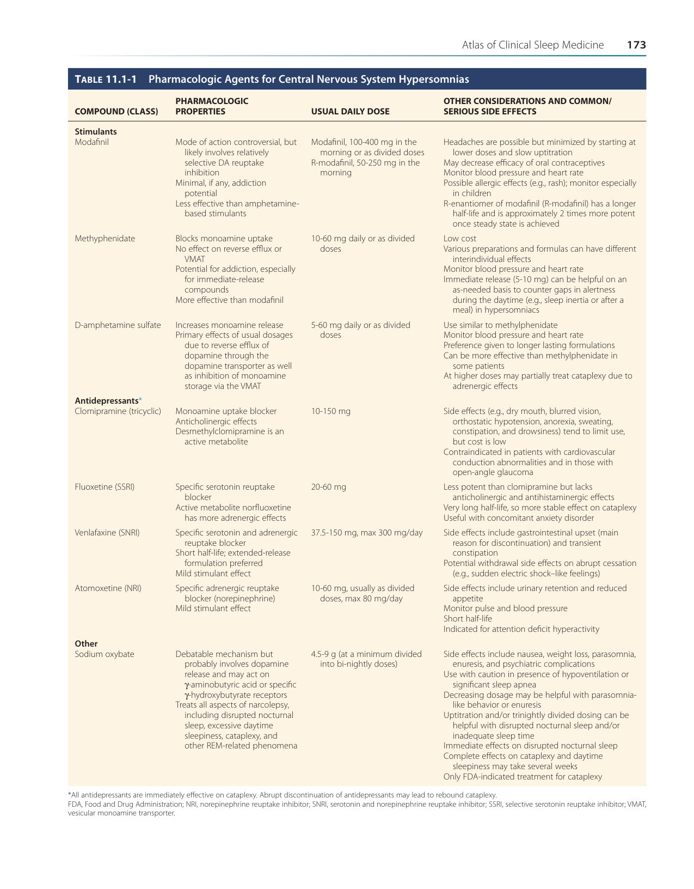

<!-- pdf-page: 192 -->

174 Neurologic Disorders

pharmacologic regimen is generally encouraged, particularly if the clinical picture or etiology is unclear or multifactorial in nature (e.g., narcolepsy without cataplexy or hypocretin deficiency) because many of these pharmacologic agents possess significant side effect profiles and come with a potential for abuse. In contrast, when cataplexy is present or hypocretin deficiency is documented, the disease is lifelong, and treatment is more codified and generally mandates aggressive optimization of medications.

Arnulf I, Rico TJ, Mignot E: Diagnosis, disease course, and management

of patients with Kleine-Levin syndrome. Lancet Neurol 11:918–928, 2012. Dauvilliers Y, Arnulf I, Mignot E: Narcolepsy with cataplexy. Lancet

369:499–511, 2007. International Classification of Sleep Disorders: Diagnostic and Coding Manual,

ed 2 (ICSD-2), Westchester, IL, 2005, American Academy of Sleep Medicine. Mignot E: A practical guide to the therapy of narcolepsy and hypersomnia

syndromes. Neurotherapeutics 9:739–752, 2012. Mignot E, Lammers GJ, Ripley B, et al: The role of cerebrospinal fluid

## MOVEMENT DISORDERS IN SLEEP

### Richard P. Allen, Rachel E. Salas, and Charlene Gamaldo

## 11.2

#### Suggested Readings

Anic-Labat S, Guilleminault C, Kraemer HC, et al: Validation of a cataplexy

questionnaire in 983 sleep-disordered patients. Sleep 22(1):77–87, 1999.

hypocretin measurement in the diagnosis of narcolepsy and other hypersomnias. Arch Neurol 59(10):1553–1562, 2002. Ohayon MM, Dauvilliers Y, Reynolds CF 3rd: Operational definitions and

algorithms for excessive sleepiness in the general population: implications for DSM-5 nosology. Arch Gen Psychiatry 69(1):71–79, 2012.

#### OVERVIEW

The second version of the International Classification of Sleep Disorders (ICSD-2) lists several sleep-related movement disorders (see Box 11.2-1). A summary of all movement disorders is shown in Figure 11.2-1. The ones most commonly experienced in sleep medicine are restless legs syndrome (RLS), also known as Willis-Ekbom disease, and periodic limb movement disorder (PLMD), which is the focus of this chapter. A brief discussion is also provided to cover three other sleeprelated movement disorders that sleep clinicians may also encounter: sleep-related leg cramps, bruxism, and rhythmic movement disorder. Although hypnic jerks (Fig. 11.2-2), or “sleep starts,” are common and can have an extreme and almost violent phenomenologic appearance, they are physiologically normal and do not constitute a disorder. The remaining conditions listed as ICSD-2 sleep-related movement disorders are of limited, if any, clinical significance.

#### PERIODIC LIMB MOVEMENTS IN SLEEP AND

#### PERIODIC LIMB MOVEMENT DISORDER

#### History and Definition

The initial descriptions of periodic limb movements (PLMs) in sleep mistakenly classified these as abrupt, repetitive movements that represented a “nocturnal myoclonus,” a term used in the literature mostly before 1970, erroneously suggesting some relation to epileptic phenomena. These movements have now been appreciated as leg movements that can reflect variable characteristics—even within a single night, for one person—for duration, onset and offset patterns, periodicity, and even in muscle groups involved in the movements. The World Association of Sleep Medicine (WASM) developed the current generally accepted criteria for defining these movements (Fig. 11.2-3). As shown in Figure 11.2-4, these movements can be frequent; in some patients, they are associated with arousals from sleep. Because these limb movements can occur during wakefulness or sleep, they are referred to as

BOX 11.2-1 Sleep-Related Movement Disorders

#### (Defined by the Second Edition of the

#### International Classification of Sleep

#### Disorders)

Restless legs syndrome (Willis-Ekbom disease) Periodic limb movement disorder Sleep-related leg cramps Sleep-related bruxism Sleep-related rhythmic movement disorder Sleep-related movement disorder, unspecified Sleep-related movement disorder because of a drug or

substance Sleep-related movement disorder because of a medical

condition Benign sleep myoclonus of infancy Excessive fragmentary myoclonus Hypnagogic foot tremor and alternating leg-muscle

activation during sleep Propriospinal myoclonus at sleep onset Sleep starts (hypnic jerks)

PLMS when they occur during sleep and PLMW when they occur during wakefulness. Movements may also occur in the arms but generally are limited to the legs.

#### Evaluation of Periodic Limb Movements

#### of Sleep and Wakefulness

Subjective reports, especially from bedmates, indicate the possible presence of PLMS/PLMW, but an all-night polysomnogram (PSG) recording is required to objectively determine and measure the presence of either. Standard sleep electroencaphalogram (EEG) is required to determine whether PLMs are occurring during sleep or in an awake state. The movements are best recorded from surface electromyogram (EMG) electrodes placed longitudinally on the belly of the anterior tibialis muscle, 2 to 3 cm apart and symmetrical with the midline of the muscle. For patients with short legs, the electrodes may be placed closer together, at one third the length

<!-- pdf-page: 193 -->

Movement disorders

In or around sleep

Simple

FIGURE 11.2-1. Flowchart for the approach to the differential diagnosis of sleep-related movement disorders. ALMA, alternating leg muscle activation;

EFM, excessive fragmentary myoclonus; HFT, hypnagogic foot tremor; PLMD, periodic limb movement disorder; RBD, rapid eye movement (REM) sleep behavior disorder; RLS, restless legs syndrome; RMD, rhythmic movement disorder.

Primarily in wakefulness and reduced in sleep Parkinson disease Huntington chorea Myoclonus Ataxia Dystonia Essential tremor Tourette syndrome Hemiballismus

Jaw and face 1. Bruxism 2. Facio mandbular myoclonus

Primarily legs 1. RLS/PLMD 2. Leg cramps 3. HFT/ALMA

Complex 1. RBD 2. Disorders of partial arousal 3. Epilepsy

Childhood 1. Benign sleep myoclonus of infancy 2. RMD

Miscellaneous 1. EFM 2. Sleep starts

1 1 1 1 1 1 1 1 1 1 1 9 9 9 9 9 9 9 9 9 9 9 9 9 9 9 9 9 9 9 9 9 9 9 9 9 9 9 9 7 9 4 9 1 9 0 0 0 0 0 0 0 0 0 0 0 0 0 0 0 0 0 0 0 0 0 0 0

LOC-A2

128 V ROC-A1

128 V

CHIN1-CHIN2

68.3 V

C3-A2

85.3 V C4-A1

85.3 V

O1-A2

85.3 V

O2-A1

85.3 V

ECG2-ECG1

682.7 V ECG2-ECG3

682.7 V

LAT1-LAT2

170.7 V RAT1-RAT2

170.7 V

Pt position

Supine Left Right Prone

SNORE

MFLO

ORAL

N/O

THOR

ABD

NPRE

SpO2

Cursor: 21:59:38, Epoch: 22 - AWAKE 30 sec/page

30 sec/page

8 8

FIGURE 11.2-2. Polysomnogram showing hypnic jerks.

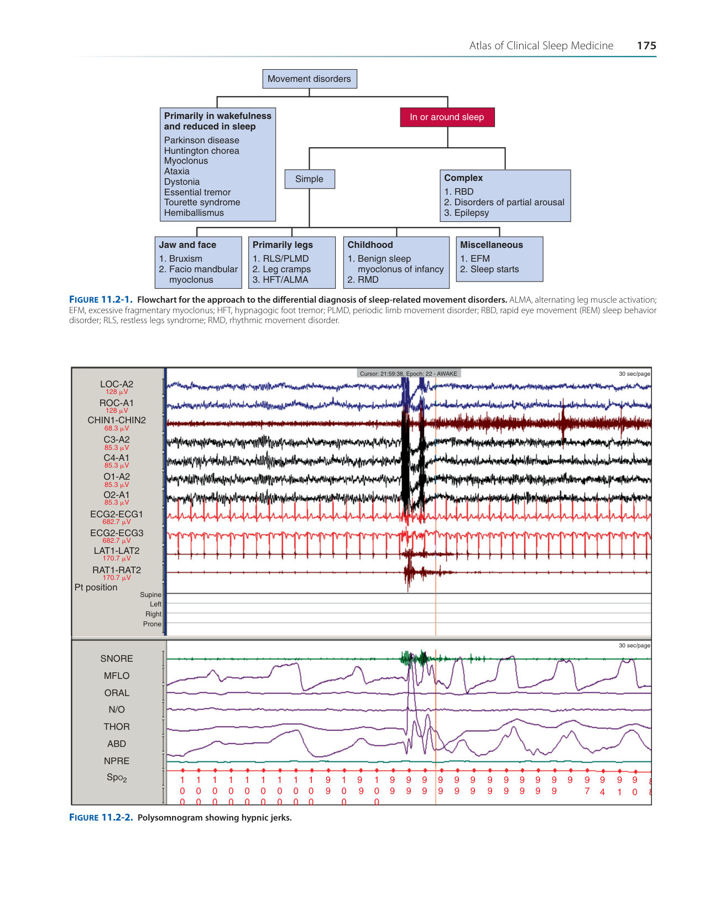

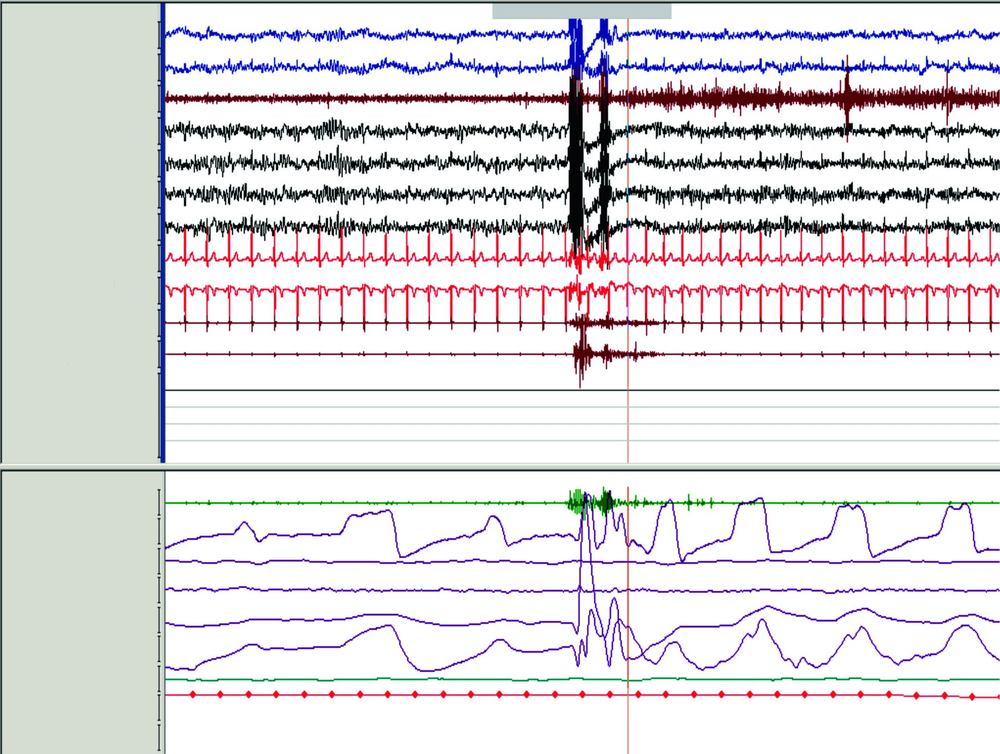

<!-- pdf-page: 194 -->

176 Neurologic Disorders

Onset Offset LM duration

Onset Offset LM duration

Inter-LM interval

Onset threshold (≥8 V above resting baseline)

Offset threshold ( 2 V above resting baseline)

Resting baseline ( 5 V)

0 V

FIGURE 11.2-3. Definition of periodic limb movements (PLMs). Movement starts when the electromyogram exceeds the onset threshold and ends when

it remains below the offset threshold for at least 0.5 seconds. The leg movement duration must be 0.5 to 10 seconds, and the intermovement interval must be 5 to 90 seconds. Four consecutive movements (three intermovement intervals) must be observed for these to be counted as PLMs. The number of such movements divided by the observation time is expressed as the PLM index, usually in terms of PLMs per hour. LM, limb movement. (From Zucconi M, Ferri R, Allen R, et al: The official World Association of Sleep Medicine [WASM] standards for recording and scoring periodic leg movements in sleep [PLMS] and wakefulness [PLMW] developed in collaboration with a task force from the International Restless Legs Syndrome Study Group [IRLSSG]. Sleep Med 2006;7:175-183.)

10 V 5 s

0.5 s

FIGURE 11.2-4. The bottom 5-minute window shows periodic limb movements that were present almost the entire night. Periodic limb movements

were seldom associated with electroencephalographic arousal but often were associated with increases in heart rate, perhaps reflecting subcortical arousals.

EMG1-EMG2

1.02 mV

C3-A2

128 V

C4-A1

128 V

Fr3-A2

128 V

Fr4-A1

128 V

01-A2

128 V

02-A1

128 V

ROC-A1

128 V

LOC-A2

128 V

ECG1-ECG2

2.05 mV

LAT-LAT-

512 V

RAT-RAT-

256 V

100

SaO2 %

50

THOR EFFORT

4.1 mV

ABD EFFORT

2.05 mV

50

PULSE bpm

30 40

EtCO2 mm Hg

0

Cursor 00:00:00. Epoch: 00 • STAGE 2 30 sec/page

5 min/page

of the muscle. Bilateral recordings of each muscle on a separate channel are required for accurate assessment of PLMs in sleep or waking.

Ambulatory leg activity monitors, such as personal activity monitors (PAM), record the patient’s physical activity and store the data for later download; these monitors provide a limited alternative to the PSG and have the advantage of being able to

record for multiple days. Given marked day-to-day variability in PLMs, a 5-day recording is considered desirable to obtain a stable measure for a single person. These monitors, however, do not discern sleep or wakeful states and thus report all PLMs during the night recording, not just PLMS. For most people, wakeful time during the night is much less than the sleep time. Therefore assuming all PLMs during nocturnal sleep time are

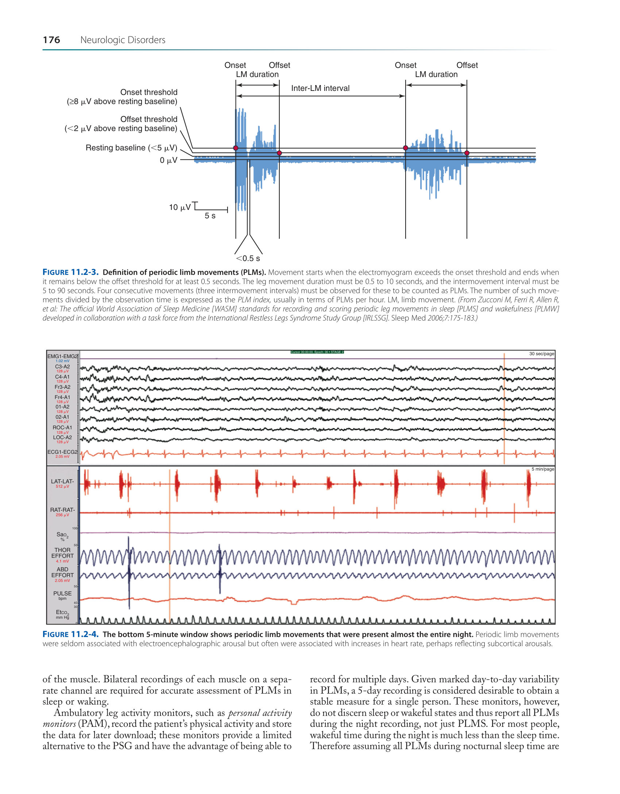

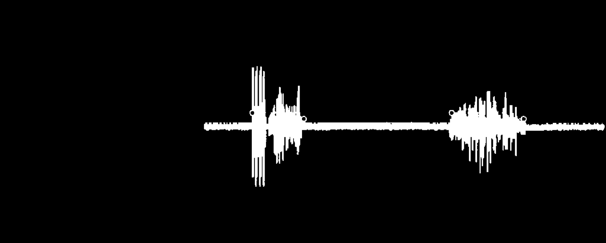

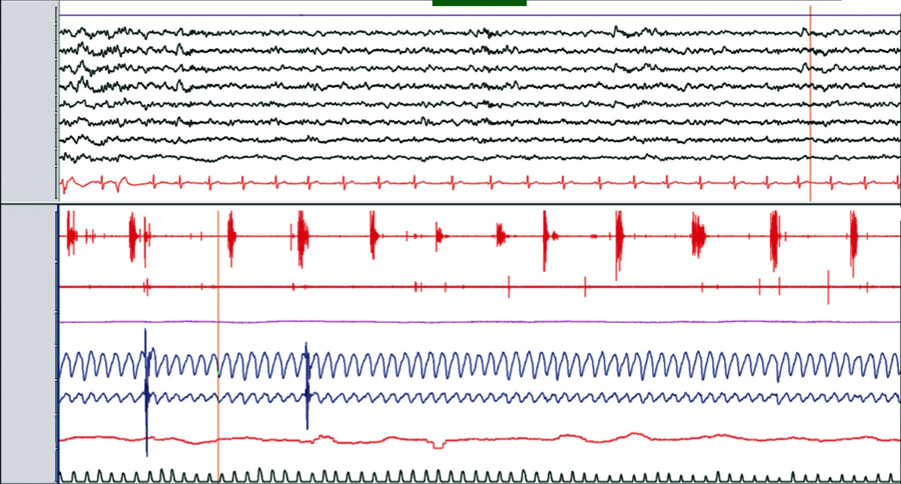

<!-- pdf-page: 195 -->

PLMS does not usually represent a significant error, but this does not apply to patients with low sleep efficiency. Activity monitors also do not exclude leg movements associated with respiratory events; thus such monitors should be used cautiously for patients with a history of confirmed or suspected untreated sleep-disordered breathing (SDB).

3 2 1 a b c d e 1 2 3 4 5 6 7 8 9 10 Before PLM Within PLM After PLM

#### Biology and Pathophysiology

Sleep, and to some extent the drowsy resting state, inhibits spinal leg-flexor reflexes. This has been demonstrated for sleep-related inhibition of the leg-flexor response to highfrequency stimulation of the medial plantar nerve. PLMS may be associated with loss of this inhibition that occurs with aging and with some disorders, such as restless legs syndrome (RLS). Decreased spinal inhibition or, alternately phrased, increased spinal excitability, has been documented during sleep in patients with PLMS and RLS. The Hoffmann’s reflex inhibition that occurs for up to 0.5 seconds after it has been stimulated is reduced in patients with RLS during the evening awake resting time. This indicates increased spinal excitability for RLS that is limited to rest and to the time of day associated with RLS symptoms. In this commonly accepted view of PLMS, leg movements occur during sleep because of the failure to inhibit periodic descending spinal activation signals. Periodic descending activation events have been associated with the basic cycling alternating pattern (CAP) of sleep. CAP describes cycling between deeper (quiet) and more

CARDIAC CYCLES: SBP

20

16

Change in SBP (compared with average of

12

3, 2, 1 seconds)

8

4

0

4

8

12

aroused (active) sleep, with PLMS occurring during the active cycle. PLMS and the associated activating events also occur with increases in blood pressure and heart rate that indicate autonomic arousal (Fig 11.2-5; see also Fig. 11.2-4). The periodic activating events, and not the PLMS, appear to be primary. Inhibiting the leg movements by dopaminergic drugs fails to alter CAP or these episodic autonomic activating events. Thus PLMS serves as a motor sign of failure to inhibit central nervous system (CNS)–activating events that have clinical and physiologic consequences, but the leg movements themselves do not cause the arousal events.

PLMS and PLMW are age-related phenomena. PLMS occurs commonly in healthy adults older than 40 years, whereas PLMW occurs mainly in people younger than 19 years (Fig. 11.2-6) and to some extent in adults older than 60 years (Fig. 11.2-7). These differences in age effects suggest that neurobiologic origins differ for PLMW and PLMS.

#### Clinical Significance

The common occurrence of PLMS and PLMW in healthy individuals indicates that they are not sensitive markers for indicating any specific underlying disease state. They may, however, be a specific motor sign for some disease states, such as RLS, in which 80% to 90% of the patients have PLMS at rates greater than 5 per hour. PLMS and PLMW may act as indicators, albeit less sensitive, for both narcolepsy and rapid eye movement (REM) sleep behavior disorder. In addition,

Fake PLMS

PLMSA PLMW

PLMSNA RRLM

FIGURE 11.2-5. Periodic limb movements (PLMs): clinical significance. PLMs are common in healthy older adults but are not disease state specific. They

are a motor sign of restless legs syndrome, with 80% to 90% sensitivity (not specific), and are associated with heart rate and blood pressure increases. PLMS, PLM during sleep; PLMW, PLM during wakefulness; PLMSA, PLMs with cortical arousal; PLMSNA, PLMs without cortical arousal; RRLM, respiratory-related limb movements; SBP, systolic blood pressure. (From Siddiqui F, Strus J, Ming X, et al: Rise of blood pressure with periodic limb movements in sleep and wakefulness. Clin Neurophysiol 2007;118:1923-1930.)

<!-- pdf-page: 196 -->

178 Neurologic Disorders

E2-M1

E2-M2

C4-M1

C3-M1

CHIN1

ECG

256 257 257 258 258 259 259 260 260 261 261 262 262 263 263 264 264 265 23:54:01 23:49:01

## 5m

## 30s

96 96 96 96 96 96 96 96 96 96 96 96 96 96 96 96 97 97 97 97 97 97 97 97 97 97 97 97 97

RLeg

LLeg

SNORE

PTAF

THERM

THOR

ABD

Sum

100 92 85 SaO2 (%)

FIGURE 11.2-6. Polysomnogram in a 6-year-old child. Children can have periodic limb movements during sleep. Such children may be referred with sleepi­

ness and may have been diagnosed with attention deficit–hyperactivity disorder. In this example, inadequate gain resulted in the right leg not showing the movements.

5-9 10-19 20-29 30-39 40-49 50-59 60 Age (y) 5-9 10-19 20-29 30-39 40-49 50-59 60 Age (y)

40

30

PLMS index

20

10

0

100

90

80

70

PLMW index

60

50

40

30

20

10

0

FIGURE 11.2-7. Periodic limb movements during sleep (PLMS) and wake time (PLMW) at different ages for healthy people. (From Pennestri MH, Whit­

torn S, Adam B, et al: PLMS and PLMW in healthy subjects as a function of age: prevalence and interval distribution. Sleep 2006;29:1183-1187.)

they can also result from medications such as selective serotonin reuptake inhibitors (SSRIs) or serotonin-norepinephrine reuptake inhibitors (SNRIs; Fig. 11.2-8).

PLMS that occurs at high rates for age with a sleep complaint unexplained by another disorder or medication has been assumed to define a sleep-related disorder referred to as periodic limb movement disorder (PLMD). Clinical guidelines for PLMD are given in Box 11.2-2. Despite considerable clinical experience that supports this condition, no studies have been done to clearly document this disorder. PLMS should be viewed first as markers of possible disease risk and is not a disorder itself. Some patients with high rates of PLMS and sleep complaints when treated with levodopa or a dopamine agonist developed RLS for the first time, indicating that PLMS may also occur as a forme fruste of RLS.

#### CLINICAL GUIDELINES

#### Restless Legs Syndrome

#### History

Despite being described in the medical literature in the seventeenth century by Willis, RLS was largely ignored until the excellent 1945 monograph by Ekbom, who provided carefully detailed descriptions of several cases (the condition is also known as Willis-Ekbom disease, the name preferred by patient groups). The term restless legs remains with us today despite its somewhat inappropriate suggestion of restless, agitated, or anxious movements that do not truly characterize the disorder. The development of the field of sleep medicine in the last part of the twentieth century produced increased awareness of the clinical significance of disorders related to sleep-wake

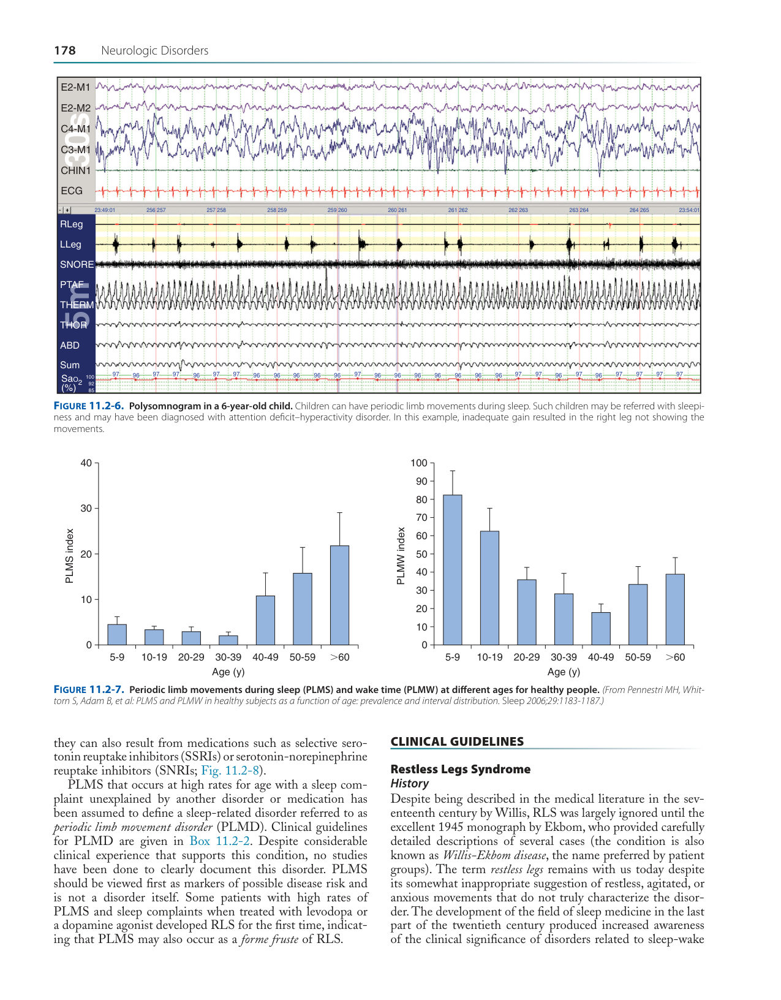

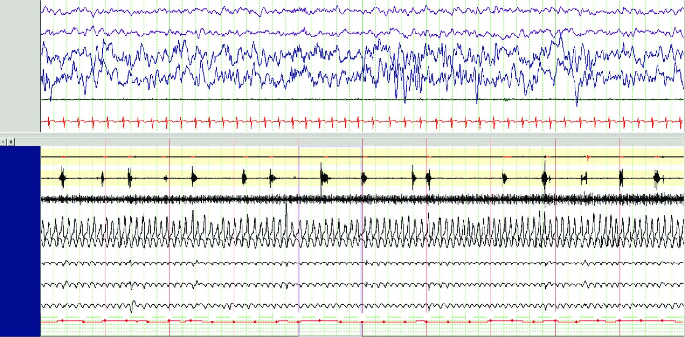

<!-- pdf-page: 197 -->

**

**

### Rest or

inactivity precipitates or worsens symptoms

**

### Urge to

move limbs

10

PLMI

* *

5

0 Control Bupropion Venlafaxine

SSRls

PLM w/o arousal PLM w/arousal total PLM

FIGURE 11.2-8. Certain antidepressants can worsen restless legs syn­

drome. In this example, the serotonin-norepinephrine reuptake inhibitor venlafaxine (Effexor) is a risk factor for inducing periodic limb movements with and without arousals compared with control patients, those using selective serotonin reuptake inhibitors (SSRIs), and those taking bupropion (Wellbutrin). PLMI, periodic limb movement index. *P < .001; **P < .0001. (Modified from Yang C, White DP, Winkelmann JW: Antidepressants and periodic leg movements of sleep. Biol Psychiatry 2005;58:510-514.)

BOX 11.2-2 Periodic Limb Movement Disorder:

#### Clinical Guidelines

1. Evaluate if:

PLMS >5/hour for people <40 years, particularly children or PLMS >15/hour for adults >40 years

2. Consider common causes and treat accordingly:

Medication use associated with onset of PLMS (e.g., SSRIs,

SNRIs) Restless legs syndrome Respiratory-related arousals, narcolepsy, REM sleep

behavior disorder Psychophysiologic insomnia

3. If unexplained consider treatment trial if:

Significant and related sleep-wake complaint and Arousal rate with PLMS is high (>5/hour)

4. Usual treatments:

Clonazepam 0.5-1.0 mg before bed Other approved GABA-active hypnotic CAUTION: daytime sleepiness, increased accident risk

GABA, γ-amino butyric acid; PLMS, periodic limb movement during sleep; REM, rapid eye movement; SNRIs, serotonin-norepinephrine reuptake inhibitors; SSRI, selective serotonin reuptake inhibitors.

states, which included RLS, and it is now understood to be the second or third most common sleep-related disorder.

#### Diagnosis

RLS has been well defined by the International Restless Legs Syndrome Study Group (IRLSSG). The diagnostic criteria are available online at www.irlssg.org and are also listed in Box 11.2-3. The diagnosis requires all four of the basic essential

### Evening

or nighttime appearance or worsening of symptoms at night

### Getting

up or moving improves the sensation

FIGURE 11.2-9. Essential criteria and core symptoms of restless legs

syndrome: “URGE.” (Modified from Allen RP, Picchietti D, Hening WA, et al: Restless legs syndrome: diagnostic criteria, special considerations, and epidemiology. A report from the Restless Legs Syndrome Diagnosis and Epidemiology Workshop at the National Institutes of Health. Sleep Med 2003;4[2]:101-119; and Walters AS: Toward a better definition of the restless legs syndrome. Move Disord 1995; 10:634-642.)

criteria that define the disorder (Fig. 11.2-9) plus a differential diagnosis that excludes common RLS “mimics.” These mimics produce symptoms close to those of RLS that can be differentiated from RLS by careful history taking. Indeed, patients may sometimes find it difficult to articulate symptoms of RLS (Fig. 11.2-10), which may be one reason why the condition may not be very easily recognized by practitioners who first encounter patients with this condition. Several conditions need to be considered in the differential diagnosis of RLS (Table 11.2-1). The core symptom of RLS is the sensation of a strong urge to move the legs that occurs while resting, particularly in the evening or night. Thus RLS has a sensory disturbance with a movement response that sometimes occurs involuntarily. It is therefore considered a sensorimotor neurologic disorder precipitated by rest or sleep. Box 11.2-4 summarizes key clinical features for RLS diagnosis.

Diagnosis is supported by PLMS that occur more than expected for age, another first-degree relative with RLS, and a significant reduction in symptoms shortly after starting dopaminergic treatment. RLS generally produces a sleep disturbance with reduced sleep quality and/or quantity, and the sleep complaint further supports the diagnosis.

#### Medical Evaluation: Iron Status

Serum ferritin and transferrin saturation should be obtained in all RLS patients; those with ferritin level below 75 µg/L or transferrin saturation below 17% should be placed on oral iron treatment, provided that iron supplementation is not contraindicated, such as with hemochromatosis. Iron treatment should be stopped when ferritin exceeds 100 µg/L or transferrin saturation is 50% or greater. Patients with iron deficiency anemia as well as other comorbidities (Fig. 11.2- 11) are at risk for developing RLS.

<!-- pdf-page: 198 -->

180 Neurologic Disorders

BOX 11.2-3 Diagnostic Criteria for Restless Legs Syndrome: International Restless Legs Syndrome Study Group

5. Occurrences of the above features are not solely accounted

Restless legs syndrome (RLS) is diagnosed by ascertaining symptom patterns that meet the following five essential criteria, with additional clinical specifiers added when appropriate.

for as symptoms primary to another medical or a behavioral condition (e.g., myalgia, venous stasis, leg edema, arthritis, leg cramps, positional discomfort, habitual foot tapping.)‖

#### Essential Diagnostic Criteria (All Must Be Met)

1. An urge to move the legs usually, but not always,

#### Specifiers for the Clinical Course of Restless Legs

#### Syndrome¶

A. Chronic-persistent RLS: Symptoms when not treated would

§When symptoms are very severe, the worsening in the evening or night may not be noticeable but must have been previously present. ‡When symptoms are very severe, relief by activity may not be noticeable but must have been previously present. †Pediatric cases must include the uncomfortable and unpleasant leg sensation. *Sometimes the urge to move the legs is present without the uncomfortable sensation, and sometimes the arms or other parts of the body are involved in addition to the legs.

accompanied by or felt to be caused by uncomfortable and unpleasant sensations in the legs.*† 2. The urge to move the legs, and any accompanying

unpleasant sensation, begins or worsens during periods of rest or inactivity, such as lying down or sitting. 3. The urge to move the legs, and any accompanying

unpleasant sensation, is partially or totally relieved by movement, such as walking or stretching, at least as long as the activity continues.‡ 4. The urge to move the legs, and any accompanying

unpleasant sensation, during rest or inactivity only occurs or becomes worse in the evening or night rather than during the day.§

occur on average of at least twice weekly for the past year. B. Intermittent RLS: Symptoms when not treated would occur

on average fewer than two per week for the past year, with at least five lifetime events.

#### Specifier for Clinical Significance of Restless Legs Syndrome

The symptoms of RLS cause significant distress or impairment in social, occupational, educational, and other important areas of functioning by the impact on sleep, energy/vitality, daily activities, behavior, cognition, and mood.

‖These conditions, often referred to as “RLS mimics,” have been commonly confused with RLS, particularly in surveys, because they produce symptoms that meet or at least come very close to meeting all of the above criteria. The list here gives some examples of this that have been noted as particularly significant in epidemiologic studies and clinical practice. RLS may also occur with any of these conditions, but the RLS symptoms will then be greater in degree, conditions of expression, or character than those usually occurring as part of the other condition.

¶The clinical course criteria do not apply for pediatric cases, nor do they apply for some special cases of provoked RLS, such as pregnancy- or drug-induced RLS, in which the frequency may be high, but it is limited to the duration of the provocative condition.

Urge to move Like bugs creeping

The communication disconnect

What the patient says... What the physician is listening for...

Creepy crawly Tugging

Tingling

FIGURE 11.2-10. Patients sometimes find it difficult to articulate symptoms of restless legs syndrome. Patients speak in emotional language. (Has the

term “heebie-jeebies” ever been noted in a diagnostic scale or evidence-based scientific paper?) Physicians look for top-line factual descriptors about restless legs syndrome and often do not interpret what the patient is saying.

Heebiejeebies

Pain... but not pain

Twitching/ jerking Funny sensations

#### Biology and Pathophysiology

RLS biology provides important insights into treatment options that involve three major contributors to the disease: iron, dopamine, and glutamate. In addition, genome-wide association studies have now identified allelic variations that carry increased risk of RLS (Table 11.2-2). One of these variations, BTBD9, has been found to be related to the presence of reduced serum ferritin, but otherwise, at this point these allelic variations have not been found to relate to any particular biologic pathway that increases the risk of RLS. Iron. Decreased iron content in the substantia nigra in patients with RLS has been documented by magnetic resonance

imaging (MRI), ultrasound, and autopsy (Fig. 11.2-12). It is the best-documented biologic abnormality of RLS (Fig. 11.2- 13). Iron in the brain is regionally regulated, and certain areas appear sensitive to decreased availability of iron, particularly the substantia nigra. RLS patients appear to have trouble maintaining adequate brain iron stores, possibly related to iron transport disturbance across the blood-brain barrier or failure of cellular distribution within the brain. This makes the brain iron stores particularly vulnerable to fluctuations in the peripheral iron state, and these individuals are more affected by low peripheral iron stores. Figure 11.2-14, A, shows the decreased relation between cerebral spinal fluid and serum ferritin for

<!-- pdf-page: 199 -->

TABLE 11.2-1 Differential Diagnosis of Restless Legs Syndrome (RLS)

ALTERNATE DIAGNOSIS CLINICAL FEATURE DISTINGUISHED FROM RLS BY

Leg cramps Sleep-related painful muscle cramp Hardening, cramping of muscle

Peripheral neuropathy Numbness, burning, pain Not quickly relieved with movement

Positional discomfort Discomfort, pressure, or pain from staying in one position

Relieved by one movement Not circadian

too long

Arthritic pains Discomfort mostly in joints Not quickly relieved with movement Not clearly circadian

Habitual/anxious foot tapping Nervous foot motion, limited awareness Not aware of any need to move Not clearly circadian

Muscle/myopathic pain Muscle aches or pains Not strongly circadian Not immediately relieved with movement Not limited to resting

Painful leg/feet and moving toes Slow, writhing, repetitive toe movements with leg/foot pain Not circadian Not relieved by movement Not worse when resting

Drug-induced or drug-exacerbated RLS Major drugs to check: 1. SSRIs (e.g., fluoxetine [Prozac]) 2. SNRIs (e.g., venlafaxine [Effexor], duloxetine [Cymbalta)] 3. Dopamine antagonists (e.g., metoclopramide [Regalin]) 4. Antihistamines (e.g., diphenhydramine [Benadryl])

Neuroleptic induced akathisia Whole body needs to move; follows use of dopamine

antagonist

Not limited to the legs Otherwise the same as RLS

RLS abates within 2 weeks of reduced dose or

stopping the drug

SNRIs, serotonin-norepinephrine reuptake inhibitors; SSRIs, selective serotonin reuptake inhibitors.

BOX 11.2-4 Summary of Key Clinical Features for

#### Restless Legs Syndrome (RLS) Diagnosis

#### Key Criteria

Urge to move the legs or arms, usually accompanied or

caused by uncomfortable leg sensations Temporary relief with movement and partial or total relief

from discomfort by walking or stretching Onsent or worsening of symptoms at rest or inactivity, such

as when lying or sitting

#### Supportive Features

Sleep disturbances Involuntary leg movements PLMS more than expected for age Positive family history of RLS Positive response to dopaminergic therapy

#### Associated Features

Can begin at any age, but most patients seen in clinical

practice are middle-aged or older. Most patients have a progressive clinical course, but a static clinical course is sometimes seen. Remissions of 1 month or more are sometimes reported. The leg discomfort and the need to move result in insomnia

and sleep disturbance. Neurologic examination findings are normal in idiopathic and

familial forms of the syndrome. Peripheral neuropathy or radiculopathy is sometimes

experienced in the nonfamilial form of RLS, and a low serum ferritin level (50 g/L) may be associated with the syndrome.

Data from Allen RP, Picchietti D, Hening WA, et al: Restless legs syndrome: diagnostic criteria, special considerations, and epidemiology. A report from the Restless Legs Syndrome Diagnosis and Epidemiology Workshop at the National Institutes of Health. Sleep Med 2003;4(2):101-119; and Walters AS: Toward a better definition of the restless legs syndrome. Move Disord 1995;10:634-642.

Diagnostic criteria developed by the International Restless Legs Syndrome Study Group (IRLSSG) in collaboration with the National Institutes of Health.

PLMS, periodic limb movements in sleep.

FIGURE 11.2-11. Restless legs syndrome (RLS) in iron deficiency. This

young woman with RLS was a vegetarian on a poor diet and had severe, chronic iron deficiency. Her tongue had evidence of glossitis manifested as reddened atrophic mucosa. Burning of the tongue is a common symptom when this is present.

RLS patients compared with healthy adults without RLS. Accordingly, a critical feature of all RLS treatment is to maintain high normal levels of peripheral iron stores (i.e., serum ferritin >75 µg/L) to help augment the central iron stores and thereby reduce RLS severity (see Fig. 11.2-14, B). Future treatment development will focus on better methods of iron delivery for RLS, such as intravenous iron with formulations that promote iron transport to brain tissue.

Cellular and tissue autopsy and blood analyses of iron proteins in RLS patients produced some surprisingly conflicting

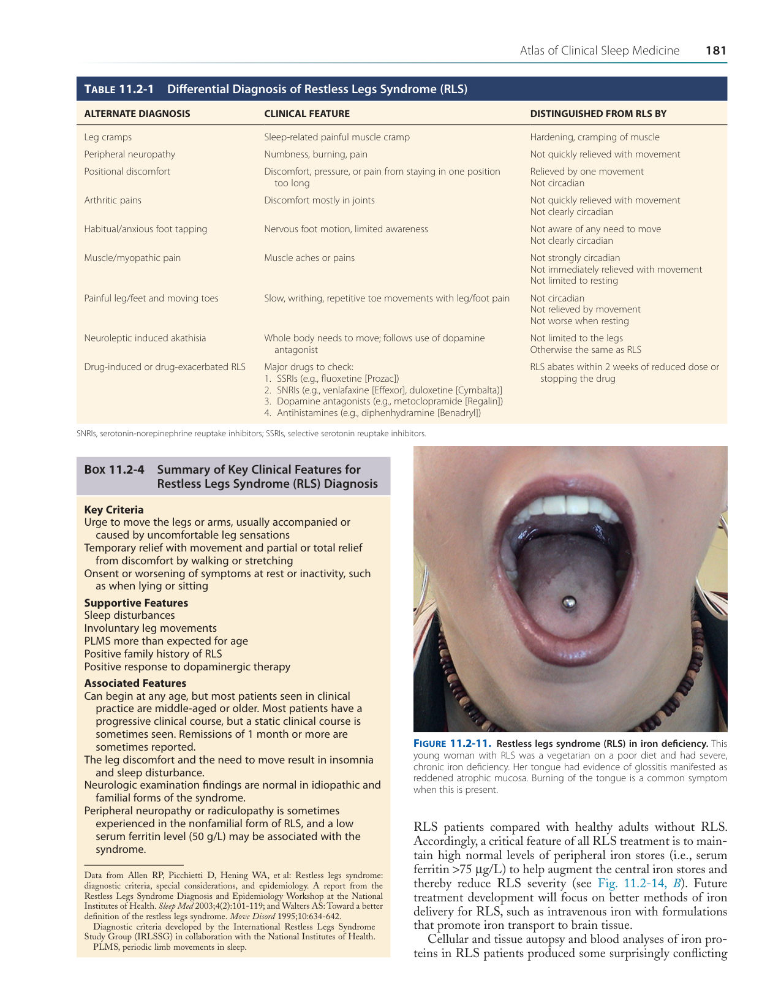

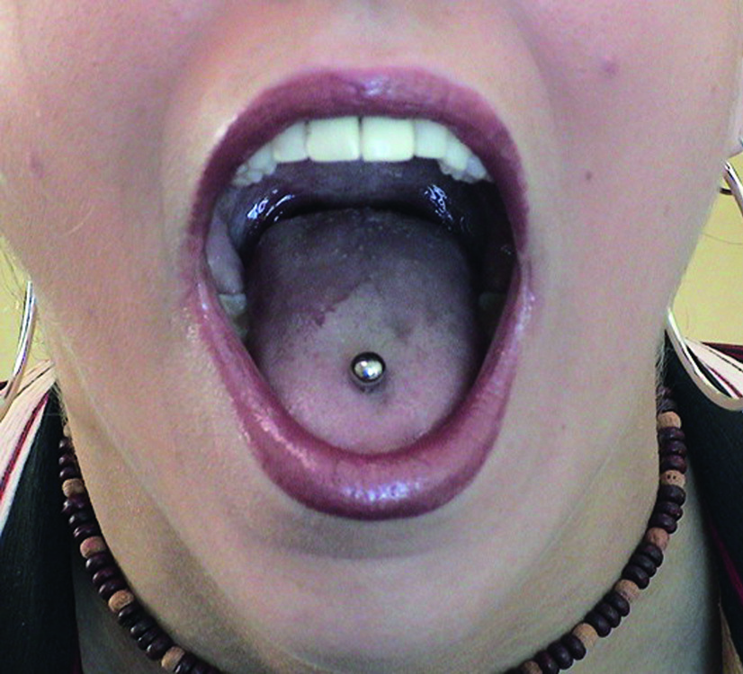

<!-- pdf-page: 200 -->

182 Neurologic Disorders

TABLE 11.2-2 Major Allelic Variations Identified by Genome-Wide Association Studies as Increasing the Risk of

#### Restless Legs Syndrome

CHROMOSOME LOCUS SNP RISK ALLELE ODDS RATIO (95% CI)

2 MEIS1 rs2300478 G 1.68 (1.57-1.81) 6 BTBD9 rs9357271 T 1.47 (1.35-1.47) 9 PTPRD rs1975197 A 1.29 (1.19-1.40) 15 Map2K5/SKOR1 rs12593813 G 1.41 (1.32-1.52) 2 Intergenic region rs6747972 A 1.23 (1.16-1.31) 2 Intergenic region rs2116050 G 1.22 (1.15-1.30) 16 TOX3/BC034767 rs3104767 G 1.35 (1.27-1.43) 16 TOX3/BC034767 rs3104788 T 1.33 (1.25-1.43)

From Winkelmann J, Czamara D, Schormair B, et al: Genome-wide association study identifies novel restless legs syndrome susceptibility loci on 2p14 and 16q12.1. PloS Genet 2011;7(7):e1002171.

FIGURE 11.2-12. Restless legs syndrome (RLS) pathophysiology. Brain iron insufficiency neuropathologic examination using iron stain for RLS controls

(A) and patients (B). (From Connor JR, Boyer PJ, Menzies SL, et al: Neuropathological examination suggests impaired brain iron acquisition in restless legs syndrome. Neurology 2003;6:301-309.)

CI, confidence interval.

A B

R2* (sec 1) 3

0

RLS Control

FIGURE 11.2-13. Magnetic resonance R2* images in a 70-year-old

patient with restless legs syndrome (RLS) and a 71-year-old control subject. Much lower R2* relaxation rates are apparent in the RLS patient in both substantia nigra and red nucleus. (From Allen RP, Barker PB, Wehrl F, et al: MRI measurement of brain iron in patients with restless legs syndrome. Neurology 2001;56:263-265.)

results. Proteins involved in cellular iron export (ferroportin) and iron uptake (transferrin receptor) vary, sometimes in conflicting ways. Substantia nigra cells show decreased iron and appropriately decreased iron export proteins with a decrease in one of the two major iron regulatory proteins, IRP-1, but they also show an unexpected decrease in the iron import protein transferrin receptor, suggesting problems acquiring and maintaining cellular iron status. Choroid plexus and microvascular tissue show increases in both iron import and export proteins and increased mitochondrial ferritin, suggesting possible

increased cellular iron turnover and possibly some increased energy demands. Even lymphocytes show iron protein abnormalities, with increased iron importer (transferrin receptor) despite no other indication for reduced availability of iron for these cells. These disruptions of iron metabolism are associated with increased hypoxic pathway activation both in CNS tissue and in peripheral muscles. Overall, the significant disturbance of iron metabolism and regulation that appears to be characteristic of RLS manifests through the disruption of multiple irondependent metabolic activities that affect not only hypoxic pathway activation but also both dopaminergic and glutamatergic systems. This central disturbance in iron regulation accounts for most RLS symptoms and leaves the RLS patient highly vulnerable to any peripheral iron loss. Dopamine. Highly successful treatment of RLS with dopamine-promoting drugs (levodopa or dopamine agonists) has led to the assumption that RLS involves reduced dopaminergic activity. However, the brain of an RLS patient and the brain of an experimentally induced iron-deficient animal both show increased nigro-striatal dopaminergic activity with increased dopamine production. This is indicated for irondeficient animals by increases in both tyrosine hydroxylase and extracellular striatal dopamine. It is complemented by decreases in D2 receptors (D2R) and membrane-bound dopamine transporters (DAT). This same pattern has now been well documented in RLS patients (Fig. 11.2-15), and a postsynaptic downregulation of response to dopamine is apparent. This

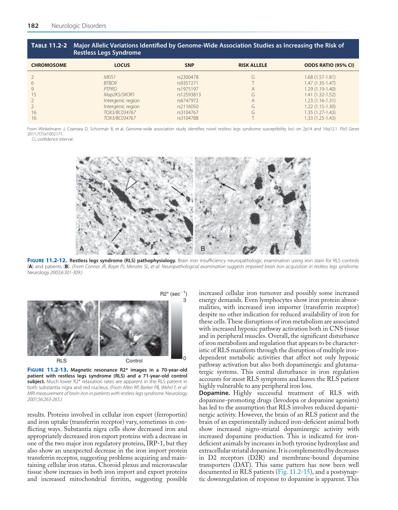

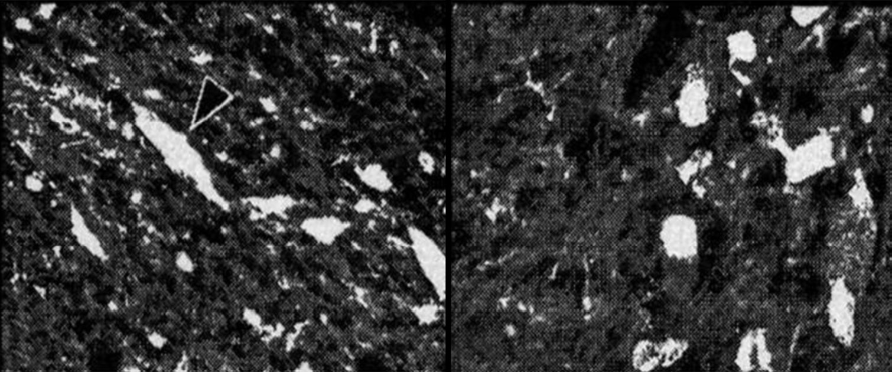

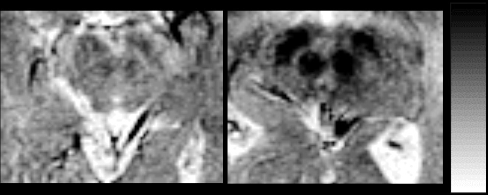

<!-- pdf-page: 201 -->

RLS severity and serum ferritin levels Normal controls CSF vs. serum ferritin

RLS patients

7

3

6

5

2

4

FIGURE 11.2-14. Cerebrospinal fluid versus serum ferritin for restless legs syndrome (RLS) patients and matched controls. A, The slope and intercept

differ significantly for RLS patients compared with controls. Note that for the RLS patient, low levels of serum ferritin relate to very low, almost undetectable levels of cerebrospinal fluid (CSF) ferritin. Very high serum ferritin levels (200 to 330 µg/L) are needed for the CSF levels to be normal. This indicates the difficulty RLS patients have maintaining adequate central nervous system levels of iron. Iron concentration in some brain regions, particularly the substantia nigra, appear sensitive to the RLS-compromised iron transport. This makes RLS patients sensitive to peripheral iron status. B, RLS severity is higher for lower serum ferritin. (A, From Earley C, Connor JR, Beard JL, et al: Abnormalities in CSF concentrations of ferritin and transferrin in restless legs syndrome. Neurology 2000;54:1698-1700; B, Modified from Sun ER, Chen CA, Ho G et al: Iron and the restless legs syndrome. Sleep 1998;21:371-377.)

CSF ferritin (ng/mL)

3

2

1

0

1

100 0 100 200 300 400 500 600 Serum ferritin (ng/mL)

A B

RLS severity

1

0

0 100 75 50 25 125 150 175 200 225 250 Ferritin (ng/mL)

produces inadequate response to dopamine stimulation during both the low point of overall dopamine activity, at times RLS symptoms occur (evening and night), and also during periods of decreased arousal. Drugs that increase dopamine stimulation specifically at these times reduce RLS symptoms. This short-duration dopamine stimulation potentially causes a daily rebound, which further increases desensitization to dopamine stimulation. This would exacerbate the underlying dopaminergic pathophysiology of RLS and produce the clinically recognized problem of RLS augmentation, when short-acting dopamine treatment is continued for more than 6 months.

Both dopaminergic treatment and dopamine abnormality in RLS seem particularly closely related to motor features (PLMS) and sensory features of RLS, but paradoxically not to the sleep loss. Glutamate. When brain iron is experimentally decreased in animals, it produces increased glutamatergic activity. A similar increase in glutamatergic activity in RLS patients has been suggested by one recent MRI spectroscopy study. Drugs that decrease glutamate activity, such as α2δ calcium channel blockers and N-methyl-D-aspartate receptor antagonists, reduce RLS sensory features and sleep loss but have less effect on the RLS motor signs (i.e., PLMs).

#### Evaluation of Restless Legs Syndrome Severity

The IRLSSG RLS Severity Scale has become widely accepted for the subjective clinical evaluation of RLS. This 10-item scale has a total score that ranges from 0 to 40 with two subscales, symptom and impact scales, as shown in Box 11.2-5 and Table 11.2-3.

The suggested immobilization test (SIT) provokes expression of RLS symptoms by requiring patients to remain relaxed and sit upright at about a 60-degree angle in bed with their

TABLE 11.2-3 Factor Loadings of the International

#### Restless Legs Syndrome Study Group

#### Items

FACTOR 1 FACTOR 2

Item 6 0.836 0.286 Item 1 0.820 0.147 Item 2 0.801 −0.029 Item 4 0.729 0.376 Item 8 0.729 0.324 Item 7 0.687 0.110 Item 9 0.398 0.757 Item 10 0.378 0.718 Item 3 −0.159 0.653 Item 5 0.562 0.614

Rotated varimax loadings for the critical items defining each subscale are indicated in italics.

Cronbach’s alpha: factor 1 = 0.90; factor 2 = 0.75.

legs placed straight and horizontal on the bed. Patients are instructed to stay awake and not to move their legs, unless they cannot resist or must do so to reduce symptoms. Every 10 minutes, patients are instructed to report the severity of their leg discomfort and urge to move. No visual or auditory stimuli are provided during this test aside from the items in the room and the requests for subjective symptom descriptions. No outside window viewing or noise is allowed. The leg movements are recorded by using standard leg-movement monitoring criteria during the PSG. An EEG is also recorded to ensure patients do not fall asleep. If sleep occurs, the patient is awakened, but the test continues for the remainder of the planned hour duration. PLMW and sensory symptoms increase with duration of the test and vary with the time of

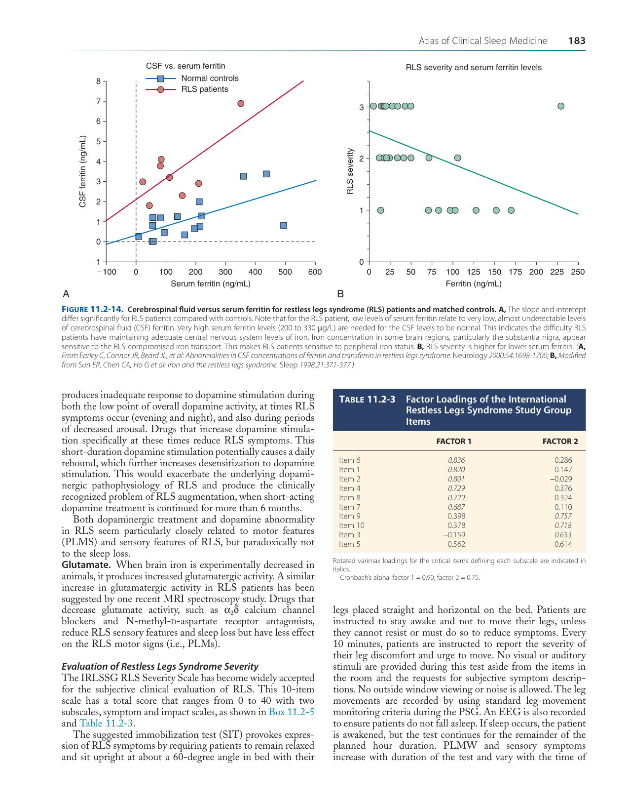

<!-- pdf-page: 202 -->

184 Neurologic Disorders

RLS

Control

FIGURE 11.2-15. Dopamine abnormalities in restless legs syndrome (RLS) indicating increased dopamine activation. Treatment response and the

decreased D2 receptor (D2R) suggest decreased postsynaptic response to dopamine activation. A, Tyrosine hydroxylase staining in the substantia nigra is increased in the RLS patient compared with the control subject. B, D2R in the putamen is decreased in RLS in relation to RLS severity. C, [11C]Methylphenidate binding potential (BP) shows membrane-bound dopamine transporter is decreased in RLS. IRLS, International RLS Severity Scale; VS, visual scale. (A, Courtesy J.C. Connor and W. Xinseng, Hershey Medical Center, State College, PA. B, From Connor JR, Wang XS, Allen RP: Altered dopaminergic profile in the putamen and substantia nigra in restless leg syndrome. Brain 2009;132:2403-2412. C, From Earley CJ, Kuwabara H, Wong DF, et al: The dopamine transporter is decreased in the striatum of subjects with restless legs syndrome. Sleep 2011;34:341-347.)

A

D2R in putamen decreased in RLS in relation to RLS severity

.0325

r .80, P .018

.03

.0275

.025

.0225

Putamen D2R

.02

.0175

.015

.0125

.01

.0075

.005

24 26 28 30 32 34 36 38 40 IRLS

B

VS level

BP 2.3

Mid-striatum

0

1.3

C

RLS Control

day at which the test is conducted (Fig. 11.2-16; Video 11-2 shows leg movements during three SIT tests under different medication conditions: placebo, 0.5 mg lorazepam, and 50 mg diphenhydramine; note the well-known marked increase with the antihistamine).

Symptoms for an individual vary with time of day and other factors, producing increased variance in the SIT data. The multiple SIT (mSIT) uses four SITs, starting at 4 PM, and repeated every 2 hours (1 hour SIT, 1 hour general activity). The maximum average sensory score or the number of waking periodic limb movements per hour provides the mSIT scores, with normal values being close to 0 for sensory discomfort and less than 20 per hour for PLMW.

Overall, the mSIT provides the best measure of current RLS symptoms. The provocation with rest and the repeated measures serve to reduce the large day-to-day variation in symptoms, providing perhaps the best objective evaluation of current RLS severity. Severity of symptoms that occur over

longer periods, such as over the previous week, is, however, best evaluated using the subjective report of symptoms on the International RLS Severity Scale.

#### Prevalence and Clinical Significance

The wide range of RLS severity distorts assessment of its prevalence. General population surveys indicate that about 7% to 10% of adults in Europe (Fig. 11.2-17) and North America report having “leg feelings” during the past year that meet the four primary criteria for RLS. Upon further evaluation, at least half of these are diagnosed with RLS mimics or “not RLS.” One epidemiologic study provided physician diagnosis of RLS and not patients’ self-reports. That study sampled adults from a population of those attending a primary care office who reported moderately to severely disturbing RLS symptoms occurring at least twice a week (referred to as “RLS sufferers”). The overall prevalence of physician-diagnosed RLS adjusted for missing data was

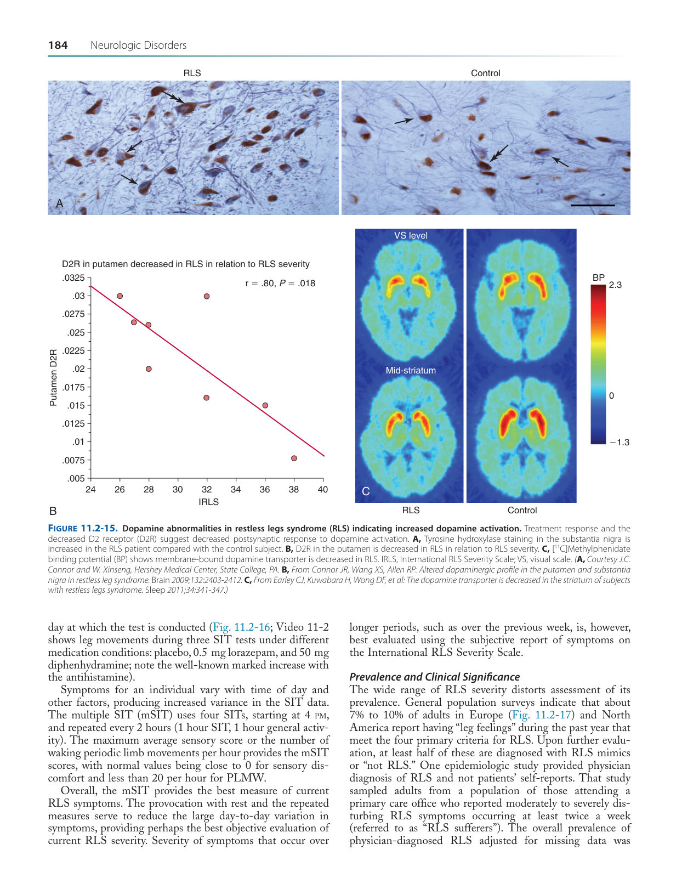

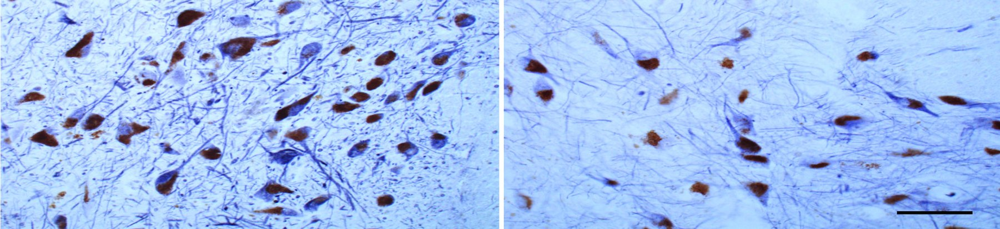

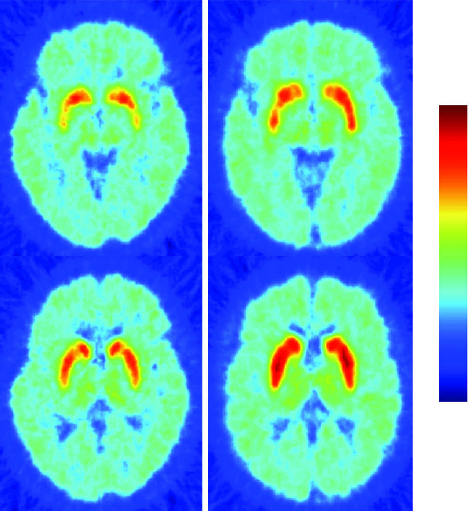

<!-- pdf-page: 203 -->

BOX 11.2-5 Restless Legs Syndrome (RLS) Severity Scale Subscale Items

The patient is asked to rate his/her symptoms for the following 10 questions. The patient, not the examiner, should make the ratings, but the examiner should be available to clarify any misunderstandings the patient may have about the questions. Either the examiner or the patient may mark the answers on the form.

6. Overall, how severe is your RLS as a whole?

(4) Very severe
(3) Severe
(2) Moderate
(1) Mild
(0) Absent
7. How often do you get RLS symptoms?

1. Overall, how would you rate the RLS discomfort in your

From The International Restless Legs Syndrome Study Group: Validation of the International Restless Legs Syndrome Study Group Rating Scale for restless legs syndrome. Sleep Med 2003;4(2):121-132.

legs or arms? (4) Very severe (3) Severe (2) Moderate (1) Mild (0) Absent 2. Overall, how would you rate the need to move around

because of your RLS symptoms? (4) Very intense (3) Intense (2) Moderate (1) Mild (0) Absent 3. Overall, how much relief of your RLS arm or leg discomfort

do you get from moving around? (4) No relief (3) Slight relief (2) Moderate relief (1) Either complete or almost complete relief (0) No RLS symptoms, question does not apply 4. Overall, how severe is your sleep disturbance from your

RLS symptoms? (4) Very severe (3) Severe (2) Moderate (1) Mild (0) Absent 5. How severe is your tiredness or sleepiness from your RLS

symptoms? (4) Very severe (3) Severe (2) Moderate (1) Mild (0) Absent

(4) Very often (6 to 7 days a week)
(3) Often (4 to 5 days a week)
(2) Sometimes (2 to 3 days a week)
(1) Rarely (1 day a week or less)
(0) Never
8. When you have RLS symptoms, how severe are they on an

average day? (4) Very severe (8 hours per 24 hour day or more) (3) Severe (3 to 8 hours per 24 hour day) (2) Moderate (1 to 3 hours per 24 hour day) (1) Mild (less than 1 hour per 24 hour day) (0) No symptoms 9. Overall, how severe is the impact of your RLS symptoms on

your ability to carry out your daily affairs, for example carrying out a satisfactory family, home, social, school, or work life? (4) Very severe (3) Severe (2) Moderate (1) Mild (0) No impact 10. How severe is your mood disturbance from your RLS

symptoms: for example, how severe is your anger, depression, sadness, anxiousness, or irritability? (4) Very severe (3) Severe (2) Moderate (1) Mild (0) No mood disturbance

Total score for all 10 items above: range, 0 to 40 1-10 = mild RLS 11-20 = moderate RLS 21-30 = severe RLS 31-40 = very severe RLS

4.4%, and the prevalence of RLS judged by physicians to have significant medical impact was 2.7%. High medical impact of RLS was reported to occur for 0.8% of the total population. Studies conducted in the general population report that prevalence of RLS sufferers increases with age, from about 0.5% for children to 4% to 5% for people older than 60 years (Fig. 11.2-18). For unclear reasons, prevalence appears to be less in those aged 80 years and older (Fig. 11.2-19). Prevalence is significantly lower in India and in Asian countries (except for Korea).

RLS sufferers have profound sleep disturbance, including sleep-onset insomnia (Fig. 11.2-20). Moderate-to-severe RLS have reduced sleep efficiency, with an average of 5.5 to 5.2 hours of sleep each night (Fig. 11.2-21) and a significant increase in risk of cardiac disease. They have overall reduced quality of life, mainly as a result of physical health-related

issues and less so as a result of the negative impact on mental health (Fig. 11.2-22) and quality of life (Fig. 11.2-23). Nonetheless, RLS sufferers also have a significantly increased risk of depression, anxiety, and panic disorder.

The significant social costs of RLS occur with an estimated RLS-related loss of work productivity and a 20% drop in overall work productivity (1 day a week). Employed moderateto-severe RLS sufferers (about 1% of the population) report a 20% reduction in work productivity (about 1 day/week of work lost). Very severe RLS sufferers report a 50% decrease in work productivity.

#### Treatment

The growing awareness of the significance of RLS augmentation stems from recognition of both its frequent occurrence and the severe pain it causes the patient, which has produced a

<!-- pdf-page: 204 -->

186 Neurologic Disorders

50 min 30 min 10 min

120

10

Patients (%)

100

5

PLM/hr

80

60

40

20

0 2.5 5 7.5 10 12.5 15 17.5 20 22.5 24-hour clock time

FIGURE 11.2-16. Periodic limb movements during wakefulness

(PLMW) per hour as a function of time of day and duration of suggested immobilization test (SIT) for patients with restless legs syndrome (RLS). Average PLMW per hour for each of 2 days from all RLS patients by duration of rest (10, 30, and 50 minutes) vs. time of day listed as hours on the 24-hour clock on the x-axis. Larger points indicate where two data points overlap. Error bars represent standard error averaged for the two repeated measures. Note the rate for healthy adults without RLS is less than 20 per hour at any time of day. The multiple SIT uses four SITs spaced at 2-hour intervals, starting at 4 PM, with the scores being the maximum for any one SIT. (From Allen RP, Dean T, Earley CJ: Effects of rest-duration, time-of-day and their interaction on periodic leg movements while awake in restless legs syndrome. Sleep Med 2005;6:429-434.)

25

20

Prevalence %

15

10

5

0

20-29 30-39 40-49 50-59 60-69 70-79 Age group (y)

All women Women without diabetes, reduced renal function, or anemia All men Men without diabetes, reduced renal function, or anemia

FIGURE 11.2-17. Prevalence of the symptoms in restless legs syn­

drome increases with age. Data shown are from the Health of Pomerania Study in Germany (n = 4310). (Data from Berger K, Luedemann J, Trenkwalder C, et al: Sex and the risk of restless legs syndrome in the general population. Arch Intern Med 2004;164:196-202.)

0

Age (y)

18-24

25-34 35-44 45-54 55-54

FIGURE 11.2-18. Number of patients with restless legs syndrome

increases with advanced age.

8

Women Men All RLS patients (n 416)

6

Prevalence (%)

4

2

0

60-69 50-59 40-49 30-39 20-29 70-79 ≥80 Age group (y)

FIGURE 11.2-19. Prevalence of restless legs syndrome (RLS) sufferers

in Europe and North America by age and gender from a general population-based survey (defined as RLS experienced two or more times per week, with moderate to severe distress). Data show that RLS prevalence is lower in most populations in India and Asia (except Korea), it is higher in women older than 30 years, and nulliparous women have the same prevalence as men of the same age. Prevalence increases with age, and mean age of onset is 34 ± 20 years. Childhood prevalence is 0.5% to 1.0% with no gender difference. (Modified from Allen RP, Walters AS, Montplaisir J, et al: Restless legs syndrome prevalence and impact: REST general population study. Arch Intern Med 2005;165:1286-1292.)

major change in the recommended first choice of treatment. RLS augmentation occurs at a rate of about 7% to 9% each year for up to 10 years for those treated with a short-acting dopamine agonist, such as pramipexole or ropinirole. To date, however, no evidence has linked significant RLS augmentation to opioids (Fig. 11.2-24). Augmentation produces a condition in which dose increases are required to maintain efficacy of the drug, daytime sleepiness may develop, and discontinuing the drug results in profound sleep loss and pain that can last for days. Increasing doses of the drug lead to even greater difficulty stopping the drug. In addition to increased risk of RLS augmentation, pramipexole and ropinirole do not provide significant improvement in sleep duration. In many cases this sleep problem represents the primary reason patients seek RLS treatment. The continuous-acting transcutaneous dopamine agonist rotigotine appears to carry a significantly reduced risk

<!-- pdf-page: 205 -->

CHIN(1)

250 V C3-A2

125 V C4-A1

125 V

O1-A2

125 V

O2-A1

125 V

ROC-A1

125 V

LOC-A2

125 V

ECG 2.5 mV

FIGURE 11.2-20. Polysomnography in restless legs syndrome (RLS). This woman with RLS had severe sleep-onset insomnia. Her legs showed a great deal

of activity while she was trying to fall asleep. The leg movements and body movements resulted in artifacts in the respiratory channels. She complained that her feet became very hot at night and that she has to keep moving them. Her husband mentioned that she moved a great deal when she slept. There was a previous history of severe iron deficiency, and ferritin level at the time of the study was 12 mg/L.

LEG(L)

125 V LEG(R)

125 V

100

SaO2 %

90

THOR RES 1

ABD RES 1

120

PULSE bpm

40 40

PCO2 mm Hg

0

AIRFLOW

31.3 V

FIGURE 11.2-21. Mean medical outcomes study sleep scale scores for patients with restless legs syndrome (RLS) separated by physician-rated

degree of RLS impact on medical health compared with U.S. norms. Note that moderate and severe RLS have very short total sleep times of 5.4 and 5.2 hours per night, respectively.

80

### *

70

60.6

60

51.4

43.9

50

Mean scores

41.0

36.9

33.1

40

### ***

28.3

28.4

24.5

30

20.1

13.3

20

9.5

10

0

Sleep disturbance

Snoring Respiratory/ shortness of breath

High negative impact N 314 (excluding “not stated”)

*Statistically significant difference between all three impact groups ** Statistically significant difference between “High” and “Some” vs. “Low/no” impact *** Statistically significant difference between “High” vs. “Low/no” impact

### *

60.5

### *

54.9

50.4

45.9

41.7

38.3

38.0

35.5

32.8

29.4

25.8

21.9

### **

6.8

6.4

5.4

5.2

Sleep quantity Adequacy of sleep Daytime somnolence Sleep problems index

Sleep scales

Some negative impact Low/no negative impact U.S. norms

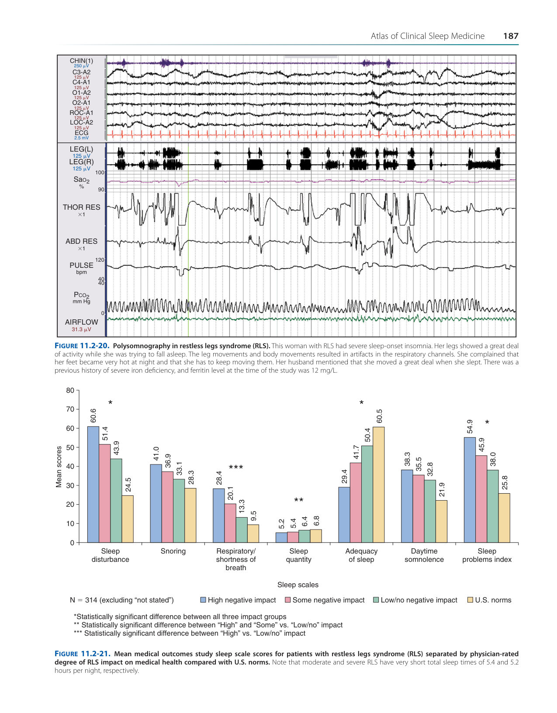

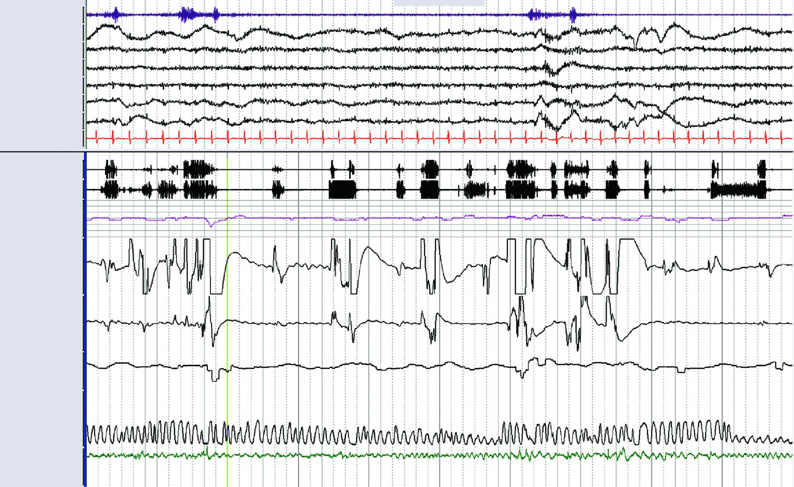

<!-- pdf-page: 206 -->

188 Neurologic Disorders

RLS patients

Age- and sex-adjusted norms for the U.S. general population (n 2474)

80

### *

### *

### *

60

FIGURE 11.2-22. Quality of life in those with restless legs syndrome (RLS). Mean medical outcomes study quality-of-life Short Form-36 (SF-36) for RLS

sufferers from a general population survey compared with age- and sex-adjusted U.S. normal population and with patients with other common chronic diseases. Note the domains most impaired relate to physical effects of RLS and decreased energy/vigor.

### *

### *

### *

### *

### *

Mean score

40

20

0

Physical functioning Role physical Bodily pain General health Energy/ vitality SF-36 Health Survey domain

Type 2 diabetes mellitus (n 541) Patients in the U.S. general population with:

100

Osteoarthritis with hypertension (n 175) Depression (n 502)

80

RLS patients (n 158)

60

Mean score

40

20

0

Physical functioning Role physical Bodily pain General health Energy/ vitality SF-36 Health Survey domain

Social functioning Role emotional Mental health

Social functioning Role emotional Mental health

of RLS augmentation and therefore is preferred as a first choice if a dopamine agonist appears to be needed for effective treatment. Costs of medication may lead to first trying the generically available short-acting dopamine agonists, pramipexole and ropinirole. In such cases the dose should be kept as low as possible, and patients should be advised about and followed clinically for development of RLS augmentation and compulsive or impulsive behaviors. These short-acting dopamine agonists should be discontinued if the dosage increases much above approved levels, and they should be used very cautiously if twice-daily dosing seems to be needed to control symptoms.

Box 11.2-6 and Figure 11.2-25 present potential treatment

algorithms for clinical management of RLS. Table 11.2-4 provides a list of possible drugs for the treatment of RLS, which comprises the four U.S. Food and Drug Administration (FDA) approved drugs for this conditions as of February 2013.

#### Bruxism

Bruxism has been defined as a stereotypic movement with teeth grinding or teeth or jaw clenching during sleep that occurs three or more nights a week over the previous 6 months. Most patients are unaware of the movements or bruxism

<!-- pdf-page: 207 -->

Drive drowsy

Missed events

Errors at work

Missed work

FIGURE 11.2-23. Impact of restless legs syndrome (RLS) on daytime function. (Data from National Sleep Foundation’s Sleep in America Poll, 2005.)

Late to work

Fatigue

0 20 40 Responders (%) 60 80

Participants with no RLS risk All participants Participants at risk for RLS

P .05 at risk for RLS vs. not at risk for RLS

14

Methadone Pergolide Pramipexole

12

Patients discontinuing Rx (%)

10

8

6

4

2

0

2 4 6 8 10 0 12 Time on medication (y)

FIGURE 11.2-24. Those discontinuing a medication because of restless

legs syndrome augmentation as a percentage of all continuing on that medication for the number of years in a 10-year follow-up study. (From Silver N, Allen RP, Senerth, J, et al: A 10-year, longitudinal assessment of dopamine agonists and methadone in the treatment of restless legs syndrome. Sleep Med 2011;12:440-444.)

sounds they produce during sleep, although bed partners are sometimes painfully aware of the teeth-grinding sounds. In significant cases, tooth wear may be seen; in more extreme cases, hypertrophy of the masseter muscle may be evident (Fig. 11.2-26). Temporomandibular joint (TMJ) pain, temporal headache, and tooth pain may also occur (Fig. 11.2-27). Bruxism varies over time, with periods of marked activity intermixed with remissions. Figures 11.2-28 through 11.2-31 show PSG tracings with bruxism artifact. Bruxism events have been noted to sometimes cause brief arousals from sleep and in some cases to be associated with changes in respiration.

#### Treatment of Bruxism

No well-documented, successful treatment is available for reducing bruxism, so the treatment emphasis focuses on reducing regional pain and damage to the teeth. Bruxism is usually treated by a dentist, and the goals of treatment are to repair the teeth that have been damaged and to fabricate a

Intermittent RLS

Conservative Tx Pharmacotherapy

Alerting activities

Iron state for ferritin 45 µg/L

Avoid alcohol, caffeine, nicotine

Dopamine agonists

Hypnotics levodopa, opioids

Review medications

FIGURE 11.2-25. Treatment algorithm for intermittent restless legs

syndrome (RLS) divided according to conservative and pharmacologic therapies. Tx, treatment. (Modified from Silber MH, Ehrenberg BL, Allen RP, et al: An algorithm for the management of restless legs syndrome. Mayo Clin Proc 2004;79:916-922.)

mouth guard to prevent additional damage. A variety of medications have been evaluated anecdotally for patients who continue to have severe sleep complaints, but randomized clinical trials are lacking. Benzodiazepines and muscle relaxants are sometimes tried long term. Often bruxism is a manifestation of stress, and treatment of the stress may be indicated.

#### SLEEP-RELATED RHYTHMIC MOVEMENT

#### DISORDER

Rhythmic, stereotyped, significant body movements that occur repeatedly at sleep onset or during periods of sleepiness characterize sleep-related rhythmic movement disorder (SRMD). This disorder occurs mostly in children, with onset before age 1 year and complete resolution by age 3 years. Approximately 5% of cases may continue to age 5 years. The rhythmic movements, such as head banging, are often disturbing to those who

<!-- pdf-page: 208 -->

190 Neurologic Disorders

BOX 11.2-6 Treatment of Restless Legs Syndrome (RLS): Clinical Guidelines

I. For intermittent of infrequent mild RLS symptoms:

a. Increased RLS severity when present
b. Increased occurrence of RLS symptoms earlier in

the day than before treatment c. Decreased duration of treatment benefit with RLS

Review iron status and treat as appropriate (goal: serum ferritin >75 µg/L, % transferrin saturation >20% but not more than 50%), behavioral treatment with increased activity during time of risk for symptoms, possibly levodopa as needed (with carbidopa or benserazide), 100-200 mg not more than twice a week. II. For moderate to severe RLS, usually the chronic, persistent

RLS in the diagnostic criteria (symptoms ≥2/week, International RLS Severity Scale ≥15) A. Initial treatment for an RLS patient not currently on any

RLS treatment: 1. Obtain serum ferritin and transferrin saturation. If

ferritin is <75 µg/L or transferrin saturations fall below 17%, treat with oral iron sulfate plus vitamin C and check with repeat blood tests in 4 to 6 weeks to ensure there is no problem with iron metabolism, particularly hemochromatosis. Note: For low peripheral iron without obvious cause, consider referral to evaluate the cause of the low iron. 2. Evaluate for possible secondary factors causing or

exacerbating the RLS, and treat as appropriate. Particularly note that many antidepressant medications can exacerbate, and in some cases create, RLS (see Table 11.2-4). 3. For initial treatment consider either gabapentin

enacarbil 600-1200 mg or the long-acting dopamine agonist ropinirole 1-3 mg/day. If the initial treatment fails, consider mixing low-dose, short-acting dopamine agonists (pramipexole 0.25-0.5 mg, ropinirole 0.5-1.0 mg) with the gabapentin enacarbil. Opioids have also been used in moderate to low doses with care taken regarding abuse potential. 4. Evaluate for the usual adverse effects. For dopamine

agonist treatment, always warn about possible development of impulsive behaviors, such as excessive gambling or shopping, and the development of RLS augmentation. B. RLS patient on dopamine agonist with poor treatment

response: Patients treated with short-acting dopamine agonists in some cases will find they are either not sleeping adequately or they are having increasing RLS symptoms, suggesting RLS augmentation. 1. Evaluate for possible development of RLS

augmentation as shown by:

FIGURE 11.2-26. On examination, this patient with bruxism had a very

prominent hypertrophied right masseter muscle.

symptoms beginning to occur sooner after taking the medications than when medications were first started d. Decreased ability to remain still and resting

without RLS symptoms developing; this differs by time of day but may get worse than before treatment at a specified time of day Note that RLS augmentation can occur at any time during short-acting dopamine agonist treatment, even as much as 8 to 10 years after starting the treatment. For pramipexole it appears to occur at a rate of about 5% to 8% of all cases continuing on the treatment each year for up to 10 years (see

Figure 11.2-10).

2. For a patient with RLS augmentation:

a. Slowly discontinue any short-acting dopamine

agonists b. Substitute long-acting dopamine agonists if FDA

approved or c. After the patient is off dopamine agonists, start

enacarbil gabapentin d. Alternative treatments not FDA approved to be

considered: (i) Opioids, at the low end of the usual doses for

pain relief (note that oxycodone has been found to be effective for treatment of RLS in one small placebo-controlled trial at dose of 2.9-20 mg/ day) III. For a patient with treatment-resistant RLS:

A. Low-dose methadone (5-30 mg/day) has been reported

to be effective in some treatment-resistant cases. B. Combination treatments may be required, including use

of both a dopamine agonist and glutamate-related medication (e.g., gabapentin enacarbil). IV. For an RLS patient with persistent low peripheral iron

despite oral iron treatment, consider referral for evaluation of cause of iron deficiency and possible intravenous iron treatment.

observe the behavior but are almost always benign. They usually spontaneously resolve with no known clinical significance, except for the rare occasion when the movements are extreme enough to produce physical injury. In such cases protective measures should be taken to minimize the risk of injury. No treatment has been proven successful for reducing these movements, nor is any recommended as possibly effective. Adults may rarely have SRMD, sometimes after CNS trauma.

The diagnosis of SRMD requires that the patient exhibit repetitive, stereotyped, and rhythmic motor behaviors that 1) involve large muscle groups; 2) occur at sleep onset or during sleep time or with daytime sleepiness; 3) are associated with a complaint that the movements interfere with normal sleep, impair daytime function, or have a significant risk of bodily injury; and 4) the SRMD cannot be better explained by some other medical disorder. Figure 11.2-32 depicts

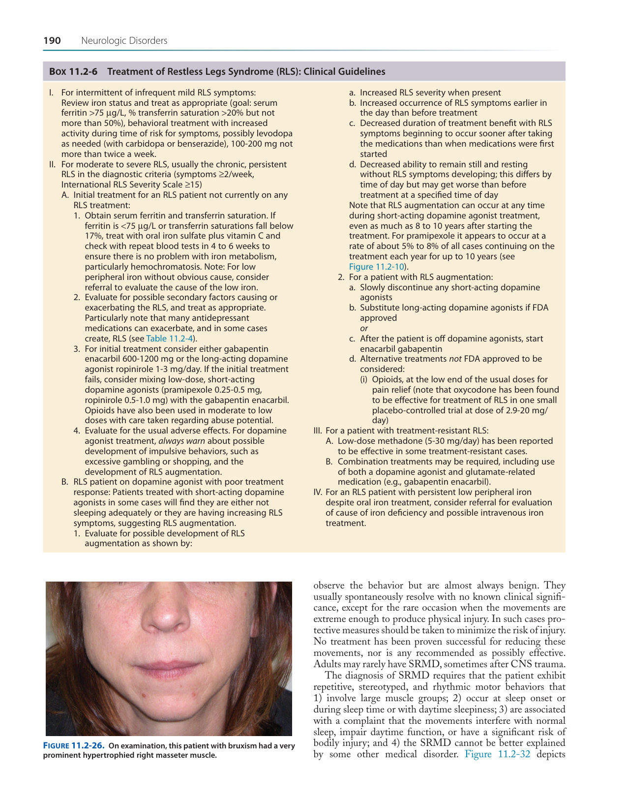

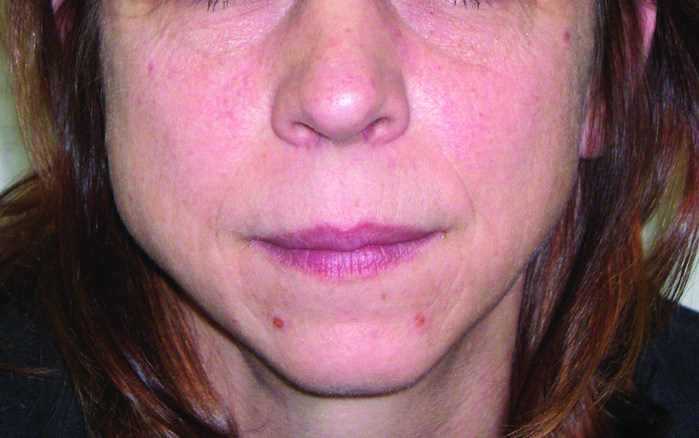

<!-- pdf-page: 209 -->

TABLE 11.2-4 Pharmacologic Treatment for Restless Legs Syndrome

GENERIC (BRAND) DOSE RISKS

Dopamine Agonists* Pramipexole (Mirapex) 0.125-0.5mg 1.5-2 hours before onset of

Severe sleepiness; in some cases, nausea and vomiting; sleep

attacks, rare impulse control behavioral abnormalities, allergic reactions possible Ropinirole (Requip) 0.25-2 mg 1.5-2 hours before onset of

symptoms

Anticonvulsants* Gabapentin enacarbil (Horizant) 300-600 mg daily at 5 PM Daytime sleepiness, nausea, allergic reaction

symptoms Rotigotine (Neupro) 1-3 mg patch QD

Benzodiazepines Clonazepam (Klonopin) 0.125 to 0.5 mg 30 min before bedtime Nausea, sedation, dizziness Clonidine (Catapres) 0.1 mg BID May be helpful in patients with hypertension

Iron Ferrous sulfate 325 mg BID/TID Recommended for ferritin <50 µg

Dopaminergic Agents Levodopa/cardidopa (Sinemet) 25 to 200 mg: 12 tablet to 3 tablets 30 min

before bedtime

Gastrointestinal side effects, constipation; role in treatment under

current investigation

Nausea, sleepiness, augmentation of daytime symptoms,

insomnia, sleepiness, gastrointestinal disturbances

Dry mouth, drowsiness, constipation, sedation, weakness,

depression (1%), hypotension

300 mg/day Nausea, vomiting, restlessness, constipation; addiction and

Opioids Propoxyphene/acetaminophen

tolerance may be possible Propoxyphene (Darvon) 65 to 135 mg at bedtime Codeine 30 mg

(Darvocet)

FIGURE 11.2-27. Patient with severe bruxism. A, Notice that the upper anterior teeth are ground down and that the right central incisor has a crack. There

is also evidence of a great deal of dental work having been done. B, Note that where the upper and lower teeth grind against each other, the bottom of the upper teeth and the top of the lower teeth are flat. The right central incisor has a crack.

*The only FDA-approved drugs for RLS as of February 2013. Modified from Avidan AY: Parasomnias and movement disorders of sleep. Semin Neurol 2009;29(4):372-392.

A

B

SRMD, which can be diagnosed based on its characteristic clinical features of head or body rocking or banging activity. The episodes can occur during all sleep stages: light non-REM sleep, less frequently during stage N3 sleep, and infrequently during REM sleep.

In SRMD, movements are stereotyped, repetitive, and typically occur during drowsiness and take the form of head banging, in which the patient moves the head back and forth down into the pillow or mattress (the most disturbing form of the disorder); head rolling, in which movements occur in a side-to-side manner; or body rocking, which may involve the entire body and occurs when the child rocks forward and backward without head banging.

Sometimes, patients with SRMD come to medical attention because of rhythmic chanting or humming, which may be very loud. The typical frequency of SRMD is between 0.5 and 2 per second with a duration of less than 15 minutes not leading to EEG arousals. Severe SRMD can produce loud noises, when the patient hits the bed frame or chants, which may be very disturbing to other family members.

#### Sleep-Related Leg Cramps

Sleep-related leg cramps are common and can be the most acutely painful events in sleep. They are characterized by an often abrupt onset of a painful muscle contraction in the leg or foot. The diagnosis requires 1) leg or foot cramp onset

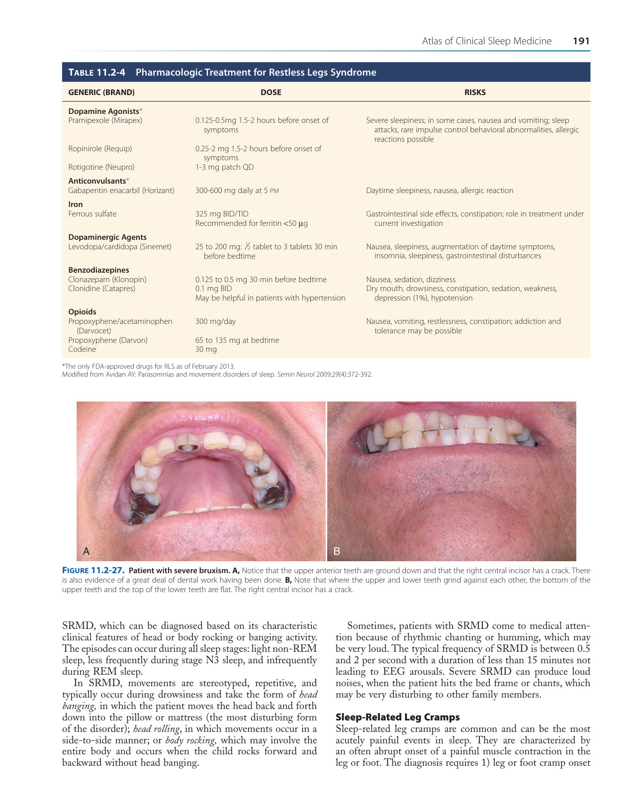

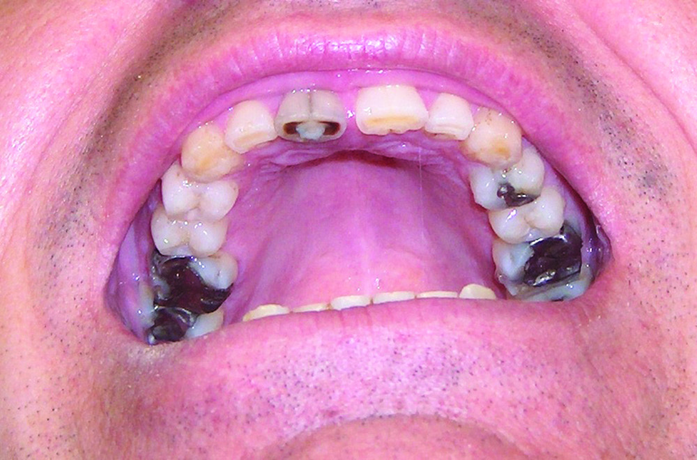

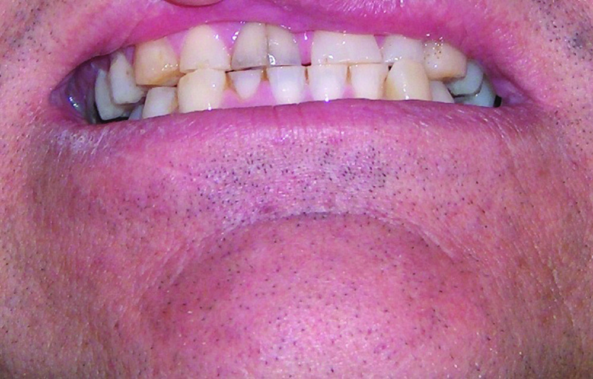

<!-- pdf-page: 210 -->

192 Neurologic Disorders

1 : 2 4 : 3 5 A M 1 : 2 4 : 3 5 A M 1 : 2 4 : 4 0 A M 1 : 2 4 : 4 5 A M 1 : 2 4 : 5 0 A M 1 : 2 4 : 5 5 A M 1 : 2 5 : 0 0 A M

EOG left (50.1 V/cm)

0

-25 25

EOG right (59.0 V/cm)

0

-25

25

F3-M2 (58.2 V/cm)

0

-25

C3-A2 (69.8 V/cm)

25

0

95 95 95 95 95 95 95 95 95 95 95 95 95 95 95 95 95 95 95 95 95 95 95 95 95 95 95 95 96 96 96 96 96 96 96 96 96 96 96 96 95 95 95 95 95 95 95 95 95 95 95 95 95 95

-25

O1-A2 (69.8 V/cm)

25

0

-25

50

CHIN1

0

500

ECG (701 V/cm)

250

0

250

50

L-Leg (92.9 V/cm)

25

0

-25

-50

25

R-Leg (69.6 V/cm)

0

-25

SpO2

100

472 473 473 474 474 475 475 476 476 477 477 478 478 479 479 480 480 481 481 482 482 483 483 484 484 485 485 486 486 487 02:51:23

75

100

Nasal pressure (292 bar/cm)

0

100

100

Thermistor (246 V/cm)

0

100

25

Thorax (57.6 V/cm)

0

-25

100

Abdomen (176 V/cm)

50

0

-50

FIGURE 11.2-28. Polysomnographic tracing with bruxism artifact.

E2-M1

E1-M2

Microarousal

## 10m

## 10m

F4-M1

C4-M1

O2-M1

CHIN1

ECG

02:41:23 468 469

469 470 470 471 471 472

RLeg LLeg

97 97 97 97 97 97 99 99 99 99 98 98 98 96 96 96 97 97 97 97 97 96 96 95 98 98 98 98 93

SNORE

PTAF

THERM

THOR

ABD SaO2 (%)

100 92 85

FIGURE 11.2-29. Polysomnogram of a patient with bruxism. The epochs in the top and bottom panels are 10 minutes long. The episode of bruxism con­

tinues for several minutes with the noise occurring in clusters. Synchronous changes are recorded in the respiratory channels (bottom panel). The patient is actually wide awake, and what appears as Cheyne-Stokes breathing is related to the clusters of bruxism.

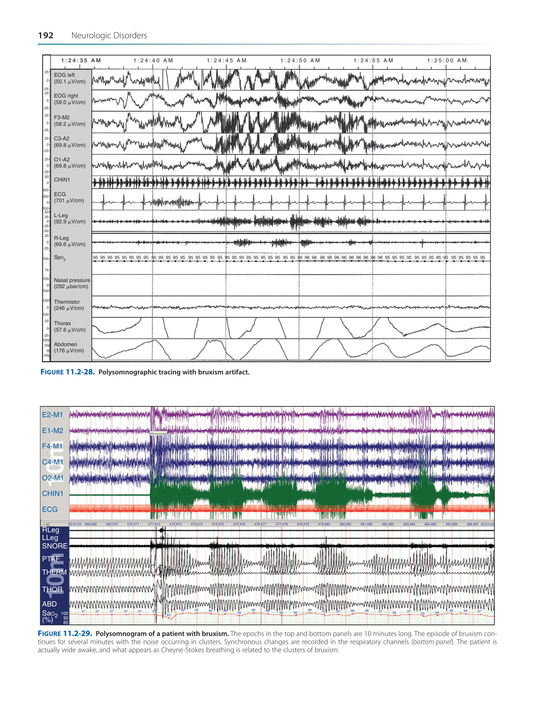

<!-- pdf-page: 211 -->

E2-M1

E1-M2

Microarousal

F4-M1

C4-M1

O2-M1

CHIN1

02:42:53 02:43:53

## 10m

## 60s

ECG

471 472

97 97 97 97 97 97 97 97 97 97 97 97 97 97 97 97 97 96 96 96 96 95 95 95 94 93 93 92 92

RLeg LLeg

SNORE

PTAF

THERM

THOR

ABD SaO2 (%)

100 92 85

FIGURE 11.2-30. Polysomnogram of a patient with bruxism. The epochs in the top and bottom panels are 60 seconds long. Here, the episode of bruxism

begins during stage N2 sleep and results in a long awakening. This event could easily have been scored as hypopnea because changes appear in the airflow channels and oxygen saturation that meet the criteria for an abnormal respiratory event. Fig. 11.2-29 shows 10 minutes’ worth of data beginning with this epoch.

96 96 96 96 96 96 96 96 96 96 96 96 96 96 96 97 97 97 96 96 98 98 98 98 98 98 99 95 95

E2-M1

E1-M2

Microarousal Microarousal

F4-M1

## 2m

## 2m

C4-M1

O2-M1

CHIN1

RERA (15.9S)

ECG

01:23:53

RLeg LLeg

SNORE

PTAF

THERM

THOR

ABD

SaO2 (%)

100 92 85

01:25:53

313 314 314 315 315 316

FIGURE 11.2-31. A patient complaining of severe insomnia. The epoch shown here is 2 minutes long. It begins in REM sleep, and there is an abrupt increase

in the chin EMG, with transmitted artifact seen in the EEG and electrooculogram. These findings are characteristic in patients with sleep bruxism. By examining the respiratory data (bottom) separately from the data used for sleep-stage scoring (top), a technician can easily suspect that an episode of hypopnea is present. On synchronized digital video, the characteristic chattering noise made by the upper and lower teeth striking against each other is audible.

during the sleep period, either during waking or sleep; 2) relief from the cramp provided by forceful stretching of the affected muscle; and 3) the cramp cannot be better explained by another medical condition. Sleep-related leg cramps have been reported in about 7% of children and adolescents but are generally infrequent until adult life. About 90% of adults older than 50 years report at least one lifetime event. Sleep-related

leg cramps occur more than once every 2 months for 33% of adults older than 60 years and 50% older than 80 years, and they are a nightly occurrence for about 6% of adults older than 60 years. They have a waxing and waning natural course, with severe bouts followed by remission for some time. Cramps can cause tenderness in the affected muscle, insomnia, and occasionally daytime fatigue from sleep loss.

<!-- pdf-page: 212 -->

194 Neurologic Disorders

Cursor: 22:20:00, Epoch: 30 - AWAKE 1 min/page

LOC-A2

128 V

ROC-A1

128 V

CHIN1- CHIN2

64.3 V

C3-A2

84.3 V

C4-A1

84.3 V

30 30 30 30 30 30 29 29 29 29 29

O1-A2

84.3 V

O2-A1

84.3 V

ECG2- ECG1 481.7 V

ECO2 481.7 V

LAT1- LAT2 170.7 V RAT1- RAT2 174.7 V

9 7 9 7 9 7 9 7 9 7 9 7 9 7 9 7 9 7 9 7 9 7 9 7 9 7 9 7 9 7 9 7 9 7 9 7 9 7 9 7 9 7 9 7 9 7 9 7 9 7 9 7 9 7 9 6 9 6 9 6 9 6 9 6 9 6 9 6 9 6 9 6 9 6 9 6

SNORE

125 V

N/O 294.1 V

THOR

295 V

ABD 4.1 V

NPRE

400 V

100

SpO2 %

90 Pt position Supine Left Right Prone

1 min/page

9 8 9 8 9 8 9 8 9 8 9 8 9 8 9 8 9 8 9 8 9 8 9 8 9 8 9 9 9 9

9 5 9 5 9 5

20 20 20 20 20 20 20 20 20 20 20

0 0

0 0

*Given the normal waxing and waning course of leg cramps, the treatment benefits reported for these may be placebo effects.

FIGURE 11.2-32. Sleep-related rhythmic movement disorder.

BOX 11.2-7 Treatment Guidelines for Nocturnal Leg Cramps

Cramping: pain reduction (implement immediately if warning

signals occur): • Walking, forceful stretching of affected muscle • Cold pack on affected muscle • Very hot bath

Prophylaxis: consider modifying, where appropriate, the

following possible factors: • Muscle overexertion in daytime • Prolonged sitting in daytime • Dehydration • Pregnancy • Diabetes • Decreased potassium levels • Neuromuscular disorders (Parkinson disease) • Medications (albuterol, niacin, diuretics, some calcium

channel blockers and dopamine antagonists) • Alcohol use

Other prophylaxis*:

• Increase fluids during the day
• Ensure adequate potassium in the diet
• Leg-muscle stretching exercises before bedtime and during

the day (not tested; efficacy uncertain) • Quinine (not recommended owing to little benefit and rare

serious adverse effects) • Naftidrofuryl, vitamin B complex, lidocaine, and diltiazem

(unproven treatments reported effective in open-label trials)

Electrophysiologic recordings show the cramps start with spontaneous firing of anterior horn cells, motor units that support the muscle contraction discharge at rates of up to 300 Hz, much faster than usual voluntary muscle contractions. Box 11.2-7 provides treatment recommendations for nocturnal leg cramps.

#### Suggested Readings

Allen RP, Earley CJ: The role of iron in restless legs syndrome. Mov Disord

22:S440–S448, 2007. Allen RP, Stillman P, Myers AJ: Physician-diagnosed restless legs

syndrome in a large sample of primary medical care patients in western Europe: prevalence and characteristics. Sleep Med 11:31–37, 2010.

<!-- pdf-page: 213 -->

Chokroverty S, Hening WA, Walters A, editors: Sleep and movement disorders,

Earley CJ, Silber MH: Restless legs syndrome: understanding its conse­

ed 1, Philadephia, 2003, Butterworth Heinemann. Connor JR, Ponnuru P, Wang XS, et al: Profile of altered brain iron acquisi­

quences and the need for better treatment. Sleep Med 11:807–815, 2010. Garcia-Borreguero D, Williams A: Dopaminergic augmentation of restless

tion in restless legs syndrome. Brain 134:959–968, 2011. Connor JR, Wang X, Allen RP, et al: Altered dopaminergic profile in the

legs syndrome: the scope of the problem. Sleep Med 12:425–426, 2011. Picchietti D, Allen RP, Walters AS, et al: Restless legs syndrome: prevalence

putamen and substantia nigra in restless leg syndrome. Brain 132:2403– 2412, 2009. Earley CJ, Kuwabara H, Wong DF, et al: The dopamine transporter is

and impact in children and adolescents—the Peds REST study. Pediatrics 120:253–266, 2007. Silver N, Allen RP, Senerth J, Earley CJ: A 10-year, longitudinal assessment

decreased in the striatum of subjects with restless legs syndrome. Sleep 34:341–347, 2011.

of dopamine agonists and methadone in the treatment of restless legs syndrome. Sleep Med 12:440–444, 2011.

## SLEEP AND EPILEPSY

### Marco Zucconi and Michelangelo Maestri

## 11.3

FIGURE 11.3-1. Sleep state as a facilitator of epilepsy: rapid eye movement (REM) versus non-REM (NREM) sleep.

#### SLEEP, SEIZURES, AND INTERICTAL

#### ELECTROENCEPHALOGRAM ACTIVITY

It is well known that seizures are related to circadian rhythms and sleep and that different types of seizures occur more in sleep than in wakefulness.

Video electroencephalogram (EEG) and video polysomnography (PSG) have shown that non–rapid eye movement (NREM) sleep has a facilitating effect on seizures, whereas rapid eye movement (REM) sleep inhibits their occurrence (Fig. 11.3-1). Video EEG and EEG studies highlight a different effect according to sleep state. In partial epilepsy, location of the epileptogenic region plays a role in the distribution of seizures: occipital and parietal epilepsy have a lower incidence of seizure during sleep, whereas frontal lobe and, to a lesser extent, temporal lobe epilepsy have a higher occurrence during sleep. Temporal neocortical seizures have been more related to sleep than have those of mesial origin. Moreover, in symptomatic seizures, the presence of a specific type of cortical dysplasia, Taylor’s focal cortical dysplasia, has been associated with sleeprelated seizures. A particular form of benign focal epilepsy of childhood (benign rolandic epilepsy) is clearly related to sleep.

Seizures are unilateral, motor focal, and occur during sleep in 50% to 80% of the cases, and they tend to be grouped in clusters. In idiopathic generalized epilepsy, myoclonic and tonicclonic seizures may arise on awakening or during sleep and may randomly occur throughout the day. More frequently, myoclonic seizures occur during the early morning, with possible associated features of absence seizures and generalized tonicclonic seizures. A peculiar form of epileptic encephalopathy clearly related to sleep is represented by continuous spikes and waves during slow-wave sleep, formerly known as electrical status epilepticus of sleep, and is characterized by continuous and diffuse slow spike-and-wave complexes that persist through NREM sleep, epilepsy, and neuropsychologic and motor impairment. NREM is characterized by diffuse spike waves at 2 to 3 Hz, organized in bursts with or without clinical manifestations that occupy 85% to 100% of NREM sleep stages, with a preservation of REM sleep.

Sleep also has similar effects on interictal abnormalities. During NREM sleep, slow oscillation and synchronizing mechanisms lead to the maintainance and diffusion of epileptic activity more than during wakefulness or REM sleep. Interictal activity is more often highilighted during deep

<!-- pdf-page: 214 -->

196 Neurologic Disorders

FIGURE 11.3-2. Cyclic alternating pattern and occipital interictal abnormalities with a right prevalence in an 18-year-old woman with idiopathic

occipital epilepsy (brief episodes of visual hallucinations, vomiting, and headache).

NREM sleep, but usually during periods of sleep instability or transitions with other stages. In a different type of epileptic syndrome, association with transient EEG phenomena such as spindle, K-complex, or vertex waves has been detected, but the most widely studied association is with a cyclic alternating pattern, mainly phase A, that represents an activation phenomena (Fig. 11.3-2). In some observations, NREM sleep seems to add more accurate lateralization of epileptogenesis, but multifocal spiking can also be seen (Fig. 11.3-3). Epileptic discharges must be differentiated from physiologic sleep transients; in Figure 11.3-4, occipital sharp waves and spikes that

Fp2-F4

F4-C4

C4-P4

P4-O2

Fp2-F8

F8-T4

T4-T6

T6-O2

Fp1-F3

F3-C3

C3-P3

P3-O1

Fp1-F7

F7-T3

T3-T5

T5-O1

Fz-Cz

Cz-Pz

O Dx

O Sx

Mento Dx

Mento Sx

ECG

could resemble posterior occipital sleep transients are presented. With regard to benign partial epilepsy of childhood with centrotemporal spikes, a specific activation of epileptic discharges during NREM sleep is usually reported, with triphasic sharp waves of high amplitude localized to the centrotemporal regions. In generalized idiopathic epilepsy, the symmetrical spike slow waves or polyspike slow-wave complexes at 1 to 4 Hz in frequency usually increase during NREM sleep, with prominence at sleep onset (Fig. 11.3-5), during transitions from NREM to REM sleep, and are associated with sleep transients (Fig. 11.3-6).

FIGURE 11.3-3. Multifocal temporal spikes during N2 sleep in a 45-year-old woman with mesial temporal lobe epilepsy (complex focal seizures with

generalization; magnetic resonance imaging revealed no pathologic changes).

Fp2-F4

F4-C4

C4-P4

P4-O2

Fp2-F8

F8-T4

T4-T6

T6-O2

Fp1-F3

F3-C3

C3-P3

P3-O1

Fp1-F7

F7-T3

T3-T5

T5-O1

Fz-Cz

Cz-Pz

O Dx

O Sx

Mento Dx

Mento Sx

ECG

FLOW

Tib Dx

Tib Sx

Tib Dx

<!-- pdf-page: 215 -->

Fp2-F4

F4-C4

C4-P4

P4-O2

Fp2-F8

F8-T4

T4-T6

T6-O2

Fp1-F3

F3-C3

FIGURE 11.3-4. Occipital spikes and sharp waves on right occipital derivation that could resemble posterior occipital sleep transience. This is the

same patient as shown in Figure 11.3-1.

C3-P3

P3-O1

Fp1-F7

F7-T3

T3-T5

T5-O1

Fz-Cz

Cz-Pz

O Dx

O Sx

Mento Dx

Mento Sx

ECG

FIGURE 11.3-5. Irregular generalized spike and polyspike slow-wave complexes at sleep onset in a 20-year-old woman with juvenile myoclonic

epilepsy (myoclonic jerks and one generalized tonic-clonic seizure after sleep deprivation).

Fp2-F4

F4-C4

C4-P4

P4-O2

Fp2-F8

F8-T4

T4-T6

T6-O2

Fp1-F3

F3-C3

C3-P3

P3-O1

Fp1-F7

F7-T3

T3-T5

T5-O1

Fz-Cz

Cz-Pz

O Dx

O Sx

Mento Dx

Mento Sx

ECG

FLOW

<!-- pdf-page: 216 -->

198 Neurologic Disorders

Fp2-F4

F4-C4

C4-P4

P4-O2

Fp2-F8

F8-T4

T4-T6

T6-O2

Fp1-F3

F3-C3

FIGURE 11.3-6. Irregular generalized spike and polyspike slow-wave complexes during stage N2 sleep in a 25-year-old woman with a history of

primary generalized seizures.

C3-P3

P3-O1

Fp1-F7

F7-T3

T3-T5

T5-O1

Fz-Cz

Cz-Pz

O Dx

O Sx

Mento Dx

Mento Sx

ECG

Sleep deprivation (SD) is considered to be a trigger for epileptic seizures, but clinical evidence is present only for some types of generalized epilepsy, mainly juvenile myoclonic epilepsy. In clinical practice, SD protocols have been extensively applied to increase the yield of occurrence of interictal abnormalities in suspected epileptic patients or to help determine the type and localization of abnormalities in epileptic patients. Even if SD protocols have not been standardized, the term usually implies partial or total sleep deprivation during the night and the possibility of sleeping during the day. There is no evidence that sleep deprivation is a more sensitive activating factor than physiologic sleep, but SD enhances cortical excitability in patients with different subtypes of epilepsy more than in controls, and sleep during an inappropriate circadian phase (i.e., in the morning) enhances sleep instability and cyclic alternating pattern, possibly causing an activation of interictal abnormalities.

NOCTURNAL FRONTAL LOBE EPILEPSY:

#### CLINICAL FEATURES AND DIFFERENTIAL

#### DIAGNOSIS FROM PARASOMNIAS

Nocturnal frontal lobe epilepsy (NFLE) represents a type of partial epilepsy in which seizures appear mainly or almost exclusively during NREM sleep. Seizures are usually described as episodes of paroxysmal motor behaviors characterized by bizarre hyperkinetic patterns or distonic postures with a high frequency of nightly episodes, internight repetition, and stereotypy. The episodes have been classified into different semiologic patterns. Minor events, or paroxysmal arousals, are characterized by a sudden arousal and no major movements. Major episodes include hyperkinetic seizures with complex movements, vocalization, screaming, and repetitive

movements of the trunk and limbs (Fig. 11.3-7, Video 11-3); asymmetric bilateral tonic seizure (Videos 11-4 through 11-6); and prolonged episodes, named epileptic nocturnal wandering (Video 11-5), which could resemble sleepwalking episodes. Seizures have been thought to originate from mesial frontal zones and orbitofrontal regions, but recent observations in drug-resistant epileptic patients submitted to presurgical stereo EEG evaluation suggest that approximately 30% of the seizures arose from the extrafrontal region and subsequently involved cingulate and frontal regions (Figs. 11.3-8 through 11.3-10). In 1994, families with NFLE inherited as an autosomal-dominant trait were described, leading to the definition of autosomal-dominant nocturnal frontal lobe epilepsy (ADNFLE). Nowadays, a family history of possible NFLE is seen in about 25% of cases, even if the genetic bases have been detected in a minority, showing mutations of the neuronal nicotinic acetylcholine receptors. This genetic alteration seems to facilitate both the epileptogenesis and the occurrence of arousal instability. However, NFLE is a heterogeneous disease, and the majority of NFLE patients are affected by sporadic forms, cryptogenetic or symptomatic.

Not uncommonly, interictal and even ictal EEG findings are normal or nonspecific in patients with NFLE (Figs. 11.3-11 through 11.3-16). Differential diagnosis between NFLE and parasomnias, particularly disorders of arousal, is complex. In general, reliable characterization of the episodes by the observers is lacking because they may be asleep or they may miss the beginning of an episode, leading to an ambiguous or partial description. Furthermore, nocturnal epileptic episodes may have auras and postictal periods that tend to be masked by sleep. Nocturnal PSG with a montage normally used for evaluating sleep-breathing disorders may detect seizure activity, but the PSG should include EEG with an expanded bilateral montage.

<!-- pdf-page: 217 -->

Polymorphic

Laughing Complex

Fighting

Screaming

Min: 0.3% Max: 0.6% Avg: 0.4% 1 1 1 0 0 0 0 0 0 0 1 1 1 1 1 0 0 0 0 0 0 0 0 0 0 0 0 Stage - Wake 100 V

Thrashing movements

F7-T3

T3-T5

T5-O1

Fp1-F3

F3-C3

C3-P3

P3-O1

Fz-Cz

Cz-Pz

Fp2-F4

F4-C4

C4-P4

P4-O2

F8-T4

T4-T6

T6-O2

Pg1-A2

Pg2-A2

24-25

26-27

28-29

30-31

32-A1

Sat

Nocturnal Seizures

Shouting Sensation of fear

Tachycardia

Kicking Running

Bicycling

FIGURE 11.3-7. Behavioral manifestations and characteristics of nocturnal

frontal lobe epilepsy.

120 180 240 300 360 420 480 540 600 660 720 780 840 900

Movement Wake REM 1 2 3 4

60

22:51:32 06:41:05 00 01 02 03 04 05 06

FIGURE 11.3-8. Nocturnal seizure while emerging from N2 sleep. (See also Figure 11.3-10.)

<!-- pdf-page: 218 -->

200 Neurologic Disorders

F7-T3

T3-T5

T5-O1

Fp1-F3

F3-C3

C3-P3

P3-O1

Fz-Cz

Cz-Pz

Fp2-F4

F4-C4

C4-P4

P4-O2

F8-T4

T4-T6

T6-O2

Pg1-A2

Pg2-A2

24-25

26-27

28-29

30-31

32-A1

FIGURE 11.3-9. Nocturnal seizure while emerging from N2 sleep. (See also Figure 11.3-10.)

Home video recording could be useful, but video PSG is required for the diagnosis. However, a percentage of cases still have no definitive diagnosis after an extensive workup and even after recording sleep-related episodes, and no definitive guidelines have been approved. Some clinical and video PSG features have been proposed recently by groups in Melbourne and Bologna to differentiate NFLE from parasomnia (Tables 11.3-1 and 11.3-2). In brief, a natural history of the episodes that appear to increase in frequency after childhood, occurrence of more than one episode per night, and semiology of the attacks (stereotypy, diskinetic and distonic components, clear onset and offset) are indicative of epileptic seizures.

Epileptic and parasomniac attacks often co-occur in the same family and even in the same patients. The two phenomena could share different possible neurophysiologic mechanisms that are an alteration of the arousal regulatory system, an involvement of the cingulate regions that have been reported to be activated also during sleepwalking episodes, or a disinhibition of a common central pattern generator, leading to the emergence of some kind of innate behaviors. NFLE could be differentiated from REM sleep behavior disorder, which is characterized by later age of onset,

relationship of the episodes with dream-enacting behavior, less stereotypy, and presence of REM without atonia during PSG recording. However, the two diseases may co-occur in elderly subjects and may possibly share some pathophysiologic mechanisms.

#### EPILEPSY AND COMORBIDITIES WITH

#### SLEEP DISORDERS

#### Obstructive Sleep Apnea Syndrome

Obstructive sleep apnea (OSA) syndrome is common in epileptic patients. In systematic investigations, a prevalence of OSA in adult epileptic patients of around 10% was found (15.4% in men and 5.4% in women), whereas in children, prevalence was reported to be 20%. In medically refractory epilepsy patients, the occurrence seems to increase further, reaching approximately 33%. OSA in patients with epilepsy should be suspected in the presence of the same signs and symptoms as in the general population, apart from sleepiness that should be due to other factors (see below). Regarding epileptic variables, later onset in life, occurrence of seizures

Text continued on page p. 208

<!-- pdf-page: 219 -->

FIGURE 11.3-10. Nocturnal seizure emerging from N2 sleep. A 16-year-old boy with a 2-year history of attacks during sleep or at awakening, with tonic

contraction of the left leg and repetitive movements of the left arm, followed by extension of both legs with bipedal activity, and then to whole body movement with agitation and repetitive supine-prone movements. Two generalized tonic-clonic seizures were reported at awakening. The video polysomnogram showed numerous minor seizures with standing of the head and trunk or scratching of the left leg. Four main episodes occurred as described before: sudden raising of the left arm with flexion of the elbow brought over the head, in dystonic position, waggle and repetitive contraction of the legs, and grasping with the hands of the legs. The seizures were distributed across the entire night (see histogram in the bottom of the figure; the red bar indicates seizures). Critical epileptic abnormalities are absent; sporadic small right temporooccipital spikes and bilateral diffusion occurred during N2 (see Fig. 11.3-9) and N3 sleep (see Fig. 11.3-10). RMN showed no lesions, in particular in the hippocampal and temporal lobes. The semiology of the major episodes seemed to suggest focal right temporal seizures with secondary involvement of cingulate and frontal regions. The seizures partially responded to treatment (topiramate and levetiracetam).

F7-T3

T3-T5

T5-O1

Fp1-F3

F3-C3

C3-P3

P3-O1

Fz-Cz

Cz-Pz

Fp2-F4

F4-C4

C4-P4

P4-O2

F8-T4

T4-T6

T6-O2

Pg1-A2

Pg2-A2

24-25

26-27

28-29

30-31

32-A1

<!-- pdf-page: 220 -->

202 Neurologic Disorders

Min: 94.8 Max: 97.1 Avg: 96.1 96 96 96 96 96 96 96 96 96 96 96 96 96 96 96 96 96 95 97 97 97 97 97 97 97 97 97

F7-T3

T3-T5

T5-O1

Fp1-F3

F3-C3

C3-P3

P3-O1

Fz-Cz

Cz-Pz

Fp2-F4

F4-C4

C4-P4

P4-O2

F8-T4

T4-T6

T6-O2

Pg1-A2

Pg2-A2

24-25

32-A2

26-27

28-29

Sat

FIGURE 11.3-11. Nocturnal frontal lobe epilepsy. A 32-year-old man with sleep-related episodes starting at 9 years of age, with sudden awakenings and

“apnea sensation, something stuck in the throat,” undiagnosed until 22 years of age and refractory or partially respondent to treatment. Figure 11.3-12 (30-second epoch) and Figures 11.3-13 through 11.3-15 (20-second epoch) show two of the 37 seizures recorded during video polysomnography; note stereotypy and similar electroencephalographic features in both the episodes, without epileptic abnormalities during the attacks. The patient suddenly sits on the bed and starts to repeatedly move his trunk, oscillating with guttural noise as an “apnea.” No interictal epileptic abnormalities were detected.

<!-- pdf-page: 221 -->

Min: 93.6 Max: 95.2 Avg: 94.5 95 95 95 Stage - Wake 95 95 95 95 95 95 95 94 94 94 94 94 94 94 94 95 95 95 95 95 94 94 94 94

F7-T3

T3-T5

T5-O1

Fp1-F3

F3-C3

C3-P3

P3-O1

Fz-Cz

Cz-Pz

Fp2-F4

F4-C4

C4-P4

P4-O2

F8-T4

T4-T6

T6-O2

Pg1-A2

Pg2-A2

24-25

32-A2

26-27

28-29

Sat

EPISODIO DISPNEA

FIGURE 11.3-12. Nocturnal frontal lobe epilepsy. (See also Figure 11.3-11.)

<!-- pdf-page: 222 -->

204 Neurologic Disorders

Min: 95.7 Max: 97.1 Avg: 96.6 96 96 96 96 97 97 97 97 97 97 97 97 97 97 97 97 97 97

F7-T3

T3-T5

T5-O1

Fp1-F3

F3-C3

C3-P3

P3-O1

Fz-Cz

Cz-Pz

Fp2-F4

F4-C4

C4-P4

P4-O2

F8-T4

T4-T6

T6-O2

Pg1-A2

Pg2-A2

24-25

32-A2

26-27

28-29

Sat

EPISODIO DISPNEA

FIGURE 11.3-13. Nocturnal frontal lobe epilepsy. (See also Figure 11.3-11.)

<!-- pdf-page: 223 -->

Min: 96.6 Max: 97.1 Avg: 96.8 97 97 97 97 97 97 97 97 97 97 97 97 97 97 97 97 97 97

F7-T3

T3-T5

T5-O1

Fp1-F3

F3-C3

C3-P3

P3-O1

Fz-Cz

Cz-Pz

Fp2-F4

F4-C4

C4-P4

P4-O2

F8-T4

T4-T6

T6-O2

Pg1-A2

Pg2-A2

24-25

32-A2

26-27

28-29

Sat

FIGURE 11.3-14. Nocturnal frontal lobe epilepsy. (See also Figure 11.3-11.)

<!-- pdf-page: 224 -->

206 Neurologic Disorders

Min: 95.7 Max: 97.1 Avg: 96.4 97 97 97 97 97 96 96 96 96 97 96 96 96 97 97 97 96 96

F7-T3

T3-T5

T5-O1

Fp1-F3

F3-C3

C3-P3

P3-O1

Fz-Cz

Cz-Pz

Fp2-F4

F4-C4

C4-P4

P4-O2

F8-T4

T4-T6

T6-O2

Pg1-A2

Pg2-A2

24-25

32-A2

26-27

28-29

Sat

Stage - Wake

FIGURE 11.3-15. Nocturnal frontal lobe epilepsy. (See also Figure 11.3-11.)

<!-- pdf-page: 225 -->

Fp2-F4

F4-C4

C4-P4

P4-O2

Fp2-F8

F8-T4

T4-T6

T6-O2

FIGURE 11.3-16. Major episode of nocturnal frontal lobe epilepsy with asymmetric bilateral tonic seizure. A 32-year-old man with a history of recurrent

nocturnal seizures with dystonic components. During sleep-deprived electroencephalography (EEG), three focal seizures were recorded. During these seizures, no evident ictal EEG abnormalities were recorded. Clinical symptoms started, together with EEG artifact, during N2 sleep.

Fp1-F3

F3-C3

C3-P3

P3-O1

Fp1-F7

F7-T3

T3-T5

T5-O1

Fz-Cz

Cz-Pz

O Dx

O Sx

Mento Dx

Mento Sx

ECG

TABLE 11.3-1 Clinical and Video Polysomnographic Features of NFLE and Non-REM Parasomnias

#### (Arousal Disorders)

Episodes per month (n) Almost every night (>30) but variation possible Almost every night (>30) but with possible variation

Age at onset (years) >10 (generally during or after adolescence, but can occur at

any age)

NFLE AROUSAL DISORDERS

<10 (generally between ages 3 and 8 years)

Episode distribution in the night At any time Generally first third

Sleep stage onset episode NREM (>60% in stage 2) NREM stages 3 and 4

Episodes per night Several Generally one

Duration of episodes <1 minute (excluding the complex, prolonged, dystonic or

“wandering” seizures)

Some minutes (1 to 10)

Repeated and stereotypic attacks Generally present Generally absent

Dystonic or tonic posturing Very common Uncommon

Vocalization May be present, generally very rapid and loud (screaming

or shouting)

Generally present (brief and unintelligible or

comprehensible and prolonged)

Recall May be present in a number of episodes Generally absent

Brief bursts of running or jumping

Characteristic of some complex seizures (nocturnal epileptic

in the bed or out of the bed

wanderings, even though of possible extrafrontal origin)

Awareness May be present in a proportion of seizures; in a typical aura,

breath is stuck in the throat

Generally absent (calm or quiet deambulation, even

out of the room or out of the house)

Generally absent

Consciousness if awaked Present and normal Impaired and slower

Sleep fragmentation Present and important May be present, sometimes related only to slow-wave

Follow-up and clinical course Stable or increasing (unknown) Generally with decreasing or disappearance of

Daytime sleepiness Common (often related to the high number of seizures and

sleep fragmentation)

Family history Frequent (both for seizures and parasomnias, sometimes

clinically undistinguishable)

Response to treatment Good response to antiepileptic drugs (carbamazepine,

topiramate, etc.) in at least 60%-70% of cases

sleep microstructure instability

Infrequent

Frequent (for parasomnias)

Not known (improvement with sleep stabilization)

NFLE, nocturnal frontal lobe epilepsy; REM, rapid eye movement.

symptoms

<!-- pdf-page: 226 -->

208 Neurologic Disorders

TABLE 11.3-2 Frontal Lobe Epilepsy and Parasomnia (FLEP) Scale

CLINICAL FEATURE SCORE

Age at onset (years) >55 −1 <55 0

Duration of a typical event <2 min +1 2 to 10 min 0 10 min −2

Clustering (number of events in a single night) 1 or 2 0 3 to 5 +1 >5 +2

Timing: time of the night Within 30 minutes of sleep onset +1 Other times 0

Symptoms Definite aura Yes +2 No 0

Wandering outside the bedroom Yes −2 No (or uncertain) 0

Complex, directed behavior during events Yes −2 No (or uncertain) 0

Prominent dystonic posturing, tonic limb extension or cramping Yes +1 No (or uncertain) 0

Stereotypy Highly stereotyped +1 Some variability/uncertain 0 Highly variable −1

Recall Yes, lucid recall +1 No or vague recollection only 0

Vocalization and subsequent recollection No 0 Yes, sounds only or single words 0 Yes, coherent speech with incomplete or no recall −2 Yes, coherent speech with recall +2

Modified from Derry CP, Davey M, Johns M, et al: Distinguishing sleep disorders from seizures: diagnosing bumps in the night. Arch Neurol 2006;63:705-709.

Total Score

Subjects with total scores of 0 or less are highly likely to be affected by parasomnias; scores between 0 and 3 need further investigation (episodes are potentially epileptic); scores above 3 are highly likely to signify nocturnal frontal lobe epilepsy. The test scale shows high positive and negative predictive values in diagnosing nocturnal frontal lobe epilepsy vs. arousal parasomnias and rapid eye movement sleep behavior disorder.

during sleep, and advanced patient age seem to be related to the risk of sleep apnea. Continuous positive airway pressure (CPAP) treatment of patients with epilepsy and OSA was found to reduce EEG interictal epileptiform activity and improve seizures, particularly in drug-resistant epilepsy (reduction by 50% or more in 28% of the patients vs. 15% of those receiving sham CPAP).

OSA could worsen controls of nocturnal seizures by increasing sleep instability during NREM sleep and inducing daytime sleepiness, with an activating effect on epileptic phenomena. A role for OSA in the pathogenesis of sudden unexpected death in epilepsy has been proposed, and a cumulative detrimental effect on cognition of both epilepsy and OSA should be considered.

#### Insomnia and Restless Legs Syndrome

Patients with epilepsy often complain of poor, nonrestorative sleep. However, insomnia has not been extensively investigated. Symptoms of insomnia, particularly sleep maintenance problems, seem to be more frequent in epileptic patients than in controls. Sleep fragmentation could be related to recurrent seizures, antiepileptic drugs, and comorbidities and could enhance interictal abnormalities and seizures, but the effect of insomnia on seizure controls is not known. Regarding restless legs syndrome (RLS) and periodic limb movements, clinical,

subjective, and PSG data do not support an association with epilepsy, even if data could not be considered definitive.

#### Daytime Sleepiness

Excessive daytime sleepiness (EDS) is a frequent complaint among epileptic patients in the clinical setting and can even be the main symptom in these patients, strongly affecting their quality of life and working capabilities. In epilepsy, a variety of causes may be responsible for EDS: 1) qualitative and quantitative sleep deficiencies, including insufficient and fragmented sleep; 2) central nervous system (CNS) pathologic abnormalities; 3) circadian rhythm disorders; 4) drugs; 5) comorbid psychiatric or primary sleep disorders; and 6) nocturnal seizures that alter both NREM and REM sleep, as well as sleep efficiency and continuity, leading to daytime sleepiness (Fig. 11.3-17). Altogether, these different factors interact with one another and can progressively exacerbate the patient’s condition. However, epidemiologic surveys showed contrasting results; an increase in the reported occurrence of subjective sleepiness was reported in epileptic subjects more often than in age-matched controls, although this has not been confirmed in other studies. Even nocturnal seizures do not seem to correlate consistently with subjective sleepiness in patients with NFLE and in patients affected by refractory temporal lobe epilepsy with nocturnal seizures.

<!-- pdf-page: 227 -->

Seizures

Depression

Positive Effects Negative Effects Positive Effects Negative Effects

Underlying sleep disorders • Obstructive sleep apnea • Restless legs syndrome/ periodic limb movements • Narcolepsy • Circadian rhythm disorders

FIGURE 11.3-17. Causes of excessive daytime sleepiness (EDS) in epilepsy.

TABLE 11.3-3 Effects of Antiepileptic Medications on Sleep

EDS in epilepsy

Antiepilectic medications Poor sleep hygiene

Insufficient sleep

SLEEP STRUCTURE SLEEP DISORDERS

Phenobarbital ↓SL ↓REM Insomnia OSAS Benzodiazepines ↓SL, ↓CAP rate ↓REM ↓SWS Insomnia, RLS OSAS Phenytoin ↓SL ↑Arousals ↑1N ↓REM RLS Primidone Carbamazepine = CAP rate ↓REM? RLS Valproate None ↑1N RLS OSAS* Felbamate OSAS Insomnia Gabapentin ↑SWS, ↓arousals None RLS, insomnia OSAS Lamotrigine ↓SWS? Insomnia; RBD (discontinuation) Levetiracetam ↑SWS RLS (case reports) Insomnia Pregabalin ↑ SWS, ↑ REM ↓arousals None RLS, insomnia OSAS* Tiagabine ↑ SWS None Insomnia Topiramate None None OSAS* RLS Zonisamide None None OSAS* RLS

CAP, cyclic alternating pattern; OSAS, obstructive sleep apnea syndrome; RBD, REM behavior disorder; REM, rapid eye movement; RLS, restless legs syndrome; SL, sleep latency; SWS, slow-wave sleep.

*Probably because of weight change.

Neurophysiologic evaluation in small groups of de novo patients showed no differences between patients and controls. In population studies, symptoms suggestive of sleep disorders such as OSA syndrome, RLS, and anxiety disorders were the most significant predictors of daytime sleepiness in epilepsy patients. Regarding drugs, the intensity of drowsiness is directly related to polytherapy and to the type and daily dose of antiepileptic drugs. Classic agents are more sedative than newer medications. Antiepileptic drugs may have profound effects on sleep (Table 11.3-3).

Figures 11.3-18 through 11.3-22 show additional PSG examples that highlight the important interplay between sleep and seizures.

#### GENERAL COMMENTS

A reciprocal relationship exists between sleep and epilepsy: sleep and sleep disorders affect epilepsy, and seizures and interictal discharges have detrimental effects on sleep. Approximately one third of epilepsy patients have seizures only during sleep. NREM sleep enhances the occurrence of seizures (mainly frontal) and the propagation of interictal abnormalities, whereas REM sleep has an inhibitory effect on seizure activity. NREM synchronization, sleep physiologic and pathologic instability, and circadian and ultradian factors influence both sleep and wake rhythms and occurrence and propagation of epileptic discharges.

<!-- pdf-page: 228 -->

Cursor: 23:02:41, Epoch: 15 - STAGE 2 15 sec/page

CHIN(1)

250 V

C3-A2

125 V

C4-A1

125 V

O1-A2

125 V

O2-A1

125 V

ROC-A1

125 V

425 427 430 432 ECG 2.5 mV

LOC-A2

125 V

422

422 425 427 430 432 435 437 440 442 445 447

LEG(L)

LEG(R)

100

SaO2 %

0

THOR RES x1

ABD RES x1

120

Pulse bpm

40 76

PCO2 mm Hg

-4

Position

30

CPAP cm H2O Airflow

2

62.5 V

30 sec/page

FIGURE 11.3-18. Polysomnograph (PSG) of nocturnal frontal lobe epilepsy. A representative PSG sample from a 35-year-old woman with a history of

bizarre nocturnal spells in the middle of the night. The episodes were usually brief, lasting less than 1 minute. This PSG shows spike and slow-wave complexes more prominent centrally during stage N2 sleep. (Courtesy Meir H. Kryger, MD.)

FIGURE 11.3-19. Polysomnograph of patient referred with infrequent nocturnal seizures. This example is from a 20-year-old student who was referred

because of a 5-month history of infrequent seizures that occurred only at night. As a result of these, the patient had dislocated his shoulder and bitten his tongue. Notice the seizure activity, lasting about 5 seconds, in the middle of the epoch, during which time the patient had central apnea. There were only three similar findings during the night. On synchronized digital video, absolutely no movement was visible. The sleep study may be entirely normal in patients with infrequent seizures. (Courtesy Meir H. Kryger, MD.)

CHIN(1)

250 V

C3-A2

125 V

C4-A1

125 V

O1-A2

125 V

O2-A1

125 V

ROC-A1

125 V

LOC-A2

125 V

ECG 2.5 mV

LEG(L)

125 V

LEG(R)

125 V

100

SaO2 %

90

ABD RES x8

120

Pulse bpm

40

AIRFLOW

41.7 V

Cursor: 01:09:10, Epoch: 277 - AWAKE 30 sec/page

30 sec/page

<!-- pdf-page: 229 -->

Cursor: 00:56:26, Epoch: 448 - STAGE 2 1 min/page

O2-A1 C3-A1 ROC-A1 LOC-A1

CHIN1-CHIN2

T3-T5 F7-T3 FP1-F7

T5-O1

FP2-F8

F8-T4

T4-T6

T6-O2

FP1-F3

F3-C3 C3-P3

P3-O1 FP2-F4

F4-C4

1 min/page 2 2 1

C4-P3

RIGHT IC 1-RIGHT IC 2 ECG1-ECG2 P3-O2

Airflow2

2 2 1

125 mV

THOR

1.02 mV

ABD 1.37 mV

100.0

SaO2

%

80.0

98 98 98 98 99 99 99 99

94

FIGURE 11.3-20. Polysomnograph example of right-sided seizure resulting in central apnea. In this example, the seizure was originally missed because

the seizure activity was only on the right side (notice the even-numbered electrodes), and the scoring montage did not include them. Such a seizure montage is useful in cases of unexplained central apneas. (Courtesy M. Mahowald, MD.)

Cursor: 04:29:39, Epoch: 945 - AWAKE 30 sec/page 2 W

FIGURE 11.3-21. Polysomnograph of a temporal seizure. In this example, brief spikes appear in the right temporal region (note the abnormalities in T4-T6

and T6-O2) that begin just before the increased activity in the chin electrodes. This is followed by arousal. On the conventional sleep-scoring montage, this would appear to be a simple, nonspecific arousal. The electroencephalographic montage reveals periodic spikes from the right midtemporal region that culminate in an arousal followed by residual postictal slowing over the same region. This “arousal” was actually the sole clinical manifestation of a focal temporal lobe epileptic discharge; these may occur hundreds of times a night, resulting in frequent arousals (sleep fragmentation) and manifesting as excessive daytime sleepiness. For this reason, it is prudent to use a full seizure montage in all patients with a history of seizures and the complaint of excessive daytime sleepiness. If these arousals are associated with extremity movements, an erroneous diagnosis of periodic leg movements could be made. (Courtesy M. Mahowald, MD.)

250 V E1

125 V C3-M1 284.4 V E2-M1

125 V O2-M1

500 V Chin1-Chin2

125 V Fp1-F7

125 V F7-T3

125 V T3-T5

125 V T5-O1

125 V Fp2-F8

125 V F8-T4

125 V T4-T6

125 V T6-O2

125 V Fp1-F3

125 V F3-C3

125 V C3-P3

125 V P3-O1

125 V Fp2-F4

125 V F4-C4

125 V C4-P4

125 V P4-O2

2 mV ECG1-ECG2

<!-- pdf-page: 230 -->

212 Neurologic Disorders

Cursor: 00:21:57, Epoch: 323 - STAGE 3 30 sec/page

85.3 V LOC-A2

170.7 V ROC-A1

170.7 V C3-A2

170.7 V O2-A1

128 V Chin1-Chin2

85.3 V Fp1-F7

85.3 V F7-T3

85.3 V T3-T5

FIGURE 11.3-22. Polysomnograph of rolandic spikes. In this example the spikes are right sided (note their presence primarily in even-numbered electrode

pairs). These spikes are characteristic of rolandic spikes, seen in benign rolandic epilepsy. They are most prominent over the central and midtemporal region and are often present only during non–rapid eye movement sleep, when they may become very active. Clinically, there may be twitching of the mouth on the contralateral side with or without drooling. Occasionally these usually trivial seizures will generalize. The prognosis is generally very good, with the natural history of spontaneous resolution over time, hence the term benign rolandic epilepsy. (Courtesy M. Mahowald, MD.)

85.3 V T5-O1

85.3 V Fp2-F8

85.3 V F8-T4

85.3 V T4-T6

85.3 V T6-O2

85.3 V Fp1-F3

85.3 V F3-C3

85.3 V C3-P3

85.3 V P3-O1

85.3 V Fp2-F4

85.3 V F4-C4

85.3 V C4-P4

85.3 V P4-O2

1.02 mV ECG1-ECG2

## SLEEP IN Other NEUROLOGIC DISORDERS

### Alon Y. Avidan and Raman Malhotra

## 11.4

#### Acknowledgment

We thank Enrica Bonanni, MD, from the Sleep Center, Neurological Clinic, University of Pisa, Italy, for help in searching for the right images for this chapter.

#### Selected Readings

Bazil CW: Sleep-related epilepsy. Curr Neurol Neurosci Rep 3:167–172,

2003. Beran RG, Plunkett MJ, Holland GJ: Interface of epilepsy and sleep disor­

ders. Seizure 8:97–102, 1999. Foldvary-Schaefer N: Sleep complaints and epilepsy: the role of seizures,

antiepileptic drugs and sleep disorders. J Clin Neurophysiol 19(6):514–521, 2002.

Foldvary-Schaefer N, Grigg-Damberger M: Sleep and epilepsy: what we

know, don’t know, and need to know. J Clin Neurophysiol 23(1):4–20, 2006. Foldvary-Schaefer N, Grigg-Damberger M: Sleep and epilepsy. Semin Neurol

29(4):419–428, 2009. Malow BA: Sleep and epilepsy. Neurol Clin 23(4):1127–1147, 2005. Manni R, Terzaghi M: Comorbidity between epilepsy and sleep disorders.

Epilepsy Res 90(3):171–177, 2010. Manni R, Terzaghi M, Repetto A: The FLEP scale in diagnosing nocturnal

frontal lobe epilepsy, NREM and REM parasomnias: data from a tertiary sleep and epilepsy unit. Epilepsia 49(9):1581–1585, 2008. Nobili L, Didato G: Sleep and epilepsy. In Silvestri R, editor: New York, 2012,

Nova Biomedical, pp 59–71. Tinuper P, Provini F, Bisulli F, et al: Movement disorders in sleep: guidelines

for differentiating epileptic from non-epileptic motor phenomena arising from sleep. Sleep Med Rev 11(4):255–267, 2007. Zucconi M: Sleep-related epilepsy. Handb Clin Neurol 99:1109–1137, 2011.

This chapter focuses on dementia, neurodegenerative and neuromuscular disorders, traumatic brain injury, and headaches. Some of the behavioral aspects are covered in Chapter 12.

#### SLEEP AND DEMENTIA

The population as a whole is aging, which will undoubtedly increase the number of patients with neurodegenerative

diseases. Patients diagnosed with these conditions commonly suffer from underlying sleep disorders such as insomnia, sleep-disordered breathing (SDB), circadian rhythm disorders, parasomnias, and restless legs syndrome (RLS). Abnormalities caused by cell death, protein deposition, or other degenerative processes, particularly those in the brainstem and hypothalamus, can play a major role in the disruption of normal sleep. Rapid eye movement (REM) sleep behavior disorder (RBD) is a common sleep disorder seen in

<!-- pdf-page: 231 -->

Increased likelihood for institutionalization

EDS and sleep attacks (secondary DA, levodopa)

Increase use of medications and health visits

Sleep breathing disorders

Irritability

Sleep disturbances in PD

Insomnia

Parasomnia (RBD, nightmares)

Motor disorders (PLMS, RLS)

FIGURE 11.4-1. The spectrum of sleep disorders in patients with

dementia. DA, dopamine agonists; EDS, excessive daytime sleepiness; PD, Parkinson disease; PLMS, periodic limb movement of sleep; RBD, rapid-eyemovement (REM) sleep behavior disorder; RLS, restless legs syndrome.

neurodegenerative diseases; it may either precede or follow the development of other key features of the condition. In addition to the increased incidence of certain sleep disorders in this population, the primary symptoms of the disease—muscle spasms, nocturia, and decreased ability to move in bed—may cause sleep disruption. The medications used to treat the underlying condition may also exacerbate sleep complaints. Improving sleep in patients who suffer from degenerative conditions of the CNS can lead to improvement in the underlying motor and cognitive symptoms and may improve overall quality of life.

Dementia refers to progressive deterioration of cognitive functions and memory, usually with accompanying neuropsychiatric symptoms. Alzheimer disease is the most common form of dementia, accounting for approximately 70% of cases. Alzheimer disease is characterized by senile plaques, neurofibrillary tangles, and neuronal degeneration in the brain. Patients with dementia are affected by a variety of underlying sleep disturbances, as summarized in Figure 11.4-1. In addition to these disturbances, dementia patients have increased irritability, impaired motor and cognitive skills, depression, and fatigue, all of which cause considerable caregiver burden and may increase the risk for institutionalization of the patient (Fig. 11.4-2).

#### PARKINSON DISEASE

#### Overview

The most common neurodegenerative disorder seen in sleep disorders clinics is Parkinson disease (PD). Patients with PD have a loss of neurons that results in the motor symptoms of resting tremor, rigidity, and akinesia. Sleep complaints are extremely common in PD.

#### Epidemiology

Except for familial forms, which may begin before age 30 years, PD is a disease of older people. The prevalence is approximately 1% in people in their late 60s and 5% in patients in their early 80s.

Disruption of home environment

Impaired motor or cognitive skills

Depression, anxiety

Daytime somnolence

FIGURE 11.4-2. Consequences of sleep disorders in dementia. Demen­

tia patients with underlying sleep disorders experience significant irritability, impaired motor and cognitive skills, excessive daytime sleepiness, and depression and anxiety, resulting in disruption of the home environment. Their increased use of medications and higher rates of health care visits result in increased societal costs and culminate in increased likelihood for institutionalization.

#### Pathophysiology

The main abnormalities are in the substantia nigra. These result in a reduced content of dopamine in the basal ganglia that leads to motor abnormalities. Other areas of the brain and neurotransmitter systems are also affected. The biologic basis of sleep disruption in PD may be due to the alteration of dopaminergic, noradrenergic, serotonergic, and cholinergic neurons in the brainstem.

#### Sleep Symptoms

The majority of patients with PD have sleep disorders that adversely affect their quality of life. These sleep disturbances include excessive daytime sleepiness (EDS), insomnia, motor disorders related to RLS and periodic limb movements (PLMs), and parasomnias such as RBD and nightmares (Fig. 11.4-3). Severe sleepiness and fatigue are common in PD patients and are two of the most disabling of their many symptoms (Fig. 11.4-4). Sleep complaints in PD patients increase with the increased severity of their disease. In severe PD, nocturia can disturb sleep and may be related to the development of dysautonomia. Central hypersomnia has also been described in PD patients, including a narcolepsy phenotype as a result of neurologic disease with low hypocretin levels measured in the cerebrospinal fluid (Fig. 11.4-5).

Sleep complaints occur in 60% to 90% of PD patients, and many disease-related or secondary factors may play a role, including the medications used to treat PD. The most common causes of EDS in PD patients are related to a variety of factors (Fig. 11.4-6).

Patients often have difficulty turning over and getting out of bed; some cannot. This is most likely secondary to bradykinesia; however, several prominent symptoms involve the

<!-- pdf-page: 232 -->

214 Neurologic Disorders

Low levels of ventricular CSF

orexin/hypocretin in PD

Insomnia

Orexin-A (pg/mL)

### *

Periodic leg movement disorder

Sleepdisordered breathing

300

250

Sleep disorders in Parkinson disease

Hypersomnia and sleep attacks

Restless legs syndrome

Parasomnia (RBD, nightmares)

FIGURE 11.4-3. The spectrum of sleep disorders in patients with Par­

kinson disease and second-degree dopamine agonists secondary to dopamine agonists. RBD, rapid eye movement sleep behavior disorder.

100

90

80

70

70

60

Patients (%)

60

50

50

40

40

30

20

20

10

0

Cognitive impairment Sleep disorders Pain

Depression Psychosis

limbs, including leg cramps, leg jerks, and dystonic spasms. Such spasms may also affect the face and back.

#### Laboratory Findings

Common sleep laboratory findings in PD include fragmented sleep with an increased number of arousals and awakenings; motor phenomena such as nocturnal immobility, rest tremor, eye blinking, dyskinesias, and other abnormalities (including PLMs and RLS); fragmentary myoclonus; and SDB. Sleep maintenance problems and difficulties with sleep initiation are the earliest and most frequent sleep disorders observed in PD (Figs. 11.4-7 to 11.4-9).

Polysomnography (PSG) recordings confirm reduced sleep efficiency, increased wake time after sleep onset (WASO), marked sleep fragmentation, reduced slow-wave and REM sleep, disruption of the NREM-to-REM cycle, loss of muscle atonia, and increased electromyographic (EMG) activity in REM sleep, which is the basis for RBD (see Chapter 12). RBD is very common in PD and may precede by years the onset of PD.

200

150

100

50

0

Controls N 5 Parkinson disease N 19

FIGURE 11.4-5. Low levels of ventricular cerebrospinal fluid hypocretin

(orexin) in advanced Parkinson disease (PD). CSF, cerebrospinal fluid. (From Drouot X, Moutereau S, Nguyen JP, et al: Low levels of ventricular CSF orexin/ hypocretin in advanced PD. Neurology 2003;61[4]:540-543.)

Primary sleep disorder

Concurrent medical conditions

Nightmares

PD pathophysiology Hallucinations

EDS in PD

Nocturia

Medication

PD motor symptoms Dementia

Depression psychosis

FIGURE 11.4-6. Causes of excessive daytime sleepiness (EDS) in Parkin­

son disease (PD).

PD-specific motor abnormalities during sleep include the parkinsonian tremor and REM-onset blepharospasm, which disappear in REM sleep. Patients have rapid blinking at sleep onset and REM intrusion into NREM sleep. Patients with PD who have posture reflex abnormalities and autonomic nervous system impairment are at an increased risk for sleeprelated breathing disorders, including central sleep apnea

<!-- pdf-page: 233 -->

Cursor: 22:22:35; Epoch: 9 - STAGE 1 30 sec/page

CHIN(1)

250 V C3-A2

125 V C4-A1

125 V O1-A2

125 V O2-A1

125 V

ROC-A1

125 V

LOC-A2

125 V

ECG 1.25 mV

FIGURE 11.4-7. Polysomnographic recording of a patient with Parkinson disease and rest tremor of the right leg during wakefulness. A regular

unilateral rest tremor is evident. The tremor continued during non–rapid eye movement sleep in this patient.

LEG(L)

31.3 V

LEG(R)

31.3 V

100

SaO2 %

50

THOR RES 0.5

ABD RES 0.5

120

PULSE bpm

40

76

PCO2 mm Hg

4

30 sec/page

FIGURE 11.4-8. Polysomnographic recording of the patient with Parkinson disease in Figure 11.4-7 during rapid eye movement (REM) sleep. Unilat­

eral tremor is still present, but the frequency at which the tremors occurred decreased by about half, and much less regularity was noted. Increased activity is seen in the right leg, synchronous with REM. This patient also had REM sleep behavior disorder.

CHIN(1)

250 V C3-A2

125 V C4-A1

125 V O1-A2

125 V O2-A1

125 V

ROC-A1

125 V

LOC-A2

125 V

ECG 1.25 mV

LEG(L)

31.3 V

LEG(R)

31.3 V

100

SaO2 %

50

THOR RES x0.5

ABD RES x0.5

120

PULSE bpm

40

76

PCO2 mm Hg

4

Cursor: 03:03:35; Epoch: 571 - REM 30 sec/page

30 sec/page

<!-- pdf-page: 234 -->

216 Neurologic Disorders

Cursor: 22:50:58; Epoch: 20 - AWAKE 5 min/page

EMG1-EMG2

1.02 mV C3-A2

128 V C4-A1

128 V O1-A2

128 V O2-A1

128 V

ROC-A1

128 V

LOC-A2

445 470 495 545 520 570 595 645 620 670 695

128 V ECG1-ECG2

2.05 mV

445 470 495 545 520 570 595 645 620 670 695

LAT-LAT

1.02 mV RAT-RAT

2.05 mV

100

SaO2 %

90

THOR EFFORT

1.64 mV

ABD EFFORT

4.1 mV

100

PULSE bpm

40 50

ETCO2 mm Hg

0

NASAL PRES

500 mV

5 min/page

FIGURE 11.4-9. Oxygen desaturations and yawning during wakefulness in Parkinson disease. This patient had sleep-onset insomnia and demonstrated

progressive drops in oxygen saturation (SaO2), terminating in a yawn during wakefulness. The findings mimic sleep apnea.

(CSA), obstructive sleep apnea (OSA), and the alveolar hypoventilation syndrome. PD may lead to extrapulmonary lung restriction (Fig. 11.4-10).

#### Treatment

Effective symptomatic management of PD and its comorbidities, pain and mood disorders, plays an important role in the treatment of patients with sleep disturbance and insomnia. Problems related to bradykinesia and nocturia may be improved by providing patients with a bedside commode. Practicing good sleep habits and sleep hygiene, such as setting a regular sleep schedule and avoiding stimulants or other substances that can affect sleep, can help improve quality of sleep in this patient population. Judicious use of hypnotic agents can be helpful, although caution must be taken because this may cause side effects in the elderly, particularly in patients with gait difficulties. Nonpharmacologic interventions that include stimulus control therapy, sleep restriction therapy, psychotherapy, and cognitive behavioral therapy should also be considered in these patients.

For management of EDS and fatigue, any underlying primary sleep disorder must be addressed, such as RLS, periodic limb movement disorder (PLMD), or SDB. For patients with symptoms of RLS, an evening and nighttime dose of dopamine agonist is useful. Sleep apnea can be addressed with continuous positive airway pressure (CPAP) therapy, mandibular advancing oral appliances, or positional therapy. Other times, pharmacologic management with stimulants such as

modafinil, armodafinil, or methylphenidate have been used to help with alertness during the day. Sodium oxybate has been shown to be effective in improving sleep quality and daytime alertness in PD in one small study.

In the management of parasomnias, specifically RBD, safety precautions should be put into place. This includes removing sharp objects next to the bed, sleeping on a mattress on the floor, or sleeping alone until symptoms are under control.

Underlying sleep disorders that can cause sleep fragmentation and arousals—such as RLS, PLMD, or SDB—should be treated appropriately. Clonazepam and melatonin have been shown to be effective when pharmacologic management of RBD is necessary. For patients with symptoms of RLS, an evening and nighttime dose of dopaminergic D3 agonist is useful. Patients in treatment may have additional sleep difficulties because low-dose dopaminergic agonists are often sedating. High-dose dopaminergic agonists may cause increased hallucinations, nightmares, and increased arousals (see the patient interview videos referred to in Chapter 20 and found at expertconsult.com).

#### REM SLEEP BEHAVIOR DISORDER

#### Overview

Normally, during REM sleep, a loss of skeletal muscle tone occurs throughout most of the body. RBD is characterized by

<!-- pdf-page: 235 -->

Cursor: 23:26:33; Epoch: 136 - STAGE 2 30 sec/page

CHIN(1)

250 V C3-A2

125 V C4-A1

125 V O1-A2

125 V O2-A1

125 V

ROC-A1

125 V

LOC-A2

125 V

ECG .25 mV

30 sec/page

FIGURE 11.4-10. Sleep apnea in a patient with Parkinson disease. The patient is sleeping with his mouth open. The nasal pressure and the end-tidal CO2

suggest different abnormalities. The nasal pressure does not detect the mouth breathing, which is detected by the oronasal carbon dioxide catheter. This has features of both obstructive and central apnea.

LEG(L)

125 V LEG(R)

125 V

100

SaO2 %

80

THOR RES x1

ABD RES x1

120

PULSE bpm

40

50

PCO2 mm Hg

0

AIRFLOW

62.5 V

pathologic augmentation of skeletal muscle tone during REM sleep (Fig. 11.4-11). Patients come to medical attention with unusual, complex, sometimes quite vigorous or violent motor activity during dreaming. Motor activity ranges from simple limb movements to complex responses to apparent dream content. The potential for patients to harm themselves and their bedmates is high (see Chapter 12). RBD can be classified based on underlying acute factors as well as more chronic and idiopathic etiologies (Fig. 11.4-12).

#### Epidemiology

The majority of cases of RBD occur in older people. In approximately 60% of older people, the condition is idiopathic; the remaining 40% may have an underlying neurologic disease. RBD often occurs initially in people in their 60s and 70s, although it has increasingly been described in children and adolescents.

RBD is commonly seen in PD. Many patients with PD but without sleep complaints may have subclinical or clinical RBD, which may precede the manifestation of PD and other diseases by decades.

In addition to RBD being common in PD, RBD is more likely to occur in other synucleinopathies, including diffuse Lewy body disease (DLBD), olivopontocerebellar degeneration, Shy-Drager syndrome, and multiple-system atrophy. RBD, however, is not exclusive to synuclein-based dementias, and if other neurodegenerative disorders are considered based on the neuropathologic classification, it can also be seen in amyloidopathies and tauopathies (Fig. 11.4-13).

In the secondary forms of RBD, the neurologic diseases disrupt the brainstem centers involved in the muscle atonia of REM. These include cerebral vascular accidents and diseases such as multiple sclerosis (Fig. 11.4-14), paraneoplastic disorders in RBD (Fig. 11.4-15), and brainstem neoplasms (Fig. 11.4-16). The acute onset of RBD is related to drugs such as tricyclic antidepressants, monamine oxidase (MAO) inhibitors, and selective serotonin-reuptake inhibitors (SSRIs) and to acute withdrawal of alcohol and barbiturates (Fig. 11.4-17).

#### Pathophysiology

The pontine tegmentum appears to be the location of the system that causes muscle atonia (paralysis) during REM sleep in people without RBD (Fig. 11.4-18). In RBD an intermittent loss of atonia occurs during REM sleep, which can result in motor behaviors in response to dreams.

#### Clinical and Laboratory Diagnosis

Clinically, the diagnosis of RBD is based on the International Classification of Sleep Disorders. In many cases, the suspected diagnosis is based on the patient’s and the patient’s bedmate’s reports of physical response to the content of dreams, which may include complex and sometimes aggressive and vigorous behaviors during the night (see Fig. 11.4-12).

The diagnosis is confirmed by PSG. Use of multiple-limb EMG leads (Box 11.4-1) along with synchronized digital video monitoring that demonstrates evidence of increased bursts of chin EMG (Fig. 11.4-19) or limb electrodes during

<!-- pdf-page: 236 -->

218 Neurologic Disorders

Cursor: 04:37:11; Epoch: 684 - REM 1 min/page

128 V LOC-A2

128 V ROC-A1

68.3 V Chin1-Chin2

85.3 mV C3-A2

85.3 mV C4-A1

SpO2 9 1 9 1 9 1 9 1 9 1 9 1 9 1 9 1 9 1 9 1 9 1 9 1 9 1 9 1 9 0 9 0 9 0 9 0 9 0 9 0 9 0 9 0 9 0 9 0 9 0 9 0 9 0 9 0 9 0 9 0 9 0 9 0 9 0 9 0 9 0 9 0 9 0 8 9 8 9 8 9 8 9 8 9 8 9 8 9 8 9 8 9 8 9 8 9 8 9 8 9 8 9 8 9 8 9 8 9 8 9 9 0 9 0 9 0 9 0 9 0 9 0

85.3 mV O1-A2

85.3 mV O2-A1

1.37 mV ECG2-ECG1

1.37 mV ECG2-ECG3

42.7 V LAT1-LAT2

256 V SNORE

204.8 V N/O

1.09 mV THOR

546.1 V ABD

100

%

0

1 min/page

FIGURE 11.4-11. A 1-minute epoch from the polysomnogram of an 80-year-old man referred for evaluation of recurrent violent nighttime awaken­

ings. Illustrated here is a typical event, in which the patient was noted to yell, jump from bed, and have complex body movements. Although a great deal of intermittent muscle activity occurs in the chin and leg, underlying rapid eye movement–associated muscle atonia is evident in the chin electromyogram (EMG) and in the left anterior tibialis muscle. The twitches in the latter are actually an electrocardiogram (ECG) artifact; notice the synchrony with ECG.

Verbalizations

Violent, agitated behaviors

Singing

RBD: Wide range of behaviors

Yelling, shouting, screaming Kicking, jumping

Walking

Punching

Running

FIGURE 11.4-12. Behavioral spectrum of rapid eye movement sleep

behavior disorder (RBD).

Neuropathologic classification of dementia

Amyloidopathies

-Synucleinopathies

Alzheimer disease Parkinson disease

Progressive supranuclear palsy (PSP)

Diffuse Lewy body dementia

RBD

Multiple system atrophy

Corticobasal degeneration

FIGURE 11.4-13. Neurodegenerative disease may be classified based on

the underlying neuropathologic process involved (e.g., inclusion-bearing cell type). Rapid eye movement sleep behavior disorder (RBD) is common in α- synucleinopathies but may also be encountered in various amyloidopathies.

<!-- pdf-page: 237 -->

FIGURE 11.4-14. Structural lesions associated with rapid eye movement (REM) sleep behavior disorder (RBD) in a 51-year-old woman with multiple

sclerosis. The patient’s husband described witnessing nightly sleep-related groaning, screaming, limb flailing, and violent thrashing. (Modified from Tippmann- Peikert M, Boeve BF, Keegan BM: REM sleep behavior disorder initiated by acute brainstem multiple sclerosis. Neurology 2006;66[8]:1277-1279; and Avidan AY: Sleep disorders in the older person. Prim Care 2005;32:563-586.)

Demyelinating lesion in the patient’s dorsal pons (A, sagittal; B, coronal views) consistent with her demyelination lesion

A

Muscle atonia during REM sleep results from pontine-mediated perilocus coeruleus inhibition of motor activity. In RBD, the brainstem mechanisms generating muscle become disrupted.

C

Excessive limb muscle tone during REM sleep as reflected by abnormal electromyography (EMG) augmentation.

Normal REM sleep is reflected by EMG atonia, which is not seen here.

D

B

Pathophysiology of RBD

Normal RBD

PONS

Medullary inhibitory region

Lack of excitation

Motor neurons

Lack of excitation

Muscles

Net effect Atonia

Lack of atonia

<!-- pdf-page: 238 -->

220 Neurologic Disorders

FIGURE 11.4-15. A, Axial fluid-attenuated inversion recovery brain magnetic resonance imaging study depicts bilateral hyperintensities in the amygdala and

dorsolateral midbrain in a patient with rapid eye movement (REM) sleep behavior disorder (RBD) in the setting of limbic encephalitis. B, The corresponding polysomnogram demonstrates characteristic features of RBD: abnormally augmented electromyographic (EMG) activity in the chin and excessive phasic EMG activity in the lower limb channels during REM sleep. (From Compta Y, Iranzo A, Santamaría J, Casamitjana R, Graus F: REM sleep behavior disorder and narcoleptic features in anti-Ma2-associated encephalitis. Sleep 2007;30[6]:767-769.)

A

LOC-A1

ROC-A2

C3-A2

C4-A1

O1-A2

O2-A1

CHIN

LBic

RBic

LAT

RAT

NASAL

THOR

ECG

B

1 sec

REM sleep has some intrinsic limitations based on the patient’s report or on ambiguous terminology, whereas PSG has better reliability.

The differential diagnosis of RBD includes sleepwalking, nocturnal seizures, posttraumatic stress disorder, sleep terrors, nocturnal panic disorders, delirium, PLMD, and psychogenic dissociative-state and confusional arousals with sleep apnea. Distinguishing RBD from nocturnal seizures may sometimes be difficult (see Chapter 11.3). However, in contrast to nocturnal seizures, typical RBD episodes are usually not stereotyped. When nocturnal seizures cannot be reliably excluded, additional sleep testing may be warranted.

#### Treatment for REM Sleep Behavior Disorder

Safety for patients and their bed partners is crucial in every case of RBD. The sleeping environment may have to be modified, such as by removing dangerous objects and padding the bed area. Sleep physicians who frequently encounter patients with RBD may find that some may have unfortunately resorted to home remedies to prevent them from aggressively acting our their dreams or injuring themselves or their bed partners (Fig. 11.4-20).

Suggested treatment for RBD includes clonazepam (0.25 mg to 1 mg PO at bedtime), which is effective in 90% of cases (Fig. 11.4-21). There is little evidence of tolerance or

<!-- pdf-page: 239 -->

#### ALZHEIMER DISEASE

FIGURE 11.4-17. Drugs with possible roles in the induction of rapid eye movement sleep behavior disorder. MAOIs, monoamine oxidase inhibitors;

SSRIs, selective serotonin-reuptake inhibitors; TCAs, tricyclic antidepressants.

abuse with this, although abrupt discontinuation of treatment can precipitate withdrawal symptoms. Other agents that can be helpful include imipramine (25 mg PO at bedtime), carbamazepine (100 mg PO three times daily), and carbodopa/ levodopa (25/100 mg), when RBD is associated with PD. Improvement may also be seen with melatonin, which is believed to exert its effect by restoring REM sleep atonia. Two studies reported that melatonin was effective in 87% of patients taking 3 to 9 mg at bedtime, whereas a later study reported resolution in those taking 6 to 12 mg at bedtime. Tacrine, donepezil, and nefazodone, drugs used in Alzheimer disease and other neurodegenerative disorders, may exacerbate RBD. Some antidepressants that potentially may increase total REM sleep may also worsen RBD. Findings from a recent consensus statement regarding evidence-based treatment for RBD are provided in Table 11.4-1.

BOX 11.4-1 International Classification of Sleep

#### Disorders (ICSD-2) Criteria for REM

#### Sleep Behavior Disorder

#### Diagnosis

• Suspected clinically, confirmed by polysomnography (PSG).

#### Diagnostic Criteria

• PSG abnormality: elevated electromyogram tone during

rapid-eye-movement (REM) sleep in either submental or limb leads • Either a history of dream-enactment behavior or

observation of abnormal REM sleep behavior during the PSG • Absence of electroencephalogram epileptiform activity

during REM sleep • Not better explained by another sleep, medical, neurologic,

or psychiatric disorder; medication use; or substance abuse

Caffeine (chocolate)

Biperiden

Cholinergic medications

#### Overview

Patients with underlying neurodegenerative disorders who are affected by comorbid sleep disturbances may experience higher rates of injury and a poorer quality of life and may impose greater social and economic burdens for caregivers and society. Patients with dementia are affected by a variety of underlying sleep disturbances (Fig. 11.4-22). In addition to these disturbances, dementia patients often have increased irritability, impaired motor and cognitive skills, depression,

RBD

Chronic

Acute

Medications Drug abuse Drug withdrawal

Secondary to neurologic disease

Idiopathic

Brainstem lesions: Lacunar stroke MS lesion

-Synucleinopathies

PD DLBD MSA

FIGURE 11.4-16. Rapid eye movement sleep behavior disorder (RBD)

classification. Acute forms could be caused by underlying medications and drug abuse, whereas the chronic form is most likely prodromal and related to α-synucleinopathies. DLBD, diffuse Lewy body disease; MS, multiple sclerosis; MSA, multiple-system atrophy; PD, Parkinson disease.

TCAs

MAOIs Selegiline

Drugs that induce RBD

SSRIs Fluoxetine

Mirtazapine (Remeron)

Venlafaxine

<!-- pdf-page: 240 -->

222 Neurologic Disorders

Pedunculopontine nuclei Perilocus coeruleus

Stimulation

Inhibition

Lateral tegmentoreticular tract

Magnocellularis neurons RBD

Medullary reticular formation

FIGURE 11.4-18. Pathophysiology of rapid eye movement (REM) sleep behavior disorder (RBD). Generalized muscle atonia during REM sleep results

from pontine-mediated perilocus coeruleus inhibition of motor activity. This pontine activity exerts an excitatory influence on medullary reticular formation (magnocellularis neurons) through the lateral tegmentoreticular tract. These neuronal groups in turn hyperpolarize the spinal motor neuron postsynaptic membranes through the ventrolateral reticulospinal tract. In RBD, the brainstem mechanisms that generate the muscle atonia normally seen in REM sleep may be disrupted. The pathophysiology of RBD in humans has been studied in a cat model, in which bilateral pontine lesions result in a persistent absence of REM sleep atonia associated with prominent motor activity, similar to that observed in human RBD. The pathophysiology of the idiopathic form of RBD in humans may arise from reduction of central dopaminergic innervation. (Modified from Avidan AY: Sleep disorders in the older patient. Prim Care 2005;32[2]:563-586.)

Lack of pontine-mediated medullar inhibition of spinal motor neurons

Lack of medullary-mediated spinal motor neuron inhibition

Muscle

Spinal cord Ventrolateral reticulospinal tract

Spinal motor neuron

FIGURE 11.4-19. Polysomnography of rapid eye movement (REM) sleep. A, Normal REM sleep episode in a healthy individual depicts muscle atonia in

the chin and upper and lower limbs. Compare this to B, which shows sustained tonic electromyographic activity during REM sleep in a patient with REM sleep behavior disorder. Note the time calibration mark. (Iranzo A, Santamaría J, Tolosa E: The clinical and pathophysiological relevance of REM sleep behavior disorder in neurodegenerative diseases. Sleep Med Rev 2009;13[6]:385-401.)

EOG

C3-Ac

C4

O1

O2 Chin

L Bic

R Bic

L TA

R TA

Nasal

Oral

Thor

Abd

ECG

A B

2sec

<!-- pdf-page: 241 -->

and fatigue, all of which cause considerable caregiver burden and may increase the risk for institutionalization of the patient (Fig. 11.4-23).

the laterodorsal tegmental nuclei, and the noradrenergic neurons of the brainstem may be responsible for decreased REM sleep in AD patients. It is thought that degeneration of the suprachiasmatic nucleus (SCN) may be primarily responsible for the underlying circadian rhythm disturbances seen in AD, and PSG disturbances show decreased sleep efficiency and reversal of circadian rhythmicity.

#### Sleep Disorders in Alzheimer Dementia

Sleep disorders in Alzheimer dementia (AD) are frequent and correlate with the severity of the disease progression. The disturbances may be divided into internal (direct) and external (indirect) mechanisms (Box 11.4-2). Direct mechanisms (Fig. 11.4-24) may be further related to the degeneration of specific nuclei in the brain; the cholinergic neurons in the nucleus basalis of Meynert, the pedunculopontine tegmental nuclei,

FIGURE 11.4-20. A mattress belt and set of handcuffs constructed by

a 65-year-old man with a history of dream-enactment episodes, to prevent himself from moving and hurting himself and his wife. The nocturnal episodes became extremely dangerous in the last few months before the patient arrived at a sleep disorder clinic. (From Avidan AY: Parasomnias and movement disorders of sleep. Semin Neurol 2009;29:372-392.)

Melatonin

Clonazepam

Dopaminergic agents

Ltryptophan

Indirect mechanisms of sleep disruption in AD include environmental factors such as reduced environmental light during the day; underlying medical, sleep, and psychiatric illnesses; medication-related side effects; and predictable agerelated alterations in sleep (described in Chapter 4.2). Patients with AD have significant sleep architecture abnormalities. Hallmarks include a reduction in sleep efficiency, an increase in non-REM (NREM) stage N1 sleep, an increase in arousal and awakening frequency, a decrease in total sleep time, and reductions in sleep spindles and K-complexes. A profound disruption in sleep-wake rhythmicity occurs primarily early in the onset of the disease. Sleep fragmentation subsequently leads to increased daytime sleepiness, nocturnal insomnia, nocturnal wandering, increase in cognitive decline, increase in the number of daytime naps, increase in time in bed and time spent awake in bed, and increase in the frequency of nocturnal wandering, disorientation, and confusion. Later, as the disease progresses, patients with AD manifest a more dramatic reduction of REM sleep, increased REM sleep latency, and a marked alteration of the circadian rhythm that results in sleepiness. In fact, sleep and cognitive dysfunction are positively correlated in AD.

#### Treatment

Management of sleep complaints in patients with dementia starts with enforcing good sleep habits and hygiene. It is also important to advise avoidance of over-the-counter or

Donepezil

Antipsychotics

Imipramine

RBD therapies

Clonidine

Gabapentin

Carbamazepine

FIGURE 11.4-21. Treatment options for rapid eye movement sleep behavior

disorder (RBD).

<!-- pdf-page: 242 -->

224 Neurologic Disorders

TABLE 11.4-1 Pharmacologic Treatment of REM Behavior Disorder

DRUG* DOSE LEVEL OF RECOMMENDATION SPECIAL CONSIDERATIONS

Clonazepam 0.25 to 4.0 mg before

Suggested† Use with caution in patients with dementia, gait disorders, or

bedtime (usual recommended dose is 0.5 to 2.0 mg)

concomitant obstructive sleep apnea. Side effects include sedation, impotence, motor incoordination,

confusion, and memory dysfunction.

Melatonin 3 to 12 mg before bedtime Suggested† Melatonin is effective in patients with α-synucleinopathies,

Zopiclone 3.5 to 7.5 mg before bedtime May be considered‡ Side effects include rash and nausea.

memory problems, and sleep-disordered breathing. Side effects include headaches, sleepiness, and delusions/

hallucinations.

Yi-Gan San 2.5 g tid May be considered‡ Studied mainly on patients who could not take clonazepam. No

Rivastigmine 4.5 to 6 mg bid May be considered‡ Studied mainly on patients with dementia of diffuse Lewy body

Sodium oxybate Not stated May be considered‡

Donepezil 10 to 15 mg May be considered‡

side effects were reported when used for the treatment of RBD.

From Zak, R Mallea J, Aurora RN: Management of parasomnias. In Avidan AY, Zee PC (eds): Handbook of sleep medicine, ed 2. Philadelphia, 2011, Lippincott Williams & Wilkins, pp xxii, 490. *Not approved by the U.S. Food and Drug Administration for the treatment of RBD. †Supported by sparse high-grade evidence or a substantial amount of low-grade data and/or clinical consensus. ‡Supported by low-grade data. RBD, REM sleep behavior disorder; REM, rapid-eye-movement.

Temazepam 10 mg May be considered‡

Alprazolam 1 to 3 mg May be considered‡

Desipramine 50 mg qhs May be considered‡

Carbamazepine 100 mg tid (one subject),

May be considered‡

500-1500 daily for other subjects

disease.

Insomnia

Sleep-disordered breathing

Circadian rhythm sleep disorders

Sleep disturbances in dementia

Sleep-related movement disorders

Hypersomnia

Parasomnia

FIGURE 11.4-22. Spectrum of sleep disorders in patients with

dementia.

prescription drugs that could cause sleep disturbance, stimulants such as caffeine and nicotine, and heavy meals or fluids before bed. Exposure to light during the day, regular exercise, avoidance of temperature extremes, and using the bedroom only for sleeping purposes should be encouraged. In dementia patients with a circadian rhythm disturbance, evening melatonin and morning light have been shown to improve levels of alertness during the day. Any underlying primary sleep disorder such as RLS or SDB should be appropriately managed. CPAP for treatment of OSA has been shown to improve levels of alertness as well as cognition in these patients, although compliance can be challenging in this patient population.

Promote good sleep hygiene

Consider treating EDS with medications (modafinil)

Treat underlying sleep disorders

Sleep hygiene in dementia

Withdraw daytime sedative medications

Assess PD medication use

FIGURE 11.4-23. Sleep hygiene in dementia. Dementia patients with

underlying sleep disorders experience significant irritability, impaired motor and cognitive skills, excessive daytime sleepiness (EDS), and depression and anxiety that result in disruption of the home environment. Some of these symptoms can be treated with medication. PD, Parkinson disease.

#### Sundowning Syndrome

Sundowning refers to agitation in dementia patients that has specific temporal exacerbation during the early evening or nocturnal hours. Patients with sundowning syndrome experience nocturnal confusion, hyperactivity, delirium, disorganized thinking, wandering, restlessness, impaired attention, agitation, insomnia, hypersomnia, hallucinations, anger, delusions, anxiety, and illusions. Patients with AD have increased susceptibility to sundowning, which is a frequent cause of

<!-- pdf-page: 243 -->

Atrophy of the SCN

Circadian rhythm disruption

APOE4 genotype

FIGURE 11.4-24. Pathophysiology of sleep disruption in patients with Alzheimer dementia: potential environmental and intrinsic factors. RBD, rapid

eye movement (REM) sleep behavior disorder; SCN, suprachiasmatic nucleus. (Modified from Avidan A: Sleep disturbances in dementia and other neurodegenerative disorders. In Culebras A [ed]: Sleep disorders and neurologic diseases, ed 2. New York, 2007, Taylor & Francis, pp 315-336.)

Degeneration of cholinergic neurons in the nucleus basalis of Meynert pedunculopontine tegmental and laterodorsal tegmental nuclei

Degeneration of the peri-locus coeruleus

Reduced REM sleep (%)

REM without atonia RBD

Degeneration of respiratory neurons:

Degeneration of the brainstem respiratory neurons and the supramedullary respiratory pathways

Increased risk for sleep-disordered breathing

Degeneration of the supraspinal autonomic neurons

Autonomic dysfunction

BOX 11.4-2 Sleep Disruption in Dementia

#### External Factors

Decreased periodic environmental stimuli (e.g., light

exposure) Environmental factors (e.g., excessive noise and light)

#### Internal Factors

Dementia Depression Medical illness Medications Inactivity Increasing age

Age-related changes in sleep Changes in the internal circadian clock Increased prevalence of primary sleep disorders

institutionalization. The term sundowning is often used too loosely and ambiguously to describe nocturnal agitation without specifically connoting a precise pathophysiologic mechanism or diagnosis. Specific therapy for sundowning is targeted at uncovering the underlying causes. Figure 11.4- 25 summarizes the contributing factors to sundowning syndrome.

Therapy for sundowning syndrome includes the integration of behavioral therapy and psychosocial support as well as

Unfamiliar sleeping environments

Use of sedatives Early bedtime

Sundowning

Advanced cognitive impairment

Underlying medical problems

FIGURE 11.4-25. Etiology of sundowning syndrome. Several factors may

play a role.

specific pharmacologic treatment using low-dose antipsychotic agents and benzodiazepines. Antipsychotics often have adverse effects, such as sedation, confusion, orthostatic hypotension, and parkinsonism, which are often clinically significant in elderly patients with dementia. High-potency antipsychotics are associated with an increased risk of producing

<!-- pdf-page: 244 -->

226 Neurologic Disorders

Sleep problems in multiple sclerosis

Direct

Indirect

CNS hypersomnia & narcolepsy Spasticity

Insomnia

FIGURE 11.4-26. Summary of the etiology of sleep problems in multiple sclerosis based on direct and indirect causes. Solid arrows demonstrate a

causative effect; dashed arrows highlight bidirectional effects. Sleep disturbances in patients with multiple sclerosis are related to underlying comorbidities that include leg spasms, pain, immobility, nocturia, and immune-modulating therapies. These can contribute to significant insomnia and hypersomnia. CNS, central nervous system; REM, rapid eye movement. (From Braley T, Avidan A: Sleep disorders in multiple sclerosis. In Giesser BS, ed: Primer on multiple sclerosis. New York, 2011, Oxford University Press, pp 91-114.)

REM sleep behavior disorder

Sleep apnea

Circadian rhythm disorders

Restless legs syndrome

Periodic leg movement disorder

Immobility

Pain

Nocturia

Depression

extrapyramidal side effects, whereas low-potency agents have more sedating, anticholinergic, and orthostatic hypotensive properties.

#### SLEEP IN OTHER NEURODEGENERATIVE

#### CONDITIONS

Patients with multiple-system atrophy (MSA) develop autonomic, extrapyramidal, or cerebellar signs and symptoms. Up to 90% of MSA patients get RBD. Patients with MSA frequently manifest a variety of sleep-related respiratory disturbances, including OSA with stridor, which can be life threatening and is caused by vocal cord abductor paralysis. Treatment is either positive airway pressure or tracheotomy. Patients with another neurodegenerative condition, olivopontocerebellar degeneration, also commonly suffer from sleep apnea, both central and obstructive, along with RBD. In progressive supranuclear palsy (PSP), patients suffer from dementia, axial rigidity, dystonia, gait disturbances, and impairment of vertical eye gaze. PSP patients typically suffer from insomnia, not only related to difficulties with rigidity and immobility in bed, but also as a result of damage to sleep-generating and sleep-maintaining structures in the brain.

#### Multiple Sclerosis

Fatigue and sleepiness are common symptoms in multiple sclerosis (MS) patients and are multifactorial in origin (Fig. 11.4-26). Pain, discomfort, nocturia, and immobility caused

60

54

50

% of patients responding

39

40

29

30

20

10

0

Chronic insomnia Chronic sleep complaint Muscle spasms

FIGURE 11.4-27. Sleep disturbance in multiple sclerosis (MS). More

than 50% of MS patients report sleep problems. Pain, depression, sleepdisordered breathing, and neurologic impairment are also reported. Fatigue is common in MS, but it is a different phenomenon than excessive daytime sleepiness (hypersomnia). (Data from Tachibana N, Howard RS, Hirsch NP, et al: Sleep problems in multiple sclerosis. Eur Neurol 1994;34[6]:320-323.)

by the nervous system damage from MS can lead to sleep disruption and insomnia (Fig. 11.4-27). In addition, MS patients are known to have proinflammatory states (high cytokine levels), which may lead to fatigue. MS patients may also have mood disorders, which can lead to complaints of fatigue. Many of the disease-modifying agents for MS, such as interferon therapy, have side effects of fatigue and sleepiness. Primary sleep disorders such as RLS, PLMD, and RBD

<!-- pdf-page: 245 -->

Restless legs syndrome

Anxiety

Sleep initiation insomnia

FIGURE 11.4-28. Sleep disturbances in patients with multiple sclerosis. REM, rapid eye

movement.

Hypersomnia

Sleep maintenance insomnia Nocturia Nocturnal leg cramps Periodic leg movements Pain

Early AM awakening REM-related sleep apnea

REM sleep behavior disorder Isolated sleep paralysis

FIGURE 11.4-29. Central sleep apnea in a 56-year-old man with multiple sclerosis, snoring, obesity, and daytime sleepiness. He was found to have a

periodic breathing pattern with few breaths in each cycle, alternating with mixed apnea (respiratory effort at the end of the cycles but without airflow). Continuous positive airway pressure was not successful, and the patient required bilevel pressure.

CHIN(1)

250 V C3-A2

125 V C4-A1

125 V O1-A2

125 V O2-A1

125 V ROC-A1

125 V LOC-A2

125 uV ECG 2.5 mV

LEG(L)

125 V LEG(R)

125 V

100

SaO2 %

70

ABD RES x1

80

PULSE bpm

50 40

PCO2 mm Hg

-4

20

CPAP cm H2O

2

AIRFLOW

62.5 V

Cursor: 11:07:38; Epoch: 49 - STAGE 2 30 sec/page

5 min/page

(Fig. 11.4-28) occur at higher rates in MS patients compared with the general population. Narcolepsy can develop because of either demyelinating lesions in the lateral hypothalamus or because of shared genetic susceptibility of the two conditions (human leukocyte antigen [HLA] subtypes). Sleep studies in MS patients have shown decreased sleep efficiency and increased arousal index, WASO, and PLM index, but studies have not clearly shown a higher rate of SDB. Treatments of fatigue include addressing any underling sleep disorders or pharmacologic therapy with amantadine or modafinil.

Common sleep disorders in patients with MS include sleep apnea (Fig. 11.4-29), insomnia, RLS, narcolepsy, and RBD, typically resulting in hypersomnolence, increased fatigue, and a lowered pain threshold (Table 11.4-2). Treatment of MS with immunotherapy is often associated with hypersomnolence, increasing fatigue, depression, and insomnia. MS plaques that affect the diencephalon (hypothalamic region) have also been shown to cause hypersomnia and narcoleptic symptoms in the context of low cerebrospinal fluid (CSF) hypocretin-1 (orexin-1) levels. An increased clinical

<!-- pdf-page: 246 -->

228 Neurologic Disorders

Cursor: 00:08:57, Epoch: 188 - STAGE 2 30 sec/page

CHIN(1)

250 V C3-A2

125 V C4-A2

125 V O1-A2

125 V O2-A2

125 V ROC-A2

125 V LOC-A2

5 min/page

FIGURE 11.4-30. Central sleep apnea in a 62-year-old man with multiple sclerosis and daytime sleepiness. This patient had been taking oxycodone

hydrochloride for severe pain in his extremities. No history of snoring was reported, but the patient was found to have a periodic breathing pattern with few breaths in each cycle, alternating with central apnea. Note the cardiogenic oscillations in the CO2 trace and the nasal pressure trace, indicating that the upper airway was patent. No snoring was audible. Surprisingly, the breathing pattern normalized entirely on oxygen treatment.

125 V ECG 2.5 mV LEG(L)

125 V LEG(R)

125 V

100

SaO2 %

90

THOR RES x1.5

ABD RES x1

120

PULSE bpm

60 40

PCO2 mm Hg

-4

AIRFLOW

125 V

TABLE 11.4-2 Summary of the Etiology of Sleep

#### Problems in Multiple Sclerosis Based

#### on Direct and Indirect Causes

DIRECT INDIRECT

Sleep apnea Leg spasm Insomnia Immobility Restless legs syndrome Pain Narcolepsy Nocturia REM sleep behavior disorder

awareness of sleep-related problems is warranted in this patient population because these problems are extremely common and have the potential to negatively impact overall health and quality of life.

#### Chronic Pain and Fibromyalgia

Sleep and pain have a bidirectional interaction that ultimately affects the biologic and behavioral capacity of the individual. Sleep studies of patients who have acute pain during postoperative recovery demonstrate shortened and fragmented sleep with reduced amounts of slow-wave sleep (SWS) and REM sleep. Recovery is accompanied by normalization of sleep architecture. Chronic pain disturbances such as arthritis frequently coexist with insomnia. Chronic pain can also produce a vicious cycle of inactivity and hypersomnia during the day in addition to insomnia at night. Patients with chronic pain disorders, including fibromyalgia, report significantly more sleepiness and fatigue and less refreshing sleep. Successful

Fatigue, stiffness

Sleep disturbances: Nonrestorative sleep and increased awakenings

Widespread pain

Fibromyalgia

Tender points

FIGURE 11.4-31. Clinical features of fibromyalgia. Chronic widespread

pain is the defining feature of fibromyalgia. Frequent sleep disturbances, fatigue, morning stiffness, and tenderness are also key features. The key sleep disturbances include nonrestorative sleep and increased awakenings.

management of chronic pain requires treatment of the pain and the associated comorbid mood disorders. Treatment of pain with opiates, however, can lead to the development of severe central apnea (Fig. 11.4-30).

Fibromyalgia is commonly associated with sleep disturbances characterized by nonrestorative sleep and increased nocturnal awakenings (Fig. 11.4-31). The sleep disturbances and chronic stress related to fibromyalgia may be associated with fatigue, cognitive difficulties, and other stress-related symptoms. The hallmark signature of sleep studies in patients

<!-- pdf-page: 247 -->

Cursor: 23:19:05, Epoch: 108 - STAGE 4 30 sec/page

Fr4-A1

EMG1-EMG2

1.02 mV

1 sec/page 23:10:10

C3-A2

128 V

Fr4-A1 128 V

C4-A1

128 V

Fr3-A2

128 V

Fr4-A1

128 V

O1-A2

128 V

O2-A1

128 V

ROC-A1

FIGURE 11.4-32. Alpha-delta sleep in a 40-year-old woman with a history of sleepiness and tossing and turning. Modern systems allow the clinician

to “drill into” the polysomnogram. The inset shows a 1-second window from one of the electroencephalographic channels, showing 10 peaks in 1 second, typical of alpha activity (8 to 13 Hz).

128 V

LOC-A2

128 V

ECG1-ECG2

2.05 mV

LAT-LAT-

512 V

RAT-RAT-

512 V

SaO2 %

THOR EFFORT

2.05 mV

ABD RES

3.28 mV

PULSE bpm

ETCO2 mm Hg

POSITION

CPAP PRES cm H2O

NASAL PRES

250 mV

30 sec/page

with fibromyalgia is alpha-delta sleep (Figs. 11.4-32 and 11.4-33).

#### Sleep and Cerebrovascular Accidents

Sleep and cerebrovascular accidents (CVAs) interact in a number of fascinating and complex ways. OSA serves as a risk factor for subsequent stroke, even after adjusting for other known risk factors such as body mass index (BMI), age, and gender. Likely mechanisms include endothelial damage, arterial hypertension, systemic inflammation, increased levels of plasma vascular endothelial growth factor (VEGF), increased production of reactive oxygen species, hypercoagulability, and cardiac arrhythmias (Fig. 11.4-34). Patients with sleep apnea are also more likely to have a stroke during sleep, in contrast to the general population, in whom stroke tends to occur in the morning hours. Sleep apnea—both OSA and CSA, in the form of Cheyne-Stokes breathing—can be seen in up to 70% of patients who have had a stroke and can have an adverse effect on recovery and survival after the stroke. In fact, snoring alone is associated with a relative risk of 3.2 for stroke. OSA is the most common form of sleep-disordered breathing in CVA, but central sleep apnea (Fig. 11.4-35) and Cheyne- Stokes breathing (Fig. 11.4-36) may predominate in 30% to 40% of patients. CPAP treatment for sleep apnea after a stroke has been associated with reduction in rates of recurrence of stroke and cardiovascular events and improved quality of life, although adherence to treatment can be challenging. Strokes that affect sleep-regulating portions of the brain— such as the subcortex, thalamus, and pons—can produce symptoms of insomnia or hypersomnia. Ischemic damage to the pontine tegmentum may cause REM sleep without atonia.

TABLE 11.4-3 Neuroanatomic Breathing Centers and

#### Resultant Breathing Pattern

#### Disturbances

ANATOMIC LESION RESPIRATORY PATHOLOGY

Afferents to medulla (spinal) Central or obstructive apnea Direct medulla Ataxic breathing, failure of automatic

breathing Efferent respiratory control

Central or obstructive apnea

(anterior medulla)

Supramedullary breathing

Respiratory apraxia, failure of

control centers

voluntary breathing Pontomedullary centers Irregular breathing

Many of these symptoms improve with time as patients recover from other deficits from their stroke.

Brainstem and spinal CVA are infrequent causes of central hypoventilation, failure of automatic breathing (Ondine’s curse), and other neurogenic breathing patterns (Table 11.4- 3). Patients with deep hemispheric lesions may come to medical attention with increased yawning and a constant urge for sleep, whereas patients with subcortical, thalamic, and pontine strokes are often likely have insomnia. Those with bilateral injury to the pontine tegmentum may theoretically develop REM sleep without atonia. Sleep apnea may be associated with a transient surge of morning blood pressure, which, over time, may lead to nocturnal and then diurnal hypertension. Changes in cerebral autoregulation during apneic events and increased carbon dioxide reactivity may contribute to the

<!-- pdf-page: 248 -->

230 Neurologic Disorders

FIGURE 11.4-33. Alpha-delta sleep in a patient with fibromyalgia. Polysomnogram fragments from a 53-year-old woman who complained of fatigue

despite obtaining 8.5 hours of sleep per night. The electrographic abnormalities in these patients are characterized by an abnormal alpha-wave intrusion during slow-wave sleep, termed alpha-delta sleep (see window).

increased morning stroke risk; indeed, several studies have shown a significant increase in intracranial pressure and a decrease in cerebral perfusion during obstructive apneas.

#### Amyotrophic Lateral Sclerosis

The many sleep disturbances encountered in patients with amyotrophic lateral sclerosis (ALS) include severe hypersomnia, likely caused by underlying sleep-related respiratory disturbances, and insomnia. Proposed underlying mechanisms of respiratory disturbance in ALS include increased collapsibility and weakness of the upper airways caused by bulbar weakness, diaphragmatic weakness or paralysis because of a phrenic nerve lesion, and intercostal muscle weakness as a result of the degeneration of intercostal nerve nuclei. Degeneration of the central respiratory neurons accounts for both CSA and OSA. PSG findings in patients with ALS include central, obstructive, and mixed apneas; frequent awakenings; increased sleep fragmentation; and reduced nocturnal oxygen saturation. Bi-level positive airway pressure (BiPAP) and noninvasive PAP have been shown to be effective in treating oxygen desaturation and daytime symptoms and for improving quality of life and survival.

#### Spinal Cord Diseases

Patients with ALS and spinal cord injury (SCI) often come to medical attention with sleep disturbances related to respiratory dysfunction. In SCI this is particularly critical when the lesion occurs in the upper cervical spinal cord in the vicinity of the phrenic nerve nuclei. Patients with SCI have greater difficulty with sleep initiation, describe more frequent awakenings, are more likely to be prescribed hypnotics, sleep more hours, and take more frequent and prolonged naps. They are also more likely to snore when compared with controls. Patients with spinal cord disorders are at a higher risk for muscular spasms, pain, paresthesia, and voiding difficulties, which have a higher association with sleep difficulties.

Patients with spinal cord disease who present with tetraplegia generally have a higher incidence of SDB, especially if other conditions are present, such as older age, increased neck circumference, longer disease duration, and an underlying use of cardiac medications. These associated conditions implicate a link between SDB and cardiovascular morbidity, one of the leading causes of death in tetraplegia. OSA appears to be more common in older patients with SCI than in the general population and is related to ventilatory dysfunction secondary to SCI.

<!-- pdf-page: 249 -->

#### Postpolio Syndrome

Besides a high predilection for SDB, postpolio syndrome (PPS) often manifests itself in sleep with random myoclonus, PLMS with muscle contractions, ballistic movements of the legs, and RLS. Poliovirus-induced damage to the spinal cord and brainstem may be implicated as a possible cause of these abnormal movements in sleep. It is suggested that PSG be performed on PPS patients with EDS and respiratory complaints.

Prothrombotic state • Increased C-reactive protein • Increased fibrinogen

Increased arterial pressure

Accelerated proinflammatory states

FIGURE 11.4-35. Central apnea in an 81-year-old woman with a 3-year history of severe insomnia that began immediately after a stroke. Note that

the patient is awake. She had this breathing pattern the entire night and did not achieve persistent sleep.

Sleep apnea

Impaired endothelial function

Arrhythmias

Hemodynamic dysregulation in cerebral circulation

FIGURE 11.4-34. Pathophysiology of sleep apnea in cerebrovascular

accidents. Obstructive sleep apnea has been linked to cerebrovascular risk through various pathways, including reduction in cerebral blood flow, altered cerebral autoregulation, impaired endothelial function, and accelerated proinflammatory states. (Data from Culebras A: Sleep apnea and stroke. Rev Neurol Dis 2005, 2[1]:13-19; Dziewas R, Ritter M, Kruger L, et al: C-reactive protein and fibrinogen in acute stroke patients with and without sleep apnea. Cerebrovasc Dis 2007, 24[5]:412-417; and Muñoz R, Ramos C: Sleep apnea-hypopnea syndrome and stroke. An Sist Sanit Navar 2007;30[Suppl 1]:97-106.)

CHIN(1)

250 V C3-A2

125 V C4-A1

125 V O1-A2

125 V O2-A1

125 V ROC-A1

125 V LOC-A2

125 V ECG 2.5 mV

LEG(L)

125 V LEG(R)

125 V

100

SaO2 %

85

THOR RES x1

ABD RES x2

90

PULSE bpm

40 76

PCO2 mm Hg

-4 30

CPAP cm H2O

2

AIRFLOW

62.5 V

#### Huntington Disease

Sleep disturbances are common in Huntington disease (HD) (Box 11.4-3). These abnormalities are correlated in part with duration of illness, severity of clinical symptoms, and degree

BOX 11.4-3 Sleep Disorders in Huntington Disease

• Disturbed sleep pattern
• Increased sleep-onset latency
• Reduced sleep efficiency
• Increased arousal frequency and sleep fragmentation
• Frequent nocturnal awakenings
• Decreased slow-wave sleep
• Increased density of sleep spindles
• Reduced sleep efficiency
• Increased time spent awake

Cursor: 10:34:46, Epoch: 2 - AWAKE 30 sec/page

5 min/page

<!-- pdf-page: 250 -->

232 Neurologic Disorders

CHIN(+1/-1) 250 V

C3-A2 125 V

C4-A1 125 V

O1-A2 125 V

O2-A1 125 V

ROC-A1 125 V

23:15:13 23:15:15.5 23:15:18 23:15:20.5 23:15:23 23:15:25.5 23:15:28 23:15:30.5 23:15:33 23:15:35.5

LOC-A2 125 V

ECG 2.5 mV

23:15:08

23:15:10.5

FIGURE 11.4-36. Cheyne-Stokes breathing in a patient with subacute left-hemispheric stroke. This breathing pattern is confirmed when at least three

consecutive cycles of cyclical crescendo and decrescendo change in breathing amplitude are seen and at least one of the following occurs: 1) five or more central apneas or hypopneas occur per hour of sleep or 2) the cyclic crescendo and decrescendo change in breathing amplitude has a duration of at least 10 consecutive minutes.

LEG(L) 1.25 mV

LEG(R) 1.25 mV

100

SaO2 %

9

9

9

9

9

9

9

9

3 9

9

9

9

9

9

9

3 9

9

3 9

9

2 9

0 9

1 9

0 9

8

8

4 8

8

8

8 8

8

8

8 8

9 8

8

8

6 8

3

70

3

3

3

3

3 8

8

2

2

2

2

2

9 8

1

1

0

1

8

6 8

0

1 7

8

0 7

7 7

7

6

8

6

5

4

3

2

0

7

8

THOR RES x1

ABD RES x1

80

PULSE bpm

20

76

PCO2 mm Hg

-4

-5

POSITION

30

CPAP cm H2O

75% SaO2

2

23:12:06 23:13:06 23:14:06

9

9

9

9

9

9

9

9

9

2 9

2 9

9

3 9

9

9

9

9

9

2 9

9

1 8

8

8

8

8 8

8

8

8 8

7 8

9 8

8

8 8

4 8

8

7 8

3

3

3

2

7 8

8

2

1

1

1

1 8

1

8

0

0

0

0

5 7

8

7

7

3 7

1 7

9 7

7 7

4 7

8

6

6

4

3

1

9

7

9

5

6

5

23:15:06 23:16:06 23:17:06 23:18:06 23:19:06 23:20:06 23:21:06

of atrophy of the caudate nucleus. Based on actigraphy data, patients with HD demonstrate significant activity and spend more time making high-acceleration movements compared with age-matched controls. These patients may have long episodes of obstructive apnea (Fig. 11.4-37). Circadianrhythm sleep disturbances (CRSDs), however, are an important pathologic feature of HD and may arise from a disruption of the expression of the circadian clock genes MPER2 and MARNTL (formerly mBmal 1) in the SCN, the principal circadian pacemaker in the brain.

#### Neuromuscular Disease

Up to 40% of patients who have been diagnosed with a neuromuscular disease, such as myasthenia gravis or myopathy,

also have a sleep disorder. The symptom of sleepiness or fatigue from a primary sleep disorder may be incorrectly accredited to the underlying neuromuscular disease. Neuromuscular conditions can cause disruption of sleep as a result of increased secretions, nocturia, pain, and rigidity at night. Respiratory muscle compromise can cause SDB in the form of sleep apnea or sleep-related hypoventilation/hypoxemia. SDB is usually worse during REM sleep because accessory respiratory muscles that are normally active during NREM sleep lose tone during REM sleep and cause decreased ventilation, leading to arousal and sleep fragmentation. Bulbar muscle weakness may lead to upper airway collapse, resulting in OSA. Overnight PSG, possibly with end-tidal CO2 monitoring, is usually needed to make the diagnosis of sleep-related

<!-- pdf-page: 251 -->

1 min/page Cursor: 02:15:35, EPOCH: 413 - REM

CHIN(1)

250 V C3-A2

125 V C4-A1

125 V O1-A2

125 V O2-A1

125 V ROC-A1

12335 12340 12345 12350 12355 12360 12365 12370 12375 12380 12385

125 V LOC-A2

125 V

ECG 2.5 mV

12145 12170 12195 12220 12245 12270 12295 12320 12345 12370 12395

LEG(L)

1.25 mV LEG(R)

1.25 mV

100

SaO2 %

70

THOR RES x8

ABD RES x1

100

PULSE bpm

40 60

PCO2 mm Hg

0

AIRFLOW

62.5 V

5 min/page

FIGURE 11.4-37. This fragment is from a 60-year-old woman with Huntington disease. She had continuous choreoathetotic movements while awake

that decreased when she fell asleep, and she experienced very long episodes of obstructive apnea during rapid eye movement sleep.

FIGURE 11.4-38. Two brothers who had a history of myotonic dystro­

phy. This figure depicts the phonotypical features of patients with this disorder, which includes frontal alopecia, temporalis muscle wasting, fish mouth, and thin neck. (From Culebras A: Sleep-disordered breathing in neuromuscular disease. Sleep Med Clin 2008;3:377-386.)

breathing disorder (obstructive or central sleep apnea, hypoventilation). PSG may also show an increased number of awakenings, sleep fragmentation, and reduced total sleep time. Treatment focuses on optimizing management of the underlying neuromuscular condition. Supplemental oxygen; mechanical ventilation in the form of CPAP, Bi-PAP, and nasal intermittent positive pressure ventilation; and tracheos­

tomy have been shown to be effective in supporting ventilation during sleep.

#### Myotonic Dystrophy

Sleep abnormalities in patients with myotonic dystrophy (MD; Fig. 11.4-38) include severe hypersomnia that correlates with the severity of muscular impairment. Sleep study characteristics of patients with MD include short sleep latency and sleep-onset REM periods during the multiple sleep latency test (MSLT), as seen in patients with narcolepsy. Corpus callosum atrophy might occur in MD patients, and the size of the corpus callosum anterior area might be associated with the hypersomnia. Patients with MD report a longer sleep period, less restorative sleep, difficulties with sleep initiation, and hypersomnia comparable with that found in idiopathic hypersomnia.

Patients with MD are found to have an increased risk of OSA, which is particularly worse during REM sleep (Fig. 11.4-39), CSA, and EDS. These patients are also thought to have centrally mediated impaired breathing, probably related to brainstem respiratory center disorder rather than respiratory muscle weakness. Neuropathologic findings in patients with MD consist of severe neuronal loss and gliosis in the midbrain and pontine raphe, particularly in the dorsal raphe nucleus and superior central nucleus, and in the pontine and medullary reticular formation. Alveolar hypoventilation and the hypersomnia in MD may be attributed to these morphologic abnormalities and would appear to be central in nature.

<!-- pdf-page: 252 -->

234 Neurologic Disorders

SaO2 Raw

90

80

70

60

50 150

Heart

120

0:00 1:00 2:00 3:00 4:00 5:00 6:00

90

60

30

0

OA OH MA CA M REM 1 2 3 4 MT B S L R P

Resp Resp Resp Resp Stage

Position

Arousal Awakening PLMS Isolated LM RX

20

15

10

5

0

Test time

FIGURE 11.4-39. A hypnogram characteristic of patients with myotonic dystrophy. Rapid eye movement (REM)-related hypoventilation is noted (stars)

and is associated with severe oxygen desaturations and arousals during REM sleep. (From Culebras A: Sleep-disordered breathing in neuromuscular disease. Sleep Med Clin 2008;3:377-386.)

Epochs

120 240 360 480 600 720

#### Fatal Familial Insomnia

Fatal familial insomnia is a very rare prion disease that leads to loss of neuroendocrine regulation and vegetative circadian rhythmicity; it ultimately leads to the death of the patient. Patients develop very severe progressive insomnia, loss of orthostatic stability, increased salivation, increased body temperature, and daytime stupor alternating with wakefulness. In the final stage of the disease, patients may become very agitated, confused, and disoriented. These patients eventually develop progressive stupor, then coma, and finally die.

#### Traumatic Brain Injury

Patients with traumatic brain injury (TBI) commonly have insomnia, sleepiness, and unrefreshing sleep even years after the injury. OSA, circadian rhythm disturbances, and

narcolepsy are noted at higher rates in this patient population. A pathophysiologic explanation for the high rate of sleep disorders in this population includes neuronal damage to sleep-regulating regions of the brain and decreased hypocretin (orexin) and melatonin levels as a result of damage to the brain. Sleep studies on patients with TBI show more awakenings and less REM sleep. Identifying and treating sleep disorders in this population are critical given the negative effects of poor sleep on mood, pain, and overall recovery.

#### Headache

Patients with headaches have higher rates of insomnia, daytime sleepiness, and RLS. It is common for patients with headaches to have them during their sleep period. Migraines

<!-- pdf-page: 253 -->

Culebras A: Sleep disorders and neuromuscular disease. Semin Neurol 25:33–

38, 2005. Culebras A: Interface of sleep and neurologic disease. Rev Neurol Dis 7:e76–

e81, 2010. Culebras A: Neurology of sleep. Rev Neurol Dis 8:e114–e119, 2011. Deschenes CL, McCurry SM: Current treatments for sleep disturbances in

individuals with dementia. Curr Psychiatry Rep 11:20–26, 2009. Dhawan V, Healy DG, Pal S, Chaudhuri KR: Sleep-related problems of

Parkinson’s disease. Age Ageing 35(3):220–228, 2006. Donnelly GF: Dementia, sleep, and simple solutions. Holist Nurs Pract 24:57–

can occur during sleep, usually in association with REM sleep. Cluster headaches consist of severe, unilateral, periorbital pain with associated lacrimation, nasal engorgement, rhinorrhea, sweating, and flushing that lasts 15 to 180 minutes. They commonly occur during both REM and NREM sleep and can have periodicity, occurring at the same time of night. Hypnic headaches (“alarm clock headaches”) occur out of both NREM and REM sleep, mainly in late middle-aged to elderly populations. Hypnic headaches are characterized by regular awakenings from sleep at a constant time of night. Patients with OSA may also have headaches, typically in the morning upon awakening; these should improve with treatment of OSA.

#### CONCLUSION

It is important that the sleep medicine provider appreciate the relationship between sleep disorders and neurologic disease. Sleep disorders in patients with neurologic disease may further impair cognitive function and compromise activities of daily living and quality of life. In addition, sleep disorders may induce cellular, metabolic, immunologic, and vascular changes that may further exacerbate underlying neuropathology, particularly in dementia and stroke. Therefore it is incumbent upon the provider to assess, diagnose, and treat these sleep disorders.

#### Selected Readings

Aboussouan LS, Lewis RA: Sleep, respiration and ALS. J Neurol Sci 164:1–2,

1999. Ancoli-Israel S, Alessi C: Sleep and aging. Am J Geriatr Psychiatry 13(5):341–

343, 2005. Ancoli-Israel S, Klauber MR, Gillin JC, et al: Sleep in non-institutionalized

Alzheimer’s disease patients. Aging (Milan) 6(6):451–458, 1994. Arnulf I, Similowski T, Salachas F, et al: Sleep disorders and diaphragmatic

function in patients with amyotrophic lateral sclerosis. Am J Respir Crit Care Med 161:849–856, 2000. Aurora RN, Zak RS, Maganti RK, et al: Best practice guide for the treatment

of REM sleep behavior disorder (RBD). J Clin Sleep Med 6(1):85–95, 2010. Avidan AY: Clinical sleep neurology. Semin Neurol 29:275–276, 2009. Bachman DL: Sleep disorders with aging: evaluation and treatment. Geriat­

rics 47(9):53–56, 59–61, 1992. Billiard M: Fatal familial insomnia. Sleep Med Rev 9(5):337–338, 2005. Blass JP: Alzheimer’s disease. Dis Mon 31(4):1–69, 1985. Bliwise DL: Sleep disorders in Alzheimer’s disease and other dementias. Clin

Cornerstone 6(Suppl 1A):S16–S28, 2004. Bliwise DL, Hughes M, McMahon PM, Kutner N: Observed sleep/

wakefulness and severity of dementia in an Alzheimer’s disease special care unit. J Gerontology 50A(6):M303–M306, 1995. Bliwise D, Yesavage J, Tinklenberg J: Sundowning and rate of decline in

mental function in Alzheimer’s disease. Dementia 3:335–341, 1992. Boeve BF: Update on the diagnosis and management of sleep disturbances

in dementia. Sleep Med Clin 3:347–360, 2008. Boeve BF, Silber MH, Ferman TJ: REM sleep behavior disorder in Parkin­

sons disease and dementia with Lewy bodies. J Geriatr Psychiatry Neurol 17(3):146–157, 2004. Bollen EL, Den Heijer JC, Ponsioen C, et al: Respiration during sleep in

Huntington’s chorea. J Neurol Sci 84:63–68, 1988. Butz M, Wollinsky KH, Wiedemuth-Catrinescu U, et al: Longitudinal

effects of noninvasive positive-pressure ventilation in patients with amyotrophic lateral sclerosis. Am J Phys Med Rehabil 82:597–604, 2003. Castriotta RJ, Wilde MC, Lai JM, et al: Prevalence and consequences of sleep

disorders in traumatic brain injury. J Clin Sleep Med 3(4):349–356, 2007. Comella CL: Sleep disorders in Parkinson’s disease. Curr Treat Options Neurol

10:215–221, 2008. Cote KA, Moldofsky H: Sleep, daytime symptoms, and cognitive perfor­

mance in patients with fibromyalgia. J Rheumatol 24:2014–2023, 1997.

58, 2010. Ferguson KA, Strong MJ, Ahmad D, George CF: Sleep-disordered breathing

in amyotrophic lateral sclerosis. Chest 110:664–669, 1996. Fleming WE, Pollak CP: Sleep disorders in multiple sclerosis. Sem Neurol

25(1):64–68, 2005. Frucht SJ, Greene PE, Fahn S: Sleep episodes in Parkinson’s disease: a

wake-up call. Move Disord 15:601–603, 2000. Gabelle A, Dauvilliers Y: Editorial: sleep and dementia. J Nutr Health Aging

14:201–202, 2010. Gibbs JW, Ciafaloni E, Radtke RA: Excessive daytime somnolence and

increased rapid eye movement pressure in myotonic dystrophy. Sleep 25:672–675, 2002. Gugger JJ, Wagner ML: Rapid eye movement sleep behavior disorder. Ann

Pharmacother 41(11):1833–1841, 2007. Hansotia P, Wall R, Berendes J: Sleep disturbances and severity of Hunting­

ton’s disease. Neurology 35:1672–1674, 1985. Kalaitzakis ME, Gentleman SM, Pearce RK: Disturbed sleep in Parkinson’s

disease—anatomical and pathological correlates. Neuropathol Appl Neurobiol 2013 Jan 30 [Epub ahead of print]. Kryger M, et al, editors: Principles and practice of sleep medicine, ed 4,

Philadelphia, 2005, Elsevier. Laberge L, Begin P, Montplaisir J, Mathieu J: Sleep complaints in patients

with myotonic dystrophy. J Sleep Res 13:95–100, 2004. Larsen JP, Tandberg E: Sleep disorders in patients with Parkinson’s disease:

epidemiology and management. CNS Drugs 15(4):267–275, 2001. Larsen JP, Tandberg E: Sleep disorders in patients with Parkinson’s disease:

behavior disorder (RBD). J Clin Sleep Med 6:85–95, 2010. Leppavuori A, Pohjasvaara T, Vataja R, et al: Insomnia in ischemic stroke

patients. Cerebrovasc Dis 14:90–97, 2002. Lim AS, Saper CB: Sleep, circadian rhythms, and dementia. Ann Neurol

70:677–679, 2011. Mahowald MW, Bornemann MA, Schenck CH: When and where do synu­

cleinopathies begin? Neurology 75:488–489, 2010. Mahowald MW, Schenck CH: The REM sleep behavior disorder odyssey.

Sleep Med Rev 13:381–384, 2009. Mahowald ML, Mahowald MW: Nighttime sleep and daytime functioning

(sleepiness and fatigue) in less well-defined chronic rheumatic diseases with particular reference to the “alpha-delta NREM sleep anomaly.” Sleep Med 1:195–207, 2000. Martínez-García MA, Campos-Rodríguez F, Soler-Cataluña JJ, et al:

Increased incidence of nonfatal cardiovascular events in stroke patients with sleep apnea: effect of CPAP treatment. Eur Respir J 39:906–912, 2012. Martínez-Rodríguez JE, Lin L, Iranzo A, et al: Decreased hypocretin-1

(Orexin-A) levels in the cerebrospinal fluid of patients with myotonic dystrophy and excessive daytime sleepiness. Sleep 26:287–290, 2003. Ødegård SS, Engstrøm M, Sand T, et al: Associations between sleep distur­

bance and primary headaches: the third Nord-Trøndelag Health Study. J Headache Pain 11(3):197–206, 2010. Postuma R: Dreaming in dementia—REM sleep behavior disorder and

synucleinopathy. Mov Disord 27:6–7, 2012. Postuma RB, Bertrand JA, Montplaisir J, et al: Rapid eye movement sleep

behavior disorder and risk of dementia in Parkinson’s disease: a prospective study. Mov Disord 27:720–726, 2012. Postuma RB, Gagnon JF: Parkinson’s disease—How do sleep and dementia

interact? Sleep Med 14:129–130, 2013. Raphaelson M, Inati SK: Treating sleep disorders in neurology practice.

Neurol Clin 30:1007–1025, 2012. Reading PJ: Sleep disorders in neurology. Pract Neurol 10:300–309,

2010. Roehrs T, Roth T: Sleep and pain: interaction of two vital functions. Semin

Neurol 25:106–116, 2005. Rose KM, Lorenz R: Sleep disturbances in dementia. J Gerontol Nurs 36:9–

14, 2010. Roth HL: Dementia and sleep. Neurol Clin 30:1213–1248, 2012.

<!-- pdf-page: 254 -->

236 Neurologic Disorders

Salami O, Lyketsos C, Rao V: Treatment of sleep disturbance in Alzheimer’s

Sleep disorders in Parkinson’s disease: diagnosis and management. Ann Indian

dementia. Int J Geriatr Psychiatry 26:771–782, 2011. Schenck CH, Bundlie SR, Mahowald MW: Delayed emergence of a Parkin­

Acad Neurol 14:S18–S20, 2011. Steljes DG, Kryger MH, Kirk BW, Millar TW: Sleep in postpolio syndrome.

sonian disorder in 38% of 29 older men initially diagnosed with idiopathic rapid eye movement sleep behavior disorder. Neurology 46:388–393, 1996. Schenck CH, Bundlie SR, Patterson AL, Mahowald MW: Rapid eye move­

Chest 98:133–140, 1990. Stores G: Rapid eye movement sleep behavior disorder in children and ado­

lescents. Dev Med Child Neurol 50(10):728–732, 2008. Trenkwalder C: Parkinsonism. In Kryger M, Roth T, Dement WC, editors:

ment sleep behavior disorder: a treatable parasomnia affecting older adults. JAMA 257(13):1786–1789, 1987. Schenck CH, Mahowald MW: REM parasomnias. Neurology Clin 14:697–

Principles and practice of sleep medicine, ed 5. Philadelphia, 2011, Elsevier. Videnovic A, Comella CL: Sleep disorders in Parkinson’s disease. Handb Clin

720, 1996. Schenck CH, Mahowald MW: Subclinical REM sleep behavior disorder and

Neurol 99:997–1010, 2011.

its clinical and research implications. Sleep 31:1627, 2008.
