# 12 Parasomnias

<!-- pdf-page: 255 -->

#### Chapter

## 12 Parasomnias

### Michael J. Howell and Carlos H. Schenck

(CA/SW/ST/SRED*) RBD NOCTURNAL SEIZURE

#### OVERVIEW

Parasomnias are abnormal physical and experiential phenomena that arise from the sleep period. Disorders of arousal, such as sleepwalking, result from an incomplete dissociation of wakefulness from non–rapid eye movement (NREM) sleep. Conditions that provoke repeated cortical arousals or that promote sleep inertia lead to NREM parasomnias by impairing normal arousal mechanisms. Sleep-related eating disorder (SRED) is characterized by a disruption of the nocturnal fast with episodes of feeding after an arousal from sleep. NREM parasomnias are often associated with the use of sedative hypnotic medications, in particular the widely prescribed benzodiazepine receptor agonists (BRAs). Recently, evidence suggests that many cases of sleepwalking and SRED are induced when BRAs are mistakenly prescribed to patients with restless legs syndrome (RLS). REM sleep behavior disorder (RBD) is characterized by a loss of skeletal muscle paralysis during REM sleep that leads to potentially injurious dream enactment. The loss of REM atonia in RBD is often a cardinal finding in the development of α-synuclein neurodegenerative disorders such as Parkinson disease. Epilepsy with motor seizures may be limited to the nocturnal period and may thus be confused with disorders of arousal and RBD. Other parasomnias include experiential phenomena, such as “exploding head” syndrome and sleep-related hallucinations (see Table 12-1 and Box 12-1).

#### PATHOPHYSIOLOGY OF PARASOMNIAS

The current understanding of the underlying pathophysiology of parasomnias is based on the understanding that sleep and

TABLE 12-1 Clinical Features

DISORDERS OF AROUSAL

CHARACTERISTICS

wakefulness are not mutually exclusive states of being. As one falls asleep and advances through the various sleep stages, the sleep stage shifts are not complete “on or off ” switch phenomena, but rather involve transitions of several neuronal centers for an equivocal stage to declare itself. It is during this period of sleep-wake dissociation that a person can encounter an admixture of different states of being. They may overlap or intrude into one another and result in complex behaviors (Fig. 12-1).

Another hypothesis is that central pattern generators (CPGs), as illustrated in Figure 12-2, lead to deafferentation of the locomotor centers from the generators of the different sleep states. Locomotor centers are present at both spinal and supraspinal levels, and this dissociation can explain motor activity or ambulation, especially in patients with disorders of arousals.

CPGs are located in the brainstem and spinal cord and are believed to be responsible for involuntary motor manifestations classified into 1) oroalimentary automatisms, bruxism,

BOX 12-1 International Classification of Sleep

#### Disorders II (ICSD-2) Parasomnia

#### Classification

At the time of this writing, parasomnias were classified as either disorders of arousal (from NREM sleep); parasomnias, usually associated with REM sleep; or other parasomnias.

Currently, the Parasomnia Task Force of the American Academy of Sleep Medicine, which includes many international members, is revising criteria for the third edition, ICSD-3, which is scheduled to be published later in 2013.

Behaviors Confused, disoriented Dream enactment Stereotyped, repetitive

Age of onset Usually childhood in CA, SW, ST; occurs in

adulthood in SRED

Frequency Range from less than once per year to

nightly

Bimodal: toxic (young adult), idiopathic

Any

(middle-aged or elderly)

REM without atonia nightly; DEB most often

Nightly with some cases of

>20 a night

monthly to nightly

Time of sleep period Usually in the first half of sleep Usually in the second half of sleep Any

Postevent confusion Yes Rare Yes

Associations RLS (SW and SRED) α-Synuclien disorders (Parkinson disease, multiple-

Daytime epilepsy

CA, confusional arousal; DEB, dream-enactment behavior; RBD, rapid-eye-movement (REM) sleep behavior disorder; RLS, restless legs syndrome; SRED, sleep-related eating disorder; ST, sleep terrors; SW, sleepwalking.

*SRED can be a disorder of arousal or a separate parasomnia.

system atrophy, dementia with Lewy bodies)

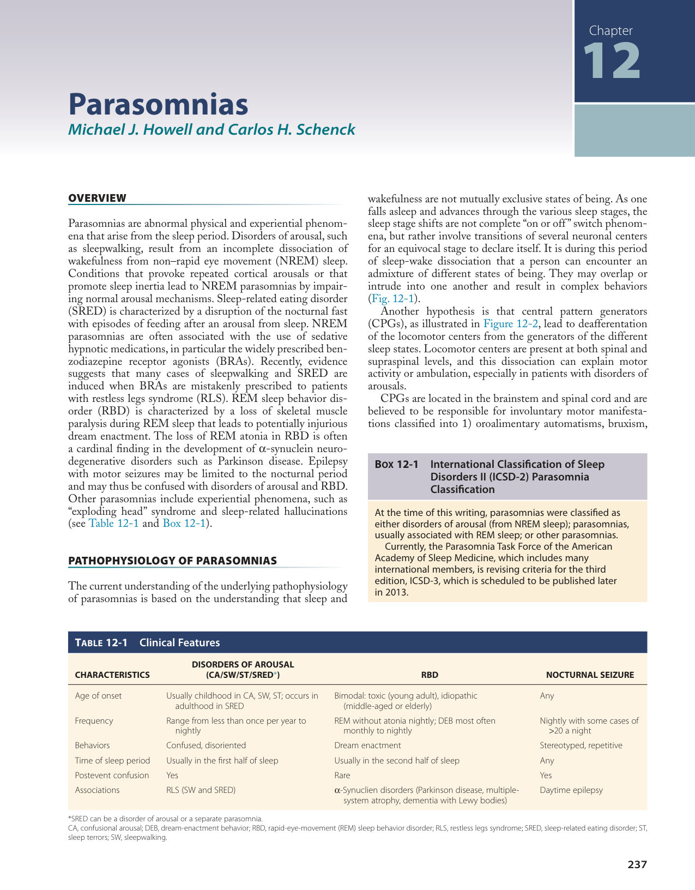

<!-- pdf-page: 256 -->

238 Parasomnias

Nocturnal spells: overlapping states

TABLE 12-2 Differences Between Sleep Terrors and

#### Nightmares

• RBD
• Hypnagogic hallucinations
• Sleep paralysis

• Confusional arousals
• Sleepwalking
• Sleep terrors

CHARACTERISTIC SLEEP TERROR NIGHTMARE

Timing during the night First third (deep

Last third

Sleep phenomena

slow-wave sleep)

Wake

REM

NREM

Seizures Psychogenic spells

• Dissociative disorders
• PTSD

NFLE

FIGURE 12-1. Overlapping states of being, as described by Mahowald

and Schenck. Parasomnias are explainable by the basic notion that sleep and wakefulness are not mutually exclusive states; these may dissociate and oscillate rapidly. The abnormal admixture of the three states of being—non–rapid eye movement (NREM) sleep, REM sleep, and wakefulness—may overlap and give rise to parasomnias. REM parasomnias occur as a result of the abnormal intrusion of wakefulness into REM sleep; likewise, NREM parasomnias, such as sleepwalking, occur because of abnormal intrusions of wakefulness into NREM sleep. Other nocturnal spells that may be confused with parasomnias include nocturnal frontal lobe epilepsy (NFLE) and psychogenic spells such as those associated with posttraumatic stress disorder (PTSD) and dissociated disorders. RBD, REM sleep behavior disorder. (Modified from Mahowald MW, Schenck CH: Non–rapid eye movement sleep parasomnias. Neurol Clin 2005;23[4]:1077- 1106, vii; and Avidan AY, Kaplish N: The parasomnias: epidemiology, clinical features, and diagnostic approach. Clin Chest Med 2010;31[2]:353-370.)

and biting; 2) ambulatory behaviors that range from the classical bimanual-bipedal activity of somnambulism to periodic leg movements; and 3) various sleep-related events associated with fear, such as sleep terrors, nightmares, and violent behaviors.

#### DISORDERS OF AROUSAL: NON–RAPID EYE

#### MOVEMENT PARASOMNIAS

The NREM parasomnias include confusional arousals, sleepwalking, and sleep terrors and represent dissociated states of being. Brain regions that coordinate motor and visual function are wakeful, but those areas of the cortex that lead to executive function and memory linger in sleep. These disorders of arousal are common in children and occur in up to 1% to 4% of adults, with most adults describing parasomnias persisting from childhood.

The disorders of arousal vary across a spectrum of duration, autonomic activity, and arousal threshold. Confusional arousals are characterized by disoriented behavior limited to the sleeping area with subsequent impaired recall of events (see Figs. 12-3 and 12-4 and Video 12-1). In adults, they can sometimes be triggered by a comorbid sleep disorder such as obstructive sleep apnea (OSA, Fig. 12-5). Sleepwalking is a combination of ambulation with impaired consciousness (Figs. 12-6 and 12-7). Sleep terrors usually occur

(REM sleep) Movements Common Rare Severity Severe Mild Vocalizations Common Rare Autonomic discharge Severe and intense Mild Amnesia Absent Present State on waking Confused, disoriented Lucid Injuries Common Rare Violence Common Rare Displacement from bed Common Very rare

REM, rapid eye movement.

#### CLINICAL CASE 12-1 Jumping Out a Window

A 19-year-old man arrived to the sleep center 4 days after a near-fatal parasomnia. The patient described several weeks of sleep restriction as a result of college academic responsibilities and social commitments, and said he went to bed at 3 AM. Approximately 45 minutes later, his roommate was startled awake to see the patient silhouetted in the frame of an open window. Without warning the patient leaped out and fell 6 meters before fortunately landing in a pile of sand. His only sequela from the event was a broken wrist.

Besides one episode of sleepwalking 2 years prior, the patient’s history and examination were unremarkable. He had no history of seizures, psychiatric disease, and no prescription medication or recreational drug use. A detailed neurologic examination was normal.

Formal sleep studies were remarkable: total sleep time was 16 hours on polysomnography, and actigraphy was consistent with circadian misalignment and behaviorally induced insufficient sleep syndrome. There was no evidence of sleep-disordered breathing, and the patient’s rapid eye movement muscle atonia was normal.

The patient did well with an increase in sleep intake and morning light therapy.

in preadolescent children, involve episodes of intense fear initiated by a sudden loud vocalization, and are accompanied by precipitously increased autonomic nervous system activity (Figs. 12-8 through 12-10). Patients with sleep terrors are typically inconsolable. The major differences between sleep terrors and REM nightmares are shown in Table 12-2.

NREM parasomnia patients are often difficult to awaken during an event; if awakened, they are usually confused and disoriented and have amnesia for any mental activity preceding the arousal.

Comorbid conditions that promote sleep inertia or fragmented sleep lead to incomplete cortical arousal. Phenomena that deepen sleep, such as sleep deprivation and sedative medications, promote NREM parasomnias by impairing arousal mechanisms (Clinical Case 12-1). Conditions that cause repeated cortical arousals, such as sleep-disordered breathing (see Fig. 12-5) or noise, lead to parasomnias through increased sleep fragmentation. The isolated activation of functional groups of motor neurons with a relative paucity of activity in brain regions that control executive function and memory

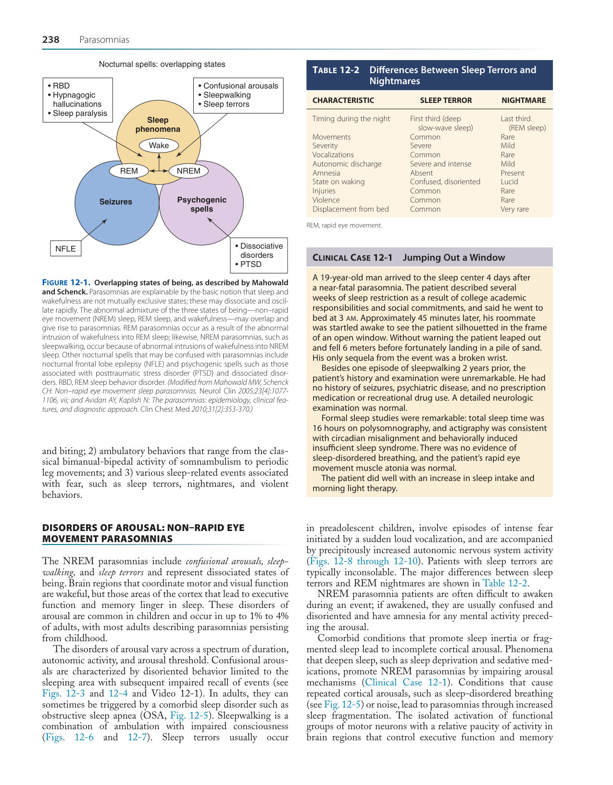

<!-- pdf-page: 257 -->

Alimentary: bruxism, oral automatism

Epilepsy

Defensive/predatory: biting

Emerging behavior

Emotional: facial expression, fear

Parasomnia

Locomotive: pedaling, fugue, cyclic leg movement

FIGURE 12-2. Along all levels of the neuraxis that stem from the brain to the upper brainstem and spinal cord, several neuronal networks exist that

produce different types of behavior (upper panel) when activated. The networks are collectively referred to as central pattern generators (CPGs), depicted as the tan regions in the bottom panel. The spectrum of resulting behaviors may be simple and stereotyped, such as rhythmic lip smacking and swallowing, to the more polymorphic and complex, such as those generating locomotion and search behaviors. The CPGs are thought to lead to monomorphic spells, which are stereotyped behaviors (automatisms) in which the possible etiology could be related to nocturnal seizures or highly complex (locomotive) polymorphic behavior, in which the cause may be a parasomnia. (Modified from Grillner S: The motor infrastructure: from ion channels to neuronal networks. Nat Rev Neurosci 2003;4:573-586; and Tassinari CA, Cantalupo G, Högl B, et al: Neuroethological approach to frontolimbic epileptic seizures and parasomnias: the same central pattern generators for the same behaviours. Rev Neurol [Paris] 2009;165:762-768.)

Central pattern generators (CPGs)

Spinal cord

Locomotion

Protective reflexes Swallowing CPG Respiratory CPG Locomotor CPG Postural networks Chewing CPG Expression of emotions Saccadic motor map Reaching

Selection sequence timing

Cerebral cortex

Speech Leg/hand movement

Cerebellum

Basal ganglia

Eating

Brainstem

Breathing Chewing Swallowing Eye movement

OSAT 98.3% 98.1 98.1 98.1 98.1 98.1 98.1 98.1 98.1 98.1 98.1 98.2 98.3 98.3 98.3 98.3 98.3 98.3 98.3 98.3 98.3 98.3 98.3 98.4 98.4 98.4 98.4

LOC-A2 ROC-A2 F3-A2 F4-A1 C3-A2 C4-A1 O1-A2 O2-A1 CHIN1-CHIN2 CHIN1-Fp1 LLeg-LAT2 RLeg-RAT2 INT-F8 Sca-T4 LArm-Cz RArm-Fp2

ECGL-ECGR

SNORE

PTAF

FLOW breaths/min

CHEST ABD TCM-TCM

Epoch 85: Wake

04/24/2010 00:13:15 [*] SUDDEN AROUSAL WITH CONFUSION

FIGURE 12-3. Spontaneous confusional arousal. This 30-second polysomnograph demonstrates a sudden arousal in a 39-year-old woman with a history of

non–rapid eye movement parasomnias unprecipitated by a respiratory event. She subsequently sat up, verbally berated her husband (who was not present), and attempted to remove her electroencephalogram wires.

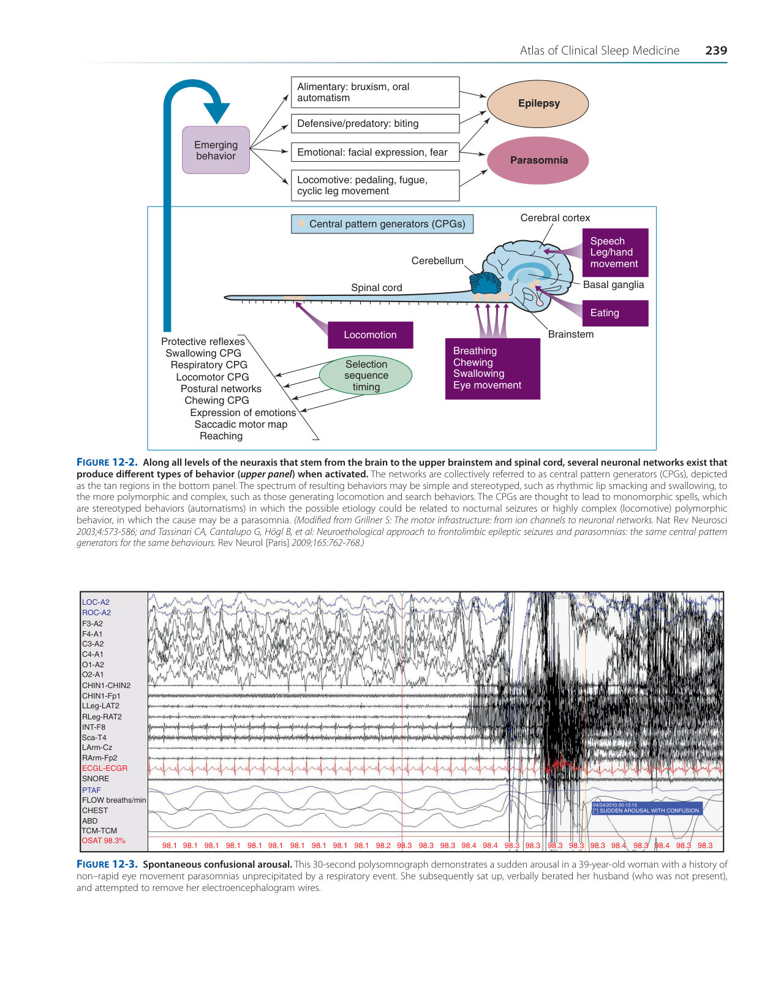

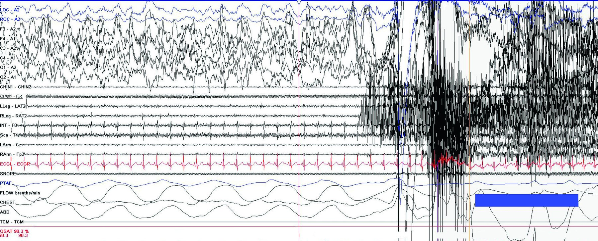

<!-- pdf-page: 258 -->

240 Parasomnias

27 1

53 79 105 131 157 183 209 235 261 287 313 339 365 391 417 443 469 495 521 547 573 599 625 651 677 703 729 755 781 807 833 859 885 911 937 963

W

CA CA CA CA

F

1

2

3

FIGURE 12-4. Hypnogram with multiple confusional arousals (CA). Notice that several confusional arousals emanated from slow-wave sleep during the

first half of the night.

94 91 89 93 92 93 91 93

E2-M1

E1-M2

CHIN1-CHIN2

F4-M1

F3-M2

C4-M1

C3-M2

O2-M1

O1-M2

ECG1-ECG2

ECG2-ECG3

LAT1-LAT2

### W

### W

### 1

RAT1-RAT2

### W

### W

### 1

SNORE

500 V

NPRE 187.5 V

N/O 200 V

THOR 100 V

ABD 3.2 V

SpO2 Art

100.0

SpO2 %

80.0

ARC RE

### W

### 1

### W

### 1

RERA

RERA

RERA

RERA

### W

### W

### W

### 1

### 1

Pleth

2V

FIGURE 12-5. Polysomnogram (120-second epoch) from a 54-year-old man conducted to evaluate for arousals with confusion and singing behavior.

The figure illustrates one of the patient’s representative events, an arousal from slow-wave sleep, as demarcated by the star, with the patient’s arms abducted (flapping his arms and described by the technicians to be “quacking like a duck”). (Modified from Avidan AY, Kaplish N: The parasomnias: epidemiology, clinical features, and diagnostic approach. Clin Chest Med 2010;31[2]:353-370.)

account for the poor judgment and amnesia that characterize NREM parasomnias.

The NREM parasomnias are associated with the normal, alternating arousal microstructure of NREM sleep, the cyclic alternating pattern (CAP; Fig. 12-11). An increase in CAP rate, a biomarker for arousal instability, has been noted among sleepwalking patients (Fig. 12-12).

Another parasomnia, SRED, is characterized by a disruption of the nocturnal fast with episodes of dysfunctional eating after an arousal from sleep. SRED is similar in many respects

to other disorders of arousal. Like sleepwalking, prolonged ambulation is common, and complications include weight gain and eating potentially dangerous substances. Polysomnography (PSG) in cases of SRED often demonstrates frequent periodic limb movements (PLMs) and rhythmic masticatory movements (i.e., chewing) during sleep and drowsy wakefulness (Fig. 12-13). Amnestic nocturnal eating can occasionally be documented during PSG when patients have readily available food at the bedside during their sleep study (Video 12-2).

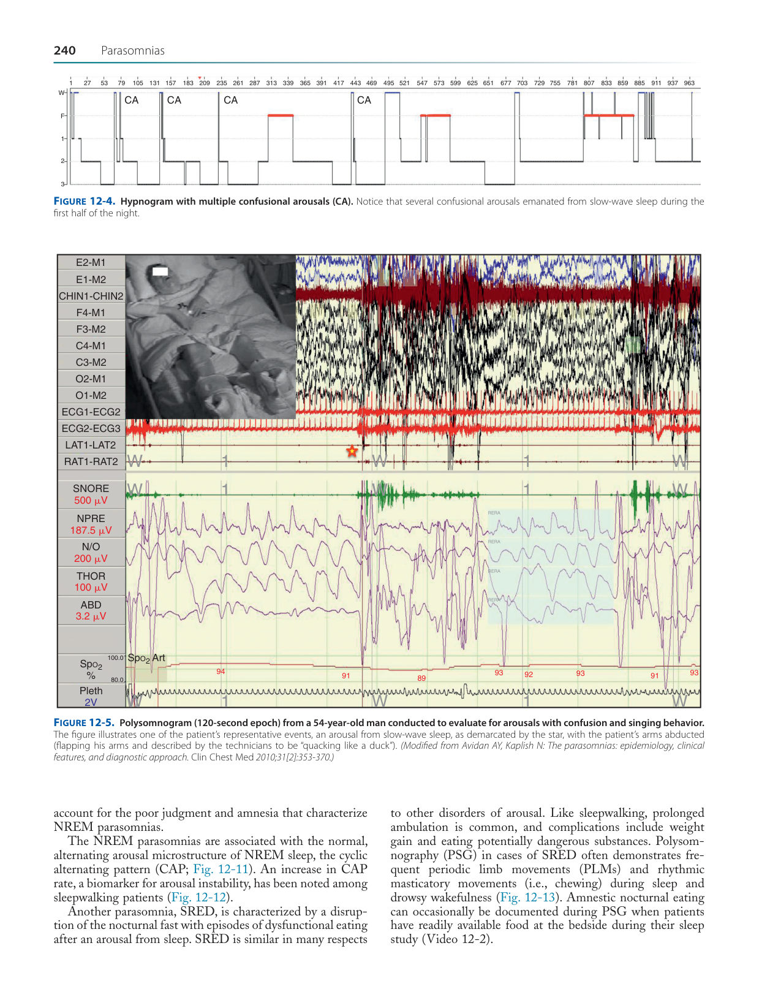

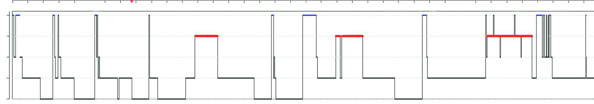

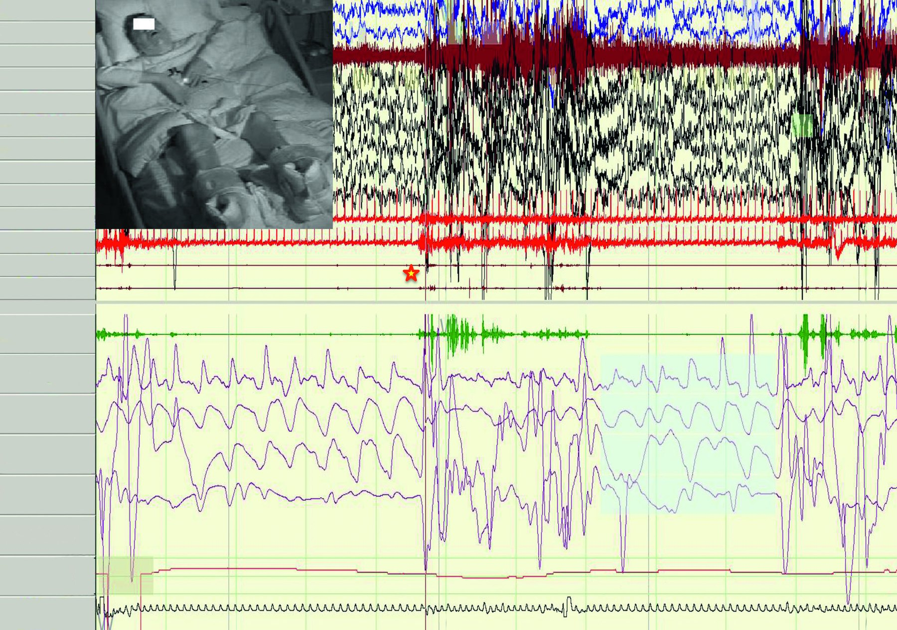

<!-- pdf-page: 259 -->

Epoch 730 Epoch 729 Epoch 728 Epoch 731

LOC-M2

ROC-M2

F3-M2

37.5 V

F4-M1

37.5 V

C3-M2

M PLM PLM PLM PLM Arousal with attempted sleepwalking

O1-M2

O2-M1

CHIN2-Fpz

FIGURE 12-6. Sleepwalking with restless legs syndrome (RLS) and periodic limb movement disorder. This 2-minute polysomnogram demonstrates an

arousal with attempted sleepwalking preceded by frequent periodic limb movements. The 28-year-old woman also described wakeful motor restlessness consistent with RLS. Dopaminergic therapy resolved the RLS symptoms and sleepwalking episodes.

LAT1-LAT2

: Stage 2 Epoch 311: Stage 2 Epoch 312: Wake

OSAT 98.6 % 98.6 100.0 98.9 97.7 96.9 97.8 96.6 97.0

LOC-M2

ROC-M1

F3-M2

F4-M1

C3-M2

C4-M1

O1-M2

O2-M1

CHIN1 CHIN2

SNORE

Ptaf2

Flow breaths/min

CHEST

ABD

Effort Sum

OBSTRUCTIVE APNEA

AROUSAL WITH ATTEMPTED SLEEPWALKING EPISODE

FIGURE 12-7. Sleepwalking with obstructive sleep apnea. This 90-second polysomnogram demonstrates an arousal with an attempted sleepwalking

episode after an obstructive apnea in a 40-year-old man.

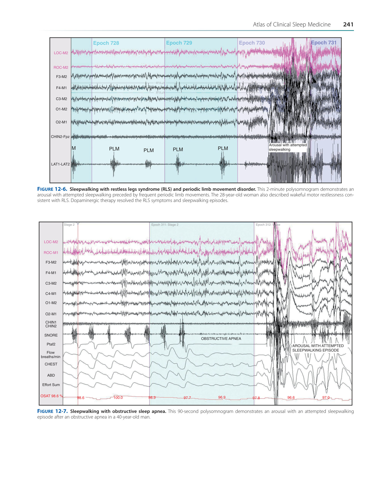

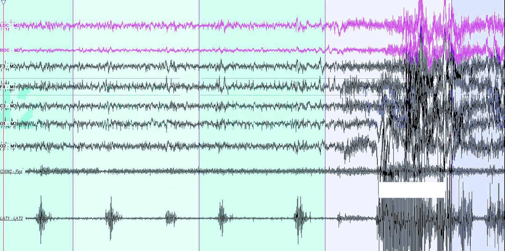

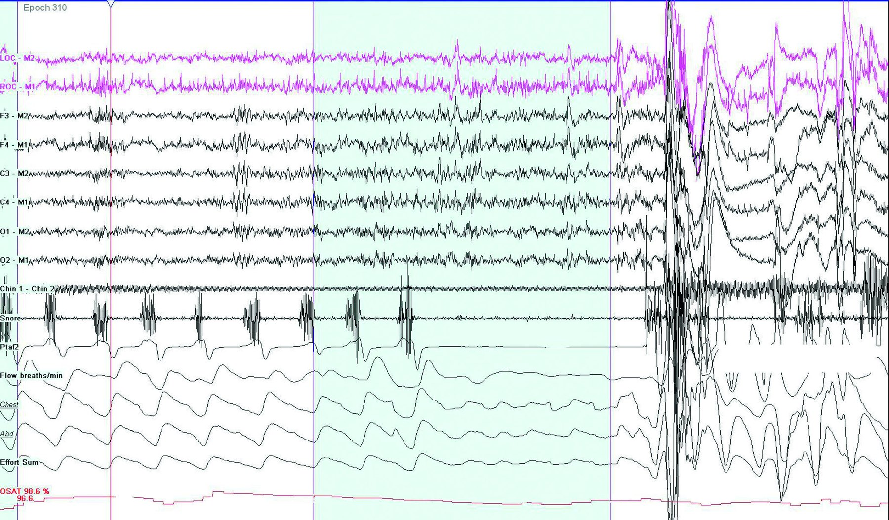

<!-- pdf-page: 260 -->

242 Parasomnias

Characteristic pattern of sleep terrors

Events typically last 3-5 minutes

Slow-wave sleep

Amnesia for the event

Sudden arousal

FIGURE 12-8. Characteristic pattern of sleep terror. Sleep terrors are characterized by a sudden arousal associated with a scream, agitation, panic, and

heighted autonomic activity. Inconsolability is almost universal. The child is incoherent and has altered perception of the environment, appearing confused. This behavior may be potentially dangerous and could result in injury. (Modified from Avidan AY, Kaplish N: The parasomnias: epidemiology, clinical features, and diagnostic approach. Clin Chest Med 2010;31[2]:353-370.)

Attempts to wake increase confusion

Mumbled speech

No response to parents

Confusion/disorientation Tremendous autonomic discharges

Sits up and screams

Panic

99.0 99.0 99.0 99.0 99.0 98.0

E2-M1 125 V

E1-M2 125 V

CHIN1-CHIN2

533.3 V

F4-M1 166.7 V

C4-M1 166.7 V

O2-M1 166.7 V ECG1-ECG2

2.67 mV

ECG2-ECG3

2.67 mV LAT1-LAT2

166.7 V

RAT1-RAT2

#### 3

#### 3

166.7 V

#### 3

#### 3

SNORE

500 V

Right Supine Left Prone

Position

NPRE 187.5 mV

N/O 400 V

THOR 400 V

ABD 400 V

100.0

SpO2 %

ARC SF

sat up quickly - screaming - see video pt sat up quickly - screaming - see video

#### W

#### W

#### W

#### W

SpO2 Art

#### W

#### W

#### 3

#### 3

80.0

Pleth

2V

FIGURE 12-9. Two-minute epoch of a diagnostic polysomnogram from a 9-year-old boy performed to evaluate for arousals associated with scream­

ing and inconsolable crying. The figure illustrates one of the patient’s representative spells, illustrating an arousal with screaming arising out of slow-wave sleep with the patient’s arms flexed and held close to the chest, as if afraid and protecting himself. (Modified from Avidan AY, Kaplish N: The parasomnias: epidemiology, clinical features, and diagnostic approach. Clin Chest Med 2010;31[2]:353-370; polysomnogram courtesy Timothy Hoban, MD, University of Michigan–Ann Arbor.)

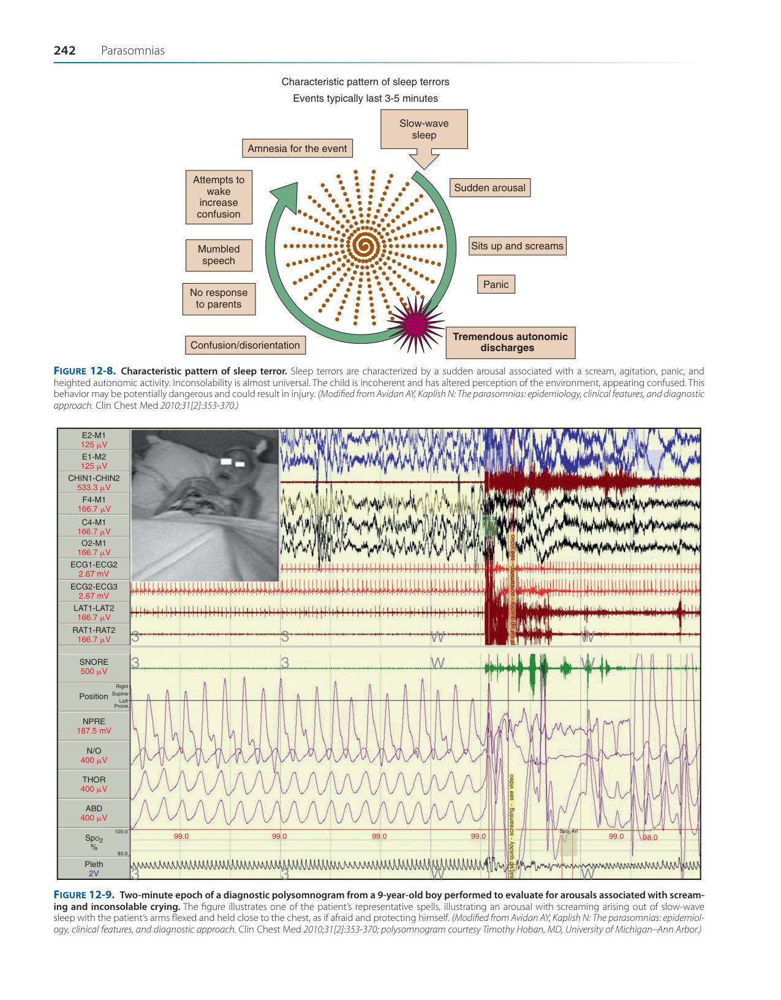

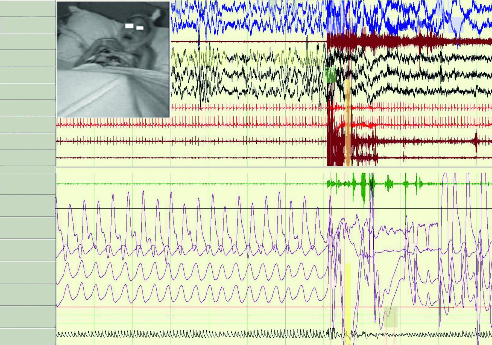

<!-- pdf-page: 261 -->

Cursor: 02:53:00, Epoch: 398 - AWAKE

LOC-A2

128 V

ROC-A1

128 V

C3-A2

128 V

C4-A1

128 V

78.1 73.1 75.1 79.1 79.1 78.1 75.1 86.1 121.1 77.1

O1-A2

128 V

O2-A1

128 V

CHIN1-CHIN2

102.4 V

Leg/L-LEG/R

21.8 mV

ECG1-ECG2

2.05 mV

MIC 1.02 mV

AIRFLOW

1.02 mV

THOR

512 V

ABD 1.02 mV

255.0

HR BPM

0.0

PT SAT UP LEANING FORWARD, OPENED HIS EYES, TALKING AND CHEWING

FIGURE 12-10. Sleep terror. This 90-second polysomnogram shows an arousal from non–rapid eye movement sleep in a patient with sleep terrors. Such

arousals typically arise from slow-wave sleep, as in this case. Note the precipitous nature of the arousal and the increase in heart rate.

### 3

### 2

### W

### W

OSAT 98.0 % 97.4 97.4 97.0 97.8 97.7 97.5 97.5 97.4 97.2 97.0 97.6 97.9 97.6 97.6 97.2 97.2 97.6 97.6 97.4 97.9 97.6 97.5

Epoch 296: Stage 2

LOC-A2

ROC-A1

F3-A2

F4-A1

C3-A2

C4-A1

O1-A2

O2-A1

CHIN1 CHIN2

PERIODIC AROUSAL

ECGL- ECGR SNORE

PTAF

Flow breaths/min

CHEST

ABD

Epoch 297: Stage 2 Epoch 298: Stage 2 Epo

PERIODIC AROUSAL PERIODIC AROUSAL PERIODIC AROUSAL

FIGURE 12-11. Cyclic alternating pattern. This 2-minute polysomnogram demonstrates normal cyclic alternating pattern during non–rapid eye movement

sleep. Notice the oscillation between high-amplitude synchronized cortical electroencephalographic activity (A phase) with low-amplitude desynchronized activity (B phase) approximately every 30 seconds.

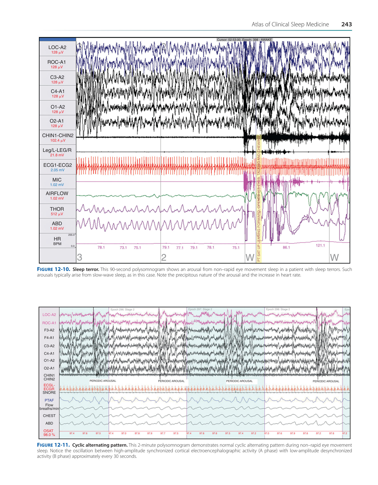

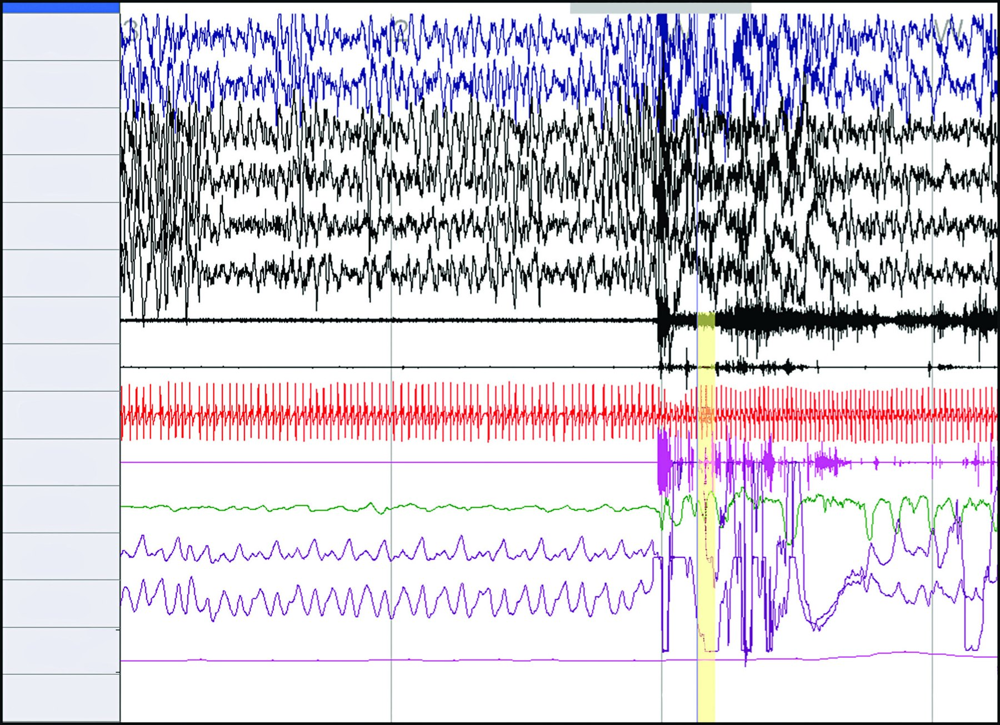

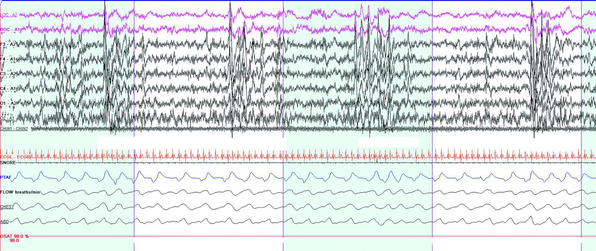

<!-- pdf-page: 262 -->

244 Parasomnias

#### Epoch 798

#### Epoch 797

#### Epoch 796

LOC-M2

ROC-M2

F3-M2

37.5 V

37.5 V

Periodic arousal Periodic arousal Periodic arousal Periodic arousal Confusional arousal Patient woke and subsequently attempted to climb out of bed.

F4-M1

37.5 V

C3-M2

C4-M1

O1-M2

O2-M1

CHIN2-Fpz

ECGL- ECGR

37.5 V

FIGURE 12-12. Rapid cyclic alternating pattern (CAP) with confusional arousal. This 90-second polysomnogram demonstrates a confusional arousal that

emanates from the A phase (high-amplitude, synchronized, cortical electroencephalographic activity) of a more rapid CAP compared with Figure 12-11. An increased CAP rate, suggestive of non–rapid eye movement instability, has been associated with sleepwalking and confusional arousals.

FIGURE 12-13. Rhythmic masticatory muscle activity in sleep-related eating disorder (SRED). This 60-second polysomnogram is from a 56-year-old

woman with a history of amnestic nocturnal eating. The rhythmic muscle artifacts in the electroencephalogram and electrooculogram leads are chewing movements frequently seen in SRED.

E1-M2

125 V

E2-M2

125 V

C3-M2

125 V C4-M1

125 V

O1-M2

125 V

O2-M1

125 V

F4-M1

125 V

CHIN1-CHIN2

200 V

Leg/L-LEG/R

16 mV

ECG1-ECG2

1 mV RIGHT IC1 - RIGHT IC2

250 V

FLOW

GOING FOR THE GUMMY BEARS JF

2 mV THOR

4 mV ABD

4 mV

Cursor: 10:45:00, Epoch: 205 - AWAKE

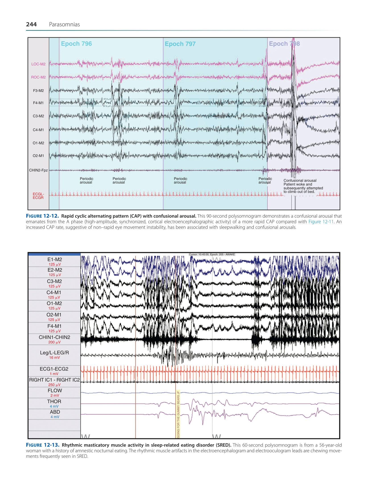

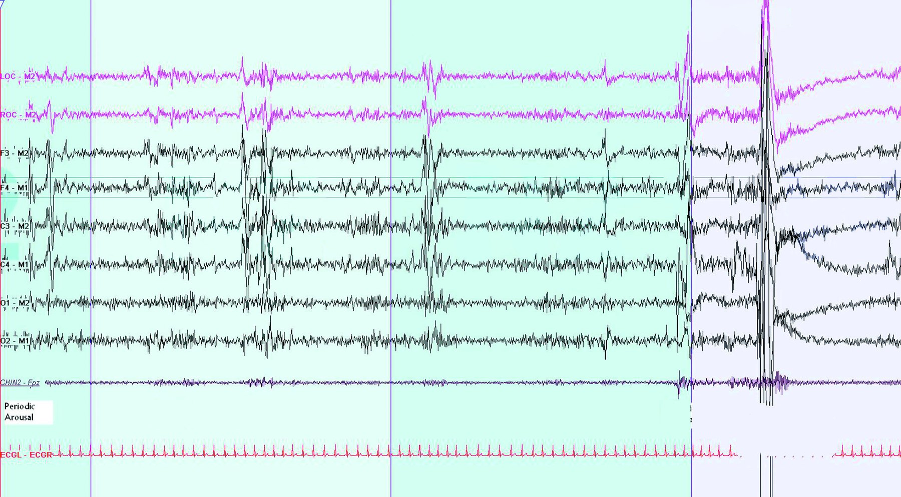

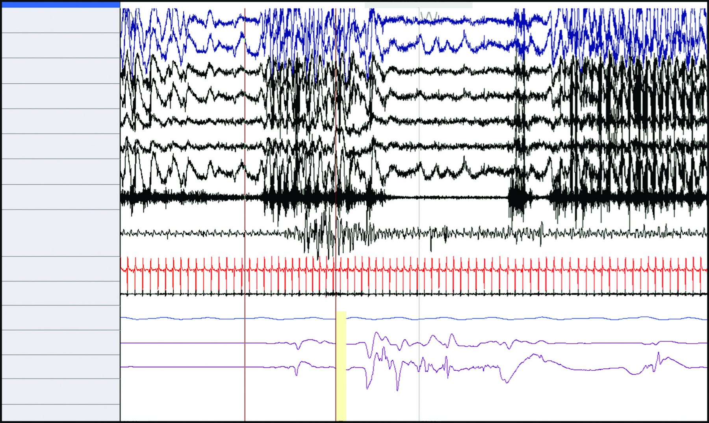

<!-- pdf-page: 263 -->

TABLE 12-3 Parasomnia Treatments

#### CLINICAL CASE 12-2 Zolpidem-Induced Sleep-Related

#### Eating Disorder in a Patient with

#### Restless Legs Syndrome

DOA SRED RBD SP

Strong

All patients with parasomnias appear to benefit from

evidencebased treatments

being treated for comorbid sleep disorders, eliminating provoking agents, and modifying the bedroom environment to prevent sleep-related injury.

Moderate

None Pramipexole Clonazepam,

None

A 49-year-old woman came to medical attention with a 6-month history of weight gain (10 kg) as a result of amnestic nocturnal eating after starting zolpidem for sleep initiation difficulties. The patient stated that before starting zolpidem, she had trouble initiating sleep related to an intrinsic motor restlessness. Furthermore, conscious nocturnal eating, typically a small snack, would often help her fall asleep. Upon starting zolpidem, she no longer had trouble falling asleep but would note abdominal distention on waking in the morning. Her family described middle-of-the-night binges on peanut butter, breads, ice cream, and candy; the patient was amnestic for these events.

Polysomnography with zolpidem demonstrated amnestic nocturnal eating after an arousal from non–rapid eye movement sleep (see Video 12-2) and frequent periodic limb movements. Clinical evaluation suggested that the patient was suffering from restless legs syndrome with nonmotor (eating) features. Zolpidem was discontinued, pramipexole was started, and subsequently both sleep initiation difficulties and parasomnia behaviors resolved.

Prolonged disorders of arousal and SRED frequently emerge in the setting of the commonly prescribed BRAs, most notably zolpidem. Furthermore, the rise of prolonged, complex amnestic behaviors in the previous two decades parallels the widespread use of BRAs. Intriguingly, many cases of BRA-induced parasomnias are noted to have comorbid RLS, which can be easily misdiagnosed and treated as insomnia. RLS is characterized by an intrinsic motor restlessness that often interferes with sleep onset and is associated with other nocturnal urges, such as the urge to eat. Because BRAs disinhibit frontal and hippocampal function, it is not surprising that these agents, when prescribed to patients with subconscious urges to ambulate and eat (RLS patients), unleash amnestic episodes of ambulation and binge eating, or SRED (Clinical Case 12-2).

Elimination of sedating agents and reversing comorbid conditions often dramatically diminish nocturnal behaviors. When sleepwalking or SRED is associated with a BRA, it is of particular importance to reconsider the diagnosis for which the medication was originally prescribed. In these cases, patients may not have insomnia, but rather RLS, as described above. In mild cases, reassurance that these behaviors are normal and unrelated to psychiatric disease is often sufficient. Medications are occasionally prescribed; however, more definitive clinical studies of efficacy and safety are needed (Tables 12-3 and 12-4).

#### REM SLEEP PARASOMNIAS

#### REM Sleep Behavior Disorder

REM sleep is characterized by an activated brain state in combination with skeletal muscle paralysis to prevent dream enactment (Fig. 12-14). The suppression of motor activity during REM sleep is the cumulative result of multiple, currently incompletely defined pathways that terminate at spinal

evidencebased treatments*

melatonin

Weak evidence-

Paroxetine

Topiramate Customized

Clomipramine

based treatments†

for STs*

bed alarm

*Large case series or small controlled trial without conflicting results. †Case series without conflicting results. DOA, disorder of arousal; RBD, rapid eye movement sleep behavior disorder; SP, sleep paralysis; SRED, sleep-related eating disorder; STs, sleep terrors.

TABLE 12-4 Treatment for Most Common Non-REM

#### Parasomnias

PARASOMNIA TREATMENT

Confusional arousal Reassurance of the benign nature of the event Avoid precipitants:

Sleep deprivation Alcohol Central nervous system depressants Escitalopram (10 mg) for sexsomnia Somnambulism

Safeguard the sleep environment and protect the patient Avoid precipitants:

(sleepwalking)

Sleep deprivation Lithium Non-benzodiazepine receptor agonists Anticipatory

Benzodiazepines Clonazepam (0.5 to 1 mg) Diazepam (10 mg) Triazolam (0.25 mg) Imipramine (50 to 300 mg) Sleep terrors Reassurance of the benign nature of the event Cognitive behavior therapy Paroxetine (20 to 40 mg) Clonazepam (0.5 to 1 mg)

awakenings

From Zak R, Mallea J, Aurora RN: Management of parasomnias. In Avidan AY, Zee PC (eds): Handbook of sleep medicine, ed 2. Philadelphia, 2011, Wolters Kluwer Health/Lippincott Williams & Wilkins, pp xxii, 490.

motor neurons, most notably via the magnocellular reticular formation in the medulla. In RBD, this normal atonia is lost, and patients come to medical attention with dream-enactment behavior that varies from small hand movements to violent activities such as punching, kicking, or leaping out of bed (Figs. 12-15 through 12-18 and Video 12-3). Several diverse pathologies can lead to RBD; these include synuclein neurodegeneration, hypocretin (orexin) dysfunction, toxic etiologies, and direct central nervous system (CNS) lesions (see the discussion of RBD in Chapter 11.4 and Clinical Cases 12-3 and 12-4).

Because of its association with REM sleep, dreamenactment behavior predominantly appears during the second half of the sleep period. Unlike patients with disorders of

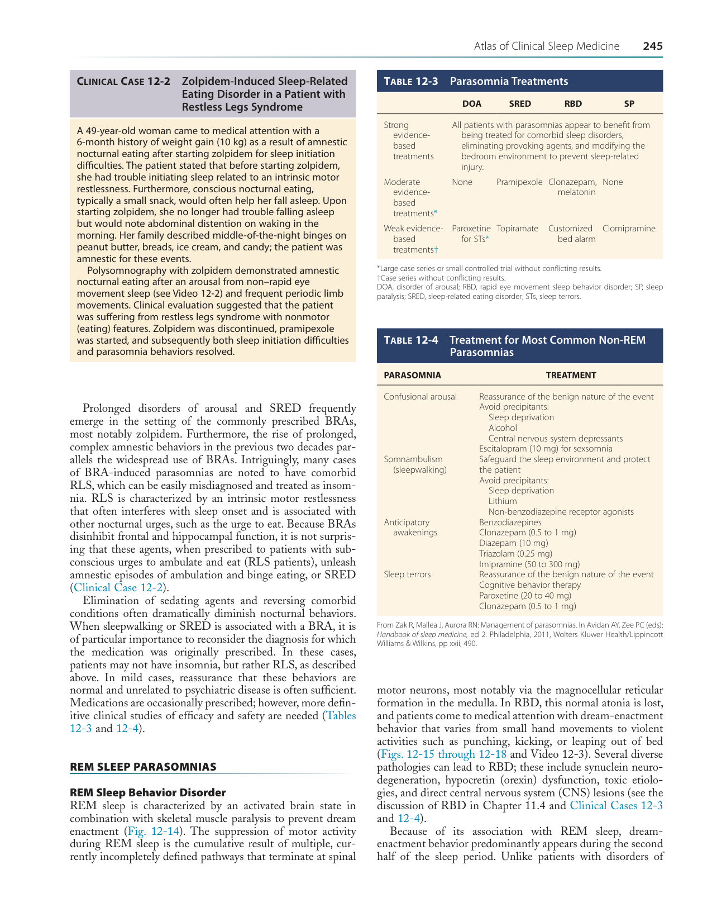

<!-- pdf-page: 264 -->

246 Parasomnias

48 Epoch 949 Epoch 951 Epoch 950

LOC-M2

ROC-M2

F3-M2

37.5 V

37.5 V

F4-M1

37.5 V

37.5 V

C3-M2

FIGURE 12-14. Normal rapid eye movement (REM) atonia. This 2-minute polysomnogram demonstrates the normal lack of muscle tone seen in REM.

C4-M1

O1-M2

O2-M1

CHIN1- CHIN2

Rarm1- Rarm2

FIGURE 12-15. Rapid eye movement (REM) without atonia (tonic). This 60-second polysomnogram demonstrates a tonic elevation of REM motor activity

in REM sleep behavioral disorder.

LOC-M2

ROC-M2

F3-M2

37.5 V

F4-M1

37.5 V

C3-M2

C4-M1

O1-M2

O2-M1

CHIN1- CHIN2

Rarm1- Rarm2

Epoch 975 Epoch 976

37.5 V

37.5 V

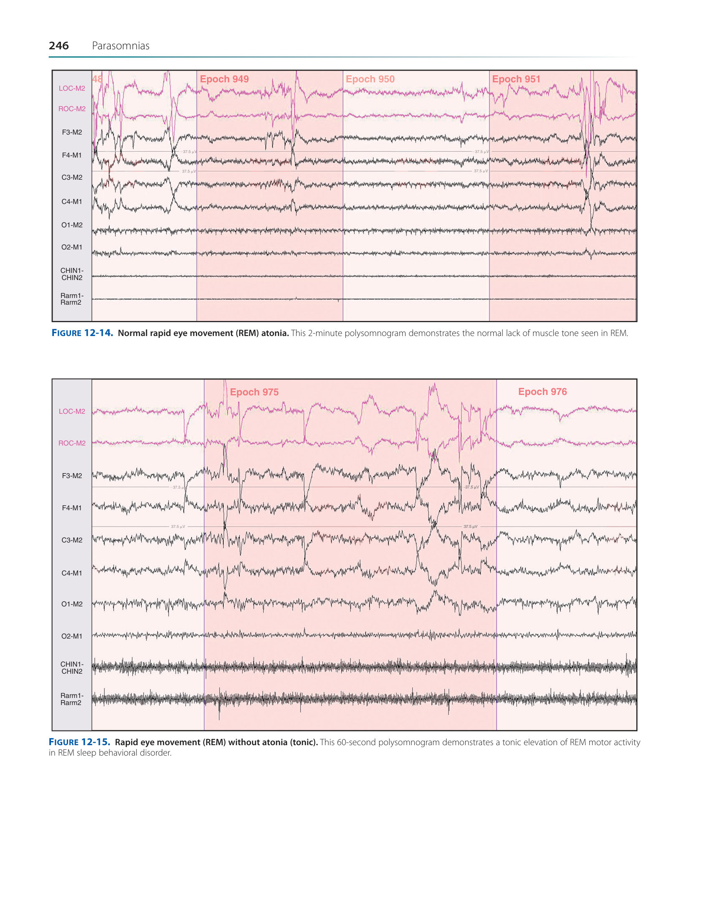

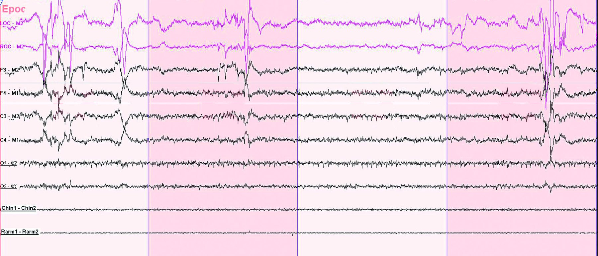

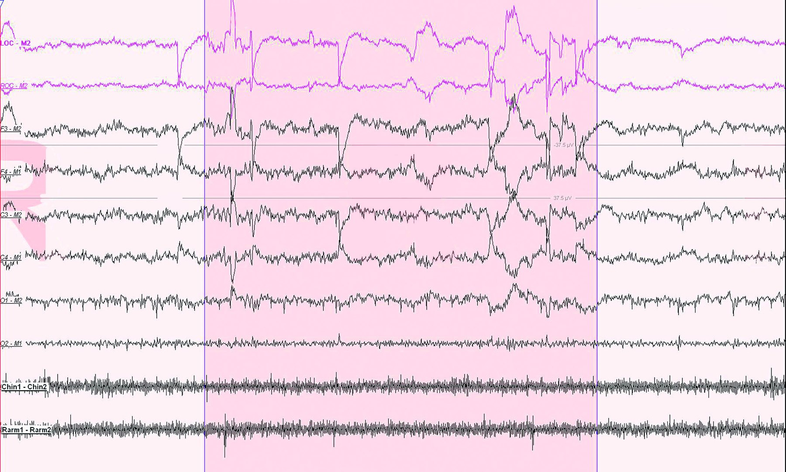

<!-- pdf-page: 265 -->

h 598 Epoch 599

LOC-M2

ROC-M2

F3-M2

37.5 V

37.5 V

F4-M1

37.5 V

37.5 V

FIGURE 12-16. Rapid eye movement (REM) without atonia (phasic). This 60-second polysomnogram demonstrates a phasic elevation of REM motor activity

in REM sleep behavior disorder. Notice that the motor activity is temporally associated with the phasic eye movements of REM sleep.

C3-M2

C4-M1

O1-M2

O2-M1

CHIN1- CHIN2

Rarm1- Rarm2

#### R

#### R

#### R

#### R

#### R

Cursor: 04:29:00, Epoch: 787 - REM 2 min/page

#### R

#### R

#### R

#### R

#### R

LOC-A2

204.8 V

ROC-A1

204.8 V

C3-A2 102.4 V

C4-A1 102.4 V

O1-A2 102.4 V

O2-A1 102.4 V

CHIN1-CHIN2

51.2 V

Leg/L-LEG/R

409.6 V

ECG1-ECG2

1.02 mV

PT VERBALIZED IN REM ON BK

FIGURE 12-17. Rapid eye movement (REM) without atonia (tonic and phasic). This 2-minute polysomnogram demonstrates a combined tonic and phasic

elevation of REM motor activity.

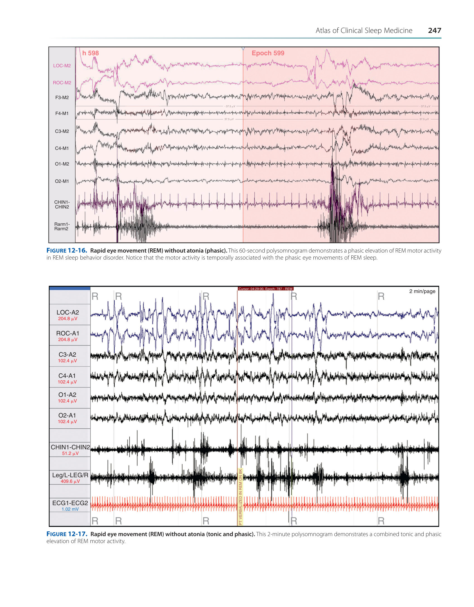

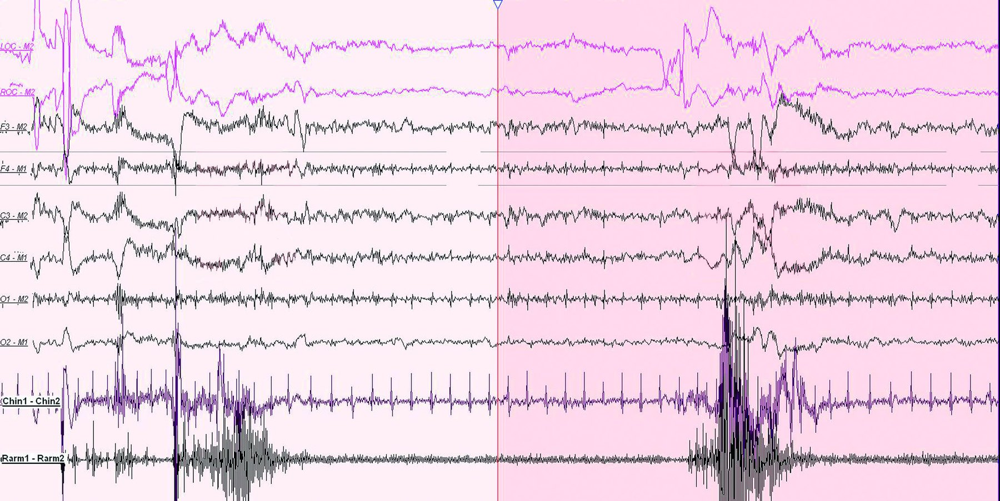

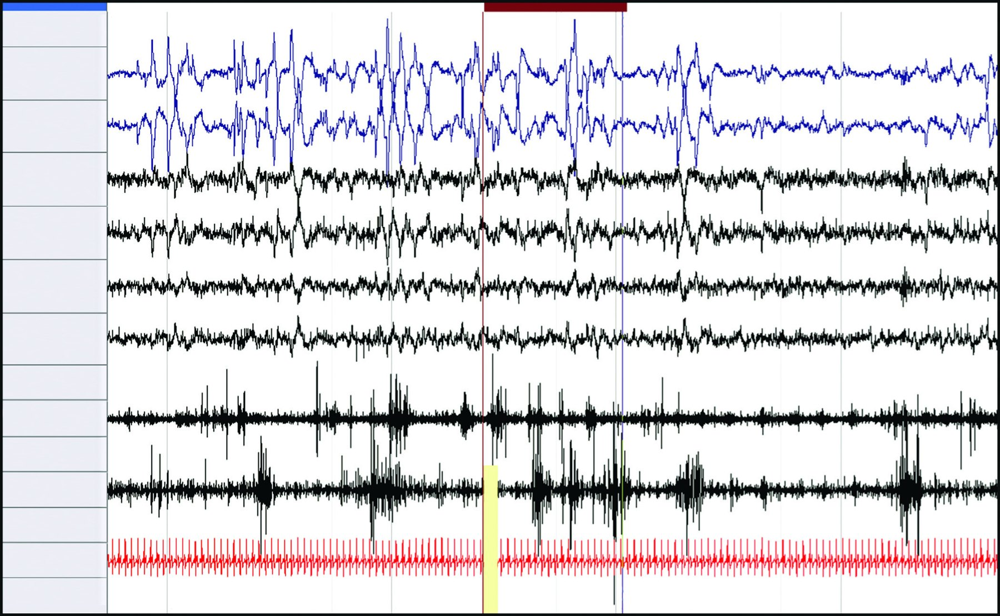

<!-- pdf-page: 266 -->

248 Parasomnias

Cursor: 04:29:14, Epoch: 1089 - REM 2 min/page

#### R R

#### R

#### R

#### R

LOC-A2

512 V

ROC-A1

512 V

C3-A2

128 V

C4-A1

#### R R

#### R

#### R

#### R

128 V

O1-A2

128 V

O2-A1

128 V

CHIN1-CHIN2

128 V

ECG1-ECG2

1.02 mV

Leg/L-LEG/R

2.05 mV

PT MOVING LEGS IN REM

THOR

64 V

ABD 512 V

FIGURE 12-18. Rapid eye movement (REM) without atonia (phasic) in extremities only. Note the prominent extremity, but not chin, phasic muscle activity

in this 2-minute polysomnogram. Chin electromyography alone can miss REM without atonia, as in this case of a 35-year-old woman with REM sleep behavior disorder associated with narcolepsy.

#### CLINICAL CASE 12-3 Medication-Induced REM Sleep

#### Behavior Disorder

A 49-year-old man was referred for a 6-month history of violent dream-enactment behaviors. These events started soon after initiating bupropion for a mood disorder. His wife describes near-nightly episodes of punching and kicking that has necessitated her sleeping in a separate bedroom. Before bupropion, the patient had no history of parasomnias or other sleep disorders. The patient noticed no difficulties with smell, constipation, or other symptoms suggestive of early α-synuclein disease. A detailed neurologic exam revealed no evidence of extrapyramidal disease.

Polysomnography demonstrated phasic rapid eye movement without atonia (see Fig. 12-16) and without other significant findings. The patient was hesitant to switch antidepressant medications based on prior sexual side effects with other agents, so he was started on high-dose melatonin—ultimately reaching 9 mg at bedtime—which he tolerated without difficulty. His dream-enactment behavior effectively resolved.

arousal, RBD patients are alert and oriented immediately upon awakening, and they report dream mentation that often correlates with the observed behaviors (Video 12-4).

RBD appears to have an age- and etiology-related bimodal distribution. Among younger adults, RBD is most frequently

#### CLINICAL CASE 12-4 Injurious REM Sleep Behavior

#### Disorder and Bed Alarm Therapy

A 70-year-old man with a 15-year history of injurious dream-enactment behavior and a 5-year history of Parkinson disease was evaluated after recently fracturing three lumbar vertebrae as a result of leaping out of bed.

PSG demonstrated rapid eye movement without atonia along with elaborate dream-enactment behavior (see Video 12-4). High-dose melatonin was only partially effective, and low-dose clonazepam was poorly tolerated because of morning gait impairment. Based on the history that his wife could verbally calm him during dream enactment, a bed alarm was customized with his wife’s voice to redirect him once he arose from bed (see Video 12-5). After 2 years of follow-up, the patient had not left the bed and reported no subsequent sleep-related injury.

noted with antidepressant medications or in the setting of narcolepsy. Among older adults, RBD is most commonly indicative of an impending synucleinopathy.

An evidence-based review suggests that both low-dose clonazepam and/or high-dose melatonin can be effective therapies for the treatment of RBD (Table 12-5; also see

Table 11.4-1). It is also recommended that the patient’s sleep­

ing environment be modified to prevent sleep-related injuries.

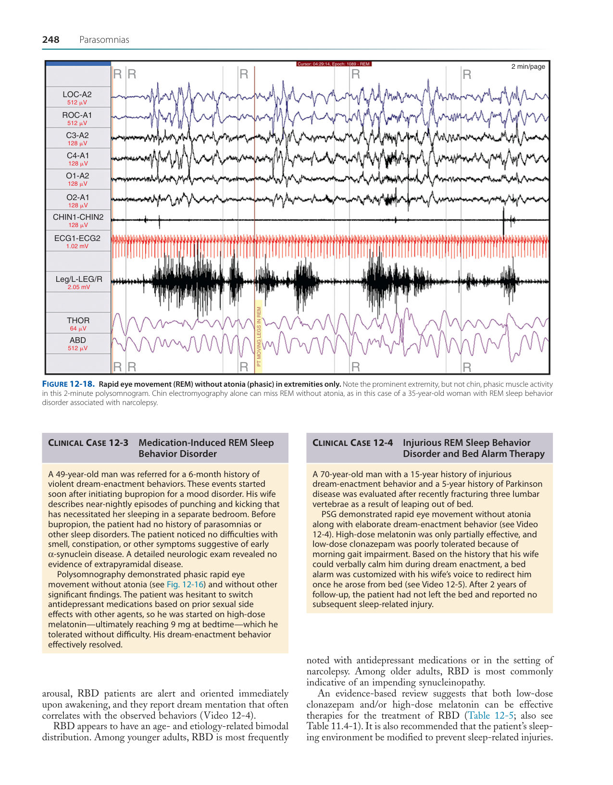

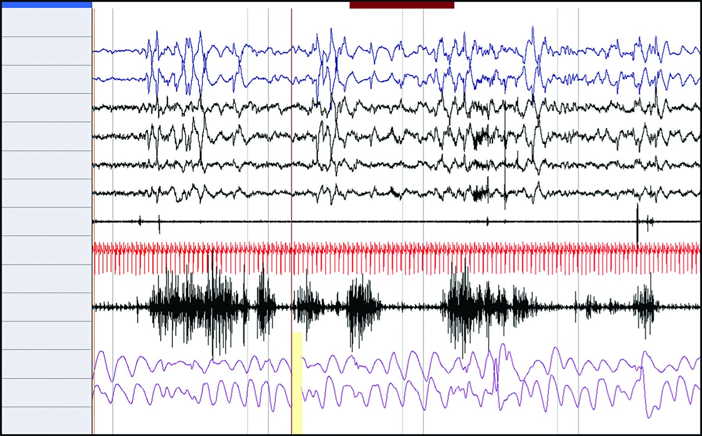

<!-- pdf-page: 267 -->

#### ABNORMAL SLEEP INERTIA

Medically resistant patients may respond to a customized bed alarm that redirects them after they arise from bed (Video 12-5).

Under normal circumstances, the change in consciousness that occurs during the transition between wake and sleep is sharply defined. However, more subtle measures of alertness, such as vigilance and reaction time, are modestly reduced when a subject is awakened. These physiologic reductions then dissipate back to normal function, typically within 1 to 2 hours.

Epoch 1172 Epoch 1173 Epoch 1174 Epoch 1171

#### Sleep Paralysis

Sleep paralysis is the preservation of atonia after an arousal from REM sleep. Dream mentation, often terrifying, may coexist with wakeful cognition (see “Experiential Parasomnias” below; Fig. 12-19, and Clinical Case 12-5). The events usually last less than 1 minute and either spontaneously resolve or are halted by external auditory or tactile stimulation from a bedmate. Because sleep paralysis occurs with an impaired dissociation from REM sleep, it is considered a REM parasomnia.

TABLE 12-5 Treatment for REM Sleep Behavior

#### Disorder Based on the Suggested Level

#### of Evidence

LEVEL OF RECOMMENDATION

DOSE

Clonazepam 2 mg qhs Suggested Melatonin 3 mg to 12 mg hs Suggested

From Zak R, Mallea J, Aurora RN: Management of parasomnias. In Avidan AY, Zee PC (eds): Handbook of sleep medicine, ed 2. Philadelphia, 2011, Wolters Kluwer Health/Lippincott Williams & Wilkins, pp xxii, 490.

#### CLINICAL CASE 12-5 Sleep Paralysis

A 42-year-old woman with a lifelong history of sleep paralysis described feeling “frozen” and unable to move or scream on a near-nightly basis. These events were described as terrifying and often associated with frightening dream mentation, including physical and sexual assault. Episodes were more severe during times of stress and sleep deprivation. These events led to sleep anxiety and avoidance, which had, on numerous occasions, compounded the problem. She was not hypersomnolent and did not experience cataplexy.

Polysomnography demonstrated a persistence of REM atonia into wakefulness for 2 minutes (see Fig. 12-19). No other sleep or circadian rhythm disturbance was discovered. The patient did only modestly well with sleep extension and a bedtime REM-suppressing agent, clomipramine. Unfortunately, side effects limited the use of this agent, and the patient was lost to follow-up.

FIGURE 12-19. Sleep paralysis. This 2-minute polysomnogram demonstrates sleep paralysis (see Clinical Case 12-6). The patient’s electroencephalogram

becomes wakeful during the second half of epoch 1172; however, the patient’s rapid eye movement atonia persists throughout epoch 1173 and into 1174.

LOC-M2

ROC-M2

F3-M2

37.5 V

F4-M1

37.5 V

C3-M2

C4-M1

O1-M2

O2-M1

CHIN1- CHIN2

Rarm1- Rarm2

37.5 V

37.5 V

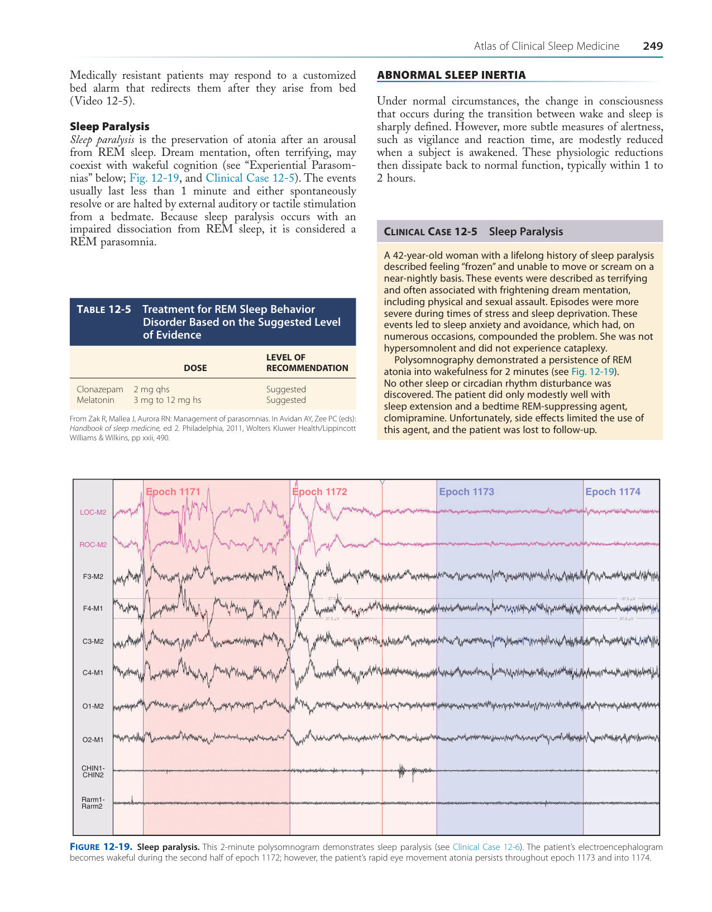

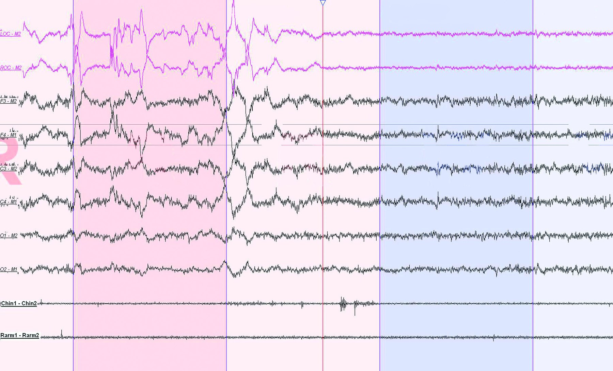

<!-- pdf-page: 268 -->

250 Parasomnias

Various pathologies can lead to severe morning sleep inertia or sleep drunkenness, which can impair cognitive function, and occasionally confusional behaviors similar to disorders of arousal. Like disorders of arousal, abnormal sleep inertia typically occurs in the setting of other comorbid sleep disorders. Unlike disorders of arousal, however, severe sleep inertia typically arises out of light NREM sleep.

developed nocturnal continence, or secondary, in a patient who had previously been continent but subsequently lost bladder control at night.

Primary sleep enuresis is often either a failure of the brain to arouse from sleep in response to bladder expansion or the result of inappropriate bladder contraction during sleep. Familial cases are common, and boys are more commonly affected than girls. The vast majority of primary sleep enuresis cases resolve spontaneously.

Other abnormalities in sleep-wake state transitions include experiential parasomnias and enuresis. These phenomena include experiential parasomnias either leading into (hypnagogic) or out of (hypnopompic) sleep.

#### Experiential Parasomnias

Sleep-onset experiences include the “exploding head” syndrome and sleep-related hallucinations (hypnogogic hallucinations). Sleep-wake transitional phenomena include sleep-related hallucinations (hypnopompic hallucinations) and sleep paralysis.

The theatrically named exploding head syndrome describes a startling auditory hallucination at the initiation of sleep. Patients claim they are awoken by a sudden loud noise and may describe the feeling as “an exploding head.” The character of auditory hallucination varies from simple (“a church bell”) to complex (“the sound of someone pounding on several piano keys”). Myoclonic jerks often co-occur with the auditory phenomena.

Sleep-related hallucinations, either hypnogogic or hypnopompic, are typically visual and appear in human or other animal form. They are often associated with anxiety and a foreboding sense of terror. This feeling is heightened if hallucinations are combined with sleep paralysis. Of note, sleep paralysis is often perceived as a sense of dyspnea, from the lack of accessory muscle of respiration, with frightening dream mentation, such as a demonic presence. Various cultures have paranormal or religious interpretations for these experiences because patients with no history of thought disorder will describe in vivid detail such things as alien abduction, sexual assault by animals, or demonic possession. The painting by John Henry Fuseli, “The Nightmare” (1781), illustrates REM sleep-wake transition experiential phenomena (see Fig. 1-14). The woman in the painting clearly demonstrates the atonia of sleep paralysis combined with frightening visual hallucinations.

These experiential parasomnias most often occur in the setting of either sleep deprivation or comorbid sleep pathology. Sleep paralysis and sleep-related hallucinations are part of the classical quartet of narcolepsy along with hypersomnolence and cataplexy. These conditions lead to experiential parasomnias by impairing a sharp transition between sleep and wakefulness. Treating underlying sleep disorders and optimizing the duration and circadian timing of sleep will successfully treat the vast majority of cases. REM-suppressing agents, such as antidepressants, can sometimes be useful for challenging cases of sleep paralysis and sleep-related hallucinations.

#### SLEEP ENURESIS

Sleep enuresis is defined by recurrent (at least twice a week) involuntary urination during sleep. By the age of 6 years, 90% of children have developed 24-hour control of micturition. Sleep enuresis is either primary, in a patient who has never

Secondary sleep enuresis is most commonly due to other sleep disorders, such as OSA. A collapsing airway in combination with increased respiratory effort decreases intrathoracic pressure, and atrial natriuretic peptide is subsequently secreted from the heart, leading to increased urinary output. In addition, OSA also leads to enuresis by impairing cortical arousal through increased homeostatic sleep drive combined with increased autonomic activity. Other etiologies of secondary sleep enuresis include urinary tract disorders, nocturnal seizures, and disorders that lead to increased urine production.

#### NOCTURNAL SEIZURES

The motor behavior of epileptic activity can mimic parasomnias, and seizures may occur exclusively during sleep. Sleeprelated synchronized brain activity promotes the spread of seizure activity; thus NREM sleep is the most epileptogenic state. The behaviors from nocturnal seizure activity are often bizarre, stereotyped, and recurrent. A 32-lead seizure montage can often be helpful because an electroencephalogram (EEG) may demonstrate epileptic activity. However, because many nocturnal seizures emanate from deep, most often frontal lobe structures, nocturnal seizures should be considered even in the absence of any EEG abnormality, especially if behavior is stereotyped and recurrently arises from NREM sleep (see Clinical Case 12-6, Fig. 12-20).

Treatment of nocturnal seizures is similar to that of other epilepsies. For a more thorough review of epilepsy and sleep, see Chapter 11.3.

#### CLINICAL CASE 12-6 Nocturnal Frontal Lobe Epilepsy

A 29-year-old developmentally disabled man was noted by family to have screaming and thrashing episodes up to 20 times a night. The patient was unaware of these events. Previous investigations included prolonged epilepsy monitoring, which concluded that the events were nonepileptic because seizure activity was never seen on electroencephalography (EEG). A previous polysomnogram (PSG) suggested mild obstructive sleep apnea. Continuous positive airway pressure was tried, poorly tolerated, and did not alter the frequency or severity of these events.

Repeat PSG demonstrated behavioral events arising out of light NREM sleep and, as with events seen in previous investigations, these were not epileptiform on EEG. However, because the events were stereotyped, abnormal, and repetitive, nocturnal frontal lobe epilepsy (NFLE) was considered likely. NFLE often is without EEG correlation because seizures can emanate from deep cortical structures not well characterized by surface electrodes.

Carbamazepine at bedtime immediately resolved the nocturnal behaviors.

<!-- pdf-page: 269 -->

LOC-A2 30 sec/page

Cursor: 03:11:39, Epoch: 531 - STAGE 2

#### 2

#### 2

ROC-A1

C3-A2

O2-A1

CH1-CH2

LEGS L/R

Fp1-F3

F3-C3

FIGURE 12-20. This epoch reveals a run of electrical seizure activity without clinical manifestations. The presence of such activity in this patient sug­

gested the diagnosis of nocturnal seizures.

C3-P3

P3-O1

Fp2-F4

F4-C4

C4-P4

P4-O2

Fp1-F7

F7-T3

T3-T5

T5-O1

SOUND FROM THROAT BEFORE EEG AROUSAL

Fp2-F8

F8-T4

T4-T6

T6-O2

FZ-CZ

ECG

AIRFLOW

SOUND

#### 2

#### 2

TABLE 12-6 Illustrated Key Similarities and Differentiating Features Between Non-REM and REM Parasomnias and

#### Nocturnal Seizures

Time in sleep cycle Early Early Early, Middle Late Late Any Sleep stage SWS SWS SWS REM REM Any EEG discharges − − − − − + Scream − ++++ − ++ + + CNS activation + ++++ + + + + Motor activity − + +++ + ++++ ++++ Awakenings − − − + + + Duration (in minutes) 0.5 to 10 1 to 10 2 to 30 3 to 20 1 to 10 5 to 15 Postevent confusion + + + − − + Age Child Child Child Child, adult Older adult Young adult Genetics + + + − − ± Organic CNS lesion − − − − ++ ++++

CONFUSIONAL AROUSALS SLEEP TERRORS SLEEPWALKING NIGHTMARES

REM SLEEP BEHAVIOR DISORDER

NOCTURNAL SEIZURES

Modified from Avidan AY, Kaplish N: The parasomnias: epidemiology, clinical features, and diagnostic approach. Clin Chest Med 2010;31(2):353-370.

CNS, central nervous system; EEG, electroencephalogram; REM, rapid eye movement; SWS, slow-wave sleep.

#### CATATHRENIA

Catathrenia, also known as sleep-related groaning, is characterized by expiratory groaning during sleep (Fig. 12-21). These episodes occur during expiration and resemble groaning, although the patient does not typically exhibit any show of emotion or respiratory distress and will not have recollection of the event. Catathrenia may be successfully managed with continuous positive airway pressure in patients with sleep

apnea comorbid with this condition. The spells generally last a few seconds, typically less than 1 minute, appearing in clusters many times per night during REM sleep. A sudden change in respiratory rhythm is seen in the respiratory channels, usually inspiration followed by a flat line during expiration, ending in arousal on EEG.

Table 12-6 summarizes the different types of nocturnal

events based on semiology, timing during the night, duration, EEG activation, and other key features.

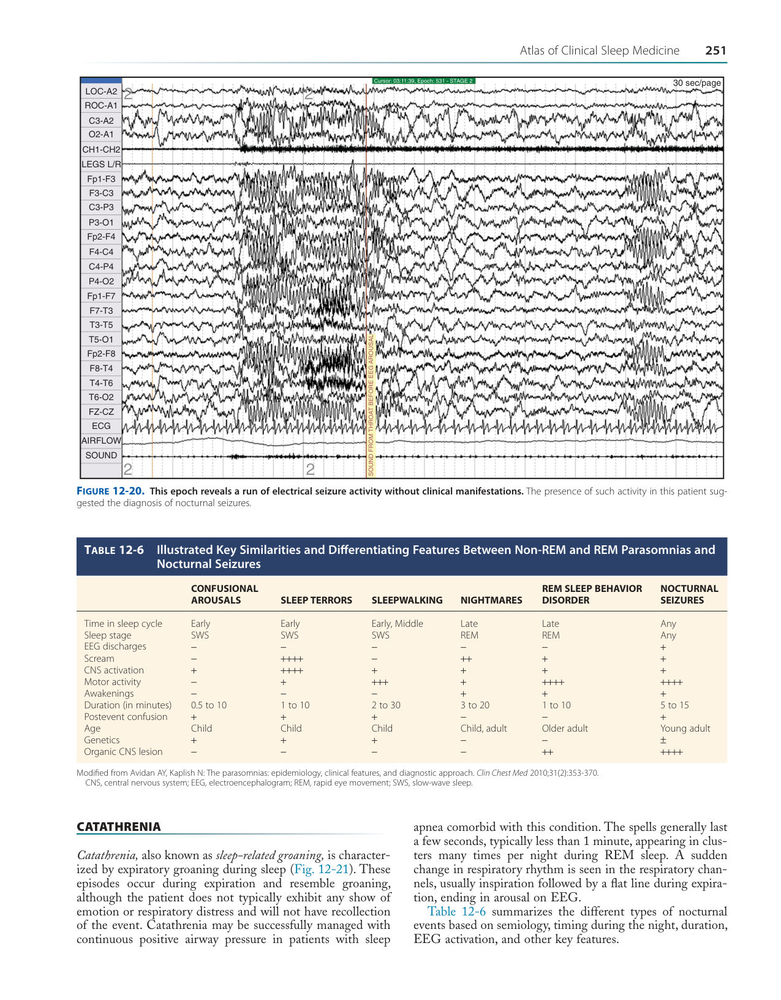

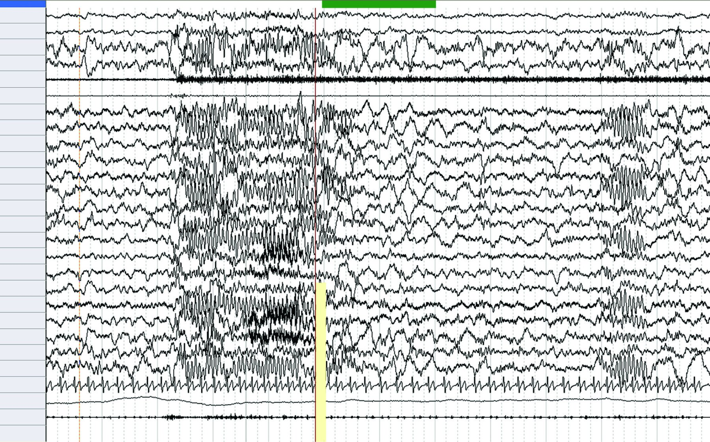

<!-- pdf-page: 270 -->

252 Parasomnias

2W WW W W W W 2 2 2 2 2 2 2 2 2 2 2 2 2 2 2 2 2 2 2 2 2 2 2 1 1 1 1 1 1 1 1 2 1 1 1 1 1 1 1 1 11 1 1 11 1 1 1 1 1 1 1 1 1

1 1 2

Reviewed Unreviewed < >

#### 2

#### 2

#### 2

#### 2

LOC: 50 483

95 98 97 94 98 98 95 91

ROC: 50

FZ-CZ: 50

CZ-OZ: 50

C4-A1: 50

CHIN EMG: 50

LEG EMG: 50

ECG: 79

TC: 13

Nasal P: 10

Sono: 44

95

SpO2: 15

71 66 70 70 75 78 66 65 68

91.0 98.0 95.5

Sum: 21

RC: 21

ABD: 21

HR: 40

65.0 78.0 69.0

FIGURE 12-21. A 120-second epoch demonstrates four episodes of catathrenia. Each episode starts with a deep inhalation, followed by a prolonged

exhalation with a monotonous sound production, as evidenced by activity in the snore channel. (Modified from Ramar K, Gay P: Catathrenia: getting the “cat” out of the bag. Sleep Breath 2008;12:291-294.)

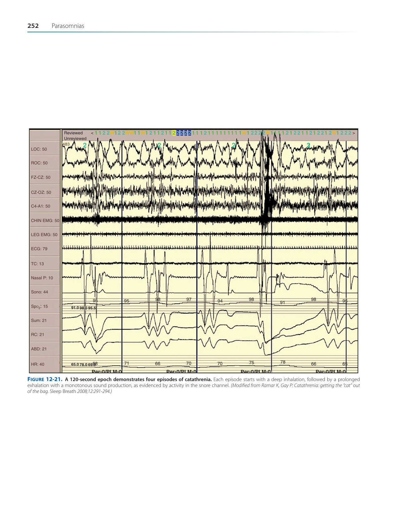

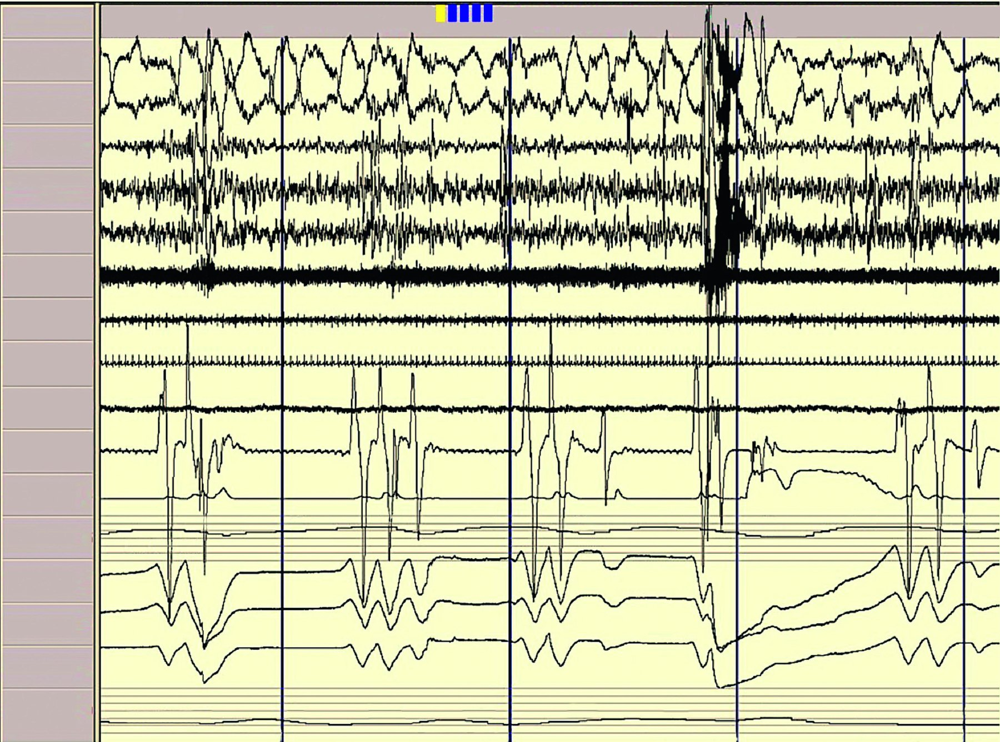

<!-- pdf-page: 271 -->

#### Selected Readings

Aurora RN, Zak RS, Maganti RK, et al: Best practice guide for the treatment

Mahowald MW, Schenck CH: NREM sleep parasomnias. Neurol Clin

23:1077–1106, 2005. Mahowald MW, Schenck CH: Sleep disorders. In Engel J Jr, Pedley TA,

of REM sleep behavior disorder (RBD). J Clin Sleep Med 6:85–95, 2010. Avidan AY, Kaplish N: The parasomnias: epidemiology, clinical features, and

editors: Epilepsy: a comprehensive textbook, Philadelphia, 2007, Lippincott Williams & Wilkins, pp 2757–2764. Pressman MR: Factors that predispose, prime, and precipitate NREM para­

diagnostic approach. Clin Chest Med 31(2):353–370, 2010. Boeve BF, Silber MH, Saper CB, et al: Pathophysiology of REM sleep

somnias in adults: clinical and forensic implications. Sleep Med Rev 11:5– 30, 2007. Provini F, Antelmi E, Vignatelli L, et al: Association of restless legs syndrome

behaviour disorder and relevance to neurodegenerative disease. Brain 130:2770–2788, 2007. Dolder CR, Nelson MH: Hypnosedative-induced complex behaviours: inci­

dence, mechanisms and management. CNS Drugs 22:1021–1036, 2008. Howell MJ: Parasomnias: an updated review. Neurotherapeutics 9:753–775,

2012. Howell MJ, Schenck CH: Restless nocturnal eating: a common feature of

Willis-Ekbom syndrome (RLS). J Clin Sleep Med 8:413–419, 2012. Mahowald MW: Overview of parasomnias. National Sleep Medicine Course.

Darien, IL, 1999, American Academy of Sleep Medicine. Mahowald MW, Bornemann MC, Schenck CH: Parasomnias. Semin Neurol

24(3):283–292, 2004. Mahowald MW, Ettinger MG: Things that go bump in the night: the para­

somnias revisited. J Clin Neurophysiol 7(1):119–143, 1990.

with nocturnal eating: a case-control study. Mov Disord 24:871–877, 2009. Schenck CH, Mahowald MW: REM sleep parasomnias. Neurol Clin

23:1107–1126, 2005. Tassinari CA, Cantalupo G, Högl B, et al: Neuroethological approach to

frontolimbic epileptic seizures and parasomnias: the same central pattern generators for the same behaviours. Rev Neurol (Paris) Epub 2009 Sep 8. Tassinari CA, Rubboli G, Gardella E, et al: Central pattern generators for a

common semiology in fronto-limbic seizures and in parasomnias: a neu­

roethologic approach. Neurol Sci 26(Suppl 3):s225–s232, 2005.
