# 13 Sleep Breathing Disorders

<!-- pdf-page: 272 -->

## 13 Sleep Breathing Disorders

## EXAMINATION OF THE PATIENT WITH SUSPECTED

## SLEEP APNEA

### Meir H. Kryger

## 13.1

Because many patients with sleep apnea have anatomic abnormalities that cause obstruction of the upper airway, and because findings may lead to specific treatment decisions, an examination of the face and all the structures of the upper airway is done in all patients suspected of having sleep apnea. In some patients, abnormal findings in the upper airway or elsewhere may lead to a suspicion of sleep apnea. All the patients whose findings are shown in this chapter had documented sleep apnea.

#### OVERALL INSPECTION OF THE PATIENT

Sleep apnea can occur in any age group, in both genders, and in all ethnic groups. It often runs in families. Many patients do not fit the stereotype of the obese middle-aged man; the child shown in Figure 13.1-1 had sleep apnea caused by enlarged tonsils. The mother and her son in Figure 13.1-2 both had sleep apnea; she had hypothyroidism (see Chapter 14.1), and her son was obese. The two brothers shown in

Figure 13.1-3, A, had sleep apnea, as did both of their parents.

#### FACIAL AND JAW STRUCTURES

Many anatomic abnormalities can lead to sleep apnea. For example, either an upper jaw (maxilla) or lower jaw (mandible) that is too far posterior can lead to sleep apnea by encroaching on the pharyngeal airway. This can occur directly as well as indirectly because some structures are attached to the mandible, such as the tongue. The physical examination includes an intraoral exam and offers many clues as to the cause of sleep apnea.

#### Inspection of the Face

In some patients, inspection of the face can reveal the disease—for example, thyroid disease (see Chapter 15.1) or acromegaly (see Chapter 15.2)—that may be causing sleep apnea. Inspection can also give insight into physiologic abnormalities.

Hyperpigmentation on the forehead, resembling acanthosis nigricans, may be present in the patient with sleep apnea (child or adult) who sleeps sitting up with the forehead resting on a forearm resting on a table (see Fig. 13.1-3, B). This is often found in patients with very severe apnea because it is the only position they can sleep in.

In many instances sleep apnea is apparent at the first meeting with the patient. For example, drooping eyelids suggest sleepiness (Figs. 13.1-4 and 13.1-5, A). Floppy eyelids have also been associated with sleep apnea (see Fig. 13.5, B).

Arched eyebrows can be a sign that the patient is trying to open her eyelids.

The patient shown in Figure 13.1-6 is obese, cyanotic, and has bloodshot eyes. The latter finding was related to polycythemia. Obesity hypoventilation syndrome or overlap syndrome should be suspected when a patient has these findings.

All patients with Down syndrome should be suspected of having sleep apnea (Fig. 13.1-7).

FIGURE 13.1-1. Enlarged tonsils in a child.

FIGURE 13.1-2. Mother and son with sleep apnea.

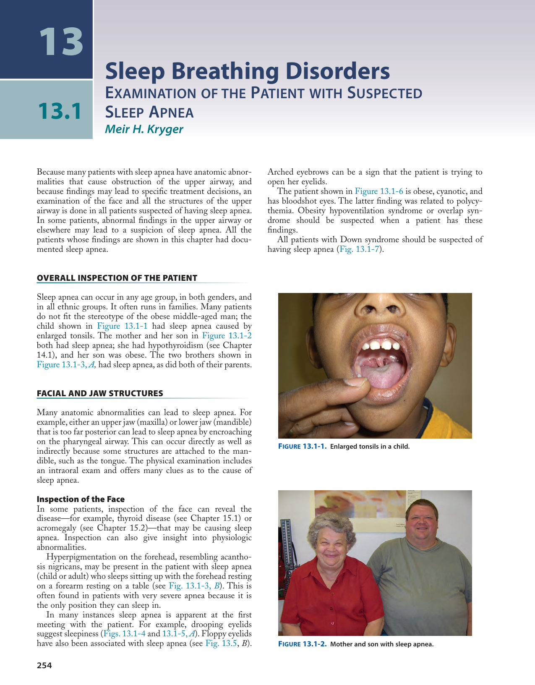

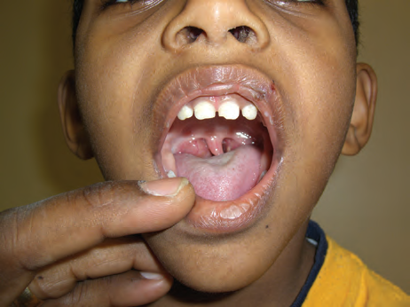

<!-- pdf-page: 273 -->

A

B

FIGURE 13.1-3. Sleep apnea. A, These brothers have sleep apnea, as did

both of their parents. B, Hyperpigmentation of the forehead in a patient who sleeps sitting up with his forearm on a table and the forehead resting on the forearm.

FIGURE 13.1-4. Drooping eyelids in a young man with sleep apnea.

#### Bony Structures

Abnormalities in the skeletal structures of the face can lead to an abnormal position of the adjacent structures or attached soft tissues. Such abnormalities can obstruct the nasal or pharyngeal airways (Figs. 13.1-8 and 13.1-9).

#### Pervasive Facial Abnormalities

Congenital facial abnormalities may be pervasive and may affect the development of the maxilla, mandible, and other structures that include those involved in the auditory system

A

B

FIGURE 13.1-5. Eyelids of patients with sleep apnea. A, Drooping

eyelids in middle-aged man. B, Floppy eyelids in a middle-aged woman. Notice the arched eyebrows.

FIGURE 13.1-6. Bloodshot eyes in a man with overlap syndrome.

FIGURE 13.1-7. Patient with Down syndrome.

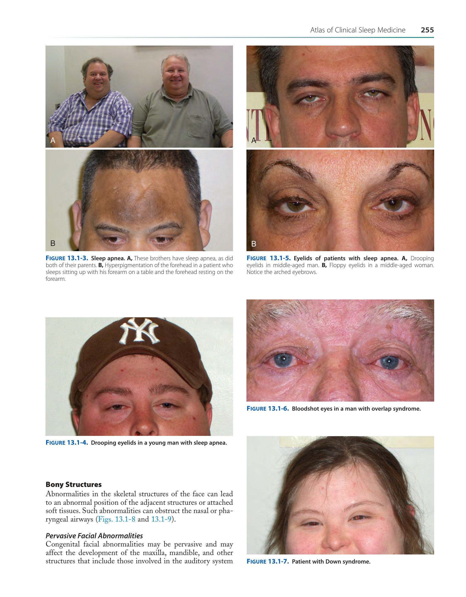

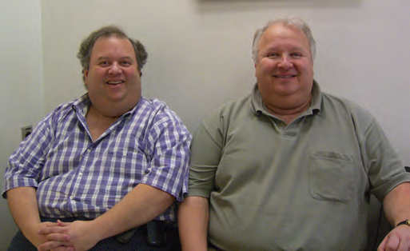

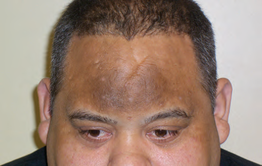

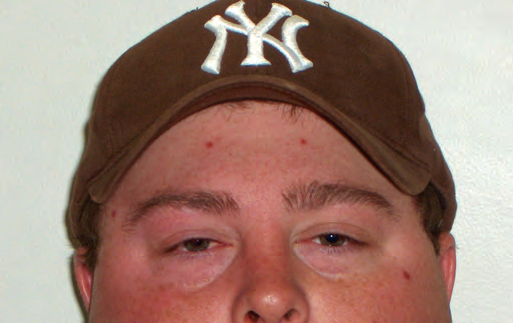

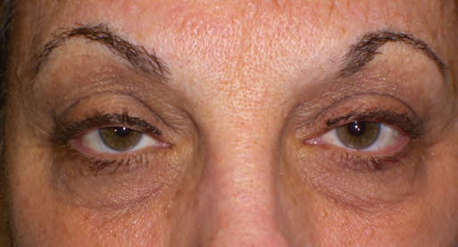

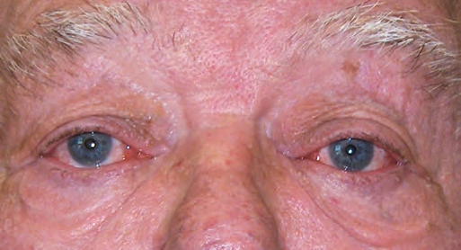

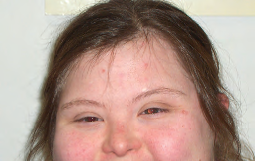

<!-- pdf-page: 274 -->

256 Sleep Breathing Disorders

Frontal

Nasion

FIGURE 13.1-9. Facial structure and sleep apnea. Landmarks (in orange) and anatomy (in blue), sagittal section.

Temporal Nasal

FIGURE 13.1-8. Landmarks (in orange) and bones (in blue) of the human skull.

Hard palate

Soft palate

Tongue

Airway

Zygomatic

Anterior nasal spine

Maxilla

Mandible

Mental protuberance

Nasion

Anterior nasal spine

Mental protuberance

(see Fig. 13.1-10). Such patients may also be born with a cleft palate.

#### Maxillary and Mandibular Insufficiency

The patient shown in Figure 13.1-11 appeared on initial inspection to have a prognathic mandible; note the concave

facial profile. In fact, he has a large fat pad over his chin that gives the appearance of a prognathic mandible. More detailed examination of his facial features indicated that he has maxillary insufficiency (note his flat face and small cheekbone, or zygomatic bone); crowding of the mandibular anterior teeth may be indicative of an undersized mandible (Fig. 13.1-12).

<!-- pdf-page: 275 -->

FIGURE 13.1-10. Pervasive congenital abnormality of the face may affect

the auditory system.

FIGURE 13.1-11. Maxillary insufficiency.

FIGURE 13.1-12. Crowded teeth indicate a small mandible.

#### Small Lower Jaw

The 8-year-old child shown in Figure 13.1-13, A, was referred because of sleepiness, poor school performance, high blood pressure, and a family history of sleep apnea. He responded to continuous positive airway pressure treatment. He has a small lower jaw (mandibular retrognathia) that was only apparent when his bite was examined. Note the convex facial

A

B

FIGURE 13.1-13. Retrognathia. A, Child with retrognathia and sleep

apnea. B, Male adults with retrognathic mandibles often grow beards.

profile, which is a feature of a child with an underdeveloped mandible. Men with a retrognathic jaw often grow a beard in an attempt to improve their appearance (see Fig. 13.1-13, B). Retrognathia causes the patient’s tongue to rest in a more posterior and superior position, thus impinging on the pharyngeal airway.

Thus a receding chin is a sign of mandibular insufficiency. Such patients usually have an overjet with mandibular anterior teeth excessively lingual (or posterior) to the maxillary anterior teeth. Figures 13.1-14 and 13.1-15 demonstrate the overjet during a lateral exam. Figure 13.1-16 shows a patient with complete overlap of the maxillary over the mandibular anterior teeth (excessive overbite) when fully in occlusion on the posterior teeth.

Patients with protrusive maxillary anterior teeth (“buckteeth”) frequently have retrognathic mandibles. Some patients have an anterior open bite that may be the result of a severe tongue thrust or even a consequence of severe thumb sucking (Fig. 13.1-17).

Patients with abnormal maxillary and mandibular arches and with asymmetry or crowding may have a micrognathic (small) mandible and may be at risk for sleep apnea. The crowding of the lower arch causes inadequate space for the anterior portion of the tongue to move anteriorly. This in turn may cause the posterior part of the tongue to “bunch up.” Such patients may develop a scalloped tongue from the tongue constantly pressing anteriorly (Figs. 13.1-18 through 13.1-21).

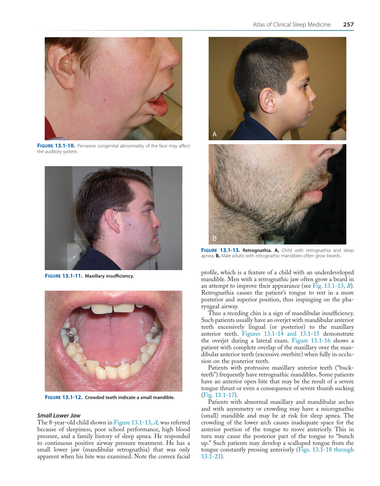

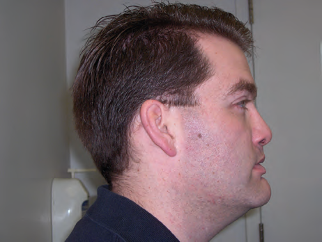

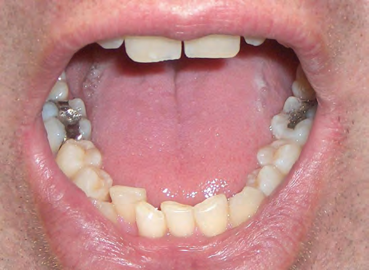

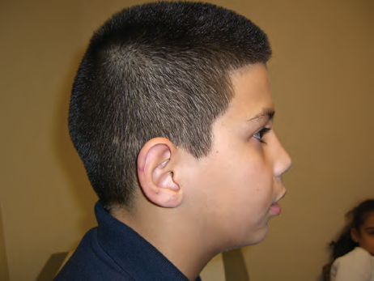

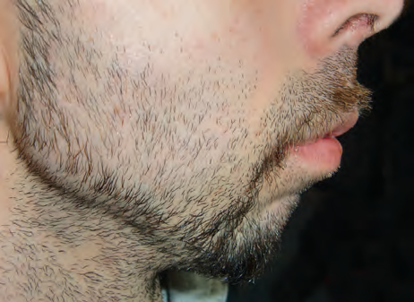

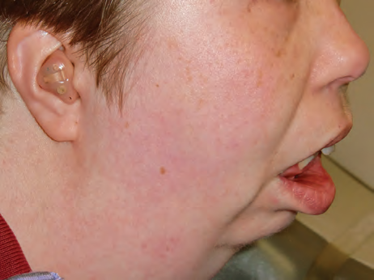

<!-- pdf-page: 276 -->

258 Sleep Breathing Disorders

FIGURE 13.1-14. Receding chin and overjet.

FIGURE 13.1-15. Receding chin and overjet.

FIGURE 13.1-16. Retrognathia. The upper teeth overlap the lower teeth.

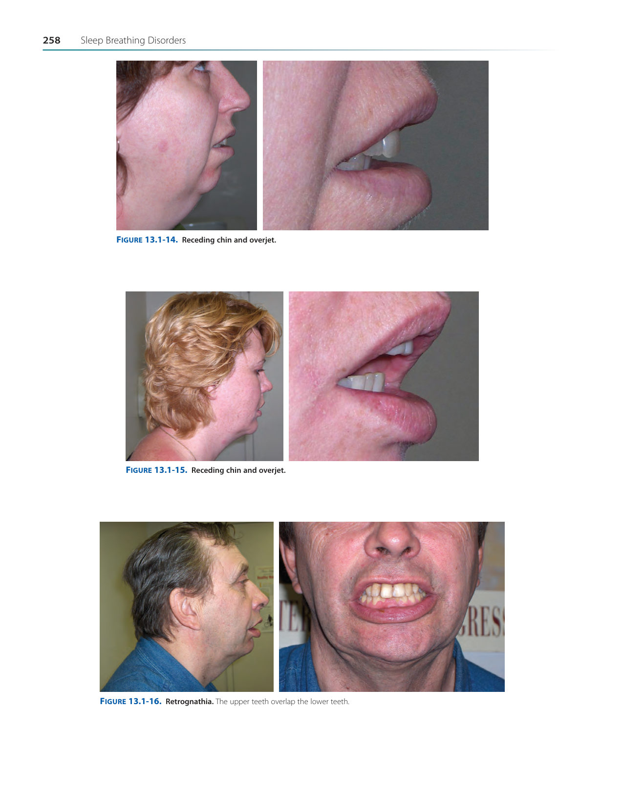

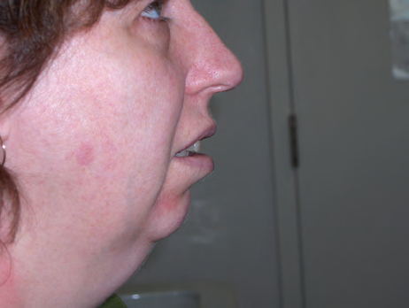

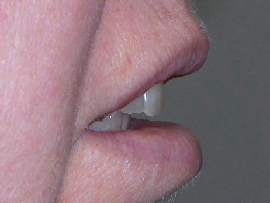

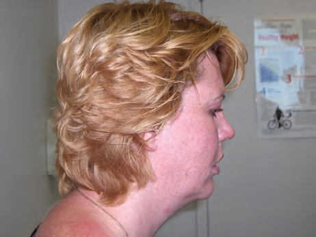

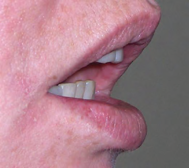

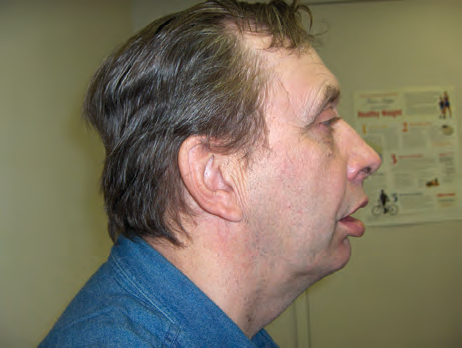

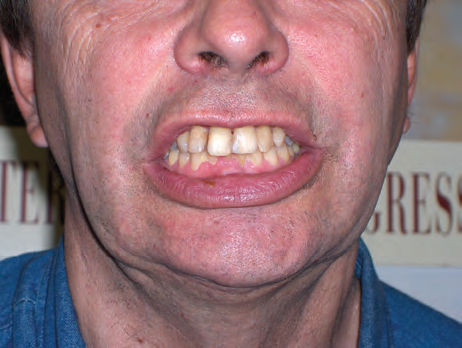

<!-- pdf-page: 277 -->

FIGURE 13.1-17. Examples of “buckteeth.”

FIGURE 13.1-18. Abnormal mandibular arch.

FIGURE 13.1-20. Scalloped tongue.

FIGURE 13.1-19. Asymmetric mandibular arch.

FIGURE 13.1-21. Small mandible, crease in tongue, bruxism.

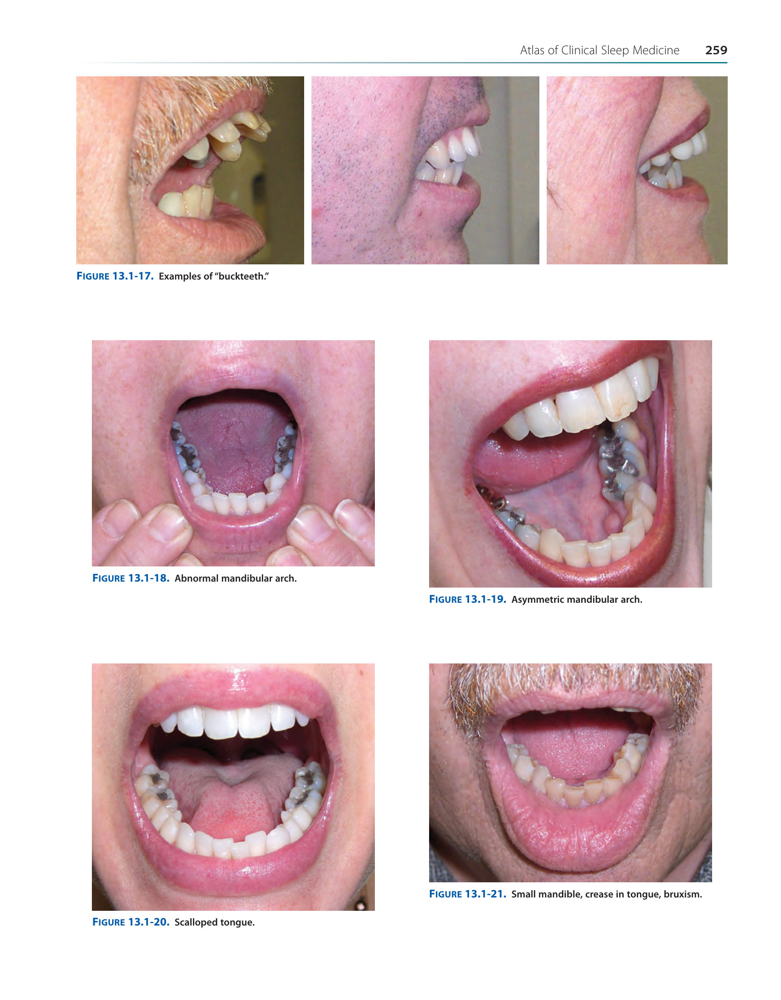

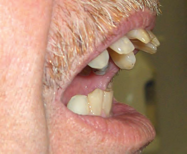

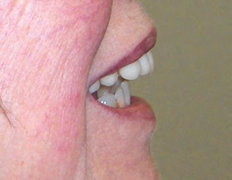

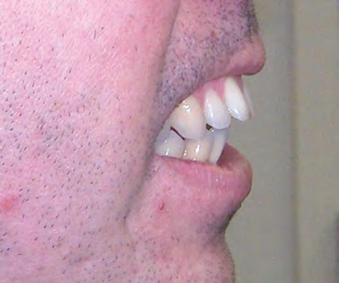

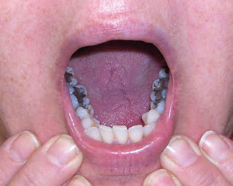

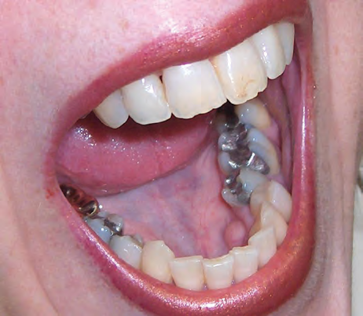

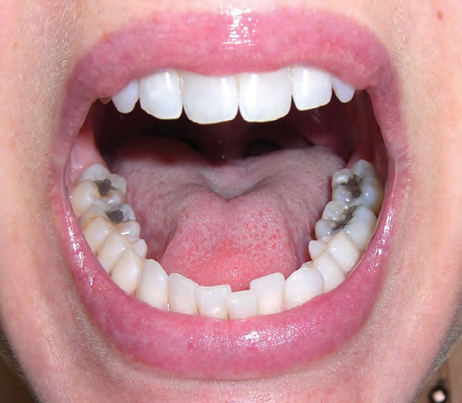

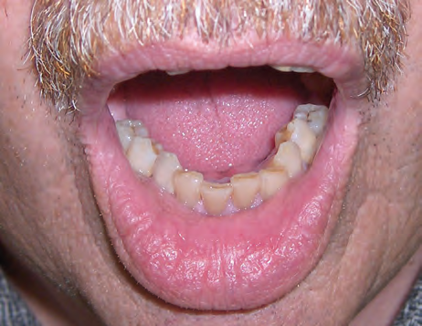

<!-- pdf-page: 278 -->

260 Sleep Breathing Disorders

FIGURE 13.1-22. Severe rosacea and rhinophyma.

FIGURE 13.1-23. Enlarged nasal turbinates.

#### NASAL AIRWAY

Examination of the nasal airway should include inspection of nasal symmetry and a search for anatomic abnormalities that could lead to nasal obstruction.

#### Diseases of the Nose and Nares

The patient shown in Figure 13.1-22 has severe rosacea. This disease can lead to nasal obstruction and sleep apnea. Diseases that affect the nasal turbinates, such as allergic rhinitis, can also lead to nasal obstruction (Fig. 13.1-23). Other abnormalities that may be found include a deviated nasal septum, which in some patients can be associated with a high-arched palate.

#### Trauma to the Nose and Nares

The patient shown in Figure 13.1-24 had severe trauma from a gunshot wound to his face that required extensive reconstructive surgery. His nose was entirely reconstructed. It does not have an airway leading to the nasopharyngeal airway, so he breathes exclusively via his oral airway, which has also had reconstructive surgery.

#### Traumatic Injury to the Nose

Inspection can reveal asymmetry of the nose. These patients may have been told they have a deviated septum. In the following examples, the patients are not overweight.

The patient shown in Figure 13.1-25, A, had a broken nose; note the asymmetry. The patient shown in Figure 13.1- 25, B, had been a boxer. The region below the nasal bone is wide and was hard to palpation; note the cyanosis of the lips.

Figure 13.1-26, A, shows examination of the nares from below

in a patient with a previous nasal fracture. Bulging of the septum in the left nostril is apparent. Note the size of the left nasal airway after application of an external nasal strip (Fig. 13.1-26, B).

#### EXAMINATION OF THE PALATE

A high-arched palate is frequently present in patients with a narrow dental arch (see Fig. 13.1-27). It must be kept in mind that the nasal airway sits above the arch of the palate, and a high arch may impinge on the size of the nasal airway and cause a deviation of the nasal septum. Children with such anatomy may benefit from rapid maxillary expansion.

#### EXAMINATION OF THE PHARYNX

#### Mallampati Classification

The Mallampati classification describes the relationship between the tongue and the size of the pharynx and was first described as a method for anesthesiologists to predict difficult tracheal intubation. The patient, in the sitting position, is asked to open his or her mouth as far as possible and to protrude the tongue. The Mallampati classification is as follows: Class I: Soft palate, fauces, uvula, and posterior and anterior

pillars are visible (Fig. 13.1-28). Class II: Soft palate, fauces, and uvula are visible (Fig.

13.1-29). Class III: Soft palate, fauces, and only base of uvula are visible

(Fig. 13.1-30). Class IV: Soft palate is not visible (Fig. 13.1-31).

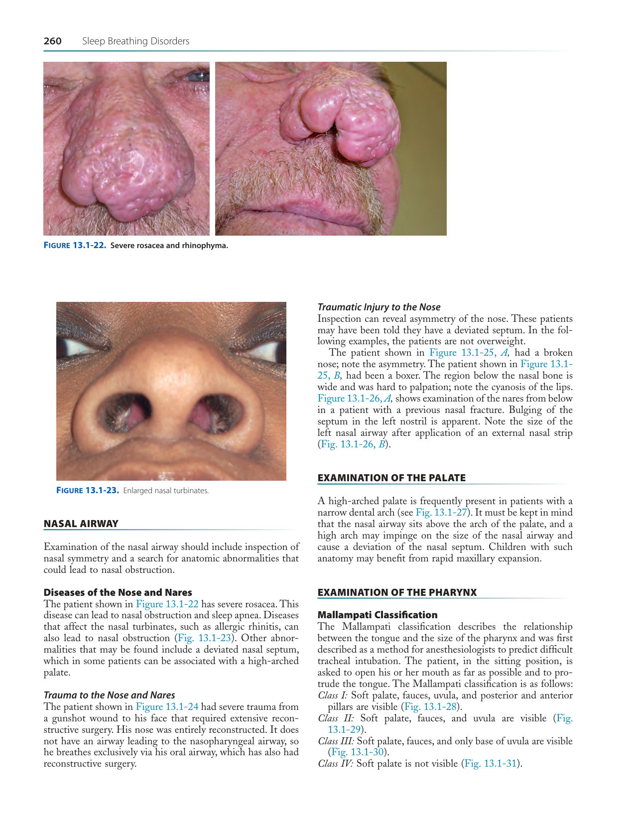

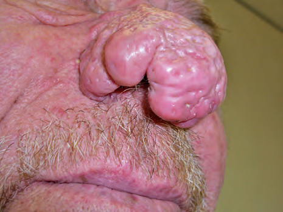

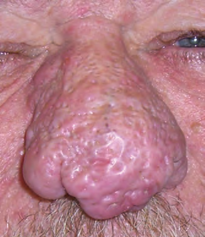

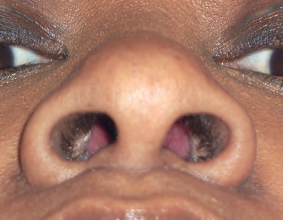

<!-- pdf-page: 279 -->

FIGURE 13.1-24. Facial reconstruction after a gunshot wound. Nasal reconstruction led to total obstruction.

A B

FIGURE 13.1-25. A and B, Examples of a broken nose.

A

FIGURE 13.1-26. Broken nose. A, Without nasal strip; note the bulge. B, With nasal strip.

B

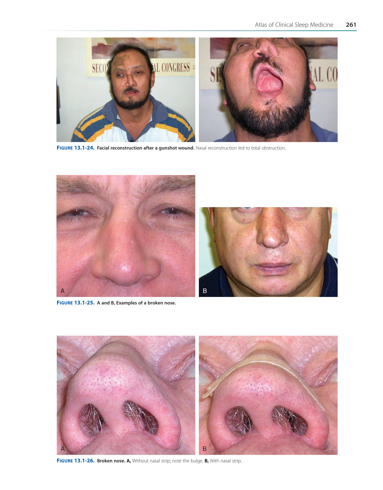

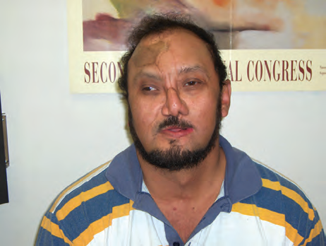

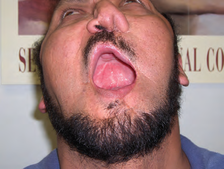

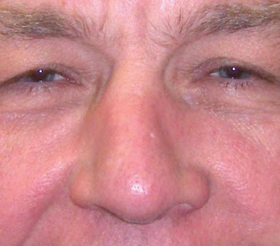

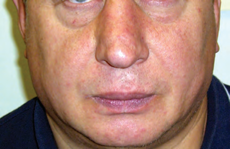

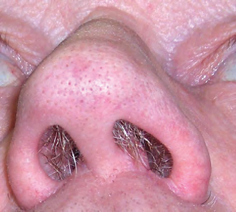

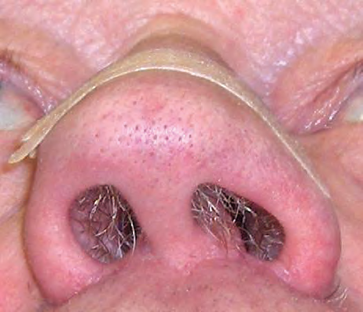

<!-- pdf-page: 280 -->

262 Sleep Breathing Disorders

FIGURE 13.1-29. Mallampati class II. A, Posterior pillars and much of uvula are not visible. B, Tip of the uvula is not visible.

FIGURE 13.1-27. High-arched palate. (Courtesy Dr. Paola Pirelli.)

FIGURE 13.1-28. Mallampati class I. All structures visible.

A

B

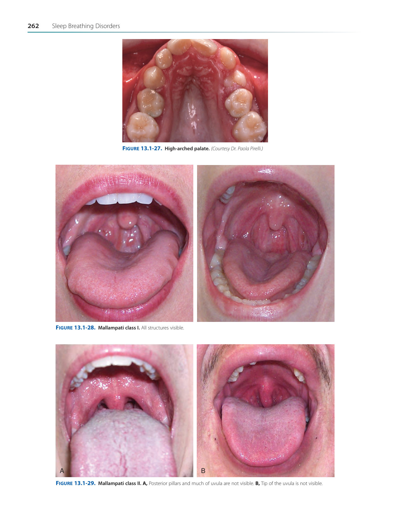

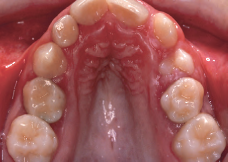

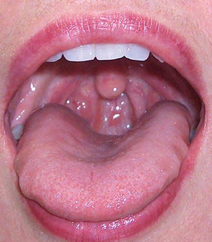

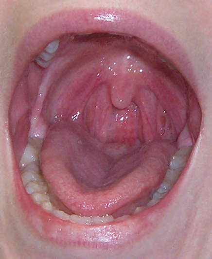

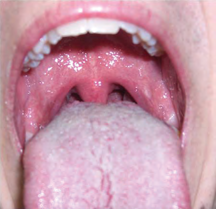

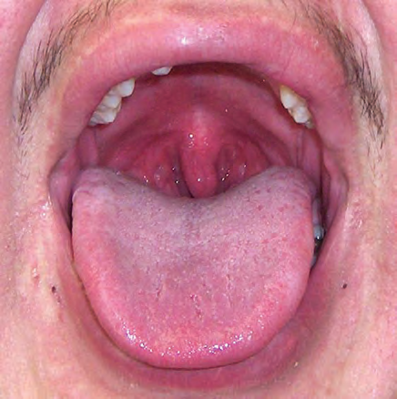

<!-- pdf-page: 281 -->

A

B

FIGURE 13.1-30. Mallampati class III. A, Only the base of the uvula is

visible. B, The base of the uvula is barely visible.

#### Examination of the Tonsils

Enlarged tonsils and adenoids can lead to sleep apnea by obstructing the upper airway during sleep. Adenoids cannot be visualized in a routine physical examination. Enlarged tonsils and adenoids are the most common cause of sleep apnea in the pediatric population. Examination of the tonsils may or may not require use of a tongue blade.

Tonsil size is graded on a scale from 0 (no tonsils) to 4 (“kissing tonsils” that touch at midline): Grade 0: Tonsils are absent. The uvula is abnormally wide and

almost bifid. This is a variant of normal (Fig. 13.1-32). Grade 1: Tonsils are hidden behind tonsillar pillars. Grade 2: Tonsils extend to the pillars. In Figure 13.1-33, the

right tonsil is grade 1, and the left is grade 2.

FIGURE 13.1-31. Mallampati class IV. The soft palate is not visible.

FIGURE 13.1-32. Grade 0 tonsils.

Grade 3: Tonsils are visible beyond the pillars (Fig. 13.1-34). Grade 4: Tonsils are enlarged to midline (Fig. 13.1-35).

#### Variants and Abnormal Airway

#### Pharyngeal Findings

In Figure 13.1-35, D, the right tonsil is much larger than the left and extends beyond the midline. It was initially difficult to visualize because it extended behind the uvula. This would be classified as equivalent to grade 4 enlarged tonsils.

In Figure 13.1-36, a nubbin of left tonsillar tissue can be seen. This patient frequently awakened with a sore throat, and the pharyngeal tissues show evidence of trauma (redness) as a result of snoring.

Figure 13.1-37 shows an unexpected finding in a sleep

apnea patient: a tiny neoplastic lesion just to the right of the uvula. The most common surgical procedure involving the upper airway is uvulopalatopharyngoplasty, which usually

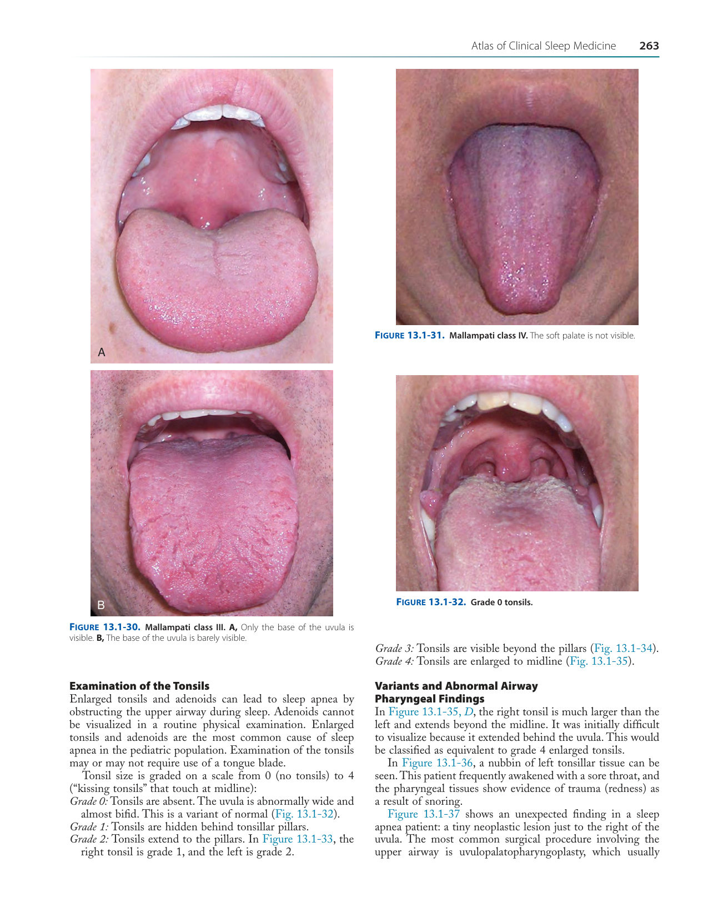

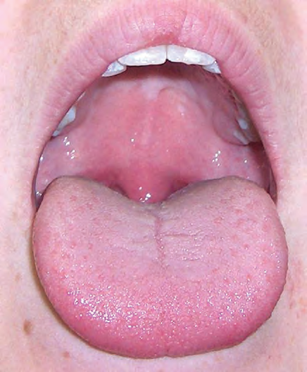

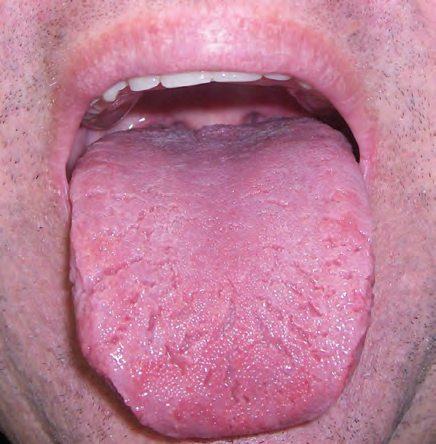

<!-- pdf-page: 282 -->

264 Sleep Breathing Disorders

involves removal of the uvula and variable amounts of the soft palate (depending on the surgeon), tonsils, adenoids, and redundant tissue in the pharynx. In the cases shown in Figures 13.1-38 and 13.1-39, uvulopalatopharyngoplasty was unsuccessful in treating the apnea. Note the differences in anatomic outcome in these examples.

Congenital abnormalities that involve the neck can also lead to sleep apnea. The patient shown in Figure 13.1-41 had severe sleep apnea as a result of Klippel-Feil syndrome. She also had polycystic ovary syndrome (see Chapter 16.1); note the acne on the face. Findings in the neck are also seen in diseases of the thyroid gland (see Chapter 15.1).

#### EXAMINATION OF THE NECK

#### EXAMINATION OF THE ABDOMEN

A large neck collar size is a robust statistical predictor of obstructive apnea, although more so in men than in women. The patient shown in Figure 13.1-40 has a neck collar size of 49 cm, or 19.3 inches. Most obese patients with apnea have a neck collar size of at least 43 cm, or 17 inches.

FIGURE 13.1-33. Grade 1 tonsil (right) and grade 2 tonsil (left).

FIGURE 13.1-34. Grade 3 tonsils.

Central obesity is a very common finding in sleep apnea patients. Note the striae in Figure 13.1-42.

Bariatric surgery is commonly done to treat morbid obesity and may result in resolution of sleep apnea. The patient shown in Figure 13.1-43 continued to have sleep apnea after having

A

B

FIGURE 13.1-35. Grade 4 tonsils.

<!-- pdf-page: 283 -->

C

D

FIGURE 13.1-35, cont’d.

lost more than 100 kg. Note the abdominal scar and redundant tissue in this male patient.

#### EXAMINATION OF THE EXTREMITIES

#### Peripheral Edema

In very obese patients who spend most of their time in bed, edema might not always be maximal in the ankles and feet (Fig. 13.1-44). When edema is very severe in a patient with a sleep breathing disorder, it is almost always in the context of a hypoventilation syndrome (Fig. 13.1-45). Chronic edema results in discoloration and may result in infections that are difficult to treat (Figs. 13.1-46 and 13.1-47).

FIGURE 13.1-36. Trauma (redness) as a result of snoring.

FIGURE 13.1-37. Soft palate tumor.

FIGURE 13.1-38. Outcome of uvulopalatopharyngoplasty.

<!-- pdf-page: 284 -->

266 Sleep Breathing Disorders

FIGURE 13.1-39. Uvulopalatopharyngoplasty (UPPP). A, UPPP with a small pharyngeal opening. B, UPPP with a triangular pharyngeal opening.

C, UPPP with a large pharyngeal opening.

A

C

B

FIGURE 13.1-40. Measuring neck collar size. Neck collar size in excess of 43 cm is associated with sleep apnea.

<!-- pdf-page: 285 -->

FIGURE 13.1-41. Sleep apnea can be due to Klippel-Feil syndrome. Patients with this syndrome have a low hairline and a short, webbed neck.

FIGURE 13.1-42. Central obesity.

FIGURE 13.1-43. Bariatric surgery results in weight loss, often leaving

excess skin.

A

B

FIGURE 13.1-44. Edema. A, Edema is not always present in the ankles and

feet. B, Pitting edema.

<!-- pdf-page: 286 -->

268 Sleep Breathing Disorders

## SLEEP APNEA IN THE ADOLESCENT AND ADULT

### Don Hayes Jr, Mark Splaingard, and Meir H. Kryger

## 13.2

FIGURE 13.1-45. Edema in a patient with hypoventilation syndrome.

FIGURE 13.1-47. Chronic edema may result in infections.

FIGURE 13.1-46. Chronic edema, even when resolved, may result in

discoloration.

#### OVERVIEW

Sleep breathing disorders encompass a wide variety of respiratory problems that appear exclusively in sleep, affect sleep, or are exacerbated by sleep. The classification schemes presented in the International Classification of Sleep Disorders (ICSD) and in the ninth and tenth editions of the International Classification of Disease (ICD-9 and ICD-10) appear in Box 13.2-1 and Table 13.2-1. More sleep breathing disorders are listed in the ICSD than in the ICD, which can be a source of confusion. Also, not all the diseases in ICD-9 map to ICD-10. This chapter reviews these disorders in patients older than 10 years. Chapter 13.3 covers these disorders in younger children.

#### DEFINITIONS

The term sleep-disordered breathing (SDB) refers to a spectrum of breathing disorders. Included are both obstructive events, in which airflow is limited despite respiratory effort, and central events, in which airflow ceases because of lack of respiratory effort.

The metric most commonly used to define and assess the severity of sleep apnea is the apnea-hypopnea index (AHI). Practically speaking, an adult is at risk for sleep apnea if the AHI is 5 or more. For this reason, measurement and definition of apneas and hypopneas are critical.

Among the obstructive SDB disorders, the line between normal and pathologic is at times unclear (Box 13.2-2). The

<!-- pdf-page: 287 -->

BOX 13.2-1 Sleep-Related Breathing Disorders

BOX 13.2-2 Spectrum of Sleep-Disordered Breathing

#### Obstructive Sleep Apnea Disorders

• Obstructive sleep apnea, adult
• Obstructive sleep apnea, pediatric*

#### Central Sleep Apnea Disorders

• Primary central sleep apnea
• Central sleep apnea with Cheyne-Stokes breathing
• Central sleep apnea because of high-altitude periodic

breathing • Central sleep apnea because of a medical or neurologic

condition without Cheyne-Stokes breathing • Central sleep apnea because of a drug or substance • Complex sleep apnea • Primary central sleep apnea of infancy* • Primary central sleep apnea of prematurity*

#### Sleep-Related Hypoventilation Disorders

• Obesity hypoventilation syndrome
• Congenital central alveolar hypoventilation*
• Late-onset central hypoventilation with hypothalamic

abnormalities • Idiopathic central alveolar hypoventilation (sleep-related

nonobstructive alveolar central hypoventilation, idiopathic) • Sleep-related hypoventilation because of a drug or

substance • Sleep-related hypoventilation because of a medical or

neurologic condition

#### Sleep-Related Hypoxemia Disorders

#### Isolated Symptoms and Normal Variants and

#### Polysomnographic Findings

• Snoring
• Catathrenia

*Exclusively pediatric disorder. Modified from International Classification of Sleep Disorders, ed 2.

TABLE 13.2-1 Sleep-Related Breathing Disorders

ICD-9 CLASSIFICATION

ICD-10 CLASSIFICATION

DISORDER

Primary central sleep apnea 327.21 G47.31

Central sleep apnea as a result

786.04 R06.3

of Cheyne-Stokes breathing

Central sleep apnea in

327.27 G47.37

conditions classified elsewhere

Central sleep apnea because

327.29 G47.39

of a drug or substance

Primary sleep apnea of infancy 770.81 P28.3

Obstructive sleep apnea, adult

327.23 G47.33

and pediatric

Idiopathic sleep-related

327.24 G47.34

nonobstructive alveolar hypoventilation

ICD, International Classification of Disease.

• Obesity-hypoventilation syndrome (Pickwickian syndrome)
• Severe obstructive sleep apnea
• Moderate obstructive sleep apnea
• Mild obstructive sleep apnea
• Upper airway resistance syndrome
• Chronic, heavy snoring
• Intermittent snoring
• Quiet breathing

mildest form of an obstructed sleep-related breathing disorder is intermittent snoring, which may be a nuisance but is without significant health sequelae. (Evidence is accumulating, however, that chronic snoring may have consequences similar to those of frank obstructive sleep apnea.) The most severe form of SDB is the obesity-hypoventilation syndrome, formerly called Pickwickian syndrome, which is associated with severe morbidity and very high mortality. Between these two extremes are disorders of gradually increasing impact on morbidity and mortality: persistent snoring, upper airway resistance syndrome (UARS), and obstructive sleep apnea (OSA) syndrome.

In contrast to obstructive SDB, central sleep apnea (CSA) typically occurs in the absence of respiratory effort and has very different risk factors and morbidities than OSA. The different pathophysiology of the two apnea types is reviewed in Chapter 3.6.

#### RISK FACTORS

Obesity is the most important risk factor for obstructive SDB in whites; the risk of significant SDB rises with body mass index (BMI). OSA is about twice as common in men as in women before the age of 50 years, but it may be equally prevalent in older men and women. Emerging data indicate that being Asian, African-American, or Hispanic is an independent risk factor for sleep apnea. Blood pressure that is difficult to control and recent onset of atrial fibrillation are also known risk factors for sleep apnea.

The prevalence of SDB increases with age. In addition, there appear to be genetic risk factors for OSA. Other risk factors include hypothyroidism, nasal obstruction, and syndromes that affect airway caliber or craniofacial anatomy, such as trisomy 21 and Pierre Robin, Apert, Treacher Collins, and Marfan syndromes. Behavioral factors that include alcohol consumption, use of sedative medication, and cigarette smoking also contribute to an increased risk of SDB. Central sleep apnea, on the other hand, is associated with congestive heart failure, use of respiratory depressants such as opioids, and central nervous system pathology (e.g., stroke, Chiari malformation).

#### CLINICAL ASSESSMENT

#### Symptoms

Symptoms have generally been present for years before the diagnosis is made. The cardinal symptoms of OSA appear in

Box 13.2-3 and in Chapter 8. An interview of the patient or

the patient’s bed partner or parent (see Chapter 13.3) will shed light on the symptoms and how they affect the patient’s life.

<!-- pdf-page: 288 -->

270 Sleep Breathing Disorders

#### Examination

The physical examination of the patient with SDB is covered in detail in Chapter 13.1. In OSA, the primary findings in adults are obesity, a crowded posterior airway, hypertension (especially difficult-to-control hypertension), and other abnormalities that may narrow the airway, such as retrognathia, an enlarged tongue, or a “birdlike face,” as seen in Treacher Collins syndrome.

transducer may be misleading in a mouth breather, and the signal from a temperature sensor is not linear. Measuring end-tidal CO2 adds an additional dimension of helpful information. The reader is encouraged not to slavishly follow the manual at all times but rather to examine all the available data to assess and understand the physiologic abnormalities. Synchronized digital video is often invaluable in assessing the patient (see Chapter 21).

90 95 95 94 94 94 93 92 92 92 90 90 86 96 93 95 95 94 94 90 93 93

#### Laboratory Evaluation

The comprehensive overnight polysomnogram is currently the most widely used diagnostic test to document sleep apnea. Home sleep testing is being increasingly used for diagnosis in patients with a high pretest probability of having sleep apnea (see Chapter 18).

#### Data Obtained in a Sleep Study

The current American Academy of Sleep Medicine (AASM) scoring manual specifies the use of an oronasal thermal sensor to assess airflow for apnea and a nasal pressure transducer to assess airflow for hypopnea. Information from a nasal pressure

BOX 13.2-3 Symptoms of Obstructive

#### Sleep-Disordered Breathing

• Snoring
• Witnessed apnea
• Excessive daytime sleepiness
• Morning headache
• Morning dry throat
• Depression symptoms
• Erectile dysfunction
• Insomnia
• Impaired vigilance and memory

L-EOG

0

R-EOG

0

C3-A2

0

C4-A1

0

O1-A2

0

O2-A1

0

CHIN

0

PRESS

0

FLOW

128

MICRO

128

SaO2

#### Scoring of Respiratory Events

In adults (those aged 18 years or older), both apneas and hypopneas must last at least 10 seconds. Apnea occurs when oronasal airflow is reduced by 90% or more from baseline, and hypopnea occurs when the nasal pressure transducer signal is reduced by 30% or more from baseline with a 3% or greater drop in arterial oxygen saturation (SaO2). An alternative rule for hypopnea requires a 50% or more reduction in nasal pressure transducer signal with a 4% or greater drop in SaO2 associated with an arousal. If respiratory effort is present during the event, the hypopnea is classified as obstructive; if effort is absent, it is classified as central. Figure 13.2-1 demonstrates a respiratory event that meets criteria for a hypopnea, with a marked reduction in the pressure transducer signal, but not the airflow or thermal sensor signal, and a drop in SaO2 from 90% to 86%. In children younger than 13 years, the length of the event changes from 10 seconds to two missed breaths as determined by the baseline respiratory rate (see Chapter 13.3). The scoring rules are flexible for ages 13 to 18 years and allow scoring either by adult or pediatric criteria.

Figure 13.2-2 demonstrates a hypopnea in which the SaO2

has fallen to 90%. In Figure 13.2-3, the somewhat arbitrary nature of these definitions, as well as the difference in thermal and pressure signals, is demonstrated. The term respiratory effort–related arousal was coined to capture respiratory events that do not qualify as apneas or hypopneas (Fig. 13.2-4).

S S S S S S S S S S S S S S S S S S S S S S S S S S S S S BODY

CHEST

128

ABD

128

FIGURE 13.2-1. Hypopnea. A 10-minute compressed epoch demonstrates the features of a standard hypopnea, with reduction to about 30% of baseline of

the pressure transducer signal and 4% oxygen desaturation. Also shown is the difference in the pressure transducer and thermal sensor (flow) signals, with noticeable change in the former but little change in the latter.

<!-- pdf-page: 289 -->

LOC-M2

ROC-M1

F3-M2

F4-M1

C3-M2

C4-M1

O1-M2

O2-M1

98 98 98 98 98 98 98 98 98 98 98 98 97 95 94 94 94 93 91 90 90 90 91 91 91 91

CZ-O1 CHIN1- CHIN2

Snore ECG2- ECG SpO2

98

92

FIGURE 13.2-2. Hypopnea. A 30-second epoch demonstrates a hypopnea with a fall in oxygen saturation (SaO2) from 98% to 90%. Flow measured by ther­

mocouple is not quite reduced by 90%. The associated changes in heart rate and SaO2 are similar to what would be seen in an apneic episode; thus the separation between apnea and hypopnea is often arbitrary, and the two events are combined to generate the apnea-hypopnea index to show the number of events per hour of sleep.

EtCO2

42

37 39 41 41

42 42 42 42

42 42 42 42

Capno

17

32 16 26 8

29 17 26 27

13 36 16 36

PTAF

Airflow

THOR

ABD

LAT-RAT

39 39 39 38 38 37 37 35 35 36 36 38 38

41

41

9 27 12 23 18

29 16 29 19 20

27 27 12 33 20

94 94 92 93 97 97 98 98 97 96 96 94 95 92 92 92 95 94 94 91 92

L-EOG

0

R-EOG

0

C3-A2

0

C4-A1

0

O1-A2

0

O2-A1

0

CHIN

0

SaO2

90

SR SR SR SR SR SR SR SR S S S S S S S S S S S S S S S S S S S S S S

FLOW

128

PRESS

0

*MICRO

128

*ECG

0

ABD

128

BODY

S3 S3 S3 MV MV WK WK WK WK S1 S2 S2 S2 S2 S2 S2 S2 S2 S2

STAGE

S2 S2 S2

FIGURE 13.2-3. Apneas and possible hypopnea. In this 10-minute compressed epoch, the FLOW channel represents the thermocouple signal, and the

PRESS channel is nasal pressure. The event marked with the rectangle meets the criteria for an apnea because the flow signal is reduced by more than 90% of baseline for more than 10 seconds (~15 seconds). The oval marks an event that does not qualify as either an apnea or a hypopnea; the oxygen saturation falls by only 1% (from 95% to 94%), which precludes designating it as a hypopnea. The thermocouple signal is reduced by about 80% of baseline, and by standard criterion, a fall by 90% or more on the thermocouple (not flow transducer) channel is required for an apnea.

480” 360” 240” 120”

<!-- pdf-page: 290 -->

272 Sleep Breathing Disorders

L-EOG

R-EOG

0

C3-A2

0

C4-A1

0

O1-A2

0

O2-A1

0

95 95 95 95 95 95 96 95 95 95 95 94 94 97 96 96 96 96 95 95

CHIN

0

FLOW

128

PRESS

0

SaO2

90

S S S S S S S S S S S S S S S S S S S S S S S S S S S S

MICRO

128

CHEST

128

ABD

128

BODY

FIGURE 13.2-4. Respiratory effort–related arousal (RERA). The difference in the sensitivity of pressure transducers (PRESS) and thermocouples (FLOW) is

demonstrated in this figure, in which a reduction of the pressure transducer signal to much less than 10% is evident but the reduction in the flow channel is minimal. According to the scoring rules of the American Academy of Sleep Medicine this event does not qualify as either an apnea or a hypopnea because assessment of flow for apneas is supposed to be done by a thermal sensor. This cannot be a hypopnea by the scoring rules because there is only a 1% oxygen desaturation. There is, however, an impressive arousal, including a leg jerk, and it is hard to argue that this event is not significant. This most likely represents an RERA, but it does not meet scoring criteria for RERA either. The current rules define RERA as “a sequence of breaths lasting at least 10 seconds characterized by increasing respiratory effort or flattening of the nasal pressure waveform leading to an arousal from sleep when the sequence of breaths does not meet criteria for an apnea or hypopnea.” However, the scoring manual calls for use of an esophageal pressure manometer or respiratory inductance plethysmography to assess respiratory effort, but these devices are not commonly used in clinical practice.

LeftLeg

0

RightLeg

0

However, although the 2012 scoring manual calls for either respiratory inductance plethysmography or polyvinylidene fluoride film signal or an esophageal pressure manometer to assess respiratory effort, the latter device is almost never used in routine clinical practice.

The presence and severity of SDB can depend both on sleep stage and on position (Fig. 13.2-5). Many patients— particularly younger patients, women, and those with milder disease—experience events only during rapid eye movement (REM) sleep or when supine.

By definition, central apneic events occur in the absence of respiratory effort. They are commonly seen in heart failure, neurologic disorders, and in the presence of respiratory depressants and in infants. They also occur frequently in nonapneic individuals after arousal (Fig. 13.2-6). The central apneas may be linked to sleep stage and, in some conditions, may be more or less common during REM sleep (Figs. 13.2-7 through 13.2-9).

Cheyne-Stokes respiration is a pattern of at least three consecutive cycles of waxing and waning of breathing with either five or more central apneas or hypopneas per hour of sleep or a cyclic crescendo-decresendo change in breathing amplitude that lasts at least 10 consecutive minutes. In adults it is one of the most prevalent forms of central apnea (Fig. 13.2-10). Assessment of respiratory effort is probably more easily done in compressed epochs than in 30- or 60-second epochs

(Fig. 13.2-11); movement in the chest and abdomen channels of this epoch are often markedly reduced during the apnea, more than what is seen in airflow.

Both central and obstructive events can be seen in the same individual under a variety of circumstances and can even be induced by treatment with CPAP (Fig. 13.2-12). Mixed sleep apneas share characteristics of both obstructive and central apneas but typically respond well to treatment for obstructive apnea (Figs. 13.2-13 and 13.2-14).

#### Scoring Intervals

Because almost all laboratories acquire sleep data digitally, and the data are displayed digitally on high-resolution displays, the polysomnographic data can be scored and later viewed with a variety of different epoch durations. Data may also be displayed simultaneously with different epoch lengths. In general, sleep-stage scoring and electrocardiogram (ECG) evaluation are best done in 30-second epochs, and assessment of respiratory events and leg movements is facilitated by compressed 2-, 5-, or 10-minute epochs. A 30-second epoch that demonstrates a hypopnea is seen in Figure 13.2-15; the compressed epoch seen in Figure 13.2-16 demonstrates the frequency and severity of SDB much more clearly. Figure 13.2-17 demonstrates the usefulness of compressing an epoch up to 5 minutes, the all-night hypnogram gives a quick

Text continued on p. 282

<!-- pdf-page: 291 -->

WK MVT REM S1 S2 S3 S4

L-EOG

0

R-EOG

0

C3-A2

0

C4-A1

0

O1-A2

0

O2-A1

0

CHIN

0

S S S S S S S S S S S S S S S S S S S S S S S S S S S S S S S S S S S S S S S S S S

FLOW

128

PRESS

0

CFLOW

0

MICRO

128

ECG

0

RR

CHEST

128

ABD

128

BODY

93 93 93 91 91 90 89 88 92 87 86 85 67 67 92 80 80 75 85 75 77 90 86 84 86 88 88 88 81 9 9 9 9 9 9 9 9 9 9 9 9 9 9 9 9 9 9 9 9 9 9 9 9 9 9 9

LEMG

0

SaO2 EPAP

90

93

0

9 9 9 9 9 9 9 9 9 9 9 9 9 9 9 9 9 9 9 9 9 9 9 9 9

9

IPAP 0

9

MV MV MV REM REM REM REM REM REM REM REM REM REM REM REM REM REM REM

STAGE

S2 S2 S2 S2 S2 S2 S2 S2 S1 S1 S1

S2

77 770 770 769 769 768 768 767 767 766 766 765 765 764 764 763 763 762 762

761

30 240” 180” 120” 60”

S S S S S S S S S S S S S S S S S S S S S S S S S S S S S S S S S S S S S S S S S S

A

WK MVT REM S1 S2 S3 S4

L-EOG

0

R-EOG

0

C3-A2

0

C4-A1

0

O1-A2

0

O2-A1

0

CHIN

0

FLOW

128

PRESS

0

CFLOW

0

MICRO

128

ECG

0

RR

CHEST

128

ABD

128

S

BODY

96 92 95 97 93 91 92 93 93 91 92 95 90 91 94 88 90 93 92 93 93 96 90 94 93 92 91 91 91

LEMG

0

91

SaO2 EPAP

90

S2 S2 S2 S2 S2 S2 S2 S2 S2 S2 S2 S2 S2 S2 S2 S2 S2 S2 S2 S2 S2 S2 S2 S2 S2 S2 S2 S2 S2 171 171 172 172 173 173 174 174 175 175 176 176 177 177 178 178 179 179 180 180

0 0 0 0 0

0 0 0 0 0

0

IPAP

0 0 0 0 0

0 0 0 0 0

0

STAGE

0 0 0 0 0

0 0 0 0 0

0 0 0 0 0

0 0

0 0 0 0 0

0 0 0 0 0

0 0

0

0 0 0 0

S2

30 240” 180” 120” 60”

FIGURE 13.2-5. Sleep-stage effect on sleep-disordered breathing. Epochs from a 38-year-old man diagnosed with obstructive sleep apnea with an apnea-

hypopnea index of 42 respiratory events per hour. A, This graph demonstrates worsening respiratory instability as the patient transitions from stage 2 to rapid eye movement (REM) sleep. B, This graph illustrates the patient’s respiratory pattern soon after sleep onset. The REM sleep–specific loss of muscle tone is expressed in postural and respiratory muscles. The reduction in upper airway tone may be more profound than the depression of the activity of the main respiratory pump muscle, the diaphragm.

B

<!-- pdf-page: 292 -->

274 Sleep Breathing Disorders

L-EOG V

0 -100

100

R-EOG V

0 -100

50

C3-A2 V

0 -50

50

C4-A1 V

0 -50

50

O1-A2 V

0 -50

97 97 97 97 97 97 93 93 96 96 96 96 97 97 97 97 97 97 97 97 97

50

O2-A1 V

0 -50

0 100

CHIN

-100

FLOW

128

SaO2

90

SR SR SR SR SR SR SR S S S S S S S S S S S S S S S S S S S S S S

MICRO

128

CHEST

128

ABD

128

S S S S S S S S S S S S S S S S S S S S S S S S S S S

BODY

A

L-EOG

0

R-EOG

0

50

C3-A2

0

50

C4-A1

0

50

O1-A2

0

50

O2-A1

0

CHIN

0

FLOW

128

MICRO

128

RR

CHEST

128

ABD

128

SR SR

97 97 97 97 97 97 97 97 97 97 97 97 97 97 97 93 96 96 96 95

BODY

SaO2

90

FIGURE 13.2-6. Central apneas. Two examples of compressed 10-minute epochs show isolated central apneas following arousals. The lack of airflow in the

pressure or flow channel, coupled with markedly reduced movement/effort in the abdomen/chest channel, marks these events as central.

B

<!-- pdf-page: 293 -->

CURSOR: 23:57:18. EPOCH: 210 • STAGE 2 30 sec/page

CHIN(1)

250 V

C3-A2

125 V

C4-A1

125 V

O1-A2

125 V

O2-A1

125 V

ROC-A1

125 V

LOC-A2

125 V

ECG 2.5 mV

5 min/page

LEG(L)

125 V

LEG(R)

FIGURE 13.2-7. Central apnea. A 30-second epoch (top) and a 5-minute epoch (bottom). These are repetitive episodes of central apnea in a 44-year-old

patient using opiates for pain in an injured ankle. Notice the small number of breaths in each cycle. Cardiogenic oscillations are evident in the CO2 trace and are best seen in the third apneic episode from the right.

125 V

100

SaO2 %

80

THOR RES x1

ABD RES x1

120

PULSE bpm

50 40

PCO2 mm Hg

0

AIRFLOW

62.5 V

FIGURE 13.2-8. Graph from the patient in Figure 13.2-7. The bottom window is now a 20-minute epoch. The patient is going into rapid eye movement

sleep and the number of central apneas has decreased, but the patient is still hypoxic.

CHIN(1)

250 V

C3-A2

125 V

C4-A1

125 V

O1-A2

125 V

O2-A1

125 V

ROC-A1

125 V

LOC-A2

125 V

ECG 2.5 mV

LEG(L)

125 V

LEG(R)

125 V

100

SaO2 %

80

THOR RES x1

ABD RES x1

120

PULSE bpm

50 40

PCO2 mm Hg

0

AIRFLOW

62.5 V

Cursor: 00:05:38. Epoch: 227 • REM 30 sec/page

20 min/page

<!-- pdf-page: 294 -->

Cursor: 23:59:35. Epoch: 215 • STAGE 2 30 min/page

CHIN(1)

250 V

C3-A2

125 V

C4-A1

125 V

O1-A2

125 V

O2-A1

125 V

ROC-A1

125 V

LOC-A2

125 V

ECG 2.5 mV

30 min/page

LEG(L)

125 V

LEG(R)

125 V

100

FIGURE 13.2-9. A 30-minute compression from the patient in Figures 13.2-7 and 13.2-8 (top and bottom windows). Rapid eye movements (REMs) can

be seen where there are large deflections in the eye channels (ROC-A1 and LOC-A2). The periodic nature of the central apneas decreases when REM sleep is entered and returns when non-REM sleep returns.

SaO2 %

80

THOR RES x1

ABD RES x1

120

PULSE bpm

50 40

PCO2 mm Hg

0

AIRFLOW

62.5 V

FIGURE 13.2-10. Cheyne-Stokes respirations (CSRs). The compressed 5-minute epoch in the bottom window is from a polysomnogram of a patient with

congestive heart failure and atrial fibrillation. It demonstrates classic central apneas separated by crescendo-decrescendo breathing, with absence or reduction of abdominal and chest movement during the apneas. Oronasal CO2 is being recorded, and the nasal pressure (AIRFLOW) shows little activity because the patient is mouth breathing. CSRs can be seen in patients with poorly controlled heart failure when they are awake, as in this example, and when they are sleeping; its presence is a negative prognostic sign. CSRs can be predicted if the patient complains of paroxysmal nocturnal dyspnea.

CHIN(1)

250 V

C3-A2

125 V

C4-A1

125 V

O1-A2

125 V

O2-A1

125 V

ROC-A1

125 V

LOC-A2

125 V

ECG 2.5 mV

LEG(L)

125 V

LEG(R)

125 V

100

SaO2 %

90

THOR RES x1

ABD RES x1

120

PULSE bpm

40 40

PCO2 mm Hg

-4

AIRFLOW

41.7 V

Cursor: 22:17:07. Epoch: 24 • AWAKE 30 sec/page

5 min/page

<!-- pdf-page: 295 -->

LOC-M2

ROC-M1

F3-M2

F4-M1

C3-M2

C4-M1

O2-M1

O1-M2

97 97 97 97 98 97 97 97 97 97 97 94 97 99 99 99 99 99 99 99 99 99 98 98 96 96

CZ-O1

CHIN1 CHIN2

Snore ECG ECG2 SpO2 EtCO2

97

FIGURE 13.2-11. Central apnea. The 60-second epoch seen here demonstrates the end of a central event (no movement in the pressure channel during the

apnea). Chest and abdominal signals are markedly reduced during the apnea. Note the cardiogenic oscillations in the CO2 channel, adding evidence that this is a central apnea. Overall patterns in breathing are more easily appreciated in longer epoch lengths.

40 41 40 41

40 39 38 38

40 42 34 32

Capno

22 31 38 36

23 36 18 34

16 22 24 11

PTAF

Airflow

THOR

ABD

LAT-RAT

44 44 44 42 42 42 42 42 41 41 41 42 41

42

41

6 9 16 29 18

5 9 12 21 33

3 4 3 5 39

S S S S S S S S S S S S S S S S S S S S S S S S S S S S S S S S S S S S S S S S S

WK MVT REM S1 S2 S3 S4

L-EOG

0

R-EOG

0

C3-A2

0

C4-A1

0

O1-A2

0

O2-A1

0

CHIN

0

PRESS

0

FLOW

128

CFLOW

0

MICRO

128

ECG

0

RR

CHEST

128

ABD

128

S S

BODY

75 75 75 75 75 78 78 79 83 86 80 80 80 80 86 80 80 81 87 87 94 94 94 94 93 92 91 91 92 90 90

LeftLeg

0

RightLeg

0

SaO2 EPAP

S2 S2 S2 S2 S2 S2 S2 S2 S2 S2 S2 S2 S2 S2 S2 S2 S2 S2 S2 S2 S2 S2 S2 S2

0

0

0

0

0

0

0

0

0

0

0

0

0

IPAP

0

0

0

0

0

0

0

0

0

0

0

0

0

STAGE

S2 S2 S2 S2 S2 S2

0

0

0

0

0

0

0

0

0

0

0

0

0

0

0

0

0

0

0

0

0

0

0

0

0

0

0

0

0

0

30 90 90 89 89 88 88 87 87 86 86 85 85 84 84 83 83 82 82 81 81

60” 120” 180” 240”

FIGURE 13.2-12. Treatment-emergent central apnea (“complex” sleep apnea). These four graphs illustrate epochs from a split-night polysomnogram

(PSG) performed on a 37-year-old man who weighed 250 pounds with a body mass index of 36. The diagnostic component of the PSG identified obstructive sleep apnea with an apnea-hypopnea index of 90.2 respiratory events per hour with lowest measured oxygen saturation of 72%. A, Obstructive apneas during the diagnostic component of the PSG.

A

<!-- pdf-page: 296 -->

WK MVT REM S1 S2 S3 S4

L-EOG

cpap 12

0

R-EOG

0

C3-A2

0

C4-A1

0

O1-A2

0

O2-A1

0

CHIN

0

S S S S S S S S S S S S S S S S S S S S S S S S S S S S S S S S S S S S S S S S S

PRESS

0

FLOW

128

CFLOW

0

MICRO

128

ECG

0

RR

CHEST

128

ABD

128

S S

BODY

99 94 85 100 96 99 92 100 94 93 100 87 96 94 91 92 85 93 100 100 93 99 99 91 92 99 87 91 92 94

LeftLeg

0

RightLeg

0

SaO2

90

S2 S2 S2 S2 S2 S2 S2 S2 S2 S2 S2 S2 S2 S2 S2 S2 S2 S2 S2 S2 S2 S2 S2 S2

10

10

10

10

10

10

10

10

10

10

10

10

EPAP

0

10

10

10

10

10

10

10

10

10

10

10

10

IPAP

0

STAGE

S2 S2 S2 S2 S2 S2

10

11

12

12

12

12

12

12

12

12

10

10

10

10

10

11

11

12

12

12

12

12

12

12

12

10

10

10

10

10

30 510 510 509 509 508 508 507 507 506 506 505 505 504 504 503 503 502 502 501 501

60” 120” 180” 240”

S S S S S S S S S S S S S S S S S S S S S S S S S S S S S S S S S S S S S S S S

B

WK MVT REM S1 S2 S3 S4

L-EOG

0

R-EOG

0

C3-A2

0

C4-A1

0

O1-A2

0

O2-A1

0

CHIN

0

PRESS

0

FLOW

128

CFLOW

0

MICRO

128

ECG

0

RR

CHEST

128

ABD

128

S S

BODY

96 93 99 96 95 91 94 99 92 94 96 97 95 97 93 98 90 91 94 100 100 100 100 100 95 96 93 96 92 94

LeftLeg

0

RightLeg

0

SaO2 EPAP

90

S2 S2 S2 S2 S2 S2 S2 S2 S2 S2 S2 S2 S2 S2 S2 S2 S2 S2 S2 S2 S2 S2 S2 S2

14

14

14

14

14

14

14

14

14

14

14

14

14

0

18

18

18

18

18

18

18

18

18

18

18

18

18

IPAP

0

STAGE

S2 S2 S2 S2 S2 S2

14

14

14

14

14

14

14

14

14

14

14

14

14

14

18

18

18

18

18

18

18

18

18

18

18

18

18

18

30 779 779 778 778 777 777 776 776 775 775 774 774 773 773 772 772 771 771 770 770

60” 120” 180” 240”

B and C, During the therapeutic component of the study, the patient developed mixed apnea with treatment both by continuous positive airway pressure (B) and bilevel continuous positive airway pressure (BiPAP; C). The patient’s upper airway obstruction was eventually resolved at a BiPAP pressure of 20/16 cm H2O.

C

FIGURE 13.2-12, cont’d.

<!-- pdf-page: 297 -->

WK MVT REM S1 S2 S3 S4

L-EOG

0

R-EOG

0

C3-A2

0

C4-A1

0

O1-A2

0

O2-A1

0

CHIN

0

S S S S S S S S S S S S S S S S S S S S S S S S S S S S S S S S S S S S S S S S S

PRESS

0

FLOW

128

CFLOW

0

MICRO

128

ECG

0

RR

CHEST

128

ABD

128

S S

BODY

84 85 81 81 84 88 87 83 82 81 84 87 86 86 87 84 85 84 83 85 82 84 88 88 85 85 88 88 86 84

LeftLeg

0

RightLeg

0

SaO2 EPAP

90

REM REM REM REM REM REM REM REM REM REM REM REM REM REM REM REM REM REM REM REM REM REM REM REM REM REM REM REM REM REM

16

16

16

16

16

16

16

16

16

16

16

16

0

20

20

20

20

20

20

20

20

20

20

20

20

IPAP

0

STAGE

16

16

16

16

16

16

16

16

16

16

16

16 16

16

16

20

20

20

20

20 20

20

20

20

20

20

20

20

20

20

60” 120” 180” 240” 30 857 857 856 856 855 855 854 854 853 853 852 852 851 851 850 850 849 849 848 848

D, The patient continued to have oxygen desaturations during rapid eye movement sleep, so supplemental oxygen was started at 2 L/min with BiPAP therapy at 20/16; his sleep-disordered breathing resolved completely.

FIGURE 13.2-12, cont’d.

D

96 88 95 93 94 64 83 81 94 93 93 98 93 84 81 93 90 94 81 98 95 88

WK MVT REM S1 S2 S3 S4

L-EOG

0

R-EOG

0

C3-A2

0

C4-A1

0

O1-A2

0

O2-A1

0

CHIN

0

PFLOW

128

FLOW

128

CFLOW

0

MICRO

128

ECG

0

RR

CHEST

128

ABD

128

BODY

LeftLeg

0

RightLeg

0

SpO2

90

0 0 0 0 0 0 0 0 0 0 0 0 0 0 0 0 0 0

EPAP

0

0

0 0 0 0 0 0 0 0 0 0 0 0 0 0 0 0 0 0 0

IPAP

0

123 123 123 123 123 123 123 123 123 123 123 123 123 123 123

123

EtCO2

0

REM REM REM REM REM REM REM REM REM REM REM REM REM M

STAGE

S2 S2 S2 S2 S2 S2 S2 S2 S2

120” 240” 360” 480” 60 15015015115 148148149149 146146147147 144144145145 142142143143 140140141141 138138139139 136136137137 134134135135 132132 1 133133

FIGURE 13.2-13. Mixed sleep apnea in a compressed 10-minute epoch from a 50-year-old man with congestive heart failure. The apnea-hypopnea

index was elevated at 92.1 events per hour of sleep, with significant hypoxemia. This patient had evidence of all three main categories of sleep apnea: obstructive sleep apnea results from upper airway obstruction, central sleep apnea is due to the lack of inspiratory muscle effort, and mixed sleep apnea is the result of a combination of these factors.

<!-- pdf-page: 298 -->

280 Sleep Breathing Disorders

30 sec/page Cursor: 11:35:18, Epoch: 116 • STAGE 2

EMG1-EMG2

1.02 mVz

C3-A1

128 V

C4-A1

128 V

F4-A1 128 V

O1-A2

128 V

02-A1 128 V

ROC-A1

128 V

LOC-A2

128 V

9 6 9 6 9 6 9 6 9 6 9 6 9 6 9 6 9 6 9 6 9 6 9 69 6 9 7 9 7 9 6 9 6 9 6 9 6 9 19 1 9 1 9 1 8 9 8 9 8 9 8 9 8 9 8 9 8 9 8 9 8 8 8 8 8 8 8 8 8 9 8 8 8 8 8 8 8 7 8 7 8 7 8 5

ECG1-ECG2

1.02 mV

LAT-LAT-

512 V RAT-RAT-

512 V

100

SaO2 %

5 min/page

9 5 9 5 9 5 9 5 9 5 9 5 9 5 9 5 9 5 9 5 9 5 9 3 9 3 9 3 9 3 9 3 9 2 9 2 9 2 9 2 9 2 9 2 9 0 9 0 9 1 9 1 9 1 9 1 9 1 9 0 9 0 9 0 9 0 9 0 9 0

9 4 9 4 9 4 9 4 9 4 9 4 9 4 9 4 9 4 9 5 9 59 3

8 0 7 8 7 9 7 9 7 97 9 7 9 7 9

8 7 8 7 8 7 8 58 5 8 5 8 5 8 5 8 5 8 5 8 5 8 5 8 6 8 6 8 6 8 6 8 6 8 6 8 7

75

8 4 8 4 8 4 8 4 8 4 8 4 8 4 8 4 8 3 8 38 3 8 3 8 3 8 3 8 3 8 3 8 3 8 3 8 28 2 8 2 8 2 8 2 8 2 8 2 8 2 8 18 1 8 1 8 1 8 1 8 1 8 1 8 1 8 1 8 1 8 0 8 0 8 0 8 0 8 0 8 0 8 0 8 0 8 0 8 0 7 87 7

THOR EFFORT

FIGURE 13.2-14. Mixed apnea usually begins with central apnea and ends with obstructive apnea. In this example, vigorous leg movements occurred

at the end of the apneic episodes. Continuous positive airway pressure abolished the apneas, but the leg movements persisted.

4.1 mV

ABD EFFORT

4.1 mV

120

PULSE bpm

75 40

EtCO2 mm Hg

20 0

CPAP Pres cm H2O

0

NASAL PRES 500 mV

95 94 94 94 94 94 94 94 95 96 97 99 99 99 99 99 99 99 98 98 97 96 95 95 95 94 93 SaO2

L-EOG

0

0

R-EOG

C3-A2

0

C4-A1

0

O1-A2

0

O2-A1

0

CHIN

0

95

90

25” 20” 15” 10” 5”

FLOW

128

0

PRESS

MICRO

128

0

ECG

128

ABD

SR

SR SR

SR SR

SR SR

SR

SR SR

SR SR

SR

BODY

STAGE

S2 S2

S2 S2

S2 S2

S2 S2

S2

S2 S2

S2 S2

S2

SR SR

SR

SR SR

SR SR

SR

SR SR

SR SR

SR

SR SR

S2 S2

S2 S2

S2 S2

S2

S2 S2

S2 S2

S2

S2 S2

FIGURE 13.2-15. A 30-second epoch demonstrating stage 2 non–rapid eye movement sleep and the end of one hypopnea and the beginning of

another.

<!-- pdf-page: 299 -->

L-EOG

R-EOG

C3-A2

0

C4-A1

0

O1-A2

0

O2-A1

0

CHIN

0

93 93 93 93 93 93 93 90 91 91 91 9 94 94 94 95 95

90 92 92 92 93

SaO2

SR SR R SR SR SR SR SR SR SR SR SR SR SR SR SR SR SR SR SR SR SR SR SR SR SR SR SR SR SR

FLOW

128

PRESS

0

*MICRO

128

*ECG

0

ABD

128

BODY

S2 S2 S2 S2 S2 S2 S2 S2 S2 S2 S2 S2 S2 S2 S2 S2 S2 S2

STAGE

S2 S2

S2 S2

FIGURE 13.2-16. A compressed 10-minute epoch demonstrating how much more evident the patterns of sleep-disordered breathing events are

when the data are more compressed. Because no 3% or greater falls in oxygen saturation occur here, no hypopneas can be scored by standard criteria. Of the falls in flow documented by thermal sensor, not nasal pressure (recommended by the American Academy of Sleep Medicine 2012 scoring manual to identify apneas), very few actually meet the criteria of a fall in flow to 10% of baseline. Yet it would be difficult to argue that this patient is not having salvos of respiratory events, most of which are causing electroencephalogram arousals.

480” 360” 240” 120”

90 5 94 93 93 96 97 93 93 93 93 95 95 96 96 96 94 94 94 93 93 93 95 95 95 95 95 92 92

L-EOG

0

R-EOG

0

C3-A2

0

C4-A1

0

O1-A2

0

O2-A1

0

CHIN

0

SaO2

PL PL PL PL PL PL PL PL PL PL PL PL L L L L L L L L L L L L L L L L L L L L L L L L L L

FLOW

128

PRESS

0

MICRO

128

ECG

0

RR

CHEST

128

ABD

128

PL PL

BODY

WK WK S1 S1 S1 S1 S1 S1 S1 S1 S1 S2 S2 S2 S1 S1 S1 S1 S1 S1 S1 S1 S1

LeftLeg

0

RightLeg

0

STAGE

S2 S2 S2 S2

S2

FIGURE 13.2-17. A compressed 5-minute epoch. In contrast to the 10 minutes of data seen in Figure 13.2-16, this epoch demonstrates the usefulness of

compressing data. The circle indicates an event that probably meets the criteria for an apnea, and it can certainly be scored as a hypopnea, if the evaluator is not convinced that the flow channel is decreased by 90% or more. The event indicated by the square is more ambiguous. It cannot be a hypopnea, because the oxygen saturation only falls from 95% to 93%, and many would score it as an apnea.

240” 180” 120” 60”

<!-- pdf-page: 300 -->

282 Sleep Breathing Disorders

#### Nonapneic Respiratory

#### Events

Oxygen saturation falls during sleep in humans and typically reaches a nadir in the early morning hours. For those with underlying lung diseases, this nocturnal desaturation can be exaggerated, as in the example shown in Figure 13.2-23, in

overview, and Figure 13.2-18 best demonstrates REMSrelated apnea. Figures 13.2-19 through 13.2-22 show the utility of examining different epoch lengths using a split screen to examine the variables used to score sleep with a 30-second epoch while using different epoch lengths to examine the respiratory variables.

22:30 23:30 00:30 01:30 02:30 03:30 04:30 05:35

Sleep Stages 21:29

MT

Hours 1 2 3 4 5 6 7 8

W R 1 2 3 4

21:29 22:30 23:30 00:30 01:30 02:30 03:30 04:30 05:35

Heart Rate

130

Hours 1 2 3 4 5 6 7 8

110

90

70

21:29 22:30 23:30 00:30 01:30 02:30 03:30 04:30 05:35 Oxygen Saturation

100 90 80 70 60 50

Hours 1 2 3 4 5 6 7 8

FIGURE 13.2-18. Hypnogram with rapid eye movement (REM) sleep–related desaturation. This all-night hypnogram demonstrates profound oxygen

desaturation during REM sleep. Notice the increases in heart rate that also occur during REM sleep. These data are from a 13-year-old adolescent with loud snoring, witnessed apneas, and restless sleep. The patient had enlarged tonsils and a strong family history of apnea. Among adults, this phenomenon appears to be more common in women than in men.

50 75 74 73 71 70 70 70 70 71 73 78 81 84 90 93 96 98 99 100 100 100 99 99 98 97 95 94 94 90 88

E1-M2

G1: G2: Sensitivity: TC: MF: Scan:

PG1 A2 10 0.300 35 EOG1

E2- M1 E1- M2 C4-M1

## 30s

## 30s

C3-M2

CHIN1

ECG

01:17:48 (305 / 807 )

RLeg LLeg

PTAF

THERM

THOR

ABD

Sum

100

SaO2 (%)

01:18:18

FIGURE 13.2-19. The best epoch length for examining data from sleep apnea patients. Since 1969, an epoch length of 30 seconds has been considered

“standard” based on a paper speed of 30 seconds per page. This is acceptable for optimal scoring of sleep stage, but often it is not optimal for examining breathing. This figure shows a 30-second epoch; an entire abnormal breathing cycle cannot be seen. Figures 13.2-20 through 13.2-22 show that different time compressions of the same data can be useful.

<!-- pdf-page: 301 -->

E2-M1

E1-M2

C4-M1

C3-M2

CHIN1

ECG

01:17:48 01:18:48 305 306

## 60s

## 30s

100 100 90 87 83 77 74 72 70 71 76 81 90 95 99 99 98 97

RLeg LLeg

PTAF

THERM

THOR

ABD

Sum

94 97 99 98 93 84 78 71 70 70 73

100 75 50

SaO2 (%)

FIGURE 13.2-20. The best epoch length for examining data from sleep apnea patients. This graph shows the utility of a split screen using different time

compression. The top half of the split screen shows a 30-second epoch for the neurophysiologic variables and electrocardiogram. The bottom half shows 1 minute of respiratory data. The longer term pattern is still not clear from this.

305 305 306 306 307 01:19:18

E2-M1

E1-M2

## 30s

## 2m

C4-M1

C3-M2

CHIN1

ECG

01:17:18 304

67 69 82 96 97 89 79 73 70 78 93 100 99 94 87 77 72 71 81 95 99 97 91 84 75 70 70 84 98

RLeg LLeg

PTAF

THERM

THOR

ABD

Sum

100

SaO2 (%)

75 50

FIGURE 13.2-21. The top portion of the split screen shows a 30-second epoch for the neurophysiologic variables and electrocardiogram of the same

patient in Figure 13.2-20. The bottom portion shows 2 minutes of the respiratory data. The longer term pattern is now much clearer.

<!-- pdf-page: 302 -->

284 Sleep Breathing Disorders

E2-M1

E1-M2

C4-M1

C3-M2

CHIN1

ECG

305 303 304 302 303 301 302 305 306 306 307 307 308 308 309 309 310 01:20:48

## 30s

## 5m

01:15:48 304

FIGURE 13.2-22. Obstructive apnea and Cheyne-Stokes respiration. A 30-second epoch (top) for the neurophysiologic variables and electrocardiogram

and 5 minutes of the respiratory data (bottom). The monotonous regularity of the breathing suggests Cheyne-Stokes respirations in this patient with heart failure and morbid obesity. Thus this patient has features of obstruction caused by obesity and the Cheyne-Stokes (central) component caused by heart failure. The leg movements noted in the leg channels are clearly linked to the breathing events and would not be scored as periodic limb movements.

RLeg LLeg

PTAF

THERM

THOR

ABD

Sum

100 87

98 82 68 76

98 89 78 80

97

87 76

75 78

SaO2 (%)

99 83 67

98 88

95 93

94 95

75 65

75 74

70

87 86 86 86 86 86 86 86 86 86 86 86 86 86 86 86 84 84 84 86 SaO2

0

L-EOG

R-EOG

0

C3-A2

0

C4-A1

0

O1-A2

0

O2-A1

0

CHIN

0

FLOW

128

PRESS

0

MICRO

128

90

87

SL SL SL SL SL SL SL SL SL SL SL SL SL SL SL SL SL SL SL SL SL SL SL SL SL SL SL SL

ECG

0

RR

CHEST

128

ABD

128

SL

SL

BODY

S3 S3 S3 S3 S3 S3 S3 S3 S3 S3 S3 S3 S3 S3 S3 S3 S3 S3 S3

LeftLeg

0

RightLeg

LeftLeg Gain 7

STAGE

S3 S3 S3

FIGURE 13.2-23. Nonapneic hypoxemia. This 10-minute compressed epoch demonstrates oxygen saturations consistently in the mid-80s despite excellent

flow. This patient had chronic obstructive pulmonary disease with mild diurnal hypoxemia.

480” 360” 240” 120”

<!-- pdf-page: 303 -->

CURSOR: 01:43:16. EPOCH: 352 • STAGE 2 30 sec/page

Digital video

CHIN(1)

250 V

Close

C3-A2

125 V

C4-A1

125 V

O1-A2

125 V

O2-A1

125 V

ROC-A1

125 V

LOC-A2

125 V

FIGURE 13.2-24. Obstructive sleep apnea (OSA) in an obese teen. This figure illustrates a 5-minute epoch of a 13-year-old who weighed 225 pounds and

had tonsillar hypertrophy. At presentation, the patient complained of snoring and daytime hypersomnolence. His apnea-hypopnea index (AHI) was 42 respiratory events per hour with lowest measured oxygen saturation of 62%. Forgoing adenotonsillectomy for treatment, the patient underwent nasal continuous positive airway pressure titration with resolution of his OSA. AHI scores are higher in obese compared with normal-weight children with OSA. Obese children are also less responsive to adenotonsillectomy as treatment compared with normal-weight children.

ECG 1.25 mV

LEG(L)

125 V

LEG(R)

125 V

100

SaO2 %

90

THOR RES x8

ABD RES x1

120

PULSE bpm

40

70

PCO2 mm Hg

-4

POSITION

30

CPAP cm H20

2

AIRFLOW

62.5 V

5 min/page

FIGURE 13.2-25. Tonsillar hypertrophy. This 14-year-old was diagnosed

with obstructive sleep apnea (OSA) by polysomnography (PSG), with an apnea-hypopnea index of 6.5 respiratory events per hour. The primary cause of sleep-disordered breathing in preschool and early school-aged children is enlarged adenoids and tonsils; this is also often present in adolescents with OSA and needs further evaluation by PSG (see Chapter 13.1 for a description of classification of tonsil enlargement). (Courtesy Meredith Merz, MD.)

which oxygen saturation hovers in the mid-80s even though airflow appears to be continually present. This pattern is commonly seen in patients with hypoventilation and in the morbidly obese.

#### Adolescent Sleep-Disordered

#### Breathing

Like obese adults, obese adolescents are also at increased risk for sleep apnea (Fig. 13.2-24). Other risk factors include tonsillar and adenoidal hypertrophy (Fig. 13.2-25), late-onset laryngomalacia (Fig. 13.2-26), craniofacial abnormalities (Fig. 13.2-27), and Down syndrome (Fig. 13.2-28; see also Chapter 13.1). Neuromuscular disorders such as cerebral palsy, spinal muscle atrophy, and severe kyphoscoliosis can also result in SDB in adolescents and young adults (Fig. 13.2-29). Prematurity is the most important risk factor for central apneas and periodic breathing during early childhood, but this form of SDB can also occur in adolescents and adults (Figs. 13.2-30). In both adolescents and adults, sleep apnea is not the only sleep disorder that may interfere with sleep or alertness (Fig. 13.2-31).

<!-- pdf-page: 304 -->

286 Sleep Breathing Disorders

FIGUREs 13.2-26. Late-onset laryngomalacia can be a risk factor for sleep-disordered breathing in adolescents. These bronchoscopic images demonstrate laryngomalacia before and after supraglottoplasty in an 11-year old patient. Significant improvement was seen in the airway obstruction after surgical therapy. (Courtesy Kris Jatana, MD.)

A B

FIGURE 13.2-27. Craniofacial anomalies. A, A 16-year-old boy with a history of multiple craniofacial anomalies as the result of an unidentifiable genetic

disorder. To assess daytime hypersomnia and snoring, a polysomnogram was performed that identified mild obstructive sleep apnea with an apnea-hypopnea index of 7.5 respiratory events per hour. The family opted for nasal continuous positive airway pressure therapy with a custom-fitted nasal mask, which resulted in the resolution of the snoring and hypersomnia. B and C, These images are of relatives, an aunt and a nephew, with sleep-disordered breathing and congenital craniofacial and musculoskeletal abnormalities of the head and neck. This 26-year-old woman (B) has severe scoliosis and Klippel-Feil syndrome (KFS), an autosomal-dominant congenital disorder characterized by a defect in the formation or segmentation of the cervical vertebrae during the early weeks of fetal development, resulting in a fused appearance. The clinical triad for KFS consists of a short neck, low posterior hairline, and limited neck movement; fewer than 50% of patients demonstrate all three clinical features. C, This 10-year-old boy has frontofacionasal dysostosis, a congenital disorder that appears to be inherited as an autosomal recessive trait. Physical traits commonly seen include brachycephaly, cleft lip or palate, hypoplasia of the nose with malformation of the nostrils, narrowing of the palpebral fissures, blepharophimosis, ocular hypertelorism, coloboma, lagophthalmos, and other eye abnormalities. This patient’s complicated medical history also included surgical repair of tetralogy of Fallot and DiGeorge syndrome.

A

C

B

<!-- pdf-page: 305 -->

L-EOG

R-EOG

C3-A2

0

C4-A1

0

O1-A2

0

O2-A1

0

CHIN

0

PRESS

0

FLOW

128

S S S S S S S S S S S S S S S S S S S S S S S S S S S S S S S S S S S S S S S S S S

CFLOW

0

MICRO

128

ECG

0

RR

CHEST

128

ABD

128

S

BODY

75 76 79 78 78 78 76 76 76 76 76 76 76 87 83 83 83 92 77 77 81 81 90 82 80 80 80 80 86

LeftLeg

0

RightLeg

0

SaO2 EPAP

90

74 0 0 0 0 0

-1 -1 -1 -1 -1 -1 -1 -1 -1 -1 -1 -1 -1 -1 -1 -1 -1 -1 -1 -1 -1 -1 -1

0 0 0 0 0

0

IPAP

0

0 0 0 0

0 0 0 0 0

0

EtCO2 STAGE

0

0 0 0 0 0

0 0 0 0 0

0 0 0 0 0

0

0 0 0 0 0

0 0 0 0 0

0 0 0 0 0

0

S2 S2 421 421 422 422 423 423 424 424 425 425 426 426 427 427 428 428429 429 430 430 S2 S2 S2 S2 S2 S2 S2 S2 S2 S2 S2 S2 S2 S2 S2 S2 S2 S2 S2 S2 S2 S2 S2 S2 S2 S2 S2 S2

30 240” 180” 120” 60”

FIGURE 13.2-28. Severe obstructive sleep apnea (OSA) in Down syndrome. This graph illustrates OSA in a 25-year-old man with Down syndrome who

came to the clinic with complaints of daytime sleepiness with snoring. Physical examination identified midface hypoplasia, macroglossia, and a body mass index of 32. The polysomnogram (PSG) identified an apnea-hypopnea index of 48.2 respiratory events per hour with lowest measured oxygen saturation of 65%. Facial dysmorphisms and upper airway abnormalities place patients with Down syndrome at risk for upper airway obstruction and OSA. The prevalence of sleepdisordered breathing in children with Down syndrome is very high. Obesity, adenoid hyperplasia, previous tonsillectomy or adenoidectomy, congenital heart disease, malocclusion, and macroglossia do not affect the prevalence. PSG should be a routine investigation for children with Down syndrome regardless of body habitus.

S S S S S S S S S S S S S S S S S S S S S S S S S S S S S S S S S S S S S S S S S S

L-EOG

0

R-EOG

0

C3-A2

0

C4-A1

0

O1-A2

0

O2-A1

0

CHIN

0

PRESS

0

FLOW

128

CFLOW

0

MICRO

128

ECG

0

RR

CHEST

128

ABD

128

BODY

97 97 96 93 84 80 76 76 85 82 83 93 88 88 88 89 91 87 82 77 75 82 90 84 84 86 88 82 82 94

LeftLeg

0

RightLeg

0

SaO2 EPAP

90

0 0 0 0 0 0 0 0 0 0 0 0 0 0 0 0 0 0 0 0 0 0

0 0 0 0 0

0

0

0 0 0

0

IPAP

0 0 0 0

0 0 0 0 0

0

0

EtCO2 STAGE

0

0

0

0 0 0 0 0

0 0 0 0 0

0 0 0 0 0

0

0

0 0 0 0 0

0 0 0 0 0

0 0 0 0 0

0

0

REM REM REM REM REM REM REM REM REM REM REM REM REM REM REM REM REM REM REM REM REM REM REM REM REM REM REM REM REM REM

311 311 312 312 313 313 314 314 315 315 316 316 317 317 318 318 319 319 320 320

30 240” 180” 120” 60”

FIGURE 13.2-29. Sleep-disordered breathing (SDB) in neuromuscular disease. This graph demonstrates a 5-minute epoch of a 12-year-old girl with type

II spinal muscle atrophy and severe kyphoscoliosis. The apnea-hypopnea index was 30 events per hour of sleep with severe hypoxemia. This graph illustrates respiratory instability during rapid eye movement sleep, and the child underwent successful bilevel pressure titration. In children with spinal muscular atrophy, SDB leads to relevant impairment of sleep and well-being. Improvement in both sleep and well-being is possible with nocturnal noninvasive ventilation.

<!-- pdf-page: 306 -->

288 Sleep Breathing Disorders

LOC-M2

ROC-M1

F3-M2

F4-M1

C3-M2

C4-M1 O1-M1

O2-M2

CZ-O1 CHIN1- CHIN2

96 96 96 96 96 96 96 95 95 94 94 94 94 94 94 94 94 94

Snore RATE

ECG- ECG2 SpO2

95 95 95 95 95 95 95 95

47 47 47 47 47 47 47 47 45 45 45 45 46 46 46 46 46 46 46 46 46

EtCO2 Capno

45 45 47 47 47

30 15 26 31 31 7 7 31 7 31 10 22 17 17 18 18 23 23 22 9 30 10 29 14 27 7

FIGURE 13.2-30. Central apnea in a teen. This figure demonstrates central apnea with mild desaturations to 92% in a 13-year-old adolescent who was 6

weeks premature at birth. Magnetic resonance imaging of the brain was normal and showed no evidence of an abnormality and no signs of an Arnold-Chiari malformation. The young teen has had normal growth and development while doing well in school. The lack of symptoms and normal SaO2 led to the decision not to treat this finding.

PTAF

Airflow

THOR

ABD

LAT-RAT

S S S S S S S S S S S S S S S S S S S S S S S S S S S S S S S S S S S S S S S S S S

L-EOG

0

R-EOG

0

C3-A2

0

C4-A1

0

O1-A2

0

O2-A1

0

CHIN

0

PRESS

0

FLOW

128

CFLOW

0

MICRO

128

ECG

0

RR

CHEST

128

ABD

128

S

BODY

99 99 98 99 98 98 99 98 98 99 99 99 99 98 99 99 99 99 99 99 99 99 98 99 99 99 99 99 99

LeftLeg

0

RightLeg

0

98

SaO2 EPAP

90

S2 S2 281 281 282 282 283 283 284 284 285 285 286 286 287 287 288 288 289 289 290 290 S2 S2 S2 S2 S2 S2 S2 S2 S2 S2 S2 S2 S2 S2 S2 S2 S2 S2 S2 S2 S2 S2 S2 S2 S2 S2 S2 S2

0 0 0 0 0

0 0 0 0 0

0

IPAP

0

0 0 0 0

0 0 0 0 0

0

STAGE

0 0 0 0 0

0 0 0 0 0

0 0 0 0 0

0

0

0 0 0 0 0

0 0 0 0 0

0 0 0 0 0

0

0

30 240” 180” 120” 60”

FIGURE 13.2-31. Periodic limb movements (PLMs) in a teen. A 14-year-old boy was evaluated for sleep-disordered breathing (SDB) based on a history of

attention deficit–hyperactivity disorder with aggressive behavior related to nonrestorative sleep. The parents reported no history of snoring and no witnessed apneas during sleep. Further history elicited long-standing growing pains that were more prevalent in the right leg and sporadic sleep-maintenance insomnia, along with the nonrestorative sleep. The patient occasionally had a morning headache. Family history identified two grandparents who may have had restless legs syndrome (RLS). Polysomnography did not identify SDB but did reveal PLMs, primarily involving the right leg, as illustrated here. With a diagnosis of RLS and PLM disorder, laboratory analysis identified an iron deficiency anemia with a ferritin level of 5 ng/mL, so ferrous sulfate therapy was started. Follow-up 3 months later revealed resolution of growing pains along with more consolidated sleep. Further follow-up 6 months later revealed correction of anemia with a ferritin level of 50 ng/mL. Some children who are diagnosed with growing pains meet the diagnostic criteria for RLS, and a positive family history is common for these children.

<!-- pdf-page: 307 -->

#### TREATMENT

sleepiness after appropriate CPAP therapy in a compliant patient with OSA may require treatment with modafinil or armodafinil. CPAP may be effective in adolescents, but as with adults, compliance can be a problem (Fig. 13.2-40).

#### General Measures

In obese patients, weight loss may be extremely helpful. Bariatric surgery is being increasingly offered as an option in the morbidly obese. The patient should also be encouraged to avoid medications that may affect the drive to breathe, such as opiates, and those that reduce upper airway muscle tone, such as alcohol and some sedatives and hypnotics. Patients should be instructed not to drive when sleepy.

#### Continuous Positive Airway Pressure

The most commonly prescribed treatment for obstructive SDB is continous positive airway pressure (CPAP), which is created by a flow generator connected to a hose that is in turn connected to a patient interface. Many different types of CPAP masks are available, but they all fall in three general categories: 1) nasal masks, 2) nasal pillows, and 3) full-face masks (Figs. 13.2-32 and 13.2-33). The flow generators have decreased in size dramatically (Fig. 13.2-34). Machines may be autotitrating, and in some devices, the pressure is bilevel with different inspiratory and expiratory pressures.

CPAP can be “titrated” in the sleep laboratory to determine the setting required to eliminate respiratory events. Figure 13.2-35 shows a compressed 20-minute epoch that demonstrates an acceptable CPAP titration. Figure 13.2-36 is an all-night hypnogram that shows normalization of oxygenation overnight during a CPAP titration. Figure 13.2-37 shows the results of a titration on bilevel pressure. Fitting the mask is a critical step (see Chapter 20, Video 20-8).

Patients can be treated for many years, often with dramatic results. However, CPAP may have a variety of complications that include nasal obstruction or stuffiness, pressure ulcers, and rashes (Figs. 13.2-38 and 13.2-39). Persistent daytime

FIGURE 13.2-32. Different types of continuous positive airway pres­

sure interfaces. This figure shows a small selection of masks and headgear from several manufacturers. On the right are two nasal pillow-type masks, in the middle are two full-face masks, and on the left are two nasal masks; the bottom nasal mask is designed for a child. In the nasal pillow mask, prongs are inserted into the nostrils to deliver the positive airway pressure. The fullface mask fits over both the nose and the mouth and is useful for “mouth breathers”—that is, those with nasal obstruction—and for those who have had palatal surgery.

#### Oral Appliance Therapy

An alternative to CPAP is the use of an oral appliance or dental device. Such devices can be effective in patients with mild to moderate obstructive apnea, especially if the patient is not morbidly obese. Patients with retrognathia (Fig. 13.2-41) who sleep with their mouths open are good

FIGURE 13.2-33. This patient had retrognathia and slept with his

mouth open. The full-face mask was needed to treat his severe sleep apnea.

Modem

Humidifier

Heated hose

Flow generator

2013

1985

FIGURE 13.2-34. Commercially available continuous positive airway

pressure machines have decreased in size dramatically since their introduction in the mid-1980s. Whereas in 1985 systems were only flow generators, modern systems include flow generators as well as humidifiers and heated tubing. Systems can be autotitrating and have the ability to store compliance and efficacy data and to transfer the data via a wireless modem, as in this example, via a smart phone by a secure digital card. Clinicians can remotely access this data. (Courtesy Meir Kryger, MD, and Respironics [Philips Healthcare, Andover, MA].)

<!-- pdf-page: 308 -->

290 Sleep Breathing Disorders

S S S S S S S S S S S S S S S S S S S S S S S S S S S S S

L-EOG

0

R-EOG

0

C3-A2

0

C4-A1

0

O1-A2

0

O2-A1

0

CHIN

0

CFLOW

0

MICRO

128

ECG

0

RR

CHEST

128

ABD

128

S

BODY

96 96 95 95 96 95 95 95 95 96 96 95 95 95 95 96 95 95 96 96

95

SaO2

90

8 8 8 8 8 8 8 8 8 8 8 8 8 8 8 8

8 8 8

EPAP

0

8 8 8 8 8 8 8 8 8 8 8 8 8 8 8 8 8 8 8

IPAP

0

REM REM REM REM REM REM REM REM REM REM REM REM REM REM REM REM REM REM REM REM REM

STAGE

REM

FIGURE 13.2-35. Adequate continuous positive airway pressure (CPAP) titration. This 10-minute compressed epoch demonstrates a positive outcome

of CPAP titration. The patient is in rapid eye movement sleep, indicated by the stage scoring at the bottom of the montage and also by the eye jerks in the electrooculogram and low chin tone. The patient is supine, indicated by the “S” in the BODY channel. The flow channel is stable, as is saturation (at 95% to 96%), and the microphone (MICRO) is silent. This patient should do well on 8 cm H2O CPAP.

360” 480” 240” 120”

<!-- pdf-page: 309 -->

Hours 1 2 3 4 5 6 7 8

21:49 22:49 23:49 00:49 01:49

W R 1 2 3 4

B

R

F

L

HYP

APN

100 90 80 70 60 50 Des

20

16

12

8

AHI 108

4

0

02:49 03:49 04:49 05:37

Sleep Stages

Position

Apneas and Hypopneas

SaO2

AHI 11.7 AHI 9.5 AHI 4.0

CPAP

FIGURE 13.2-36. Adequate continuous positive airway pressure (CPAP) titration. From top to bottom: This all-night hypnogram consists of sleep stages,

position, presence of apneas and hypopneas, SaO2 desaturations, and CPAP pressure over almost 8 hours of a split-night study. Notice that before CPAP, sleep is unstable with no rapid eye movement (REM) sleep and many apneas and hypopneas with large oscillations in SaO2. On the final CPAP pressure, the apneahypopnea index is normal, and the patient has REM sleep. AHI, apnea/hypopnea index.

<!-- pdf-page: 310 -->

292 Sleep Breathing Disorders

ECG LOC-A2 ROC-A1 O2-A1 O1-A2 C4-A1 C3-A2 CHIN(1) 30 sec/page Cursor: 00:55:34. Epoch: 283 • REM

2 hr/page

LEG(R)

125 uV

100

SaO2 %

FIGURE 13.2-37. Polysomnogram with the top window showing 30 seconds of data and the bottom showing 2 hours. The band in the continuous

positive airway pressure channel represents the pressure swings with bilevel pressure. The patient was initially tried on 16 cm H2O inspiratory pressure and 12 cm H2O expiratory pressure, and the pressures were increased in steps to 24/20 cm H2O; this corrected the very severe cyclic hypoxemia.

60

THOR RES x1

ABD RES x1

120

PULSE bpm

40 60

PCO2 mm Hg

0 30

CPAP mm H2O

0

16/12

AIRFLOW

62.5 V

24/20

FIGURE 13.2-38. Pressure from the mask can cause tissue breakdown and infection. A, This patient developed a weepy pustule on the bridge of her

nose. She had been overtightening her mask. Educating the patient and switching masks solved her problem. B, The local reaction to a full-face mask in this patient was perioral bacterial dermatitis, which required oral amoxicillin and topical 1% metronidazole gel.

A B

<!-- pdf-page: 311 -->

FIGURE 13.2-39. Long-term use of a full-face mask. This patient did well on continuous positive airway pressure but developed “waterbags” under his eyes.

Although he tried several interfaces, only the full-face mask was effective and he elected to continue to use it. The bags under his eyes did not result in symptoms.

S S S S S S S S S S S S S S S S S S S S S S S S S S S S S S S S S S S S S S S S S S

WK MVT REM S1 S2 S3 S4

L-EOG R-EOG C3-A2

0

0

0

C4-A1 O1-A2 O2-A1

0

0

0

CHIN

0

PRESS

0

FLOW CFLOW MICRO

128

0

128

ECG

0

RR

CHEST ABD

128

128

BODY LeftLeg RightLeg

72 79 74 76 78 71 81 83 86 87 87 92 84 77 79 86 71 92 87 88 90 91 75 78 78 84 96 95 92

0

0

SaO2 EPAP IPAP EtCO2 STAGE

90

89

10 10 16 24 3 13 13

0

0 0

0 0

0 0

0 0

0 0

0 0

0

0 0 0

0 0

0 0

0 0

0 0

0 0

0

0

0 0

0 0

0 0

0 0

0 0

0 0

0 0

0 0

0 0

0 0

0 0

0 0

0 0

0 0

1 1 1 1 1 1 1 1 1 1 1 1 1 1 1 1

S2 S2 S2 S2 S2 S2 S2 S2 S2 S3 S3 S3 S3 S3 S3 S2 S2 S2 S3 S3 S3 S3 S3 S3 S3 S3 S3 S3 S3 S3

60” 120” 180” 240” 30 170 170 169 169 168 168 167 167 166 166 165 165 164 164 163 163 162 162 161 161

FIGURE 13.2-40. Continuous positive airway pressure titration in an adolescent. These images illustrate epochs of a polysomnogram (PSG) in a 13-year-

old child who weighed 152 pounds and had undergone adenotonsillectomy 3 years prior. A, The initial PSG identified obstructive sleep apnea with an apneahypopnea index of 24 respiratory events per hour with lowest measured saturation of 71%.

A

<!-- pdf-page: 312 -->

294 Sleep Breathing Disorders

WK MVT REM S1 S2 S3 S4

L-EOG R-EOG C3-A2

0

0

0

0

0

S S S S S S S S S S S S S S S S S S S S S S S S S S S S S S S S S S S S S S S S S S S

C4-A1 O1-A2 O2-A1

0

CHIN

0

PRESS

0

FLOW CFLOW MICRO

128

0

128

ECzG

0

RR

CHEST ABD

128

128

BODY LeftLeg RightLeg

93 93 93 93 93 93 93 93 93 93 92 93 93 93 93 93 93 93 93 93 93 93 93 93 93 94 94 94 94 94

0

0

SaO2 EPAP IPAP EtCO2 STAGE

90

1 1 1 1 1 1 1 1 1 1 1 1 1 1 1 1 1 1 1 1 1 1 1

13 13

13 13

13 13

13 13

13 13

13 13

0

13 13

13 13

13 13

13 13

13 13

13 13

0

0

13 13

13 13

13 13

13 13

13 13

13 13

13

13 13

13 13

13 13

13

13 13

13 13

13 13

13 13

13 13

REM REM REM REM REM REM REM REM REM REM REM REM REM REM REM REM REM REM REM REM REM REM REM REM REM REM REM REM REM RE

60” 120” 180” 240” 30 983 983 982 982 981 981 980 980 979 979 978 978 977 977 976 976 975 975 974 974

B, The patient underwent a CPAP titration, and resolution of respiratory events occurred best at a CPAP pressure of 9 cm H2O.

FIGURE 13.2-40, cont’d.

B

FIGURE 13.2-41. The patient with retrognathia is a good candidate for an oral appliance. Note that although this patient’s mandible is retrognathic, as

evidenced by the overjet, the lower jaw appears normal because of a pad of soft tissue on the chin. In fitting for an oral appliance, an impression of the maxilla and the mandible is taken with the mandible advanced to or beyond normal occlusion. When in place, oral devices then advance the lower jaw, which opens the posterior airway.

candidates for such treatment. The most widely used type of oral appliance is the mandibular advancement device (Figs. 13.2-42 and 13.2-43). Dozens of different models are available, generally through a dentist. In teens, rapid maxillary expansion may be beneficial in some situations (Fig. 13.2-44).

#### Other Treatments that Modify Pressure

#### in the Upper Airway

#### Nasal Expiratory Positive Airway Pressure

The Provent device (Theravent Inc, San Jose, CA) is applied to both nares (Fig. 13.2-45) and offers no resistance on inspiration but provides resistance on expiration; thus it increases

<!-- pdf-page: 313 -->

FIGURE 13.2-42. A mandibular advancement device is custom made for each patient. After determining that the teeth are sufficient in number and of

adequate integrity and strength, the first step is to obtain separate impressions of the upper (right) and lower (left) teeth that will anchor the device. Note that the impression shows a narrow upper arch and a high-arched palate.

FIGURE 13.2-43. A mandibular advancement device on the dental impressions shown in Figure 13.2-42. The left image shows the natural position of

the mandible, which is retrognathic. The right shows the anterior position of the mandible after the appliance has been adjusted. Substantial forward movement of the mandible has occurred.

FIGURE 13.2-44. Rapid maxillary expansion. A rapid maxillary palate

expander in a 13-year-old girl with a BMI of 75% predicted. The patient had a history of snoring and restless sleep and was referred to an orthodontist for dental occlusion. At the same time she was referred for polysomnogram, which identified obstructive sleep apnea with an apnea-hypopnea index (AHI) of 5.8 respiratory events per hour. The rapid maxillary expander was placed, and a repeat polysomnogram 6 months after completion of maxillary expansion revealed an AHI of 0.6 respiratory events per hour.

FIGURE 13.2-45. Provent (Theravent, San Jose, CA) is a disposable

device applied nightly to both nares. This expiratory positive airway pressure device is helpful in some cases of obstructive apnea.

<!-- pdf-page: 314 -->

296 Sleep Breathing Disorders

upper airway pressure during expiration and stents open the upper airway. Such devices can be effective in selected patients.

can be directed toward anatomic lesions that obstruct the upper airway, such as enlarged tonsils and adenoids, or it may target skeletal abnormalities that involve facial structures. Newer treatments are always being developed, such as hypoglossal nerve stimulation, which would push the tongue forward and thus increase the retropalatal airway (see Fig. 13.2-46, B).

FIGURE 13.2-46. Systems designed to open the airway. A, Winx (ApniCure, Redwood City, CA) is a system that creates a mild negative pressure in the oral

airway to pull the soft palate forward and thus increase the size of the pharyngeal airway. B, Stimulation of branches of the hypoglossal nerve (cranial nerve XII) can push the tongue forward and increase the size of the retroglossal airway. The Inspire system (Inspire Medical Systems, Minneapolis, MN), currently an investigational device only, is made up of a pacing device (1); a lead that senses respiration, which is placed in the rib cage (2); and a pacing lead (3) that is implanted on a branch of the hypoglossal nerve (4). (Modified from Van de Heyning PH, Badr MS, Baskin JZ, et al: Implanted upper airway stimulation device for obstructive sleep apnea. Laryngoscope 2012;122:1626-1633. A, Courtesy ApniCure.)

#### Oral Pressure Therapy

The Winx device (Apnicure, Redwood City, CA) uses a mouthpiece to apply a vacuum to the intraoral airway (Fig. 13.2-46, A). The mouthpiece and vacuum pull the soft palate forward and thus increase the size of the airway behind the tongue.

#### Surgery

In most patients, surgery is considered only after the less invasive treatments mentioned above have been tried. Surgery

Soft palate

Vacuum source

Mouthpiece

A

3. Pacing lead
1. Pacing device

Surgery to expose structures

Pectoralis major

Intercostal muscles

Neurovascular bundle

Sensing lead

Rib

Lung

2. Sensing lead

4. Implanted lead

B

#### SLEEP APNEA COMORBID WITH OTHER

#### SLEEP DISORDERS

SDB has been demonstrated to be associated with periodic limb movements (PLMs). Often, the leg jerks are part of the

Submandibular gland

CN XII

Digastric m.

Mylohyoid m.

Medial branch of CN XII

Cuff electrode

Mylohyoid m.

Digastric m.

<!-- pdf-page: 315 -->

arousal response to the SDB event. Such leg jerks should not be scored as PLMs because they are simply electrophysiologic epiphenomena in this scenario. Figures 13.2-47 and 13.2-48 demonstrate this phenomenon in obstructive and central sleep apnea, respectively. SDB can also be associated with seizure

activity. Figures 13.2-49 and 13.2-50 illustrate potential findings on polysomnography.

Some patients may also have narcolepsy in addition to sleep apnea. In this case, both diseases will require treatment.

L-EOG

0

R-EOG

0

R R R R R R R R R R R R R R R R R R R R R R R R R R R R R R R R R

C3-A2

0

C4-A1

0

O1-A2

0

O2-A1

0

CHIN

0

PFLOW

128

FLOW

128

CFLOW

0

MICRO

128

ECG

0

CHEST

128

ABD

128

BODY

R R R R

99 99 99 99 99 99 99 99 99 99 99 99 99 99 99 99 99 9 99 100 100 100 100 100 100 100 100 100

LeftLeg

0

RightLeg

0

SpO2

90

FIGURE 13.2-47. Periodic limb movements (PLMs) and obstructive sleep apnea. Here, leg jerks occur as part of the arousal for obstructed breathing

events. OSA has been associated with PLMs; a diagnosis of PLM disorder should be made cautiously in those with untreated sleep-disordered breathing.

S S S S S S S S S S S S S S S S S S S S S S S S S S S S S

L-EOG

0

R-EOG

0

C3-A2

0

C4-A1

0

O1-A2

0

O2-A1

0

CHIN

0

FLOW

128

PRESS

0

CHEST

128

ABD

128

BODY

92 92 92 92 92 92 92 92 92 92 92 92 92 92 9 92 93 93 93 93 93

MICRO

128

ECG

0

LeftLeg

0

RightLeg

0

SaO2

90

S2 S2 S2 S2 S2 S2 S2 S2 S2 S2 S2 S2 S2 S2 S2 S2 S2 S2 2

STAGE

S2 S2 S2

FIGURE 13.2-48. Periodic limb movements and central apnea. The graph demonstrates leg movements as part of the arousal response to respiratory

events that are primarily central.

480” 360” 240” 120”

<!-- pdf-page: 316 -->

298 Sleep Breathing Disorders

Stage

Respiratory event

08:09:35 09

10 11 12 13 14:03:19

Pt. had EEG changes and then central apnea occured

LOC-A2

Blo-by O2 @ 100% stimulating baby verbally and rubbing chest

ROC-A1

C3-CZ

CZ-C4

110 110 110 110 112 112 111 111 109 109 109 108 102 104 111 118 118 118 119 119 121 120 120 122 97 96 108

O2-A1

O1-A2

CZ-O1

CHIN1-CHIN2

ECG-REF

HR

93 93 93 93 93 93 93 93 93 93 93 93 94 94 94 84 75 68 58 50 43 35 28 21 14 95

mic2-mic1

SaO2

93

19 19 19 20 20 20 18 18 18 18 18 18 18 18 18 18 18 18 18

EtCO2

16

16 16 15 17 17 17 17

3 13 13 13 3 17 14 15 15 14 4 2 2 3 2 2 3 2 2 2 2 2 3 5 9 5 16

Capno

211 63 421 200 274 463 126 368 368 95 84 337 189 32 168 200 232 158

Resp

18 1-9 1-9 18 18 18 18 18 18 18 18 18 18

Nasal-REF

THOR1-REF

ABD1-REF

THOR1-ABD1

LAT-RAT

BiPap

11 126 63 0

17 17 17

13 13 13 13 13 13 13 13 13 13 13

211 168 74 358 200

Stage - 2 Stage - 2 Stage - 2 Stage - 2 Page #059

S 100 V

FIGURE 13.2-49. Seizure activity and central apnea. This 14-year-old with cerebral palsy underwent polysomnography because of difficulty breathing during

sleep and was found to have central apnea related to seizure activity that resolved after starting antiepileptic therapy.

90 87 86 88 89 87 89 89 79 89 93 92 89 85 83 89 87 87 91 86 88 91 87 85 92 95

LOC-A2

ROC-A1 C3-A2 C4-A1 O2-A1 O1-A2 CZ-O1 CHIN1-CHIN2

ECG-ECG2 Rate

2 Supine 2 Supine 2 Supine 2 Supine 2 Supine 2 Supine 2 Supine 2 Supine 2 Supine 2 Supine 2 Supine 2 Supine 2 Supine 2 Supine

[Snore]

SpO2 EtCO2

97 97 97 95 97 97 97 97 95 97 97 97 97 97 97 97 87 87 97 97 96 97 97 96 97 97

50 51 37 50 53 51 50 49 50 51 51 49 49 49 49 49 49 49 49 49 49 49 51 49 52 50

50 2 0 25 52 48 3 45 4 37 3 47 1 44 2 47 45 12 16 39 40 47 3 14 33 1

[PTAF] Capno

22 21 21 14 27 23 21 20 18 21 21 21 21 21 19 19 20 20 21 20 19 19 20 19 14 21

Airflow THOR ABD

RAT-LAT

Resp

793 794 793 793 791 793 793 794 794 793 793 793 793 794 794 793 794 794 793 791 793 793

CPAP pH

793 793 794 793

0 0 0 0 0 0 0 0 0 0 0 0 0 0 0 0 0 0 0 0 0 0 0 0 0

0

Stage - 2 Stage - 2 Stage - 2 Stage - 2 Stage - 2 Stage - 2 Stage - 2 Stage - 2 Stage - 2 Stage - 2 Stage - 2 Stage - 2 Stage - 2 Stage - 100 V 6 6 6 6 6 6 6 6 6 6 7 pHImp

6 6 6 6 6 6 6 6 6 6 6 7 7 7 7

FIGURE 13.2-50. Vagal nerve stimulator and obstructive apnea. This 13-year-old with intractable seizures required a vagal nerve stimulator (VNS) despite

treatment with three antiepileptic drugs (phenobarbital, lamotrigine, and clobazam). The patient underwent polysomnography because of snoring and dyspnea at night. The polysomnogram revealed obstructive apneas that occurred when the VNS fired, which resolved with a reduction in the VNS stimuli amplitude.

<!-- pdf-page: 317 -->

#### Selected Readings

Accardo JA, Shults J, Leonard MB, Traylor J, Marcus CL: Differences in

International Classification of Sleep Disorders: Diagnostic and coding manual,

ed 2, Westchester, IL, 2005, American Academy of Sleep Medicine. Kushida CA, Morgenthaler TI, Littner MR, et al: Practice parameters for

overnight polysomnography scores using the adult and pediatric criteria for respiratory events in adolescents. Sleep 33(10):1333–1339, 2010. Berry RB, Budhiraja R, Gottlieb DJ, et al: Rules for scoring respiratory events

the treatment of snoring and obstructive sleep apnea with oral appliances: an update for 2005. Sleep 29(2):240–243, 2006. Mitchell RB, Kelly J: Outcome of adenotonsillectomy for obstructive sleep

in sleep: update of the 2007 AASM Manual for the Scoring of Sleep and Associated Events. Deliberations of the Sleep Apnea Definitions Task Force of the American Academy of Sleep Medicine. J Clin Sleep Med 8(5):597–619, 2012. Fitzgerald DA, Paul A, Richmond C: Severity of obstructive apnoea in

apnea in obese and normal-weight children. Otolaryngol Head Neck Surg 137(1):43–48, 2007. Mulgrew AT, Fox N, Ayas NT, Ryan CF: Diagnosis and initial management

## OBSTRUCTIVE SLEEP APNEA IN CHILDREN

### Stephen H. Sheldon

## 13.3

children with Down syndrome who snore. Arch Dis Child 92(5):423–425, 2007. Guilleminault C, Stoohs R, Clerk A, et al: A cause of excessive daytime

sleepiness. Chest 104:781–787, 1993. Iber C, Ancoli-Israel S, Chesson A, Quan SF: The AASM manual for the

scoring of sleep and associated events: rules, terminology and technical specifications, Westchester, IL, 2007, American Academy of Sleep Medicine.

of obstructive sleep apnea without polysomnography: a randomized validation study. Ann Intern Med 146:157–166, 2007. Tishler PV, Larkin EK, Schluchter MD, Redline S: Incidence of sleep-

disordered breathing in an urban adult population. JAMA 289:2230–2237, 2003. Young T, Peppard PE, Gottlieb DJ: Epidemiology of obstructive sleep apnea:

a population health perspective. Am J Respir Crit Care Med 165:1217–1239, 2002.

#### OBSTRUCTIVE SLEEP APNEA IN CHILDREN

Obstructive sleep apnea (OSA) in children is common and can result in severe sequelae if unrecognized and untreated. Pediatric OSA is a disorder of breathing characterized by intermittent partial or complete obstruction of the upper airway that disrupts normal respiration and ventilation during sleep and disrupts normal sleep patterns.1 Pediatric OSA is most often caused by enlarged tonsils and adenoids, abnormalities in skeletal structures that involve the jaw, or obesity (Fig. 13.3-1).

Obstruction may also consist of prolonged periods of partial upper airway obstruction accompanied by symptoms or signs of habitual snoring (>3 nights/week); increased work of breathing during sleep; and gasping, snorting, or choking during sleep. Associated symptoms and signs may include sleep-related enuresis, sleeping with neck hyperextension, hyperactivity, attention problems, daytime sleepiness, learning difficulties, hypertrophied tonsils and/or adenoids, failure to thrive, overweight, and hypertension. Neurocognitive impairment and behavioral problems may also occur. Obesity, adenotonsillar hypertrophy, neuromuscular disorders, and craniofacial abnormalities may also contribute to the presence and/or severity of pediatric OSA. Prevalence of pediatric OSA has been reported to range from 1.2% to 5.7% of the pediatric population.2-4

Sequelae from OSA are not uncommon. These range from cognitive deficits to problems in neuropsychologic function,5,6 but there does not seem to be a correlation between the severity of pediatric OSA and neurocognitive morbidity. Objective measurement of sleepiness using multiple sleep latency testing (MSLT) has revealed increased sleepiness in children with pediatric OSA.7,8 Cardiovascular effects can range from ventricular remodeling to persistently elevated blood pressure.9,10 A relationship has also been found between pediatric OSA and metabolic syndrome.11

Diagnosis cannot be based on history and physical examination alone.12 Comprehensive nocturnal polysomnography remains the gold standard for diagnosis. Alternative methods have ranged from home pulse oximetry to home audio/video

recording. Although home and alternative testing have fairly good sensitivity, specificity is quite poor and results in a very poor negative predictive value.13

#### HISTORY AND PHYSICAL EXAMINATION

Although the history and physical examination have poor sensitivity and specificity in the diagnosis of pediatric OSA, they are an essential starting point. Symptoms and signs include those listed below.

#### Historical Symptoms of Obstructive Sleep

#### Apnea in Children

• Habitual snoring (>3 nights/week)
• Reported observed apneas
• Gasping, snorting, or choking during sleep
• Increased work of breathing
• Inability to sleep in a flat position
• Chronic mouth breathing
• Sleeping with the neck hyperextended
• Sleeping in a sitting position
• Morning headaches
• Secondary sleep-related enuresis
• Reported observed cyanosis
• Daytime sleepiness
• Hyperactivity
• Daytime attention problems
• Learning difficulties

#### Common Physical Examination Findings

• Enlarged tonsils
• Enlarged adenoids with adenoidal facial features
• Micrognathia
• Retrognathia
• High-arched palate
• Elongated palate
• Crowded oropharynx
• Failure to thrive
• Elevated blood pressure
• Obesity

<!-- pdf-page: 318 -->

300 Sleep Breathing Disorders

E C

EtCO2 wave

D

B A

Pressure

A

B

C

FIGURE 13.3-1. The most common causes of obstructive sleep apnea

(OSA) in the child include enlarged tonsils and adenoids (A), obesity (B), and abnormal jaw structure (C). Many diseases that cause craniofacial abnormalities can result in abnormal jaw structure and predispose the patient to develop OSA.

FIGURE 13.3-2. A comparison of the end-tidal carbon dioxide (EtCO2)

waveform and the pressure waveform. A and B, The beginning of exhalation with dead space air from the nose and nasopharynx. B and C, The second phase of exhalation, with CO2 again from dead space air but from larger airways, including the trachea, bronchi, and bronchioles. C to E, The alveolar plateau is CO2 exhaled from the alveoli; it ends with the maximal exhalation of CO2 at the end of a tidal breath. Point E is the point of EtCO2. Continuous CO2 is measured and recorded, and breath-to-breath variability is also noted. Elevation of an individual breath’s CO2 is seen during recovery breathing after an apnea or hypopnea. During obstructive hypoventilation, CO2 is elevated more than 50 mm Hg for more than 25% of the total sleep time.

#### Technical Considerations

Polysomnographic diagnosis of pediatric OSA is quite different from that proposed for adult OSA,14 and the technical considerations differ considerably. The sensor recommended for determination of absence of airflow is a thermal sensor, whereas a pressure without square root transformation is recommended for identification of hypopnea. Effort sensors recommended are inductance plethysmography or polyvinylidene fluoride (PVDF) effort belts. Pulse oximetry is used for monitoring oxygen saturation, and continuous monitoring of endtidal carbon dioxide (EtCO2) can be used for evaluation of both airflow and the presence of hypoventilation.

Unlike pressure or temperature recordings, the EtCO2 wave possesses particular characteristics. As shown in Figure 13.3-2, the recording between A and B occurs at the beginning of exhalation and represents dead space air from the nose and nasopharynx. Exhaled air between points B and C represents dead space air from larger and smaller airways (trachea, bronchi, and bronchioles). The recording between points C and E is representative of alveolar air and is termed the alveolar plateau. Point E is the point at which the expiratory portion of a tidal breath occurs and is the point of EtCO2. Measurement of exhaled CO2 and breath-to-breath variability of exhaled CO2 is continuous.

In many cases, because of the difficulty in maintaining sensors because of a child’s tactile defensiveness, redundancy in recording is required, and alternate sensors may be used to determine absence of airflow and/or absence of effort. For example, if the thermal signal is unreliable, the pressure signal may be used to determine apnea; if the pressure signal is unreliable, the thermal signal may be used to determine hypopnea. The EtCO2 signal and/or the sum of the respiratory inductive plesthysmography belt signal may also be used, if needed.

#### Definitions

#### Obstructive Apnea

An obstructive apnea is defined as two or more respiratory efforts with obstructed airflow with at least a 90% fall in the flow signal for 90% or more of the event. Duration of the apnea is determined from the end of the last normal breath

<!-- pdf-page: 319 -->

to the beginning of the first breath to prebaseline for effort (Figs. 13.3-3 and 13.3-4).

FIGURE 13.3-3. Obstructive apnea in a 3-year-old child. Note the absence of airflow in all flow channels—thermal, pressure, and end-tidal carbon dioxide

(EtCO2)—for two continued respiratory efforts; arousal following the event, as noted by increased respiratory effort and airflow; increased chin muscle tone; and a mild decrease in R-R interval on electrocardiogram, indicating a brief elevation of the heart rate. A 4% fall in oxygen saturation from the baseline is evident before the onset of the event. Airflow signal has fallen greater than 90% from baseline, and it persists for more than 90% of the obstructive event.

#### Mixed Apnea

Mixed apnea is defined as two or more obstructed respiratory efforts without airflow, associated with a 90% fall in the flow signal for at least 90% of the respiratory event. In addition, mixed apnea requires absent inspiratory effort at the beginning of the event and resumption of effort at the end of the event (Fig. 13.3-5).

#### Central Apnea

Central apnea is identified when absence of airflow is associated with absence of respiratory effort throughout the entire duration of the event. In addition, the event must last at least 20 seconds, or there must be the equivalent of two missed breaths associated with an arousal, awakening, or 3% or more desaturation from the oxygen saturation baseline.

#### Hypopnea

A hypopnea (Fig. 13.3-6) must meet all the following criteria: • The fall in the pressure signal (or alternate airflow signal)

must be more than 50%. • The event must last for at least two respiratory efforts. • The fall in the pressure must last for 90% of the event or

longer. • An arousal, awakening, or at least a 3% fall in oxygen satura­

tion occurs.

#### Respiratory Effort–Related

#### Arousal

A respiratory effort–related arousal (RERA) may be present if a fall in airflow is measured by pressure at the nose and mouth, but it is less than 50% from baseline. Flattening of the nasal pressure waveform occurs with continued (but decreased) airflow measured by other sensors, snoring is present, breathing is noisy, EtCO2 is elevated on recovery breaths, CO2 is elevated on transcutaneous monitoring, or work of breathing is notably increased. Duration of the event should be more than two respiratory efforts.

#### Obstructive Hypoventilation

Obstructive hypoventilation is present when either EtCO2 or transcutaneous CO2 (TcPCO2) is greater than 50 mm Hg for more than 25% of the total sleep time.

#### Expiratory Apnea/Hypopnea

Expiratory apneas have been reported in the literature since 1985.15,16 These are common events that have questionable clinical significance, and they are difficult to identify when only pressure and thermal methods are used for identification of airflow. Expiratory apneas typically consist of an initial augmented breath (sigh) followed by a respiratory pause of varying length, associated with either rapid or slow return to the normal end-expiratory lung volume. These events can be identified by prolongation of the alveolar plateau as measured by EtCO2 waveform (Fig. 13.3-7).

<!-- pdf-page: 320 -->

302 Sleep Breathing Disorders

FIGURE 13.3-4. Obstructive apneas occur commonly in rapid eye movement sleep. Obstructive respiratory events are frequent in this 2-minute epoch

and last about 10 to 20 seconds, fulfill all criteria for obstructive apneas, and are associated with arousal and sleep fragmentation. In addition, periodic oxygen desaturation greater than 3% from the baseline is associated with most events.

FIGURE 13.3-5. Hypopneas. Hypopneas are discrete respiratory events in which airflow falls 50% or more, as measured by the pressure channel (B), with

continued respiratory effort as noted in the respiratory inductive plesthysmography channels (C) and intercostal electromyelogram (EMG). The shape of the end-tidal carbon dioxide (EtCO2) waveform changes considerably (A) because alveolar air cannot be exhaled, and there is loss of the alveolar plateau with remaining CO2 coming from airway dead space. Some exaggeration of the normal respiratory sinus variation is apparent on the electrocardiogram; vibratory snore artifact is noted in the chin muscle EMG, and snores are noted in the sonography (Snore) channel.

<!-- pdf-page: 321 -->

FIGURE 13.3-6. Mixed apneas are characterized by respiratory events associated with what appears to be absent respiratory effort during the

beginning of the event (A), with resumption of inspiratory and expiratory respiratory effort without return of airflow (B). The initial portion of the event, in which rhythmic inspiration and exhalation cannot be identified by respiratory inductive plesthysmography or other effort belts, appears “central” when monitoring only airflow by a thermal or pressure sensor. However, the initial portion of a mixed apnea may still be partially obstructive in character, as identified by the prolonged alveolar plateau noted at point C. This represents somewhat prolonged exhalation of carbon dioxide against a partially occluded upper airway.

#### DIAGNOSTIC CONSIDERATIONS

Location of the area of obstruction can help direct appropriate management of the patient. Narrowing of the upper airway can occur at any location, from the region of the anterior nasal valve to the level of the glottis. Although in otherwise normal children hypertrophy of the tonsils and adenoids is the most common cause, other locations, such as the level of the lingual tonsils or the hypopharynx secondary to micrognathia or retrognathia, can result in identical findings (Figs. 13.3-8 through 13.3-10).

#### TREATMENT OPTIONS FOR CHILDHOOD

#### OBSTRUCTIVE SLEEP APNEA

Although the first successful treatment of OSA in childhood was through placement of a tracheostomy, this invasive procedure is rarely required today. Other forms of management are currently recommended and are successful, and new treatment options are on the horizon.

Once pediatric OSA has been diagnosed, the approach to treatment depends on patient age, severity of sleep-disordered breathing (SDB), chronicity of SDB, underlying etiology, comorbid states, and patient/parent preference. If the child has symptoms of OSA, is age 4 years or older, and has physical findings of adenotonsillar hypertrophy, the first line of

treatment is adenotonsillectomy. For younger children, an adenoidectomy without tonsillectomy might be considered, and in some cases, a subcapsular tonsillectomy might be recommended. However, adenoidectomy or tonsillectomy alone might not be sufficient because residual tissue may remain and can result in continued obstructive SDB. Unless otherwise contraindicated, an adenotonsillectomy is the treatment of choice for most young children with adenotonsillar hypertrophy. Postoperative polysomnography typically reveals considerable improvement of the SDB, although some residual breathing problems may continue. Risks and benefits must be weighed regardless of treatment choice. Clinical judgment is required in assessment of benefits of adenotonsillectomy compared with the risks and benefits of other forms of treatment.

Similar to adults, nasal continuous positive airway pressure (CPAP) can also be successful in the treatment of children, particularly those with special needs, obese children, and those in whom adenotonsillectomy may be contraindicated. Adenotonsillectomy may result in less than optimal resolution of SDB in the obese patient. Desensitization to the nasal mask is an important interdisciplinary task because it can improve compliance. Appropriate fitting and gradual introduction to the mask and airflow are as important as arriving at a proper pressure. After desensitization, pressure titration can be much more successful. Length of positive airway pressure (PAP) desensitization varies depending on the child’s tolerance and the parents’ consistency, participation, and determination. In

<!-- pdf-page: 322 -->

304 Sleep Breathing Disorders

FIGURE 13.3-7. This event appears following an augmented breath associated with an arousal during rapid eye movement sleep. There appears to

be a central respiratory pause following the arousal characterized by absence of airflow, as measured by pressure at the nose and mouth, and absence of respiratory effort of the chest or abdomen. Absence of intercostal muscle electromyogram activity is noted. However, end-tidal carbon dioxide recording reveals an extended and prolonged alveolar plateau with persistent exhalation of CO2 throughout the extent of the respiratory pauses. These events are either post-sigh pauses associated with prolonged exhalation, or they may be partially obstructive in character (expiratory apnea/hypopnea).

FIGURE 13.3-8. Hypertrophied adenoids in a 2-year-old. Note the nar­

rowing of the posterior nasopharynx (arrows).

FIGURE 13.3-9. Hypopharyngeal airway narrowing as a result of

hypertrophy of lingual tonsils (arrow).

the obese patient, optimal therapy includes weight loss, but concomitant therapy with PAP is often required (Figs. 13.3-11 and 13.3-12).

Although bilevel PAP (BiPAP) is commonly thought to improve compliance, little evidence supports that this is true in children. Indeed, compelling anecdotal evidence suggests that CPAP, when appropriately titrated to optimal pressure, is more effective and better tolerated than BiPAP treatment because of needed expiratory load.

PAP therapy should be regularly monitored in the sleep clinic because children continue to grow and mature, needs

<!-- pdf-page: 323 -->

B

FIGURE 13.3-12. A 7-year-old girl with Down syndrome. This child was desensitized to her continuous positive airway pressure mask, which was well toler­

ated. She would place the mask on herself to communicate to her family when it was bedtime. Compliance was excellent.

C

A

FIGURE 13.3-10. Hypopharyngeal airway narrowing as a result of ret­

rognathia. Narrowing is noted at point A. Note the posterior position of the mandible (C). A maxillary expander appliance is in place (B). Interestingly, rapid maxillary expansion will likely do little in the management of this patient’s obstructive sleep apnea because the nasopharynx is adequately sized and the obstruction is located somewhat distal to the nasopharynx.

FIGURE 13.3-11. A 5-year-old girl with Crouzon syndrome. Severe pedi­

atric obstructive sleep apnea continued after multiple craniofacial surgeries that required nasal continuous positive airway pressure.

change, and pressure increase or decrease is common. Adverse effects of PAP therapy are rare but include skin irritation and breakdown, scarring in the mask region, poor compliance with resultant continued symptoms and sequelae, and/or dryness and irritation of the eyes from a mask leak. In very young children, when the membranous bone of the maxilla has not yet completely developed, there is a risk of midface deformities and limited or asymmetrical maxillary growth secondary to pressure from a snugly fitting mask.

Topical intranasal corticosteroids have been recommended for children with mild OSA, when adenotonsillectomy is contraindicated, and for children with mild residual OSA

following adenotonsillectomy. Individual response to treatment is variable, and longitudinal studies have not been conducted to determine the degree and duration of improvement of mild OSA. Intranasal corticosteroids can be augmented by montelukast and/or antihistamines. Again, evidence is unclear as to the degree and duration of improvement of SDB with this adjuvant therapy.

In patients with mild to moderate OSA and high-arched elongated palates, rapid maxillary expansion might be considered. As with medical treatments, a paucity of evidence supports long-term resolution of OSA using this technique. New pediatric dental techniques may be possible to slowly

<!-- pdf-page: 324 -->

306 Sleep Breathing Disorders

FIGURE 13.3-13. Active and passive mandibular advancement. A, Biobloc Orthotropics maxillary and mandibular appliance (Orthotropics-NA.org). B and

C, Note the rubber bands that extend from the face mask to the maxillary appliance. These bands provide force to pull the alveolar ridge forward. This effect is opposite from traditional orthodontic headgear traction, which pushes posteriorly. D, Because the orthotropic procedure is slow, when mild to moderate pediatric obstructive sleep apnea persists despite adenotonsillectomy, positive airway pressure (PAP) therapy is sometimes required. The patient showed excellent compliance with both PAP therapy and orthotropic treatment.

A B

C D

advance the midface region with both active and passive mandibular advancement. Biobloc orthotropic therapy (BBO) was developed by Dr. John Mew and was first published in the early 1940s. This noninvasive orthodontic technique can significantly increase the size of the hypopharyngal airway in children, thus decreasing upper airway resistance below the

critical closing pressure of the airway. Although described in the literature for more than 50 years, little systematic data exist, other than anecdotally, to document that BBO improves obstructive SDB. In addition, other treatment may be required while the child is undergoing BBO intervention, including adenotonsillectomy and/or PAP therapy (Fig. 13.3-13).

<!-- pdf-page: 325 -->

#### References

9. Weber SA, Montovani JC, Matsubara B, Fioretto JR: Echocardiographic

abnormalities in children with obstructive breathing disorders during sleep. J Pediatr 83(6):518–522, 2007. 10. Amin RS, Carroll JL, Jeffries JL, et al: Twenty-four hour ambulatory

1. American Thoracic Society: Standards and indications for cardiopulmo­

nary sleep studies in children. Am J Respir Crit Care Med 153(2):866–878, 1996. 2. Bixler EO, Vgontzas AN, Lin HM, et al: Sleep disordered breathing in

blood pressure in children with sleep-disordered breathing. Am J Respir Crit Care Med 169(8):950–956, 2004. 11. Bonuck KA, Freeman K, Henderson J: Growth and growth biomarker

children in a general population sample: prevalence and risk factors. Sleep 32(6):731–736, 2009. 3. Li AM, So HK, Au CT, et al: Epidemiology of obstructive sleep apnoea

changes after adenotonsillectomy: systematic review and meta-analysis. Arch Dis Child 94(2):83–91, 2009. 12. Chervin RD, Weatherly RA, Garetz SL, et al: Pediatric sleep question­

syndrome in Chinese children: a two-phase community study. Thorax 65(11):991–997, 2010. 4. O’Brien LM, Holbrook CR, Mervis CB, et al: Sleep and neurobehavioral

## RESPIRATORY DISEASES AND THE OVERLAP SYNDROMES

### Christine Won and Meir H. Kryger

## 13.4

characteristics of 5- to 7-year old children with parentally reported symptoms of attention-deficit/hyperactivity disorder. Pediatrics 111(3):554– 563, 2003. 5. Mulvaney SA, Goodwin JL, Morgan WJ, et al: Behavior problems asso­

ciated with sleep disordered breathing in school-aged children: the Tucson Children’s Assessment of Sleep Apnea Study. J Pediatr Psychol 31(3):322–330, 2006. 6. Spruyt K, Gozal D: A mediation model linking body weight, cognition,

and sleep disordered breathing. Am J Respir Crit Care Med 185(2):199– 205, 2012. 7. Gozal D, Wang M, Pope DW Jr: Objective sleepiness measures in pedi­

atric obstructive sleep apnea. Pediatrics 108(3):693–697, 2001. 8. Chervin RD, Weatherly RA, Ruzicka DL, et al: Subjective sleepiness

and polysomnographic correlates in children scheduled for adenotonsillectomy vs. other surgical care. Sleep 29(4):495–503, 2006.

naire: prediction of sleep apnea and outcomes. Arch Otolaryngol Head Neck Surg 133(3):216–222, 2007. 13. Marcus CL, Brooks LJ, Davidson Ward S, et al: Diagnosis and manage­

ment of childhood obstructive sleep apnea syndrome: technical report. Pediatrics 130(3):1–42, 2012. 14. Iber C, Ancoli-Israel S, Chesson A, Quan SF, for the American Academy

of Sleep Medicine (AASM): The AASM manual for the scoring of sleep and associated events: rules, terminology, and technical specifications, ed 1, West Chester, IL, 2007, AASM. 15. Haupt ME, Goodman DM, Sheldon SH: Sleep-related expiratory

obstructive apnea in children. J Clin Sleep Med 8(6):673–679, 2012. 16. Southall DP, Talbert DG, Johnson P, et al: Prolonged expiratory apnoea:

a disorder resulting in episodes of severe arterial hypoxaemia in infants and young children. Lancet 2:571–577, 1985.

The term overlap syndrome was originally introduced to categorize patients who had sleep apnea and chronic obstructive pulmonary disease (COPD). The notion is that such patients would demonstrate the clinical and laboratory features of their underlying respiratory disease and those of their sleep breathing disorder. In reality, patients encountered in the sleep clinic often have features of several respiratory diseases and sleep disorders, not just COPD. This chapter considers the respiratory overlap syndromes.

#### OBSTRUCTIVE PULMONARY DISEASES

Obstructive pulmonary diseases result in large and small airways becoming narrower, thus increasing airway resistance. Obstructive lung diseases include COPD, asthma, and cystic fibrosis. Although patients with obstructive lung disease frequently have nocturnal complaints and sleep disturbances, they are seldom referred to a sleep center.

COPD can be considered a spectrum of disorders that ranges from chronic bronchitis, which can include the pathophysiologic abnormalities of lower airway inflammation and bronchial muscle constriction, to emphysema, in which destruction of lung tissue occurs. Many COPD patients have elements of both. In most cases, the likeliest cause is cigarette smoking.

Patients with COPD often have unstable sleep because of secretion production, coughing, and dyspnea related to constriction of the airways (Box 13.4-1; see also Chapter 20). Sleep is often fragmented in patients with severe findings. In COPD without sleep apnea, significant hypoxemia may occur,

primarily during rapid eye movement (REM) sleep because of hypoventilation most likely caused by the loss of muscle tone in the accessory muscles of respiration (Box 13.4-2). Poor sleep quality can be predicted by daytime hypoxemia and abnormality of lung function. In the typical sleep clinic, encountering a patient with COPD and sleep disruption only related to COPD is less likely. More commonly encountered are referred patients with the overlap syndrome, in which the combination of sleep-disordered breathing (SDB) and the findings related to COPD are often seen.

Although a formal designation does not exist for these overlap patients, we recommend a designation that describes their sleep breathing abnormality and their pulmonary disease, followed by an indication of whether the SDB is present throughout sleep or primarily in REM sleep. Furthermore, such cases can be further designated to indicate whether hypoventilation or right heart failure is present.

The patient with COPD may come to medical attention with only the typical sleep findings of COPD, mainly oxygen desaturation during REMS, which is believed to be related to REM atonia that affects the respiratory muscles (Fig. 13.4-1). When COPD is severe (Fig. 13.4-2), hypoxemia may persist in all sleep stages, with additional hypoxemia when snoring is present (without apnea). Snoring that results in hypoxemia may respond to continuous positive airway pressure. In our experience, COPD patients frequently have a movement disorder (Figs. 13.4-3 and 13.4-4).

The COPD patient may have the features of the sleep findings of COPD and obstructive sleep apnea (Figs. 13.4-5 through 13.4-7). In the patient with very severe COPD, the sleep findings may be related to REM sleep, and the patient

<!-- pdf-page: 326 -->

308 Sleep Breathing Disorders

100%

90%

SaO2

80%

70%

Wake

21:47:55 23 00 01 02 03 04 05 06:04:59

REM

N1

Stage

N2

N3

FIGURE 13.4-1. This all-night oximetry trace shows three prolonged episodes of desaturation in a typical patient with chronic obstructive pulmonary

disease. The desaturations occurred in rapid eye movement sleep. Also note the low baseline oxygen saturation (SaO2) level.

BOX 13.4-1 Abnormal Sleep Physiology in COPD

• Increased airway resistance → dyspnea
• Pooling of secretions → cough
• Accessory muscle atonia in REM sleep → hypoventilation/

hypercapnia • Ventilation/perfusion mismatch in lung → hypoxemia • Decreased ventilatory drive → hypercapnia and hypoxemia

COPD, chronic obstructive pulmonary disorder; REM, rapid eye movement.

BOX 13.4-2 Sleep Disturbance in COPD

• Difficulty initiating and maintaining sleep (>50% of

patients) • Reduced sleep efficiency • Increased awakenings, sometimes to smoke • Multiple arousals and stage changes • Daytime fatigue, frequent naps • Predicted by daytime hypoxemia and pulmonary function

abnormality • Paroxysmal nocturnal dyspnea because of pulmonary

hypertension and cor pulmonale

COPD, chronic obstructive pulmonary disease.

may demonstrate hypoventilation and/or apnea (Figs. 13.4-8 through 13.4-10).

Patients with other types of obstructive pulmonary disease, such as asthma or cystic fibrosis, may be seen with findings similar to those described above. Wheezing may be audible during a sleep study, which represents poorly controlled obstructive lung disease.

#### RESTRICTIVE LUNG DISEASES

Intrapulmonary lung restriction includes a variety of lung diseases, among them idiopathic pulmonary fibrosis (PF) and PF

FIGURE 13.4-2. Chronic obstructive pulmonary disease (COPD). This

patient has severe COPD; note the smoking-induced wrinkles in her face. Fragments of her polysomnograms appear in Figures 13.4-3 and 13.4-4.

related to another medical condition, such as rheumatoid lung disease (Figs. 13.4-11 through 13.4-13). Inhalation of dust may also cause PF. Because the pulmonary disease may stimulate lung receptors, such patients may have a rapid, shallow breathing pattern. These patients hyperventilate during most of the course of their disease. In our experience, such patients are referred to sleep clinics when they also develop symptoms such as sleepiness or severe insomnia. In the end stage of PF, sleep may be very difficult to achieve because of dyspnea superimposed on a sleep breathing disorder.

#### EXTRAPULMONARY LUNG RESTRICTION

Extrapulmonary lung restriction includes the diseases that affect the thoracic cage, such as kyphoscoliosis, and those that affect the neuromuscular system, such as postpolio syndrome and amyotrophic lateral sclerosis. Such patients may come to

<!-- pdf-page: 327 -->

30 sec/page

Cursor: 01:50:11, Epoch: 455 - STAGE 2

CHIN(1)

250 V

C3-A2

125 V C4-A1

125 V O1-A2

125 V O2-A1

125 V ROC-A1

125 V LOC-A2

125 V

ECG 2.5 mV

2 min/page

LEG(L)

125 V LEG(R)

125 V

100

FIGURE 13.4-3. Hypoxemia and a significant movement disorder are evident at baseline. This patient is noted to snore; note the respiratory artifact

caused by lead A2.

SaO2 %

85

THOR RES x1

ABD RES x1

50

PCO2 mm Hg

0

15

CPAP cm H2O

0

AIRFLOW

62.5 V

FIGURE 13.4-4. Continuous positive airway pressure has corrected the hypoxemia in the patient shown in Figure 13.4-2. The periodic limb movements

continue.

CHIN(1)

250 V

C3-A2

125 V C4-A1

125 V O1-A2

125 V O2-A1

125 V ROC-A1

125 V LOC-A2

125 V

ECG 2.5 mV

LEG(L)

125 V

LEG(R)

125 V

100

SaO2 %

85

THOR RES x1

ABD RES x1

50

PCO2 mm Hg

0

15

CPAP cm H2O

0

AIRFLOW

62.5 V

Cursor: 05:23:19, Epoch: 882 - STAGE 3

30 sec/page

2 min/page

<!-- pdf-page: 328 -->

310 Sleep Breathing Disorders

FIGURE 13.4-5. Overlap syndrome. This patient has severe chronic obstructive pulmonary disease and sleep apnea. Note the cyanosis and bloodshot eyes.

FIGURE 13.4-6. The main findings in the patient shown in Figure 13.4-5 are due to repetitive episodes of sleep apnea and hypopnea.

CHIN(1)

250 V

C3-A2

125 V C4-A1

125 V O1-A2

125 V O2-A1

125 V ROC-A1

125 V LOC-A2

125 V

ECG 2.5 mV

LEG(L)

125 V

LEG(R)

125 V

100

SaO2 %

50

THOR RES x1.5

ABD RES x2

120

PULSE bpm

50 40

PCO2 mm Hg

15 0

CPAP cm H2O

0

AIRFLOW

62.5 V

Cursor: 04:58:19, Epoch: 155 - STAGE 2

30 sec/page

5 min/page

<!-- pdf-page: 329 -->

Cursor: 14:56:19, Epoch: 467 - STAGE 2

30 sec/page

CHIN(1)

250 V

C3-A2

125 V C4-A1

125 V O1-A2

125 V O2-A1

125 V ROC-A1

125 V LOC-A2

125 V

ECG 1.25 mV

FIGURE 13.4-7. Some patients have difficulty tolerating continuous positive airway pressure (CPAP). CPAP may make some patients worse because

it may lead to hyperinflation; thus bilevel positive airway pressure (BiPAP) support is needed. CPAP alone was sufficient for the patient shown in Figures 13.4-5 and 13.4-6.

LEG(L)

125 V LEG(R)

125 V

100

SaO2 %

50

THOR RES x1

ABD RES x2

120

PULSE bpm

40 50

PCO2 mm Hg

0

15

CPAP cm H2O

0

AIRFLOW

62.5 V

5 min/page

FIGURE 13.4-8. Chronic obstructive pulmonary disease (COPD) and hypoxemic respiratory failure. This patient had severe COPD and received 24-hour

oxygen therapy. Fragments of her polysomnograms are shown in Figures 13.4-9 and 13.4-10.

<!-- pdf-page: 330 -->

Cursor: 01:35:17, Epoch: 251 - NEW

30 sec/page

EMG1-EMG2

1.02 mV

C3-A2

128 V

C4-A1

128 V

O1-A2

128 V

02-A1 128 V

ROC-A1

128 V

LOC-A2

128 V

ECG1-ECG2

2.05 mV

20 min/page

FIGURE 13.4-9. Chronic obstructive pulmonary disease and hypoxemic respiratory failure baseline polysomnogram. The patient in Figure 13.4-8

developed apneic episodes and severe hypoxemia upon entering rapid eye movement (REM) sleep. The top part of the tracing shows a 30-second epoch, and the bottom shows a 20-minute epoch; these are synchronized by the red vertical line. The patient was receiving oxygen. Sleep-disordered breathing is likely associated with REM sleep–related respiratory muscle atonia.

LAT-LAT-

512 V RAT-RAT-

512 V

100

SaO2 %

40

THOR EFFORT 3.21 mV

ABD EFFORT

4.1 mV

120

Pulse bpm

40

50

EtCO2 mm Hg

0

CPAP PRESS cm H2O

25

10

FIGURE 13.4-10. Chronic obstructive pulmonary disease and hypoxic respiratory failure on bilevel pressure. The patient shown in Figure 13.4-8 did

best on bilevel positive airway pressure (see the lowest channel, which monitors pressure) with oxygen added to the circuit.

EMG1-EMG2

1.02 mV

C3-A2

128 V

C4-A1

128 V

O1-A2

128 V

02-A1 128 V

ROC-A1

128 V

LOC-A2

128 V

ECG1-ECG2

2.05 mV

LAT-LAT-

512 V

RAT-RAT-

512 V

100

SaO2 %

40

THOR EFFORT 3.21 mV

ABD EFFORT

4.1 mV

120

Pulse bpm

40

50

EtCO2 mm Hg

0

CPAP PRESS cm H2O

20

10

Cursor: 00:17:28, Epoch: 006 - STAGE 4

30 sec/page

5 min/page

<!-- pdf-page: 331 -->

Cursor: 23:45:29, Epoch: 159 - STAGE 2

30 sec/page

CHIN(1)

250 V

C3-A2

125 V

C4-A1

125 V

O1-A2

125 V

O2-A1

125 V

4745 4747 4750 4752 4755 4757 4760 4762 4765 4767

ROC-A1

125 V

LOC-A2

125 V

ECG 625 mV

4742

4760 4810 4860 4910 4960 5010 5060 5110 5160 5210 5260

LEG(R) LEG(L)

100

SaO2 %

50

THOR RES x1

ABD RES x1

120

PULSE bpm

40

76

PCO2 mm Hg

-4

POSITION

30

CPAP cm H2O AIRFLOW

2

62.5 V

10 min/page

FIGURE 13.4-11. Idiopathic pulmonary fibrosis baseline polysomnogram. This 67-year-old man had idiopathic pulmonary fibrosis, a 10-year history of

snoring, and an approximately 5-year history of daytime sleepiness. Note the very high apnea index and the very rapid and severe oxygen desaturations and resaturations, likely related to the low lung volumes from his pulmonary disease.

FIGURE 13.4-12. Rheumatoid arthritis. Hand of a female patient with rheumatoid arthritis, pulmonary fibrosis, and severe sleepiness (Epworth score 20).

<!-- pdf-page: 332 -->

314 Sleep Breathing Disorders

30 sec/page

Cursor: 10:54:38, Epoch: 49 - STAGE 1

5 min/page

100

9 4 9 49 4 9 4 9 4 9 4 9 4 9 5 9 59 5 9 5 9 5 9 5 9 6 9 6 9 69 6 9 6 9 6 9 6 9 6 9 6 9 6 9 6 9 6 9 6 9 6 9 6 9 6 9 6 9 6 9 7 9 5 9 59 59 5 9 5 9 5 9 5 9 5 9 5 9 5 9 5 9 5 9 5 9 5 9 5 9 5 9 5 9 59 5 9 5 9 5 9 5 9 5 9 5 9 59 4 9 4 9 4 9 4 9 4 9 4 9 4 9 4 9 4 9 4 9 4 9 4 9 3 9 3 9 3 9 2 9 2 9 2 9 2 9 2 9 2 9 1 9 1 9 3 9 3 9 3 9 3 9 39 3 9 3 9 3 9 2 9 29 2 9 2 9 2 9 2 9 3 9 3 9 3 9 3 9 29 1 9 1 9 1 9 0 9 0 9 0 9 0 9 0 9 0 9 0 9 08 9 8 8 8 8 8 8 8 8 8 9 8 9 8 98 9 8 9 8 78 7 8 6 8 6 8 5 8 4 8 48 2 8 2 8 2 8 1 8 18 0

9 3 9 3

8 7 8 7 8 7

8 7 8 7 8 7 8 7 8 7

8 6 8 6 8 6 8 6 8 5 8 5 8 5 8 28 2 8 2

SaO2 %

8 3 8 4 8 4 8 4 8 4 8 3

7 6 7 7 7 8 7 9 7 9

60

FIGURE 13.4-13. Graph of the patient shown in Figure 13.4-12. She had a periodic breathing pattern and, despite very severe sleepiness, was unable to

achieve persistent sleep in the sleep center. The nasal pressure airflow channel is flat because she breathed with her mouth wide open.

THOR RES x0.5

ABD RES x1

120

PULSE bpm

76

PCO2 mm Hg

-4

30

CPAP cm H2O

2

AIRFLOW

62.5 V

93 93 93 92 93 93 94 94 94 91 91 91 93 92 91 91 90 90 90 90 89 89 88 88 89 89 85 87 87

LOC

ROC

C3-A2

C4-A1

O1-A2

O2-A1

## 2m

CHIN

ECG

SNORE

RIGHT LEG

LEFT LEG C-FLOW

CHEST

ABD

100 87 75

SpO2 (%)

FIGURE 13.4-14. Kyphoscoliosis. This graph shows a 2-minute epoch in a patient with kyphoscoliosis. The patient was being treated with methadone

40 mg twice a day, had a body mass index of 40 kg/m2, and was on noninvasive ventilation (inspiratory pressure 12 cm H2O, expiratory pressure 6 cm H2O) with a back-up rate of 12 beats/min and an oxygen bleed into the circuit. Findings were those of persistent central apneas, in which the apneas occurred in the face of a back-up rate, suggesting upper airway closure during the central events. (Courtesy Dr. Lisa Wolfe, Northwestern University.)

<!-- pdf-page: 333 -->

LOC

ROC

C3-A2

C4-A1

O1-A2

93 93 91 92 92 90 91 91 91 91 93 93 93 92 93 92 91 92 92 93 89 89 91 91 93 93 93 92 93 100 87 75

O2-A1

## 2m

CHIN

ECG

SNORE

RIGHT LEG

LEFT LEG C-FLOW

CHEST

ABD

SpO2 (%)

FIGURE 13.4-15. Kyphoscoliosis. This graph shows data from the patient shown in Figure 13.4-14. When the patient entered rapid eye movement sleep, the

central apnea events resolved.

medical attention with hypoventilation and may require bilevel positive airway pressure or noninvasive positivepressure ventilation to treat their sleep disorder. Capnography is a useful addition in the monitoring of these patients. The patient’s physiology may be further compromised by obesity and medications (Figs. 13.4-14 and 13.4-15). Neuromuscular disorders are reviewed in Chapter 11.4.

#### EXTRATHORACIC UPPER AIRWAY

#### OBSTRUCTION

Extrathoracic upper airway obstruction may result from head, neck, nasal, oropharyngeal, laryngeal, or tracheal tumors. Obstruction may also occur from upper airway stenosis or tracheomalacia. In most cases, significant anatomic obstruction precedes the development of daytime symptoms such as dyspnea, hoarseness, or stridor. However, because upper airway obstruction often worsens during sleep as a result of supine positioning and laxity of upper airway dilatory muscles, the patient may initially be seen with symptoms of SDB with snoring, gasping, apnea, and daytime somnolence. Upper airway obstruction should be suspected and investigated by imaging or laryngoscopy in patients with acute onset of sleep

apnea not otherwise explained by recent weight gain, medications, or stroke.

#### Selected Readings

Casey KR, Cantillo KO, Brown LK: Sleep-related hypoventilation/hypoxemic

syndromes. Chest 131(6):1936–1948, 2007. George CF, Kryger MH: Sleep in restrictive lung disease. Sleep 10(5):409–

418, 1987. Marrone O, Salvaggio A, Insalaco G: Respiratory disorders during sleep in

chronic obstructive pulmonary disease. Int J Chron Obstruct Pulmon Dis 1(4):363–372, 2006. McNicholas WT, Coffey M, Fitzgerald MX: Ventilation and gas exchange

during sleep in patients with interstitial lung disease. Thorax 41 (10):777– 782, 1986. McSharry DG, Ryan S, Calverley P, Edwards JC, McNicholas WT: Sleep

quality in chronic obstructive pulmonary disease. Respirology 17(7):1119– 1124, 2012. Mermigkis C, Chapman J, Golish J, et al: Sleep-related breathing disorders

in patients with idiopathic pulmonary fibrosis. Lung 185(3):173–178, 2007. Ozsancak A, D’Ambrosio C, Hill NS: Nocturnal noninvasive ventilation.

Chest 133(5):1275–1286, 2008. Shiina K, Tomiyama H, Takata Y, et al: Overlap syndrome: additive effects

of COPD on the cardiovascular damages in patients with OSA. Respir Med 106(9):1335–1341, 2012. Urbano F, Mohsenin V: Chronic obstructive pulmonary disease and sleep:

the interaction. Panminerva Med 48(4):223–230, 2006.

