# 16 Women’s Health

<!-- pdf-page: 414 -->

#### Chapter

## 16 Women’s Health

## THE MENSTRUAL CYCLE

### Kathryn A. Lee

## 16.1

FIGURE 16.1-1. Hypnograms from ambulatory polysomnography in the home setting. The patient is a 29-year-old woman with a history of premenstrual

syndrome. A, Follicular phase (day 8 of the menstrual cycle), night 2 of polysomnography recording: total sleep time, 425 minutes; rapid eye movement (REM) sleep latency from stage 2 sleep, 87 minutes; REM sleep, 27%; stage 2 sleep, 52%; stage 3 and 4 sleep, 12.5%; sleep efficiency, 96%. B, Luteal phase (day 20 of the menstrual cycle), night 2 of polysomnography recording: total sleep time, 420 minutes; REM latency from stage 2 sleep, 62 minutes; REM sleep, 24%; stage 2 sleep, 53%; stage 3 and 4 sleep, 12.9%; sleep efficiency, 95%. Mvmt, movement.

#### MENSTRUAL CYCLE SLEEP CHANGES

The menstrual cycle starts with menses, or 2 to 5 days of menstrual bleeding, followed by a follicular or preovulation phase, an ovulation phase that lasts between 13 and 15 days after the start of menses, and a postovulation phase that lasts about 14 days and ends with the onset of menses. The postovulation phase is also known as the luteal phase, because if ovulation occurs, secretion of the gonadal hormones progesterone and estrogen from the corpus luteum of the ovary is substantial. If ovulation does not occur, the cycle is likely irregular, with either a substantially shorter (less than 25 days) or longer (more than 35 days) length.

Healthy menstruating women report more problems with their sleep during the premenstrual week and the first few days of menses compared with other days. Their sleep problems are likely because of menstrual cramps and the pain of dysmenorrhea, although little research has been done on possible mechanisms. Sleep problems may also be from rapid withdrawal of the sedating effects of progesterone before menses onset. Objective sleep measures in controlled laboratory settings, however, show little change in rapid eye

01–IA, N2

Mvmt Wake 1 2 3 4 REM

A

01–IB, N2

Mvmt Wake 1 2 3 4 REM

B

movement (REM) and non-REM (NREM) sleep stages from one phase of the cycle to another; of course, only small numbers of women participate in these longitudinal studies. When ovulation has occurred, and the increased progesterone raises core body temperature during the luteal phase, a woman’s REM latency is often shorter compared with her own follicular phase (Fig. 16.1-1).

#### PREMENSTRUAL MOOD AND SLEEP

Evidence shows that women with premenstrual syndrome (PMS) have less slow-wave deep sleep than other women of the same age. Figure 16.1-1 depicts hypnograms for a woman with PMS. At each phase she had only 13% slow-wave deep sleep; note the earlier REM latency during the luteal phase (62 minutes) compared with the follicular phase (87 minutes). Oral contraceptives maintain low levels of hormones during the menstrual cycle, and in addition to preventing ovulation, this therapy may be useful for severe sleep complaints in young women.

23 24 1 2 3 4 5 6 7 8 9

22 23 24 1 2 3 4 5 6 7 8

<!-- pdf-page: 415 -->

354 Women’s Health

#### POLYCYSTIC OVARY SYNDROME

and body weight. It is likely that between 20% and 40% of obese women with polycystic ovary syndrome have sleep apnea.

#### Selected Readings

Baker FC, Sassoon SA, Kahan T, et al: Perceived poor sleep quality in the

absence of polysomnographic sleep disturbance in women with severe premenstrual syndrome. J Sleep Res 21:535–545, 2012. Lee KA, Baker FC, Newton KM, Ancoli-Israel S: The influence of

FIGURE 16.1-3. The periumbilical region of the abdomen of a woman with polycystic ovary syndrome shows male distribution of hair growth.

Because of embarrassment, this patient shaved her periumbilical hair.

Polycystic ovary syndrome occurs in about 5% of young women and is usually diagnosed when infertility becomes a concern. In addition to the presence of bilateral polycystic ovaries (Fig. 16.1-2), these women often experience irregular and anovulatory menstrual cycles along with androgen excess with hirsutism and acne (Figs. 16.1-3 and 16.1-4). About half of this patient population is also obese and at risk for insulin resistance. They have lower sleep efficiency, with less REM and NREM sleep, and they are much more likely to experience sleep-disordered breathing and daytime sleepiness compared with ovulating women of similar age

Normal ovary

Polycystic ovary

FIGURE 16.1-2. A normal ovary and fallopian tube compared with a polycystic ovary.

reproductive status and age on women’s sleep. J Womens Health 17:1209– 1214, 2008. Mokhlesi B, Scoccia B, Mazzone T, Sam S: Risk of obstructive sleep apnea

in obese and nonobese women with polycystic ovary syndrome and healthy reproductively normal women. Fertil Steril 97:786–791, 2012.

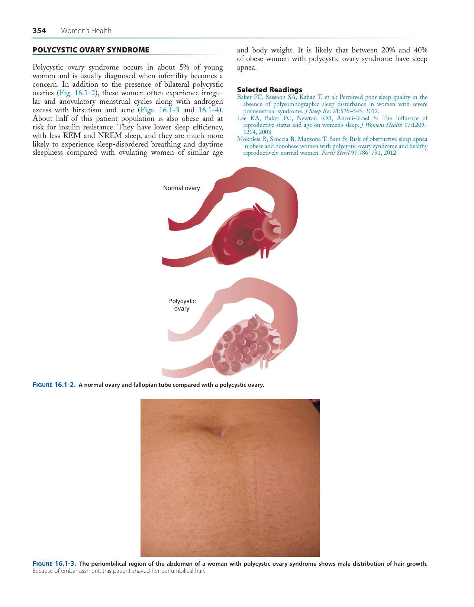

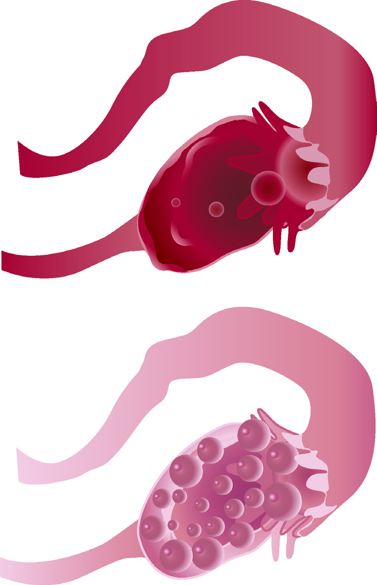

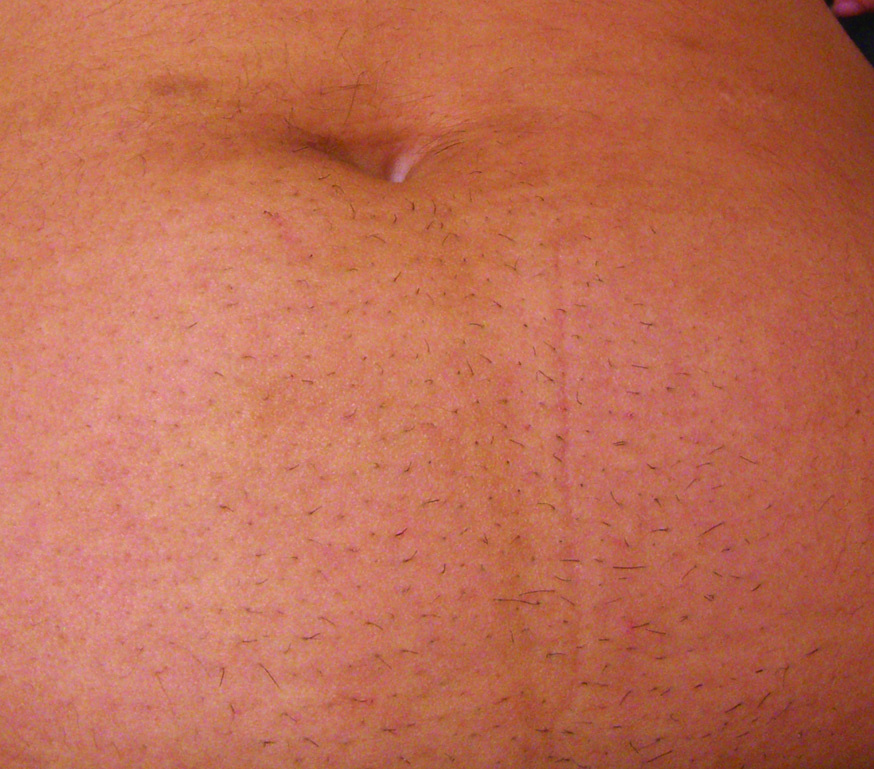

<!-- pdf-page: 416 -->

FIGURE 16.1-4. A woman with polycystic ovary syndrome (PCOS). A, Note the facial features (hirsutism and acne) characteristic of androgen excess.

B, This polysomnogram segment shows severe sleep apnea in a 48-year-old woman who had symptoms of PCOS for more than a decade and who was first diagnosed with PCOS when assessed for sleep apnea. The patient was obese and had angina pectoris, arterial hypertension, and diabetes mellitus.

A

EMG1-EMG2

1.02 mV

C3-A2

128 V C4-A1

128 V O1-A2

128 V O2-A1

128 V ROC-A1

128 V LOC-A2

128 V ECG1-ECG2

2.05 mV

LAT-LAT

2.05 mV RAT-RAT

2.05 mV

100

SaO2 %

90

THOR EFFORT

4.1 mV

ABD EFFORT

4.1 mV

120

PULSE bpm

70 75

EtCO2 mm Hg

0 20 0

CPAP PRESS cm H2O

NASAL PRESS

500 mV

B

30 sec/page Cursor: 01:15:26, Epoch: 208 - STAGE 2

5 min/page

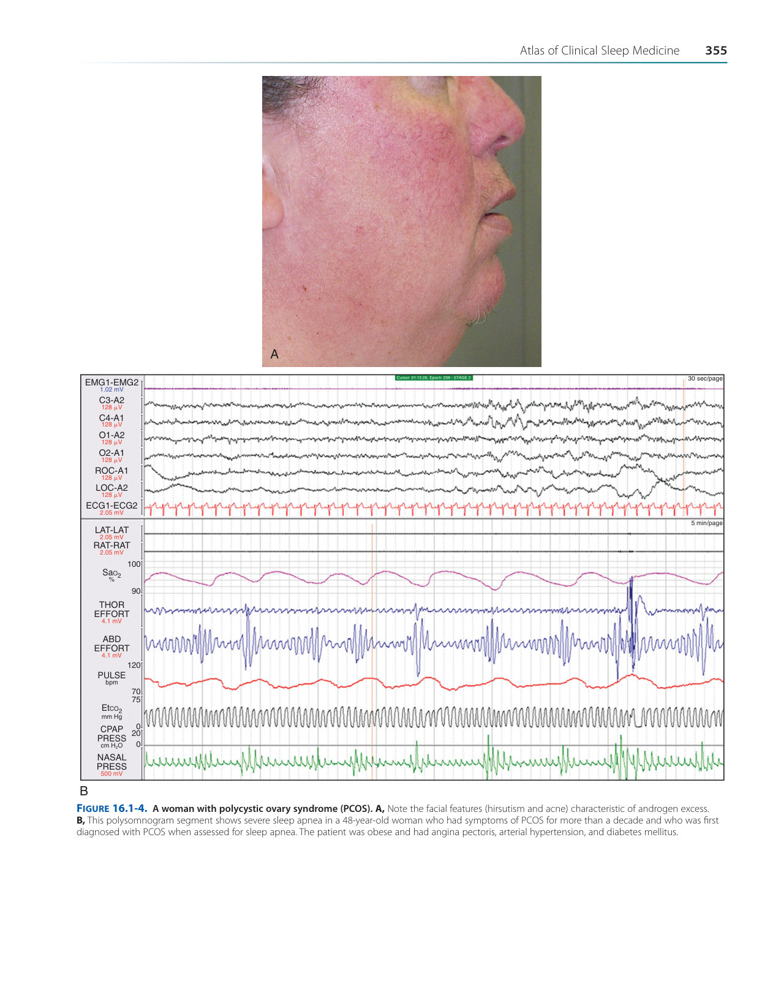

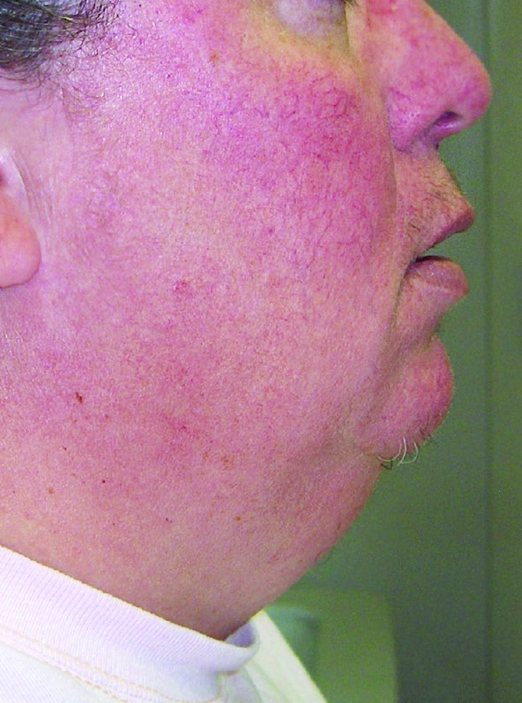

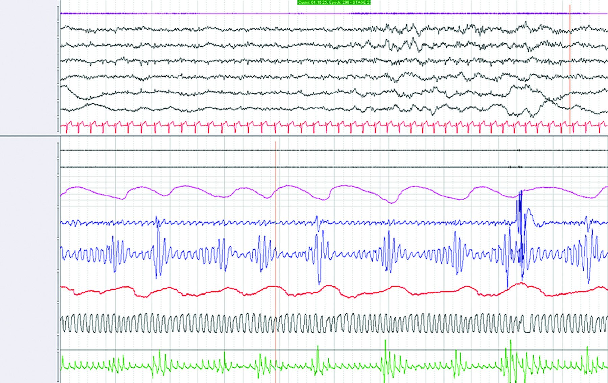

<!-- pdf-page: 417 -->

356 Women’s Health

## PREGNANCY AND POSTPARTUM

### Kin M. Yuen

## 16.2

pregnant women. A higher incidence of snoring has been reported in the second trimester.

TABLE 16.2-1 Features of Sleep Disturbances in Pregnancy and Postpartum

Blood volume, hormone effects, and physical changes during pregnancy affect a woman’s sleep. During the first trimester, with rapidly expanding blood volume and progesteroneinduced hyperventilation, there is a sense of shortness of breath. The added estrogen increases pliability and hyperemia, causing nasal passages to become more collapsible. Both of these changes contribute to the heightened sensation of dyspnea. The added progesterone is also likely to increase daytime sleepiness and napping, thereby increasing overall total sleep time. Persistent nighttime or early morning nausea and vomiting of pregnancy can also worsen sleep, although the second trimester brings some normalization to total sleep time. Table 16.2-1 summarizes common complaints, polysomnographic findings, and sleep disorders found during the three trimesters of pregnancy. Frequent snoring affects fewer than 5% of nonpregnant women, but it affects 15% to 20% of

Although most parasomnias purportedly decrease during pregnancy, the prevalence of sleep paralysis has been reported to increase in the second and third trimesters, to about 13%, from a prepregnancy rate of 6%. Sleep fragmentation has been suggested as the cause; sleep paralysis resolves upon delivery.

During the third trimester, women have further decrements in total sleep time. More awakenings are reported, and sleep efficiency is lower. Other physical discomforts arise because of the expanding abdominal girth and anatomic changes that include frequent urination, heartburn, and dyspnea, which further decrease sleep efficiency. Because functional residual capacity is now greatly reduced as a result of elevation of the diaphragm, dyspnea returns.

TRIMESTER COMPLAINTS PSG FINDINGS HORMONAL CORRELATES SLEEP DISORDERS*

*Narcoleptic symptoms can continue during pregnancy. †β-Human chorionic gonadotropin, rennin, nitric oxide, interleukin-1, TNF, and interferon may also facilitate sleepiness. ‡Multiparous mothers with fewer symptoms compared with nulliparous mothers. §Mothers caring for premature infants with more waking after sleep onset and even less total sleep time. OSA, obstructive sleep apnea; PSG, polysomnography; REM, rapid eye movement; SWS, slow-wave sleep; TNF, tumor necrosis factor; TST, total sleep time.

↑ Naps ↑ TST ↑ Wake time ↓ SWS

First Excessive daytime sleepiness Insomnia Urinary frequency

Second ↑ Awakenings ↓ SWS ↓ REM

↓ TST ↓ SWS ↓ REM ↑ Wake after sleep onset ↑ Stage 1 sleep

Third 3–5 Awakenings/night ↓ Daytime alertness Leg cramps Dyspnea Backache Heartburn Abdominal discomfort Fetal movement Frequent nocturia

↑ Sleep fragmentation ↑ Time out of bed ↑ Body movements

Preeclampsia Poor sleep Nausea Edema Headaches Dizziness Changes in vision Sleepiness

Postpartum‡ Poor sleep ↓ TST§ ↓ REM ↓ REM latency ↓ Stage 2 sleep ↑ SWS ↑ Awake time ↓ Sleep efficiency

↑ Progesterone:

Snoring/OSA Less bruxism than baseline More hypnic jerks

hyperventilation, sedation, smooth muscle relaxation ↑ Prolactin ↑ REM ↑ Estrogen Melatonin not affected†

↑ Progesterone ↑ Estrogen

Snoring/OSA More sleep paralysis Less somnambulism Less somniloquy

↑ Estrogen ↓ Progesterone at parturition Oxytocin at parturition Lower cortisol

Snoring/OSA Preeclampsia Restless legs Leg cramps Recurrence of somnambulism More sleep paralysis

↑ Cytokines ↑ C-reactive protein ↑ TNF

Snoring/OSA

↓ Estrogen ↓ Progesterone

Blues: 50%-80% Depression: 10%-20% Psychosis (rare): 0.1%

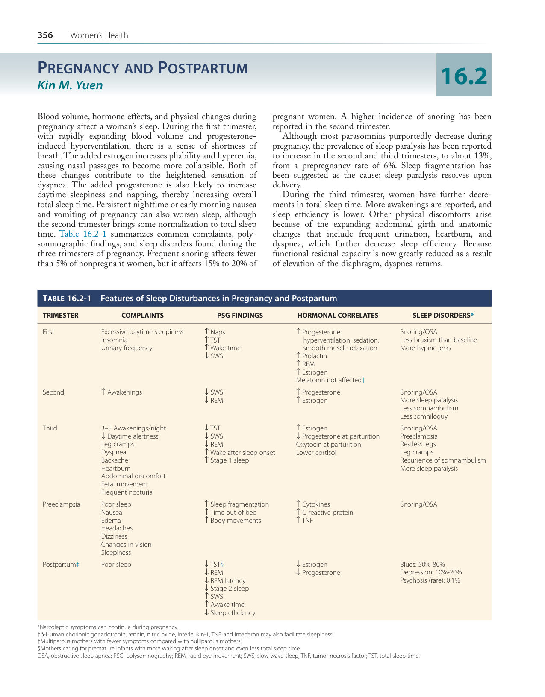

<!-- pdf-page: 418 -->

#### SLEEP-DISORDERED BREATHING

Nasal positive airway pressure application during pregnancy has been reported to be effective in treating obstructive sleep apnea, with no adverse effects on the fetus.

A higher risk of preeclampsia has been reported among frequent snorers (Table 16.2-2). Aside from systemic hypertension, pedal edema, and proteinuria, babies born to preeclamptic women who snore may be more likely to have intrauterine growth retardation and lower Apgar scores. Studies further document an increase in cytokine markers, tumor necrosis factor, and interleukin-6 among preeclamptic snorers.

#### RESTLESS LEGS SYNDROME

FIGURE 16.2-1. Postcesarean polysomnography (PSG) in a woman with apnea. This PSG fragment was taken from a 38-year-old woman immediately after

cesarean delivery. She had a difficult pregnancy complicated by arterial hypertension, peripheral edema, and gastroesophageal reflux with a history of snoring, observed apnea, and daytime sleepiness. Immediately after the cesarean delivery, she was noted to have life-threatening hypoxemia. She had an apnea-hypopnea index of 167, and her oxygen saturation (SaO2) approached 40%.

Sleep apnea affects women during pregnancy and the postpartum period for a few reasons. For example, a woman who has sleep apnea may become pregnant, or apnea may start during pregnancy, especially in cases of marked weight gain. After parturition, sleepiness from untreated apnea affects the new mother’s ability to care for the newborn.

TABLE 16.2-2 Pregnancy and Sleep-Disordered

#### Breathing

BEFORE PREGNANCY

PREGNANCY

PREECLAMPSIA

SNORING

(%)

(%)

(%)

Self-reported 5 15-30 10 Partner reported 25-35 55 85

CHIN(1)

250 V

C3-A2

125 V

C4-A1

125 V

O1-A2

125 V

O2-A1

125 V

ROC-A1

125 V

LOC-A2

125 V

ECG 2.5 mV

LEG(L)

125 V

LEG(R)

125 V

100

SaO2 %

40

THOR RES x1.5

ABD RES x1.5

120

PULSE bpm

40 76

PCO2 mm Hg

-4

20

CPAP cm H2O

2

AIRFLOW

62.5 V

Restless legs syndrome (RLS), which is reported in individuals with iron or folate deficiency, affects 15% to 25% of women in the third trimester. This is independent of the oftenreported severe leg cramps that awaken women from sleep. Because of the rapid blood volume expansion by 2 to 3 L during pregnancy, and despite oral iron and folate prenatal supplementation, some women continue to have irondeficiency anemia. Because RLS in pregnancy is short term, conservative measures, such as evening massage, are advised. In severe cases, further iron supplementation is usually recommended before prescribing dopaminergic agents.

#### LABOR AND DELIVERY

Few polysomnographic sleep studies have been done on women in labor, for obvious reasons (Fig. 16.2-1). When women expecting their first child were monitored with wrist

30 sec/page

Cursor: 00:29:35, Epoch: 167 - STAGE 2

5 min/page

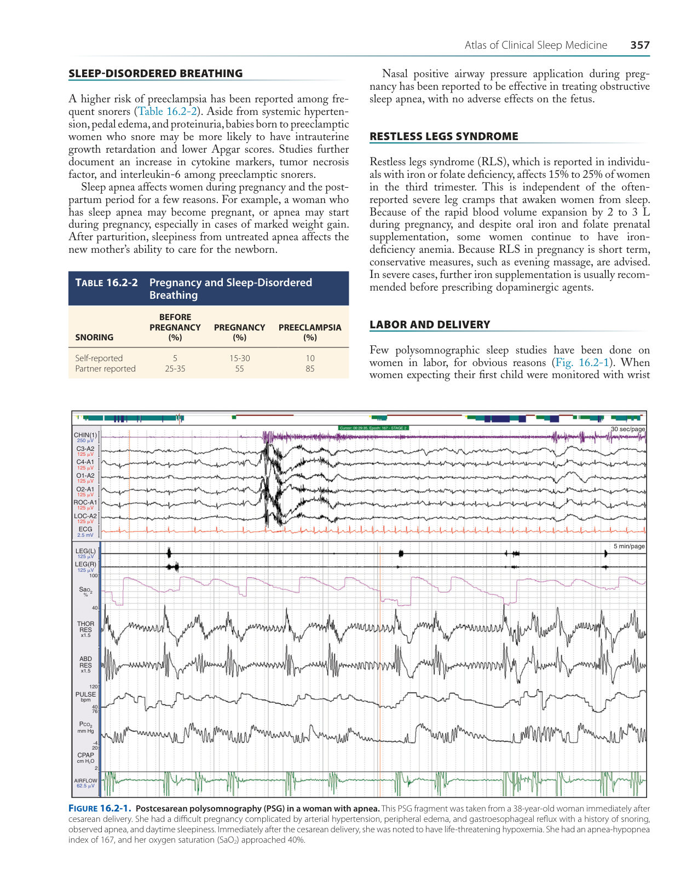

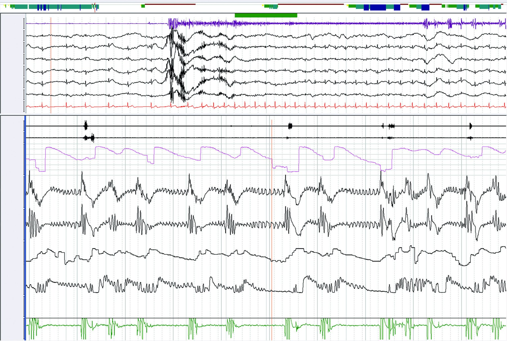

<!-- pdf-page: 419 -->

358 Women’s Health

actigraphy for five nights before the onset of labor, results were surprising. Sleep progressively deteriorates from an average of 7.5 plus 1.0 hours and 15% wake time to 4.5 plus 2.0 hours with about 30% wake time the night before the onset of labor and hospital admission. This also occurs to a lesser extent in women scheduled for induction of labor. Anxiety about labor may be a key factor. Having most of the active labor during the night may be related to depressed mood during the first few weeks after delivery.

TABLE 16.2-4 Differences in Cesarean Rates by Waking After Sleep Onset (n = 131)

When women expecting their first child had their sleep monitored by wrist actigraphy at about 3 weeks before the onset of labor, 15% slept less than 6 hours. Compared with those who slept 7 hours or more, these short sleepers were in labor almost 12 hours longer on average and were 4.5 times more likely to have a cesarean delivery (Tables 16.2-3 and 16.2-4).

#### POSTPARTUM SLEEP

The postpartum period allows for some recovery of slow-wave deep sleep and rapid eye movement sleep. Although all new mothers exhibit lower sleep efficiency while caring for a newborn, multiparous women are more likely to enter into

TABLE 16.2-3 Differences in Labor Duration by Total

#### Sleep Time and Waking After Sleep

Onset (n = 131)

LABOR DURATION

(MEAN + SD)*

N

Waking After Sleep Onset (%) 15+ 41 26.0 ± 11.7† 10-14.9 32 16.3 ± 12.9 <10 58 18.3 ± 14.6

Total Sleep Time (hr) <6 19 29.0 ± 12.5† 6-6.9 38 20.5 ± 11.3 7+ 74 17.7 ± 15.6

Data from Lee KA, Gay CL: Sleep in late pregnancy predicts length of labor and type of delivery. Am J Obstet Gynecol 2004;191:2041–2046. *In hours, adjusted for infant birth weight. †Significantly longer labor than the other two groups. SD, standard deviation.

stable sleep during the infant’s first few weeks of life than are first-time mothers. A few studies have shown that breastfeeding mothers sleep better than formula-feeding mothers; polysomnography indicates more slow-wave deep sleep in nursing mothers, and actigraphy indicates about 45 minutes more sleep during the night. Further research is needed, but in lactating mothers, levels of the hormone prolactin are thought to be responsible for these findings. New mothers caring for premature infants or infants with special needs have persistently less total sleep time, with more frequent awakenings and longer wakeful episodes at night.

#### Postpartum Sleep and Mental Health

Postpartum depression, or “the baby blues,” is commonly reported in new mothers (50% to 80%) and is thought to be due to the rapid drop in placental hormones. Most women recover from postpartum depression in 2 to 3 weeks. However, in 10% to 20% of new mothers, it persists. A history of depression before pregnancy is the biggest risk factor. Studies have found that continuing selective serotonin reuptake inhibitor antidepressants during pregnancy does not significantly affect fetal outcome, except for some jitteriness in the newborn infant immediately after birth. In 0.1% of new mothers, postpartum psychosis is diagnosed; these women are likely to have a history of bipolar disorder.

#### NARCOLEPSY AND PREGNANCY

The management of narcolepsy in pregnant women remains a challenge. The general consensus is that supportive changes in work schedules should, if necessary, be provided so that daytime naps can be included. For others who may be affected by frequent cataplexy or sleep attacks, the judicious use of medication for alertness and cataplexy must be considered to enhance the safety of both the mother and the fetus.

#### SUMMARY

Pregnancy encompasses many rapid hormonal, hematologic, mechanical, and physiologic changes (see Table 16.2-1). Parasomnias generally decrease during pregnancy, but snoring

N CESAREAN RATE (%) OR* 95% CI P VALUE

Waking After Sleep Onset (%) 15+ 41 39.0 5.19 1.77–15.18 .003 10-14.9 32 18.8 1.90 0.55–6.63 .312 <10 58 10.3 ref

Total Sleep Time (hr) <6 19 36.8 4.54 1.36–15.21 .014 6-6.9 38 34.2 3.67 1.33–10.18 .012 7+ 74 10.8 ref

GSDS Sleep Quality Subscale (days/wk) Poor sleep 5+ 48 31.3 5.33 1.40–20.36 .014 Poor sleep 3 to 4 39 25.6 4.21 1.05–16.93 .043 Poor sleep 0 to 2 44 6.8 ref

Data from Lee KA, Gay CL: Sleep in late pregnancy predicts length of labor and type of delivery. Am J Obstet Gynecol 2004; 191:2041–2046. *Adjusted for infant birth weight. CI, confidence interval; GSDS, general sleep disturbance scale; ref, reference group; OR, odds ratio.

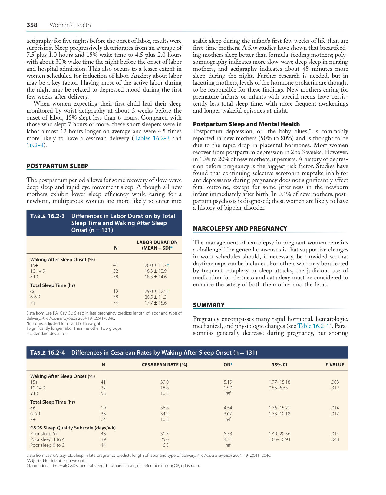

<!-- pdf-page: 420 -->

should be evaluated for obstructive sleep apnea. RLS is common in the third trimester and resolves after delivery without further intervention. Pharmacologic interventions are rarely considered because of the potential adverse effects on the fetus or breastfeeding newborn. Nonpharmacologic interventions, such as nasal continuous positive airway pressure, have the potential to minimize fetal and newborn complications in women with sleep-disordered breathing.

Doan T, Gardiner A, Gay CL, Lee KA: Breast-feeding increases sleep dura­

tion of new parents. J Perinat Neonatal Nurs 21:200–206, 2007. Facco FL, Liu CS, Cabello AA, et al: Sleep-disordered breathing: a risk factor

for adverse pregnancy outcomes? Am J Perinatol 29:277–282, 2012. Ibrahim S, Foldvary-Schaefer N: Sleep disorders in pregnancy: implications,

evaluation, and treatment. Neurol Clin 30:925–936, 2012. Manconi M, Ulfberg J, Berger K: When gender matters: restless legs syn­

drome. Report of the “RLS and woman” workshop endorsed by the European RLS Study Group. Sleep Med Rev 16:297–307, 2012.

## MIDLIFE TRANSITION AND MENOPAUSE

### Kathryn A. Lee

## 16.3

#### Selected Readings

Barger M, Caughey AB, Lee KA: Evaluating insomnia during pregnancy and

postpartum. In Attarian HP, viola-Saltzman M, editors: Sleep disorders in women: a guide to practical management, ed 2, New York, 2013, Springer, pp 225–242.

FIGURE 16.3-1. The thermoneutral zone changes in women with hot flash (HF) symptoms. Small core body temperature elevations acting within a

reduced thermoneutral zone trigger HFs in symptomatic postmenopausal women. The thermoneutral zone is narrowed in symptomatic women (those with HFs) compared with asymptomatic women. In animals, elevated brain norepinephrine (NE) reduces this zone. Yohimbine (YOH) elevates brain NE and should reduce the zone; conversely, clonidine (CLON) should widen it. 5-HT, serotonin; SSRI, selective serotonin reuptake inhibitor. (Modified from Freedman RR: Hot flashes: behavioral treatments, mechanisms, and relation to sleep. Am J Med 2005;118[Suppl 12B]:124–130.)

For women, midlife is defined as the period between 40 and 60 years of age. However, some women in their 40s are having their first child, while others are becoming grandmothers. Socioeconomic situations may require some women to welcome their adult children back home to live; others may be launching children out of the home with great trepidation and stress. For the average American or European woman, menopause occurs at about 51 years of age, after having no menses for 12 months. The age range is quite broad, and the transition can begin with irregular cycles and hormonal fluctuations for 8 to 10 years before the actual cessation of menses. Sleep studies of older adults conducted in laboratory settings conclude that women retain more slow-wave deep sleep compared with men of the same age; however, epidemiologic studies of self-reported sleep problems have concluded that women experience more sleep problems than men.

No hot flashes

Core body temperature

Sweating threshold

Core body temperature

Shivering threshold

#### THERMOREGULATION AND

#### VASOMOTOR SYMPTOMS

When the ovaries cease to function and no longer produce estrogen, hypothalamic secretion of follicle-stimulating hormone and luteinizing hormone continues, and serum levels rise. Estrogen plays a role in maintaining a broad thermoneutral zone. The absence of estrogen is thought to be responsible for the disruptions in thermoregulation that narrow the zone between sweating to cool off and shivering to stay warm. Attenuation of the thermoneutral zone also occurs with stress (Fig. 16.3-1).

Vasomotor symptoms of menopause include hot flashes and night sweats, which are thought to occur when the hypothalamic thermoregulatory system functions poorly. Although in some ethnicities these vasomotor symptoms are

Hot flashes Threshold for

Sweating Hot flash

Thermoneutral zone Thermoneutral zone

Chills

Shivering

Thermoneutral zone HF YOH CLON Non- HF BRAIN NE 5-HT SSRI

<!-- pdf-page: 421 -->

360 Women’s Health

12

9

6

FIGURE 16.3-2. Pattern of hot flash frequency across 24 hours. (Modified from Woodward S, Freedman RR: The thermoregulatory effects of menopausal hot

flashes on sleep. Sleep 1994;17:499)

Number of hot flashes

3

0 2 4 6 8 10 noon

Time of day

2 4 6 8 A.M. P.M. 10 midnight

Sleep with hot flashes

Activity Activity

A

6 Hours

Sleep without hot flashes

B

6 Hours

FIGURE 16.3-3. Wrist actigraphy asleep and awake time for a 52-year-

old postmenopausal woman before (A) and after (B) cognitive behavioral therapy. A, The patient’s sleep diary indicated she woke up twice with hot flashes. She pressed the event marker at 11:55 PM and 01:15 AM to indicate she had been awakened by a hot flash. Total sleep time was 294 minutes, and sleep efficiency was 83%. Actigraphy documented 11 awakenings. B, The same patient 1 month after beginning cognitive behavioral therapy. Total sleep time was 396 minutes, and sleep efficiency was 91%. Actigraphy documented five awakenings. She did not experience hot flashes after intervention according to her sleep diary or the event marker on her actigraph monitor.

experienced by less than 10% of the population (in Asia), it is estimated that up to 80% of American and European women have these symptoms and are most distressed when they interfere with sleep.

Hot flashes occur day and night but are more frequent in the evening (Fig. 16.3-2). In laboratory settings, polysomnography data indicate that cortical arousals from sleep occur just before the onset of a hot flash. Some women have a measurable hot flash while sleep is being monitored in the laboratory but have no cognitive awareness of the experience. Other women have such extensive diaphoresis that bed linens must be changed before sleep can resume.

Figure 16.3-3 depicts wrist actigraphy sleep monitoring for

a woman seeking treatment for poor sleep quality because of menopausal hot flashes. Before treatment, she had 83% sleep efficiency (see Fig. 16.3-3, A). After 1 month of cognitive behavioral therapy, subjective report of sleep improved, and actigraphy showed 91% sleep efficiency (see Fig. 16.3-3, B). Most sleep laboratory studies of menopausal women indicate very little difference in wake time or sleep stage changes compared with asymptomatic women or menstruating women of the same age. Hot flashes can be minimized when the ambient temperature of the sleeping environment is cool, and cognitive behavioral therapy that includes stress reduction therapeutics may be useful in minimizing hot flash frequency or severity during the day and night. Because hormone replacement therapy is controversial, and studies of estrogen’s effect on sleep are not conclusive, short-acting hypnotics have been tested and have been shown to be effective in improving sleep in menopausal women who are experiencing vasomotor symptoms.

#### Selected Readings

Baker FC, Wolfson AR, Lee KA: Association of sociodemographic, lifestyle,

and health factors with sleep quality and daytime sleepiness in women: findings from the 2007 National Sleep Foundation “Sleep in America Poll.” J Womens Health 18:841–849, 2009. Dorsey CM, Lee KA, Scharf MB: Effect of zolpidem on sleep in women

with perimenopausal and postmenopuasal insomnia: a 4-week, randomized, multicenter, double-blind, placebo-controlled study. Clin Ther 26:1578–1586, 2004. Freedman RR, Roehrs TA: Sleep disturbance in menopause. Menopause

14:826–829, 2007. Kravitz HM, Joffe H: Sleep during the perimenopause: a SWAN story. Obstet

Gynecol Clin North Am 38:567–586, 2011.

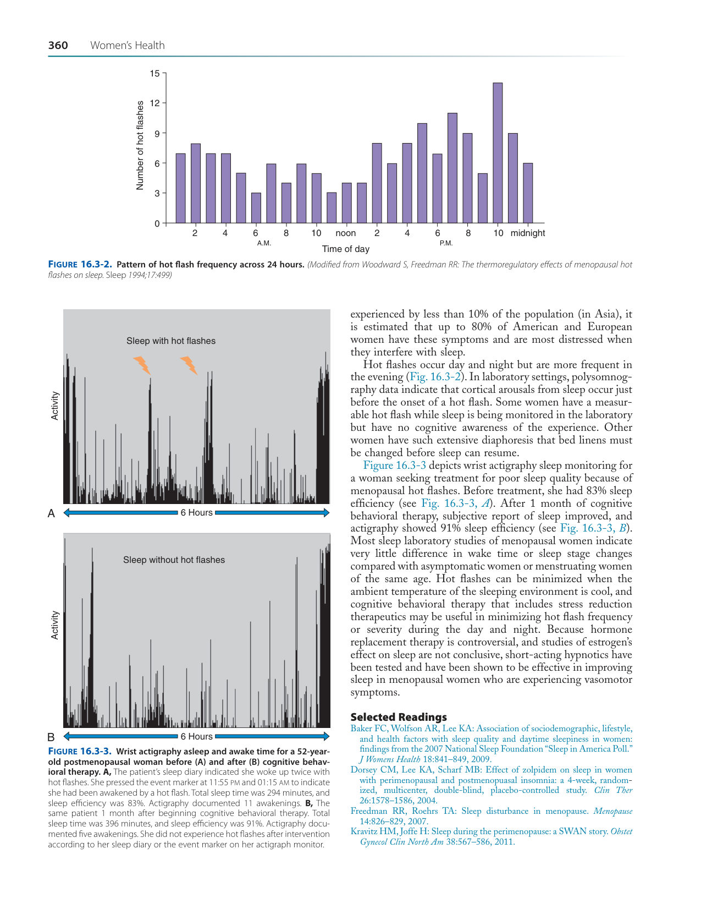

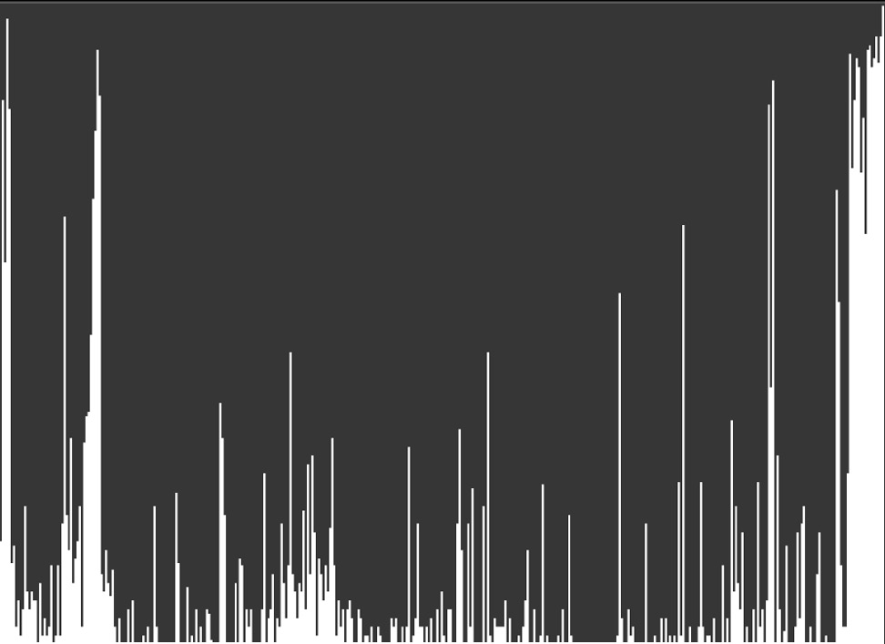

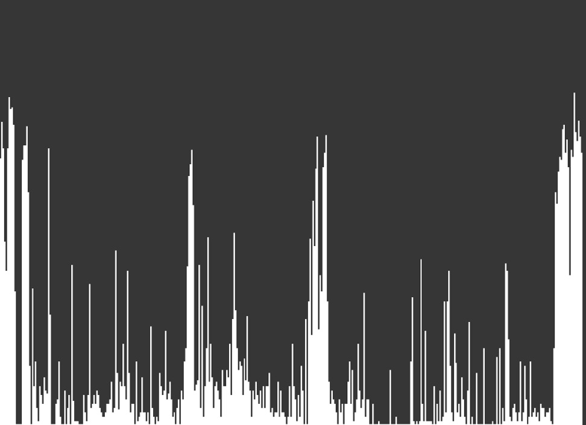

<!-- pdf-page: 422 -->

## CHRONIC FATIGUE AND FIBROMYALGIA SYNDROMES

### Carol A. Landis

## 16.4

Chronic fatigue syndrome (CFS) and fibromyalgia (FM) are complex, chronic illnesses of unknown etiology and pathogenesis with a much higher prevalence in women than in men. Both are characterized by symptoms that include pain, fatigue, and sleep disturbance. Individuals who develop these disorders may have a genetic component that renders them susceptible to activation of central nervous system mediators by a trigger such as an acute infection or traumatic event. Characteristics of CFS and FM are listed in Box 16.4-1. Individuals with these illnesses are likely to suffer from comorbid conditions such as irritable bowel syndrome, multiple chemical sensitivities, temporomandibular joint disorder, myofascial pain syndrome, tension headaches, and chronic sinusitis.

CFS is characterized by severe, disabling fatigue not attributed to another medical or psychiatric cause. It must coexist with a combination of symptoms that include impaired cognition, sleep disturbance, and musculoskeletal pain. It does not exclude conditions such as fibromyalgia, anxiety, somatoform disorders, subsyndromal depression, and chemical sensitivity disorder.

FM is based on symptoms and tenderness at nine paired sites on the body (Fig. 16.4-1). Its prevalence in the adult population is estimated to be 2% to 4% in the United States and is nine times higher in women than in men, affecting nearly 7% of women older than 60 years. Greater sensitivity to pain may place women at higher risk for developing FM.

BOX 16.4-1 Diagnostic Criteria for Fibromyalgia and

#### Chronic Fatigue Syndrome

#### Fibromyalgia

• Pain is widespread (bilateral above and below the waist) for

at least 3 months’ duration in combination with tenderness at 11 or more of 18 specific bilateral tender point sites. Tenderness is defined as mild or greater pain at the occiput, low cervical, trapezius, supraspinatus, second rib, lateral epicondyle, gluteal, greater trochanter, and knee area. Digital palpation is performed with approximately 4 kg force. • The presence of a second clinical disorder does not exclude

the diagnosis of fibromyalgia.

#### Chronic Fatigue Syndrome

Chronic, severe fatigue persists or relapses for 6 months or longer. Fatigue is new or of defined onset, is not substantially alleviated by rest, and results in a substantial reduction in levels of social and personal activities.

Four or more of the following symptoms should be present for at least 6 months and develop after the onset of fatigue: • Impaired memory or concentration • Sore throat • Tender cervical or axillary lymph nodes • Muscle pain, multijoint pain • New headaches • Unrefreshing sleep • Postexertion pain

Classify as idiopathic chronic fatigue if the above criteria are not met.

It is important for clinicians to make sure that the patient does not have another disorder that may be causing the symptoms, such as a movement disorder or sleep apnea (Fig. 16.4-2).

#### SLEEP DISTURBANCE IN CHRONIC FATIGUE

#### SYNDROME AND FIBROMYALGIA

Insomnia, sleep-disordered breathing, restless legs syndrome, and periodic leg movement disorder are common in CFS and FM. Self-reported sleep disturbance is one of eight possible symptoms characteristic of CFS and occurs in 78% of those with FM. Poor sleep adversely affects pain and mediates the relation between pain and fatigue. Fatigue in FM has been directly related to actigraphy-derived poor sleep efficiency. Evidence for altered circadian rhythms in CFS is mixed, but a constant, routine study showed no difference in melatonin or cortisol between women with and without FM.

The most consistent polysomnographic findings for FM show lower sleep efficiency, with slightly longer sleep-onset latency and more wakefulness in the first half of the night. In

FIGURE 16.4-1. Tender point locations for fibromyalgia (FM) from

“Three Graces” by Raphael (Muséo Conde). Low cervical, front neck area: at the anterior aspect of the interspaces between the transverse processes of C5 and C7. Front chest area: just lateral to the second costochondral junctions. Elbow area: 2 cm distal to the lateral epicondyle. Knee area: at the medial fat pad proximal to the joint line. Occiput, back of the neck: at the insertions of one or more of the following muscles: trapezius, sternocleidomastoid, splenius capits, semispinalis capitis. Trapezius muscle, back of shoulder: at the midpoint of the upper border. Supraspinatus muscle, shoulder blade area: above the scapular spine near the medial border. Gluteal, rear end: at the upper outer quadrant of the buttocks at the anterior edge of the gluteus maximus. Greater trochanter, rear hip: posterior to the greater trochanteric prominence.

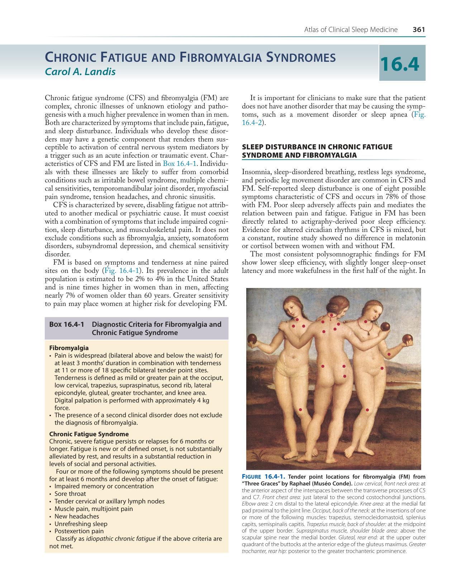

<!-- pdf-page: 423 -->

362 Women’s Health

CFS, sleep-onset latency and rapid eye movement (REM) sleep latency is longer and less REM sleep occurs; evidence for fragmented sleep is mixed.

was first described in psychiatric disorders and is also seen in primary insomnia. Such alpha-wave activity has not been correlated with symptom severity.

Women with CFS or FM often complain of nonrestorative sleep, which has been linked to alpha-wave activity in non-REM sleep in FM (Fig. 16.4-3). The alpha-delta hypothesis of nonrestorative sleep assumes that increased alpha-wave activity represents pain during sleep. However, this pattern

Rather than alpha-delta activity, FM patients consistently demonstrate fewer sleep spindles per minute of stage 2 sleep (Fig. 16.4-4). Pain tender point pressure threshold predicts the number of spindles after controlling for age and depression, two variables also associated with fewer sleep spindles.

FIGURE 16.4-2. A list of symptoms brought to a consultation by a patient with fibromyalgia. It became apparent that the patient had restless legs

syndrome, and laboratory testing confirmed obstructive apnea. (Courtesy Meir Kryger, MD.)

EMG1-EMG2

1.02 mV

C3-A2

128 V

C4-A1

128 V

Fr3-A2

128 V

Fr4-A1

128 V

O1-A2

128 V

O2-A1

128 V

ROC-A1

128 V

LOC-A2

128 V

FIGURE 16.4-3. An example of alpha-delta sleep. (Courtesy Meir Kryger, MD.)

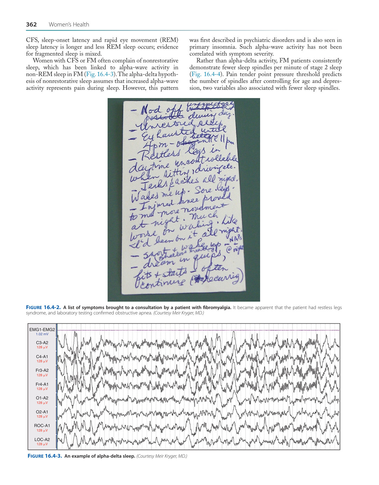

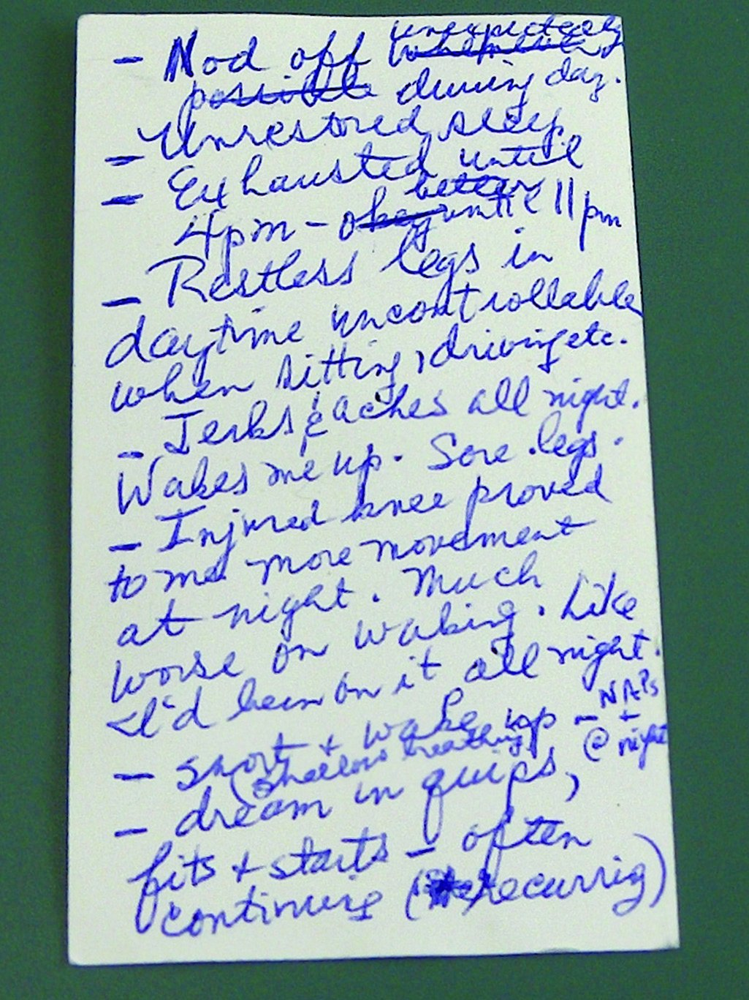

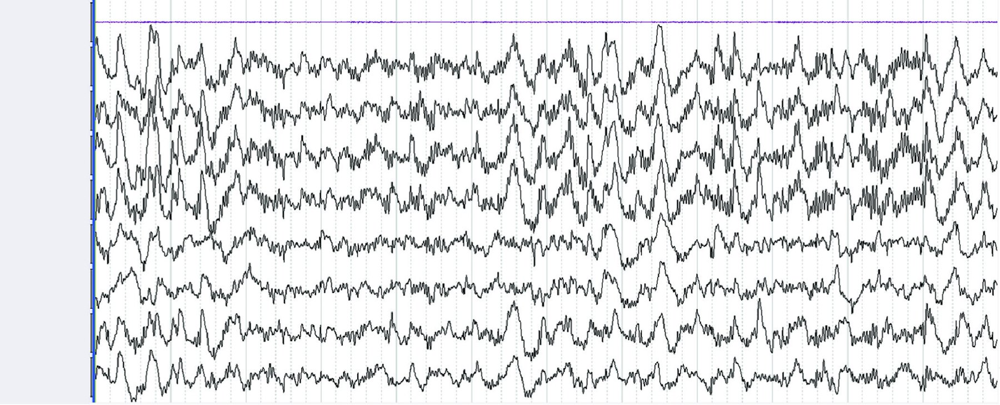

<!-- pdf-page: 424 -->

FM, spindle count: 5

FIGURE 16.4-4. Sleep-spindle activity in a woman with fibromyalgia (FM). The spindle count equaled 5, compared with a healthy age-matched control,

whose spindle count was 7. (From Landis CA, Lentz MJ, et al: Decreased sleep spindles and spindle activity in midlife women with fibromyalgia. Sleep 2004;27[3]:741–750.)

Control, spindle count: 7

Emerging data suggest that sleep disruption may lower the pain threshold. Consolidating sleep with sodium oxybate has been shown in some trials to improve sleep and reduce pain in FM patients.

#### Selected Readings

Bellato E, Marini E, Castoldi F, et al: Fibromyalgia syndrome: etiology,

pathogenesis, diagnosis, and treatment. Pain Res Treat Epub 2012 Nov 4. Jackson ML, Bruck D: Sleep abnormalities in chronic fatigue syndrome/

myalgic encephalomyelitis: a review. J Clin Sleep Med 8:719–728, 2012.

Landis CA: Sleep, pain, fibromyalgia, and chronic fatigue syndrome. Handb

Clin Neurol 98:613–637, 2011. Roehrs T, Diederichs C, Gillis M: Nocturnal sleep, daytime sleepiness and

fatigue in fibromyalgia patients compared to rheumatoid arthritis patients and healthy controls: a preliminary study. Sleep Med 14:109–115, 2013. Spaeth M, Bennett RM, Benson BA, et al: Sodium oxybate therapy provides

multidimensional improvement in fibromyalgia: results of an international phase 3 trial. Ann Rheum Dis 71(6):935–942, 2012.

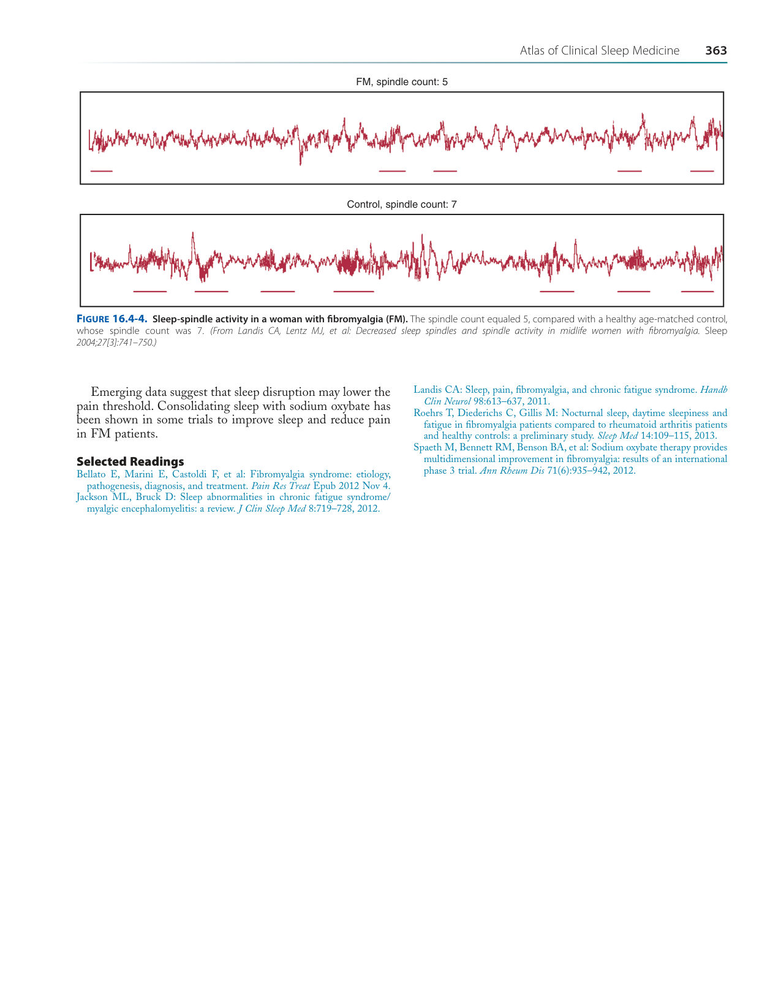

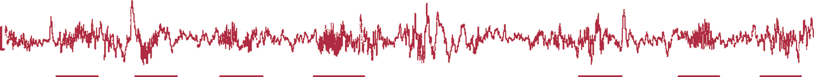

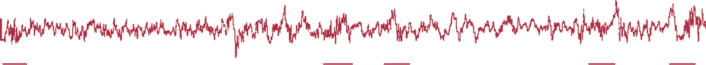
