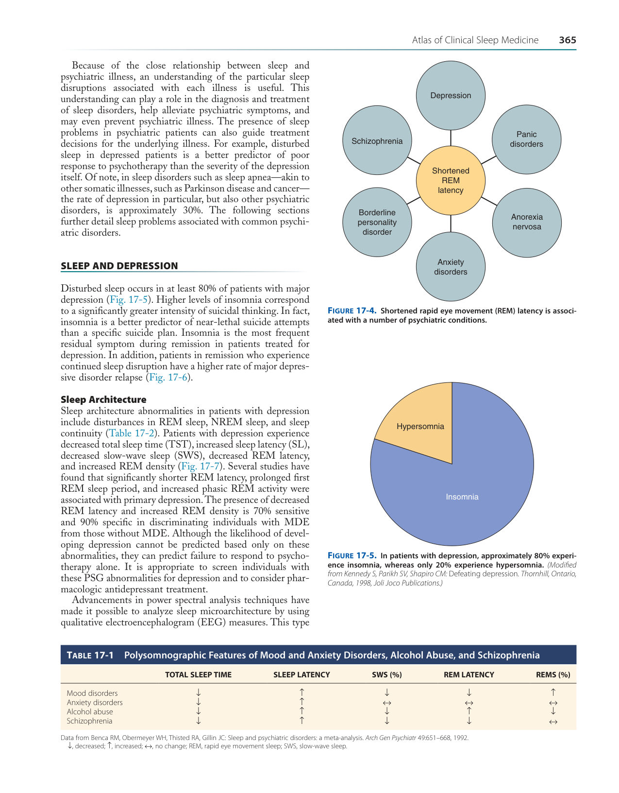
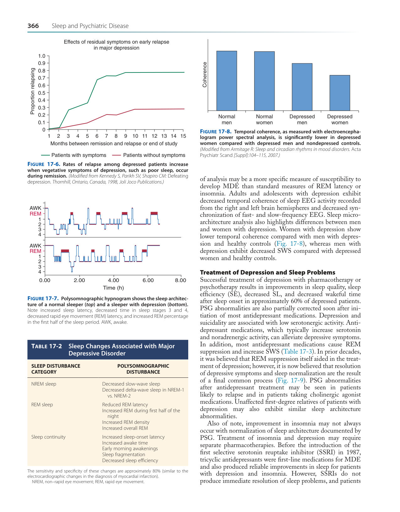
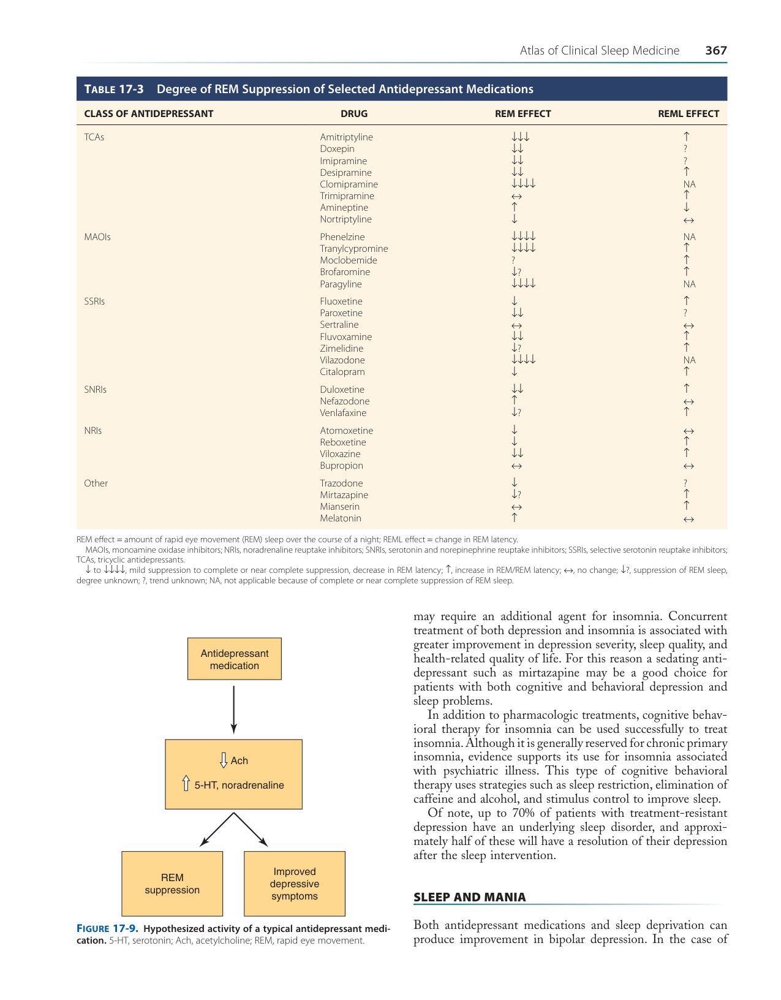
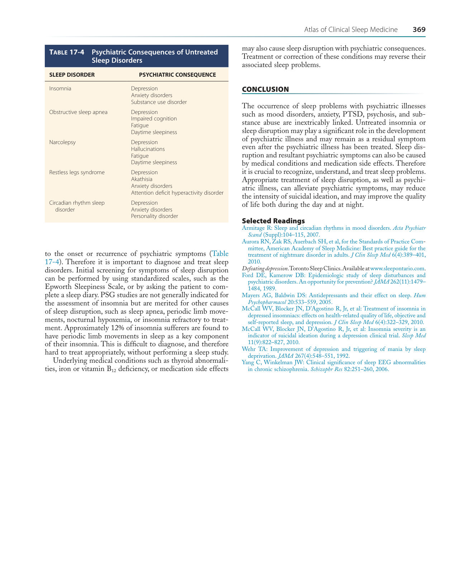

# 17 Sleep and Psychiatric Disease

<!-- pdf-page: 425 -->

#### Chapter

## 17 Sleep and Psychiatric Disease

### Catherine McCall, Colin M. Shapiro, and W. Vaughn McCall

#### OVERVIEW

Common sleep problems such as insomnia, circadian rhythm disorders, and nightmares reviewed elsewhere in this volume occur very frequently in patients with psychiatric illness. Up to 63% of patients with psychiatric illness report significant sleep loss compared with only 20% of the general population (Fig. 17-1). Conversely, disturbed sleepers report more psychiatric symptoms than do undisturbed sleepers. Nearly 45% of patients with insomnia can attribute their sleep loss to psychiatric conditions. Less common causes are primary insomnia, delayed sleep phase syndrome, obstructive sleep apnea (OSA), and other medical disorders (Fig. 17-2).

In some patients, insomnia may even be a harbinger for future mental illness. In approximately a dozen studies, it has been shown that unresolved insomnia increases the odds of developing a new psychiatric disorder over the following year, particularly a major depressive episode (MDE) or panic disorder (Fig. 17-3). It is unclear whether insomnia is merely an early symptom of MDE or a modifiable risk factor, but the evidence tilts toward the latter. In susceptible patients with bipolar disorder, even a single night of sleep loss has been shown to precipitate manic symptoms.

Circadian rhythm disorders and nightmares are also associated with psychiatric illness. Delayed sleep phase syndrome is more prevalent in patients with mood disorders than in control subjects and may have a role in triggering depression and self-harm. Patients with postraumatic stress disorder (PTSD) frequently suffer from debilitating nightmares that impact nighttime sleep and affect daily mood and functioning.

Objective abnormalities in sleep architecture recorded by polysomnography (PSG) have been noted in patients with psychiatric disorders. In healthy adults, sleep onset occurs approximately 10 to 15 minutes after lights out, followed by stages 2, 3, and 4 of non–rapid eye movement (NREM) sleep. This is followed by a period of rapid eye movement (REM) sleep. This cycle of NREM-REM sleep occurs at approximately 90- to 100-minute intervals throughout the night. The duration of NREM sleep progressively decreases throughout the night, whereas REM sleep duration increases. Intermittent awakenings of short duration occur in healthy adults but generally last for only 2% to 5% of total sleep time. Specific sleep pattern anomalies are associated with psychiatric illness. In particular, decreased REM latency has been notably associated with a number of disorders, including MDE, panic disorder, schizophrenia, anxiety disorders, and borderline personality disorder (Fig. 17-4). Other specific patterns of PSG abnormalities have been associated with depression, PTSD, anxiety, alcohol dependence, and schizophrenia (Table 17-1).

80

63.2%

70

% Outpatients with sleep loss symptoms

60

50

40

20.1%

30

20

10

0

Control Psychiatric

FIGURE 17-1. Prevalence of insomnia in psychiatric patients compared

with patients who do not have psychiatric illness. (Data from Sweetwood HL, et al: Sleep disorder and psychobiological symptomatology in male psychiatric outpatients and male nonpatients. Psychosomat Med 1976;38:373-378.)

0 5 10 15 20 25 30 35 40 45 50

% of Patients

Mental disorder Primary insomnia DSPS OSAS

FIGURE 17-2. Prevalence of insomnia associated with mental illness,

primary insomnia, delayed sleep phase syndrome (DSPS), obstructive sleep apnea syndrome (OSAS), or other medical illness. (Modified from Buysse DJ, Reynolds CF 3d, Hauri PJ, et al: Diagnostic concordance for DSM-IV sleep disorders: a report from the APA/NIMH DSM-IV field trial. Am J Psychiatry 151:1351–1360, 1994.)

40 Any psychiatric disorder Major depression Anxiety disorders Alcohol abuse

33.6

35

30

25.6

% of Patients

25

20

14

15

12.7

10

7.4

3.4

5

2.5

0.6

0

Resolved insomnia Unresolved insomnia At 1-year follow-up

FIGURE 17-3. Percentage of patients with insomnia who return after 1

year, with resolved or unresolved insomnia, and those with a new diagnosis of psychiatric illness. (Data from Ford DE, Kamerow DB: Epidemiologic study of sleep disturbances and psychiatric disorders. An opportunity for prevention? JAMA 262(11):1479–1484, 1989.)

<!-- pdf-page: 426 -->

Depression

Panic disorders Schizophrenia

TABLE 17-1 Polysomnographic Features of Mood and Anxiety Disorders, Alcohol Abuse, and Schizophrenia

Because of the close relationship between sleep and psychiatric illness, an understanding of the particular sleep disruptions associated with each illness is useful. This understanding can play a role in the diagnosis and treatment of sleep disorders, help alleviate psychiatric symptoms, and may even prevent psychiatric illness. The presence of sleep problems in psychiatric patients can also guide treatment decisions for the underlying illness. For example, disturbed sleep in depressed patients is a better predictor of poor response to psychotherapy than the severity of the depression itself. Of note, in sleep disorders such as sleep apnea—akin to other somatic illnesses, such as Parkinson disease and cancer— the rate of depression in particular, but also other psychiatric disorders, is approximately 30%. The following sections further detail sleep problems associated with common psychiatric disorders.

#### SLEEP AND DEPRESSION

Disturbed sleep occurs in at least 80% of patients with major depression (Fig. 17-5). Higher levels of insomnia correspond to a significantly greater intensity of suicidal thinking. In fact, insomnia is a better predictor of near-lethal suicide attempts than a specific suicide plan. Insomnia is the most frequent residual symptom during remission in patients treated for depression. In addition, patients in remission who experience continued sleep disruption have a higher rate of major depressive disorder relapse (Fig. 17-6).

#### Sleep Architecture

Sleep architecture abnormalities in patients with depression include disturbances in REM sleep, NREM sleep, and sleep continuity (Table 17-2). Patients with depression experience decreased total sleep time (TST), increased sleep latency (SL), decreased slow-wave sleep (SWS), decreased REM latency, and increased REM density (Fig. 17-7). Several studies have found that significantly shorter REM latency, prolonged first REM sleep period, and increased phasic REM activity were associated with primary depression. The presence of decreased REM latency and increased REM density is 70% sensitive and 90% specific in discriminating individuals with MDE from those without MDE. Although the likelihood of developing depression cannot be predicted based only on these abnormalities, they can predict failure to respond to psychotherapy alone. It is appropriate to screen individuals with these PSG abnormalities for depression and to consider pharmacologic antidepressant treatment.

Advancements in power spectral analysis techniques have made it possible to analyze sleep microarchitecture by using qualitative electroencephalogram (EEG) measures. This type

Shortened REM latency

Borderline personality disorder

Anorexia nervosa

Anxiety disorders

FIGURE 17-4. Shortened rapid eye movement (REM) latency is associ­

ated with a number of psychiatric conditions.

Hypersomnia

Insomnia

FIGURE 17-5. In patients with depression, approximately 80% experi­

ence insomnia, whereas only 20% experience hypersomnia. (Modified from Kennedy S, Parikh SV, Shapiro CM: Defeating depression. Thornhill, Ontario, Canada, 1998, Joli Joco Publications.)

TOTAL SLEEP TIME SLEEP LATENCY SWS (%) REM LATENCY REMS (%)

Mood disorders ↓ ↑ ↓ ↓ ↑ Anxiety disorders ↓ ↑ ↔ ↔ ↔ Alcohol abuse ↓ ↑ ↓ ↑ ↓ Schizophrenia ↓ ↑ ↓ ↓ ↔

Data from Benca RM, Obermeyer WH, Thisted RA, Gillin JC: Sleep and psychiatric disorders: a meta-analysis. Arch Gen Psychiatr 49:651–668, 1992.

↓, decreased; ↑, increased; ↔, no change; REM, rapid eye movement sleep; SWS, slow-wave sleep.

<!-- pdf-page: 427 -->

366 Sleep and Psychiatric Disease

Effects of residual symptoms on early relapse

in major depression

1.0

Coherence

0.9 0.8 0.7 0.6 0.5 0.4 0.3 0.2 0.1

Proportion relapsing

1 0

15 8 7 6 5 4 12 11 10 9 14 13 3 2

Months between remission and relapse or end of study

Patients without symptoms Patients with symptoms

FIGURE 17-6. Rates of relapse among depressed patients increase

when vegetative symptoms of depression, such as poor sleep, occur during remission. (Modified from Kennedy S, Parikh SV, Shapiro CM: Defeating depression. Thornhill, Ontario, Canada, 1998, Joli Joco Publications.)

4 3 2 1 REM AWK

4 3 2 1 REM AWK

0.00 2.00 4.00 6.00 8.00 Time (h)

FIGURE 17-7. Polysomnographic hypnogram shows the sleep architec­

ture of a normal sleeper (top) and a sleeper with depression (bottom). Note increased sleep latency, decreased time in sleep stages 3 and 4, decreased rapid eye movement (REM) latency, and increased REM percentage in the first half of the sleep period. AWK, awake.

TABLE 17-2 Sleep Changes Associated with Major

#### Depressive Disorder

SLEEP DISTURBANCE CATEGORY

POLYSOMNOGRAPHIC

DISTURBANCE

NREM sleep Decreased slow-wave sleep Decreased delta-wave sleep in NREM-1

vs. NREM-2

REM sleep Reduced REM latency Increased REM during first half of the

night Increased REM density Increased overall REM

Sleep continuity Increased sleep-onset latency Increased awake time Early morning awakenings Sleep fragmentation Decreased sleep efficiency

The sensitivity and specificity of these changes are approximately 80% (similar to the electrocardiographic changes in the diagnosis of myocardial infarction).

NREM, non–rapid eye movement; REM, rapid eye movement.

Normal men Normal women Depressed men Depressed women

FIGURE 17-8. Temporal coherence, as measured with electroencepha­

logram power spectral analysis, is significantly lower in depressed women compared with depressed men and nondepressed controls. (Modified from Armitage R: Sleep and circadian rhythms in mood disorders. Acta Psychiatr Scand [Suppl]:104–115, 2007.)

of analysis may be a more specific measure of susceptibility to develop MDE than standard measures of REM latency or insomnia. Adults and adolescents with depression exhibit decreased temporal coherence of sleep EEG activity recorded from the right and left brain hemispheres and decreased synchronization of fast- and slow-frequency EEG. Sleep microarchitecture analysis also highlights differences between men and women with depression. Women with depression show lower temporal coherence compared with men with depression and healthy controls (Fig. 17-8), whereas men with depression exhibit decreased SWS compared with depressed women and healthy controls.

#### Treatment of Depression and Sleep Problems

Successful treatment of depression with pharmacotherapy or psychotherapy results in improvements in sleep quality, sleep efficiency (SE), decreased SL, and decreased wakeful time after sleep onset in approximately 60% of depressed patients. PSG abnormalities are also partially corrected soon after initiation of most antidepressant medications. Depression and suicidality are associated with low serotonergic activity. Antidepressant medications, which typically increase serotonin and noradrenergic activity, can alleviate depressive symptoms. In addition, most antidepressant medications cause REM suppression and increase SWS (Table 17-3). In prior decades, it was believed that REM suppression itself aided in the treatment of depression; however, it is now believed that resolution of depressive symptoms and sleep normalization are the result of a final common process (Fig. 17-9). PSG abnormalities after antidepressant treatment may be seen in patients likely to relapse and in patients taking cholinergic agonist medications. Unaffected first-degree relatives of patients with depression may also exhibit similar sleep architecture abnormalities.

Also of note, improvement in insomnia may not always occur with normalization of sleep architecture documented by PSG. Treatment of insomnia and depression may require separate pharmacotherapies. Before the introduction of the first selective serotonin reuptake inhibitor (SSRI) in 1987, tricyclic antidepressants were first-line medications for MDE and also produced reliable improvements in sleep for patients with depression and insomnia. However, SSRIs do not produce immediate resolution of sleep problems, and patients

<!-- pdf-page: 428 -->

TABLE 17-3 Degree of REM Suppression of Selected Antidepressant Medications

CLASS OF ANTIDEPRESSANT DRUG REM EFFECT REML EFFECT

TCAs Amitriptyline ↓↓↓ ↑ Doxepin ↓↓ ? Imipramine ↓↓ ? Desipramine ↓↓ ↑ Clomipramine ↓↓↓↓ NA Trimipramine ↔ ↑ Amineptine ↑ ↓ Nortriptyline ↓ ↔

MAOIs Phenelzine ↓↓↓↓ NA Tranylcypromine ↓↓↓↓ ↑ Moclobemide ? ↑ Brofaromine ↓? ↑ Paragyline ↓↓↓↓ NA

SSRIs Fluoxetine ↓ ↑ Paroxetine ↓↓ ? Sertraline ↔ ↔ Fluvoxamine ↓↓ ↑ Zimelidine ↓? ↑ Vilazodone ↓↓↓↓ NA Citalopram ↓ ↑

SNRIs Duloxetine ↓↓ ↑ Nefazodone ↑ ↔ Venlafaxine ↓? ↑

NRIs Atomoxetine ↓ ↔ Reboxetine ↓ ↑ Viloxazine ↓↓ ↑ Bupropion ↔ ↔

Other Trazodone ↓ ? Mirtazapine ↓? ↑ Mianserin ↔ ↑ Melatonin ↑ ↔

REM effect = amount of rapid eye movement (REM) sleep over the course of a night; REML effect = change in REM latency.

MAOIs, monoamine oxidase inhibitors; NRIs, noradrenaline reuptake inhibitors; SNRIs, serotonin and norepinephrine reuptake inhibitors; SSRIs, selective serotonin reuptake inhibitors; TCAs, tricyclic antidepressants.

↓ to ↓↓↓↓, mild suppression to complete or near complete suppression, decrease in REM latency; ↑, increase in REM/REM latency; ↔, no change; ↓?, suppression of REM sleep, degree unknown; ?, trend unknown; NA, not applicable because of complete or near complete suppression of REM sleep.

Antidepressant medication

Ach

5-HT, noradrenaline

Improved depressive symptoms

REM suppression

FIGURE 17-9. Hypothesized activity of a typical antidepressant medi­

cation. 5-HT, serotonin; Ach, acetylcholine; REM, rapid eye movement.

may require an additional agent for insomnia. Concurrent treatment of both depression and insomnia is associated with greater improvement in depression severity, sleep quality, and health-related quality of life. For this reason a sedating antidepressant such as mirtazapine may be a good choice for patients with both cognitive and behavioral depression and sleep problems.

In addition to pharmacologic treatments, cognitive behavioral therapy for insomnia can be used successfully to treat insomnia. Although it is generally reserved for chronic primary insomnia, evidence supports its use for insomnia associated with psychiatric illness. This type of cognitive behavioral therapy uses strategies such as sleep restriction, elimination of caffeine and alcohol, and stimulus control to improve sleep.

Of note, up to 70% of patients with treatment-resistant depression have an underlying sleep disorder, and approximately half of these will have a resolution of their depression after the sleep intervention.

#### SLEEP AND MANIA

Both antidepressant medications and sleep deprivation can produce improvement in bipolar depression. In the case of

<!-- pdf-page: 429 -->

368 Sleep and Psychiatric Disease

sleep deprivation, these effects are rapid but transient. For patients with bipolar disorder who are susceptible to mania, both antidepressant medications and sleep deprivation can trigger or intensify a manic episode.

nightmares associated with PTSD. In several studies with combat veterans and civilian trauma victims with PTSD, treatment with prazosin resulted in a significant reduction of trauma-related nightmares. Clonidine, an α2 adrenergic receptor agonist, may also reduce nightmares to a lesser extent. These medications appear to reduce norepinephrine activity and thus decrease arousal symptoms such as nightmares and startle reactions.

Mania induced by sleep deprivation may subside if the patient is able to sleep; however, because insomnia is also aggravated by mania, the resultant cycle can reinforce both manic symptoms and insomnia and may lead to symptoms that last for weeks or months. Patients with rapid-cycling bipolar disorder may be especially vulnerable to the onset of mania after sleep deprivation. Studies have found that disturbed sleep may precede the onset of bipolar disorder itself by several years, and that patients with bipolar disorder also exhibit circadian physiologic function abnormalities, such as altered hormone secretion and core temperature. Similarly to depressed patients, pharmacologic and behavioral interventions that normalize circadian abnormalities are also effective in promoting mood stabilization in these patients.

#### SLEEP, NIGHTMARES, AND POSTTRAUMATIC

#### STRESS DISORDER

Insomnia and nightmares are cardinal symptoms of PTSD. Sleep disruption as a result of hypervigilance and nightmares has been well documented in individuals suffering from PTSD after exposure to traumatic experiences. In studies of combat veterans with PTSD, 44% to 90% reported difficulty falling or staying asleep, and 52% to 87% reported recurrent nightmares. More recent studies have suggested that disrupted sleep may even be a core factor in the development and maintenance of the disorder. Nightmares and insomnia may promote pathophysiology through disruption of emotional event processing during sleep, interference with fear extinction, sensitization to traumatic experiences during repeated nightmares, and/or altered neurobiologic function. PTSD can persist for decades; in some cases, the onset may be delayed. In many patients the disorder is complicated by traumatic brain injury.

Other sleep disturbances observed in patients with PTSD include night terrors, increased motor activity during REM and NREM sleep, and sleep apnea.

#### Sleep Architecture

Although subjective reports of sleep disruption among PTSD patients are well documented, objective PSG findings are inconsistent. PSG sleep architecture in PTSD is characterized by increased stage 1 sleep, decreased SWS, and increased REM density; a delay in REM onset and heightened sleep fragmentation are often seen. Variables such as gender, age, comorbid depression, and substance abuse may moderate the effects of PTSD on other sleep parameters such as SL, TST, and SE.

#### Treatment of Nightmares in Posttraumatic

#### Stress Disorder

Treating nightmares in PTSD improves sleep and other symptoms of the disorder. In the past, SSRIs were the treatment of choice for PTSD. However, they typically lack efficacy in treating sleep problems. Recent years have seen the emergence of prazosin, an α1 adrenergic receptor antagonist with antihypertensive properties, as an effective treatment for

Effective nonpharmacologic treatment for PTSD includes image rehearsal therapy, a modified CBT technique that involves recalling the nightmare, writing it down, rewriting the content to be less distressing, then rehearsing the new scenario with the intent of replacing the nightmare when it occurs. Progressive deep muscle relaxation training may also be effective for reducing nightmare frequency.

#### SLEEP AND GENERALIZED

#### ANXIETY DISORDER

Persons suffering from generalized anxiety disorder frequently report difficulties initiating and maintaining sleep. Sleep architecture abnormalities reflect this, with increased SL, wakeful time after sleep onset, arousal index, and REM latency and decreased SE and SWS. In some cases, patients with panic disorder may experience panic attacks exclusively during sleep.

#### SLEEP AND ALCOHOL DEPENDENCE

Alcohol dependence is associated with insomnia, OSA, and circadian rhythm disturbances. PSG findings during acute alcohol intoxication include decreased SE, TST, SWS, and REM latency. Although alcohol use has sedating properties and induces sleep when consumed in large quantities, the resulting sleep is nonrestorative. Acute alcohol withdrawal is associated with decreased SE, TST, SWS, and potentiation of REM sleep. Sleep remains disturbed during prolonged abstinence in approximately 50% of alcoholic patients; this subgroup is therefore at a greater risk to return to problematic alcohol use. Although debated, the balance of evidence suggests that alcohol triggers parasomnias, which may have forensic implications.

#### SLEEP AND SCHIZOPHRENIA

Patients with schizophrenia may experience profound difficulties in sleep initiation and maintenance, poor SE, decreased SWS, and increased REM density. Historically, positive symptoms in schizophrenia have been linked to increased SL, increased REM density, decreased REM latency, and decreased SE, whereas negative symptoms have been linked to decreased SWS.

#### SCREENING FOR SLEEP DISORDERS AND

#### OTHER MEDICAL CONDITIONS

Sleep disorders such as insomnia, OSA, narcolepsy, restless legs syndrome, and circadian rhythm sleep disorders can lead

<!-- pdf-page: 430 -->

may also cause sleep disruption with psychiatric consequences. Treatment or correction of these conditions may reverse their associated sleep problems.

TABLE 17-4 Psychiatric Consequences of Untreated

#### Sleep Disorders

SLEEP DISORDER PSYCHIATRIC CONSEQUENCE

#### CONCLUSION

Insomnia Depression Anxiety disorders Substance use disorder

Obstructive sleep apnea Depression Impaired cognition Fatigue Daytime sleepiness

Narcolepsy Depression Hallucinations Fatigue Daytime sleepiness

Restless legs syndrome Depression Akathisia Anxiety disorders Attention deficit hyperactivity disorder

Circadian rhythm sleep

Depression Anxiety disorders Personality disorder

disorder

to the onset or recurrence of psychiatric symptoms (Table 17-4). Therefore it is important to diagnose and treat sleep disorders. Initial screening for symptoms of sleep disruption can be performed by using standardized scales, such as the Epworth Sleepiness Scale, or by asking the patient to complete a sleep diary. PSG studies are not generally indicated for the assessment of insomnia but are merited for other causes of sleep disruption, such as sleep apnea, periodic limb movements, nocturnal hypoxemia, or insomnia refractory to treatment. Approximately 12% of insomnia sufferers are found to have periodic limb movements in sleep as a key component of their insomnia. This is difficult to diagnose, and therefore hard to treat appropriately, without performing a sleep study.

Underlying medical conditions such as thyroid abnormalities, iron or vitamin B12 deficiency, or medication side effects

The occurrence of sleep problems with psychiatric illnesses such as mood disorders, anxiety, PTSD, psychosis, and substance abuse are inextricably linked. Untreated insomnia or sleep disruption may play a significant role in the development of psychiatric illness and may remain as a residual symptom even after the psychiatric illness has been treated. Sleep disruption and resultant psychiatric symptoms can also be caused by medical conditions and medication side effects. Therefore it is crucial to recognize, understand, and treat sleep problems. Appropriate treatment of sleep disruption, as well as psychiatric illness, can alleviate psychiatric symptoms, may reduce the intensity of suicidal ideation, and may improve the quality of life both during the day and at night.

#### Selected Readings

Armitage R: Sleep and circadian rhythms in mood disorders. Acta Psychiatr

Scand (Suppl):104–115, 2007. Aurora RN, Zak RS, Auerbach SH, et al, for the Standards of Practice Com­

mittee, American Academy of Sleep Medicine: Best practice guide for the treatment of nightmare disorder in adults. J Clin Sleep Med 6(4):389–401, 2010. Defeating depression. Toronto Sleep Clinics. Available at www.sleepontario.com. Ford DE, Kamerow DB: Epidemiologic study of sleep disturbances and

psychiatric disorders. An opportunity for prevention? JAMA 262(11):1479– 1484, 1989. Mayers AG, Baldwin DS: Antidepressants and their effect on sleep. Hum

Psychopharmacol 20:533–559, 2005. McCall WV, Blocker JN, D’Agostino R, Jr, et al: Treatment of insomnia in

depressed insomniacs: effects on health-related quality of life, objective and self-reported sleep, and depression. J Clin Sleep Med 6(4):322–329, 2010. McCall WV, Blocker JN, D’Agostino R, Jr, et al: Insomnia severity is an

indicator of suicidal ideation during a depression clinical trial. Sleep Med 11(9):822–827, 2010. Wehr TA: Improvement of depression and triggering of mania by sleep

deprivation. JAMA 267(4):548–551, 1992. Yang C, Winkelman JW: Clinical significance of sleep EEG abnormalities

in chronic schizophrenia. Schizophr Res 82:251–260, 2006.

