# 18 Diagnostic Assessment Methods in Adults

<!-- pdf-page: 431 -->

#### Chapter

## 18 Diagnostic Assessment Methods

## in Adults

### Max Hirshkowitz and Amir Sharafkhaneh

#### OVERVIEW

Thousands of people undergo “sleep studies” every day. These studies involve collecting electrophysiologic data in hospitals, freestanding sleep disorders centers, and patients’ homes. The vast majority of these studies rely on determining the presence, type, and severity of sleep-disordered breathing. A small percentage help diagnose narcolepsy, nocturnal seizures, parasomnias, and other sleep disorders, and a few will be conducted for research purposes. Until very recently, recording parameters, how tests were conducted, techniques applied for record review, and procedures used for data reduction varied substantially from one test facility to another. The increasing standardization largely stems from the American Academy of Sleep Medicine (AASM) developing and publishing a standardized clinical polysomnography (PSG) manual and a trend for third-party insurance carriers (and government programs) to require facility accreditation for procedure reimbursement. This chapter describes, summarizes, and discusses current AASM standards.

The diversity in methods and techniques of sleep research likely arises from the origin of “sleep medicine” as a research endeavor. Discovering recordable bioelectric correlates for suspected sleep problems paved the way for adopting the psychophysiologic research method known as polysomnography as the major procedure in sleep medicine. However, research methods designed to chart new frontiers in knowledge necessarily use diverse methods. Furthermore, researchers continually modify these methods to increase sensitivity, incorporate new technology, and widen the scope of inquiry. Nevertheless, as clinical utility for PSG grew, some de facto standards gained acceptance, and expert panels developed guidelines. The AASM manual was based largely on existing techniques, and its content represents the efforts of many individuals. Previous guidelines included the standardized manual for terminology, techniques, and scoring (see next section); the guidelines developed by the American Sleep Disorders Association (ASDA) task forces on arousal scoring and periodic leg movement scoring; and work by “the Chicago Group” on sleep-related breathing. The AASM manual, developed through the use of evidence-based research techniques, provides a single information source that describes how to record, score, and distill human sleep data for clinical purposes.

#### SLEEP STAGING

In 1937, Loomis and colleagues recorded the first known, continuous, all-night electrophysiologic sleep study. It became imperative to distill the massive amount of data collected into

a manageable form immediately. Thus they invented sleep staging. During the following three decades, an assortment of sleep stage classification schemes emerged, culminating in the standardized technique described in A Manual of Standardized Terminology, Techniques and Scoring System for Sleep Stages in Human Subjects. Doctors Allan Rechtschaffen and Anthony Kales chaired this project, thus the origin of its nickname, the “R and K manual.” It focused on normal sleep and established rules for sleep staging data recorded from adults. As pointed out in the first AASM scoring manual preface, “the rapidly emerging field of sleep medicine requires a more comprehensive system of standardized metrics that considers events occurring outside of normal brain activity.”

#### Recording

Standard PSG practice uses three types of electrophysiologic activity to categorize sleep into four different stages and differentiate it from wakefulness. The three electrophysiologic activities are 1) brain activity, 2) eye movements, and 3) skeletal muscle tone.

#### Electroencephalogram for Brain Activity

For classifying sleep stages, the AASM manual recommends recording frontal, central, and occipital electroencephalograms (EEGs)—specifically, monopolar derivations from F4, C4, and O2 linked to the contralateral mastoid (M). Backup electrodes are placed at homologous sites at left scalp loci. An alternative recording montage allows substitution of midline bipolar recordings from frontal and occipital derivations (Table 18-1, Figs. 18-1 through 18-3).

#### Eye Movements

To detect eye movements, electrodes are placed near the eyes’ right and left outer canthi (E2 and E1, respectively). The manual recommends a monopolar electrooculographic (EOG) montage, with E2 placed 1 cm above and E1 placed 1 cm below the outer canthus. When a lateral eye movement occurs, the positive corneal potential moves toward one electrode and away from the other. Therefore this electrode arrangement produces robust right-versus-left EOG out-of-phase activity when horizontal eye movements occur. Consequently, eye movements are easily differentiated by frontal EEG activity proximal to the EOG electrodes, which appears as an in-phase signal. Staggering the electrode placements slightly above and slightly below each eye’s horizontal plane allows some limited appreciation of vertical eye movements on the PSG. An alternative recording montage that allows better visualization of vertical eye movements (albeit sacrificing the in-phase/outof-phase differentiation by frontal EEG activity) has both EOG placements 1 cm below the outer canthi and referenced to the middle of the forehead (see Table 18-1).

<!-- pdf-page: 432 -->

TABLE 18-1 Recording Montage for Sleep Staging and Respiratory Monitoring

SAMPLING RATE (Hz) FILTER SETTING (Hz)

Recorded Activity Standard Site Alternate Site Preferred Minimal Low f High f

Central EEG C4-M1 500 200 0.3 35 Occipital EEG O4-M1 Cz-Oz 500 200 0.3 35 Frontal EEG F4-M1 Fz-Cz 500 200 0.3 35 Left EOG E1*-M2 E1*-Fp 500 200 0.3 35 Right EOG E2*-M2 E2*-Fp 500 200 0.3 35 Muscle tone Submental EMG 500 200 10 100 ECG Lead II 500 200 0.3 70 Airflow thermistor Nares and mouth 100 25 0.1 15 Oximetry Earlobe or finger 25 10 0.1 15 Nasal pressure Nose 100 25 0.1 15 Esophageal pressure Inserted 100 25 0.1 15 Body position Various 1 1 — — Snoring sounds Microphone 500 200 10 100 Respiratory effort Rib cage and abdominal movement 100 25 0.1 15 Intercostal EMG 500 200 10 100

*Place electrode 1 cm below the eye’s outer canthus. Cz, central zero (midline); E1, left eye; E2, right eye; ECG, electrocardiogram; EEG, electroencephalogram; EMG, electromyogram; EOG, electrooculogram; f, frequency; Fp, frontal pole; Hz, Hertz; M, mastoid; Oz, occipital zero (midline).

#### Electromyogram for Skeletal Muscle Tone

Finally, to record a submentalis electromyogram (EMG), one electrode is placed 1 cm above the mandible’s inferior edge (on the midline); the other two are placed 2 cm below and 2 cm to the right and left of midline, respectively. Recordings should reference one of the two electrodes below the mandible to the one above, with the remaining electrode for backup. Because of this placement, submentalis EMG is commonly referred to as “chin EMG.”

#### Staging

#### Classification

Sleep-stage classification involves characterizing the predominant electrocortical activity over a set length of time. This time-domain categorization proceeds for each specified time interval, called an epoch. The AASM manual standardized the epoch length at 30 seconds, which corresponds to what had been one page when paper recordings were made, with the chart drive set to 10 mm/sec. Overall, the sleep process is classified into three distinct conceptual organizational states of the central nervous system (CNS): wakefulness, rapid eye movement (REM) sleep, and non-REM (NREM) sleep. On the basis of EEG, EOG, and EMG activity, each recorded epoch is classified as either stage N1 (NREM 1), N2 (NREM 2), N3 (NREM 3), R (REM), or W (wakefulness).*

#### Waves

Six EEG waveforms are commonly used to differentiate states and classify sleep stages: 1) alpha activity, 2) theta activity,

*The terminology has become so familiar that its intrinsic irony is seldom appreciated. REM sleep represents only 20% to 25% of sleep in normal adults, yet we label the majority of sleep as non-REM. That would be akin to referring to wakefulness as nonsleep, even though it represents the predominant state of CNS activity each day. The overemphasis and preoccupation with REM-related activity (to the neglect and detriment of NREM phenomena research) likely arose from two factors. First, the discovery of REM sleep and its relationship to dreaming created tremendous excitement, energized sleep research, and captivated our imagination. Second, the dramatically distinctive feature, the rapid eye movement, provided an easily applied term that highlighted the intriguing and paradoxical nature of this type of sleep.

3) vertex sharp waves, 4) sleep spindles, 5) K-complexes, and
6) slow-wave activity (Table 18-2).

#### Stages

Stage W. In patients with well-defined alpha activity, wakefulness and sleep are easily differentiated. Stage W is scored when alpha activity occupies 15 or more seconds of an epoch (Fig. 18-4). By contrast, when clear alpha activity is absent, differentiating wakefulness from sleep can, at times, be difficult. Stage N1. Vertex sharp waves often herald sleep onset and thereby provide a valuable landmark for recognizing stage N1 sleep. Wakefulness usually transitions to either stage N1 or N2. Stage N1 is marked by a general slowing of background EEG activity with the appearance of theta and vertex sharp waves. N1 may also be marked by the cessation of blinking and saccadic eye movements and by the appearance of slow eye movements (Fig. 18-5). Although not required, N1 can be discerned by its low-voltage, mixed-frequency background EEG containing theta activity in the absence of slow waves, sleep spindles, K-complexes, prominent alpha activity, or REM. Sleep stage scoring reliability for stage N1 is substantially lower than for any other stage; this holds true for both interscoring and intrascoring agreement. This problem arises from stage N1 being largely defined by rules of exclusion rather than by clearly recognizable electrophysiologic events. Luckily, stage N1 is transitory and accounts for only a small percentage of the night’s sleep complement. Stage N2. By contrast, stage N2 is easily recognized by sleep spindles or K-complexes (Fig. 18-6) that occur on a lowvoltage, mixed-frequency background EEG in the absence of significant slow-wave activity (i.e., less than 6 seconds of 75 µV or more). Stage N3. When 6 or more seconds of slow-wave activity are present in an epoch, it is scored as stage N3 (Fig. 18-7). The designation N3 generally conforms to activity previously designated as slow-wave sleep because of the highly synchronized low-frequency activity. Slow-wave activity scoring requires 75 µV or greater peak-to-peak amplitude from a frontal

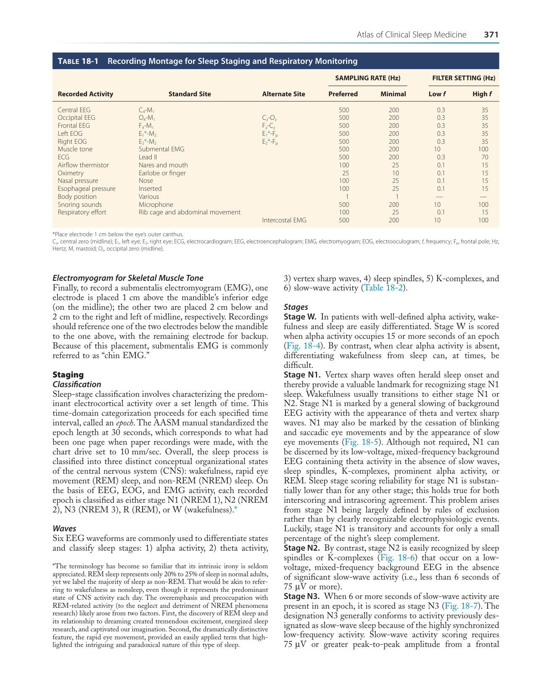

<!-- pdf-page: 433 -->

372 Diagnostic Assessment Methods in Adults

Classic derivations

Nasion

Fp1 Fpz Fp2

Preauricular point

Preauricular point

F3 F7 Fz F8 F4

A1 A2

C3 T3 Cz T4 C4

P3 T5 Pz T6 P4

O1 Oz O2

Inion

FIGURE 18-1. Classic Rechtschaffen and Kales derivations for recording

the electroencephalogram. Electrode locations as recommended in 1969. Electrode pairs are indicated by the same colors.

Updated recommended derivations

Nasion

Fp1 Fpz Fp2

F3 F7 Fz F8 F4

C3 T3 Cz T4 C4

Mastoid M1 Mastoid M2

P3 T5 Pz T6 P4

O1 Oz O2

Inion

FIGURE 18-2. Updated American Association of Sleep Medicine (AASM)

recommended derivations for recording the electroencephalogram. Electrode locations as recommended in 2007 by AASM.

Updated alternative derivations

Nasion

Fp1 Fpz Fp2

F3 F7 Fz F8 F4

C3 T3 Cz T4 C4

Mastoid M1 Mastoid M2

P3 T5 Pz T6 P4

O1 Oz O2

Inion

FIGURE 18-3. Updated American Association of Sleep Medicine alter­

native derivations for recording the electroencephalogram. Alternative electrode locations as recommended in 2007. Backup electrode substitutions: O1 for Oz, Fpz for Fz, and C3 for Cz.

derivation. However, it is important to realize that the recording montage dramatically affects EEG amplitude. Thus if a frontal EEG is recorded using the AASM alternate bipolar montage (Fz-Cz), amplitudes will be lower, and N3 sleep will be reduced. The AASM manual does not provide a guideline for amplitude adjustment; therefore stage N3 scoring should derive from the monopolar central lead included in the alternate montage. Stage R. Criteria for scoring REM sleep—or stage R sleep, as it has been renamed, although most will likely continue to call it REM sleep—remained essentially unchanged. Stage R is characterized by low-voltage, mixed-frequency EEG, very low chin EMG levels, and REM (Fig. 18-8). Sawtooth activity represents a unique variant of theta activity, containing waveforms with a notched or sawtooth-shaped appearance, frequently observed during stage R (Table 18-3).

#### Smoothing Rules

When an epoch contains characteristic features for more than one sleep stage, it is scored according to the characteristics that make up its majority. One source of scoring difficulty arises when epochs without actual eye movements are contiguous with REM sleep. The AASM manual does not address the concept of differentiation between phasic and tonic REM sleep (see Fig. 18-8). Nevertheless, this concept is widely used in research and can provide useful instruction in this matter. The term phasic REM sleep refers to epochs scored as stage R clearly accompanied by eye movements and sometimes by other phasic events. By contrast, an epoch designated as tonic REM sleep has the same background EEG activity, nearly completely diminished chin EMG, but lacks eye movements. If such an epoch occurred in isolation, it would likely be scored as N1; however, when surrounded by epochs of phasic REM sleep, it is considered stage R. In fact, N1-like epochs without eye movement contiguous with REM sleep continue to be scored as stage R until some indication occurs that another sleep process has emerged. Indicators can be a spindle, a K-complex, a CNS arousal, an increase in chin EMG, a body movement followed by slow eye movements, or the appearance of another scorable sleep stage in the first half of the epoch. The AASM manual provides examples to guide scoring decisions at stage transitions.

#### AROUSAL SCORING

#### Electroencephalogram Speeding and Central

#### Nervous System Arousals

Sleep staging forms what may be called the “building blocks” of sleep macroarchitecture. Staging provides information useful for forming a general impression of sleep’s overall continuity and integrity. Staging also serves as a biomarker for detecting gross disturbances and for correlating pathophysiology with the organizational state of the CNS (i.e., REM, NREM, or wakefulness). Staging parameters, however, fail to capture transient sleep disturbances, which last less than 15 seconds. Therefore techniques are needed to identify brief CNS arousals that fail to meet the epoch scoring criteria for wakefulness.

CNS arousals involve an abrupt shift during sleep to faster EEG activities—including theta, alpha, and beta but not sleep spindles—for 3 seconds or longer. CNS arousal scoring rules

<!-- pdf-page: 434 -->

TABLE 18-2 Sleep Electroencephalogram Waveforms

Sample

Definition Label

Alpha activity 8- to 13-Hz rhythm, usually most prominent in occipital leads. Thought to be generated by cortex, possibly via dipole located in layers 4 and 5. Used as a marker for relaxed wakefulness and CNS arousals.

Low-voltage, mixed-frequency EEG ✓ ✓ ✓ Vertex sharp waves ✓ ✓ Sleep spindles ✓ ✓ K-complexes ✓ ✓ EEG beta bandwidth activity ✓ ✓ EEG alpha bandwidth activity ≥15 s <15 s <15 s <15 s EEG gamma bandwidth activity ✓ ✓ ✓ ✓† EEG delta bandwidth activity ✓ ✓ ✓ Slow-wave activity‡ <6 s <6 s ≥6 s <6 s Eye movement activity Slow and rapid Slow Rapid EMG activity level Variable Low Low Low Atonic

Vertex sharp waves

AASM, American Association of Sleep Medicine; EEG, electroencephalogram; SEM, slow eye movement.

TABLE 18-3 Electrophysiologic Characteristics of Each Sleep Stage

Electrophysiologic Activity

Theta activity 4- to 8-Hz waves, typically prominent in central and temporal leads. Sawtooth activity (shown in figure) is a unique variant of theta activity (containing waveforms with a notched or sawtooth-shaped appearance) frequently seen during REM sleep.

Sharply contoured, negative-going bursts that stand out from the background activity and appear most often in central leads placed near the midline.

Sleep spindle A phasic burst of 11- to 16-Hz activity, prominent in central scalp leads; typically last for 0.5-1.5 seconds. Spindles are a scalp representation of thalamocortical discharges; the name derives from their shape (which is spindle-like).

K complex Recently redefined in the AASM manual as an EEG event consisting of a well-delineated negative sharp wave immediately followed by a positive component standing out from the background EEG with total duration 0.5 seconds, usually maximal in amplitude over the frontal regions.

Slow waves High-amplitude ( 75 V) and low-frequency ( 2 Hz) variants of delta (1- to 4-Hz) activity. Slow waves are the defining characteristics of stage N3 sleep.

REM Rapid eye movements are conjugate saccades occurring during REM sleep correlated with the dreamer’s attempt to look at the dream sensorium. They are sharply peaked with an initial deflection usually 0.5 seconds in duration.

SEM Slow eye movements are conjugate, usually rhythmic, rolling eye movements with an initial deflection usually 0.5 seconds in duration.

SLEEP STAGE

W* N1 N2 N3 R

*With eyes closed. †Special form of theta wave called sawtooth owing to its appearance. ‡For purposes of sleep staging, monopolar slow-wave activity from frontal or central derivations must be ≥75 µV. EEG, electroencephalogram; EMG, electromyogram; s, seconds.

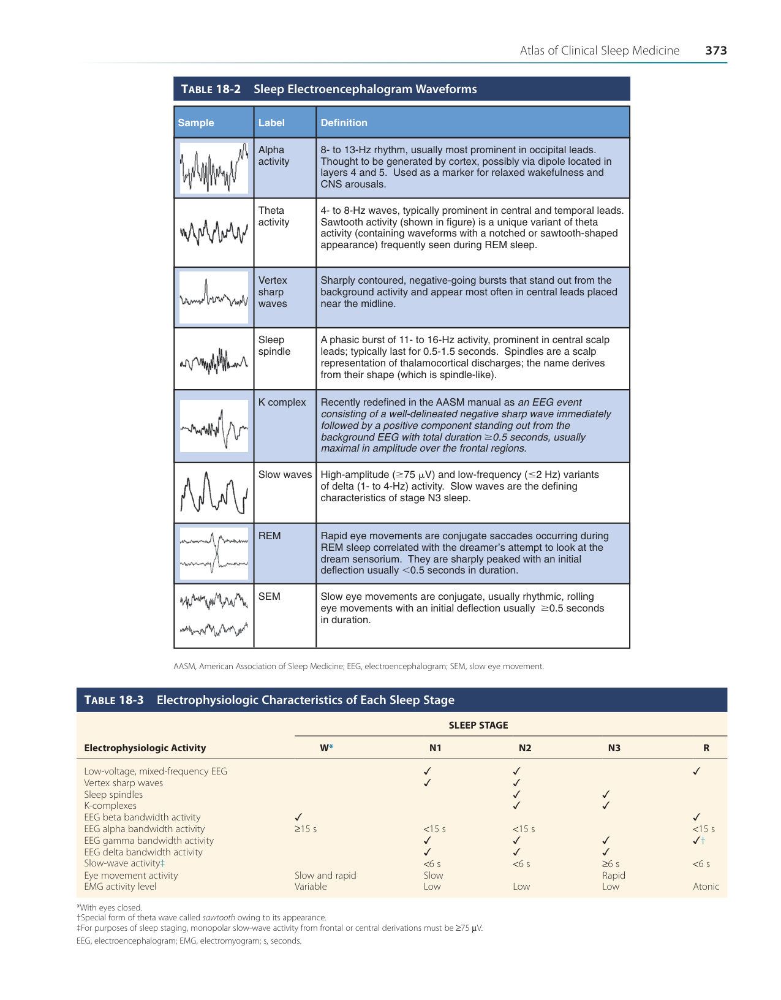

<!-- pdf-page: 435 -->

374 Diagnostic Assessment Methods in Adults

F3-M2

C3-M2

O3-M2

E1-M2

FIGURE 18-4. Epoch of stage W. This figure depicts 30 seconds of polysomnographic activity characterizing stage W (wakefulness) according to AASM scoring

criteria. C3, left central scalp derivation; E1, left outer canthus eye electrode location; E2, right outer canthus eye electrode location; EMGSM, surface electrode electromyogram (EMG) from submentalis muscle; F3, left frontal scalp derivation; M2, right mastoid electrode location; O3, left occipital scalp derivation.

E2-M2

EMGSM

FIGURE 18-5. Epoch of stage N1. This figure depicts 30 seconds of PSG activity characterizing stage N1 sleep according to AASM scoring criteria. C3, left

central scalp derivation; E1, left outer canthus eye electrode location; E2, right outer canthus eye electrode location; EMGSM, surface electrode EMG from submentalis muscle; F3, left frontal scalp derivation; M2, right mastoid electrode location; O3, left occipital scalp derivation.

F3-M2

C3-M2

O3-M2

E1-M2

E2-M2

EMGSM

FIGURE 18-6. Epoch of stage N2. This figure depicts 30 seconds of PSG activity characterizing stage N2 sleep according to AASM scoring criteria. C3, left

central scalp derivation; E1, left outer canthus eye electrode location; E2, right outer canthus eye electrode location; EMGSM, surface electrode EMG from submentalis muscle; F3, left frontal scalp derivation; M2, right mastoid electrode location; O3, left occipital scalp derivation.

F3-M2

C3-M2

O3-M2

E1-M2

E2-M2

EMGSM

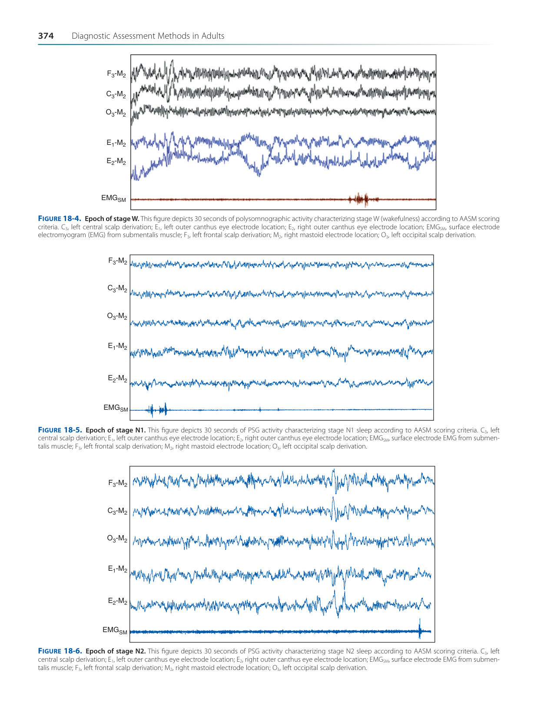

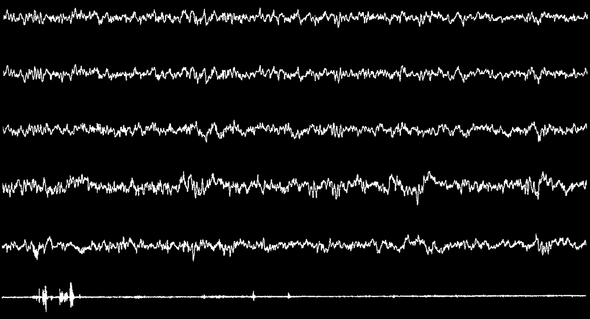

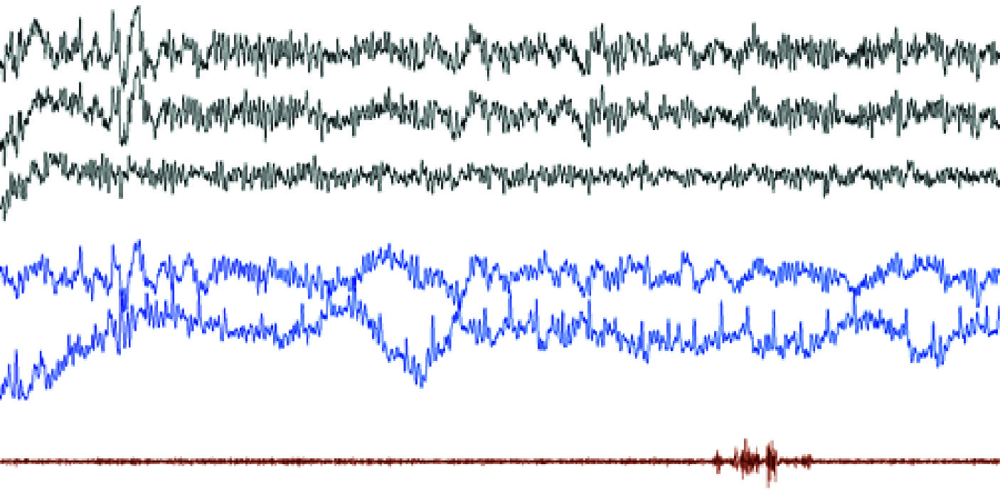

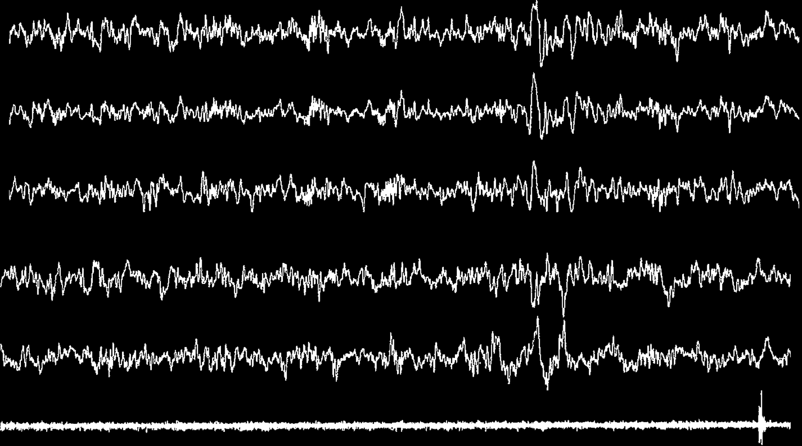

<!-- pdf-page: 436 -->

F3-M2

C3-M2

O3-M2

FIGURE 18-7. Epoch of stage N3. This figure depicts 30 seconds of PSG activity characterizing stage N3 sleep according to AASM scoring criteria. C3, left

central scalp derivation; E1, left outer canthus eye electrode location; E2, right outer canthus eye electrode location; EMGSM, surface electrode EMG from submentalis muscle; F3, left frontal scalp derivation; M2, right mastoid electrode location; O3, left occipital scalp derivation.

E1-M2

E2-M2

EMGSM

FIGURE 18-8. Phasic and tonic rapid eye movement (REM) sleep. This figure depicts PSG activity characterizing stage R sleep (REM sleep) according

to AASM scoring criteria. A, Stage R, with phasic bursts of REM (phasic REM). B, A quiescent period of stage R sleep (tonic REM). C3, left central scalp derivation; E1, left outer canthus eye electrode location; E2, right outer canthus eye electrode location; EMGSM, surface electrode EMG from submentalis muscle; F3, left frontal scalp derivation; M2, right mastoid electrode location; O3, left occipital scalp derivation.

F3-M2

C3-M2

O3-M2

E1-M2

E2-M2

EMGSM

A B

largely derive from a previous concept called EEG speeding. Usually, the frequency shift manifests as alpha activity and is best visualized in occipital leads. For the shift to qualify as an arousal, the person must have been asleep for at least 10 seconds. Finally, during REM sleep, the EEG shift must be accompanied by at least 1 second of increased chin EMG tone (Fig. 18-9) because alpha bursts routinely appear during REM sleep and do not intrinsically represent pathophysiology. The 3-second duration was not arbitrary; it was the minimum arousal duration reliably scored by hand among the task force members. Undoubtedly, digital systems could reliably score shorter arousals, but the clinical significance of such events is not known.

#### Cyclic Alternating Pattern

The cyclic alternating pattern (CAP) refers to an EEG pattern seen during sleep (Fig. 18-10) in which EEG activity

bursts—usually a high-amplitude slow, sharp, or polymorphic wave burst—alternate with periods of quiescence. The burst constitutes the A phase, and the quiescence is labeled the B phase. The Parma Groups, led by Terzano and Parrino, organized an international workshop during which recording and scoring techniques were codified. In essence, the A phase was subcategorized into three types based on the presence and duration of intermixed or intermingled EEG alpha activity. Type A1 contains little or no alpha EEG activity and consequently does not meet AASM arousal scoring criteria. Type A2 often meets AASM arousal criteria, and A3 meets AASM criteria 95% of the time. Sleep associated with A1 bursts is conceptualized as unstable but is preserved by a descending cortical response that helps reinforce a protective thalamic gating mechanism. By contrast, if the attempt to reinforce this gate fails, an arousal or awakening occurs, and an A3 burst is observed. A2 responses fall somewhere in between (Fig. 18-11).

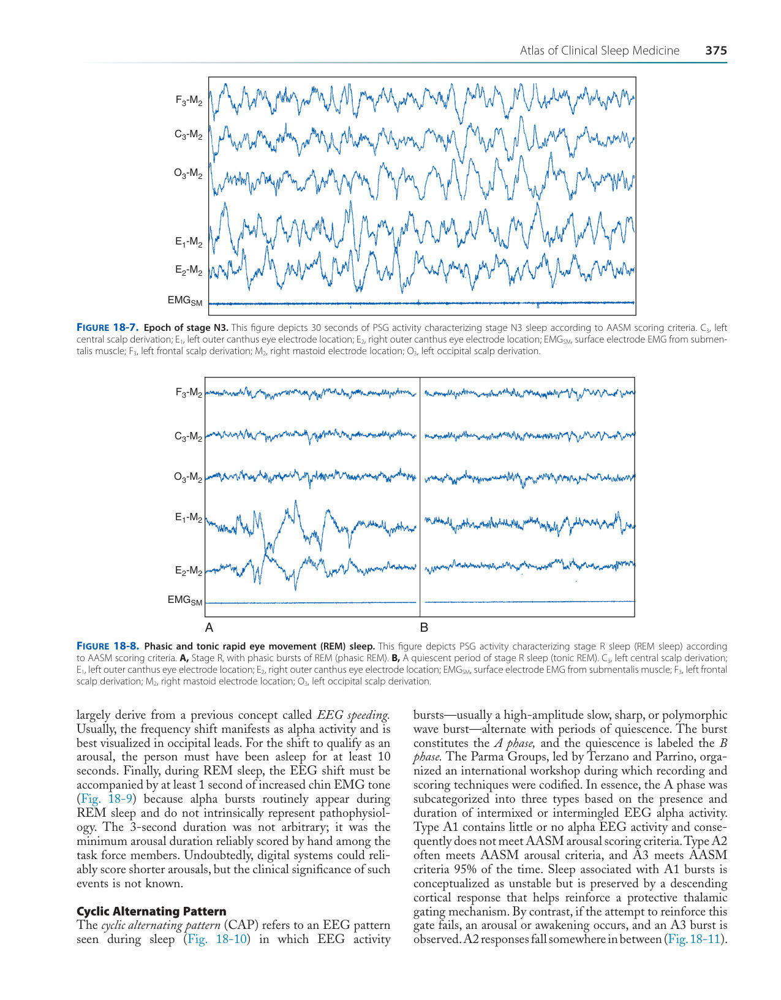

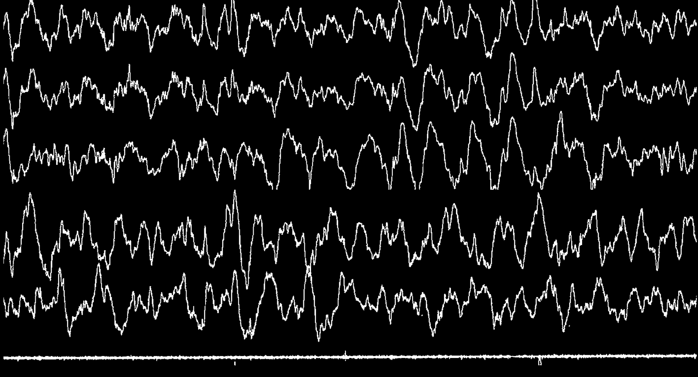

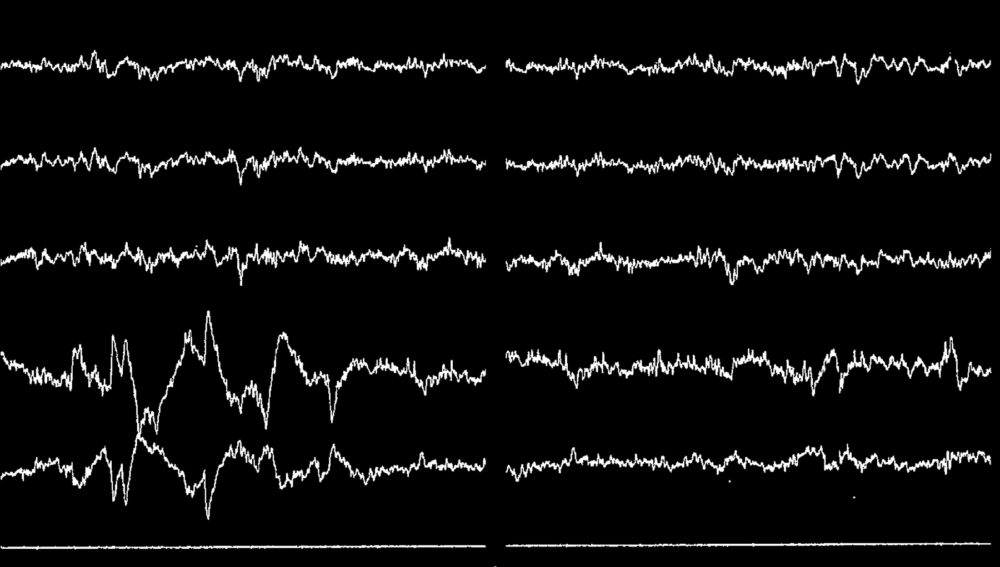

<!-- pdf-page: 437 -->

376 Diagnostic Assessment Methods in Adults

F3-M2

C3-M2

O3-M2

E1-M2

E2-M2

EMGSM

FIGURE 18-9. Central nervous system arousals. Central nervous system (CNS) arousals from non-REM (A) and REM sleep (B). C3, left central scalp derivation;

E1, left outer canthus eye electrode location; E2, right outer canthus eye electrode location; EMGSM, surface electrode EMG from submentalis muscle; F3, left frontal scalp derivation; M2, right mastoid electrode location; O3, left occipital scalp derivation.

A

F3-M2

C3-M2

O3-M2

E1-M2

E2-M2

EMGSM

B

FIGURE 18-10. Cyclic alternating pattern (CAP). This figure depicts polysomnographic activity characterizing phase A (burst) and phase B (quiescent) activity.

This period of CAP activity appears not to be associated with either periodic leg movements or breathing abnormalities. ABMvmt, abdominal movement measured with inductive plethysmography; C3, left central scalp derivation; E1, left outer canthus eye electrode location; E2, right outer canthus eye electrode location; EMGLeg, surface electrode EMG from left and right anterior tibialis; EMGSM, surface electrode EMG from submentalis muscle; F3, left frontal scalp derivation; Flow, airflow measured with nasal-oral thermistors; M2, right mastoid electrode location; O3, left occipital scalp derivation; RCMvmt, rib cage movement measured with inductive plethysmography.

F3-M2

C3-M2

O3-M2

E1-M2

E2-M2

EMGSM

EMGLeg

Flow

RCMvmt

ABMvmt

A B B A A A A B B

#### SLEEP-RELATED BREATHING DISORDERS

It has taken many years and substantial educational effort, but the medical community now largely understands that sleeprelated breathing disorders do not exclusively affect hypoventilating, morbidly obese patients. An estimated 90% or more of all PSG studies performed on any given night are conducted to diagnose or assess treatment for sleep-disordered breathing (SDB). Ironically, recording and scoring techniques for evaluating SDB were among the last to be standardized.

#### Recording Technique

Key features needed to assess SDB include airflow, respiratory effort, blood oxygenation, and sleep disturbance. The AASM

manual recommends recording the four data channels when clinically evaluating adult patients with overnight PSG (see

Table 18-1 for sampling rates and filter settings). This is done

with 1) a thermal sensor at the nose and mouth to detect apnea; 2) a nasal pressure transducer to detect hypopnea; 3) either an esophageal manometer or chest/abdominal inductance plethysmograph—or, alternatively, intercostal EMG—to detect respiratory effort; and 4) a pulse oximeter with its signal averaged over 3 seconds or less.

Although end-tidal CO2 measurement is not recommended for adults by the AASM manual, it can be useful for quantifying hypoventilation. This volume contains illustrations of end-tidal CO2 recordings. Snoring sounds can help differentiate different types of SDB events, even

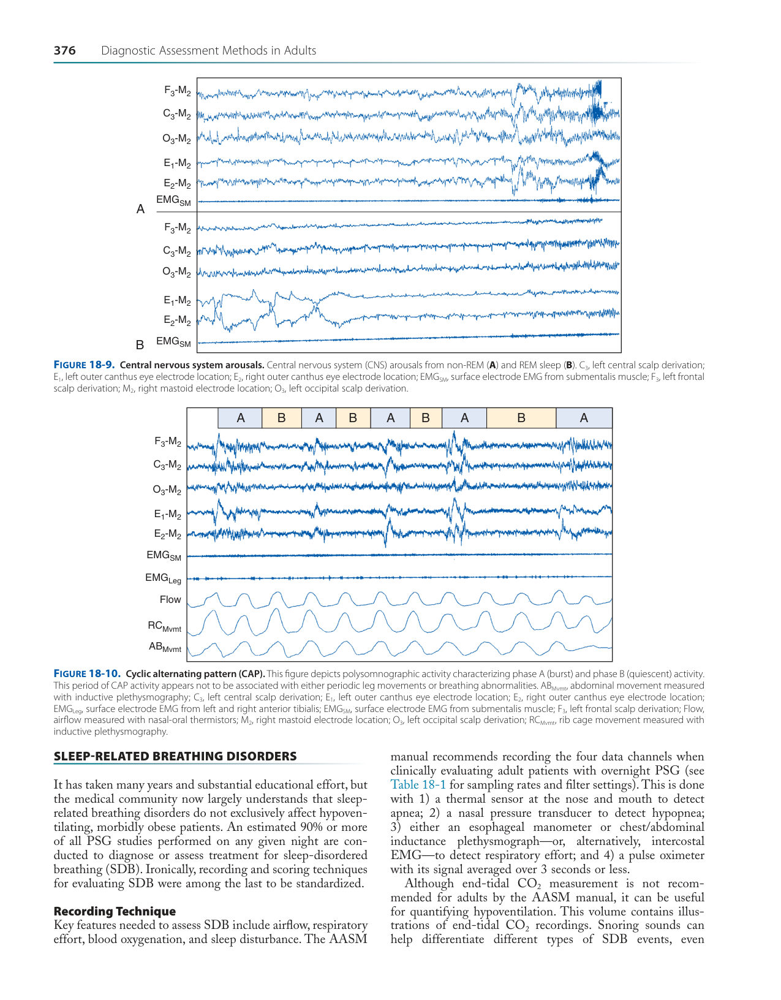

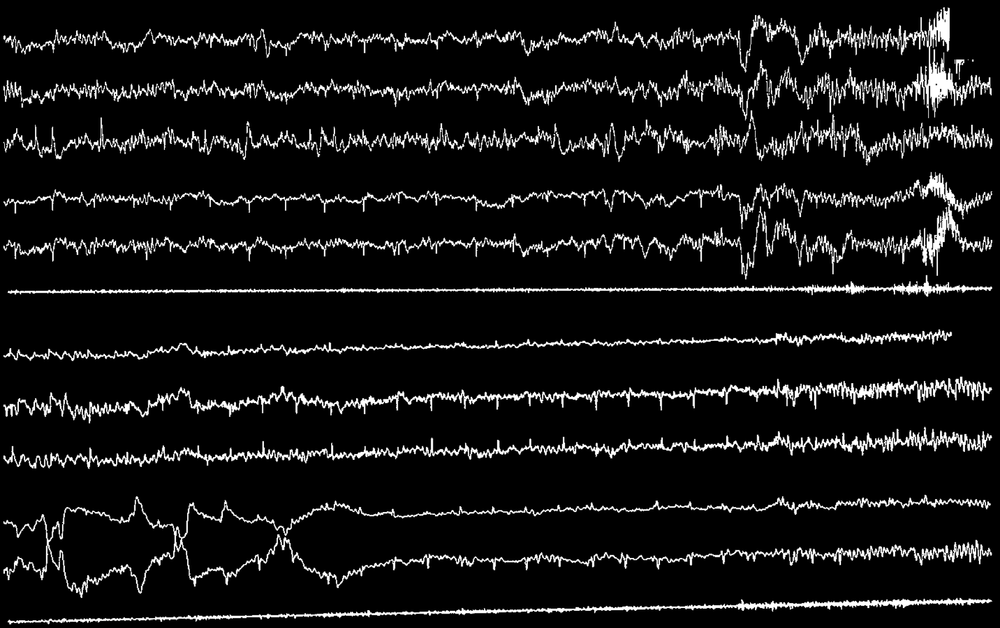

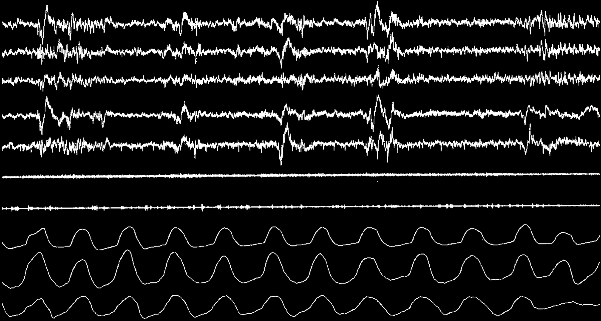

<!-- pdf-page: 438 -->

Type 1 Type 2 Type 3

E1-M2

E2-M2

EMGSM

F3-M2

FIGURE 18-11. Examples of cyclic alternating pattern A phase types 1, 2, and 3 activity. Type 1 does not appear to have EEG activity suggestive of central

nervous system (CNS) arousal. By contrast, type 2 activity suggests possible arousal, whereas type 3 meets AASM criteria for CNS arousal from NREM sleep.

C3-M2

O3-M2

though the means to use this parameter is not specified in the manual.

SDB scoring is event based, not time-domain based. Consequently, the 30-second fixed epoch length is not necessarily recommended. Scoring mainly involves identifying, counting, and characterizing discrete sequences of SDB events. Sleeprelated respiratory signals are considerably slower than variations in EEG-EOG-EMG activity. Therefore viewing tracings over longer time frames can facilitate breathing pattern and event recognition. The viewing flexibility provided by digital PSG reflects a great advantage when scoring and interpreting sleep-related respiratory impairments. Nonetheless, the 30-second fixed epoch length specified by the AASM manual applied to sleep staging does affect SDB scoring. Sleep onset can occur during an epoch scored as stage W if it begins in the latter portion of an epoch. When apnea occurs in such a case, some tabulation programs do not count it because it is not recognized as sleep related. Similarly, when a sleep-related respiratory event occurs early enough during an epoch to provoke an awakening that renders the epoch to be staged as wakeful, again, some software fails to count the episode. Clinicians must determine how their digital systems handle such disconnects and must adjust summaries accordingly.

#### Definitions and Scoring Rules

#### Sleep Apnea

Conceptually, a cessation of airflow for two or more respiratory cycles during sleep constitutes an episode of sleep apnea. This works out to be, on average, a 10-second or longer halt in ventilation. Episodes can be classified as central, obstructive, or mixed. The cessation of breathing during central apnea results from an absence of inspiratory effort. By contrast, obstructive apnea results from airway occlusion notwithstanding continued and even increasing inspiratory effort. Finally, mixed apnea episode usually begins with no inspiratory effort and is followed by an unsuccessful attempt to breathe against a collapsed airway.

The AASM manual defines apnea as a 10-second or longer, 90% or greater drop in the nasal/oral airflow channel’s

peak-to-trough amplitude compared with the preevent baseline (Fig. 18-12). Obstructive apneas are far more commonly observed in most sleep laboratories than central apneas. However, central apnea can take several forms, arising from different etiologies that include heart failure, brain damage, metabolic disorders, toxic exposure, and CNS depressants.

Figure 18-13 illustrates an example of Cheyne-Stokes respi­

ration presenting as recurrent central sleep apnea episodes as typically observed in patients with heart failure.

#### Hypopnea

In the strictest sense, a hypopnea is merely a shallow breath and is not intrinsically pathophysiologic. However, during sleep, reduced ventilation that produces significant oxygen desaturations can adversely affect sleep, wakefulness, and health. Also, flow limitations that provoke CNS arousals, awakenings, and sleep fragmentation can undermine the sleep process. Thus the pathophysiology lies not with the hypopnea but rather with its consequence.

The previous AASM manual operationalized hypopnea scoring based on two different sets of rules, the first designated “recommended” criteria, the other “alternative” criteria. Fortunately, a single definition has now been established by the AASM, which now defines hypopnea as a 10-second or longer, 30% or more drop in nasal pressure signal amplitude, or other airflow measure, compared with the preevent amplitude that either provokes a 3% or more drop in oxygen saturation or a CNS arousal (Fig. 18-14). Unfortunately, the AASM definition is currently at variance with the one required by Central Medicare Services (CMS) to justify treatment with positive airway pressure (PAP) therapy.* Having different

*The previous AASM manual had two definitions for hypopnea and recommended using the one that closely approximated what was compulsory for billing CMS (which required a 4% drop in oxyhemoglobin saturation). The new criteria have been submitted for CMS approval, and if it is granted, the matter will be mostly resolved. In the meantime, and if approval is not granted, if a practice includes CMS-covered patients, both types of hypopnea scoring must be performed for all patients to avoid committing Medicare fraud (because you may not treat Medicare patients differently than private patients, because that creates a two-tiered medical system).

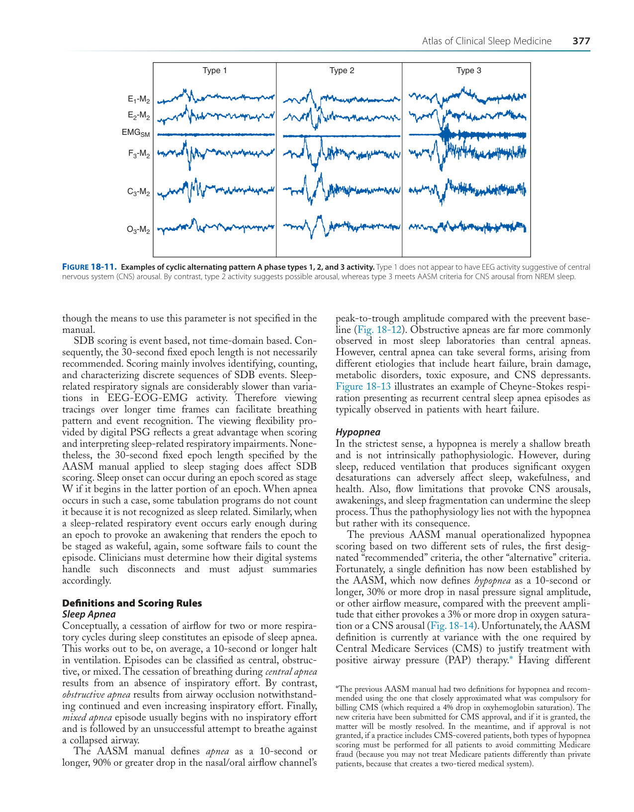

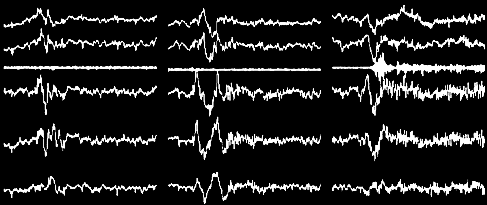

<!-- pdf-page: 439 -->

378 Diagnostic Assessment Methods in Adults

F3-M2

C3-M2

O3-M2

E1-M2

E2-M2

FIGURE 18-12. Sleep apnea episodes. Obstructive (A), central (B), and mixed (C) apneas are shown. Note the presence of respiratory effort (rib cage and

abdominal movement), notwithstanding cessation of airflow, throughout the obstructive apnea and during the latter portion of the mixed apnea. By contrast, respiratory effort is absent during the flow cessation throughout the central apnea and during the early portion of the mixed apnea. ABMvmt, abdominal movement measured with inductive plethysmography; C3, left central scalp derivation; E1, left outer canthus eye electrode location; E2, right outer canthus eye electrode location; EMGSM, surface electrode electromyography from submentalis muscle; F3, left frontal scalp derivation; Flow, airflow measured with nasal-nasal-oral thermistors; M2, right mastoid electrode location; O3, left occipital scalp derivation; RCMvmt, rib cage movement measured with inductive plethysmography.

EMGSM

Flow

RCMvmt

ABMvmt

A B C

10m 0s 10m 0s

AM 5:44:00 AM 5:45:00 AM 5:46:00 AM 5:47:00 AM 5:48:00 AM 5:49:00 AM 5:50:00 AM 5:51:00 AM 5:52:00 AM 5:53:00

85 85 85 85 84 84 84 84 84 84 84 84 84 84 84 84 84 84 84 84 84 85 85 85 85 85 85 85 85 85 85 86 82 82 82 82 82 82 82 82 82 82 82 82 82 82 82 82 82 82 83 83 83 83 83 83 83 83 83 83 83 83 83 83 82 81 81 81 81 81 81 81

Neck_PDS

0.5

V

Snore_PDS

0

bar

FLOW

0

mL/s

Thermistor

0

V

Nasal pr

-0.25

mbar

XSum

0

mV

THOR

0

V

ABD

0

V

SpO2 - % Pulse - bpm

100

FIGURE 18-13. Cheyne-Stokes respiration pattern. Note the waxing and waning of respiratory effort, manifest as flattening in the thoracic and abdominal

movement channels, with corresponding cessation of airflow.

75

50

90

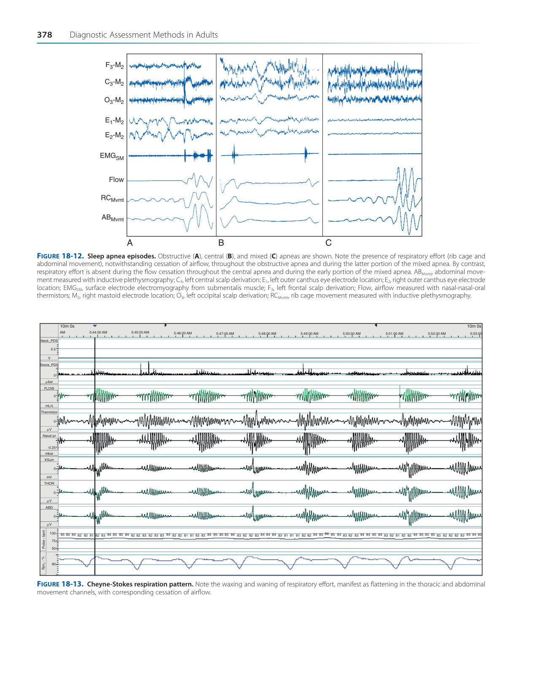

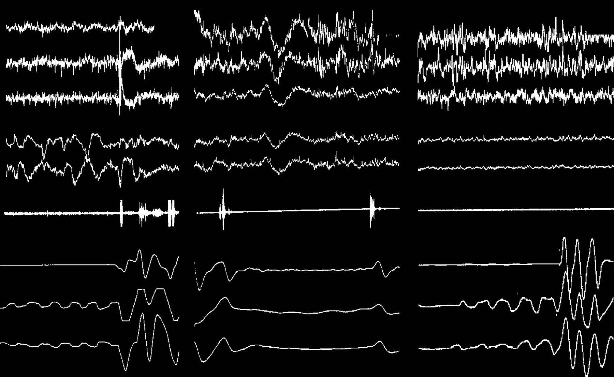

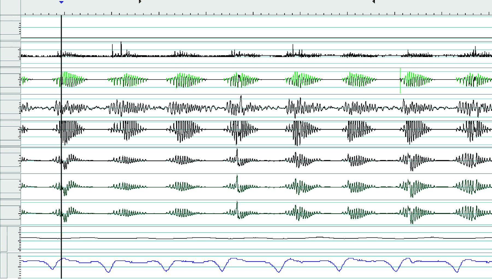

<!-- pdf-page: 440 -->

F3-M2

C3-M2

O3-M2

E1-M2

E2-M2

FIGURE 18-14. Desaturating and traditional hypopnea episodes. A, Sleep hypopnea associated with a greater than 4% oxygen desaturation (meeting

Medicare criteria). B, Sleep hypopnea terminated by a central nervous system arousal (meeting current AASM criteria). Many sleep laboratories differentiate the nonapneic respiratory event designated here as a desaturating hypopnea, distinct from the traditional hypopnea, by labeling the latter as a respiratory effort– related arousal. ABMvmt, abdominal movement measured with inductive plethysmography; C3, left central scalp derivation; E1, left outer canthus eye electrode location; E2, right outer canthus eye electrode location; EMGSM, surface electrode electromyography from submentalis muscle; F3, left frontal scalp derivation; Flow, airflow measured with nasal-nasal-oral thermistors; M2, right mastoid electrode location; O3, left occipital scalp derivation; RCMvmt, rib cage movement measured with inductive plethysmography; SaO2, oxygen saturation with percent indicated on grid.

EMGSM

Flow

RCMvmt

ABMvmt

SaO2 100 96 92 88

A B

100 96 92 88

definitions and revising definitions without changing terminology creates ambiguity and confusion and increases the chance of miscommunication. It is preferable that when a term is newly defined, it is also provided a unique moniker, such as “hypopnea07” for events scored using the previously recommended AASM criteria, “hypopnea12” for those meeting current AASM criteria, and “hypopneaCMS” for those scored using Medicare criteria. Actually, almost any unambiguous set of terms would be an improvement for communicating without having to stop and review which criteria were being applied (see Fig. 18-14).

#### Respiratory Effort–Related Arousals

Respiratory effort–related arousals (RERAs) were traditionally designated as SDB events that failed to meet criteria for designation as an apnea or hypopnea based on airflow measures. RERAs emphasize the sleep disturbance (CNS arousal) produced by increasing effort to breathe during the respiratory event. Originally the RERA designation helped quantify more subtle breathing events that would otherwise be missed. However, with the original AASM manual, RERA scoring evolved into serving as a surrogate for “alternative” hypopnea, when the required oxyhemoglobin desaturation criteria for “recommended” hypopnea scoring was not met. It appears that RERAs have now mostly returned to their original definition, with the modification that they are identified by inspiratory flattening of nasal pressure or a PAP machine’s flow channel rather than by measuring respiratory effort with an esophageal pressure transducer. RERA scoring requires a 10-second or longer increased respiratory effort that manifests as “flattening” in the nasal pressure channel that provokes a CNS arousal but does not meet apnea or hypopnea amplitude or oxygen saturation criteria. Nasal pressure recordings can alert the clinician to much more subtle respiratory events than

the traditional nasal-oral thermistors. However, notwithstanding their greater sensitivity to SDB events, nasal pressure recordings are compromised when sleepers “mouth breathe” because of nasal congestion, their anatomy, or both.

#### MOVEMENTS

#### Leg Movement Recording Technique

To record leg movements, a pair of surface electrodes is placed longitudinally at homologous sites on the belly of each leg’s anterior tibialis muscle (2 to 3 cm apart). Both left and right legs should be recorded either on separate channels (greatly preferred) or combined on a single channel (see Table 18-3 for sampling rates and filter settings). The actual movement associated with periodic limb movement disorder (PMLD) can be merely a Babinski-like extension of the great toe. However, movements may be more dramatic and may involve the ankle, knee, hip, and/or upper extremities.

#### Periodic Leg Movement Scoring Rules

Overall, the general approach for scoring periodic leg movements has changed little since Coleman’s original description. However, specific criteria for detecting and segmenting leg movements were updated with amenability with digital PSG systems. The AASM manual reasserted most of the scoring rules developed by the International Restless Legs Syndrome Study Group (IRLSSG) chaired by Zucconi. Criteria require each anterior tibialis EMG burst duration to range from 0.5 seconds to 10 seconds (inclusive) beginning when the EMG amplitude increases to 8 µV (minimally) above the resting level and ending when amplitude falls to within 2 µV of the resting level. Surface electrode–recorded EMGs cannot be calibrated; the empirically determined amplitude criteria serve

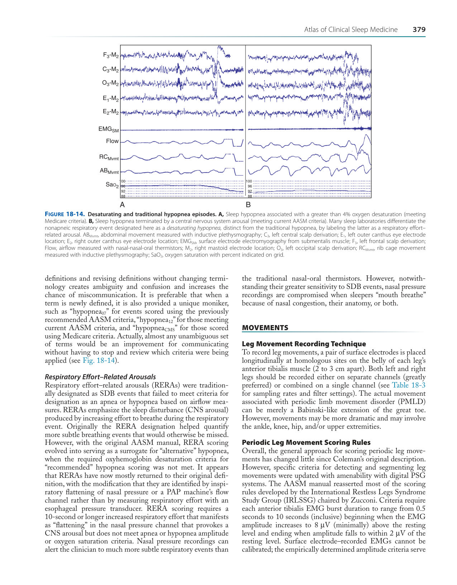

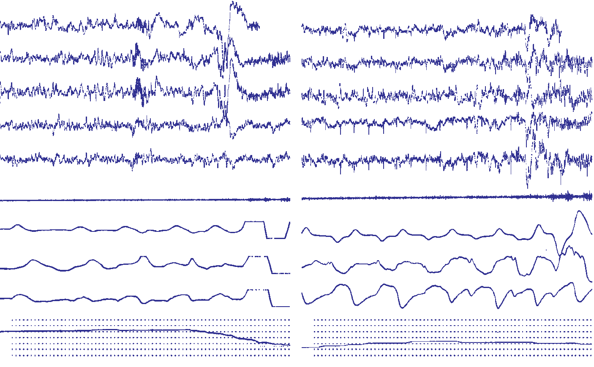

<!-- pdf-page: 441 -->

380 Diagnostic Assessment Methods in Adults

C3-M2

O3-M2

E1-M2

E2-M2

EMGSM

EMGLeg

FIGURE 18-15. Periodic leg movements in sleep. This figure illustrates polysomnographic activity commonly observed on recordings from individuals with

periodic limb movement disorder. ABMvmt, abdominal movement measured with inductive plethysmography; C3, left central scalp derivation; E1, left outer canthus eye electrode location; E2, right outer canthus eye electrode location; EMGLeg, surface electrode electromyography (EMG) recorded from left and right anterior tibialis—on separate channels; EMGSM, surface electrode EMG from submentalis muscle; Flow, airflow measured with nasal-nasal-oral thermistors; M2, right mastoid electrode location; O3, left occipital scalp derivation; RCMvmt, rib cage movement measured with inductive plethysmography.

EMGLeg

Flow

RCMvmt

ABMvmt

FIGURE 18-16. Restless legs type I and II activity. This figure illustrates polysomnographic activity commonly observed on recordings from individuals with

restless legs syndrome. A, Very brief electromyography (EMG) discharges on anterior tibialis channels lead up to movements. B, Periodic leg movements during wakefulness. ABMvmt, abdominal movement measured with inductive plethysmography; C3, left central scalp derivation; E1, left outer canthus eye electrode location; E2, right outer canthus eye electrode location; ECG, electrocardiogram; EMGLeg, surface electrode EMG from left and right anterior tibialis; Flow, airflow measured with nasal-nasal-oral thermistors; M2, right mastoid electrode location; O3, left occipital scalp derivation; RCMvmt, rib cage movement measured with inductive plethysmography.

E1-M2

E2-M2

EMGSM

C3-M2

O3-M2

EKG

EMGLeg

EMGLeg

Flow

RCMvmt

ABMvmt

LOC-A2

A B

ROC-A2

Chin EMG

C3-A2

O1-A2

ECG

L. Anterior Tibialis EMG

R. Anterior Tibialis EMG

Snoring

Thoracic Effort

Abdominal Effort

to facilitate automation and do not represent any biologic watershed demarcation. To constitute a periodic leg movement episode, there must be a sequence of four or more movements with the intermovement interval ranging from 5 to 90 seconds (inclusive). Leg movements can be unilateral, bilateral, or may alternate. Leg movements that occur during sleep may be associated with CNS arousals (Fig. 18-15). Periodic leg movements that occur during wakefulness sometimes serve as a biomarker for restless legs syndrome (RLS, Fig. 18-16).

#### Other Movements

Descriptions and criteria for other types of sleep-related movements are described in the AASM manual. These types

include hypnagogic foot tremor, excessive fragmentary myoclonus, sleep bruxism, REM sleep behavior disorder (RBD), and rhythmic movement disorder. A discussion of the recording and scoring techniques for these movements is beyond the scope of this chapter. For details, see the AASM manual.

#### ELECTROCARDIOGRAM

The AASM manual recommends recording cardiac rhythm concurrently during PSG. A single modified electrocardiographic (ECG) lead placed on the torso and aligned parallel to the right shoulder and the left hip provides the necessary

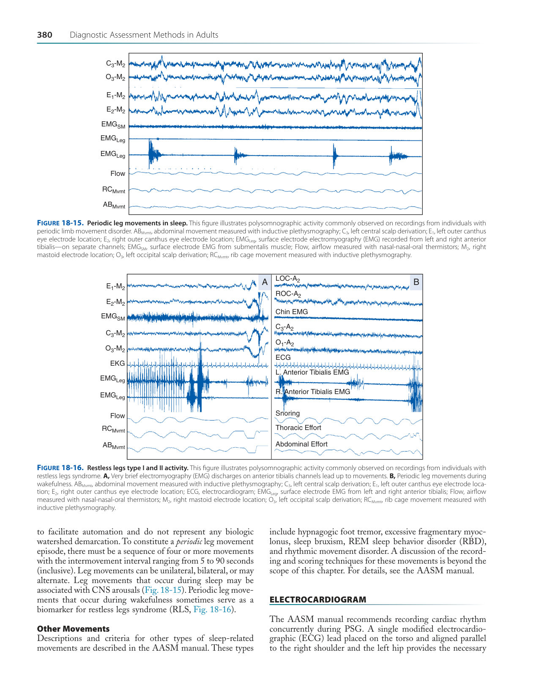

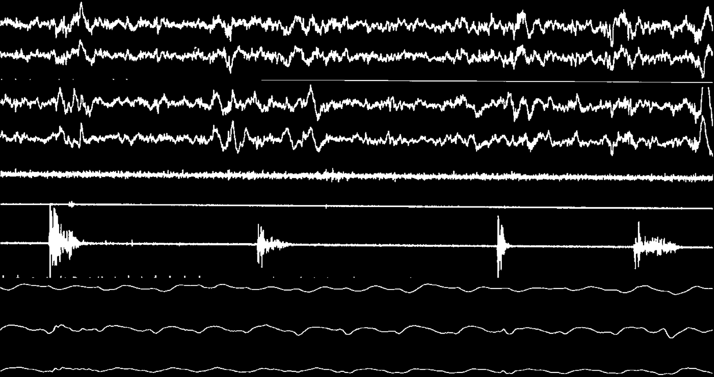

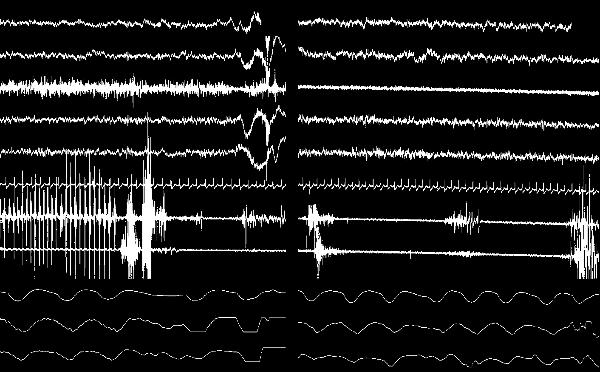

<!-- pdf-page: 442 -->

Proper patient selection is easily accomplished with an instrument called the STOP-BANG questionnaire (see Chapter 8). STOP-BANG has eight yes-or-no items that address snoring, tiredness, observed cessation of breathing, presence or history of hypertension, obesity (body mass index >35), age (>50 years), neck circumference (>15.75 inches), and sex (being male). A score of 5 or above constitutes a very high pretest probability for SDB that can be confirmed with HST.

FIGURE 18-17. Home sleep testing algorithm and recording sample. This figure shows an algorithm used to perform home sleep testing with cardiopul­

monary (type III) recorders. APAP, auto PAP; HD, heart disease; LD, lung disease; MO, morbid obesity; MSLT, multiple sleep latency test; ND, neurologic disease; PAP, positive airway pressure; PSG, polysomnography; Pt, patient; SRBD, sleep-related breathing disorder; UP3, uvulopalatopharyngoplasty.

tracing. Adult sinus tachycardia during sleep involves a sustained rate of 90 beats/min or higher, whereas bradycardia is a sustained rate below 40 beats/min. Three consecutive beats with a rate above 100 beats/min and a 120-ms QRS duration or greater constitutes sleep-related wide complex tachycardia. Sleep-related narrow complex tachycardia is similar, except that the QRS duration must be less than 120 ms in duration. Cardiac pauses with a duration of 3 seconds or more are reported as asystoles. The manual also recommends reporting other arrhythmias and ectopic beats, if these are judged to be clinically significant.

#### HOME SLEEP TESTING

Most clinical sleep assessments are performed to diagnose SDB, titrated PAP therapy, or both. Whether home sleep testing (HST) is appropriate or helpful remains somewhat controversial. Nevertheless, CMS has approved home sleep testing to diagnose sleep apnea, and local coverage determination (LCD) contractors and private third-party insurance carriers are beginning to rule that HST is “reasonable and necessary.” HST represents a limited test that may facilitate diagnosis and reduce costs if used properly. However, a home sleep test’s success depends on 1) proper patient selection; 2) appropriate portable recorder application; 3) study interpretation by a qualified sleep specialist; 4) readily available access to laboratory PSG, when needed after a negative test or for continuing problems notwithstanding treatment; and 5) systematic follow-up (Fig. 18-17).

Pretest clinical assessment

Is SRBD suspicion high?

Narcolepsy suspicion high?

no

yes

no

Schedule Pt for a home level II or level III study

Suspicion for parasomnia or seizure?

no

Is test positive for SRBD?

Schedule laboratory PSG

no

yes

no

Does Pt have HD, LD, ND, MO, UP3? yes

Is PAP titration needed?

no

Because HST lacks the sensitivity of PSG, it can rule in, but not rule out, SDB. HST recorders are classified as levels II, III, and IV. Most recording devices fall into the level III category and acquire three or more respiratory channels and heart rate. Sometimes referred to as cardiopulmonary recorders, these devices are worn at home during sleep, and their data are subsequently transferred to a computer for review and analysis. Systems with only one or two channels, usually including oximetry, fall into the level IV category. Like cardiac Holter monitors, sleep cardiopulmonary recorders can be used to gather data from patients in whom there is a high clinical suspicion for disease.

HST will miss subtle forms of SDB events, and the most common cardiopulmonary level III tests do not detect CNS arousals. More importantly, if the patient has a disorder other than easily verified sleep apnea, or in addition to it, it will go undetected. If symptom presentation is mixed, the patient is not sleepy, or pretest probability is low, the patient should be referred for full laboratory assessment. Patients with symptoms that suggest other or possibly comorbid sleep disorders (sleepwalking, cataplexy, dream enactment with injury) should also be referred for laboratory evaluation.

Schedule for a laboratory PSG with a MSLT on the following day

yes

Schedule laboratory PSG with extended montage & video monitoring

yes

Possible APAP candidate

Treat sleep disorder & follow clinically

Laboratory titration needed

yes

<!-- pdf-page: 443 -->

382 Diagnostic Assessment Methods in Adults

11:35:42 PM 2 min Desat 11:37:42 PM Desat Desat

Desat

SpO2 %

80

Ob.Ap

Ob.Ap

Ob.Ap

Abdo 62.5 mV

1.5

Ob.Ap

Ob.Ap

Ob.Ap

FIGURE 18-18. Home sleep testing recording sample. This figure shows a sample tracing of data obtained during a home sleep test, using home sleep-

testing equipment. on a patient with high clinical suspicion for having sleep-disordered breathing. This is from a level III study that shows 2 minutes of data and was taken from an obese patient with classic obstructive sleep apnea syndrome by history; thus the pretest probability of sleep apnea was high. A low sampling rate is evident in the oxygen saturation (SpO2) trace as steps in the data. Notice that the airflow signal (inspiration goes up) from the measurement of nasal pressure shows high-frequency noises that are particularly apparent at the beginning of this epoch. These represent the vibration of snoring. The patient had these types of findings, as shown here, during four periods of the night spaced with 60- to 120-minute intervals. Presumably, these occurred during rapid eye movement sleep. Because it is not clear whether the patient was awake or asleep when he did not have abnormal breathing, interpretation of such a study can be difficult. Indices in such home studies are calculated on recording time. This patient’s apnea index thus calculated was 14.8. In this case the patient had symptoms; therefore he would meet criteria for treatment with positive airway pressure (PAP). If he did not have symptoms, Centers for Medicare and Medicaid Services (CMS) and carriers using CMS criteria would not approve PAP therapy and re-study with overnight polysomnography would be be needed. Abdo, abdominal movement; HR, heart rate; ObAp, obstructive apnea.

Airflow cm H20

1.5

80

HR 8PM

40

The HST recording should be reviewed and interpreted by an experienced sleep medicine practitioner (Fig. 18-18). When the portable study is positive for obstructive sleep apnea and is severe enough to warrant PAP therapy, the patient is referred for either laboratory titration (the standard of care) or home-based automatic self-adjusting PAP titration (somewhat experimental and controversial). During follow-up, patients with residual sleep-related symptoms (e.g., sleepiness, insomnia, fatigue) should be referred for further assessment.

Although not addressed in the AASM manual, HST will likely soon become as common as laboratory PSG for diagnosing SDB. However, to be an effective diagnostic procedure, home testing must be embedded within an overall sleep disorders program rather than being used as an isolated test. Patients with negative HST results should be referred for attended PSG, and many patients with positive HST results will need attended PAP titration. Cardiopulmonary recorders are prone to recording problems. Because the test proceeds unattended, signal failures are not ameliorated, and data loss handicaps the test’s sensitivity.* Furthermore, partial data loss is very common (Figs. 18-19 and 18-20). HST recorders are merely tools, and they can be used either skillfully or poorly. As the Czech novelist Milan Kundera wrote, “A tool knows exactly how it is meant to be handled, while the user of the tool can only have an approximate idea.”

#### OVERALL ASSESSMENT

PSG is an important part of the overall patient assessment in sleep medicine practice. The AASM manual focuses on

*For example, if the oximetry probe detaches, no hypopnea can be scored, because level III recorders do not include the EEG signals necessary to score CNS arousals. Thus, in such a case, if the patient’s apnea is not severe enough to meet criteria based on apnea alone, the HST is negative.

recording and scoring techniques and attempts to set a clinical standard for laboratory sleep studies. The rules and definitions form the backbone for scoring and summarizing sleep-related physiologic activity. However, this technical component is only a part of patient evaluation. Sleep continuity, integrity, and architecture must be considered within the context of age, sex, concordance with the usual sleep-wake schedule, comorbid conditions, and medication. Finally, the type, frequency, magnitude, duration, and severity of pathophysiology detected during sleep must be correlated with the patient’s symptoms, signs, somatic condition, and psychologic status. Sleep evaluations can be particularly sensitive to underlying conditions inhibited by volitional or waking stage processes.

#### Sleep Stage Changes Across the Night

In normal young adults, the macroarchitectural sleep stage pattern across the night is fairly consistent (Fig. 18-21); stage N2 occupies approximately half of the total sleep time. Stage N3 may account for one eighth to one fifth of total sleep time (12.5% to 20%), with the remaining NREM stage (N1) occurring at sleep onset and during transitions, usually totaling less than 5% of sleep. REM sleep (stage R) appears every 90 to 100 minutes in distinct episodes that elongate as the night progresses, thereby loading the second half of the sleep session with the majority of time spent in this CNS organization state. In total, approximately one fifth to one fourth of sleep is spent in stage R.

Under normal circumstances, the transition from wakefulness to sleep is rapid (5 to 15 minutes) and is marked by the appearance of stage N1 or N2 sleep. A healthy young adult sleeps 85% to 95% of the typical 7 to 8 hours spent in bed. Stage R typically occurs after an hour and a half. Slow-wave activity, and therefore stage N3, predominates in the first third of the night and becomes rarer toward morning awakening. Men and women differ little in sleep macroarchitecture;

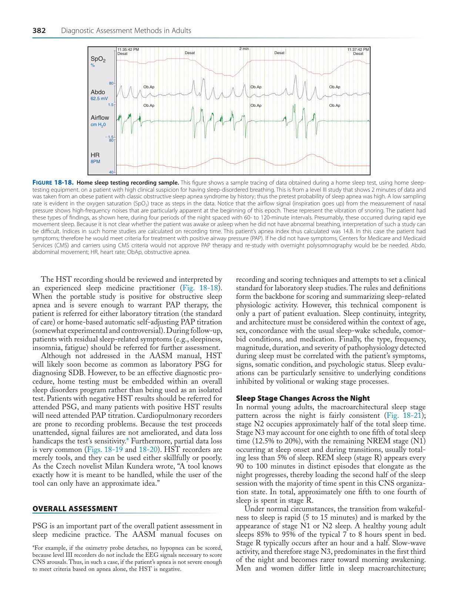

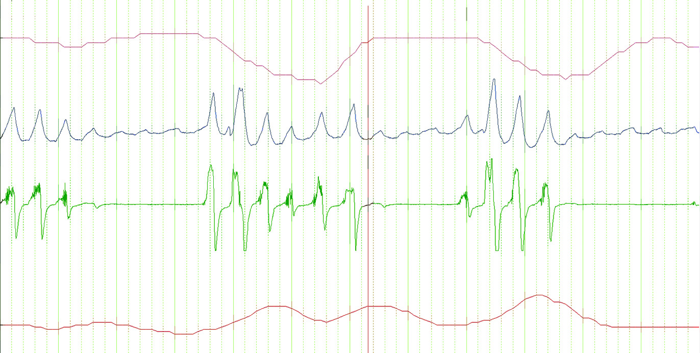

<!-- pdf-page: 444 -->

9:53:38 PM 11 PM 12 AM 6:32:19 PM 8 PM 9 PM 10 PM 11 PM 12 AM 1 AM 2 AM 3 AM

S

100 92.5 85 77.5 70

30

15

0

30

15

0

30

15

0

50

25

0

N

HYPO, sec

MA, sec

OA, sec

CA, sec

SpO2 %

SpO2 %

Pos

1 AM 2 AM 3 AM 4 AM

S

100 92.5 85 77.5 70

30

15

0

30

15

0

30

15

0

50

25

0

N

100 92.5 85 77.5 70

HYPO, sec

MA, sec

OA, sec

CA, sec

SpO2 %

SpO2 %

Pos

the oxyhemoglobin desaturations also coincide with the patient shifting to supine position. By contrast, the lower-left panel also shows recurrent oxyhemoglobin desaturation, but spaced further apart (120 to 180

FIGURE 18-19. Home sleep test histograms. This four-panel illustration shows summary histograms from four different patients. The histogram in the upper-left panel shows very severe sleep apnea with both

obstructive and central components. The upper-right panel figure shows sleep-disordered breathing (SDB) that may be rapid eye movement related (given the increasing severity every 80 to 100 minutes); however,

played (from top to bottom) include SpO2 (oxygen saturation), CA (central apnea), OA (obstructive apnea), MA (mixed apnea), Hypo (hypopnea), and Pos (position, N, nonsupine or S, supine). Note: Hypopnea scoring

minutes) during sustained lateral recumbence (nonsupine). Finally, the lower-right panel shows a patient histogram with milder SDB, even though the patient slept supine the entire night. Recording channels dis­

11:35:55 PM 1 PM 2 PM 3 PM 4 PM 5 PM

S

100 92.5 85 77.5 70

30

15

0

30

15

0

30

15

0

50

25

0

N

shown on this figure are scored according to reduced ventilation and do not use oxyhemoglobin desaturation criteria.

HYPO, sec

MA, sec

OA, sec

CA, sec

Pos

9:25:11 PM 11 PM 12 AM 1 AM 2 AM 3 AM 4 AM 5 AM

S

30

15

0

30

15

0

30

15

0

50

25

0

N

HYPO, sec

MA, sec

OA, sec

CA, sec

Pos

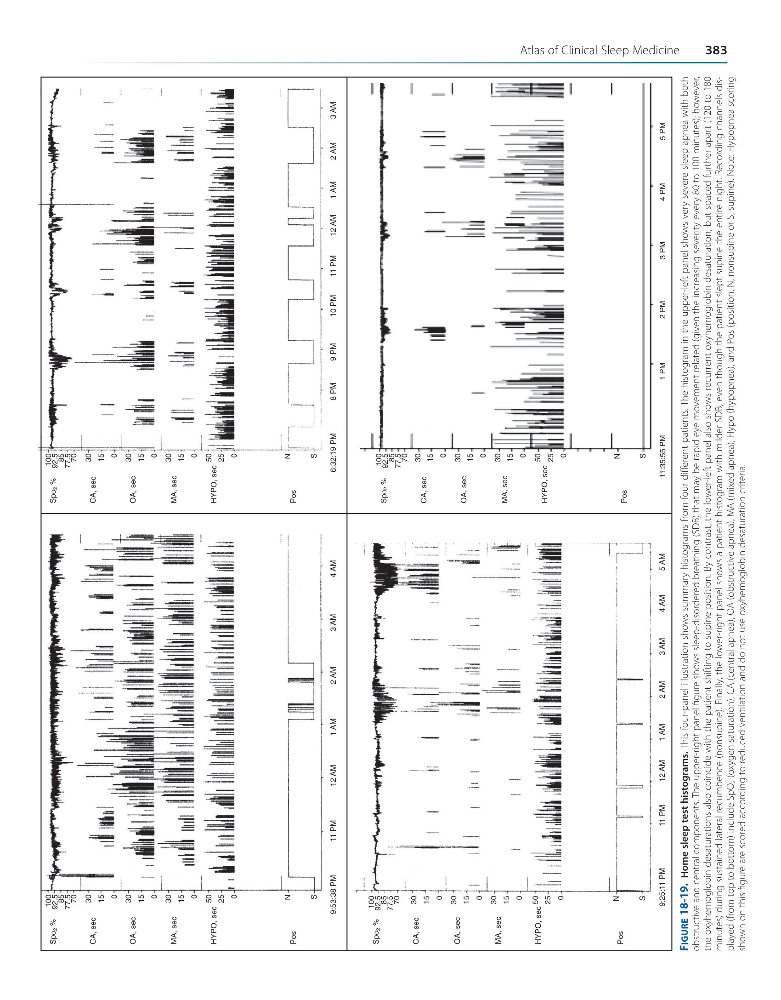

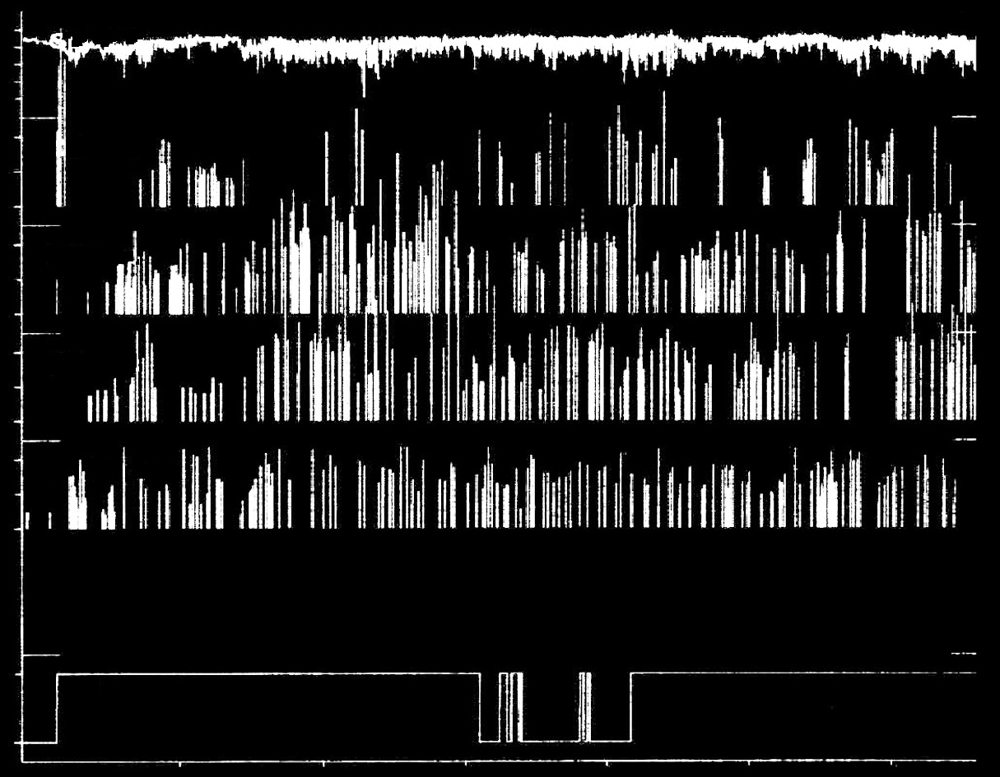

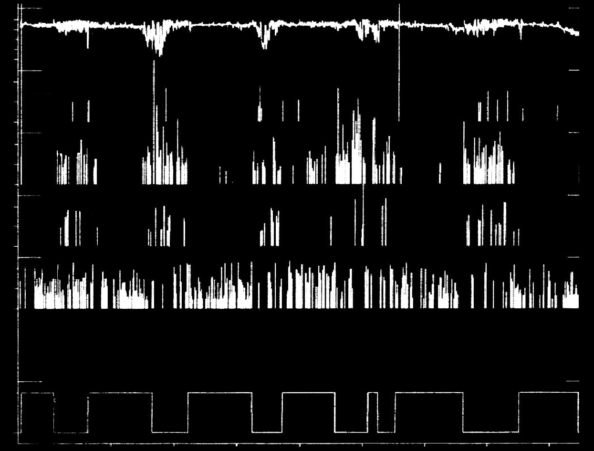

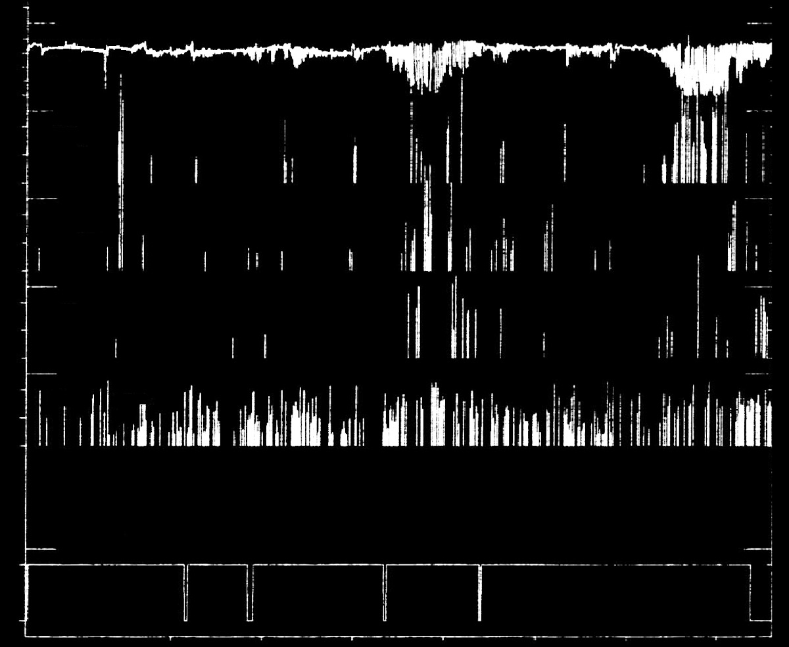

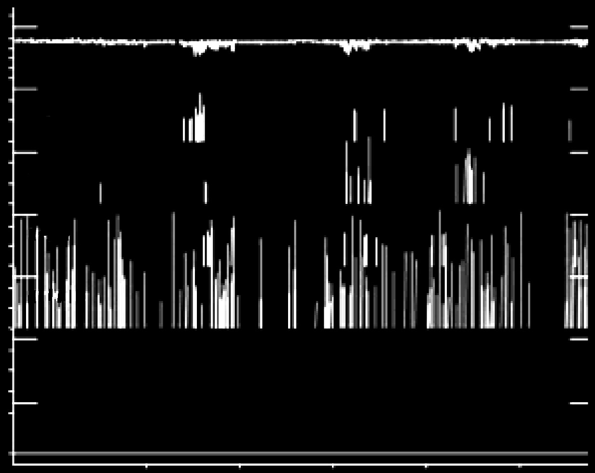

<!-- pdf-page: 445 -->

384 Diagnostic Assessment Methods in Adults

0 0 0 0 0 0 0 0 0 0 0 0 0 0 0 0 0 0 0 0 0 0 0 0 0 0 0 0 0 0 0 0 0 0 0 0 0 0 0 0 0 0

0 0 0 0 0 0 0 0 0 0 0 0 0 0 0 0 0 0 0 0 0 0 0 0 0 0 0 0 0 0 0 0 0 0 0 0 0 0 0 0 0 0

SN SN SN SN SN SN SN SN SN SN SN SN SN SN SN SN

SN SN SN SN SN SN SN SN SN SN

AIRFLOW

RESP EFFORT RESP EFFORT

SNORE

SaO2

HR

84 84 84 80 80 79 78 75 78 77 74 76 73 73 71 71 71 79 92 93 93 90 82 85 85 85 85 86 86 86 86 80 82 82 82 83 83 83 83 88 88 88

88 87 89 90 92 92 92 91 91 91 94 94 94 94 94 94 93 93

86 86 86 85 85 85 85 88 88 88 88 85 85 84

89 87 87 87 87

84 84 84 84

94

AIRFLOW

SNORE

SaO2

HR

hypopnea cannot be scored according to Centers for Medicare and Medicaid Services criteria. In this case, the SDB manifests as apnea events, making diagnosis possible. The lower-left panel shows a tracing that

by prominent oxyhemoglobin desaturation events. The upper-right panel also shows a patient with severe sleep-disordered breathing (SDB); however, the oximetry channel is not functioning. Without oximetry,

is missing both airflow and snoring sounds. Although the oximetry channel suggests sleep apnea is present, diagnosis cannot definitively be made. The lower-right panel shows a pattern indicating snoring and

FIGURE 18-20. Home sleep test tracings. This four-panel illustration shows 5-minute tracings from four different patients. The upper-left panel shows a patient with severe obstructive sleep apnea accompanied

SN SN SN SN SN SN SN SN SN SN SN SN SN SN SN SN SN SN SN SN SN SN SN SN SN SN SN SN SN SN SN SN SN

62 63 63 63 63 63 63 63 63 63 64 64 64 65 64 65 65 66 66 67 67 67 63 63 62 62 62 66 65 66 68 66 67 63 63 62 63 63 63 63 63 64

92 92 94 95 96 94 91 91 92 91 91 94 91 91 90 90 93 94 94 95 94 94 93 94

90 92 92 92 94 93 92 92 93

93 93 93 91 92 92 93 92 91

AIRFLOW

RESP EFFORT RESP EFFORT

SNORE

SaO2

HR

some hypopnea events. SaO2, oxyhemoglobin saturation; HR, heart rate; Resp, respiratory; SN, snore sound.

57 64 60 60 62 64 60 61 61 67 59 61 64 60 64 64 61 60 61 61 60 63 62 65 59 59 59 63 64 60 61 61 63 61 62 62 76 62 76 62 60 60

95 97 99 98 98 98 96 96 94

98 95 98 97 96 97 95 97

95 95 98 96 96 97 97 99

99

94 93 95 94 97

97 99 99 99

99 98 97 97 97 94

95

AIRFLOW

SNORE

SaO2

HR

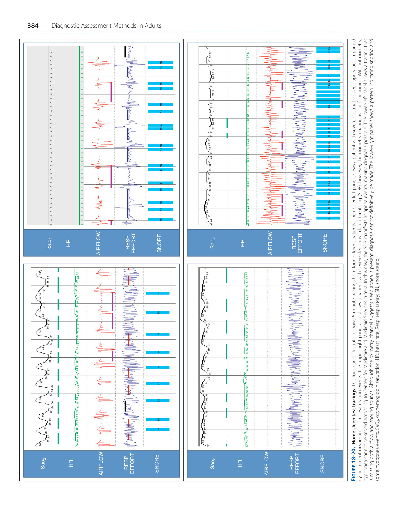

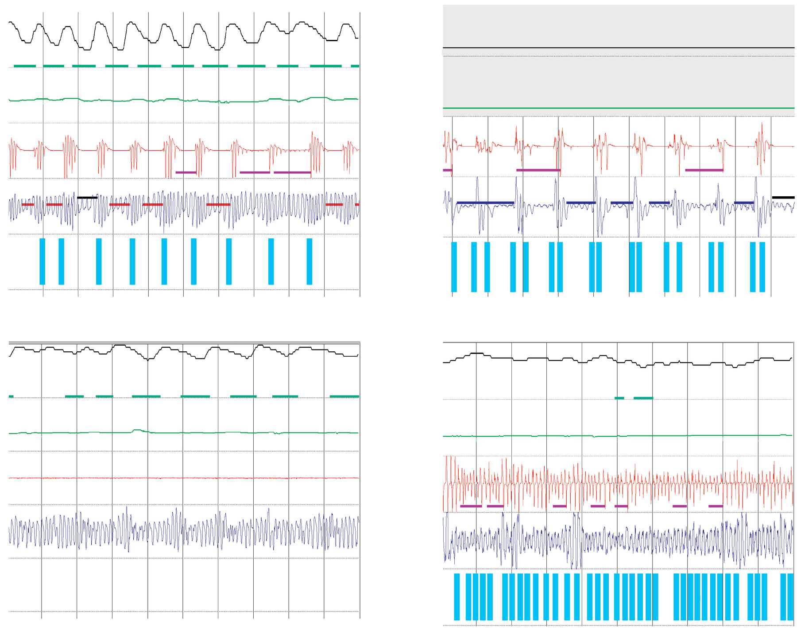

<!-- pdf-page: 446 -->

W

R

N1

N2

0 1 2 3 4 5 Time in bed (hours) 6 7 8 9

N3

FIGURE 18-21. Normal sleep macroarchitecture. This figure illustrates normal sleep-stage progression for a healthy young adult. N1, sleep stage 1; N2, sleep

stage 2; N3, sleep stages 3 and 4; R, rapid-eye-movement sleep; W, wakefulness.

TABLE 18-4 Normal Value Ranges for “First Night” Laboratory Polysomnography*

20–29 (n = 44) 30–39 (n = 23) 40–49 (n = 49) 50–59 (n = 41) >60 (n = 29)

AGE GROUP (NUMBER OF INDIVIDUALS) (IN YEARS)

General, Sleep Continuity, and Integrity Measures Time in bed (min) 361–449 335–451 355–454 342–444 353–439 Sleep latency (min) 0–25 3–24 0–28 0–20 0–30 Total sleep time (min) 285–410 269–411 275–384 268–395 237–360 Sleep efficiency index† 72–100 75–98 71–93 73–95 62–89 Latency to arising (min) 0–10 0–32 0–29 0–15 0–14 Number of awakenings 1–18 4–12 6–17 7–16 7–21 Awakenings per hour 0–3 1–2 1–3 1–3 1–3 Number of REM sleep episodes 2–4 2–4 3–5 3–5 2–5

NREM Sleep Stage Percentages N1 percentage of time in bed 1–7 1–6 2–9 3–9 3–10 N2 percentage of time in bed 40–58 40–60 40–64 44–64 42–60 N3 percentage of time in bed 12–19 11–19 4–13 3–11 2–8 Stage R percentage of time in bed 11–25 10–25 9–24 12–24 8–19

*Normal value range lower and upper bounds are calculated here as the parameter mean −1 standard deviation (SD) to the parameter mean +1 SD, respectively, with negative values replaced by zero. †Sleep efficiency index is the total sleep time as a percentage of time in bed.

however, women may have slightly better-preserved stage N3 with advancing age.

The above descriptions of normal sleep in the healthy young adult derive from electrophysiologic data that universally exclude results obtained during the first night in the laboratory. Sleep disturbances associated with the initial experience of sleeping in a laboratory are so well known they are called the first night effect. These data are excluded by researchers interested in the commonalities of normal sleep, who rightfully believe these are artifacts created by procedure (analogous to the uncertainty in quantum mechanics postulated by the Heisenberg principle). Ironically, first night data are more appropriate in clinical practice because diagnostic PSG is usually recorded the first night the patient sleeps overnight in the laboratory. Consequently, results should be compared with normative values collected from normal healthy adults sleeping in the laboratory for the first time (Table 18-4).

#### Sleep Stage Changes as a Function of Age

Over the life span, a great many changes occur in sleep microarchitecture and macroarchitecture. For this reason, judging sleep integrity, continuity, or composition should be done

against age-specific normative values. During infancy, multiple-feeding REM sleep–NREM sleep cycles consolidate to one major and several minor sleep episodes by the end of the first year. This further reduces to a major and a single minor sleep episode by age 4 years and to the adult single major sleep period at around age 10 years. At some time between the two milestones of 6 months and 1 year, the prevailing sleep-onset REM—or, more precisely, “active sleep”— switches to the adult pattern, in which the transition from wakefulness to sleep is through an NREM stage. Overall, across childhood and into adulthood, total sleep time gradually decreases. Part of this is the decreasing stage N3 after adolescence; however, other stages also decline, and wakefulness within the sleep period increases. This trend continues as a function of age, with N3 reduction to low levels, or even disappearing altogether, in elderly individuals. By contrast, “active sleep,” the infant’s equivalent of stage R, drops spectacularly from more than 50% at birth to 20% to 25% by adolescence. Then, after remaining stable for perhaps five decades, stage R percentage declines slightly further. Decreasing sleep duration and consolidation are often associated with sleep disturbances related to the accumulated pathologies that invariably accompany aging. However, some total sleep decline

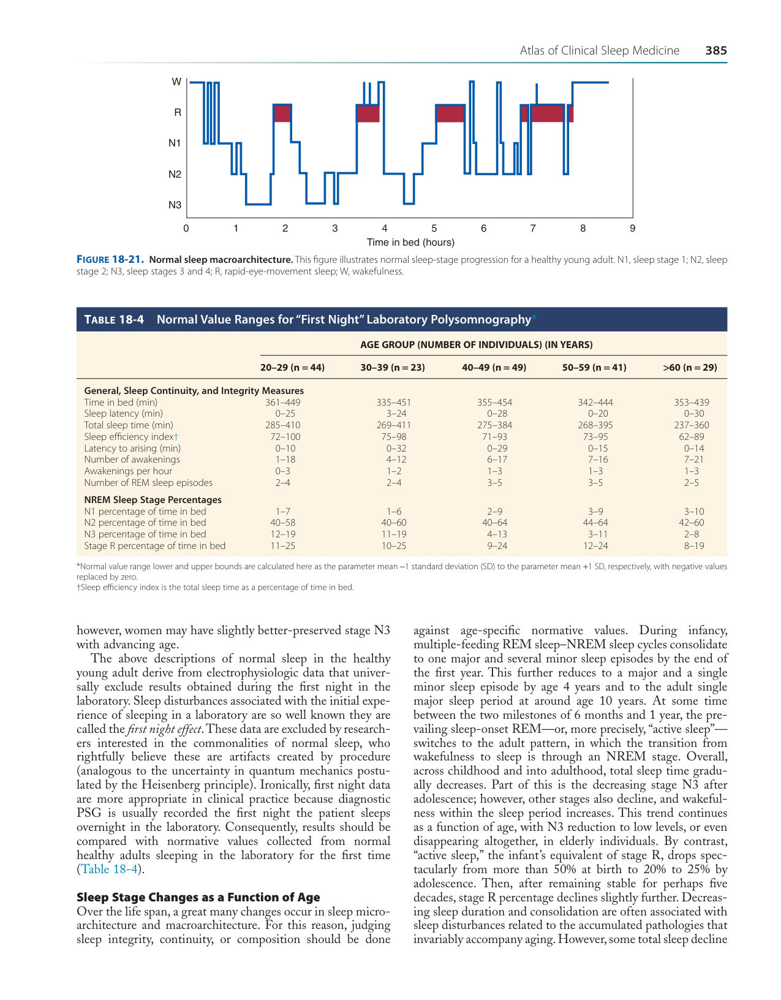

<!-- pdf-page: 447 -->

386 Diagnostic Assessment Methods in Adults

TABLE 18-5 Recommended Polysomnographic Parameters

CATEGORY CLASS* DESCRIPTION

Sleep stage R Clock times that polysomnogram began and finished R Total duration of the recording and amount of time spent actually sleeping R Latencies to sleep (from lights out) and stage R (from sleep onset) R Time and percent (of total sleep time) spent in each sleep stage R Percent time of total recording spent asleep (sleep efficiency index) R Time spent awake after initial sleep onset (wake after sleep onset) I Latency to persistent sleep

Respiration R Number of each type of apnea (i.e., central, mixed, obstructive) and hypopnea R Number of all apneas and hypopneas combined R Apnea, hypopnea, and apnea-hypopnea indices (number per hour of sleep) R Mean and minimum oxygen saturation percentages R Indication of whether Cheyne-Stokes breathing pattern occurred O Indication of whether hypoventilation was observed O Number and index (number per hour of sleep) of RERAs O Number and index of 3% (or more) or 4% (or more) oxygen desaturations I During positive airway pressure titration; optimal pressure; time at optimal pressure; whether stage R occurred during time

Arousals R Number and index (number per hour of sleep) I Number and duration of cyclic alternating pattern episodes

at optimal pressure; indexes for apnea, apnea/hypopnea, and apnea/hypopnea/RERA at optimal pressure

Heart rhythm R Mean and maximum heart rate during sleep and maximum during recording R Indication of whether bradycardia, asystole, sinus tachycardia, narrow complex tachycardia, wide complex tachycardia, atrial

Movement R Number and index (number per hour of sleep) of periodic limb movements during sleep R Number and index of periodic limb movements during sleep that were associated with central nervous system arousal I Number and index of periodic limb movements during wakefulness I Indication of whether bruxism, restless leg activity, rhythmic movement, rapid eye movement–related movements,

fibrillation, or other arrhythmias occurred (and provide pause lengths or rates where appropriate)

Other R Clinical correlates of pathophysiology and diagnosis R Other EEG abnormalities (e.g., spikes, sharps, excessive or diminished waveform activity, hypersynchronous delta or

fragmentary myoclonus, or other types of movements occurred during sleep or wakefulness

*Classification by the American Academy of Sleep Medicine as recommended (R), optional (O), or not mentioned but considered important and recommended in other guidelines (I). EEG, electroencephalogram; RERA, respiratory effort–related arousals.

alpha-delta sleep) R Heart rhythm abnormalities R Behavioral observations O Sleep histogram

is nonspecific or of unknown etiology. Some researchers argue that age-related deterioration of underlying physiologic sleep mechanisms is responsible. The fact remains, as we enter our senior years we spend more time in bed but less time sleeping.

#### Parameters, Pathophysiology, and

#### Interpretation

For summarizing a sleep study, the AASM manual provides a list of parameters for calculating, tabulating, and reporting. Some parameters are recommended, and some are optional (Table 18-5). This provides an objective technique for assessing sleep disturbances and instability. Indexed measures are useful to control for differences in recording, or in sleep duration that occurs across nights, or, more importantly, among individuals. For example, the number of leg movement– related arousals per hour better characterizes activity level than does the overall number of leg movement–related arousals.

PSG interpretation must proceed from context. Important contexts include 1) sleep schedule and napping pattern, 2) symptoms, 3) comorbid illnesses and conditions, and 4) medications, alcohol, and recreational substances. Sample forms useful for such assessments are included as Figures 18-22 through 18-25. The screening questionnaire includes

a check-box version of the Epworth Sleepiness Scale, whose validation study was presented at the Helsinki World Sleep Apnea Congress in 2003. It also inquires about overall sleep disturbances and collects information concerning sleep schedule and napping from which one can deduce 1) whether the sleep schedule is adequate, 2) whether the patient is “fasting” and “bingeing” on sleep, and 3) whether the patient phase delays, phase advances, or remains regular. The symptom checklist is straightforward, and patients can affirm any sleep problems they may be experiencing. Some of the symptoms are strong markers for particular sleep disorders, whereas others are nonspecific. Furthermore, some symptoms serve to alert the sleep specialist reviewing the PSG to pay special attention to distinct electrophysiologic phenomena. If a patient bites his tongue during sleep, careful scrutiny of the tracing for spikes, phantom spikes, and sharp waves would be prudent. Or if a patient reports dream enactment with injury, focus should be put on REM-related movements and REM without atonia as correlates of possible RBD. The bottom section of the questionnaire specifically addresses the triad of symptoms associated with narcolepsy (i.e., sleep paralysis, hypnagogia, and cataplexy). Sleep-relevant comorbid conditions are listed on the sleep clinic health problems checklist so that patients can easily affirm active or past history of each infirmity. In addition to the instruments used

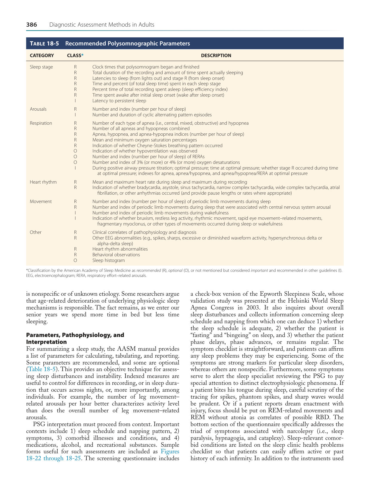

<!-- pdf-page: 448 -->

Sleep Center Screening Questionnaire

Patient name

Date

EPWORTH SLEEPINESS SCALE

How LIKELY are you to DOZE off or FALL ASLEEP in the following situations, in contrast to feeling just tired? This refers to your usual way of life in recent times. Even if you have not done some of these things recently, try to work out how they would have affected you. Please check one box per line.

BRIEF SLEEP SYMPTOM CHECKLIST (please check the boxes that best describe you)

---CHANCE OF DOZING OFF---

never slight moderate high sitting and reading

watching TV

sitting and talking to someone

sitting, inactive in a public place (example, a theater or a meeting)

as a passenger in a car for an hour without a break

lying down to rest in the afternoon when circumstances permit

sitting quietly after lunch without alcohol

in a car, while stopped for a few minutes in traffic

FIGURE 18-22. Sleep clinic screening questionnaire. Sample self-administered questionnaire form used to assess sleepiness (using the Epworth Sleepiness

Scale developed by Dr. Murray Johns), sleep schedule, napping, and general symptoms of sleep disorders.

never rarely frequently always I snore loudly

My sleep is very restless

I fall asleep while driving

SLEEP SCHEDULE (please provide the following information)

What time do you go to bed on WEEKDAYS?

What time do you get up on WEEKDAYS? What time do you go to bed on WEEKENDS? What time do you get up on WEEKENDS? Are you a shift worker?

I awaken gasping or choking for breath

I awaken in the morning unrefreshed

I have problems falling asleep or staying asleep (insomnia)

My sleep is disturbed by unusual behaviors (for example: nightmares, sleepwalking, dream enactments, tongue biting, bedwetting... etc.)

I’ve been told that I stop breathing in my sleep (told by )

AM or PM AM or PM AM or PM AM or PM

Do you nap? [yes] [no] How often do you nap? times per week How long are the naps? minutes Do you awaken refreshed? [yes] [no] [yes] [no] If yes, what kind of shift do you work?

here as examples, many sleep clinics administer a depression screening test and the International Restless Legs Study Group screening test.

In sleep medicine, few diagnostic criteria are quantitatively codified. Pathophysiologies are mainly correlates. The disease process can be an upstream or downstream factor, or it can be

only indirectly related. In the case of sleep apnea, however, criteria have been established. CMS criteria for qualifying a patient for PAP therapy, the apnea-hypopnea index (AHI)*

*For CMS, hypopneas are defined as partial airway restriction events with a 4% (or more) oxyhemoglobin desaturation.

<!-- pdf-page: 449 -->

388 Diagnostic Assessment Methods in Adults

SLEEP PROBLEMS CHECKLIST

Patient Name

Date

What problem causes you to seek our help, and how does it affect your life?

FIGURE 18-23. Sleep problems checklist. Sample self-administered questionnaire form used in the sleep medicine clinic to determine chief complaints,

presence or absence of common symptoms associated with sleep disorders, and severity of complaints constituting narcolepsy’s symptom triad other than sleepiness (i.e., cataplexy, sleep paralysis, and hypnagogia).

CHECK the box for each problem you CURRENTLY HAVE.

Loud snoring with frequent awakenings

Crawling feelings in legs when trying to sleep Leg-kicking during sleep Leg cramps in sleep Trouble falling asleep at night Trouble staying asleep at night Racing thoughts when trying to sleep Increased muscle tension when trying to sleep Fear of being unable to sleep Laying in bed worrying when trying to sleep Waking too early in the morning Sleep talking Sweating a lot at night Waking up with reflux (and/or heartburn) Waking up to urinate 2 or more times nightly Nightmares

For each symptom, please CHECK the boxes that BEST DESCRIBE YOU:

Never Rarely Sometimes Usually Always

Teeth grinding during sleep Morning headaches Morning dry mouth Sleepwalking Tongue biting in sleep Bedwetting Acting out dreams with injury Acting out dreams without injury Uncontrollable daytime sleep attacks Falling asleep unexpectedly Falling asleep at work Falling asleep at school I use sleeping pills to help me sleep I use alcohol to help me sleep Pain interfering with sleep Where is the pain?

When falling asleep, I feel paralyzed (unable to move)

I feel unable to move (paralyzed) after a nap I have dream-like images (hallucinations) when I awaken in the morning even though I know I am not asleep

I see vivid dream-like images (hallucinations) either just before or just after a daytime nap, yet I am sure I am awake when they happen

I am often unable to move (paralyzed) when I am waking up in the morning

I get “weak knees” when I laugh

I get sudden muscular weakness (or even brief periods of paralysis, being unable to move) when laughing, angry, or in situations of strong emotion

Developed by Max Hirshkowitz @ Flatland Logic Group

must be 5 or more for patients with symptoms or relevant comorbidities. However, for patients who are neither sleepy nor have any significant, potentially related comorbid medical conditions, the AHI must reach 15 or more. AASM criteria are similar but use the respiratory disturbance index (RDI),* rather than the AHI, in the decision paradigm.

*The acronym RDI has, unfortunately, been used to index several different but associated sleep-related respiratory impairments. RDI was originally used to index desaturation events but subsequently became virtually synonymous with apnea-hypopnea index (AHI). More recently, CMS attempted to resolve the erroneous used of AHI for cardiorespiratory home sleep tests—because the denominator is total recording time, rather than total sleep time—by renaming the HST analog as RDI, thus adding to, rather than resolving, the confusion.

<!-- pdf-page: 450 -->

Sleep Center Health and Family Questionnaire

Diabetes Anemia now past now past

Patient name

1. How would you rate your current general health?

very poor poor average good

#### 2. Check ( ) if you now have or in the past had the following:

Date

very good

High blood pressure Peptic ulcers now past now past

Stroke Acid reflux (heartburn) now past now past

Heart disease or CHF Kidney disease now past now past

Heart attack Thyroid disease now past now past

Angina Arthritis now past now past

Emphysema or COPD Back pain now past now past

Asthma Head trauma now past now past

Tuberculosis Severe headaches now past now past

Other lung disease Epilepsy (seizures) now past now past

Nasal allergies Passing-out spells (fainting) now past now past

Runny or blocked nose Depression now past now past

Hormonal problem Anxiety disorder now past now past

Urological problem Problems with alcohol now past now past Prostate disease Problems with drugs now past now past

3. Please list hospitalizations. Please give the reasons for each hospitalization and the dates (as best you can remember).

FIGURE 18-24. Sleep center health and family questionnaire. Sample self-administered questionnaire form used in the sleep medicine clinic to collect

information about an individual’s comorbid health conditions; hospitalizations; caffeine, alcohol, and nicotine use; marital status; occupation; and general family health status. CHF, congestive heart failure; COPD, chronic obstructive pulmonary disease.

REASONS FOR HOSPITALIZATION DATE

4. Please give important details about your medical conditions.

Continued

<!-- pdf-page: 451 -->

390 Diagnostic Assessment Methods in Adults

What is the most you ever smoked? If you quit, how long ago did you quit?

5. List your current average for each category below.

hours worked per day days worked per week days of vacation per year number of cigarettes smoked per day other tobacco used per day (pipefuls or cigars) cups of regular coffee per day cups of tea per day glasses of cola or other caffeinated beverages per day cans of beer per day (12 oz.) glasses of wine per day (3-4 oz.) alcoholic drinks per day (1-2 oz. straight or mixed)

6. If you smoke or used to smoke...

single married divorced widowed separated living with someone

7. What is your current relationship status?

3. Do any of your brothers and sisters (if applicable) have any major diseases or sleep disorders?

8. How many times have you been married?

9. What is your occupation?

FAMILY INFORMATION

1. Is your father living?

yes no If yes, how old is he?

If no, at what age did he die?

What was your father’s major occupation?

2. Is your mother living?

yes no If yes, how old is she?

If no, at what age did she die?

What was your mother’s major occupation?

What caused his death?

What caused her death?

If yes, please describe:

FIGURE 18-24, cont’d

<!-- pdf-page: 452 -->

We need to know what drugs, vitamins, and herbal substances you have taken in the past 6 months. Please complete the form below. Check your medicine cabinet and your medical records for drugs. Think back about the health problems you have had and the medicines you took for them.

Patient name

Sleep Center Medication Questionnaire

Date

Name of drug, vitamin, or herbal substance used Still taking?

Taken for what problem? Taken for how long? # of pills Dose

FIGURE 18-25. Sleep center medication log. Sample self-administered questionnaire form used in the sleep medicine clinic to collect information about

medication and substance use.

Yes No

<!-- pdf-page: 453 -->

392 Diagnostic Assessment Methods in Adults

W

R

N1

N2

N3

Nap 1 Nap 2 Nap 3 Nap 4

FIGURE 18-26. Summary sleep stage histograms from a multiple sleep latency test. Note that rapid eye movement sleep occurred on all four nap

opportunities, thereby supporting the diagnosis of narcolepsy in a sleepy patient in whom other causes of sleepiness have been ruled out (chronic sleep deprivation, another untreated hypersomnolence-producing sleep disorder, withdrawal from stimulants, or use of central nervous system depressants). These patients may also have ancillary symptoms associated with narcolepsy, such as cataplexy, sleep paralysis, and hypnagogic or hypnopompic hallucinations. Sleep onset occurred on all nap opportunities with the longest during test session 3. Also, the final nap was extended slightly longer than it should have been. N1, sleep stage 1; N2, sleep stage 2; N3, sleep stages 3 and 4; R, REM sleep; W, wakefulness.

15 minutes

#### OTHER ASSESSMENTS AND INTERPRETATION

#### Multiple Sleep Latency Test

The multiple sleep latency test (MSLT) is used to document sleepiness and provides supporting information to diagnose narcolepsy. When performed correctly in adults, a series of four or five nap opportunities (test sessions) are provided at 2-hour intervals, commencing approximately 2 hours after arising from the previous night’s PSG recording. Subjects being tested lie down in bed and are allowed to get comfortable; they are then instructed to let themselves fall asleep, try to fall asleep, or not to resist falling asleep. Between test sessions, the patient must get out of bed and is not permitted to drink caffeinated beverages. If an individual does not fall asleep (based on PSG criteria from concurrently recorded tracings), the nap opportunity is terminated after 20 minutes. However, if sleep onset occurs, the test session is extended 15 additional minutes. Extending the test session allows for assessment of REM pressure, which characterizes narcolepsy. If two REM onsets or no REM sleep occurs during the first four nap opportunities, the test concludes. By contrast, if REM sleep occurs on only one test session, a fifth nap opportunity is conducted. The mean sleep latency is calculated, and the naps during which REM sleep occurs are determined. A mean sleep latency less than 5 minutes is considered pathologic sleepiness, and values greater than 10 are considered normal; values in between represent a gray zone. A diagnosis of narcolepsy is supported when two or more naps contain REM sleep (see Fig. 18-26).

#### Maintenance of Wakefulness Test

In recent years, the maintenance of wakefulness test (MWT) has supplanted the MSLT for assessing sleepiness in regulatory situations. Although not a diagnostic test, MWT is included here because it has become the objective standard in sleep medicine for establishing “fitness for duty.” In MWT, four test sessions are scheduled at 2-hour intervals, with the first commencing approximately 2 to 3 hours after a person’s usual morning rising time. The individual being tested wears street clothes, reclines on the bed with a bolster pillow, and is instructed to attempt to remain awake. The room is dimly lit, not totally dark. If unequivocal sleep onset occurs (i.e., one epoch of stage N2, N3, or R or three consecutive epochs of N1), the test session is terminated. If no unequivocal sleep

onset occurs, the test session terminates after 40 minutes. Recordings involve collecting PSG parameters used to score sleep stages. A sleep latency of less than 8 minutes is considered abnormal.

#### SUGGESTED IMMOBILIZATION TEST

The suggested immobilization test (SIT) is a PSG procedure used to support diagnosis in patients with suspected RLS. SIT is performed 1.5 to 2.0 hours before overnight PSG for a duration of 1 hour. Standard PSG recordings are made as the individual sits in bed at a 45-degree angle, with eyes open and legs outstretched in front, while attempting to stay awake and not move. Leg movements are scored (anterior tibialis EMG 0.5- to 10.0-second bursts, separated by 4 or more seconds); 40 movements per hour confers an 81% sensitivity and 81% specificity for RLS.

#### Actigraphy

Actigraphy involves having an individual wear a wristwatchlike device that contains accelerometers, a clock, and internal memory. The device usually also records concomitant light levels with a photo sensor. The device can record for several weeks or months, depending on the memory size and sampling resolution, after which data are transferred to a computer for display and analysis. The data provide information about the individual’s rest-activity cycle, which may serve as a surrogate for the sleep-wake cycle. Usually interpreted in context with a sleep diary, actigraphy supplies potentially useful information concerning sleep habits, circadian rhythm disorders, insomnia, and parasomnia. Misalignments between sleep diary and rest-activity cycle, progressive phase delay or advance, or chaotic sleep-wake schedules are easily visualized with actigraphy (see Fig. 18-27). Actigraphic data can also help document the sleep-wake cycle leading up to scheduled MSLT procedures, and some clinicians use it on the leg to assess periodic limb movement disorder and RLS.

#### SUMMARY

The AASM manual helps establish recording and scoring criteria for nearly the full range of PSG parameters, including

<!-- pdf-page: 454 -->

12:00 PM 8:00 PM 12:00 PM 6:00 AM 12:00 AM

Sunday 10/30/2011 (DAY 8)

Rest Sleep Off wrist Marker Excluded Custom Sleep/wake

Monday 10/31/2011 (DAY 9)

Tuesday 11/1/2011 (DAY 10)

Wednesday 11/2/2011 (DAY 11)

Thursday 11/3/2011 (DAY 12)

Friday 11/4/2011 (DAY 13)

Saturday 11/5/2011 (DAY 14)

12:00 PM 6:00 PM

Legend:

Activity White light Red light Green light Blue light

12:00 PM 6:00 AM 12:00 AM

FIGURE 18-27. One-week actigraphy histogram. This histogram shows an erratic sleep-wake cycle. The subject begins the week on Sunday with a fairly

conventional night of sleep (approximately 11 PM to 6:30 AM) only to shorten it slightly the next night by delaying bedtime to midnight. The following night, the subject appears to “sleep in,” extending rest time to more than 12 hours (which agreed with the sleep diary). The following night, sleep is contracted to less than 6 hours with an earlier than usual bedtime the following night. Friday night, the patient does not retire until after 2 AM and sleeps until 11 AM. This chaotic week was capped off by lights-out at 9 PM followed by a 9.5-hour sleep period on Saturday night.

sleep stages, arousal scoring, respiratory events, cardiac events, and movement activity. This chapter summarizes and illustrates the critical features and essence of the manual’s content and also presents and discusses other assessment procedures used to evaluate sleep disorders. Clearly there is room for improvement; however, the manual compiles methods and technique guidelines into a single source, underwritten and endorsed by the major clinical professional society, and it represents an aggressive step toward standardizing the field.

#### Selected Readings

Bonnet M, Carley D, Carskadon M, et al: ASDA Report. EEG arousals:

scoring rules and examples. Sleep 15:173–184, 1992. Coleman RM: Periodic movements in sleep (nocturnal myoclonus) and rest­

less legs syndrome. In Guilleminault C, editor: Sleeping and waking disorders: indications and techniques. Menlo Park, CA, 1982, Addison-Wesley, pp 267–295. Hirshkowitz M, Moore CA, Hamilton CR, et al: Polysomnography of adults

and elderly: sleep architecture, respiration, and leg movements. J Clin Neurophysiol 9:56–62, 1992.

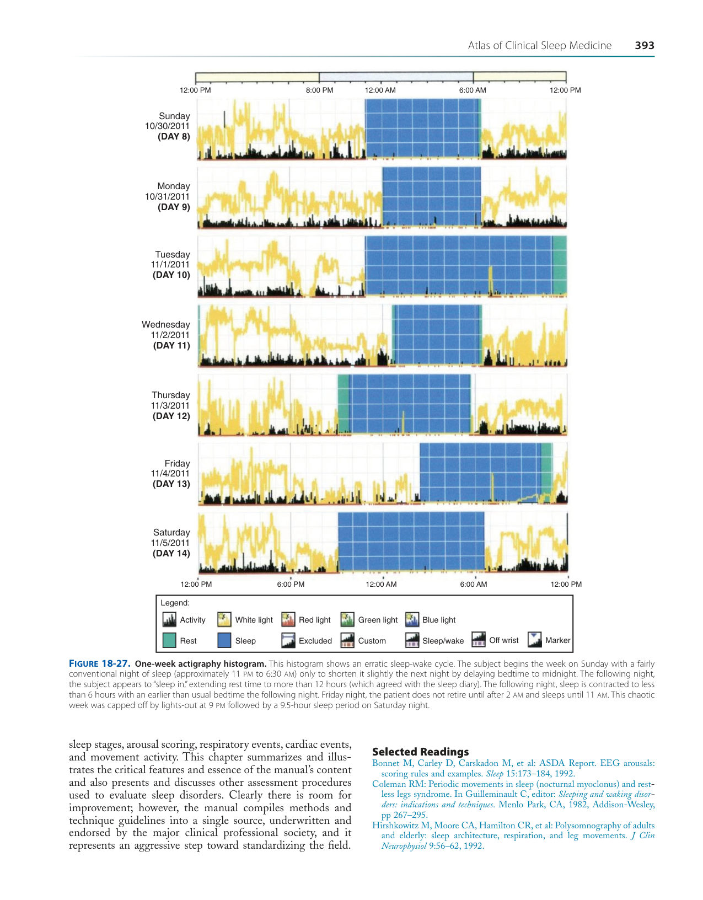

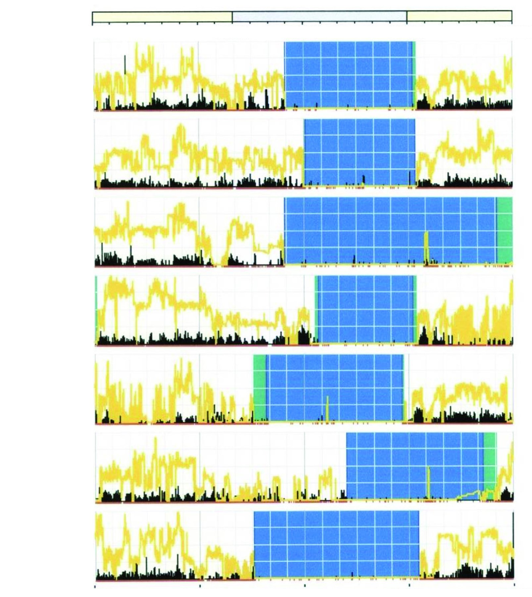

<!-- pdf-page: 455 -->

394 Diagnostic Assessment Methods in Adults

Iber C, Ancoli-Israel S, Chesson A, Quan SF, for the American Academy of

Terzano MG, Parrino L, Smerieri A, et al: Atlas, rules, and recording tech­

Sleep Medicine: The AASM manual for the scoring of sleep and associated events: rules, terminology and technical specifications. Westchester, IL, 2007, AASM. Loomis AL, Harvey N, Hobart GA: Cerebral states during sleep, as studied

nique for scoring of cyclic alternating pattern (CAP) in human sleep. Sleep Med 3:187–199, 2002. Zucconi M, Ferri R, Allen R, et al: The official World Association of Sleep

Medicine (WASM) standards for recording and scoring periodic leg movements in sleep (PLMS) and wakefulness (PLMW). Developed in collaboration with a task force from the International Restless Legs Syndrome Study Group (IRLSSG). Sleep Med 7:175–183, 2006.

by human brain potentials. J Exp Psychol 21:127–144, 1937. Rechtschaffen A, Kales A: A manual of standardized terminology, techniques

and scoring system for sleep stages in human subjects. NIH Publication No. 204. Washington, DC, 1968, U.S. Government Printing Office.
