# 19 Gallery of Polysomnographic Recordings

<!-- pdf-page: 456 -->

#### Chapter

## 19 Gallery of Polysomnographic

## Recordings

### Max Hirshkowitz and Meir H. Kryger

23:17:58 98 99 99 100 100 101 23:19:58

This chapter presents a wide variety of polysomnographic recordings organized by disorder or disease.

Text continued on p. 439

#### OBSTRUCTIVE SLEEP APNEA (OSA)

E2-M1

E1-M2

Microarousal [Aon] [Snr(I)]

Microarousal [HYP] [Snr(I)]

## 2m

## 2m

C4-M1

C3-M2

CHIN1

ECG

95 99 98 97 96 96 96 95 95 95 93 92 91 91 94 97 97 96 94 93 92 91 95 96 92 91 91 91 89

RLeg LLeg

Snore

PTAF

THERM

THOR

ABD

100 75 50

SaO2 (%)

FIGURE 19-1. Obstructive sleep apnea. In OSA, despite thoracic and abdominal efforts, there is a cessation of airflow. In this example, airflow is being moni­

tored by the use of the thermocouple (THERM) and nasal pressure (PTAF, for nasal pressure airflow). It is recommended by the American Academy of Sleep Medicine (AASM) scoring manual (see Chapters 13.2 and 18) that apnea be scored when there is a 90% or more reduction in the peak thermal sensor excursion (or excursion of the alternate sensor, nasal air pressure) for more than 10 seconds. The same manual suggests that hypopnea be scored when nasal pressure signal excursions—or their alternates, calibrated or uncalibrated inductance plethysmography—drop by more than 30%. In this example, the scoring technician has labeled the first event a hypopnea and the next two events apneas. In reality, there is little physiologic difference between hypopneas and apneas, and indeed, more hypoxemia was present with the hypopneic episode. All the data should be examined: in this example, the snoring channels; the chin electromyelogram (EMG), which is also detecting snoring; and the electroencephalogram (EEG) channels, which show the arousals linked to the abnormal respiratory events. Epoch lengths should be used that best enhance the interpretation and understanding of the patient (i.e., not always the recommended 30-second epoch). The top and bottom windows are 2-minute epochs.

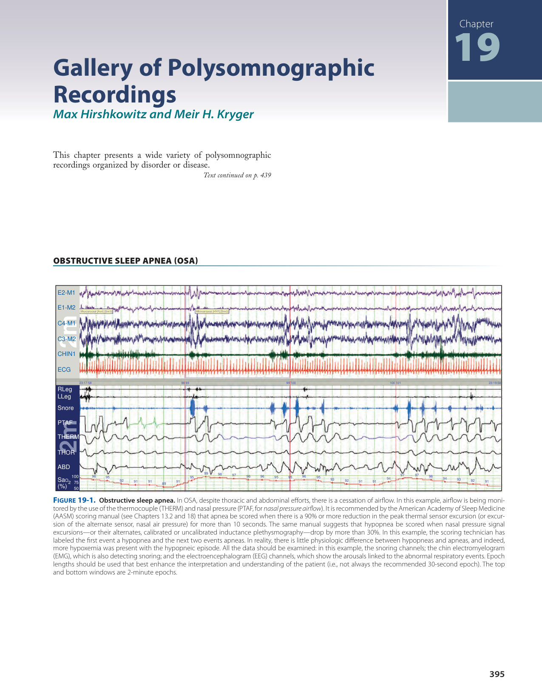

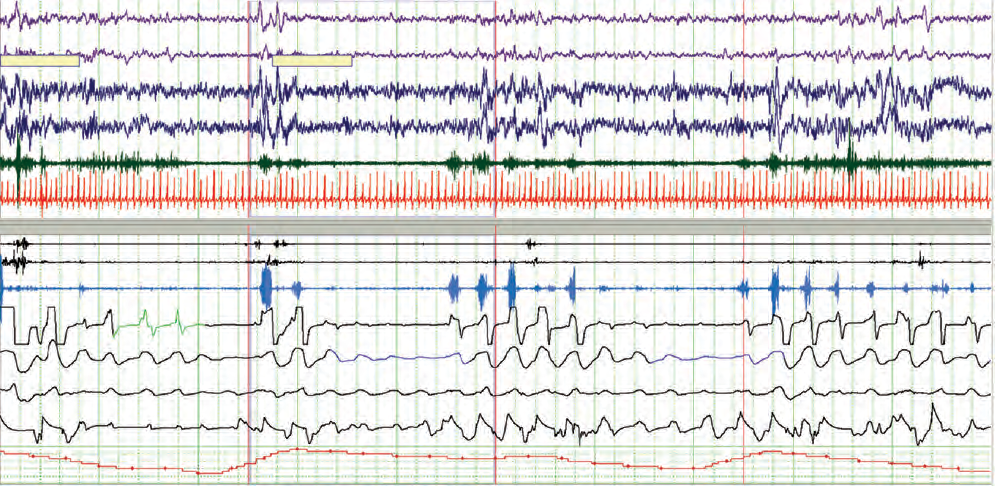

<!-- pdf-page: 457 -->

396 Gallery of Polysomnographic Recordings

0:57:02 0:57:12 0:57:02 0:58:12 0:59:02 0:59:12 1:00:02 1:00:12 1:01:02

CHIN(1)

250 V

C3-A2

125 V

C4-A1

125 V

O1-A2

125 V

O2-A1

125 V

ROC-A1

125 V

LOC-A2

125 V

ECG

2.5 mv LEG(L) 125 V

0:56:12

0:57:02 0:57:12 0:57:02 0:58:12 0:59:02 0:59:12 1:00:02 1:00:12 1:01:02

SaO2 %

THOR RES x1

PULSE bpm

PCO2 mm Hg

SOUND 20 mv

Blood pressure 20 v

Hvw 20 v

0:56:12

FIGURE 19-2. Obstructive sleep apnea. Understanding cardiorespiratory sensors is important. The AASM manual recommends a thermal sensor for detecting

apneas and nasal pressure to detect hypopneas. Both of these sensors have significant potential limitations. Nasal pressure results in absent or decreased airflow in patients who are mouth breathers and may result in overestimation of the number of apneas and the length of individual events. In this figure, oronasal endtidal pCO2, nasal pressure, and nasal airflow are being monitored. Notice that many more unobstructed breaths are detected using oronasal pCO2 and that it lags pressure by 5 to 10 seconds because of the technology of the capnometer. Thermal sensors are dependent on where they are placed in the airstream; they are nonlinear with airflow and are uncalibrated, and it is suggested that a square root transformation be made on the signal to prevent reporting hypopneas that are not present. It is recommended that pulse oximetry be collected with signal averaging of 3 seconds. In this example, the oxygen saturation (SaO2) starts to increase rapidly within 5 to 10 seconds of the onset of breathing, whereas in Figure 19-1, the SaO2 lagged by about 30 seconds. There a finger probe was used, whereas in this case, and in many others in this text, a rapidly responding ear oximeter was used. Notice that this patient has a classic tachycardia/bradycardia pattern, which corresponds very closely to the episodes of obstructive apnea. The pulse rate is usually derived directly from the calculation of the R-R interval of the electrocardiogram and is a fast-responding, accurate signal. Thus it is important to understand phase differences between channels. The top and bottom windows are 5-minute epochs.

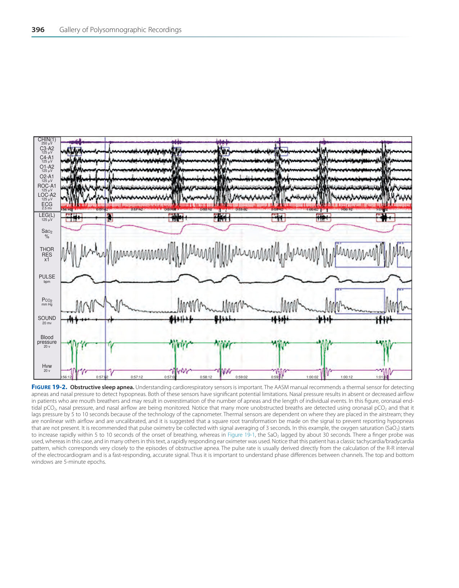

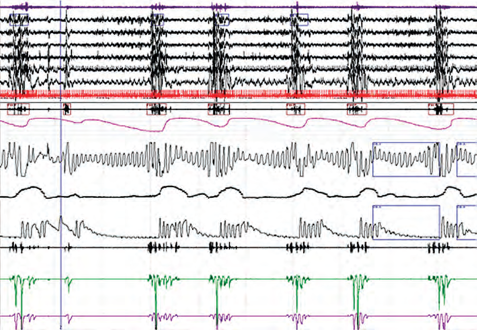

<!-- pdf-page: 458 -->

FIGURE 19-3. Obstructive sleep apnea. This 47-year-old former boxer had his nose broken multiple times, with resultant severe sleep apnea. The minimal

channels required to differentiate obstructive from central apnea are SaO2, breathing effort (thoracic and/or abdominal), and oronasal airflow. A calibrated, rapidly responding end-tidal CO2 (EtCO2) analyzer to monitor oral and nasal airflow and detect the presence of hypoventilation is superior to a thermistor or thermocouple, which merely detect the presence or absence of airflow. Notice that the EtCO2 has detected more breaths than the pressure transducer (labeled “AIRFLOW”) in this patient, who does a great deal of mouth breathing. For examining sleep, the ideal epoch length is 30 seconds; for examining breathing during sleep, the ideal epoch length is 2 to 5 minutes, although this may vary from patient to patient. In this example, the top window is a 30-second epoch and the bottom is a 5-minute epoch.

CHIN(1)

250 V

C3-A2

125 V

C4-A1

125 V

O1-A2

125 V

O2-A1

125 V

ROC-A1

125 V

LOC-A2

125 V

ECG

2.5 mv

LEG(L)

125 V LEG(R)

125 V

100

SaO2 %

THOR RES x1

ABD RES x2

120

PULSE bpm

40 50

PCO2 mm Hg

0 20

CPAP cm H2O

2

AIRFLOW

62.5 V

30 sec/page Cursor: 22:29:40, Epoch: 3 - STAGE3

5 min/page

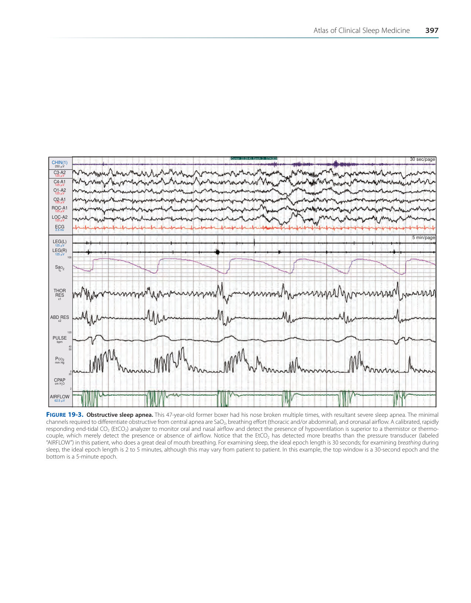

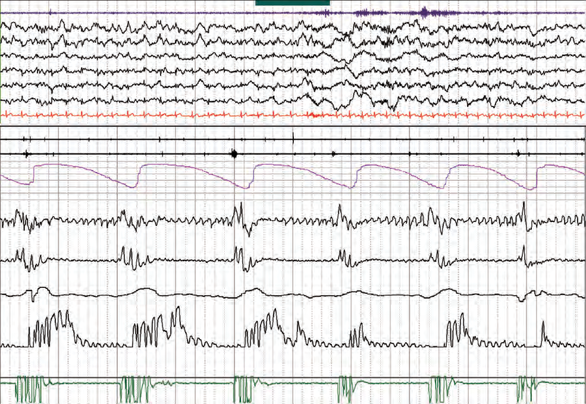

<!-- pdf-page: 459 -->

Cursor: 01:43:16, Epoch: 352 - STAGE 2 30 sec/page

Digital video

CHIN(1)

250 V

Close

C3-A2

125 V

C4-A1

125 V

O1-A2

125 V

O2-A1

125 V

ROC-A1

125 V

LOC-A2

125 V

ECG 1.25 V

5 min/page

LEG(L)

FIGURE 19-4. Sleep apnea in a child. This 12-year-old boy had been snoring since birth. He was modestly overweight, had headaches and a history of

awakening with shortness of breath, and was a restless sleeper. His preferred sleeping position was on his stomach. Here he is sleeping on his back and demonstrates OSA. Children with sleep apnea commonly assume positions that minimize airway obstruction. See Video 22 on expertconsult.com for a recording of this patient.

125 V LEG(R)

125 V

100

SaO2 %

90

THOR RES x8

ABD RES x1

120

PULSE bpm

40

76

PCO2

mm Hg

-4

POSITION

30

CPAP cm H2O

2

AIRFLOW

62.5 V

FIGURE 19-5. Sleep apnea (the same patient shown in Fig. 19-4). Here the patient is sleeping mostly on his stomach. The apnea has resolved entirely. This

child had enlarged tonsils and adenoids that were surgically removed, resulting in the resolution of the sleep apnea.

Digital video

CHIN(1)

250 V

Close

C3-A2

125 V

C4-A1

125 V

O1-A2

125 V

O2-A1

125 V

ROC-A1

125 V

LOC-A2

125 V

ECG 1.25 V

LEG(L)

125 V LEG(R)

125 V

100

SaO2 %

90

THOR RES x8

ABD RES x1

120

PULSE bpm

40

76

PCO2

mm Hg

-4

POSITION

30

CPAP cm H2O

2

AIRFLOW

62.5 V

Cursor: 01:43:16, Epoch: 352 - STAGE 2 30 sec/page

5 min/page

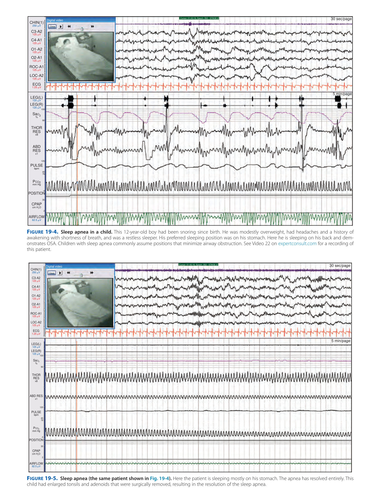

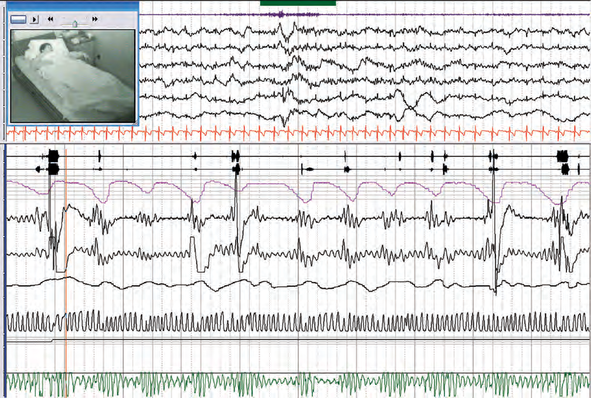

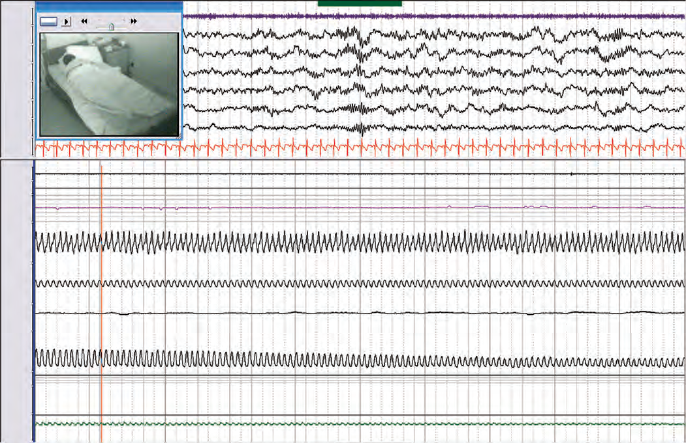

<!-- pdf-page: 460 -->

E2-M1

E1-M2

F4-M1

F3-M2

02:01:19 631 632 632 633 633 634 02:03:19

## 30s

## 2m

C3-M2

CHIN2

ECG

98 98 98 98 98 97 97 97 97 97 97 97 96 96 96 95 94 93 92 90 88

Snore

THERM

PTAF

THOR

ABD

100

94

SaO2 (%)

92

93 98 98 98 98 99 99

FIGURE 19-6. Sleep apnea in a retrognathic child. This 7-year-old girl had a history of snoring loudly since birth, and apnea and restless sleep were observed.

She was thin, with a body mass index (BMI) of 21. During sleep, the patient thrust her lower jaw forward and arched her neck in an unconscious attempt to enlarge the pharyngeal airway. In rapid eye movement (REM) sleep, the patient had quite long episodes of apnea, as shown in this figure. Note the thoracic/ abdominal paradox when the apnea “breaks.”

85

FIGURE 19-7. Retrognathic child with sleep apnea. This 5-year-old boy slept with his lower jaw thrust forward in an attempt to enlarge the pharyngeal

airway. He had a history of snoring, waking up gasping, and shortness of breath, and observed apnea was reported. The boy snored 62% of the night and had an apnea-hypopnea index of 2.4, which is above the threshold of 1 required for the diagnosis of pediatric sleep apnea.

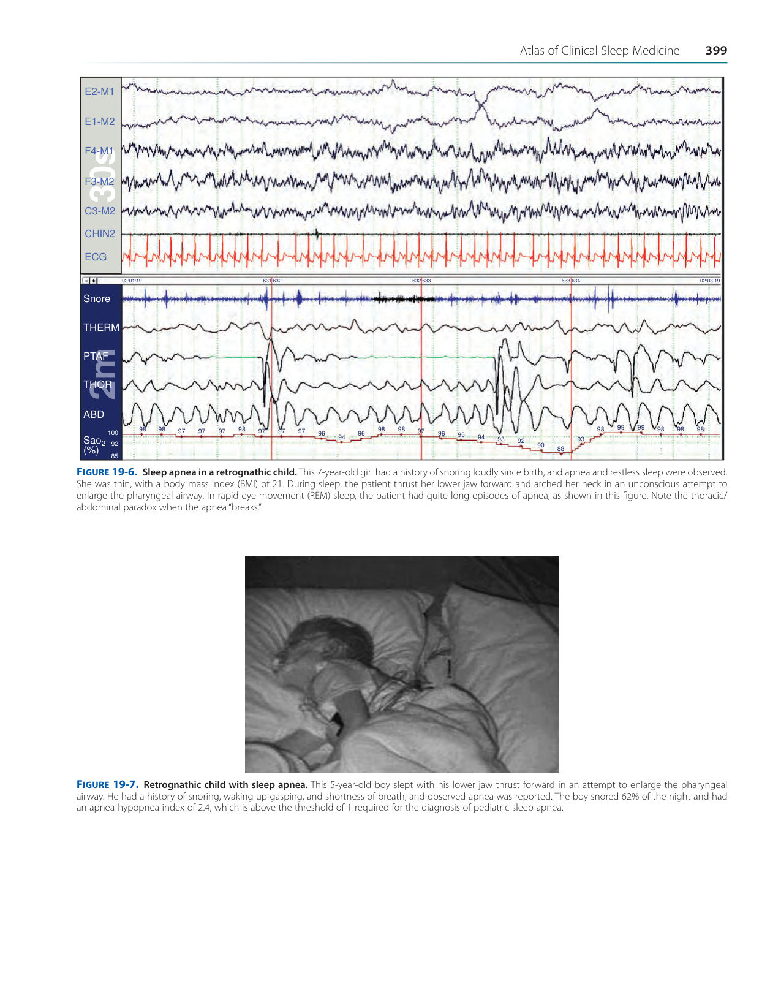

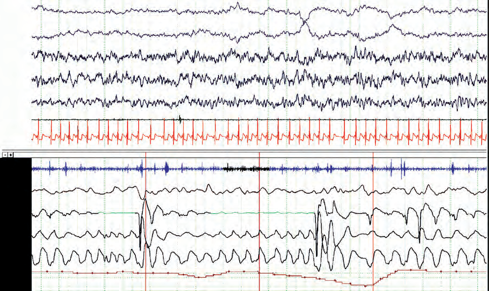

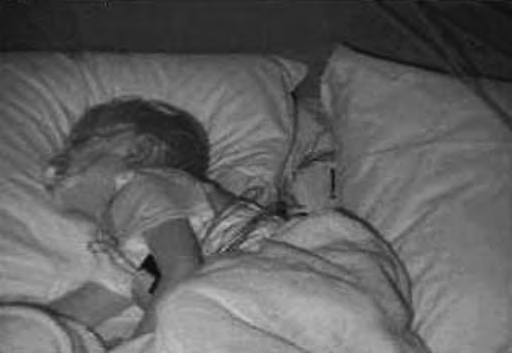

<!-- pdf-page: 461 -->

Cursor: 02:06:10, Epoch: 326 - STAGE 2 30 sec/page

CHIN(1)

250 V

C3-A2

125 V

C4-A1

125 V

O1-A2

125 V

O2-A1

125 V

ROC-A1

125 V

LOC-A2

125 V

ECG 2.5 mV

5 min/page

LEG(R)

83.3 V

100

FIGURE 19-8. OSA with leg EMG activity. Here, leg movements are detected with every apneic episode. The movements occur at the time of the greatest

respiratory efforts. Are these periodic limb movements (PLMs), or are they merely movements linked to respiratory effort? But does this patient have one or two diagnoses? The scoring manual notes that “A leg movement should not be scored if it occurs during a period from 0.5 seconds preceding an apnea or hypopnea to 0.5 seconds following an apnea or hypopnea.”

80

THOR RES x4

ABD RES x4

120

PULSE bpm

40

76

PCO2

mm Hg

-4

POSITION

20

CPAP cm H2O

2

AIRFLOW

62.5 V

FIGURE 19-9. OSA with activity in the leg channels on continuous positive airway pressure (CPAP). These data are from the same patient shown in Figure 19-8 but occurred later on in the night. On CPAP, the leg movements have resolved entirely; thus the movements were linked to the abnormal breathing

pattern. This patient does not have PLMS.

CHIN(1)

250 V

C3-A2

125 V

C4-A1

125 V

O1-A2

125 V

O2-A1

125 V

ROC-A1

125 V

LOC-A2

125 V

ECG 2.5 mV

LEG(R)

83.3 V

100

SaO2 %

80

THOR RES x4

ABD RES x4

120

PULSE bpm

40

76

PCO2

mm Hg

-4

POSITION

20

CPAP cm H2O

2

AIRFLOW

62.5 V

Cursor: 03:20:10, Epoch: 474 - STAGE 3 30 sec/page

5 min/page

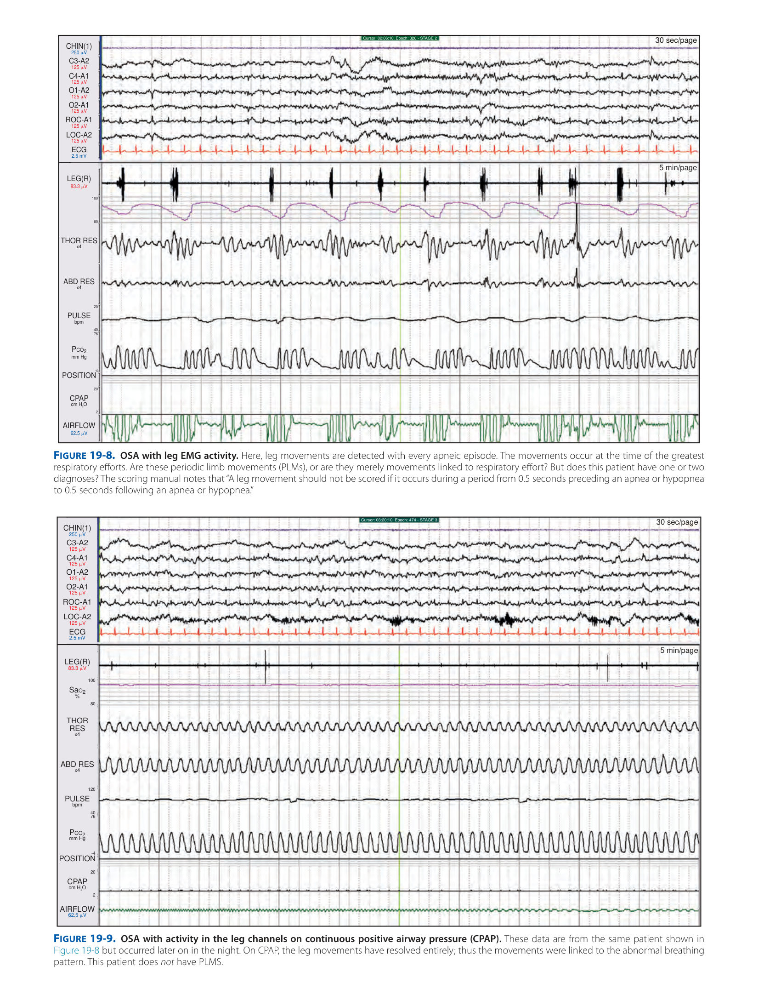

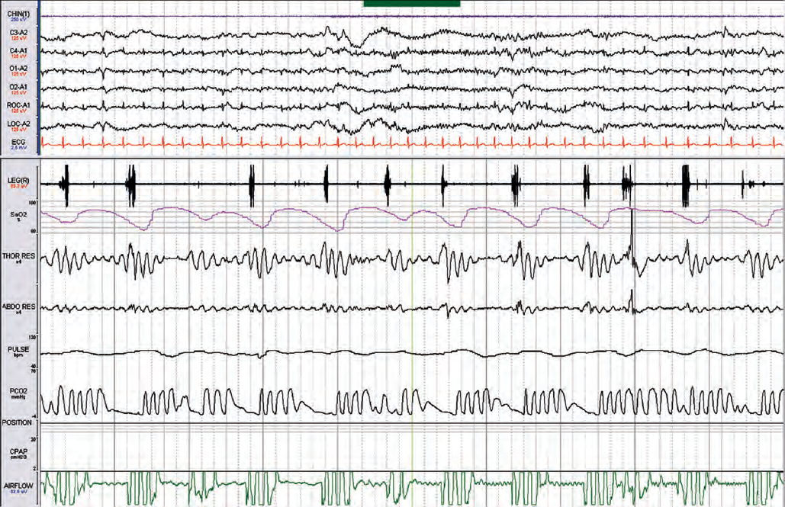

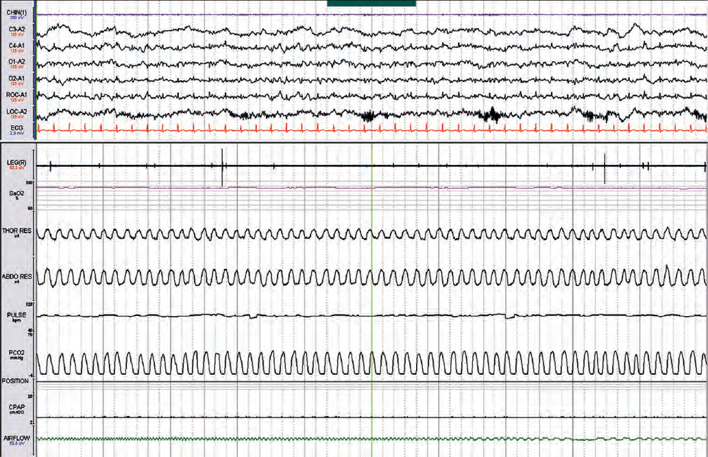

<!-- pdf-page: 462 -->

30 sec/page Cursor: 10:52:29, Epoch: 23 - REM

CHIN(1)

250 V C3-A2

125 V C4-A1

125 V O1-A2

125 V O2-A1

125 V ROC-A1

125 V LOC-A2

125 V ECG 2.5 mV

20 min/page

LEG(L)

125 mV

LEG(R)

FIGURE 19-10. Mixed sleep apnea with leg activity. Shown is another patient with leg movements and severe sleep apnea. The leg movements are not as

periodic or as regular as those in Figure 19-9. Are the movements simply a reflection of the breathing efforts? One clue is that the heart rate, measured by the pulse, shows oscillations that are not always linked to the abnormal breathing patterns.

125 mV

100

SaO2 %

50

THOR RES x1

ABD RES x1

80

PULSE bpm

40

50

PCO2 mm Hg

0 5

CPAP cm H2O

0

AIRFLOW

62.5 V

CPAP cm H2O 1 1 1 1 1 111 11 1 1 11 1 1 1 1 1 1 1 1 1 1 1 1 1 1 1 1 11 1 1 1 1 1 1 1 1 1 1 1111 1 1 1 1 1 1111 1 1 1 1 1 1111 1 1 1 1 1 1 1 1 1 1 1 1 1 1 1 1111 1 1 1 1 1 1111 1 1 1 1 1 1111 1 1 1 1 1 11111 1 1 1 1 1111 1 1 1 1 1 11111 1 1 1 1 1111 1 1 1 1 1 11111 1 1 1 1 1111 1 1 1 1 1 1111 1 1 1 1 1 1111 1 1 1 1 1 11111 1 1 1 1 1111 1 1 1 1 1 2 2 2 2 2 22 2 2 2 22 2 2 2 2 22 2 22 2 2 2 2 22 2 2 2 2 2 2 2 2 2 2 2 2 2 2 2 2 2 2 2 2 2 2 2 2 2 2 2 2 2 2 2 2 22 2 2 2 2 2 2 22 2 22 2 2 22 2 22 2 22 222 2 22 22 22 2 2 2222 2 2 2 2 2 222 2 2 2 2 22 22 2 2 2 2 222 2 2 2 22 22 2 2 22 2 2 2 2 2 2

CHIN(1)

250 V

C3-A2

125 V

C4-A1

125 V

O1-A2

125 V

O2-A1

125 V

ROC-A1

125 V

LOC-A2

125 V

ECG 2.5 mV

LEG(L)

125 V

LEG(R)

125 V

100

SaO2 %

50

THOR RES x2

ABD RES x1

80

PULSE bpm

40

50

PCO2 mm Hg

0 15

Cursor: 12:41:15, Epoch: 240 REM 30 sec/page

20 min/page

FIGURE 19-11. Mixed sleep apnea with activity in the leg channels on CPAP. This is the same patient as shown in Figure 19-10. The apnea has resolved,

but the leg movements continue at a very high rate. Note the improvement in SaO2. This patient has both sleep apnea and PLMS.

0

AIRFLOW

62.5 V

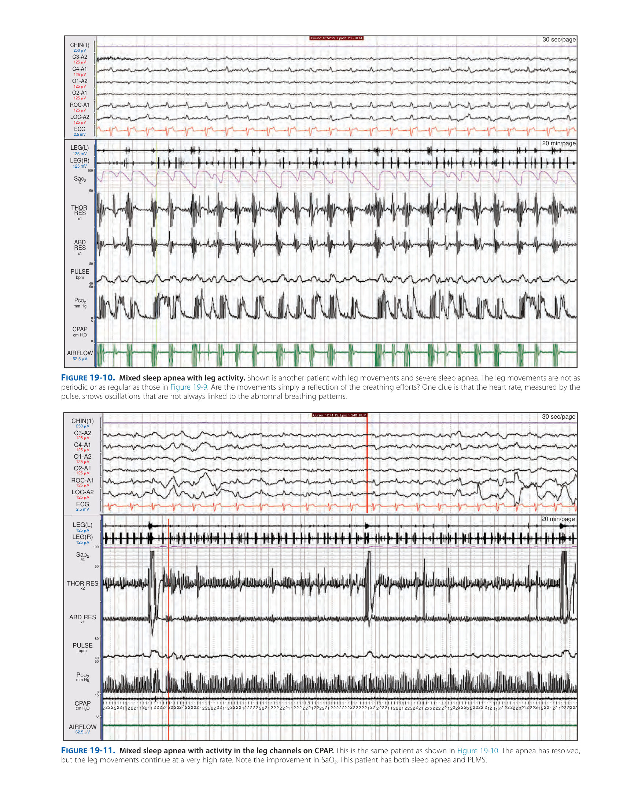

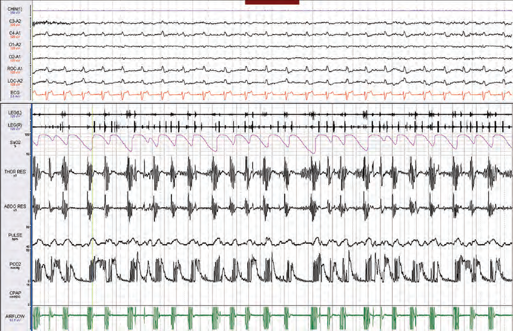

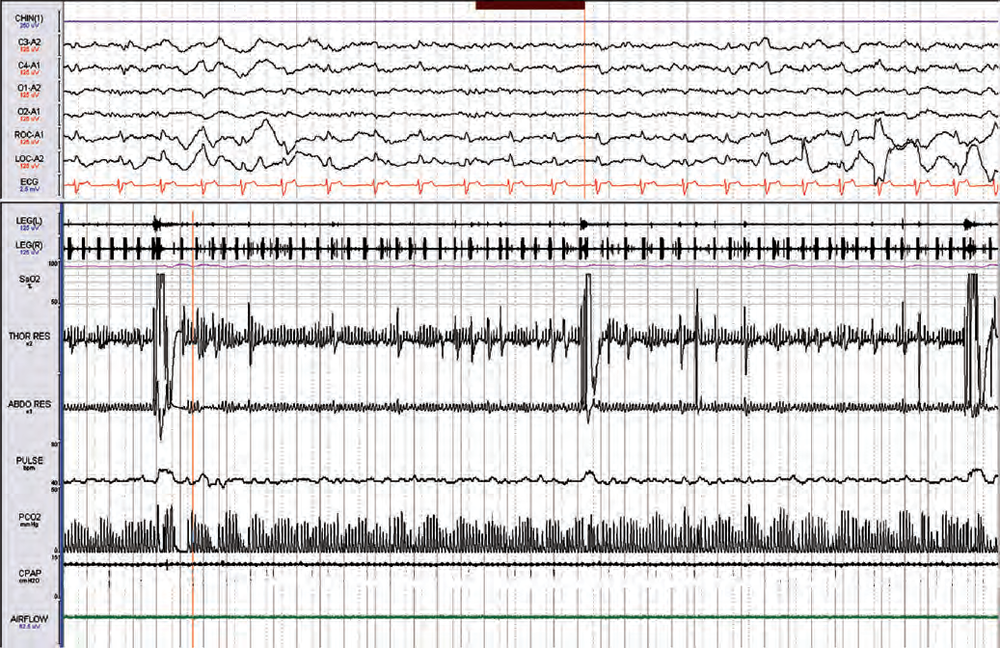

<!-- pdf-page: 463 -->

Digital Video Cursor: 00:53:01, Epoch: 150 - STAGE 2 30 sec/page

CHIN(1)

250 V

Close

C3-A2

125 V

C4-A1

125 V

O1-A2

125 V

O2-A1

125 V

ROC-A1

125 V

LOC-A2

125 V

ECG 2.5 mV

5 min/page

LEG(L)

125 V

LEG(R)

125 V

100

FIGURE 19-12. OSA with acromegaly. Synchronized digital video is extremely helpful in explaining the physiologic abnormalities in this patient. She slept

with her mouth wide open and moved her jaw forward to reestablish breathing. See Videos 35 and 36 on expertconsult.com for recordings of this patient.

SaO2 %

80

THOR RES x1

ABD RES x1

120

PULSE bpm

40

76

PCO2

mm Hg

-4

POSITION

30

CPAP cm H2O

2

AIRFLOW

62.5 V

FIGURE 19-13. OSA or hypoventilation? The patient is a 31-year-old man with a history of snoring, awakening with severe nocturnal headaches, and morbid

obesity (BMI of 49). REM sleep is detected, even though all the EEG channels show a great deal of electrocardiographic (ECG) artifact. The nasal pressure channel suggests that the events are simply episodes of obstructive apnea. The pCO2 channel shows breaths throughout the 2-minute epoch in the lower window. Hypoventilation is suggested by the high end-tidal pCO2 being recorded. Using current data acquisition systems, the clinician can “drill down” and examine individual breaths in great detail (see Fig. 19-14).

CHIN(1)

250 V

C3-A2

125 V

C4-A1

125 V

O1-A2

125 V

O2-A1

125 V

ROC-A1 LOC-A2

ECG 2.5 mV

LEG(R)

125 V

100

SaO2 %

80

THOR RES x1

ABD RES x4

120

PULSE bpm

40

60

PCO2 mm Hg

0

AIRFLOW

125 V

Cursor: 02:09:59, Epoch: 396 - REM 30 sec/page

2 min/page

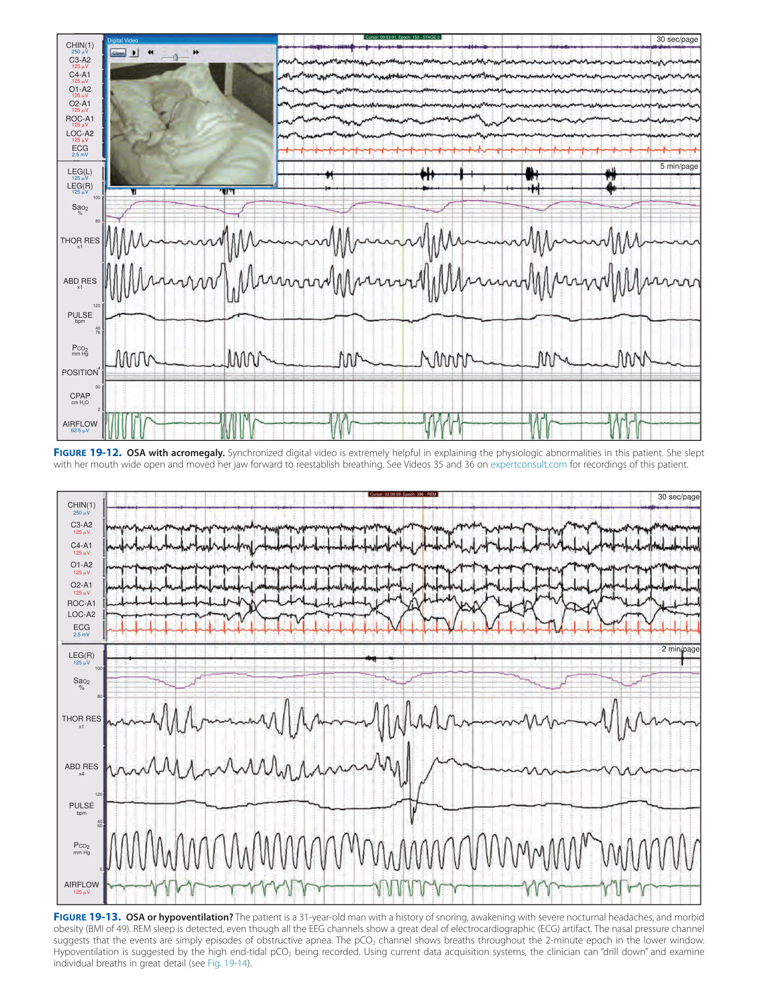

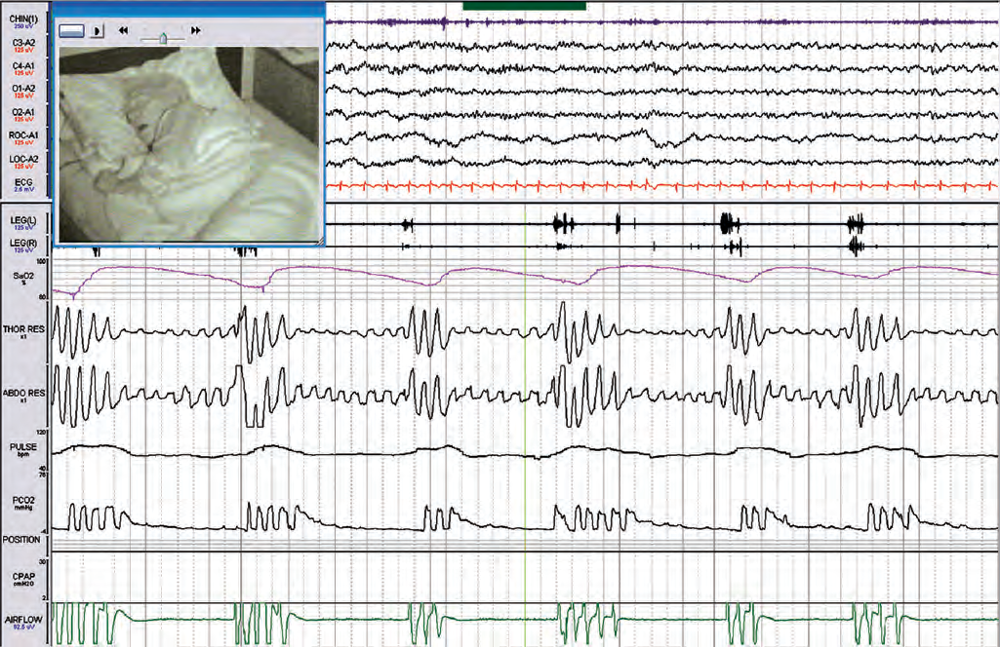

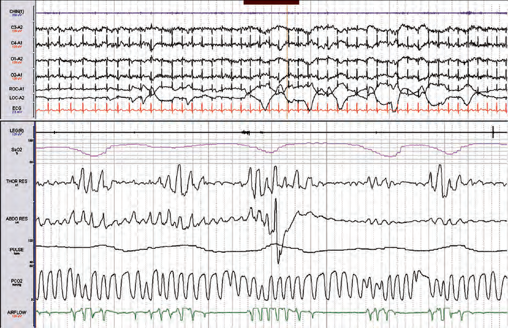

<!-- pdf-page: 464 -->

7 9

CHIN(1)

250 V

C3-A2

125 V

C4-A1

125 V

O1-A2

125 V

O2-A1

125 V

ROC-A1 LOC-A2

ECG 2.5 mV

LEG(R)

125 V

100

SaO2 %

80

THOR RES x1

ABD RES x4

120

PULSE bpm

40

60

5555555

55

4444444444444

44444 44

444

4 4

111 1

2

00

00 0

PCO2

999

8888

8 8 8 8

2 57

8 8

3 3 3 3 3 33

7 7 7

6 6

333 3

5 5

5

4

Cursor: 02:09:59, Epoch: 396 - REM 30 sec/page

15 sec/page

55555555

4444 444 44

4 44444444

444444 4 4 4

3 3 333 33 3 3 33

22 2

1 1

9

8

8 8

66

5 5

5

1

2 2

3 3

1

mm Hg

0

9

0

FIGURE 19-14. OSA or hypoventilation? The bottom window shows a 15-second epoch. CO2 is being detected with each of the small breaths; breathing

frequency is about 26 breaths/min. The digital system can include data points collected throughout on the CO2 channel. The highest end-tidal pCO2 noted here is 54 mm Hg. This number underestimates the true pCO2 for two reasons: 1) oronasal sampling will entrain some air, thereby diluting the airstream; and 2) the patient has a rapid, shallow breathing pattern, which will not result in a true measurement of alveolar pCO2. Thus, interpreting all the data leads to the conclusion that the main problem is hypoventilation. Some health care systems require such documentation to provide the patient with a mechanical ventilator or a bilevel positive airway pressure (BiPAP) device.

22 2 2 22

5 2

1 1 11 1 111 1

2 2

0

8

5

4 6 6 6

3

9

9

8

0

8

8

5 5

4 444

4 4 4

5

3 322 2

2

3

2 2 1

0

1

AIRFLOW

125 V

2 2

7 7 7

6

222222 2

2 2

5

4

22

2

1

111 1 1 1 1

0

2

8

8

111 111 1 1 1 1 1 11111

6 6 6

11 1 111

5

5 5 5 5

4

4

3

1

0

0 0

9

9 9

8 8 8 8 8 8 8

8

5 5

6 6 6 66

5

6 6 4

4

5

4

3 3

4

2

4

2 2

2 22 2

2

22

0 0

2

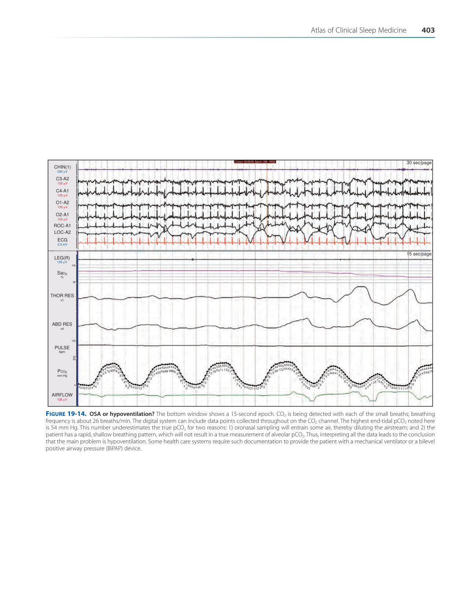

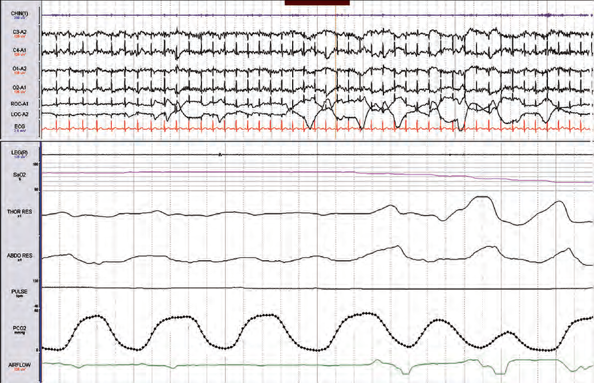

<!-- pdf-page: 465 -->

Cursor: 23:50:40, Epoch: 253 - REM 30 sec/page

CHIN(1)

250 V

C3-A2

125 V

C4-A1

125 V

O1-A2

125 V

O2-A1

125 V

ROC-A1

125 V

LOC-A2

125 V

ECG 2.5 mV

5 min/page

LEG(L)

125 uV

LEG(R)

125 V

100

FIGURE 19-15. Obstructive sleep apnea. The importance of sleep-stage recording. In this example, the patient has five episodes of oxygen desaturation

followed by a much longer episode of apnea, and oxygen desaturation is much greater. The top window is a 30-second epoch and the bottom is a 5-minute epoch; the top and bottom windows are synchronized by the vertical orange lines. In the middle of the upper window, the patient has gone into REM sleep, with sawtooth waves immediately followed by REM sleep. Sleep apnea is generally more severe in REM sleep.

SaO2 %

70

THOR RES x2

ABD RES x2

120

PULSE bpm

40

50

PCO2 mm Hg

0

POSITION

20

CPAP cm H2O

2

AIRFLOW

15.6 V

FIGURE 19-16. Awake and asleep: OSA. Sleep laboratories often ignore data obtained during wakefulness. These data are from a 49-year-old woman who

for 3 years had the perception that her breathing stopped during wakefulness. In addition, she had a history of snoring and severe sleepiness (Epworth sleepiness score of 24). Here the patient is awake but drowsy; notice the slow eye movements.

EMG1-EMG2

1.02 mV

C3-A1

128 V

C4-A1

128 V

Fr3-A1

128 V

Fr4-A1

128 V

O1-A1

128 V O2-A1

128 V

ROC-A1

128 V LOC-A1

128 V

ECG1-ECG2

2.05 mV

LAT-LAT-

512 V

RAT-RAT-

512 V

100

SaO2 %

85

THOR EFFORT

4.1 mV

ABD EFFORT

4.1 mV

120

Pulse bpm

40 75

ETCO2 mm Hg

0

20

CPAP PRES cm H2O

0

NASAL PRES

500 mV

Cursor: 11:14:45, Epoch: 19 - STAGE 1 30 sec/page

5 min/page

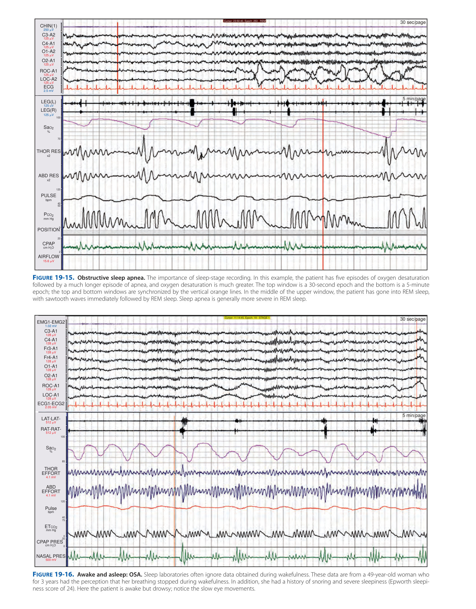

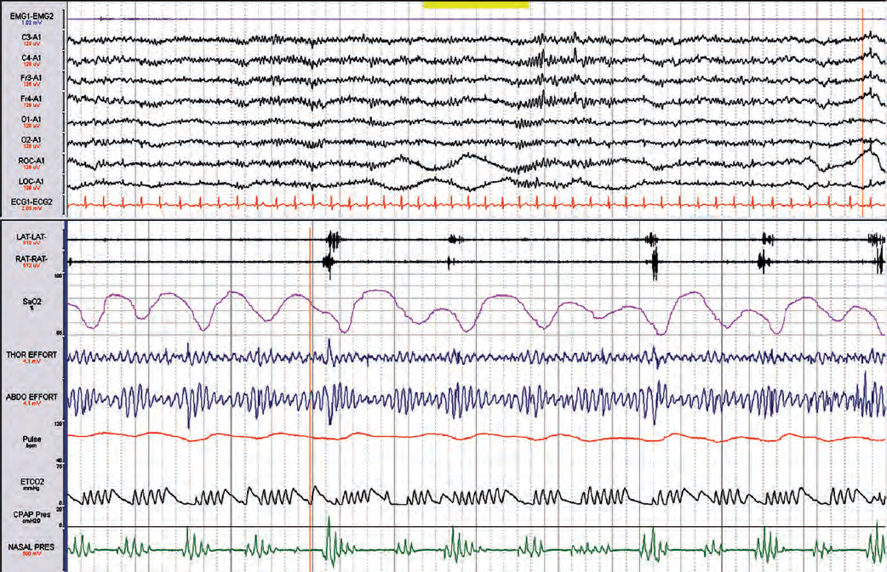

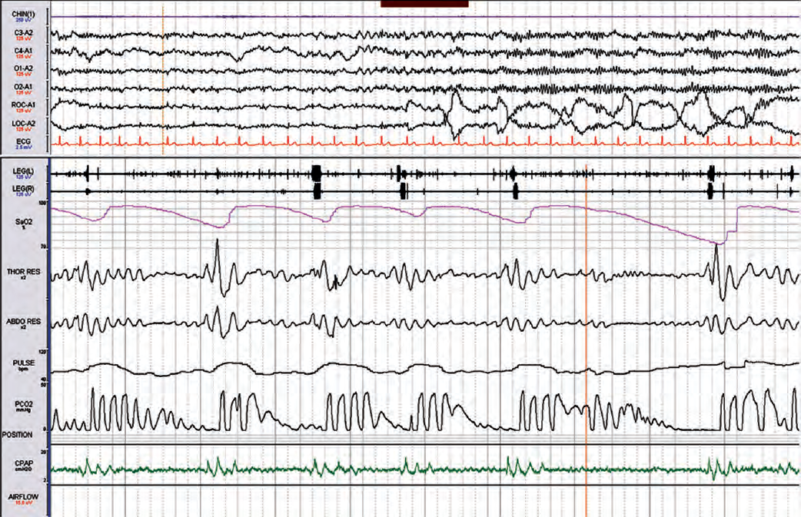

<!-- pdf-page: 466 -->

Cursor: 11:52:16, Epoch: 95 - STAGE 3 30 sec/page

EMG1-EMG2

1.02 mV

C3-A1

128 V

C4-A1

128 V

Fr3-A1

128 V

Fr4-A1

128 V

O1-A1

128 V O2-A1

128 V

ROC-A1

FIGURE 19-17. Awake and asleep: OSA. Here the same patient as shown in Figure 19-16 is in non-REM (NREM) sleep. The abnormal breathing pattern

continues.

128 V LOC-A1

128 V

ECG1-ECG2

2.05 mV

LAT-LAT-

512 V

RAT-RAT-

512 V

100

SaO2 %

85

THOR EFFORT

4.1 mV

ABD EFFORT

4.1 mV

120

Pulse bpm

40 75

ETCO2 mm Hg

0

20

CPAP PRES cm H2O

0

NASAL PRES

500 mV

5 min/page

FIGURE 19-18. Awake and asleep: OSA. This is the same patient as shown in Figures 19-16 and 19-17. CPAP treatment was ineffective; the patient was then

treated with bilevel pressure in a spontaneous mode. Notice in the channel labeled “CPAP” that clusters of 4 to 5 square waves represent the pressure generated by the bilevel machine in response to patient effort, but the apnea episodes continue. In fact, the patient now has central apneas. At the vertical orange line in the middle of the bottom window, the backup rate is added to the bilevel system. By the end of the epoch, both the breathing pattern and SaO2 have normalized.

CHIN(1)

250 V

C3-A2

125 V

C4-A1

125 V O1-A2

125 V

O21 125 V

ROC-A1

125 V LOC-A3

125 V ECG 2.5 mV

LEG(L)

625 V LEG(R)

625 V 100

SaO2 %

85

THOR RES x1.5

ABD RES x1

120

PULSE bpm

40 76

PCO2 mm Hg

-4 30

CPAP cm H2O

2

AIRFLOW

62.5 V

30 sec/page

Cursor: 11:04:16, Epoch: 41 - STAGE 2

10 min/page

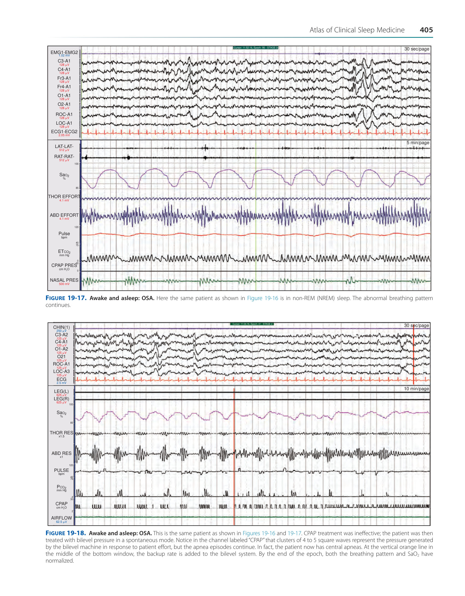

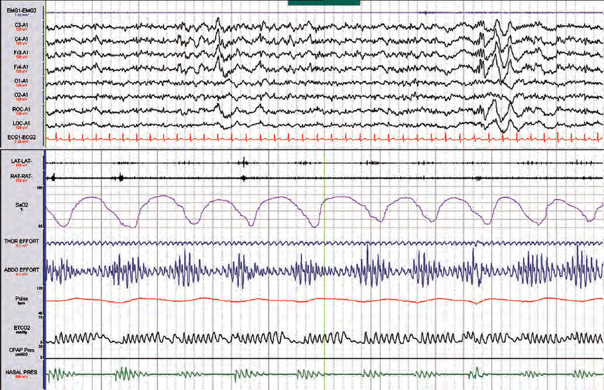

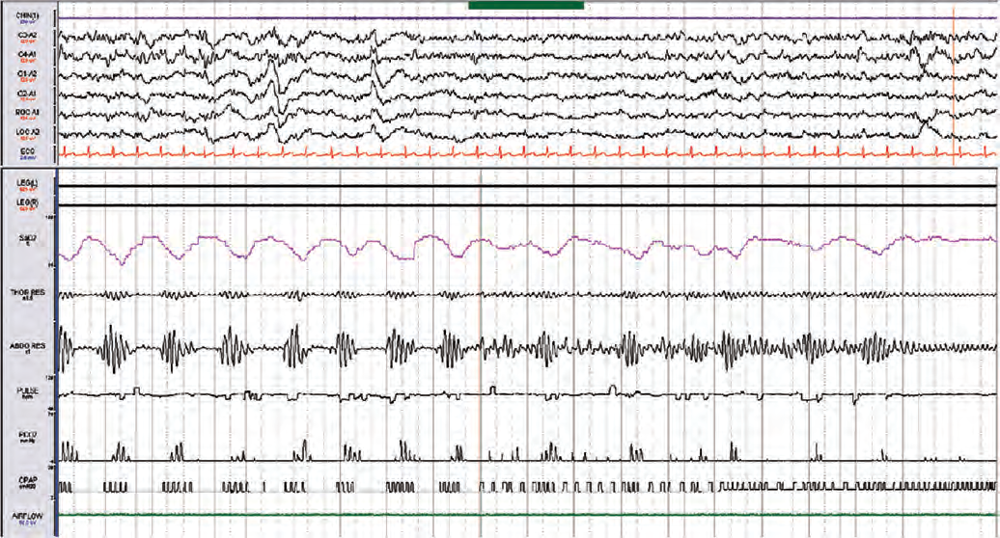

<!-- pdf-page: 467 -->

Cursor: 00:40:39, Epoch: 241 - STAGE 2 30 sec/page

EMG1-EMG2

1.02 mV

C3-A2

128 V

O2-A1

128 V

ROC-A1

128 V

LOC-A2

128 V

ECG1-ECG2

2.05 mV

5 min/page

LAT-LAT

512 V

RAT-RAT

512 V

100

FIGURE 19-19. Mixed apnea. Mixed apnea usually begins with central apnea (absent thoracic and abdominal effort) followed by obstructive apnea, as docu­

mented by efforts to breathe in the absence of airflow. Physiologic changes with mixed apnea are very similar to the changes in OSA: oxygen desaturations, increases in heart rate, and arousals. Consequently, most clinicians regard mixed apnea as obstructive events. Patients may respond extremely well to CPAP, or they may develop PAP-emergent central sleep apnea. Whether the PAP-emergent episodes resolve over time (as CO2 receptors recover from blunting) or persist (due to underling cardiac, metabolic, or drug-related factors) depends on the patient’s comorbid conditions and status. These data are from a 50-year-old man who began to snore at age 16 years after sustaining a broken nose playing hockey. The nasal obstruction related to the fracture was never treated, but he responded well to CPAP.

SaO2 %

80

THOR RES

2.05 mV

4.1 mV ABD EFFORT

80

Pulse bpm

40

50

ETCO2 mm Hg

0

2.50 mV NASAL PRES

FIGURE 19-20. OSA in a patient with Down syndrome. Physical examination showed an enlarged tongue. In this 5-minute recording sample, the range of

SaO2 is between 90% and 100%. Thus the drops in SaO2 are quite small. Even though oxygenation pathophysiology was only mild to moderate, the patient had severe sleepiness associated with his abnormal breathing pattern.

EMG1-EMG2

1.02 mV

C3-A2

128 V

C4-A1

128 V Fr3-A2

128 V Fr4-A1

128 V

O1-A2

128 V O2-A1

128 V ROC-A1

128 V LOC-A2

128 V

ECG1-ECG2

2.05 mV

512 V LAT-LAT

512 V RAT-RAT

100

SaO2 %

90

THOR EFFORT

2.05 mV

8.19 mV ABD EFFORT

120

Pulse bpm

40 50

ETCO2 mm Hg

0 20

CPAP PRES cm H2O

0

500 mV NASAL PRES

Cursor: 11:32:46, Epoch: 82 - STAGE 4 30 sec/page

5 min/page

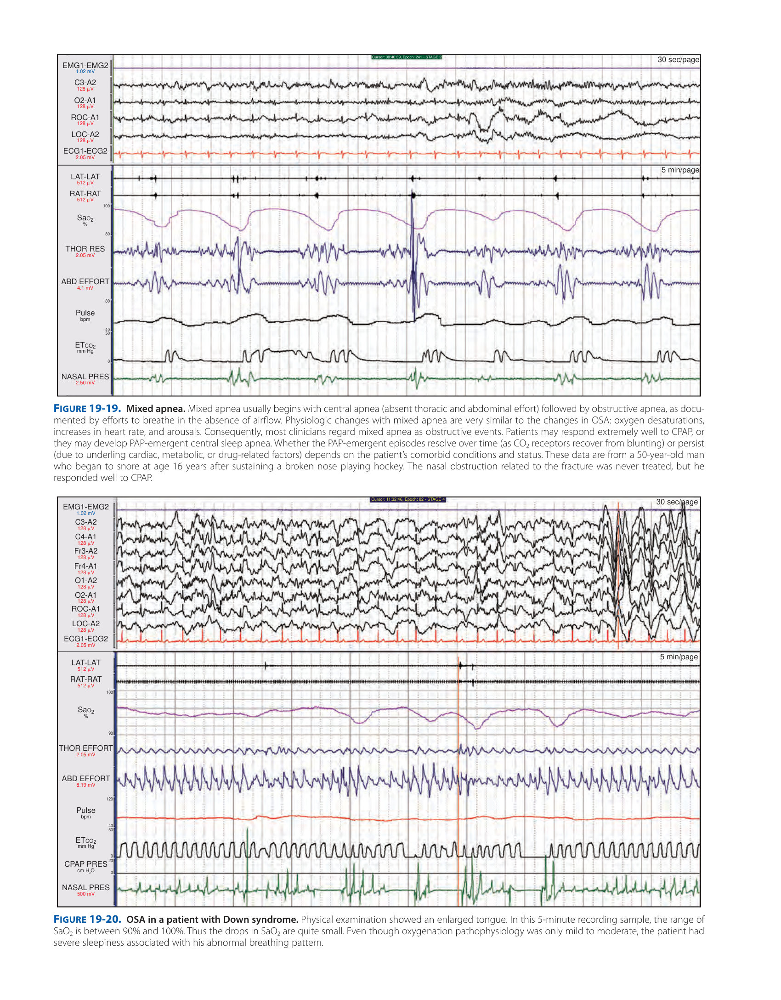

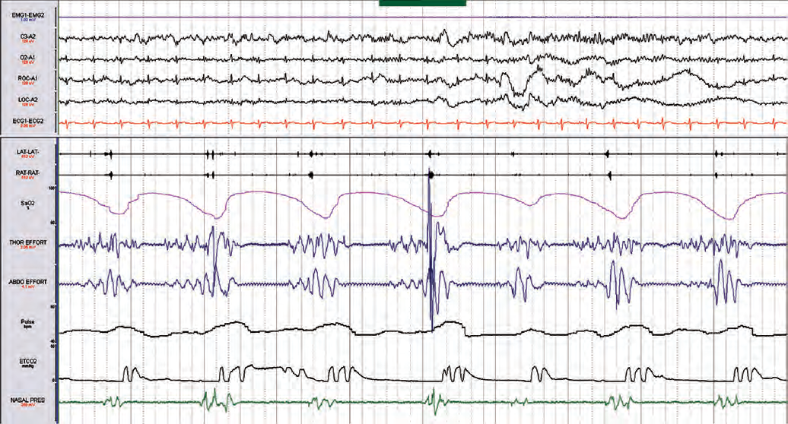

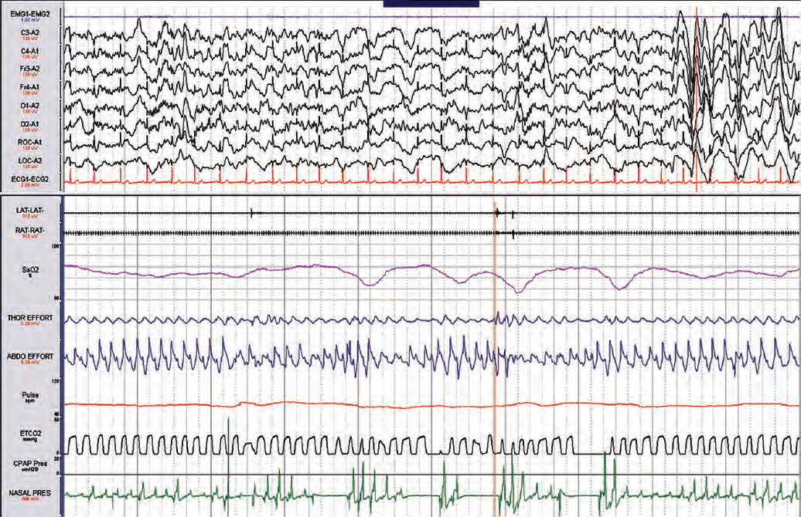

<!-- pdf-page: 468 -->

Digital Video Cursor: 22:37:38, Epoch: 65 - STAGE 2 30 sec/page

EMG1-EMG2

1.02 mV

Close

C3-A2

128 V

C4-A1

128 V

O1-A2

128 V

O2-A1

128 V

O2-A1

128 V

LOC-A2

128 V

ECG1-ECG2

2.05 mV

10 min/page

LAT-LAT-

512 V

FIGURE 19-21. OSA and periodic limb movements. This female patient had both severe apnea and severe PLMs. Examining the synchronized digital video

is very useful with such patients because the clinician can see and hear episodes of obstruction and the often vigorous movements. This patient moved a great deal during sleep, and she sweated and kicked off her bedclothes. Notice the very large-amplitude low-frequency oscillation in the three channels referenced to the A1 electrode, representing sweat artifact.

RAT-RAT-

512 V

100

SaO2 %

80

THOR EFFORT

8.19 mV

ABD EFFORT

4.1 mV

120

Pulse bpm

60 50

ETCO2 mm Hg

0 12

CPAP PRES cm H2O

0

NASAL PRES

250 mV

Digital Video Cursor: 03:03:27, Epoch: 597 - STAGE 2 30 sec/page

FIGURE 19-22. OSA and periodic limb movements. This is the same patient as shown in Figure 19-21, now on CPAP. Her breathing has become entirely

normal, the leg movements have ceased, and the sweat artifact is gone.

EMG1-EMG2

1.02 mV

Close

C3-A2

128 V

C4-A1

128 V

O1-A2

128 V

O2-A1

128 V

O2-A1

128 V

LOC-A2

128 V

ECG1-ECG2

2.05 mV

LAT-LAT-

1.02 mV

RAT-RAT-

512 V

100

SaO2 %

80

THOR EFFORT

8.19 mV

ABD EFFORT

4.1 mV

120

Pulse bpm

60 50

ETCO2 mm Hg

0 12

CPAP PRES cm H2O

0

NASAL PRES

250 mV

10 min/page

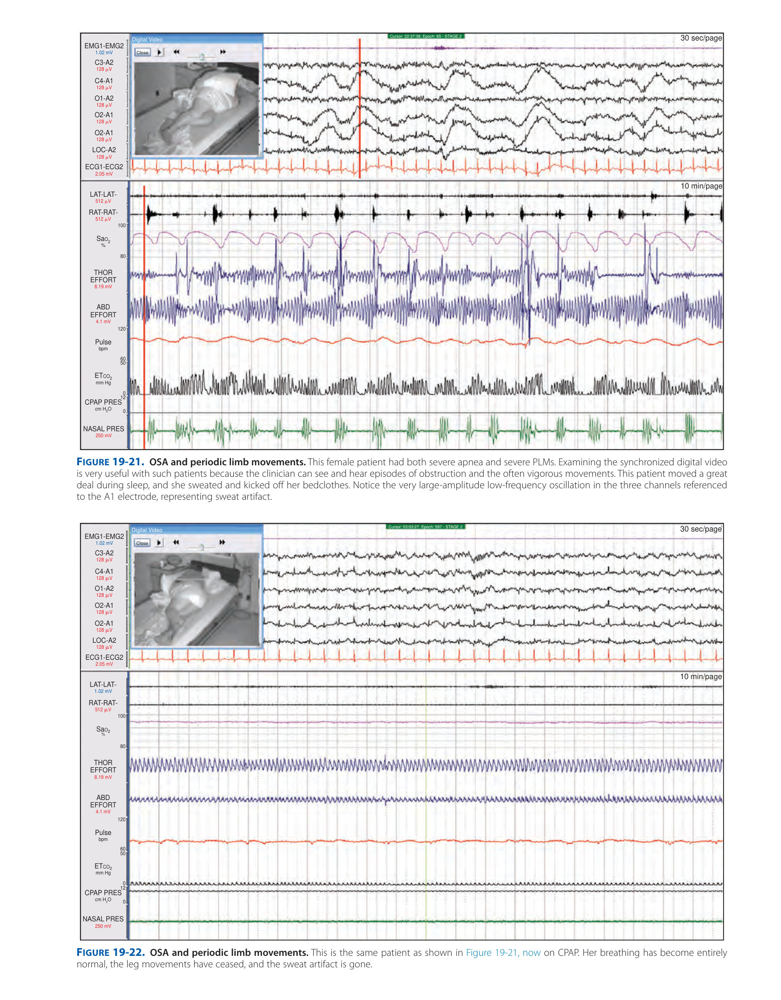

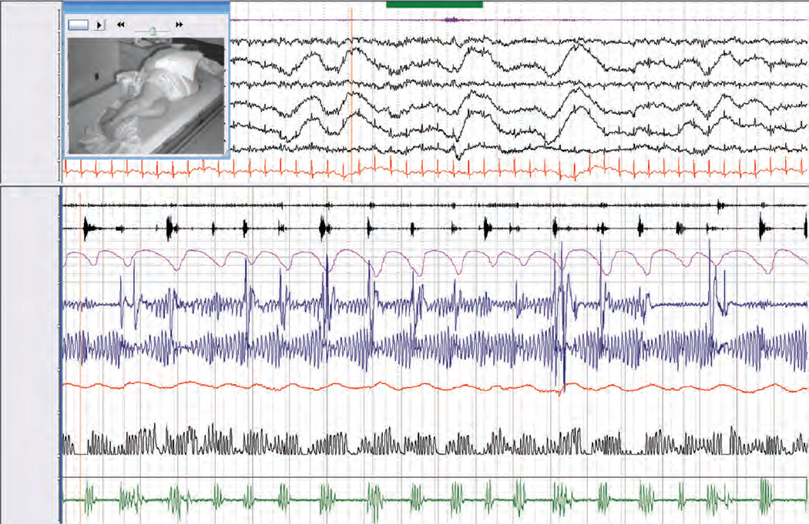

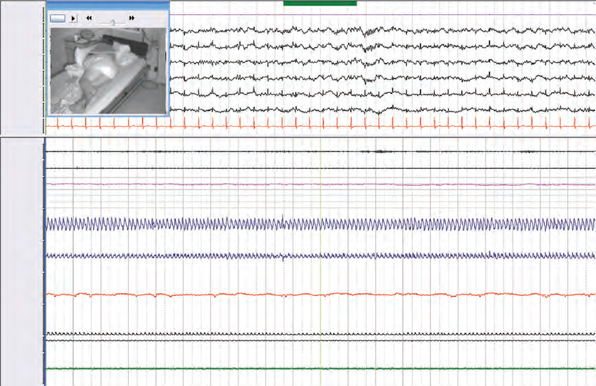

<!-- pdf-page: 469 -->

408 Gallery of Polysomnographic Recordings

FIGURE 19-23. Upper airway resistance syndrome (UARS). A clue to a sleep breathing abnormality becomes evident when examining the breathing vari­

ables in time compression; the bottom window is 1 hour. The SaO2 signal is “ragged,” tiny deflections are associated with sudden increased excursion in thoracic and abdominal effort, and an arousal is noted in the EEG (the orange vertical lines are synchronized). Figures 19-24 and 19-25 show additional information when drilling down on the data.

EMG1-EMG2

1.02 mV

C3-A2

128 V

C4-A1

128 V

Fr3-A2

128 V

Fr4-A1

128 V

O1-A2

128 V

O2-A1

128 V

ROC-A1

128 V

LOC-A2

128 V

ECG1-ECG2

2.05 mV

LAT-LAT-

512 V

RAT-RAT-

512 V

100

SaO2 %

50

THOR EFFORT

4.1 mV

ABD EFFORT

4.1 mV

120

Pulse bpm

40 75

ETCO2 mm Hg

0 20

CPAP PRES cm H2O

0

NASAL PRES

500 mV

Cursor: 23:47:51, Epoch: 161 - STAGE 3 30 sec/page

1 hr/page

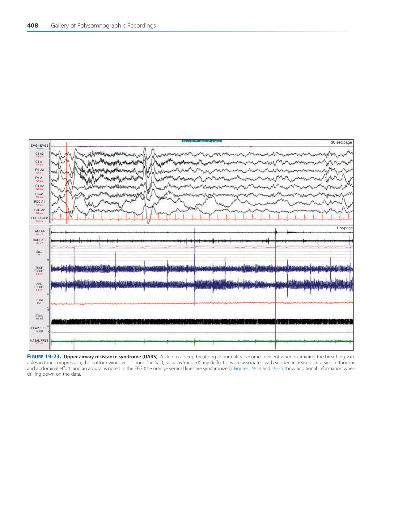

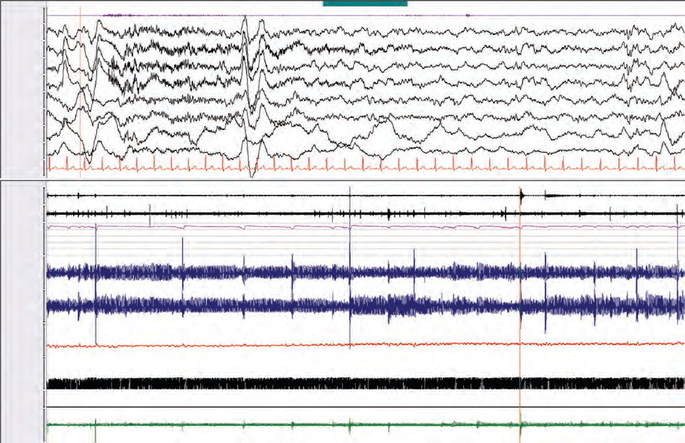

<!-- pdf-page: 470 -->

FIGURE 19-24. UARS, drilling down on the previous polysomnographic fragment (see Fig. 19-23). The upper window shows a 30-second epoch and

the lower window shows a 5-minute epoch. The gain of the SaO2 signal has been increased, and the scale is 90% to 100%. The synchronized digital video shows that the mouth is open and the patient is snoring quietly. The synchronizing vertical orange lines indicate the patient is one breath away from an event. The drop in SaO2 is only 2%, the nasal pressure changes are small, and the oronasal EtCO2 measurement shows continuous breathing. Figure 19-25 shows a moment one breath later.

Digital Video

EMG1-EMG2

1.02 mV

Close

C3-A2

128 V

C4-A1

128 V

Fr3-A2

128 V

Fr4-A1

128 V

O1-A2

128 V

O2-A1

128 V

ROC-A1

128 V

LOC-A2

128 V

ECG1-ECG2

2.05 mV

LAT-LAT-

512 V

RAT-RAT-

512 V

100

SaO2 %

90

THOR EFFORT

4.1 mV

ABD EFFORT

4.1 mV

120

Pulse bpm

40 75

ETCO2 mm Hg

0 20

CPAP PRES cm H2O

0

NASAL PRES

250 mV

30 sec/page

5 min/page

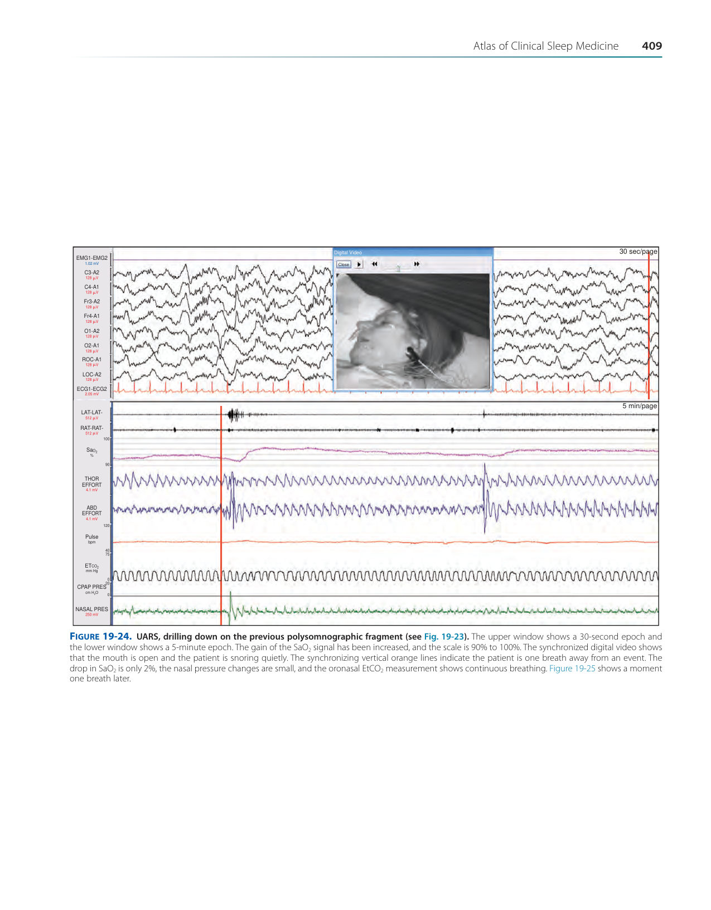

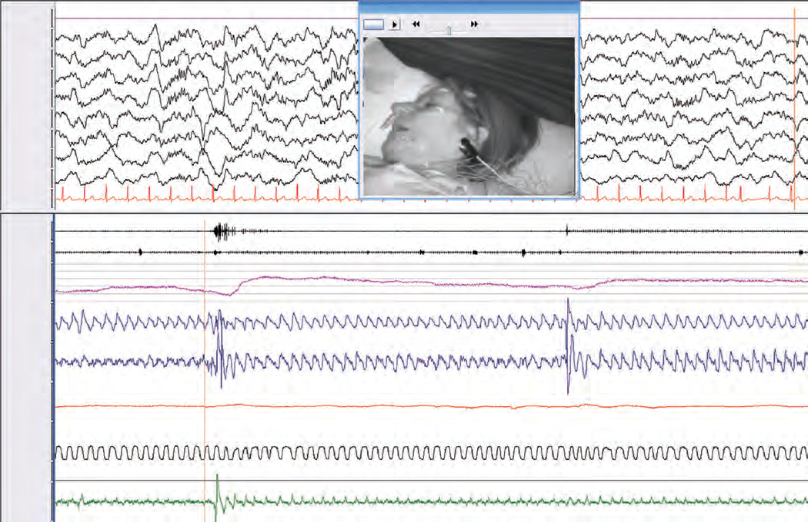

<!-- pdf-page: 471 -->

Digital Video 30 sec/page

EMG1-EMG2

1.02 mV

Close

C3-A2

128 V

C4-A1

128 V

Fr3-A2

128 V

Fr4-A1

128 V

O1-A2

128 V

O2-A1

128 V

ROC-A1

128 V

LOC-A2

128 V

ECG1-ECG2

2.05 mV

5 min/page

FIGURE 19-25. UARS (the same patient shown in Fig. 19-24, one breath later). The patient has closed her mouth and is now breathing through her nose

(see the nasal pressure change). This is followed by an increase in SaO2. On the video, she snorts and then turns her head. The red vertical lines, which synchronize the top and bottom windows, show that this is associated with an arousal on EEG. This is a respiratory effort–related arousal (RERA), although the nasal pressure transducer was not giving the information needed to properly characterize the event. Whereas some experts claim that the nasal pressure transducer is adequate for scoring hypopneas—because in part, they believe mouth breathing is a rare event—it has been our experience that mouth breathing is a very common finding.

LAT-LAT-

512 V

RAT-RAT-

512 V

100

SaO2 %

90

THOR EFFORT

4.1 mV

ABD EFFORT

4.1 mV

120

Pulse bpm

40 75

ETCO2 mm Hg

0 20

CPAP PRES cm H2O

0

NASAL PRES

250 mV

FIGURE 19-26. UARS. The lower window shows a 5-minute epoch. Reductions in SaO2 are small and reverse with increases in the nasal pressure signal. Here

the orange synchronizing vertical lines precede a K-complex and a speeding up of the EEG. This is an RERA.

EMG1-EMG2

1.02 mV

C3-A2

128 V

C4-A1

128 V

Fr3-A2

128 V

Fr4-A1

128 V

O1-A2

128 V

O2-A1

128 V

ROC-A1

128 V

LOC-A2

128 V

ECG1-ECG2 2.05 mV

LAT-LAT-

RAT-RAT-

100

SaO2 %

50

THOR EFFORT

4.1 mV

ABD EFFORT

4.1 mV

120

Pulse bpm

40 50

ETCO2 mm Hg

0 20

CPAP PRES cm H2O

0

NASAL PRES

200 mV

Cursor: 00:41:27, Epoch: 237 - STAGE 2 30 sec/page

5 min/page

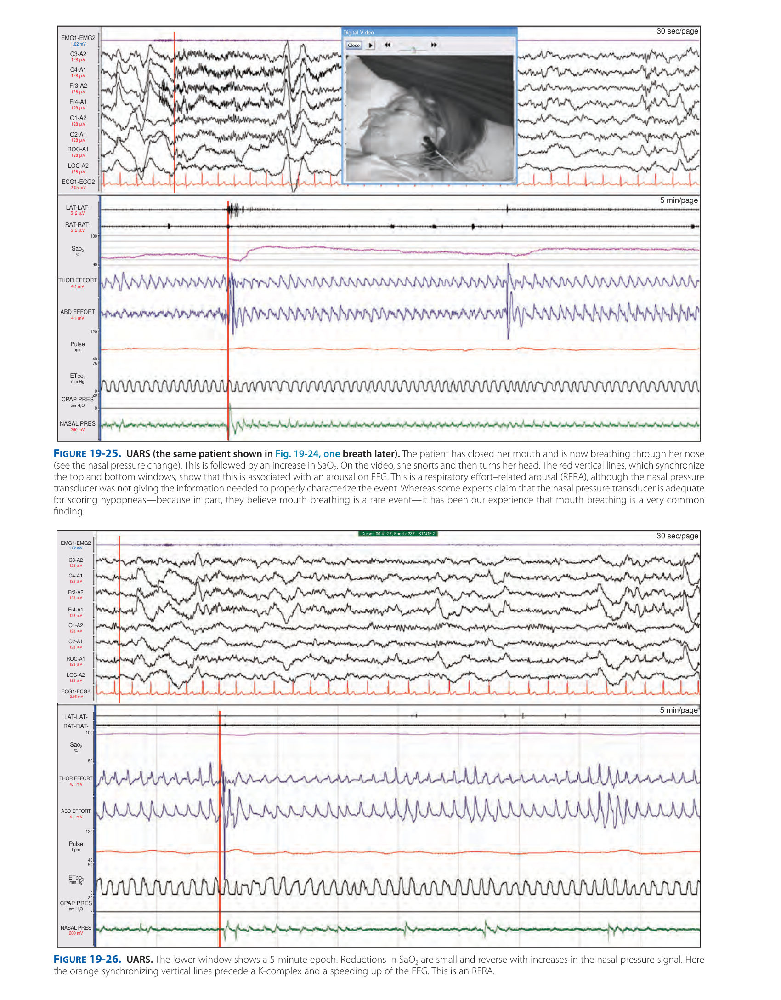

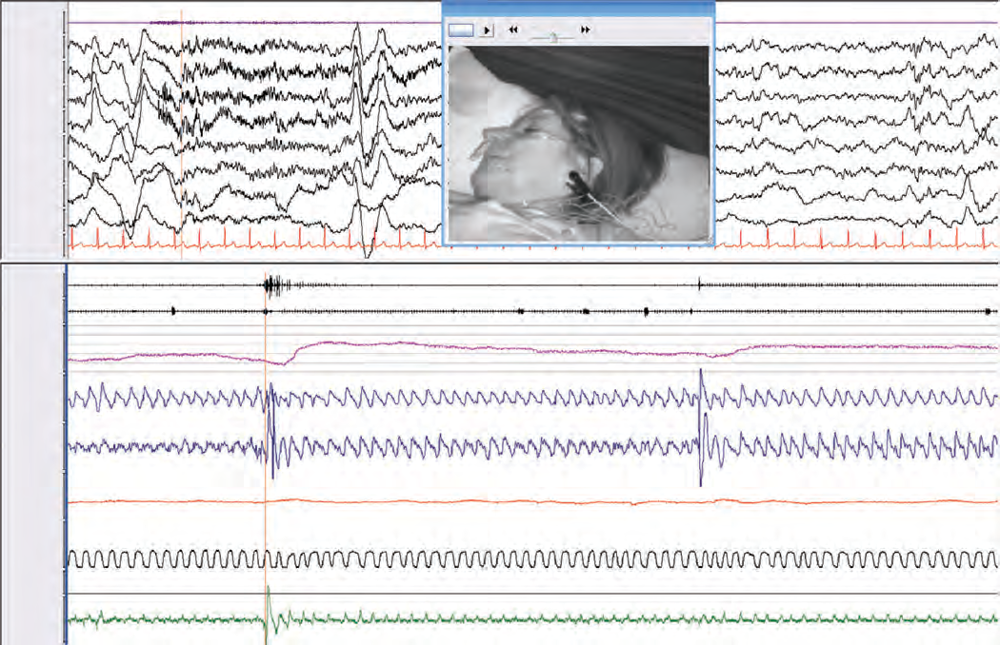

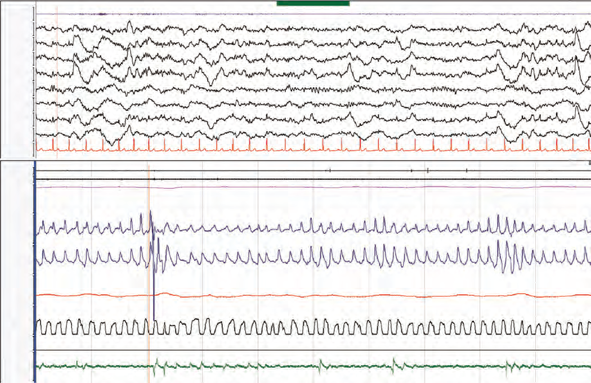

<!-- pdf-page: 472 -->

Cursor: 02:49:56, Epoch: 494 - STAGE 2 30 sec/page

EMG1-EMG2

1.02 mV

C3-A2

128 V

C4-A1

128 V

Fr3-A2

128 V

Fr4-A1

128 V

O1-A2

128 V

O2-A1

128 V

ROC-A1

128 V

LOC-A2

128 V

ECG1-ECG2

2.05 mV

FIGURE 19-27. UARS (the same patient as shown in Fig. 19-26). The SaO2 is steady, as is the breathing pattern. Massive REM sleep rebound occurred in the

second part of the night when the patient was on CPAP (not shown here).

RAT-RAT- LAT-LAT-

100

SaO2 %

90

THOR EFFORT

4.1 mV

ABD EFFORT

4.1 mV

90

Pulse bpm

50 60

ETCO2 mm Hg

0 20

CPAP PRES cm H2O

0

NASAL PRES

200 mV

5 min/page

2192 2195 2197 2200 2202 2205 2207 2210 2212 2215 2217

EMG1-EMG2

1.02 mV

C3-A2

128 V

C4-A1

128 V

O1-A2

128 V O2-A1

128 V

ROC-A1

128 V

LOC-A2

128 V

ECG1-ECG2

2.05 mV

Cursor: 10:57:20, Epoch: 74 - STAGE 3 30 sec/page

2155 2180 2230 2255 2280 2305 2330 2355 2390 2405

LAT-LAT-

512 V

RAT-RAT-

512 V

100

SaO2 %

90

THOR EFFORT

8.19 mV

ABD EFFORT

4.1 mV

120

Pulse bpm

40 75

ETCO2 mm Hg

0

POSITION

20

CPAP PRES cm H2O

0

NASAL PRES

200 mV

2205

5 min/page

FIGURE 19-28. Prolonged obstructive hypoventilation. In some continuous heavy snorers, a slow but progressive reduction is sometimes seen in SaO2,

associated with a progressive increase in effort, followed by a snort and then an increase in SaO2. In this example, the change in SaO2 is only about 3%. The patient is breathing entirely through the mouth, and the nasal pressure trace is completely flat and not helpful. This would be scored as an RERA.

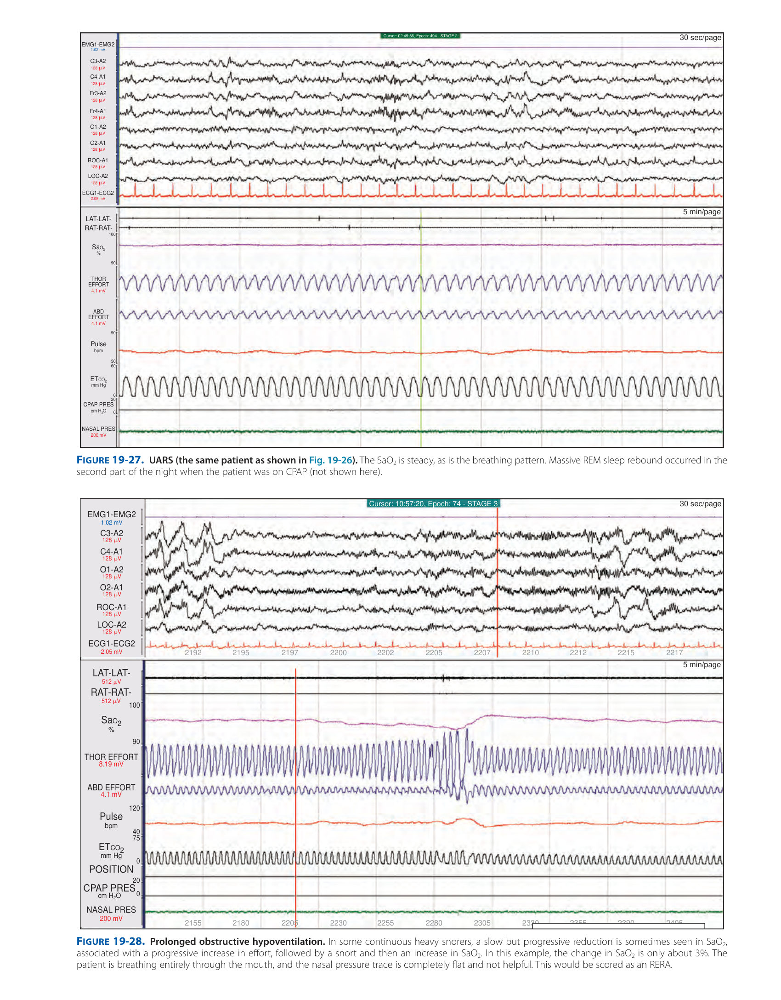

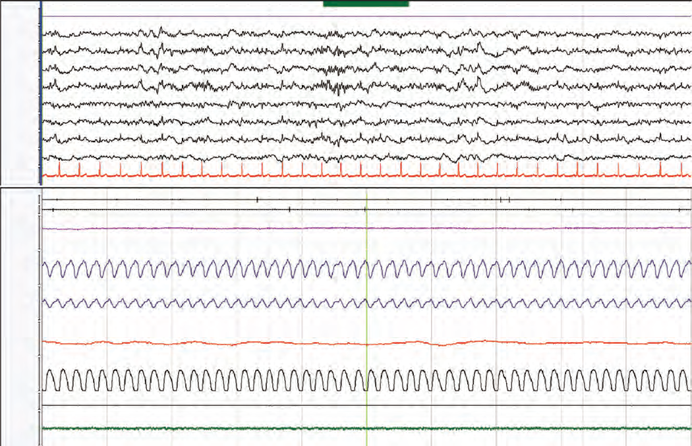

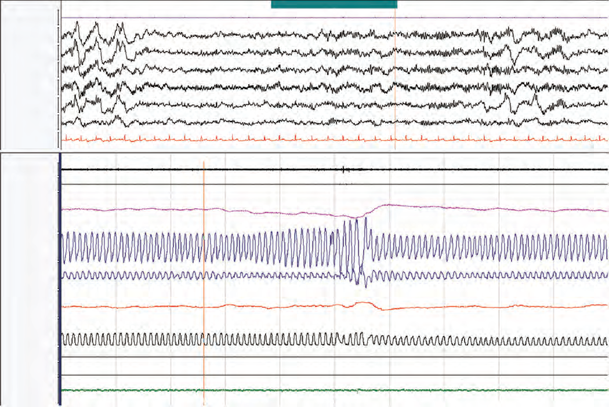

<!-- pdf-page: 473 -->

412 Gallery of Polysomnographic Recordings

72 68 33 33 33 33 33 33 35 36 80 88 88 88 79 36 72 68 68 68 68 68 62 67 66 34 70 72 72 71 71 71 69 64 65 68 68 68 68 69 71 72 72 73 72 72 70 75 74 76 76 34 71 71 93 94 94 94

E2-M1

E1-M2

Microarousal [snr(l)]

## 60s

## 60s

C4-M1

C3-M2

CHIN1

RERA (3.0s)

ECG

02:24:14 485 486

R-R

32

02:25:14

94 94 96 94 94 94 94 94 93 93 93 95 97 97 95 96 96 96 96 96 96 96 95 95 95 95 94 94 97 94

RLeg

Snore

PTAF

THERM

THOR

ABD

Sum

100 92 85

SaO2 (%)

FIGURE 19-29. UARS causing cardiac arrhythmia. The upper and lower windows each show a 1-minute epoch. Notice that in the beginning of the epoch,

a very low heart rate (~33 beats/min) is recorded in the R-R channel. The patient is in REM sleep, as indicated in the eye channels. About a quarter of the way into the epoch, a microarousal occurred in response to abnormal breathing. This is an RERA. There has been an increase in the snoring channel and, following the arousal, the heart rate increased abruptly to about 94 beats/min. When the heart rate was low, the ECG indicated a 2 : 1 Mobitz second-degree atrioventricular block, and there were two P waves for each conducted beat. This was presumably caused by increased parasympathetic activity, which in turn was caused by the increase in the patient’s respiratory effort when the upper airway was obstructed. See Figures. 19-70 to 19-73 for more details about heart blocks.

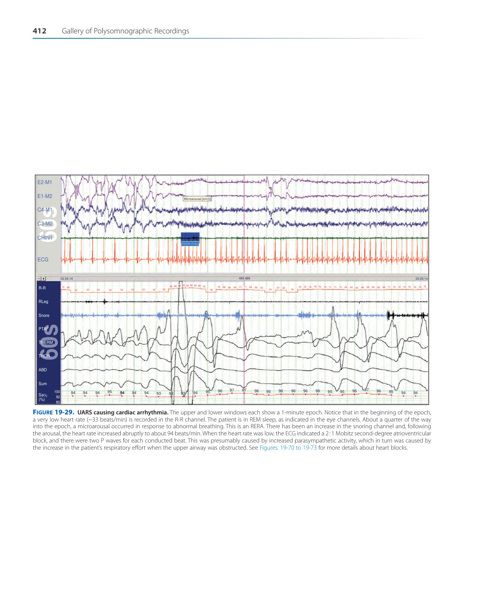

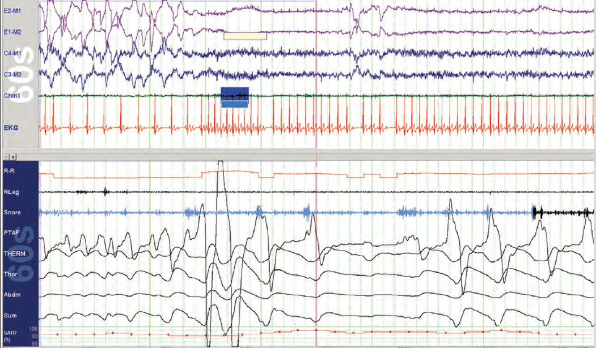

<!-- pdf-page: 474 -->

3002 3005 3007 3010 3012 3015 3017 3020 3022 3025 3027

EMG1- EMG2

C3-A2

C4-A1

O1-A2

O2-A1

ROC-A1

LOC-A2

ECG1- ECG2

Cursor: 11:15:30, Epoch: 101 - STAGE 4 30 sec/page

Ob.Hyp Ob.HypOb.Hyp Ob.Hyp Ob.Hyp Ob.Hyp Ob.Hyp O Ob.Hyp Ob.Hyp

LAT-LAT-

512 V

RAT-RAT-

512 V

100

SaO2 %

80

Ob.Hyp

Ob.Hyp

Ob.Hyp

Ob.Hyp

Ob.Hyp

THOR EFFORT

4.1 mV

Ob.Hyp

Ob.Hyp

Ob.Hyp

Ob.Hyp

Ob.Hyp

ABD EFFORT

4.1 mV

120

Pulse bpm

40 75

10 min/page

Ob.Hyp

Ob.Hyp

Ob.Hyp

Ob.Hyp

O

Ob.Hyp

Ob.Hyp

Ob.Hyp

Ob.Hyp

O

2800 2750 2850 2900 2950 3000 3050 3100 3150 3200 3250

ETCO2 mm Hg

0

POSITION

20

CPAP PRES cm H2O

0

NASAL PRES

500 mV

FIGURE 19-30. UARS or obstructive hypopneas? The lower window shows a 10-minute epoch. Small oscillations in SaO2 are associated with changes in

nasal pressure, but note that little change occurs in the oronasal pCO2 trace. This suggests that the patient is mouth breathing during each event, thereby causing the reduction in SaO2. The clinician could infer that these are hypopneas. The patient is a 54-year-old man with a BMI of 31 and a 20-year history of snoring, recently observed apnea, and sleepiness. His apnea-hypopnea index was 52.3, but on CPAP it decreased to 7.9. Interpretation of a study should include consideration of all available data; the final diagnosis was severe OSA syndrome.

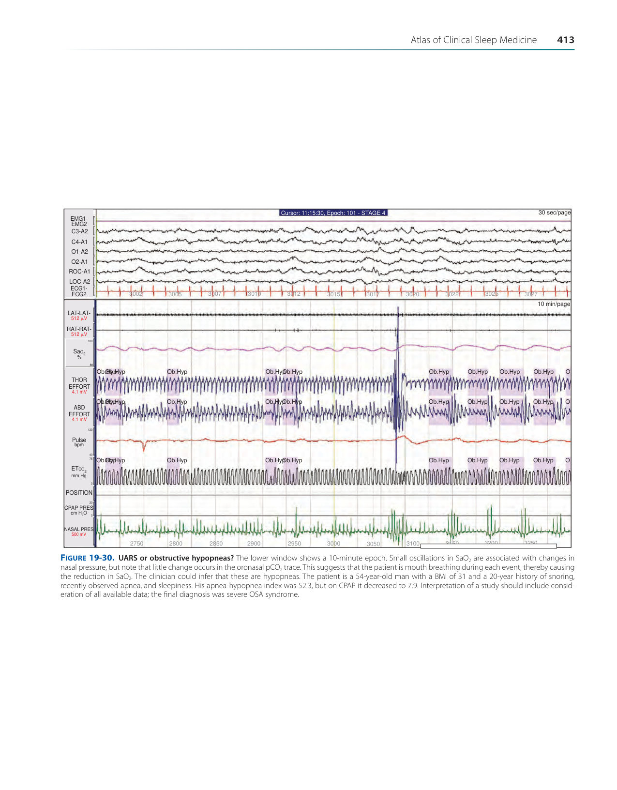

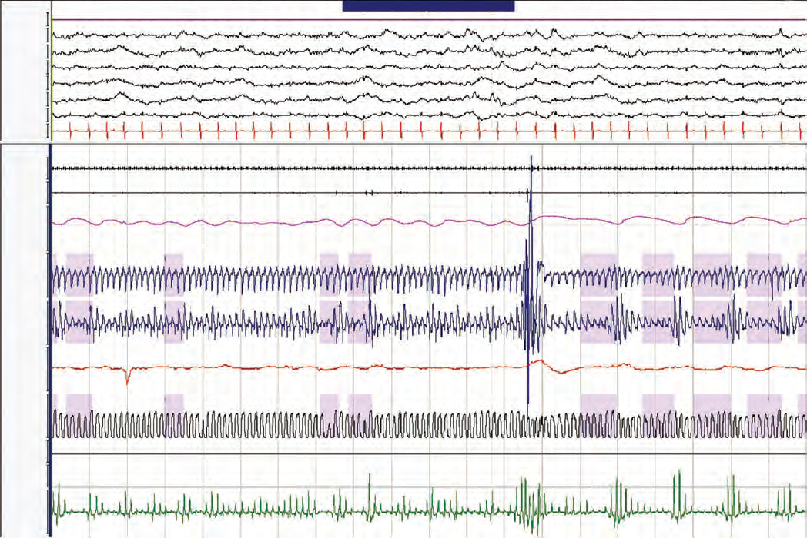

<!-- pdf-page: 475 -->

414 Gallery of Polysomnographic Recordings

FIGURE 19-31. Idiopathic central sleep apnea. The term central apnea refers to a cessation of breathing in excess of 10 seconds with markedly reduced or

absent effort to breathe. Central apnea may occur during wakefulness, as in this example. This is a 71-year-old patient who had central apnea of unknown etiology recorded during both wakefulness and sleep. Note the absence of effort in both the thoracic and abdominal effort channels. The longest episode of apnea is almost 30 seconds. Note the cardiogenic oscillations in the CO2 trace. Although the patient is awake throughout, fluctuating levels of alpha-wave activity appear in the EEG channels. In this example, the patient’s overall breathing rate is only 7 breaths/min. The top window shows a 30-second epoch and the bottom shows a 2-minute epoch. Similar findings occur in some patients who use opioid medications. This patient responded well to low-flow CPAP.

#### CENTRAL SLEEP APNEA

CHIN(1)

250 V

C3-A2

125 V

C4-A1

125 V

O1-A2

125 V

O2-A1

125 V

ROC-A1

125 V

LOC-A2

125 V

ECG 1.67 mV

LEG(L)

250 V LEG(R)

250 V

100

SaO2 %

90

THOR RES x1

ABD RES x1

120

Pulse bpm

30 50

PCO2 mm Hg

0

AIRFLOW

62.5

Cursor: 00:25:44, Epoch: 241 - AWAKE 30 sec/page

2 min/page

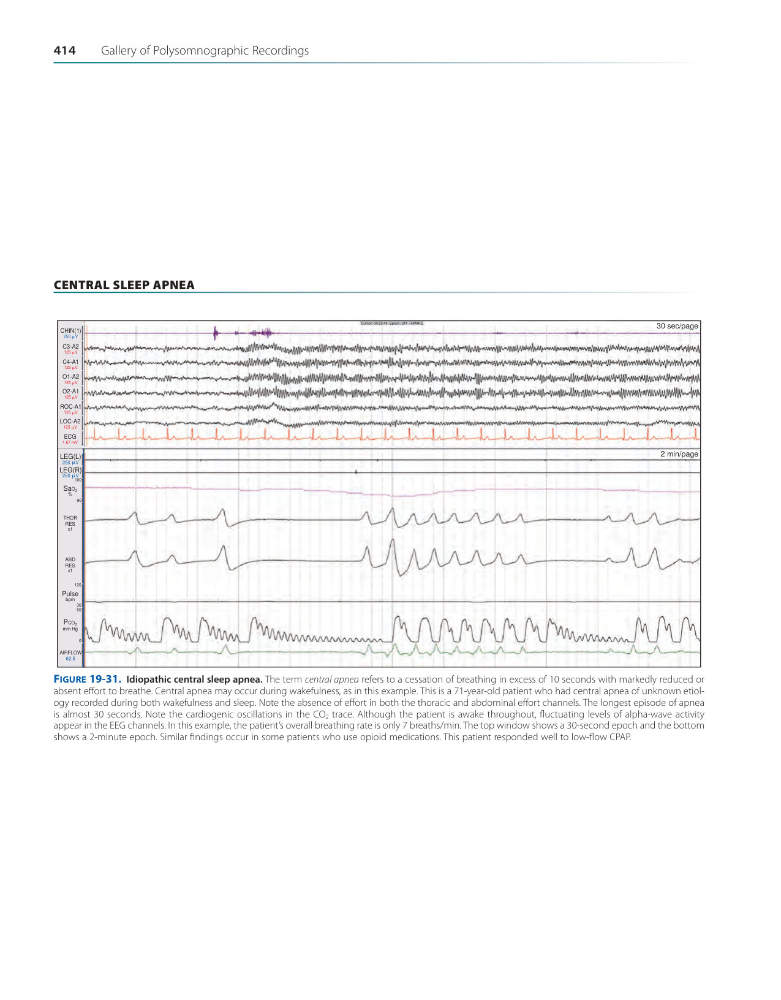

<!-- pdf-page: 476 -->

FIGURE 19-32. Central apnea related to opiates. These data are from a 44-year-old soldier treated for severe nerve pain related to an ankle injury. He had

had snoring, severe sleepiness, and witnessed apnea for 2 to 3 years. His pain was treated with morphine. He had a breathing frequency of only four or five breaths/min and repetitive cycles of two to three breaths, followed by central apneic episodes. The bottom window shows a 5-minute epoch. It is likely that this pattern is related to the morphine. The patient also had central apnea during wakefulness.

CHIN(1)

250 V

C3-A2

125 V

C4-A1

125 V

O1-A2

125 V

O2-A1

125 V

ROC-A1

125 V

LOC-A2

125 V

ECG 2.5 mV

LEG(L)

250 V

LEG(R)

250 V

100

SaO2 %

90

THOR RES x1

ABD RES x1

120

PULSE bpm

40 50

PCO2 mm Hg

0

AIRFLOW

62.5 V

Cursor: 25:57:18, Epoch: 210 - STAGE 2 30 sec/page

5 min/page

<!-- pdf-page: 477 -->

416 Gallery of Polysomnographic Recordings

FIGURE 19-33. Central apnea related to opiates. The top and bottom windows each show a 30-minute epoch. REM sleep occurs when there are large,

dense deflections in the two electrooculogram (EOG) channels. Notice that the patient’s breathing pattern actually changes during REM, and much less periodicity is evident in the breathing pattern and the SaO2. When the patient emerges from REM sleep at the end of this epoch, the abnormal breathing pattern seen in Figure 19-32 returns. The central apneic episodes in NREM sleep are likely being maintained by the ventilatory chemical control system, which is depressed by morphine. When the patient goes into REM sleep, REM processes override the ventilatory control system.

CHIN(1)

250 V

C3-A2

125 V

C4-A1

125 V

O1-A2

125 V

O2-A1

125 V

ROC-A1

125 V

LOC-A2

125 V

ECG 2.5 mV

LEG(L)

250 V

LEG(R)

250 V

100

SaO2 %

80

THOR RES x1

ABD RES x1

120

PULSE bpm

40 50

PCO2 mm Hg

0

AIRFLOW

62.5 V

Cursor: 23:59:35, Epoch: 215 - STAGE 2 30 min/page

30 min/page

<!-- pdf-page: 478 -->

Digital Video Cursor: 11:04:53, Epoch: 51 - STAGE 3 30 sec/page

FIGURE 19-34. Idiopathic central sleep apnea. This patient, a 30-year-old man, came to medical attention with severe daytime sleepiness, snoring, and

nocturnal headaches. Episodes of central apnea (reduced or absent thoracic and abdominal efforts) and oxygen desaturations are apparent. Note that each cluster of breaths is made up of only four to five breaths, and the apnea episodes are about 20 seconds long. The top window is a 30-second epoch and the bottom window is a 5-minute epoch. Because of his snoring history, this patient was first tested on CPAP (see Fig. 19-35).

CHIN(1)

Close

250 V C3-A2

125 V

C4-A1

125 V

O1-A2

125 V

O2-A1

125 V

ROC-A1

125 V

LOC-A2

125 V

ECG 2.5 mV

LEG(L)

125 V LEG(R)

125 V

100

SaO2 %

85

THOR RES x1

ABD RES x1

120

PULSE bpm

40 50

PCO2 mm Hg

0

20

CPAP cm H2O

2

AIRFLOW

62.5 V

5 min/page

<!-- pdf-page: 479 -->

418 Gallery of Polysomnographic Recordings

FIGURE 19-35. Idiopathic central sleep apnea on CPAP (the same patient as shown in Fig. 19-34). While on CPAP, worsening of the patient’s apneic

episodes was marked, to about 40 seconds in length. Complex sleep apnea is a term recently introduced that implies ventilatory instability in some patients leads to episodes of central apnea. Operationally, this is defined as patients who develop central sleep apnea with PAP therapy. By that definition, some might conclude that this patient had a variant of complex sleep apnea. However, defining a disease based on the response to treatment is problematic, and many do not believe that this is an independent entity. The most accurate description of his diagnosis would be “central apnea worsened by positive airway pressure.” Thus, although his history suggested OSA, simply initiating CPAP without monitoring or without first determining apnea type would have placed this patient at increased risk. In the sleep laboratory setting, the clinician could proceed to the next step, testing on BiPAP, as shown in Figure 19-36.

Digital Video

CHIN(1)

250 V

Close

C3-A2

125 V

C4-A1

125 V

O1-A2

125 V O2-A1

125 V

ROC-A1

125 V

LOC-A2

125 V

ECG 2.5 mV

LEG(L)

125 V LEG(R)

125 V

100

SaO2 %

85

THOR RES x1

ABD RES x1

120

PULSE bpm

40 50

PCO2 mm Hg

0 20

CPAP cm H2O

2

AIRFLOW

62.5 V

Cursor: 12:33:35, Epoch: 229 - STAGE 2 30 sec/page

5 min/page

<!-- pdf-page: 480 -->

FIGURE 19-36. Idiopathic central sleep apnea on bilevel pressure (the same patient as shown in Fig. 19-35). There was a further marked lengthening

of this patient’s apneic episodes to about 100 seconds. Clearly this approach was not going to be effective. Rather than proceeding to BiPAP with a timed backup, this patient was started on adaptive servoventilation (ASV), as shown in Figure 19-37.

Digital Video

CHIN(1)

250 V

Close

C3-A2

125 V

C4-A1

125 V

O1-A2

125 V O2-A1

125 V

ROC-A1

125 V

LOC-A2

125 V

ECG 2.5 mV

LEG(L)

125 V LEG(R)

125 V

100

Sao2 %

85

THOR RES x2

ABD RES x1

120

PULSE bpm

40 50

PCO2 mm Hg

0 20

CPAP cm H2O

2

AIRFLOW

62.5 V

Cursor: 13:00:30, Epoch: 204 - STAGE 2 30 sec/page

5 min/page

<!-- pdf-page: 481 -->

Cursor: 14:33:35, Epoch: 469 - STAGE 4 30 sec/page

Digital Video

Close CHIN(1)

250 V

C3-A2

125 V

C4-A1

125 V

O1-A2

125 V O2-A1

125 V

ROC-A1

125 V

LOC-A2

125 V

ECG 2.5 mV

5 min/page

LEG(L)

FIGURE 19-37. Idiopathic central sleep apnea on ASV (the same patients as shown in Fig. 19-16). This type of airway pressure support calculates the

patient’s minute ventilation and takes into account the breathing pattern. It compensates by adding additional support during episodes of apnea and less support during hyperpnea. The patient’s episodes of central apnea were resolved by this treatment.

125 V LEG(R)

125 V

100

SaO2 %

85

THOR RES x4

ABD RES x4

120

PULSE bpm

40 50

PCO2 mm Hg

0 20

CPAP cm H2O

2

AIRFLOW

62.5 V

4922 4925 4927 4930 4932 4935 4937 4940 4942 4945 4947

CHIN(1)

250 V

C3-A2

125 V

C4-A1

125 V

O1-A2

125 V O2-A1

125 V

ROC-A1

125 V

LOC-A2

125 V ECG 2.5 mV

Cursor: 11:52:40, Epoch: 165 - AWAKE 30 sec/page

4970 5020 5070 5120 5170 5220 5270 5320 5370 5420 5470

LEG(L)

125 V LEG(R)

125 V

100

SaO2 %

85

THOR RES x4

ABD RES x0.7

120

PULSE bpm

40 60

PCO2 mm Hg

-4 20

CPAP cm H2O

2

10 min/page

FIGURE 19-38. Idiopathic central sleep apnea: treatment with ASV. This 55-year-old man came to medical attention with cognitive impairment and sleepi­

ness but no snoring. He was found to have episodes of central apnea and had worsening episodes on CPAP; he had no response to oxygen and was then tested on ASV. The top window shows a 30-second epoch and the bottom shows a 10-minute epoch, each starting at the same time. The channel labeled “CPAP” shows the pressure output of the ASV device. Notice that when the patient is apneic, the device produces the most pressure. By the end of the epoch, the patient’s breathing pattern is normalizing, as is his SaO2. Figure 19-39 shows a more prolonged response.

<!-- pdf-page: 482 -->

8552 8555 8557 8560 8562 8565 8567 8570 8572 8575 8577

CHIN(1)

250 V

C3-A2

125 V

C4-A1

125 V

O1-A2

125 V O2-A1

125 V

ROC-A1

125 V

LOC-A2

125 V ECG 2.5 mV

Cursor: 12:53:10, Epoch: 286 - AWAKE 30 sec/page

8700 8850 9000 9150 9300 9450 9600 9750 9900 10050 10200

LEG(L)

125 V LEG(R)

125 V

100

SaO2 %

85

THOR RES x1

ABD RES x0.5

120

PULSE bpm

40

60

PCO2 mm Hg

-4

20

CPAP cm H2O

2

30 min/page

FIGURE 19-39. Idiopathic central apnea: treatment with adaptive servoventilation (the same patient as shown in Fig. 19-38). The lower window shows

a 30-minute epoch. Notice that after about 7 minutes, all the data show signs of normalizing, except that the ASV is still showing periodic changes in pressure support. By the end of the epoch, everything has normalized, including the output of the ASV, which is now steady. Thus the pressure support delivered by the ASV device has changed based on changes in the patient’s breathing pattern.

<!-- pdf-page: 483 -->

422 Gallery of Polysomnographic Recordings

FIGURE 19-40. Mixed apnea becoming complex sleep apnea. This 63-year-old man had a history of a recent coronary artery bypass graft, daytime sleepi­

ness, snoring, and observed sleep apnea. The top window is a 30-second epoch and the bottom is a 20-minute epoch. Examination of the thoracic and abdominal respiratory effort channels reveals that several of the more than 20 apnea episodes shown here had evidence of a central component (absent or decreased effort) followed by efforts. These are episodes of mixed apnea. Figure 19-41 shows the response to treatment.

#### MIXED AND COMPLEX SLEEP APNEA

EMG1-EMG2

1.02 mV

C3-A2

128 V

O2-A1

125 V

ROC-A1

128 V

LOC-A2

128 V ECG1-ECG2

2.05 mV

LAT-LAT-

512 V

RAT-RAT-

512 V

100

SaO2 %

80

THOR EFFORT

4.1 mV

ABD EFFORT

4.1 mV

120

Pulse bpm

40 75

ETCO2 mm Hg

0 20

CPAP PRES cm H2O

0

NASAL PRES

500 mV

Cursor: 01:09:47, Epoch: 351 - STAGE 2 30 sec/page

20 min/page

<!-- pdf-page: 484 -->

FIGURE 19-41. Mixed apnea becoming complex sleep apnea (the same patient as shown in Fig. 19-40). The first treatment that was tried was CPAP,

which caused the mixed apneas to become central apneas. The patient even had episodes of central apnea while he was awake. At about the vertical orange line in the bottom window, oxygen was added to the CPAP system and the episodes of central apnea resolved.

EMG1-EMG2

1.02 mV

C3-A2

128 V

O2-A1

125 V

ROC-A1

128 V

LOC-A2

128 V ECG1-ECG2

2.05 mV

LAT-LAT-

512 V

RAT-RAT-

512 V

100

SaO2 %

80

THOR EFFORT

4.1 mV

ABD EFFORT

4.1 mV

120

Pulse bpm

40 75

ETCO2 mm Hg

0 20

CPAP PRES cm H2O

0

NASAL PRES

500 mV

Cursor: 02:19:48, Epoch: 491 - STAGE 2 30 sec/page

30 min/page

<!-- pdf-page: 485 -->

424 Gallery of Polysomnographic Recordings

00:35 01:35 02:35 03:35 04:35 05:35 06:02

Sleep Stage

M1

Hours 1 2 3 4 5 7 6

4 3 2 1 R W

00:35 01:35 02:35 03:35 04:35 05:35 06:02

Apnea/Hypopnea

HDI:20 Cen

Note the very large numbers of central apneas

Hours 1 2 3 4 5 7 AHI:21.6

Mix Obs

HYP

Cen Mix Obs

APN

ADI: 19.6

00:35 01:35 02:35 03:35 04:35 05:35 06:02

Oxygen saturation

100 90 80 70 60 50 Des

Hours 1 2 3 4 5 7 6

A

FIGURE 19-42. Sleep apnea that worsens with treatment; another variant of complex apnea is shown here and in the following figure. A, Hypnogram

of a patient being treated with opiates for pain. This diagnostic study shows that he had central sleep apnea with an apnea-hypopnea index of 19. The next figure shows what happened when he was titrated with CPAP.

<!-- pdf-page: 486 -->

22:51 23:52 00:52 01:52 02:52 03:52 04:52 05:35

MT

Sleep Stage

Hours 1 2 3 4 5 7 6

4 3 2 1 R W

22:51 23:52 00:52 01:52 02:52 03:52 04:52 05:35

Cen

Apnea/Hypopnea

HDI: 16.6

Hours 1 2 3 4 5 6

Mix Obs

HYP

Cen Mix Obs

APN

ADI: 42.9

AHI: 59.6

22:51 23:52 00:52 01:52 02:52 03:52 04:52 05:35

100 90 80 70 60 50 Des

Oxygen saturation

Hours 1 2 3 4 5 7 6

22:51 23:52 00:52 01:52 02:52 03:52 04:52 05:35

20 15 12 8 4 0

CPAP

AHI: 38.5

Hours 1 2 3 4 5 7 6

64.3 43.1 21.8

Total AHI: 44.7

B, Hypnogram of the patient while he was being titrated, first on CPAP then on BiPAP, ending with BiPAP and a backup rate. The bottom panel shows PAP settings. The treatments worsened this patient’s sleep breathing findings and sleep structure. It is worth noting that increasing ventilatory support worsens, rather than solves, the problem.

B

FIGURE 19-42, cont’d

<!-- pdf-page: 487 -->

426 Gallery of Polysomnographic Recordings

FIGURE 19-43. Mixed apnea in a patient with idiopathic pulmonary fibrosis. This patient had very rapid and severe oxygen desaturations likely related to

low lung volumes. Note that the SaO2 range is 50% to 100%.

CHIN(1)

250 V

C3-A2

125 V C3-A2

128 V

O1-A2

125 V

O2-A1

125 V

ROC-A1

125 V LOC-A2

125 V ECG 1.25 mV

LEG(L)

125 V

LEG(R)

125 V

100

SaO2 %

50

THOR EFFORT

x0.5

ABD RES x0.5

120

PULSE bpm

40 50

PCO2 mm Hg

-4

AIRFLOW

31.3 V

Cursor: 23:46:41, Epoch: 162 - STAGE 2 30 sec/page

5 min/page

<!-- pdf-page: 488 -->

FIGURE 19-44. Congestive heart failure (CHF) with awake Cheyne-Stokes breathing. Sleep-onset insomnia and paroxysmal nocturnal dyspnea are

common in CHF and were present in this patient. The upper window shows a 30-second epoch and the bottom shows a 5-minute epoch. The patient was wide awake. Notice the classic periodic breathing (Cheyne-Stokes), with a waxing and waning of ventilation and a large number of breaths in each cycle. In other forms of Cheyne-Stokes breathing, such as at high altitude, the number of breaths in each periodic breathing cycle is much smaller. As the patient begins to doze off, the episodes of apnea or hypopnea may lead to an arousal, which may prevent the patient from achieving sleep. Notice the lack of deflections in the nasal pressure trace. The patient was short of breath, hyperventilating (the end-tidal pCO2 was low; oronasal CO2 was being monitored), and breathing through his mouth.

#### HEART FAILURE

CHIN(1)

250 V

C3-A2

125 V C4-A1

125 V

O1-A2

125 V

O2-A1

125 V

ROC-A1

125 V LOC-A2

125 V ECG 2.5 mV

LEG(L)

125 V

LEG(R)

125 V

100

SaO2 %

50

THOR RES x1

ABD RES x4

120

PULSE bpm

40 40

PCO2 mm Hg

-4

AIRFLOW

41.7 V

Cursor: 22:17:07, Epoch: 24 - AWAKE 30 sec/page

5 min/page

<!-- pdf-page: 489 -->

Cursor: 23:07:01, Epoch: 48 - AWAKE 30 sec/page

EMG1-EMG2

1.02 mV

C3-A2

128 V

O2-A1

128 V

ROC-A1

128 V

LOC-A2

128 V

1412 1415 1417 1420 1422 1425 1427 1430 1432 1435 1437

C3-A2 2.05 mV

1460 1510 1560 1610 1660 1710 1760 1810 1860 1910 1960

100

SaO2 %

90

THOR EFFORT

4.1 mV

4.1 mV ABD EFFORT

100

Pulse bpm

60 30

ETCO2

mm Hg

0

CPAP PRES POSITION

100 mV NASAL PRES

10 min/page

FIGURE 19-45. CHF with awake Cheyne-Stokes breathing. The top window is a 30-second epoch and the bottom window is a 10-minute epoch. Notice

the almost monotonous regularity of the periodic breathing pattern. Three or more cycles of periodic breathing are scored as Cheyne-Stokes breathing. Here, the patient was wide awake and had significant episodes of hypoxemia; hypocapnia was also present. Careful examination of the end-tidal pCO2 trace during apnea indicated that it was thicker than normal because of oscillations in the trace. The cause of such oscillations is shown in Figure 19-46.

FIGURE 19-46. CHF with awake Cheyne-Stokes breathing with cardiogenic oscillations (the same patient as shown in Fig. 19-45). Both windows show

1-minute epochs. Examination of the pCO2 trace shows that when the patient is apneic, high-frequency oscillations in CO2 correspond to the heartbeat. These oscillations occur because the beating heart creates tiny puffs of airflow with CO2, which are detected by the CO2 analyzer. This proves that the upper airways are patent.

CHIN(1)

C4-A1 C3-A2

O1-A2 O2-A1 ROC-A1 LOC-A2

ECG 2.5 mV

LEG(L) LEG(R)

100

SaO2 %

90

THOR RES x2

ABD RES x4

35

PCO2 mm Hg

0

AIRFLOW

41.7 V

1 min/page

Cursor: 00:36:57, Epoch: 303 - AWAKE

1 min/page

<!-- pdf-page: 490 -->

E2-M1

## 2

E1-M2

C4-M1

#### Prone

C3-M2

04:36:57 04:38:57 831 832 832 833 833 834

## 2 2

## 2 2

## 2m

## 30s

CHIN1

ECG

PTAF

THERM

#### Prone

#### Prone

#### Prone

#### Prone

THOR

89 90 91 93 96 98 99 99 98 91 86 91 92 98 99 99 98 95 91 87 86 88 95 99 99 99 98 96 93

ABD

SUM

100 87

SaO2 (%)

FIGURE 19-47. CHF in a 9-year-old girl. This patient had a history of rheumatic fever, Sydenham chorea, mitral regurgitation, pulmonary hypertension, and

CHF. The sleep study was done before mitral valve replacement. The patient is in stage N2 sleep. Cheyne-Stokes breathing is evident, with a large number of breaths per cycle, which is typical in CHF. A crescendo increase in depth of breathing, followed by a decrease, was evident. Notice the significant oscillations in oxygen saturation. The patient’s apnea/hypopnea index was 66.

75

05:32:57 05:34:57 943 944 944 945 945 946

E2-M1

E1-M2

## 2m

## 30s

C4-M1

C3-M2

CHIN1

ECG

## R

#### Prone

## R

## R

## R

## R

PTAF

THERM

#### Prone

#### Prone

#### Prone

#### Prone

THOR

96 94 97 97 98 98 98 98 98 98 98 98 98 98 98 98 98 98 98 97 97 97 97 97 97 97 97 97 97

ABD

SUM

100 87

SaO2 (%)

FIGURE 19-48. CHF in a 9-year-old girl (the same patient as shown in Fig. 19-47). Here, the patient is in REM sleep, and the Cheyne-Stokes breathing

pattern has normalized. This finding, in which breathing pattern improves in REM sleep, is common in patients with CHF and has also been described in the Cheyne-Stokes breathing of high altitude.

75

<!-- pdf-page: 491 -->

430 Gallery of Polysomnographic Recordings

E2-M1

## 2

E1-M2

C4-M1

#### Prone

C3-M2

04:35:27 828 829 829 830 830 831 831 832 832 833 833 834 834 835 835 836 836 837 04:40:27

## 5m

## 30s

CHIN1

ECG

## 2 2

## 2 2

## 2 2

## 2 2

## 2 2

PTAF

THERM

THOR

93 99 99 94 94 94 91 88 87 88 88 87 95 87 86 92 99 99 99 99 99 99 99 91 92 94 97 96 91

ABD

SUM

100 87

SaO2 (%)

FIGURE 19-49. CHF in a 9-year-old girl (the patient as shown in Fig. 19-47). Although Cheyne-Stokes respiration is sometimes described as a breathing

instability, in fact, the overall pattern can be extremely regular and repetitive for long periods of time. Notice the almost monotonous regularity of the breathing pattern and oscillations in oxygen saturation over 5 minutes.

75

825 826 826 827 827 828 828 829 829 830 830 831 831 832 832 833 833 834 834 835 835 836 836 837 837 838 838 839 839 840 840 841 841 84204:42:57 04:32:57

E2-M1

E1-M2

## 10m

## 30s

C4-M1

C3-M2

CHIN1

ECG

823 824 824 825

## 2

#### Prone

## 2 2 2 2 2 2 2 2 2 2 2 2 2 2 2 2 2 2 2 2

PTAF

THERM

THOR

FIGURE 19-50. CHF in a 9-year-old girl (the same patient as shown in Fig. 19-47). The breathing pattern persists during this entire 10-minute epoch, with

13 central apnea episodes. The patient’s NREM apnea index was about 100, and she was subsequently assessed on CPAP in preparation for her cardiac surgery. Her AHI was 5 on a pressure of 6 cm H2O, and she used CPAP at home in preparation for surgery and perioperatively. After mitral valve replacement, the patient’s breathing pattern normalized, and she was asymptomatic with respect to sleep.

ABD

Sum

95 87 98 91 96 95 98 93 99

Prone

100 87

SaO2 (%)

75

100

99 99 99 99 99

86 91 91 92 94 94 96 97 97

88

87 87 87 85

<!-- pdf-page: 492 -->

3425 3427 3430 3432 3435 3437 3440 3442 3445 3447

CHIN(1)

250 V

C3-A2

125 V

O2-A1

125 V

ROC-A1

125 V

LOC-A2

125 V

ECG

2.5 mv

3422

Cursor: 23:35:58, Epoch: 115 - STAGE 2 30 sec/page

Period Period Period Period

mh L mh L

mh L mh L mh L mh L mh L mh L mh L mh I mh L

LEG(R) LEG(L)

100

SaO2

%

Period

Period

85

THOR RES x1

Period

Period

ABD RES x1

120

PULSE bpm

40 30

5 min/page

mh L mh L mh L mh L mh L mh L mh L mh L mh Lmh L mh L

mh R mh R

Period

Period

Period

Period

3295 3345 3370 3395 3320 3420 3445 3470 3495 3520 3545

PCO2 mm Hg

-4

AIRFLOW

62.5 V

FIGURE 19-51. CHF. This patient has well-developed Cheyne-Stokes breathing with periodic crescendo increases in efforts to breathe, followed by decrescendo

reductions in effort, resulting in the typical diamond-shaped pattern seen in the bottom 5-minute window. The nadir SaO2 occurs during the peak of hyperpnea (a rapidly responding ear oximeter is being used). This type of breathing pattern may resolve while the patient is in REM sleep. The periodic breathing cycles may occur in the absence of arousals, suggesting that they are maintained by chemical control of breathing, which is blunted in REM sleep. This is one of the few conditions in which abnormal breathing patterns may improve in REM sleep. The ECG shows two types of beats: 1) narrow complex ventricular beats, which reflect the patient’s underlying atrial fibrillation, and 2) wide complex beats initiated by a cardiac pacemaker. Extremely short pacing pulses are missed entirely by the data acquisition system. The patient also had significant PLMs, a common finding in heart failure.

<!-- pdf-page: 493 -->

Cursor: 22:34:19, Epoch: 144 - STAGE 4 30 sec/page

CHIN(1)

250 V

C3-A2

125 V C3-A2

128 V

O1-A2

125 V

O2-A1

125 V

ROC-A1

125 V LOC-A2

125 V

ECG 1.25 mV

5 min/page

LEG(L)

FIGURE 19-52. Periodic breathing initiated by a big breath. Patients with CHF do not have periodic breathing the entire night. It was shown many years

ago that breathing in such patients could be stable, and then an event such as a loud noise could result in temporary hyperventilation, in turn causing the instability leading to Cheyne-Stokes breathing as shown here. At the orange vertical line, the patient takes a very big breath, which is soon followed by oscillations in his SaO2.

125 V LEG(R)

125 V

100

SaO2 %

85

ABD RES x2

120

PULSE bpm

40 78

PCO2 mm Hg

-4 30

CPAP cm H2O

2

AIRFLOW

15.6 V

FIGURE 19-53. CHF with multiple abnormalities. This 75-year-old patient had myocardial infarction and mitral valve replacement. The eye is first drawn to

the PLMs. Other abnormalities include an underlying periodicity in the breathing pattern, a grossly irregular heart rate, and a ragged ear oximeter SaO2 trace; the latter is likely related to the poor perfusion through the ear caused by low cardiac output. Perhaps the last thing noticed is the most important: the patient had about 3 seconds between R-R intervals between the second and third heartbeat of this epoch. The top window is a 30-second epoch and the bottom is a 5-minute epoch. Figure 19-54 shows the effect of treatment.

CHIN(1)

250 V

C3-A2

125 V C4-A2

125 V

O1-A2

125 V

O2-A1

125 V

ROC-A1

125 V LOC-A2

125 V

ECG 625 muV

LEG(L)

125 V LEG(R)

125 V

100

SaO2 %

90

THOR RES x1

ABD RES x1

70

PULSE bpm

30 40

PCO2 mm Hg

-4

AIRFLOW

62.5 V

Cursor: 23:12:02, Epoch: 15 - STAGE 2 30 sec/page

5 min/page

<!-- pdf-page: 494 -->

FIGURE 19-54. CHF with multiple abnormalities (the same patient as shown in Fig. 19-53). Thirteen days later, the heart rate is not as variable, the

Cheyne-Stokes breathing pattern is more developed, and the SaO2 shows a clean oscillating signal with the nadir SaO2 occurring during the peak of hyperpnea. This is from a fast-responding ear oximeter. However, the ECG looks worse. The top window is a 30-second epoch and the bottom is a 5-minute epoch. Figure 19-55 drills down on the bottom window.

CHIN(1)

250 V

C3-A2

125 V C4-A1

125 V

O1-A2

125 V

O2-A1

125 V

ROC-A1

125 V LOC-A2

125 V

ECG 2.5 m V

LEG(L)

125 V

LEG(R)

125 V

100

SaO2 %

85

THOR RES x1.5

ABD RES x1

120

PULSE bpm

40 50

PCO2 mmHg

-4

AIRFLOW

31.3 V

Cursor: 23:59:32, Epoch: 147 - STAGE 2 30 sec/page

5 min/page

<!-- pdf-page: 495 -->

434 Gallery of Polysomnographic Recordings

FIGURE 19-55. CHF with multiple abnormalities (the same patient as shown in Figs. 19-53 and 19-54). Another fragment from the same night. The

bottom window is a 2-minute epoch, and cardiogenic oscillations are clearly visible in the CO2 channel following the hyperpneic breaths in the middle of the epoch. The abnormal cardiac beats were initially scored as ventricular tachycardia. Indeed, the abnormal heartbeats are wide and complex and could be ventricular tachycardia or a low junctional rhythm (see Figs. 19-75 and 19-79). However, the pulse channel shows after the middle of the epoch an absolutely steady pulse rate. The abnormal beats, on careful inspection, occur initially after a slightly increased time between beats. In fact, a cardiac pacemaker had been placed in the patient, and the pacing pulses were missed entirely because of the sampling rate of the ECG. The abnormal beats are paced beats.

CHIN(1)

250 V

C3-A2

125 V C4-A1

125 V

O1-A2

125 V

O2-A1

125 V

ROC-A1

125 V LOC-A2

125 V

ECG 2.5 m V

LEG(L)

125 V

LEG(R)

125 V

100

SaO2 %

85

THOR RES x1.5

ABD RES x1

120

PULSE bpm

40 50

PCO2 mm Hg

-4

AIRFLOW

31.3 V

Cursor: 23:59:50, Epoch: 148 - STAGE 2 30 sec/page

2 min/page

<!-- pdf-page: 496 -->

FIGURE 19-56. Acute heart failure and OSA. The top window is a 30-second epoch and the bottom is a 5-minute epoch. At the time of this recording, the

patient was awake, had severe oxygen desaturations, and was in florid pulmonary edema caused by acute left ventricular failure (see Video 46 on expertconsult. com). The patient had a few unobstructed breaths, followed by shallow breaths, and then had evidence of OSA with large efforts but no airflow. Nadir SaO2 occurred long after breathing resumed (a fast-response ear oximeter was used). The heart-to-ear circulation time was long because of heart failure, and the patient was unable to achieve persistent sleep without ventilatory support (see Fig. 19-57).

CHIN(1)

250 V

C3-A2

125 V C4-A1

125 V

O1-A2

125 V

O2-A1

125 V

ROC-A1

125 V LOC-A2

125 uV ECG 625 V

LEG(L)

125 V

100

SaO2 %

70

ABD RES x2

120

PULSE bpm

40

50

PCO2 mm Hg

0 20

CPAP cm H2O

2

Cursor: 22:39:15, Epoch: 82 - AWAKE 30 sec/page

5 min/page

<!-- pdf-page: 497 -->

436 Gallery of Polysomnographic Recordings

Cursor: 02:25:33, Epoch: 535 - STAGE 4 30 sec/page

CHIN(1)

250 V

C3-A2

125 V C4-A1

125 V

O1-A2

125 V

O2-A1

125 V

ROC-A1

125 V LOC-A2

125 V ECG 625 V

FIGURE 19-57. Acute heart failure and OSA on ventilatory support (the same patient as shown in Fig. 19-56). Notice the regular deflections in the

bilevel pressure CPAP channel. Both a high inspiratory pressure and a high expiratory pressure were used. That the pressure waves generated by the bilevel machine show clocklike regularity indicates a timed backup rate was used. The apnea is completely resolved, hypoxemia is no longer present, and the patient is in slow-wave sleep.

LEG(L)

125 V

100

SaO2 %

70

ABD RES x8

120

PULSE bpm

40

50

PCO2 mm Hg

0 20

CPAP cm H2O

2

5 min/page

FIGURE 19-58. CHF and apnea during wakefulness. This figure and Figures 19-59 through 19-61 are from a 61-year-old man with a 30-year history of snoring,

5 years of apnea observed by his wife and, at the time of this recording, nightly paroxysmal nocturnal dyspnea, documented atrial fibrillation (AF), and mild CHF. The top 30-second epoch shows that the patient was awake. The bottom 5-minute epoch shows Cheyne-Stokes breathing. AF is noted by regularly irregular variation in the heart rate in the pulse channel and the lack of developed P waves in the ECG. Awake Cheyne-Stokes breathing is common in heart failure.

CHIN(1) C3-A2

250 V

125 V C4-A1

125 V

O1-A2

125 V

O2-A1

125 V

ROC-A1

125 V LOC-A2

125 V ECG

625 V

LEG(L)

125 V LEG(R)

125 V

100

SaO2 %

75

THOR RES x1

ABD RES x1.5

120

PULSE bpm

40

50

PCO2 mm Hg

20 -4

CPAP cm H2O

0

AIRFLOW

62.5 V

Cursor: 23:47:08, Epoch: 113 - AWAKE 30 sec/page

5 min/page

<!-- pdf-page: 498 -->

Cursor: 23:17:10, Epoch: 54 - STAGE 2 30 sec/page

CHIN(1) C3-A2

250 V

125 V C4-A1

125 V

O1-A2

125 V

O2-A1

125 V

ROC-A1

125 V LOC-A2

125 V

ECG 625 V

5 min/page

LEG(L)

125 V LEG(R)

125 V

FIGURE 19-59. Heart failure and apnea during sleep (the same patient as shown in Fig. 19-58). The patient now has features of both Cheyne-Stokes

respiration and obstructive apnea. Note that in the abdominal effort channel, at times efforts to breathe are not accompanied by airflow, as noted in the bottom channel. During these times the CO2 channel shows some expiratory airflow and detects expiratory air that is rich in CO2.

100

SaO2 %

75

THOR RES x2

ABD RES x4

120

PULSE bpm

40

50

PCO2 mm Hg

20 -4

CPAP cm H 2O

0

AIRFLOW

62.5 V

FIGURE 19-60. Heart failure and obstructive apnea on bilevel pressure. Notice in the CPAP channel that there are deflections with flattened peaks. The

patient is on a bilevel machine in spontaneous mode, which has no effect on his breathing pattern or oxyhemoglobin saturation. The patient is awake and was unable to achieve persistent sleep. Figure 19-61 shows the effect of raising pressures and changing the patient to fixed-pressure CPAP.

CHIN(1) C3-A2

250 V

125 V C4-A1

125 V

O1-A2

125 V

O2-A1

125 V

ROC-A1

125 V LOC-A2

125 V

ECG 625 V

LEG(L)

125 V LEG(R)

125 V

100

Sao2 %

75

THOR RES x1

ABD RES x4

120

PULSE bpm

40

50

PCO2 mm Hg

20 -4

CPAP cm H2O

0

AIRFLOW

62.5 V

Cursor: 05:08:21, Epoch: 756 - STAGE 1 30 sec/page

5 min/page

<!-- pdf-page: 499 -->

Cursor: 05:22:21, Epoch: 784 - STAGE 2 30 sec/page

CHIN(1)

250 V

C3-A2

125 V C4-A1

125 V

O1-A2

125 V

O2-A1

125 V

ROC-A1

125 V LOC-A2

125 V

ECG 625 V

20 min/page

LEG(L)

125 V LEG(R)

125 V

100

Sao2

%

75

FIGURE 19-61. CHF and OSA on CPAP therapy (the same patient as shown in Fig. 19-60). The bottom window now shows 20 minutes of data, during

which time attempts were made to titrate the patient on bilevel pressure. Then, about a third of the way into the 20-minute epoch, the patient was switched to fixed pressure (note change in the channel labeled “CPAP”). Within about 10 minutes, the patient achieved sleep; shortly thereafter, his breathing pattern and oxygenation normalized. By the end of this epoch, he was in stage N2 sleep. Most of the time, titrations in patients with CHF and OSA are complicated and involve trial and error because it is difficult to predict how a patient will respond to a specific treatment. Because of this, it is inappropriate to attempt unattended home titration in a patient with heart failure.

THOR RES x1

ABD RES x1.5

120

PULSE bpm

40

50

PCO2 mm Hg

20 -4

CPAP cm H2O

0

AIRFLOW

62.5 V

FIGURE 19-62. CHF, periodic breathing, and the effect of oxygen. The top window shows a 30-second epoch and the bottom shows a 20-minute epoch.

At the beginning of the 20-minute epoch, the patient has an apparent Cheyne-Stokes breathing pattern, a chaotic heart rate consistent with AF, and 2% to 4% oscillations in SaO2. The SaO2 does not go below 90%. The patient was started on oxygen, and airflow deflections in the bottom channel ceased. Within 4 to 5 minutes, the breathing pattern becomes regular, and the SaO2 is steady. For reasons not entirely clear, even though significant hypoxemia was not detected, the patient responded to oxygen administration.

CHIN(1)

250 V

C3-A2

125 V C4-A1

125 V

O1-A2

125 V

O2-A1

125 V

ROC-A1

125 V

LOC-A2

125 V

ECG 625 V

LEG(L)

125 V LEG(R)

125 V

100

Sao2

%

90

THOR RES x4

ABD RES x2

120

PULSE bpm

76 40

PCO2 mm Hg

-4

AIRFLOW

62.5 V

Cursor: 01:22:30, Epoch: 344 - STAGE 2 30 sec/page

20 min/page

<!-- pdf-page: 500 -->

#### CARDIAC RHYTHM ABNORMALITIES

between 40 and 60 beats/min. If the junctional pacemakers fail, tissue in the ventricles with pacemaking properties will fire and drive the heart at a rate between 20 and 40 beats/min. The function and rate of these pacemakers can be affected by changes in the ANS, levels of catecholamines, blood gases, and myocardial pathology.

In sleep laboratories, cardiac arrhythmias are often observed related to blood gas and autonomic nervous system (ANS) changes seen in sleep pathology such as sleep apnea, arrhythmias related to primary heart disease, or a combination of both. Understanding the genesis of arrhythmias will facilitate interpretation of the abnormal rhythm.

FIGURE 19-63. Sinus arrest and junctional escape rhythm in sleep apnea. A bradycardia/tachycardia pattern has long been recognized in patients with

sleep apnea. This pattern is easily appreciated when the heart rate is examined, as in the pulse channel shown. Such a pattern is usually present when the patient has an underlying sinus rhythm that responds to the ANS changes associated with the apneic episodes. In this example, the patient developed sinus arrest toward the end of an apneic episode. The configuration of the P waves has changed in the preceding heartbeats. Note the ECG artifact in the EEG that accurately reflects QRS complexes. This is a junctional rhythm because the QRS complex is narrow and is similar to the QRS complexes before the sinus arrest. The top window shows a 30-second epoch and the bottom shows a 5-minute epoch.

Because maintaining a heartbeat is so critical, if one pacemaker fails, others take over, but at a lower intrinsic rate. The main pacemaker is the sinoatrial (SA) node, which normally drives the heart at rates that vary between 60 and 100 beats/ min. If the SA node fails, other atrial foci take over the pacemaker function and drive the heart at rates between 60 and 80 beats/min. If atrial foci fail, tissues at the atrioventricular junction take over and drive the heart at rates that vary

CHIN(1)

250 V

C3-A2

125 V C4-A1

125 V

O1-A2

125 V

O2-A1

125 V

ROC-A1

125 V LOC-A2

125 V ECG 625 V

LEG(L)

125 V

LEG(R)

125 V

100

Sao2

%

75

THOR RES x1.5

ABD RES x1

120

PULSE bpm

76 40

PCO2 mm Hg

-4

AIRFLOW

125 V

Most arrhythmias seen in the sleep center fall into one of four general categories: 1) irregular rhythms, 2) escape rhythms, 3) premature beats, and 4) tachyarrhythmias. Most commonly seen are atrial fibrillation (AF) and premature ventricular contractions (PVCs).

The optimal epoch length for evaluating cardiac rhythm abnormalities varies according to the type of abnormality and the abnormality’s relation to other sleep findings. Frequently the rhythm is best evaluated when different epoch lengths for the ECG and the sleep breathing data are used.

Cursor: 01:23:32, Epoch: 340 - STAGE 2 30 sec/page

5 min/page

<!-- pdf-page: 501 -->

440 Gallery of Polysomnographic Recordings

3425 3430 3435 3440 3445 3450 3455 3460 3465 3470 3475

EMG1-EMG2

1.02 mV

C3-A2

128 V

C4-A1

128 V

O1-A2

128 V O2-A1

128 V

ROC-A1

128 V

LOC-A2

128 V ECG1-ECG2

128 V

Cursor: 23:55:31, Epoch: 115 - STAGE 2 1 min/page

3425 3430 3435 3440 3445 3450 3455 3460 3465 3470 3475

LAT-LAT-

512 V RAT-RAT-

512 V

100

SaO2

%

80

THOR EFFORT

4.1 mV

ABD EFFORT

4.1 mV

120

Pulse bpm

40

75

ETCO2

mm Hg

0

POSITION

ETCO2 cm H2O

20 0

NASAL PRES

500 mV

1 min/page

FIGURE 19-64. Atrial fibrillation in obstructive sleep apnea. AF is a common finding in sleep apnea patients. In some cases, in a sleep apnea patient who

normally has a sinus rhythm, AF begins during sleep. The classic findings of absent P waves and disorganized electrical activity preceding the QRS waves are evident here. Extreme slowing of the cardiac rate occurs toward the end of an apneic episode, the result of increased parasympathetic activity. The top and bottom windows each show 1 minute.

<!-- pdf-page: 502 -->

FIGURE 19-65. Atrial fibrillation in OSA. Here, AF and failure of the atrial foci to generate a heartbeat result in junctional escape, as evidenced by a narrow

QRS. The longest R-R interval here is more than 3 seconds, or a rate of 20 beats/min. This suggests either disease or suppression of the junction because the intrinsic rate is generally between 40 and 60 beats/min. Parasympathetic activity related to the effort to breathe has suppressed atrial and junctional pacemaking tissues. This patient had OSA and coronary artery disease. The top window shows a 30-second epoch and the bottom shows a 5-minute epoch.

EMG1

1.02 mV

C3-A2

128 V C4-A1

128 V

O1-A2

128 V

O2-A1

128 V

ROC-A1

128 V LOC-A2

125 V

ECG1-ECG2

1.02 mV

100

SaO2 %

70

ABD EFFORT

4.1 mV

120

Pulse bpm

50 40

ETCO2

mm Hg

20 0

CPAP Pres cm H2O

0

NASAL PRES

250 mV

Cursor: 00:58:42, Epoch: 242 - REM 30 sec/page

5 min/page

<!-- pdf-page: 503 -->

Cursor: 23:11:12, Epoch: 27 - STAGE 1 30 sec/page

C3-A2

128 V C4-A1

128 V

O1-A2

128 V

O2-A1

128 V

ROC-A1

128 V LOC-A2

128 V

ECG1-ECG2

1.02 mV

5 min/page

100

FIGURE 19-66. Atrial fibrillation in an awake patient with Cheyne-Stokes breathing with heart failure. No well-developed P waves are evident, and

the ventricular rate is irregular. Such patients may have severe sleep-onset insomnia. The top window shows a 1-minute epoch and the bottom shows a 5-minute epoch.

SaO2 %

80

ABD EFFORT

4.1 mV

120

Pulse bpm

40 40

ETCO2 mm Hg

20 0

CPAP PRES cm H2O

0

NASAL PRES

250 mV

FIGURE 19-67. Atrial fibrillation in an awake patient with Cheyne-Stokes breathing as a result of CHF. In the patient shown in Figure 19-66, but later

during the night, no well-developed P waves are seen and the ventricular rate is irregular. A sudden slowing of the heart rate to less than 40 beats/min (notice the flat line at 40 beats on the pulse trace) occurs during a central apneic episode with significant hypoxemia. This is followed by tachycardia, during which the heart rate is about 100 beats/min but still irregular. The top window shows a 1-minute epoch and the bottom window shows a 5-minute epoch.

C3-A2

128 V C4-A1

128 V

O1-A2

128 V

O2-A1

128 V

ROC-A1

128 V LOC-A2

128 V

ECG1-ECG2

1.02 mV

100

SaO2 %

80

ABD EFFORT

4.1 mV

120

Pulse bpm

50 40

ETCO2 mm Hg

20 0

CPAP PRES cm H2O

0

NASAL PRES

250 mV

Cursor: 23:55:43, Epoch: 116 - AWAKE 1 min/page

5 min/page

<!-- pdf-page: 504 -->

Cursor: 01:22:30, Epoch: 344 - STAGE 2 30 sec/page

CHIN(1)

250 V

C3-A2

128 V

C4-A1

128 V

O1-A2

128 V

O2-A1

128 V

ROC-A1

128 V LOC-A2

125 V

ECG 625 V

20 min/page

LEG (L)

125 V LEG (R)

FIGURE 19-68. Irregular rhythm: atrial fibrillation in a patient with congestive heart failure and Cheyne-Stokes breathing. The pulse is the first clue

that AF is present. The pulse rate is regularly irregular, it is actually random, and the patient appears to have a movement disorder. Most of the brisker movements occur during a peak of hyperpnea. At the vertical orange line, the patient is given oxygen. Within 1 minute, the breathing becomes more regular, a reduction in the leg movements is noted, and SaO2 normalizes. Cardiac rhythm is unaffected. The top window shows a 30-second epoch and the bottom shows a 20-minute epoch.

125 V

100

SaO2 %

90

THOR RES x4

ABD RES x2

120

PULSE bpm

76 40

PCO2 mm Hg

-4

AIRFLOW

62.5 V

FIGURE 19-69. Irregular rhythm and escape beats with severe heart failure. The pulse channel indicates a chaotic rhythm, and AF is present. Occasionally

the patient has narrow-complex escape beats, most likely arising from the AV junction. Modern polysomnography systems have flexibility in what channels to examine, at different gains and differing epoch lengths. The top window shows a 30-second epoch and the bottom shows a 5-minute epoch.

ECG 2.5 mV

100

SaO2 %

70

THOR RES x1

ABD RES x1

120

PULSE bpm

50 40

PCO2 mm Hg

0

Cursor: 11:04:12, Epoch: 68 - STAGE 1 30 sec/page

5 min/page

<!-- pdf-page: 505 -->

444 Gallery of Polysomnographic Recordings

E2-M1

E1-M2

C4-M1

C3-M2

CHIN1

ECG

04:41:44 760 761 761 762 762 763 0

## 30s

## 2m

95 95 95 95 95 95 95 95 94 94 94 94 94 96 96 96 96 94 94 93 92 85

R-R

RLeg

Snore

PTAF

THERM

THOR

ABD

100 95 95 95

95 95 95 95 95 95

SaO2 (%)

34 35 38 38 38 38 38 38 38 38 37 42 40 39 60

FIGURE 19-70. Heart blocks. Heart blocks interfere with the conduction of depolarization waves, resulting in missed beats. This can occur at the SA node, at

the AV node, or within the Purkinje fibers. SA and AV blocks are frequently seen in sleep studies. Bundle branch blocks and hemiblocks, which occur below the AV junction, are less frequently seen. With sinus block, the SA node fails to depolarize and results in an absent P wave, leading to missed beats. The three types of AV blocks are called first-, second-, and third-degree blocks. A first-degree block is simply a prolongation of the PR interval to more than 0.2 seconds. Here there are missed beats. To appreciate why the beats are missed, it is necessary to drill down. The top window shows a 30-second epoch.

04:42:14 04:42:24

E2-M1

E1-M2

## 10s

## 10s

C4-M1

C3-M2

CHIN1

ECG

69 72 74 72 70 66 65 60 34 67 68

R-R

FIGURE 19-71. Wenckebach second-degree AV block. This is a 10-second epoch of the PSG fragment in Figure 19-70. This heart block shows a gradual

lengthening of the PR intervals. Compare the PR interval from the last conducted beat toward the middle of the epoch with the PR interval at the beginning of the epoch; it is much longer. It is believed that in this type of AV block, the nonconducted P wave is blocked entirely in the AV node, possibly as a result of increased parasympathetic activity. In this example, the patient is in REM sleep, and possibly there has been a surge of parasympathetic tone.

RLeg

Snore

PTAF

THERM

THOR

ABD

100 92 85

95 95 95

95 95 95 95 95 95

SaO2 (%)

95 95 95 95 95 95 95 95 95 95 95 95 95 95 95 95 95 95 95 95

<!-- pdf-page: 506 -->

E2-M1

E1-M2

Microarousal [snr(l)]

C4-M1

C3-M2

CHIN1

RERA (3.0s)

02:24:14 ( 485 / 872 ) 02:24:44

## 30s

## 30s

ECG

72 69 33 33 33 33 32 33 33 35 39 80 88 90 93 94 94 94 88 79 36 72 68 68 68 71

R-R

94 94 94 94 94 94 94 94 94 94 95 95 96 96 97 97 93 93 93 93 93 93 93 94 95 95

RLeg

Snore

PTAF

THERM

THOR

ABD

Sum

100 92 85

94 94 94

SaO2 (%)

FIGURE 19-72. In Mobitz second-degree AV block, one or more blocked P waves are followed by a conducted ventricular beat. In this example, there

are two P waves to each QRS in the beginning of the epoch. This is called a Mobitz 2 : 1 AV block. In a 3 : 1 block, there are three P waves to each conducted QRS. This type of block occurs in the lower part of the AV node, or His bundle, or in the right or left bundle branches. If it occurs in the bundle branches, the QRS will be wider.

68 68 68 68 68 68 63 63 60 54 53 54 52 50 49 49 56 58 59 59 62 63 57 61

E2-M1

E1-M2

F4-M1

C4-M1

O2-M1

F3-M2

C3-M2

## 30s

O1-M2

CHIN1

CHIN2

ECG

R-R

95 95 95 95 95 95 95 95 95 95 95 95 95 95 95 94 94 94 94 94 94 94

C-FLOW

THOR

ABD

100 92 85

SaO2 (%)

? ECG CHANGES

93 93 93 93 92 92 92

FIGURE 19-73. Third-degree heart block. SA node–generated P waves are not followed by an escape rhythm. The three P waves that are not conducted

are identical to the ones conducted before and after the cardiac pause. This patient had sleep apnea, but in this PSG fragment, no apnea or hypoxemia is apparent. These episodes might be related to REM sleep. Note the eye movements in the EOG channels and the sawtooth waves on EEG; findings such as these should lead to a cardiology assessment because the patient may need a pacemaker.

<!-- pdf-page: 507 -->

446 Gallery of Polysomnographic Recordings

E2-M1

E1-M2

C4-M1

C3-M2

CHIN1

ECG

01:08:29

01:07:59 ( 335 / 887 )

66 64 64 66 65 61 62 67 65 64 33 66 66 65 69 65 65 65 61 68 64 65 61 65 68 67 68 70 67 66 64

## 30s

## 30s

R-R

92 92 93 93 94 94 94 94 94 94 94 94 94 94 93 93 94 94 94 94 94 94 94 94 93 94

RLeg

LLeg

Snore

THERM

THOR

ABD

Sum

100

SaO2 (%)

91 92 92

92

FIGURE 19-74. PVC. PVC arises from an irritable focus in the ventricle that depolarizes. The depolarization wave travels to the remainder of that ventricle and

then to the opposite ventricle, producing a large and wide ventricular complex, as seen in this example. It is likely that the SA node depolarizes, but the P wave is usually lost in the QRS and arrives at the ventricle when it is refractory. Thus a conducted beat is missed, but the following P wave is conducted, resulting in a compensatory pause.

85

FIGURE 19-75. PVC. The underlying rhythm is sinus. The abnormal beats are early and wide complex and at times are followed by a compensatory pause.

Some data acquisition systems allow the clinician to drill down. The middle window shows a 6-second epoch that corresponds to the beats surrounded by the box on the ECG trace of the PSG. This allows the clinician to better characterize the rhythm abnormality. More than six PVCs per minute should cause concern. Two PVCs in a row are called couplets; three are called triplets. When there are more than three, the event is called ventricular tachycardia.

EMG1-EMG2 1.02 mV

O3-A2 128 V

O2-A1 128 V

ROC-A1 128 V

LOC-A2 128 V

ECG1-ECG2 2.05 mV

2:48:37 2:48:47 2:48:57

LAT+-LAT- 512 V

RAT+-RAT- 512 V

100

Sao2 %

9 5 9 5 9 5 9 5 9 5 9 5 9 5 9 5 9 5 9 5

85

THOR EFFORT 4.1 mV ECG1- ECG2 2.05 mV

ABD EFFORT 4.1 mV

120

Pulse bpm

2:48:41

2:48:43.5

75 40

ETCO2 mm Hg

0

POSITION

20 PR RI LE BA

CPAP PRES cm H2O

0

NASAL PRES 500 mV

2:48:37 2:48:47 2:48:57

2pvcs in a row 2pvcs in a row

2:49:07 2:49:17 2:49:27 2:49

Cursor: 02:48:41, Epoch: 435 - AWAKE 6 sec/page

9 5 9 5 9 5 9 5 9 5 9 5 9 5 9 5 9 5 9 5 9 5 9 5 9 5 9 5 9 5 9 5 9 5 9 5 9 5 9 5 9 5 9 5 9 5 9 5 9 5 9 5 9 5 9 5 9 5

2:48:45

2:49:27 2:49

2:49:07 2:49:17

<!-- pdf-page: 508 -->

mb L mb L mb L L

CHIN(1)

ARO Limb

C3-A2

C4-A1

O1-A2

O2-A1

ROC-A2

LOC-A2

ECG 1.25 mV

13705 13730

LEG(L)

125 V

Cursor: 03:20:52, Epoch: 462 - STAGE 1 5 min/page

O2 up to 1.5L

13755 13780 13805 13830 13855 13880 13905 13930 13955

5 min/page

Period 7 7 7 1 5 4 4 2 4 2

LEG(R)

mbR

125 V

100

SaO2 %

90

THOR RES x2

ABD RES x1

120

1 1 2 3 8

PULSE bpm

7 6 7 5 7 4 7 2 4 0 4 5 4 4

6 8 6 8 6 5 5 9 5 8

6 5 5 9

40

5 5

5 0 4 0

76

mbR mbR mbR mbR

Period

Period

8 25 1 4 6 4 6 5 2 5 1 5 1 1 1

8 2 5 9 5 9 5 9 5 9 5 9

8 2

7 6 7 6 7 0 6 8 6 9

7 4 5 4

6 8 6 8 6 5 6 5 6 5 6 6

5 7 5 5 5 7 3 5 3 9

6 6 6 6 5 3 5 5 5 5 5 3 6 0 6 1 3 8 3 8 3 8 3 8

6 5 6 3 5 0

6 3

5 8 5 8 3 8 3 8 2 8 2 6 2 7

5 4 5 4 5 6

5 2 5 4

3 8

6 94 4 4 3 4 3 4 3 4 3 4 4 4 5 4 2 4 63 2 3 2

6 2 6 2 5 7 5 7 5 6 5 4 5 2 5 6 5 7 5 7 5 7 5 7

4 1 4 0 4 4 4 9 4 2 4 7 4 5 4 5 4 5 4 5 4 5 4 6

FIGURE 19-76. Tachycardia in congestive heart failure and Cheyne-Stokes breathing. Although it is counterintuitive, examining a long epoch gives an

impression of the overall rhythm, and the eye is immediately drawn to differences from the underlying pattern. Here, the top and bottom windows are both 5-minute epochs. On examining the ECG, the overall impression is that the underlying rhythm is regularly irregular. A narrow, dense band on the ECG at the beginning of the epoch corresponds to an increased heart rate detected in the pulse channel. Once a suspected abnormality is detected, the epoch length can be changed to examine it in more detail. Figure 19-77 shows details of the beginning of the epoch.

PCO2 mm Hg

-4

13705 13730 13755 13780 13805 13830 13855

O2 up to 1.5L

snun

13880 13905 13930 13955

<!-- pdf-page: 509 -->

448 Gallery of Polysomnographic Recordings

Cursor: 03:18:22, Epoch: 457 - AWAKE 30 sec/page

CHIN(1)

C3-A2

C4-A1

O1-A2

O2-A1

ROC-A2

LOC-A2

13682 13685 13687 13690 13692 13695 13697 13700 13702 13705 13707

ECG 1.25 mV

7 0 7 0 4 4 4 5 4 5 4 1 4 1 4 1 4 1 4 1 4 1 4 0 4 2 4 2 4 2 4 2 4 2 4 2 4 2 4 2 4 2 4 2 4 3 4 3 4 3 4 3 4 3 4 3 4 3 4 4 3 8 3 8 3 8 3 8 4 5 4 5 4 5 4 5 4 8 4 7 4 7 4 6 4 7 5 1 5 1 5 1 5 1 5 1 5 1 5 0 5 2 5 6 5 6 5 6 5 6 5 9 5 9 5 9 5 9 5 9 5 9 5 8 5 8 5 7 5 7 5 7 6 1

LEG(L)

125 V

LEG(R)

125 V

100

SaO2 %

90

THOR RES x2

ABD RES x1

120

PULSE bpm

6 9 6 9 5 2 5 1 5 1 5 1 5 1 5 1 5 1 4 6 5 3

76 40

30 sec/page

1 1 5

1 1 5

1 1 5

1 1 4

1 1 1

1 1 2

1 1 1

1 1 1

1 1 1

1 1 1

1 0 9

1 1 1

1 0 9

1 1 1

1 0 9

1 0 5 4 2 4 0 4 5 4 5 4 5 4 5 4 1 3 8 3 8 3 8 3 8 3 9

7 4 7 6 7 6 7 6 6 3

6 3 6 3 6 2 6 2 6 2 6 0 6 5 6 5 6 5

5 5 5 4 5 4 5 4

13682 13685 13687 13690 13692 13695 13697 13700 13702 13705 13707

PCO2 mm Hg

-4

FIGURE 19-77. Ventricular tachycardia. At this epoch length (top and bottom are 30 seconds) the configuration of the abnormal beats can be more easily

seen. This epoch length lets the clinician manually calculate the rate from the ECG. In fact, the rate is actually about 160 beats/min, not the 109 to 115 beats/ min indicated on the pulse channel. In this example, the rate on the recording is obtained from the output of an oximeter, not from the R-R interval of the ECG; not all the beats were detected.

FIGURE 19-78. Tachycardia. Through scanning by 5-minute epochs, an unusual pattern was detected that suggested a tachycardia on the ECG about 1

minute into the epoch. The pulse rate was 120 beats/min at this time, and REM is apparent on the eye channels. At the same time, there is a reduction in the number of leg movements. This patient had severe sleep apnea and a movement disorder. Figure 19-79 examines a shorter epoch length in which the data are shown in greater resolution.

C4-A1 C3-A2 CHIN(1)

O1-A2

LOC-A2 ROC-A1 O2-A1

ECG 125 mV

LEG(L)

125 V

LEG(R)

125 V

100

SaO2 %

85

THOR RES x4

ABD RES x4

120

PULSE bpm

40 40

Cursor: 03:51:07, Epoch: 635 - REM 5 min/page

5 min/page

<!-- pdf-page: 510 -->

Cursor: 03:50:05, Epoch: 633 - REM 1 min/page

C4-A1 C3-A2 CHIN(1)

O1-A2

LOC-A2 ROC-A1 O2-A1

ECG 2.5 mV

1 min/page

LEG(L)

FIGURE 19-79. Ventricular tachycardia. The beginning of the epoch shows an irregular pattern without well-developed P waves, characteristic of AF. This is

followed by what appears to be a mirror image of bigeminy. Instead of a normal beat alternating with a wide-complex PVC, the narrow-complex beat follows the wide-complex beat. This suggests that the wide-complex beat is leading to retrograde conduction, which in turn leads to the narrow-complex beat. These wide-complex beats are likely junctional beats. A wide-complex beat falls on a T wave, leading to a run of sustained ventricular tachycardia. The rate is 90 beats and steady (see the pulse channel). A ventricular contraction on a T wave should alert to the possibility of impending ventricular fibrillation. It is likely that surges in sympathetic activity that occur during REM sleep play a role in the genesis of the tachycardia.

125 V

LEG(R)

125 V

100

SaO2 %

85

THOR RES x4

ABD RES x4

120

PULSE bpm

40 40

FIGURE 19-80. Parkinson disease. This patient has sleep apnea, and his mouth is wide open. The nasal pressure channel overestimates the length of the

apneas, which are more accurately detected by oronasal CO2. The top window shows a 30-second epoch and the bottom shows a 5-minute epoch.

#### NEUROLOGIC DISEASES

#### Movement Disorders

Digital Video

CHIN(1)

250 V

Close

C3-A2

125 V

C4-A1

125 V

O1-A2

125 V

O2-A1

125 V

ROC-A1

125 V

LOC-A2

125 V

ECG 2.5 mV

LEG(L)

125 V LEG(R)

125 V

100

SaO2 %

80

THOR RES x1

ABD RES x1

120

bpm PULSE

40 50

PCO2 mm Hg

0

AIRFLOW

62.5 V

Cursor: 23:26:33, Epoch: 136 - STAGE 2 30 sec/page

5 min/page

<!-- pdf-page: 511 -->

Cursor: 23:49:11, Epoch: 187 - AWAKE 30 sec/page

CHIN(1)

250 V

C3-A2

125 V

C4-A1

125 V

O1-A2

125 V

O2-A1

125 V

ROC-A1

125 V

LOC-A2

125 V

ECG

2.5 mV

5 min/page

125 V LEG(L)

FIGURE 19-81. Restless legs syndrome. Sleep latency was prolonged. During the time the patient was trying to fall asleep, she was extremely fidgety, had

difficulty staying still, and demonstrated continuous movements in her legs. The movements caused artifacts in the abdominal and thoracic effort channels. The top window shows a 30-second epoch and the bottom shows a 5-minute epoch.

125 V LEG(R)

100

% SaO2

90

x1 THOR RES

x1 ABD RES

120

bpm PULSE

40 40

mm Hg PCO2

0

31.3 V AIRFLOW

FIGURE 19-82. PLMS. Notice that the movements are followed by increases in heart rate (see PULSE channel), presumably caused by increased sympathetic

tone. This patient was a lifelong vegetarian who had reduced iron stores. The top window shows a 30-second epoch and the bottom shows a 2-minute epoch.

CHIN(1)

250 V

C3-A2

125 V

C4-A1

125 V

O1-A2

125 V

O2-A1

125 V

ROC-A1

125 V

LOC-A2

125 uV

ECG

2.5 mV

62.5 V LEG(L)

125 V LEG(R)

100

SaO2

%

90

x1 THOR RES

x1 ABD RES

90

bpm PULSE

50 40

mm Hg PCO2

-4

62.5 V AIRFLOW

Cursor: 22:54:04, Epoch: 50 - STAGE 2 30 sec/page

2 min/page

<!-- pdf-page: 512 -->

Cursor: 22:47:50, Epoch: 93 - STAGE 3 30 sec/page

Digital Video

EMG1-EMG2

1.02 mV

Close

C3-A2

128 V

C4-A1

128 V

Fr3-A2

128 V

128 V Fr4-A1

128 V O1-A2

O2-A1

128 V

ROC-A1

128 V

LOC-A2

128 V

FIGURE 19-83. PLMS. The patient, lying on his side, had typical findings of PLMS. There are small synchronous increases in heart rate. The top window shows

a 30-second epoch and the bottom shows a 5-minute epoch.

2.05 mV ECG1-ECG2

512 V LAT-LAT-

512 V RAT-RAT-

100

% SaO2

85

THOR EFFORT

2.05 mV

2.05 mV ABD EFFORT

80

bpm Pulse

40 40

mm Hg ETCO2

0

500 mV NASAL PRES

5 min/page

FIGURE 19-84. PLMS. The patient, sleeping on his back, had a sleep breathing disorder. Limb movements are now synchronized with the peak of hyperpnea.

The top window shows a 30-second epoch and the bottom shows a 5-minute epoch.

Digital Video

EMG1-EMG2

1.02 mV

Close

C3-A2

128 V

C4-A1

128 V

Fr3-A2

128 V

128 V Fr4-A1

128 V O1-A2

O2-A1

128 V

ROC-A1

128 V

LOC-A2

128 V

2.05 mV ECG1-ECG2

256 V LAT-LAT-

512 V RAT-RAT-

100

SaO2

%

85

THOR EFFORT

4.1 mV

2.05 mV ABD EFFORT

80

bpm Pulse

40 40

mm Hg ETCO2

0

500 mV NASAL PRES

Cursor: 23:53:33, Epoch: 224 - STAGE 2 30 sec/page

5 min/page

<!-- pdf-page: 513 -->

Cursor: 23:54:45, Epoch: 153 - STAGE 3 30 sec/page

EMG1-EMG2

1.02 mV

C3-A2

128 V

C4-A1

128 V

128 V O1-A2

O2-A1

128 V

ROC-A1

128 V

LOC-A2

128 V

2.05 mV ECG1-ECG2

4562

4565 4567 4570 4572 4575 4577 4580 4582 4585 4587

10 min/page

4340 4390 4440 4540 4640 4490 4590 4690 4740 4840 4790

512 V LAT-LAT-

512 V RAT-RAT-

100

SaO2

%

85

THOR EFFORT

4.1 mV

2.05 mV ABD EFFORT

120

bpm Pulse

40 50

mm Hg ETCO2

0

500 mV NASAL PRES

FIGURE 19-85. Calf cramp. This patient had nightly leg cramps that awakened him. He had severe PLMS with a PLMS index of about 150. The top window

shows a 30-second epoch and the bottom shows a 10-minute epoch. Whether there is a relationship between his PLMS and cramps is not known.

17585 17590 17595 17600 17605 17610 17615 17620 17625 17630 17635

EMG1-EMG2

1.02 mV

C3-A2

128 V

C4-A1

128 V

128 V O1-A2

O2-A1

128 V

ROC-A1

128 V

LOC-A2

128 V

2.05 mV ECG1-ECG2

17585 17590 17595 17600 17605 17610 17615 17620

512 V LAT-LAT-

512 V RAT-RAT-

100

SaO2

%

80

THOR EFFORT

4.1 mV

2.05 mV ABD EFFORT

120

bpm Pulse

30 50

mm Hg ETCO2

0

500 mV NASAL PRES

Cursor: 03:31:39, Epoch: 587 - AWAKE 1 min/page

17625 17630 17635

1 min/page

FIGURE 19-86. The same patient as shown in Figure 19-85, at the beginning of a 1-minute epoch, was in REM sleep. Activity in the legs was noticeable

beginning in the middle of the epoch. Within about 10 seconds of the first leg movement, the patient awakened abruptly with a painful cramp. The synchronized video shows a sudden, very high-speed movement, resembling a kick, just before awakening.

<!-- pdf-page: 514 -->

FIGURE 19-87. Becker muscular dystrophy. This 35-year-old patient was diagnosed at age 13 years. At age 15 years, he started snoring and developed

daytime sleepiness; this PSG fragment shows sleep apnea. A discrepancy between nasal pressure and oronasal CO2 is evident because the patient often breathed through his mouth. The top window shows a 1-minute epoch and the bottom shows a 5-minute epoch.

#### Genetic Disorders

EMG1-EMG2

1.02 mV C3-A2

128 V C4-A1

128 V Fr3-A2

128 V Fr4-A1

128 V O1-A2

128 V O2-A1

128 V ROC-A1

128 V LOC-A2

128 V ECG1-ECG3

2.05 mV

LAT-LAT-

256 V

RAT-RAT-

128 V

100

SaO2 %

90

THOR EFFORT

4.1 mV

ABD EFFORT

8.19 mV

120

Pulse bpm

75 40

PCO2 mm Hg

0

NASAL PRES

250 mV

Cursor: 23:51:38, Epoch: 121 - STAGE 2 1 min/page

5 min/page

<!-- pdf-page: 515 -->

Cursor: 23:28:25, Epoch: 78 - STAGE 2 30 sec/page

CHIN(1)

250 V C3-A1

125 V O2-A1

125 V ROC-A1

125 V LOC-A1

125 V ECG 2.5 mV

10 min/page

LEG(L)

125 V

LEG(R)

125 V

100

FIGURE 19-88. Retinitis pigmentosa. These data are from a 75-year-old man with blindness as a result of retinitis pigmentosa. He had a 20-year history of

severe daytime sleepiness and a history of snoring, observed apnea, and restlessness in his legs. The patient also had white fingernails. The breathing abnormality shown, a variant of Cheyne-Stokes breathing, was also present during wakefulness. The patient responded well to ASV with an end-expiratory pressure of 10 cm H2O. The top window shows a 30-second epoch and the bottom shows a 10-minute epoch.

SaO2 %

90

THOR RES x1

ABD RES x1

120

PULSE bpm

40 20

2 CPAP cm H2O

AIRFLOW

31.3 V

12185 12187 12190 12192 12195 12197 12200 12202 12205 12207

CHIN(1)

250 V

125 V C3-A2

125 V C4-A1

125 V O1-A2

125 V O2-A1

125 V ROC-A1

ECG 125 V LOC-A2

2.5 mV

12182

Cursor: 02:12:20, Epoch: 407 - REM 30 sec/page

12205 12230 12255 12280 12305 12330 12355 12380 12405 12430 12455

125 V LEG(L)

125 V LEG(R)

100

% SaO2

70

x1 THOR RES

x1 ABD RES

120

bpm PULSE

76 40

mm Hg PCO2

-4

62.5 V AIRFLOW

5 min/page

tech in to start CPAP

FIGURE 19-89. Huntington disease. This 60-year-old woman had continuous choreoathetotic movements during wakefulness that decreased during sleep.

She had no breathing abnormalities in NREM sleep, but during REM sleep (shown here), she had very long episodes of OSA.

<!-- pdf-page: 516 -->

2045 2047 2050 2052 2055 2057 2060 2062 2065 2067

#### Stroke

CHIN(1)

C3-A2

C4-A1

O1-A2

O2-A1

ROC-A1

LOC-A3

ECG

2042

Cursor: 23:02:08, Epoch: 69 - STAGE 2 30 sec/page

1975 2000 2025 2050 2075 2100 2125 2150 2175 2200 2225

LEG(L)

125 V

LEG(R)

125 V

100

SaO2 %

85

THOR RES x1

ABD RES x1

120

PULSE bpm

40 50

PCO2

mm Hg

-4

POSITION

AIRFLOW

62.5 V

5 min/page

FIGURE 19-90. Stroke. This PSG is of a 54-year-old man who developed excessive daytime sleepiness, snoring, and witnessed apnea during sleep after a stroke

at age 51 years. There was also a history of excessive movements during sleep. The patient has central apnea with cardiogenic oscillations evident in the CO2 trace. The top window shows a 30-second epoch and the bottom shows a 5-minute epoch. Note the electrocardiographic artifact in all the channels in the top window.

<!-- pdf-page: 517 -->

Cursor: 10:34:46, Epoch: 2 - AWAKE 30 sec/page

CHIN(1)

250 V

C3-A2

125 V

C4-A1

125 V

O1-A2

125 V

O2-A1

125 V

ROC-A1

125 V

LOC-A2

125 V

ECG

2.5 mV

20 min/page

125 V LEG(L)

125 V LEG(R)

100

FIGURE 19-91. Awake central apnea in stroke. These data are from an 81-year-old woman with insomnia that began 3 years earlier, following a stroke that

resulted in right-sided weakness and some impairment of speech. The patient had central apnea the entire night and never achieved persistent sleep. The top window shows a 30-second epoch and the bottom shows a 20-minute epoch.

SaO2

%

85

x1 THOR RES

x2 ABD RES

90

bpm PULSE

40 76

PCO2 mm Hg

-4

30

PCO2

cm H2O

2

62.5 V AIRFLOW

3005 3007 3010 3012 3015 3017 3020 3022 3025 3027

CHIN(1)

C3-A2

C4-A1

O1-A2

O2-A1

ROC-A1

LOC-A2

ECG

3002

30 sec/page

Cursor: 23:10:16, Epoch: 101 - STAGE 2

3025 3050 3075 3100 3125 3150 3175 3200 3225 3250 3275

125 V LEG(L)

125 V LEG(R)

100

SaO2

%

80

x1 THOR RES

x1 ABD RES

120

bpm PULSE

40

76

PCO2 mm Hg

-4

POSITION

30

CPAP

cm H2O

2

62.5 V AIRFLOW

5 min/page

FIGURE 19-92. Central sleep apnea in stroke. These data are from a 72-year-old man who had daytime sleepiness that began after a stroke. His wife also

witnessed apnea during his sleep. The patient had a periodic breathing pattern, a variant of Cheyne-Stokes respiration, during both sleep (as shown here) and wakefulness. The top window shows a 30-second epoch and the bottom shows a 20-minute epoch. Note the electrocardiographic artifact in the top window.

<!-- pdf-page: 518 -->

Cursor: 00:30:16, Epoch: 261 - STAGE 1

30 sec/page

CHIN(1)

C3-A2

C4-A1

O1-A2

O2-A1

ROC-A1

LOC-A2

ECG

7802

7805 7807 7810 7812 7815 7817 7820 7822 7825 7827

5 min/page

125 V LEG(L)

125 V LEG(R)

100

SaO2

7825 7850 7875 7900 7925 7950 7975 8000 8025 8050 8075

%

80

x1 THOR RES

x1 ABD RES

120

bpm PULSE

40

76

PCO2 mm Hg

-4

POSITION

30

cm H2O CPAP

2

62.5 V AIRFLOW

FIGURE 19-93. Central sleep apnea in stroke (the same patient as shown in Figure 19-92). Here, later in the night, the patient was assessed on an ASV

system. The CPAP channel shows increases in pressure generated by the servoventilator when the patient became apneic. Figure 19-94 shows the 20 minutes of transition onto ASV. The top window shows a 30-second epoch and the bottom shows a 5-minute epoch.

7832 7835 7837 7840 7842 7845 7847 7850 7852 7855 7857

CHIN(1)

C3-A2

C4-A1

O1-A2

O2-A1

ROC-A1

LOC-A2

ECG

Cursor: 00:31:03, Epoch: 262 - STAGE 2

30 sec/page

7850 7950 8050 8150 8250 8350 8450 8550 8650 8750 7750

125 V LEG(L)

125 V LEG(R)

100

SaO2

%

80

x1 THOR RES

x1 ABD RES

120

bpm PULSE

40

76

PCO2 mm Hg

-4

POSITION

30

cm H2O CPAP

2

62.5 V AIRFLOW

20 min/page

FIGURE 19-94. Central sleep apnea in stroke (the same patient as shown in Figure 19-92). The bottom window shows 20 minutes of data on ASV. There

is a gradual normalization of SaO2 and a reduction of periodic breathing as ASV entrains and normalizes the breathing pattern. Symptoms improved dramatically with home use of ASV.

<!-- pdf-page: 519 -->

458 Gallery of Polysomnographic Recordings

#### Narcolepsy

REMs

Hour 1 2 3 4 5 6 7 8

REM

N1

N2

N3

FIGURE 19-95. Narcolepsy. Sleep histogram from a 15-year-old girl who complained of sleepiness (Epworth score of 19). The top part of the histogram shows

the presence of REM; the bottom part shows sleep stages. N3 is made up of stage 3 (shorter blue bands) and stage 4 (longer blue bands). The first episode of REM sleep occurred 6.5 minutes after lights out. The multiple sleep latency test done the next day was terminated after three naps, during which the patient was in REM sleep. The mean sleep latency was 6 minutes.

9 9 939 9 9 9 999 99 9 9 9 9 9 999 99 999 9 999 9 9 9 99 9 9 999 9 99 999 9 99 99 9 999 9 9 99 99 999 9 99 99 99 999 99 9 99 99 99 9 99 9 99 9 999 9 99 9 9 9 99 9 9999 9999 9 99 9 99 9999 9 99 9 9 9 9999 9 99 9 99 999 999 99 99 999 99 9 9 9 99 9999 9 9 9

EMG1-EMG2

1.02 mV

C3-A2

128 V

C2-A1

128 V

ROC-A1

128 V

LOC-A2

128 V

ECG1-ECG2

2.05 mV

LAT-LAT-

512 V

Moaning, trying to call for help

RAT-RAT-

512 V

100

SaO2

%

Cursor: 23:55:33, Epoch: 154 - REM 10 min/page

10 min/page

9 445 555 55 555 5 5 5 6 6 44 4 444 4 4 4 4 44 44 4 4 4 4 44 44 4 4 4 44 4 44 4 4 4 4 5 5 5555 5555 5 55 5 55 5 55 5 5 5555 5 55 55 555 55 555 5 5555 555 55 55 5 55 5 5 4 44 6 66 66 6 5 5 5 3 3 3 333 3 333 33 3 33 333 3 3 3 33 3 3 33 3 3 3 3 33 3 3 33 3 3 2 2 2 2 22 2 2

FIGURE 19-96. Sleep paralysis. This 10-minute PSG epoch is from a 49-year-old woman with a 15-year history of sleep paralysis. Notice the notation of

moaning during the REMs. The patient stated that she was awake but paralyzed and was trying to call for help by making moaning noises. This patient did not have any other features of narcolepsy.

80

THOR EFFORT

4.1 mV

ABD EFFORT

2.05 mV

120

Pulse bpm

40 40

ETCO2

mm Hg

0

20

CPAP PRES

cm H2O

0

NASAL PRES

2.05 mV

<!-- pdf-page: 520 -->

5:54:23.5 5:54:26 5:54:31 5:54:36 5:54:41 5:54:46 5:54:28.5 5:54:33.5 5:54:38.5 5:54:43.5 5:54:48.5 5:54

#### REM Sleep Behavior Disorder

CHIN(+1/-1) 250 V

C3-A2 125 V

C4-A1 125 V

O1-A2 125 V

O2-A1 125 V

ROC-A1 125 V

LOC-A2 125 V

ECG

2.5 mV 5:54:21

5:54:25 5:54:55 5:55:25 5:55:55 5:56:25 5:56:55 5:57:25 5:57:55 5:58:25 5:58:55

LEG(L) LEG(R)

SaO2

THOR RES

ABD RES

PULSE

PCO2

CPAP POSITION

SOUND Nasal pressure

Flow

FIGURE 19-97. REM sleep behavior disorder. This woman had a long history of reacting to dream content in which she was being attacked (see Video 15

on expertconsult.com). The patient is in REM sleep and has movements noted in her legs. The blue vertical lines synchronize the top and bottom windows. The top window shows a 30-second epoch and the bottom shows a 5-minute epoch.

<!-- pdf-page: 521 -->

460 Gallery of Polysomnographic Recordings

FIGURE 19-98. REM sleep behavior disorder. A 53-year-old woman had a long history of reacting to dream content. Four to five nights a week she would

strike out during dreams about “a bad man who is deformed and ugly” who might be attacking her. On examination of synchronized digital video during this episode of REM sleep, the patient was seen moving her right hand (see Video 61 on expertconsult.com).

EMG1-EMG2

1.02 mV

C3-A2

128 V C2-A1

128 V O1-A2

128 V O2-A1

128 V

ROC-A1

128 V LOC-A2

128 V ECG1-ECG2

2.05 mV

LAT-LAT-

512 V

RAT-RAT-

512 V

100

SaO2 %

0

THOR EFFORT

4.1 mV

ABD EFFORT

4.1 mV

Digital Video

120

Close

Pulse bpm

40

75

ETCO2

mm Hg

0

POSITION

BACK LEFT RIGHT PRONE

20

CPAP PRES cm H2O

0

NASAL PRES

500 mV

30 sec/page Cursor: 03:20:42, Epoch: 581 - REM

30 sec/page

<!-- pdf-page: 522 -->

422 425 427 430 432

#### Seizures

CHIN(1)

250 V

C3-A2

125 V

C4-A1

125 V

O1-A2

125 V

O2-A1

125 V

ROC-A1

125 V

LOC-A2

125 V

ECG 2.5 mV

15 sec/page Cursor: 23:02:41, Epoch: 15 - STAGE 2

432 435 437 440 442 445 447 430 427 425 422

LEG(R) LEG(L)

100

SaO2

%

0

THOR RES x1

ABD RES x1

120

PULSE bpm

40

76

PCO2 mm Hg

-4

POSITION

30

CPAP

cm H2O

2

AIRFLOW

62.5 V

30 sec/page

FIGURE 19-99. Seizure disorder. The spike and wave activity lasted about 5 seconds in this epoch and was not associated with any other recorded abnormal­

ity. The top window shows a 15-second epoch and the bottom shows a 30-second epoch.

<!-- pdf-page: 523 -->

1 min/page Cursor: 01:08:45, Epoch: 277 - AWAKE

CHIN(1)

250 V

C3-A2

125 V

C4-A1

125 V

O1-A2

125 V

O2-A1

125 V

ROC-A1

125 V

FIGURE 19-100. Seizure disorder. The first episode of central apnea is not associated with apparent seizure activity, but the second one is. The top and

bottom windows both show 1 minute of data.

LOC-A2

125 V

ECG 2.5 mV

LEG(L)

125 uV

LEG(R)

125 uV

100

SaO2

%

90

ABD RES x8

AIRFLOW

62.5 V

1 min/page

2 1 2

O2-A1 C3-A1 ROC-A1 LOC-A1

CHIN1-CHIN2

FP1-F7

F7-T3

T5-O1 T3-T5

FP2-F8

F8-T4

T6-O2 T4-T6

FP1-F3

F3-C3

C3-P3

P3-O1

FP2-F4

F4-C4

C4-P3

RIGHT IC 1-RIGHT IC 2 ECG1-ECG2 P3-O2

Airflow2

1 min/page Cursor: 00:56:26, Epoch: 448 - STAGE 2

1 min/page

100.0 98 98 98 98 99 99 99 99

125 V

THOR 1.02 mV

ABD 1.37 mV

SaO2 %

2 1 2

80.0

94

FIGURE 19-101. Seizure disorder. A central apneic episode associated with significant oxygen desaturation is the sole manifestation of the seizure. The true

nature of the event, a right-sided seizure, would not be evident without a full seizure montage. EEG traces refer to the left side, black to the right side. The top and bottom windows both show 1 minute of data. (Courtesy M. Mahowald, MD.)

<!-- pdf-page: 524 -->

30 sec/page Cursor: 04:55:41, Epoch: 703 - STAGE 3 3 3 LOC-A2

170.7 V

ROC-A1

170.7 V

C3-A2 170.7 V

O2-A1 170.7 V

CHIN1-CHIN2

512 V

Fp1-F7

85.3 V

F7-T3 85.3 V

T3-T5 85.3 V

FIGURE 19-102. Seizure disorder. Rare, localized spikes over the right anterior temporal region in a patient with nocturnal seizures. Only a few such spikes

occurred during the entire study, underscoring the necessity of personally reviewing each epoch when looking for evidence of spikes. This activity could not have been identified by using the conventional sleep-stage scoring montage. The window shows a 30-second epoch. (Courtesy M. Mahowald, MD.)

T5-O1

85.3 V

Fp2-F8

85.3 V

F8-T4 85.3 V

T4-T6 85.3 V

T6-O2

85.3 V

Fp1-F3

85.3 V

F3-C3 85.3 V

C3-P3

85.3 V

P3-O1

85.3 V

Fp2-F4

85.3 V

F4-C4 85.3 V

C4-P4

85.3 V

P4-O2

85.3 V

ECG1-ECG2

1.02 mV

1 min/page Cursor: 04:39:14, Epoch: 942 - NREM 3 3 3 3 E1-M2

125 V

FIGURE 19-103. Seizure disorder. This is an example of an electrical seizure emanating from the right hemisphere followed by isolated spikes over the same

region. There are no clinical correlates of this electrical seizure, and it could not be identified on the sleep-scoring montage. The tendency is often for the technicians to mark only clinically obvious events, which are often nothing but movement artifact. The true nature of the events is identified only by finding subclinical electrical seizure activity, such as that shown on this epoch. (Courtesy M. Mahowald, MD.)

E2-M2

125 V

C3-M2

125 V

O2-M1

125 V

CHIN1-CHIN2

125 V

Fp1-F7

125 V

F7-T3

125 V

T3-T5

125 V

T5-O1

125 V

Fp2-F8

125 V

F8-T4

125 V

T4-T6

125 V

T6-O2

125 V

Fp1-F3

125 V

F3-C3

125 V

C3-P3

125 V

P3-O1

125 V

Fp2-F4

125 V

F4-C4

125 V

C4-P4

125 V

P4-O2

125 V

ECG1-ECG2

2 mV

<!-- pdf-page: 525 -->

30 sec/page Cursor: 00:13:25, Epoch: 243 - STAGE 3 3 3 LOC-A2

128 V

ROC-A1

128 V

C3-A2

128 V

O2-A1

128 V

CHIN1-CHIN2

125 V

Fp1-F7

128 V

F7-T3

128 V

T3-T5

128 V

T5-O1

128 V

Fp2-F8

128 V

FIGURE 19-104. Seizure disorder. Infrequent periodic spikes emanate from the left midtemporal region (without clinical correlates). Localization would not

be possible on the conventional sleep-scoring montage. The window shows a 30-second epoch. (Courtesy M. Mahowald, MD.)

F8-T4

128 V

T4-T6

128 V

T6-O2

128 V

Fp1-F3

128 V

F3-C3

128 V

C3-P3

128 V

P3-O1

128 V

Fp2-F4

128 V

F4-C4

128 V

C4-P4

128 V

P4-O2

128 V

ECG1-ECG2

2.05 mV

30 sec/page Cursor: 04:29:39, Epoch: 945 - AWAKE 2 W

FIGURE 19-105. Seizure disorder. On the conventional sleep-scoring montage, this would appear to be a simple, nonspecific arousal. The EEG montage

reveals periodic spikes from the right midtemporal region that culminate in an arousal, followed by residual postictal slowing over the same region. This “arousal” was actually the sole clinical manifestation of a focal temporal lobe epileptic discharge. (These may occur hundreds of times a night, resulting in frequent arousals [sleep fragmentation] presenting as excessive daytime sleepiness.) For this reason, it is prudent to use a full seizure montage in all patients with a history of seizures and complaints of excessive daytime sleepiness. If these arousals are associated with extremity movements, an erroneous diagnosis of PLMS might be made. The window shows a 30-second epoch. (Courtesy M. Mahowald, MD.)

E1 250 V E2-M1

284.4 V C3-M1

125 V O2-M1

125 V

CHIN1-CHIN2

500 V

Fp1-F7

125 V

F7-T3

125 V T3-T5

125 V T5-O1

125 V Fp2-F8

125 V F8-T4

125 V T4-T6

125 V T6-O2

125 V Fp1-F3

125 V F3-C3

125 V C3-P3

125 V P3-O1

125 V Fp2-F4

125 V F4-C4

125 V C4-P4

125 V P4-O2

125 V

ECG1-ECG2

2 mV

<!-- pdf-page: 526 -->

30 sec/page Cursor: 00:21:57, Epoch: 323 - STAGE 3 3

85.3 V LOC-A2

FIGURE 19-106. Seizure disorder. These spikes are characteristic of rolandic spikes seen in benign rolandic epilepsy. The spikes are most prominent over the

central and midtemporal regions. They are often only present during NREM sleep, when they may become very active. Clinically, there may be twitching of the mouth on the contralateral side with or without drooling. Occasionally, these usually trivial seizures will generalize. The prognosis is generally very good, with a natural history of spontaneous resolution over time, hence the name benign rolandic epilepsy. Epoch length is 15 seconds. (Courtesy M. Mahowald, MD.)

170.7 V ROC-A1

170.7 V C3-A2

170.7 V O2-A1

128 V CHIN1-CHIN2

85.3 V Fp1-F7

85.3 V F7-T3

85.3 V T3-T5

85.3 V T5-O1

85.3 V Fp2-F8

85.3 V F8-T4

85.3 V T4-T6

85.3 V T6-O2

85.3 V Fp1-F3

85.3 V F3-C3

85.3 V C3-P3

85.3 V P3-O1

85.3 V Fp2-F4

85.3 V F4-C4

85.3 V C4-P4

85.3 V P4-O2

1.02 mV ECG1-ECG2

<!-- pdf-page: 527 -->

466 Gallery of Polysomnographic Recordings

FIGURE 19-107. Head trauma in NREM sleep. As a result of head trauma and fractures of his jaw and facial structures, this 57-year-old patient spent 3 years

in the hospital for rehabilitation. He had a periodic breathing pattern but no history of snoring. During the sleep study, the patient’s breathing was inaudible.

#### Head Trauma

Cursor: 00:35:07, Epoch: 302 - STAGE 3 EMG1-EMG2

1.02 mV

C3-A2

128 V C4-A1

128 V Fr3-A2

128 V Fr4-A1

128 V

O1-A2

128 V O2-A1

128 V ROC-A1

128 V LOC-2

128 V

ECG1-ECG2

2.05 V

LAT-LAT-

512 V

RAT-RAT-

512 V

100

SaO2 %

90

THOR EFFORT

2.05 mV

ABD EFFORT

2.05 mV

120

Pulse bpm

40 50

ETCO2 mm Hg

0

NASAL PRES

250 mV

30 sec/page

5 min/page

<!-- pdf-page: 528 -->

FIGURE 19-108. Head trauma in REM sleep (the same patient as shown in Fig. 19-107). The breathing pattern now has the configuration of Cheyne-Stokes

breathing, with long central apneic episodes. The patient had an underlying breathing pattern that was slow. During the 5-minute epoch seen in the lower window, he had fewer than 30 breaths. The top window shows a 15-second epoch and the bottom shows a 30-second epoch.

EMG1-EMG2

1.02 mV

C3-A2

128 V C4-A1

128 V Fr3-A2

128 V Fr4-A1

128 V

O1-A2

128 V O2-A1

128 V ROC-A1

128 V LOC-2

128 V

ECG1-ECG2

2.05 V

LAT-LAT-

512 V

RAT-RAT-

512 V

100

SaO2

%

90

THOR EFFORT

1.02 mV

ABD EFFORT

8.19 mV

120

Pulse bpm

40 50

ETCO2 mm Hg

0

NASAL PRESS

250 mV

Cursor: 01:15:41, Epoch: 383 - REM

30 sec/page

5 min/page

<!-- pdf-page: 529 -->

468 Gallery of Polysomnographic Recordings

#### MULTIPLE SCLEROSIS

Cursor: 01:16:13, Epoch: 68 - STAGE 2

30 sec/page

CHIN(1)

250 V

C3-A2

125 V C4-A1

125 V

O1-A2

125 V O2-A1

125 V ROC-A1

FIGURE 19-109. Multiple sclerosis. This PSG fragment is taken from a 56-year-old man with a 5-year history of multiple sclerosis. His main symptom was

severe daytime sleepiness, but he had gained between 50 and 60 pounds since the diagnosis of multiple sclerosis. During wakefulness, the patient had central apnea; during sleep, shown here, the patient demonstrated mixed apnea episodes. The top window shows a 15-second epoch and the bottom shows a 30-second epoch.

125 V LOC-A2

125 V

ECG 2.5 mV

LEG(L)

125 V LEG(R)

125 V

100

SaO2

%

80

ABD RES x1

120

PULSE bpm

40 50

PCO2 mm Hg

-4 20

CPAP cm H2O

2

AIRFLOW

62.5 V

5 min/page

FIGURE 19-110. Multiple sclerosis (the same patient as shown in Fig. 19-109). The patient, now in REM sleep, was treated with a bilevel device, which

led to resolution of his mixed apneas. He had a great deal of REM sleep upon starting bilevel treatment. The top window shows a 15-second epoch and the bottom shows a 30-second epoch.

CHIN(1)

250 V

C3-A2

125 V C4-A1

125 V

O1-A2

125 V O2-A1

125 V ROC-A1

125 V LOC-A2

125 V

ECG 2.5 mV

LEG(L)

125 V LEG(R)

125 V

100

SaO2

%

80

ABD RES x4

120

PULSE bpm

40 50

PCO2 mm Hg

-4 20

CPAP

cm H2O

2

AIRFLOW

62.5 V

30 sec/page

Cursor: 13:14:38, Epoch: 303 - REM

5 min/page

<!-- pdf-page: 530 -->

FIGURE 19-111. 60-Hz interference. Note the obvious broad band of black that appears in four of the channels. Modern data acquisition systems allow the

frequency analysis, either visual or numerical, of channels. The inset, which shows 1 second of one of the channels, clearly shows an underlying 60-Hz wave in the channel. This is 60-cycle electrical interference. Lead A2 is the cause because that artifact was found in all the channels that include this lead. Figure 19-112 shows ways of dealing with such noise. The top window shows a 30-second epoch.

#### ARTIFACTS IN SLEEP RECORDINGS

1 sec/page 04:47:30 C3-A2

EMG1-EMG2

1.02 mV

C3-A2

128 V

C4-A1

C3-A2 128 V

128 V Fr3-A2

128 V

Fr4-A1 128 V

O1-A2

128 V O2-A1

128 V

ROC-A1

128 V LOC-A2

128 V

EC1-ECG2

2.05 mV

LAT-LAT-

512 V

RAT-RAT-

512 V

100

SaO2 %

80

THOR EFFORT

1.64 mV

120

PULSE bpm

40 75

ETCO2

mm Hg

0 BACK LEFT RIGHT PRONE

POSITION

20

ETCO2

cm H2O

0

NASAL PRES

500 mV

Cursor: 04:47:48, Epoch: 802 - REM

30 sec/page

5 min/page

<!-- pdf-page: 531 -->

470 Gallery of Polysomnographic Recordings

Cursor: 04:47:48, Epoch: 802 - REM

30 sec/page

EMG1-EMG2

1.02 mV

C3-A2

128 V C4-A1

128 V Fr3-A2

128 V Fr4-A1

128 V

O1-A2

128 V O2-A1

FIGURE 19-112. 60-Hz interference corrected. This is the same epoch as shown in Figure 19-111, except that the montage has been modified so that the

A1 lead is used instead of lead A2. Digital filters can also be used to remove 60-Hz noise.

128 V ROC-A1

128 V LOC-A2

128 V

EC1-ECG2

2.05 mV

LAT-LAT-

512 V RAT-RAT-

512 V

100

SaO2 %

80

THOR EFFORT

1.64 mV

120

PULSE bpm

40 75

ETCO2 mm Hg

0 BACK LEFT RIGHT PRONE

POSITION

20

cm H2O ETCO2

0

NASAL PRES

500 mV

5 min/page

FIGURE 19-113. Artifacts that affect EEG and respiratory channels. What is the main finding in this epoch? Is it leg movements or sleep apnea? An ECG

artifact appears in all the EEG channels, which sometimes makes scoring for sleep stage difficult. In the bottom window is an artifact that affects both the thoracic and abdominal respiration channels. The leg movements and breathing are very closely linked; leg movements occur precisely during the peak of respiratory effort. Many would interpret this as the apneas causing the movements, but in this situation, examining the synchronized video is helpful. The orange vertical lines synchronize the upper (30-second epoch) and lower (5-minute epoch) windows.

Digital Video

CHIN(1)

250 V

Close

C3-A2

125 V C4-A1

125 V

O1-A2

125 V O2-A1

125 V

ROC-A1

125 V LOC-A2

125 V

ECG 2.5 mV

100

LEG(L)

125 V LEG(R)

125 V

SaO2 %

80

THOR RES x1

ABD RES x1

120

PULSE bpm

40 40

PCO2 mm Hg

-4 20

CPAP

cm H2O

2

AIRFLOW

62.5 V

Cursor: 22:37:42, Epoch: 31 - STAGE 1

30 sec/page

5 min/page

<!-- pdf-page: 532 -->

Cursor: 22:37:48, Epoch: 31 - STAGE 1

30 sec/page

Digital Video

Close CHIN(1)

250 V

C3-A2

125 V C4-A1

125 V

O1-A2

125 V O2-A1

125 V ROC-A1

125 V LOC-A2

125 V

FIGURE 19-114. Artifacts that affect EEG and respiratory channels (the same patient as shown in Fig. 19-113). The vertical orange lines have moved

forward about 5.5 seconds. An arousal has occurred in the EEG channels, and a dramatic movement of the legs is evident in the synchronized digital video. The question remains whether the apneas are causing the movements. The answer comes in the fragment shown in Figure 19-115, after the patient has been placed on CPAP.

ECG 2.5 mV

100

LEG(L)

125 V LEG(R)

125 V

SaO2

80

%

THOR RES x1

ABD RES x1

120

PULSE bpm

40 40

PCO2 mm Hg

-4 20

CPAP

cm H2O

2

AIRFLOW

62.5 V

5 min/page

FIGURE 19-115. Artifacts that affect EEG and respiratory channels (the same patient as shown in Fig. 19-114). With the patient placed on CPAP, the

apneas have been abolished, but the movements remain. Notice that they still cause an artifact in the thoracic and abdominal channels and that each twitch is associated with a reproducible increase in heart rate, suggesting that subcortical arousals are perhaps occurring. Their significance is unknown. The nasal pressure channel reflects the pressure being delivered by the CPAP machine. The patient is in stage N3 sleep.

Digital Video

Close CHIN(1)

250 V

C3-A2

125 V C4-A1

125 V

O1-A2

125 V O2-A1

125 V ROC-A1

125 V LOC-A2

125 V

ECG 2.5 mV

LEG(L)

125 V LEG(R)

125 V

100

SaO2

%

80

THOR RES x2

ABD RES x2

120

PULSE bpm

40 40

PCO2 mm Hg

-4 20

CPAP

cm H2O

2

AIRFLOW

62.5 V

Cursor: 04:23:30, Epoch: 723 - STAGE 4

30 sec/page

5 min/page

<!-- pdf-page: 533 -->

472 Gallery of Polysomnographic Recordings

30 sec/page

Cursor: 04:40:45, Epoch: 775 - REM

Digital Video

Close CHIN(1)

250 V

C3-A2

125 V C4-A1

125 V

O1-A2

125 V

O2-A1

125 V

ROC-A1

125 V

LOC-A2

125 V

FIGURE 19-116. Artifacts that affect EEG and respiratory channels (the same patient as shown in Fig. 19-115). The patient is now in REM sleep. There

has been a dramatic decrease in both the leg movements and the artifacts in the thoracic and abdominal channels. The EEG still contains ECG artifact. Notice the regular movements in the two eye channels. This patient has both OSA and PLMS.

ECG 2.5 mV

LEG(L)

125 V LEG(R)

125 V

100

SaO2

%

80

THOR RES x2

ABD RES x4

120

PULSE bpm

40 40

PCO2

mm Hg

-4 20

CPAP

cm H2O

2

AIRFLOW

62.5 V

5 min/page

815 815 815 815 815 815 815 816 816 816 816 816 816

CH1-CH2

250 V

C3-A2

125 V

C4-A1

125 V

O1-A2

125 V

O2-A1

125 V

ROC-A1

125 V

LOC-A2

125 V

ECG 1.25 mV

815 815 815 815 815 815 815 816 816 816 816 816 816

LEG(L)

125 V LEG(R)

125 V

100

SaO2 %

85

THOR RES

x5

ABD RES

x5

120

PULSE

bpm

40 76

PCO2

mm Hg

-4

FLOW

10 V

FIGURE 19-117. Cardiac artifact in EEG. Two types of cardiac artifacts may be observed in the EEG; one is caused by the transmission of electrical waves

from the ECG to the EEG (as seen in Fig. 19-116), whereas the other is related to, or caused by, a beating heart. Here, three of the EEG channels have a highamplitude sinusoidal wave embedded in them. These waves are exactly synchronous with the heartbeat. In addition, examination reveals that the three channels have something in common: an A1 electrode as one of the pair. Figure 19-118 shows how this is remedied. Both windows show 30-second epochs.

<!-- pdf-page: 534 -->

815 815 815 815 815 815 816 816 816 816 816 816

CH1-CH2

250 V

C3-A2

125 V

C4-A2

125 V

O1-A2

125 V

O2-A2

125 V

ROC-A2

125 V

LOC-A2

125 V

ECG 1.25 mV

815 815 815 815 815 815 815 816 816 816 816 816 816

LEG(L)

125 V LEG(R)

125 V

100

SaO2 %

85

THOR RES

x5

ABD RES

x5

120

PULSE

bpm

40 76

PCO2

mm Hg

-4

FLOW

10 V

FIGURE 19-118. Cardiac artifact in EEG rectified (the same epoch as shown in Fig. 19-117). Modern computer systems allow the user to digitally

re-reference electrode pairs. By removing A1 from the montage and using A2 instead, the problem has been solved. Presumably the original artifact was caused by motion that affected the A1 electrode. This is a 30-second epoch.

<!-- pdf-page: 535 -->

4772 4775 4777 4780 4782 4785 4787 4792 4795 4797 4790

4772 4775 4777 4780 4782 4785 4787 4792 4795 4797 4790

FIGURE 19-119. When an artifact helps make a diagnosis. Here, a very high-amplitude, low-frequency wave is superimposed on all the EEG channels.

Clearly the high-amplitude deflections are synchronous with breathing. The technician might call this a sweat artifact, but it is really a breathing artifact in a sweaty patient. This patient did indeed have severe night sweats, and the ECG showed atrial fibrillation. Based on the clues presented in this PSG fragment, the patient was evaluated for hyperthyroidism, and the diagnosis was confirmed. This is a 30-second epoch.

FIGURE 19-120. Eye channel artifacts. Scoring technicians most often have no contact with the patient whose study they are scoring. Nighttime technicians

are often too busy to evaluate findings that are abnormal and therefore may attribute them to artifact. Here, at the beginning of the night, a low-frequency oscillation in the left eye channel was dismissed, probably as a breathing artifact.

Cursor: 10:44:40, Epoch: 20 - STAGE 1 EMG1-EMG2

1.02 mV

C3-A2

128 V

C4-A1

128 V

O1-A2

128 V

O2-A1

128 V

ROC-A1

128 V

LOC-A2

128 V

EC1-ECG2

1.02 mV

LAT-LAT-

512 V RAT-RAT-

512 V

100

SaO2 %

70

THOR EFFORT

2.05 mV

ABD EFFORT

4.1 mV

120

PULSE bpm

40 75

ETCO2 mm Hg

0

CPAP PRES cm H2O

20

0

NASAL PRES

250 mV

30 sec/page

30 sec/page

<!-- pdf-page: 536 -->

30 sec/page

Cursor: 14:21:40, Epoch: 454 - REM

EMG1-EMG2

1.02 mV

C3-A2

128 V

C4-A1

128 V

O1-A2

128 V

O2-A1

128 V

ROC-A1

128 V

LOC-A2

128 V

FIGURE 19-121. Eye channel artifacts (the same patient as shown in Fig. 19-120). The patient was originally scored as having no REM sleep. The eye

movements in the left eye channel were interpreted as being artifacts. The clinician who evaluated the patient later that morning examined the patient’s extraocular movements, shown in Figure 19-122.

EC1-ECG2

1.02 mV

LAT-LAT-

512 V RAT-RAT-

512 V

100

SaO2 %

70

THOR EFFORT

1.02 mV

ABD EFFORT

2.05 mV

120

PULSE bpm

40 75

ETCO2 mm Hg

0

CPAP PRES

20

cm H2O

0

NASAL PRES

250 mV

30 sec/page

FIGURE 19-122. Eye channel artifacts (the same patient as shown in Fig. 19-121). A, When the patient looked straight ahead, everything seemed normal.

B, When he was asked to look to his right, only his right eye moved. What is going on, and how did this affect the eye channels the previous night? The patient had a glass eye in the left eye socket. The EOG channel was detecting only the movements of the right eye. Figure 19-121 actually does show REM sleep. The night technician had also mixed up the right and left eye channels and was actually recording movements of the right eye.

A B

<!-- pdf-page: 537 -->

476 Gallery of Polysomnographic Recordings

FIGURE 19-123. Recording artifact in both leg channels. An artifact-free leg movement recording could not be attained in this patient. She had massive

peripheral edema related to right heart failure, with about 2 cm of edema fluid between the recording electrode and the anterior tibialis muscle. The EMG channels were not recording EMG but rather electrical noise.

Cursor: 10:37:20, Epoch: 28 - STAGE 2 CHIN(1)

250 uV

C3-A2

125 V C4-A1

125 V

O1-A2

125 V O2-A1

125 V ROC-A1

125 V LOC-A2

125 V

ECG 2.5 mV

LEG(L)

125 V

LEG(R)

125 V

100

SaO2 %

90

THOR RES x16

ABD RES x10

120

PULSE bpm

40 50

PCO2 mm Hg

0

AIRFLOW

62.5 V

30 sec/page

30 sec/page

<!-- pdf-page: 538 -->

30 sec/page

Cursor: 23:18:21, Epoch: 106 - STAGE 4 CHIN(1)

125 V

C3-A2

125 V C4-A1

125 V

O1-A2

125 V O2-A1

125 V ROC-A1

125 V LOC-A2

125 V

ECG 1.25 mV

FIGURE 19-124. Periodic artifact in the chin EMG and in the ECG. High-frequency noise is present with regular periodicity in both the chin EMG and the

ECG. The noise is clearly linked to the patient’s breathing and is actually being caused by snoring. The top and bottom windows show 30-second epochs.

LEG(L)

125 V

LEG(R)

125 V

100

SaO2 %

70

THOR RES x1

ABD RES x1

120

PULSE bpm

40 50

PCO2 mm Hg

0

AIRFLOW

62.5 V

30 sec/page

62 62 62 62 62 62 61 61 60 67 67 66 64 64 81 63 63 68 58 63 66 66 66 66 65 65 65 68 69

Fp2-F8 F8-T4 T4-T6 T6-O2 F4-M1 C4-M1 O2-M1 Fp1-F7 F7-T3 T3-T5 T5-O1 F3-M2 C3-M2 O1-M2 E2-M1 E1-M1 CHIN1 CHIN2 ECG R-R RLeg LLeg SNORE THOR ABD SaO2 (%)

## 30s

97 97 97 97 97 97 97 97 97 97 97 97 97 97 97 97 97 97 97 97 97 98 98 98 98 98 98 98 98

SEIZURE?

FIGURE 19-125. A seizure? On observing the high-amplitude activity and EEG channels at the end of this epoch, the technician scored the event as a seizure.

Synchronized digital video showed that the patient was simply scratching himself at that time. The technician should always view the synchronized digital video when such a finding is made. Notice also the ECG artifact in most of the EEG channels. This is a 30-second epoch.

