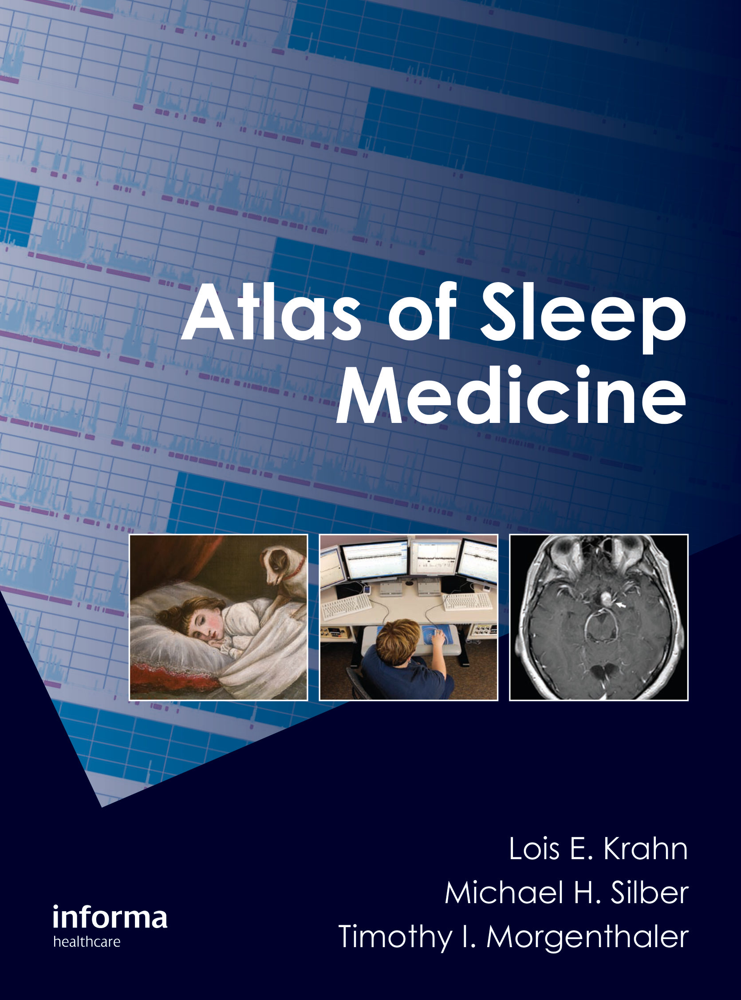
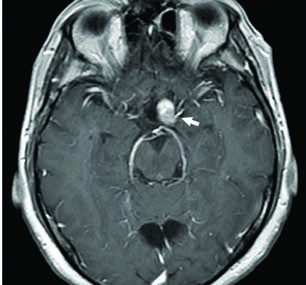
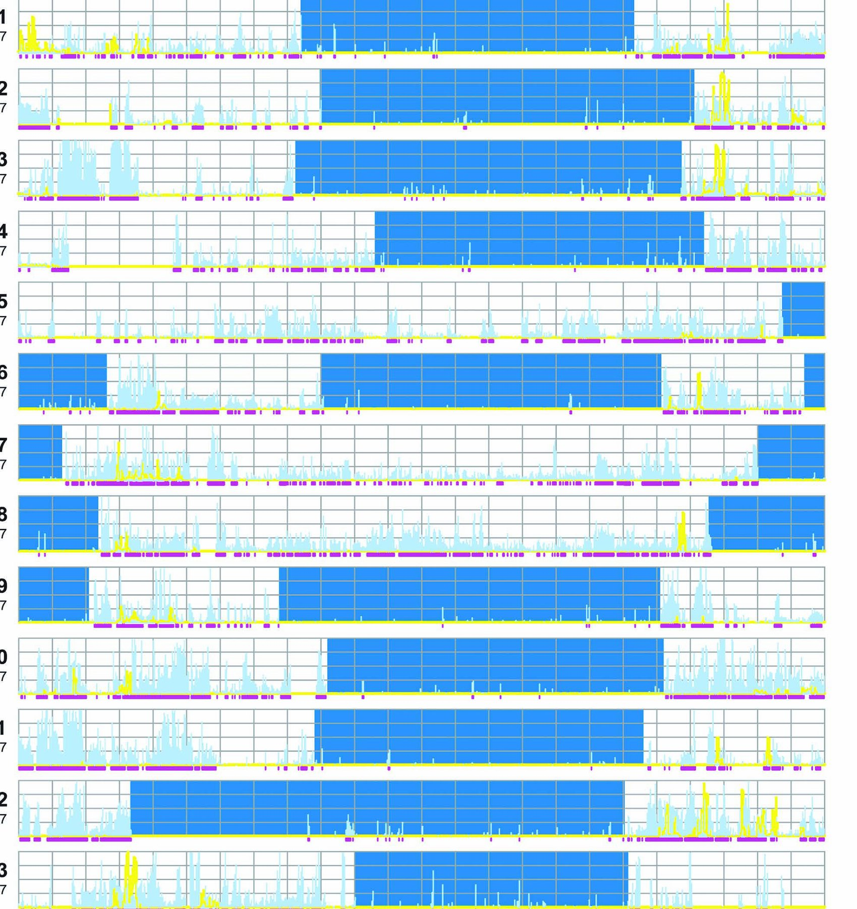

# Front Matter

<!-- pdf-page: 1 -->

## Atlas of Sleep

## Medicine

## Lois E. Krahn

## Michael H. Silber

## Timothy I. Morgenthaler

<!-- pdf-page: 2 -->

## Atlas of Sleep Medicine

<!-- pdf-page: 3 -->

<!-- pdf-page: 4 -->

## Atlas of Sleep Medicine

### Lois E. Krahn, MD

### Michael H. Silber, MBChB, FCP (SA)

### Timothy I. Morgenthaler, MD

<!-- pdf-page: 5 -->

First published in 2011 by Informa Healthcare, Telephone House, 69-77 Paul Street, London EC2A 4LQ, UK.

Simultaneously published in the USA by Informa Healthcare, 52 Vanderbilt Avenue, 7th Floor, New York, NY 10017, USA.

Informa Healthcare is a trading division of Informa UK Ltd. Registered Office: 37–41 Mortimer Street, London W1T 3JH, UK. Registered in England and Wales number 1072954.

About the Cover

Left: Sleep and its disruption have long been the subject of artists. (Figure 10 of Chapter 8: Sleeping Child With Dog, Convent of St. Joseph’s, St. Louis, MO, 1886; from Girard Foundation Collection, Museum of International Folk Art [DCA], Santa Fe, NM. Photo by Blair Clark. [Used with permission.])

Middle: Sleep laboratories rely on computers to monitor the physiological variables of patients (Figure 4C of Chapter 5).

Right: Magnetic resonance imaging scans may reveal underlying causes of sleep disorders, such as this scan of a suprasellar pituitary adenoma in a patient with narcolepsy without cataplexy (Figure 10A of Chapter 7).

No claim to original U.S. government works.

Product or corporate names may be trademarks or registered trademarks and are used only for identification and explanation without intent to infringe.

This book contains information from reputable sources and although reasonable efforts have been made to publish accurate information, neither the publisher nor the authors make any warranties (either express or implied) as to the accuracy or fitness for a particular purpose of the information or advice contained herein. The publisher wishes to make it clear that any views or opinions expressed in this book by individual authors or contributors are their personal views and opinions and do not necessarily reflect the views or opinions of the publisher. Any information or guidance contained in this book is intended for use solely by medical professionals strictly as a supplement to the medical professional’s own judgment, knowledge of the patient’s medical history, relevant manufacturer’s instructions, and the appropriate best practice guidelines. Because of the rapid advances in medical science, any information or advice on dosages, procedures, or diagnoses should be independently verified. This book does not indicate whether a particular treatment is appropriate or suitable for a particular individual. Ultimately, it is the sole responsibility of the medical professional to make his or her own professional judgments, so as to appropriately advise and treat patients. Save for death or personal injury caused by the publisher’s negligence and to the fullest extent otherwise permitted by law, neither the publisher nor any person engaged or employed by the publisher shall be responsible or liable for any loss, injury, or damage caused to any person or property arising in any way from the use of this book.

Orders may be sent to: Informa Healthcare, Sheepen Place, Colchester, Essex CO3 3LP, UK Telephone: +44 (0)20 7017 5540 Email: CSDhealthcarebooks@informa.com Website: http://informahealthcarebooks.com/

A CIP record for this book is available from the British Library.

Library of Congress Cataloging-in-Publication Data available on application.

ISBN-13: 9780415450089

For corporate sales please contact: CorporateBooksIHC@informa.com For foreign rights please contact: RightsIHC@informa.com For reprint permissions please contact: PermissionsIHC@informa.com

Typeset by MPS Limited, a Macmillan Company Printed and bound in the United Kingdom

Current printing: (9 8 7 6 5 4 3 2 1)

<!-- pdf-page: 6 -->

#### This book has been inspired by the patients who seek solutions and care from the

#### Center for Sleep Medicine at Mayo Clinic.

### Dedication

<!-- pdf-page: 7 -->

<!-- pdf-page: 8 -->

## Preface

This atlas is intended to provide an overview for the reader of the rich and everexpanding field of sleep medicine. The authors, a multidisciplinary team of a psychiatrist, a neurologist, and a pulmonologist, have drawn upon multiple sources to illustrate the influence of both sleep and disordered sleep on the human condition. This volume touches upon several interdisciplinary topics, notably the history of sleep and sleep in animals, that exist on the periphery of the commonly accepted domain of medicine. Ideally, this atlas will inspire the reader to seek a greater understanding of the significance of sleep.

Lois E. Krahn, MD

<!-- pdf-page: 9 -->

<!-- pdf-page: 10 -->

## Contents

1. A History of Sleep and Sleep Medicine . . . . . . . . . . . . . . . . . . . . . . . . . . . . . . . . . . . . . . . . . 1 Sarah Morgenthaler Bonnema, BA, and Timothy I. Morgenthaler, MD

Preface. . . . . . . . . . . vii Authors . . . . . . . . . . . xi

2. Cross-Cultural Aspects of Sleep . . . . . . . . . . . . . . . . . . . . . . . . . . . . . . . . . . . . . . . . . . . . . . . . . 13 Lois E. Krahn, MD

3. Animals and Sleep . . . . . . . . . . . . . . . . . . . . . . . . . . . . . . . . . . . . . . . . . . . . . . . . . . . . . . . . . . . . . . . 25 Lois E. Krahn, MD, and Timothy I. Morgenthaler, MD

4. The Physiology of Sleep . . . . . . . . . . . . . . . . . . . . . . . . . . . . . . . . . . . . . . . . . . . . . . . . . . . . . . . . . 30 Michael H. Silber, MBChB, FCP (SA)

5. Diagnostic Tools in Sleep Medicine . . . . . . . . . . . . . . . . . . . . . . . . . . . . . . . . . . . . . . . . . . . . 43 Timothy I. Morgenthaler, MD, and Michael H. Silber, MBChB, FCP (SA)

6. Sleep-Related Breathing Disorders. . . . . . . . . . . . . . . . . . . . . . . . . . . . . . . . . . . . . . . . . . . . . . 55 Timothy I. Morgenthaler, MD

7. Narcolepsy . . . . . . . . . . . . . . . . . . . . . . . . . . . . . . . . . . . . . . . . . . . . . . . . . . . . . . . . . . . . . . . . . . . . . . . . 88 Michael H. Silber, MBChB, FCP (SA)

8. Insomnia . . . . . . . . . . . . . . . . . . . . . . . . . . . . . . . . . . . . . . . . . . . . . . . . . . . . . . . . . . . . . . . . . . . . . . . . . 100 Lois E. Krahn, MD

9. Movement Disorders and Parasomnias . . . . . . . . . . . . . . . . . . . . . . . . . . . . . . . . . . . . . . . . 117 Michael H. Silber, MBChB, FCP (SA)

10. Circadian Rhythm Sleep Disorders: Physiology of the Circadian Clock. . . . . .131 Lois E. Krahn, MD

Index . . . . 145

<!-- pdf-page: 11 -->

<!-- pdf-page: 12 -->

## Authors

Lois E. Krahn, MD Chair, Department of Psychiatry and Psychology and Consultant, Division of Pulmonary Medicine, Mayo Clinic, Scottsdale, Arizona; Professor of Psychiatry and Director for Education, College of Medicine, Mayo Clinic

Timothy I. Morgenthaler, MD Associate Chair for Quality, Department of Internal Medicine, and Consultant, Center for Sleep Medicine and Division of Pulmonary and Critical Care Medicine, Mayo Clinic, Rochester, Minnesota; Associate Professor of Medicine, College of Medicine, Mayo Clinic

Michael H. Silber, MBChB, FCP (SA) Co-Director, Center for Sleep Medicine and Consultant, Department of Neurology, Mayo Clinic, Rochester, Minnesota; Professor of Neurology, College of Medicine, Mayo Clinic

Sarah Morgenthaler Bonnema, BA Department of Community and Family Health, University of South Florida, College of Public Health, Tampa, Florida

## Contributor

<!-- pdf-page: 13 -->
