# Chapter 1 A History of Sleep and Sleep Medicine

<!-- pdf-page: 14 -->

## 1 A History of Sleep and Sleep Medicine

#### Sarah Morgenthaler Bonnema, BA, and Timothy I. Morgenthaler, MD

#### ABBREVIATIONS

EEG, electroencephalograph; electroencephalographic

NREM, non–rapid eye movement

OSA, obstructive sleep apnea

REM, rapid eye movement

But this I very well know, that while I am asleep, I feel neither hope nor despair; I am free from pain and insensible of glory. Now blessings light on him that first invented this same sleep: it covers a man all over, thoughts and all, like a cloak; it is meat for the hungry, drink for the thirsty, heat for the cold, and cold for the hot. It is the current coin that purchases all the pleasures of the world cheap; and the balance that sets the king and the shepherd, the fool and the wise man even. There is only one thing, which somebody once put into my head, that I dislike in sleep; it is, that it resembles death; there is very little difference between a man in his first sleep, and a man in his last sleep. (Sancho Panza speaking in Don Quixote by Miguel de Cervantes [Hertfordshire: Wordsworth Editions Limited, 1993. Part 2. Chapter 68. {Used with permission.}])

The medical specialty of sleep medicine has a brief history spanning only the past 25 to 50 years. Like other medical specialties, sleep medicine evolved in response to the increased prevalence and recognition of disease (in this case, sleep disorders) and to the availability of specialized methods to diagnose and treat them. Technological, economic, and sociological changes in the past century have outpaced our ability as organisms to adapt, ignoring our biological necessity for sleep quantity, quality, and timing. Arguably, the very factors that have increased our standard of living have contributed to an increased prevalence of sleep maladies. Artificial light has, in effect, shrunken the night, and 20% of the workforce in developing nations now works during the workers’ circadian sleep period within the endogenous 24-hour internal sleep- and wake-related rhythm of humans (1). Mechanized transit enables the rapid traverse of multiple timelines, creating the chronobiological condition known as jet lag. Passive entertainment and work specialization have led to more sedentary pursuits. Coupled with the immense increase in food supply and our increasing consumption of processed foods, the sedentary lifestyle has resulted in an epidemic of obesity that contributes to obstructive sleep apnea (OSA) syndrome, one of the most common sleep disorders. Concurrent with these changes has been an explosion in the development of special-

ized knowledge about the biology of sleep and about measurement techniques to study sleep. The history of sleep medicine may be new, but man’s interest in sleep dates back to the earliest times. To examine it, we must consider not only science but also philosophy, art, law, and literature. History is dynamic. We can try to study and document what has gone before, but new learning often leads to a reinterpretation of the old such that our view of the past is not static. It is difficult to apply a satisfactory organization to a grand story spanning many centuries, but we have ambitiously organized this history into a survey of mankind’s efforts to understand the purpose and nature of sleep, the experiences of sleep (including dreams and their meaning), the physiology of sleep, and the recognition and treatment of sleep disorders.

#### THE PURPOSE AND NATURE OF SLEEP

Sleep and Death, two twins of winged race, Of matchless swiftness, but of silent pace. (The Iliad of Homer, Book XVI [circa 850 BC]) (2)

Before the recent developments in sleep science, descriptions of sleep often took on two faces. On the one hand, sleep was viewed as a gift from the gods, as a welcome balm that restores energy and health, and as a sweet respite from the strife of life. On the other hand, sleep was identified with darkness, and thus at times was viewed as a consort of death and danger, as a vulnerable window into which the vilest evils might visit our unprotected souls. One of the oldest written references to sleep appears in the early chapters of Genesis in the Hebrew Bible (the Christian Old Testament) describing how Yahweh (God) placed Adam into a deep sleep, removed his rib, and created Eve (Figure 1; Table 1: Hebrew Words for Sleep) (3). An ancient Hindu text, The Laws of Manu, proposed that before the supreme being Svayambhu created the world, the universe “existed in the shape of Darkness, unperceived, destitute of distinctive marks, unattainable by reasoning, unknowable, wholly immersed, as it were, in deep sleep” (4). From antiquity, sleep was seen as a time of inactivity and vulnerability to events that would be less likely to occur to a person while awake. Some fearsome warriors could be subdued only in their sleep, as was the case with the biblical hero Samson (Figure 2):

Having put him to sleep on her [Delilah’s] lap, she called a man to shave off the seven braids of his hair, and so began to subdue him. And his strength left him (Judges 16:19 [NIV]) (5).

<!-- pdf-page: 15 -->

Figure 1

The Creation of Eve. In the Genesis account in the Bible, God causes an involuntary sleep to come over Adam (Hebrew word “Radum”) that is sufficiently deep to allow the completion of the creation of Eve, apparently using Adam’s rib as a template (upper panel of fresco). In the lower panel, Adam is depicted as sleeping on his right side during the act of creation. From early times onward, sleeping on the right side was advocated as a healthy posture, whereas supine sleeping was almost uniformly discouraged in ancient (and even in more contemporary) texts. (Baptistry fresco titled the Creation of Man and Woman by the Florentine painter Giusto de´ Giovanni Menabuoi [circa 1320-1391].) (From the Basilica of St. Anthony in Padua, Italy.) (From Bridgeman Art Library International, New York, New York. [Used with permission.])

Table 1

Ancient Hebrew descriptors of different types of sleepa

Hebrew word Context Meaning (possible stage)

Tenumah Isaiah 5:27 Psalm 76:6 Drowsy, lighter sleep (stage 1 sleep) Yashen or shehah Genesis 28:16 Genesis 31:40 Conscious thought that becomes unconscious and involuntary (stage 2) Radam Jonah 1:5-6 Genesis 2:21 Heavy or deep sleep (slow-wave sleep) Tardemah Genesis 15:12 Trancelike sleep, where thoughts continue to flow (REM sleep?)

Abbreviation: REM, rapid eye movement. aData from Ancoli-Israel S. “Sleep is not tangible” or what the Hebrew tradition has to say about sleep. Psychosom Med 2001; 63: 778-87.

Figure 2

The Betrayal of Samson. Samson, the Jewish biblical hero endowed with supernatural strength, proved to have two weaknesses: his arrogance in believing himself invulnerable to the wiles of the Philistine woman Delilah, and the very real vulnerability of sleep. Here, after discovering from Samson that his uncut hair is the requisite for his strength, Delilah summons a servant to cut his hair while he sleeps. His waiting enemies, the Philistines (at the doorway) will then be able to easily subdue him (Judges 16:17-20). Throughout history and in literature and common experience, sleep has been seen as a compromising time. Historically, the sleeper has often been viewed as being more vulnerable to the action of supernatural forces that may influence dreams, and thus alter the understanding, attitudes, and actions of the victim. In literature the sleeper has been portrayed as being captured, killed, injured, or tricked. (Oil on wood painting titled Samson and Delilah [circa 1609-1610] by Peter Paul Rubens [1577-1640].) (From National Gallery, London/Art Resource, New York. [Used with permission.])

In Homer’s epic poem The Odyssey (6), Odysseus was powerless before the cannibalistic Cyclops Polyphemus while the Cyclops was awake, but he managed to engineer the escape of himself and his shipmates by maiming the single eye of the giant while he slept (Figure 3). The state of sleep seemed so vulnerable and still that the ancient Greeks believed that Hypnos, the god of sleep, and Thanatos, the god of death, were twin brothers and that sleep was a passive state barely differentiated from death (Figures 4 and 5). Millennia later, this view of sleep as being passive remained widely popular; in 1834 Robert Macnish wrote in his textbook The Philosophy of Sleep that sleep was a passive state on a continuum somewhere between wakefulness and death (7). Until the 1950s, this predominant view of sleep often served as a major impediment to sleep research, although luckily some historical figures looked past this misconception. The Greek philosopher Plato (429-347 BC) was among the first scholars to speculate that sleep had an actual purpose other than as the rest near death; he postulated that its function was to cool the brain (8). His pupil Aristotle (384-322 BC) later refined this view, stating that one fell asleep as the result of a daily epileptic seizure, but that sleep then resided in and cooled

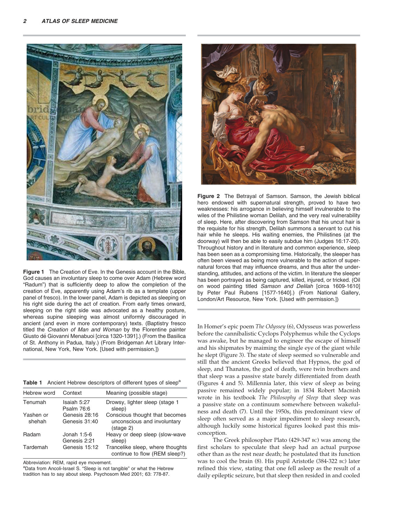

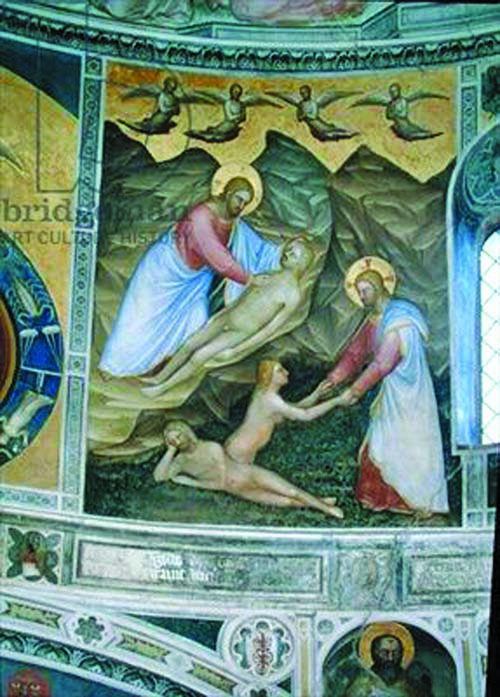

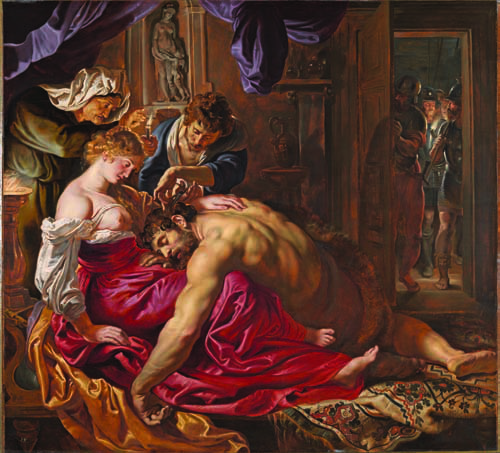

<!-- pdf-page: 16 -->

Figure 3

Blinding the Sleeping Cyclops. If sleep is a time of vulnerability, how much more so is the sleep following indulgence in strong drink! In the ancient legend told in Homer’s Odyssey, the Cyclops Polyphemus dines on the ship’s crew. To save themselves, they induce a deep (and defenseless) sleep in the Cyclops by giving him wine. Once the Cyclops is in this weakened condition, they are able to blind him by poking out his solitary eye. Afterward, they escape by clinging to the bellies of sheep that pass by the Cyclops when he allows them out of his cave to graze. (Statue in the Museo Archeologico Nazionale, Sperlonga, Italy.) (From Livius. [Used with permission.])

the heart, providing a time for food to digest (9). Aristotle believed that sleep facilitated rest, which was necessary for the conservation of life (10). For a time, alterations to Aristotle’s views were minimal. The Greek physician Galen (circa AD 129-210) observed that “sleep and vigil” could benefit the person if applied correctly but could be harmful if applied incorrectly. The Islamic philosopher-scientist and Persian physician Avicenna (AD 973-1037) wrote that healthy persons must pay attention to their sleep because proper sleep is essential to the balance of the “humors.” (Early Greek practitioners held that the wax and wane of four humors, identified as black bile, yellow bile, phlegm, and blood, determined one’s health.) Later reports in the scholarly literature emphasized the restorative imperative of sleep. In the sixteenth century, the Dutch physician Levinus Lemnius (1505-1568) described sleep as a period of revival:

Sleepe is nothing else but a resting of the animall faculty, and a pawsing from the actions and businesse of the day, whereby the vertues of the body being faint, and the powers thereof being resolve, are revived and made fresh againe, and all the weary members and Senses recomforted (10).

In 1771 Johann August Unzer (1727-1799) wrote in his Erste Gru¨nde einer Physiologie der eigentlichen thierischen Natur thierischer Korper (Principles of a Physiology of the Proper Animal Nature of Animal Bodies) that sleep was an instinctual reaction to the disagreeable sensation of fatigue (11). Eight years later the English physiologist George Henry Lewes commented that the function of sleep was to provide repose for the brain and senses in order to allow the nervous system to rest.

The struggle to understand the purpose of sleep continues to vex modern-day scientists and physicians. However, the most recent conceptualization of the sleeping patterns of both men and animals is that sleep is a way to conserve energy by keeping organisms inactive at inopportune times and active at required times. Sleep periods in certain species correlate with dietary availability; thus when food is not plentiful, activity is minimized. Sleep is also postulated to reverse changes in brain function caused by wakefulness such as neuronal oxidative stress, depletion of glycogen stores and neurogenesis-related proteins, and accumulation of neuronal adenosine (12).

#### DREAMING AND DREAMS

The minds of men, which with mighty movements bring forth mighty deeds, often in sleep do and dare just the same; they storm kings, are captured, join battle, raise a loud cry, as though being murdered—all without moving. (Lucretius [98-55 BC]) (13)

Dream function and interpretation were by far the most dominant areas of sleep study in early history. Numerous accounts of prophetic dreams can be found in Judeo-Christian texts, Egyptian papyri, Sumerian inscriptions, and classic Greco- Roman literature (Figure 6). Interpretations of these dreams often served as turning points in history. Dreams allegedly guided the Roman emperor Julius Caesar (100-44 BC) in his decision to cross the Rubicon (14), the Carthaginian general Hannibal (circa 247-182 BC) in his decision to traverse the Alps, and the French philosopher Rene´ Descartes (1596-1650) in the development of his scientific methods, which included analytical geometry. During the formative years of medicine, Greek physicians advocated that certain dreams had diagnostic properties. The first medical textbooks included dream interpretation manuals, indicating that “dreams were considered to be phenomena worthy of serious investigative inquiry” (15). One such textbook, Regimen, is a collection of medical treatises written sometime between 500 and 320 BC by a group of physicians known as the Hippocratic doctors (16). Its Book IV: On Dreams is particularly representative of these early roots of sleep medicine. The anonymous author of this text speculated that dreams were caused by the soul and contained either prophetic content useful for forecasting the future or diagnostic content that signified what ailed the body. The author had little confidence in the ability of physicians to interpret prophetic dreams but did encourage them to interpret diagnostic dreams. For example, he wrote that dreaming about mist, cloud, rain, or hail signified that the body was secreting extra phlegm. In 300 BC the Greek physician Herophilus (335- 280 BC) introduced a slightly different dream classification method by suggesting that dreams fell into three categories: 1) those inspired or sent by a god, 2) “natural” dreams that the soul created to indicate what will come about, and 3) “compound” dreams that arise from a combination of our wishes and images of reality (17). The great Greek medical scholars continued to develop their concepts of dreaming from these early theories. In the second century BC, the Greek diviner and author Artemidorus (18) wrote a dream interpretation manual titled the Onirocriticon (15). In this work he described six elements by which all dreams should be interpreted: law, occupation, names, time,

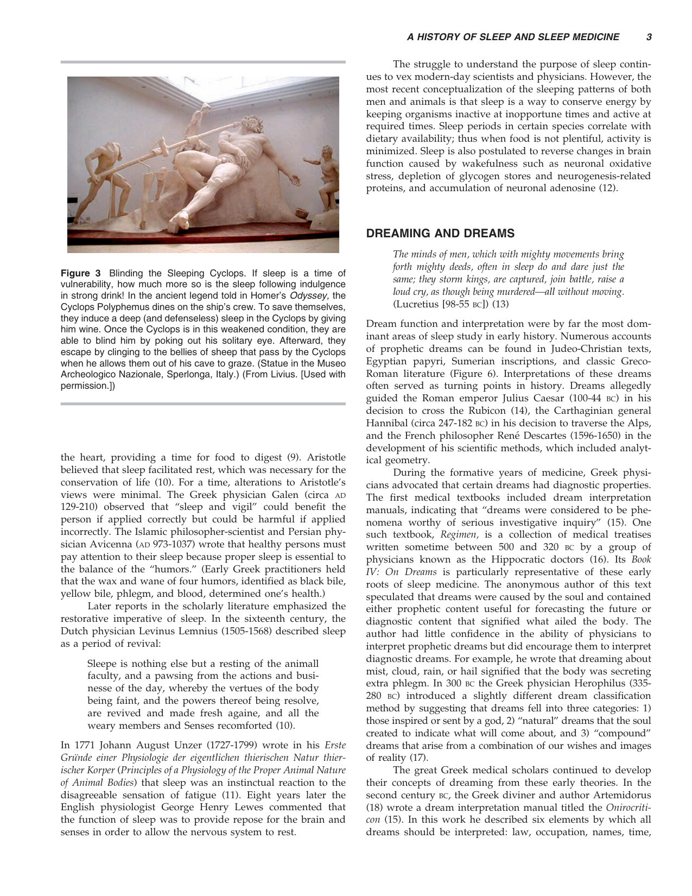

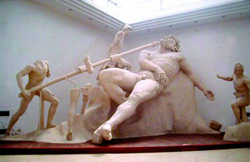

<!-- pdf-page: 17 -->

custom, and nature. Dreams in agreement with these elements indicated positive outcomes; those not in agreement foreshadowed negative outcomes. Galen also studied dreams intently, and in his essay “On Diagnosis in Dreams,” he wrote of a wrestler who in his dreams “seemed to be standing in a receptacle of blood” (19). Galen noted that it was later determined that this wrestler had an abundance of blood and needed to be purged. Galen explained that

in sleep, the soul, having gone into the depths of the body and retreated from the external perceptions, perceives the dispositions throughout the body and forms an impression of all that it reaches out to. (19)

Figure 4

The Pedigree of Sleep in Greek Mythology. By some schemes, the progeny of Chaos are night (Nyx) and shadow (Erebus). The goddess Nyx, being one of the first-born primordial gods (Protogenoi), gives birth (often without any ascribed husband) to various aspects of the human condition, among them death (Thanatos) and sleep (Hypnos). Throughout much early history, death and sleep were depicted as being nearly alike; to the Greeks, they were like (twin) brothers of the same mother. The palace of Hypnos was portrayed as a dark cave where the sun never shone, and with poppies and other hypnogogic plants gracing its entrance. Images often show Hypnos bedecked with wings on his feet, shoulders, or brow (so he could rise into the sky in the train of mother Nyx), with his hands often holding either a horn of sleep-inducing opium, a poppy stem, or a branch of dripping water from the river Lethe (forgetfulness). He was also often paired with his brothers (or sons, depending on the source), the Oneroi (brothers of dreams). The ancient Greeks developed several schemas about the nature and meaning of dreams.

Nightmares were a popular topic, regardless of any sort of dream classification scheme (Figure 7). The ancient Greeks blamed nightmares on the gods, primarily the three sons (or brothers, according to some pedigrees [Figures 4 and 5]) of the Greek god of sleep, Hypnos (from which is derived the word hypnosis), who was the twin of Thanatos (death): 1) Phobetor (phobia), who appeared in dreams in the form of animals or monsters; 2) Morpheus (morphine), the god of dreams, who was responsible for the human elements of dreams; and 3) Phantasos (phantasm), who appeared in dreams in the form of inanimate objects. Their visits were the result of the sleeper’s gluttony, epilepsy, fever, or other physical conditions. In Roman times the attacking spirit in the nightmare was known as the incubus, an envoy from hell who raped women in

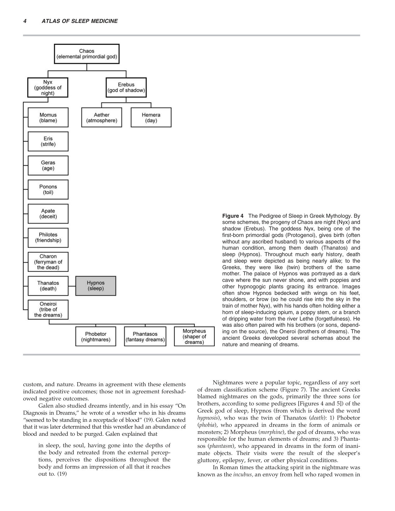

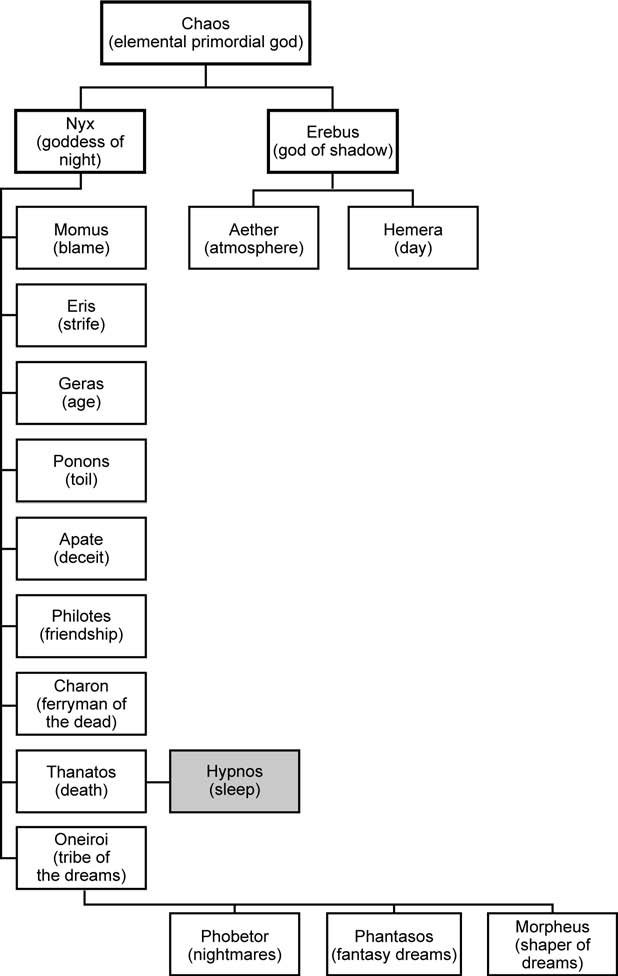

<!-- pdf-page: 18 -->

the question of where thoughts came from and entertained the possibility that dreams were ideas originating in the sleeping brain (22). The father of nine children, he was fascinated with how infants smile:

Figure 5

Hypnos and Thanatos. In Greek mythology, sleep (Hypnos, at left) and death (Thanatos, at right) are closely related, perhaps even twins. Note the poppies, from which were derived laudanum and opium for inducing sleep and dreamlike states. (Oil on canvas painting titled Sleep and His Half-Brother Death [1874] by the English pre-Raphaelite painter John William Waterhouse.) (From Fine Art Photographic Library, London/Art Resource, New York. [Used with permission.])

their sleep (Figure 8). The fourth-century theologian Saint Augustine of Hippo (AD 354-430) wrote in his classic work, The City of God (20), that incubi “often made wicked assaults upon women, and satisfied their lust upon them” (Book 15.23.1.). In part reportedly due to the credence lent this idea by Augustine’s examination of it, the notion of incubi became a part of Christian teaching well into the Middle Ages. The female equivalent of the seductive evil spirit was known as a succubus, who, in addition to seducing the unwary male sleeper, eventually drained him of his life energy. Since the creatures were often depicted as both seductive and oppressive, they were thought to cause a feeling of weightiness on the chest. Succubi later took on a more alluring seductive character, but in the medieval ages they were portrayed as demonic. During the medieval Renaissance of the sixteenth century, the German physician Christoph Wirsung (1500-1571) tried to end some of the theological theorizing by scolding “unbelievers” who propagated the idea that nightmares were the result of witchcraft and by developing a more biologic approach to understanding them (21). He believed that nightmares were reflective of current or future physical ailments, and he prescribed a number of remedies that included purges, gargles, stimulants, and dietary changes. The English physician William Bullein (circa 1520-1576) suggested that those suffering from nightmares should ignore the “supersticious Hypocrites, Infidelles, with charmes, coniurynges [spells] and relickes hangying about the necke, to fraie the Mare” (10). Instead, they should entrust “their sleeping and wakyng to Jesus Christ, that they may live honestlie, goe to bed merily, slepe quietlie, and rise early” (10). Some observations from the eighteenth and nineteenth centuries regarding dreams deserve note. In “Essay 4: Conception” of his 1785 Essays on the Intellectual Powers of Man, the Scottish philosopher Thomas Reid (1710-1796) wrestled with

A few days—sometimes a few hours—after they are born we see them smile in their sleep. But it’s not easy to guess what they are smiling at, for it’s not until some months later that they smile at anything while awake. It is also common to see them move their lips, as if they were sucking, while they are asleep. These things seem to reveal some working of the imagination (22).

These observed activities of sleep in infants may be the earliest written observation of what is called active sleep that would later be found to be the equivalent of rapid eye movement (REM) sleep. In 1896 Sarah Weed and Florence Hallam also recorded observations on the circadian nature of dreams. They noted that only “20 dreams (out of 150) were caused by external stimuli,” and that dreams that occurred from 5 AM to 6:30 AM were “the most frequent, most interesting, most vivid and most varied” (13). If dreams do not originate from external stimuli or demons or the gods, if they might be the seat of imagination or original thought, and if they are indeed embedded in the human experience, then what is their purpose? Some authors have suggested that dreams are a way for our “selves” to break through to thoughts that we could not otherwise identify. In 1811 the Scottish philosopher Dugald Stewart (1753-1823) suggested that we do not gain any new abilities or capacities in dreams; rather, dreams cause us to lose our ability to control our thoughts and wills (11). The American neurologist Edward H. Clarke wrote in 1878 that a dream is “the unconscious cerebration of that portion of the brain over which sleep has no power,” the result of the brain acting on itself in sleep. The most famous dream theory to emerge from this time period, however, was that suggested by the Austrian physician and founder of psychoanalysis Sigmund Freud, who believed that dreams serve as a window onto the unconscious:

The interpretation of dreams is the royal road to a knowledge of the unconscious activities of the mind (23).

Freud’s landmark book, The Interpretation of Dreams, was published in 1899. The book sold an unimpressive 351 copies in its first six years in print yet went on to revolutionize the world of psychology and philosophy (23). The discovery in the early 1950s by Eugene Aserinsky and Nathaniel Kleitman of REM sleep (that period of sleep when our most vivid dreams occur) as a distinct periodic physiological process different from non–rapid eye movement (NREM) sleep ushered in a whole new opportunity to study the phenomenon of dream sleep quantitatively, but it also introduced a new list of questions, speculations, and observations (Figure 9) (24). Although these later developments largely supplanted the dream interpretation methods of Freud, the precise function of REM remains incompletely understood.

#### THE MECHANICS OF SLEEP

And yet there is so much difference betwixt myself and myself, within that moment wherein I pass from waking to sleeping, or return from sleeping to waking! (Saint Augustine of Hippo [circa AD 398]) (25)

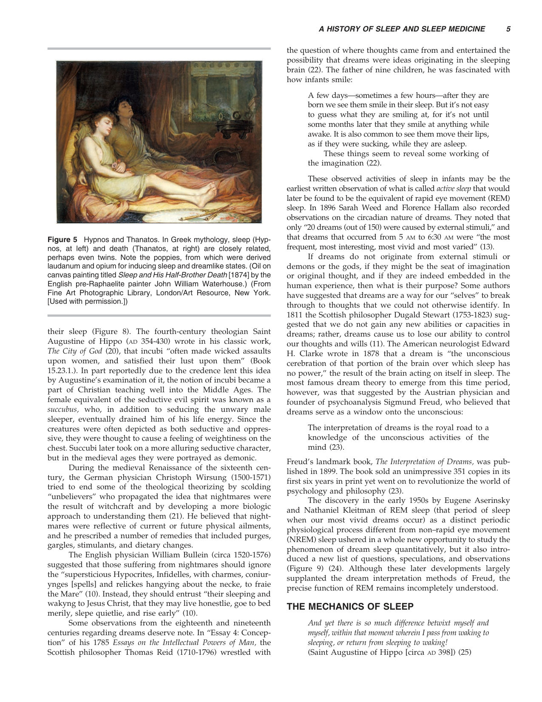

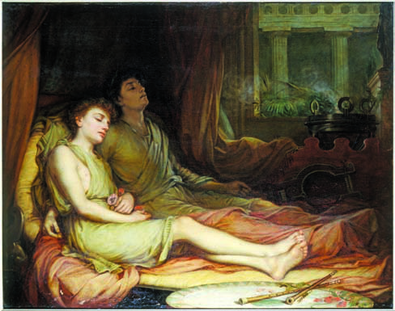

<!-- pdf-page: 19 -->

Most early observers of sleep concerned themselves with the purpose of sleep and the meaning of dreams. However, what actually causes sleep, and from whence does it originate? Historically, theories on the mechanics of how we sleep could be categorized in four groups: vascular, chemical, neural, and behavioral (26). We have already seen how the early philosophers and physicians attributed sleep specifically to divine intervention. However, Alcmaeon (circa sixth and fifth centuries BC), was among the first to speculate on the natural physiology of sleep. He believed that sleep was brought on by blood receding from vessels under the skin to the interior of the body, thus causing immobilization and a lack of sensation (27). Aristotle put forth a chemical and vascular theory, surmising that sleep resided in the heart and was due to the sequelae of “fumes” being absorbed into the blood after the ingestion of food (10). The Roman naturalist Pliny (AD 23-79) wrote in the first century AD that anything without a brain could not sleep, a view later adopted by Galen, who conceptualized sleep as taking place in the brain, which caused it to be temporarily disconnected from the rest of the body (10,19). Despite the lack of experimental or factual verification, the ever-preeminent Peripatetic views dominated the understanding of sleep until the fifteenth century when the Veronese anatomist Alessandro Benedietti (1452-1512) discovered through careful dissections that almost all nerves originate in the brain. He concluded that sleep takes place in the brain, rather than in the heart as Aristotle had stated. Benedietti faced no less a battle than did Galileo (1564-1642) in overcoming the

Figure 6

The Dream Book. Understanding the meaning of dreams was a sign of great scholarship in ancient times, and it often garnered significant power for the avid interpreter. In this Egyptian papyri, a list of approximately 108 dreams and their interpretations are inscribed in black (good dreams) or red (bad dreams): “If a man sees himself in a dream looking out of a window, good; it means the hearing of his cry”; or “If a man sees himself in a dream plunging into cold waters, good; it indicates absolution of all ills.” Not all dreams were a good omen; for example, a man seeing himself making love to his wife in daylight was a bad omen, suggesting that his god would discover his misdeeds. The high value the Egyptians placed on understanding dreams is also evidenced by the biblical account in Genesis regarding Joseph’s interpretations of the Pharoah’s troubling dreams: “In the morning his [the Pharaoh’s] mind was troubled, so he sent for all the magicians and wise men of Egypt. Pharaoh told them his dreams, but no one could interpret them for him.” When Joseph was able to provide an interpretation, he subsequently became a trusted adviser to the Pharaoh (Genesis 41:8, NIV). (Fragments of papyri from Deir el-Medina, Egypt [circa 1279-1213

BC].) (From The Trustees of the British Museum. London. [Used with permission.])

supremely entrenched veneration of Aristotle’s writings almost a century later. In a work published posthumously in 1520, Bolognese anatomist Alessandro Achillini (1463-1512) (28) elaborated on Benedietti’s idea by ascribing sleep to the stoppage of slender arteries in the base of the brain. Vascular theories such as these, sometimes intermixed with chemical or humoral theories, had many notable proponents, and predominated throughout the end of the nineteenth century. Despite slow progress in the field of sleep research, in 1822 the French physiologist Pierre Flourens (1794-1867), building on the work of Luigi Rolando (1773-1831), showed that bilateral ablation of the cerebral hemispheres of pigeons produced a condition similar to sleep (which we would now call coma) (29). With that finding, the address of sleep was securely assigned to the brain, and neural theories of sleep subsequently predominated. In 1928, the German neuropsychiatrist Hans Berger recorded the brain’s electrical activity and found a distinct difference between waking and sleeping rhythms (30). During an encephalitis epidemic a year later, Constantin von Economo identified specific loci in the brain that seemed responsible for the functions of sleep and alertness while he was studying patients with encephalitis who suffered from excessive sleepiness or pervasive insomnia (ie, encephalitis lethargica) (31) (Figure 10 [32]). In 1935-36, Fre´de´ric Bremer described the characteristic, diagnostic surface electroencephalographic (EEG) findings unique to sleep (33). Then in 1953, Aserinsky and Kleitman (24) published a brief 2-page paper in Science on REM and NREM electrical activity that revolutionized both

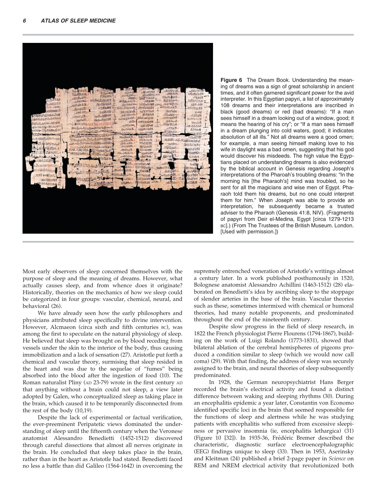

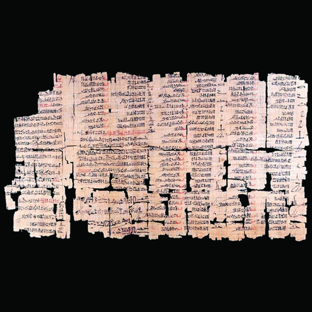

<!-- pdf-page: 20 -->

Figure 7

Personification of Nightmare. The sinister dark creature is a weight upon the dreamer, rendering her unable to move. The glowing red eyes and brooding posture of the misshapen creature, along with the frightening shadows, coalesce to convince the viewer that the dreams in this case are not at all pleasant. In rapid eye movement sleep, when our most active and vivid dreams occur, the axial skeletal muscle tone is inhibited, rendering us incapable of movement. Occasionally, when a person partially awakens (from a nightmare or otherwise), there may be a momentary feeling of paralysis, an ofttimes frightening experience called sleep paralysis. Frequent bouts of sleep paralysis or the ability to physically act out dreams are often signs of a sleep disorder (see Chapter 9 on “Movement Disorders and Parasomnias”). (Oil on canvas painting titled Nachtmahr [Nightmare] (1800) by Nicolai Abraham Abildgaard [1743-1809].) (From Danish Museums Online, Denmark.)

cognitive and sleep studies and served as conclusive proof that sleep is indeed an active neurological process residing in the brain (Figure 11). The science of sleep has erupted in recent decades. The biochemical basis of why one becomes sleepy, the genes that determine circadian rhythm, and the discovery of novel neurotransmitter systems that serve an integral function in the delicate balance of wake, NREM, and REM sleep have all been clarified only recently. Current sleep research is no longer confined to philosophy, theology, or psychology but is instead pursued by nearly every discipline of science. There are no fewer than five peer-reviewed international scientific journals dedicated exclusively to sleep, with more venues on the way.

#### SLEEP DISORDERS

There are persons who have a disposition to sleep on every occasion. They do so at all times, and in all places. They sleep after dinner; they sleep in the theatre, they sleep in church. It is the same to them in what situation they may be placed: sleep is the great end of their existence—their occupation—their sole employment. . . [these are] our dull, heavy-handed, drowsy mortals,

Figure 8

Incubus and Succubus: Special Dreams and Nightmares. In medieval times the incubus was said to be an evil spirit who visited the female sleeper (although occasionally it was depicted as visiting a male sleeper) for the purpose of sexual gratification. Its counterpart, the succubus, was thought be a female spirit that visited and seduced sleeping males. In some tales the succubus consumed the man’s energy or life force during intercourse. In later incarnations succubi sometimes were commingled with vampires. (Oil on canvas painting titled Der Nachtmahr verla¨ßt das Lager zweier schlafender Ma¨dchen [The Nightmare Leaves the Two Sleeping Maidens] by Johann Heinrich Fu¨ssli [1793].) (From Muraltengut, Zurich, Switzerland.)

those sons and daughters of phlegm—with passion as inert as a Dutch fog, and intellects as sluggish as the movements of the hippopotamus or leviathan (Robert Macnish [7]).

From the beginning, opinions abounded about how to promote good sleep, even while the purpose, origin, and parameters determining the quality of sleep were uncertain. Hippocrates (circa 460-377 BC) recommended sleeping on the left or right side in a cool place, well covered, and with arms, neck, and legs slightly bent (10). Avicenna suggested that sleep should commence on a full stomach (10). The Spanish-born Jewish philosopher Maimonides (AD 1138-1204) recommended eating one’s meal three to four hours before going to sleep on one’s side, and then switching sides in the middle of the night. The French physician Andre´ Du Laurens (1558-1609) ordered his patients to exercise between supper and bedtime; he also dispensed recipes for eight compound internal medicines and 11 outwardly applied medicines as a cure for insomnia (10). Walter Bailey (1529-1592), who served as the physician to Queen Elizabeth I (1533-1603), cautioned against sleeping in a moonlit room because he believed that moonlight bred rheumatic diseases, a recommendation that may have led to the popularity of the canopy bed (10). Bailey also discouraged patients from sleeping for longer than seven hours. Insomnia is the oldest recorded sleep disorder, as related in the ancient Judaic texts. The biblical figure Job (circa 1000- 500 BC) complained, “Nights of misery have been assigned to me. When I lie down I think, ‘How long before I get up?’ The

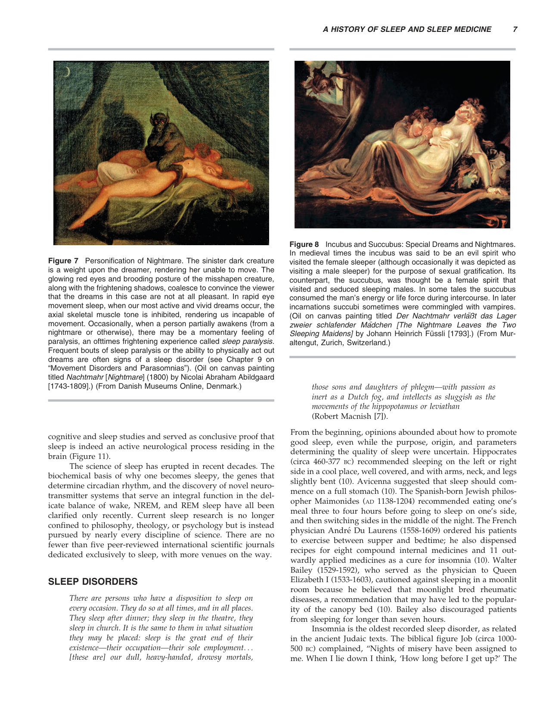

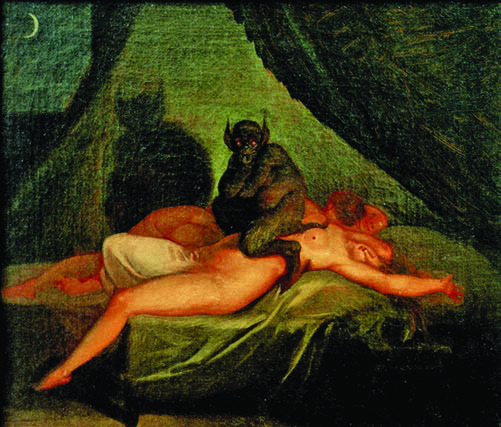

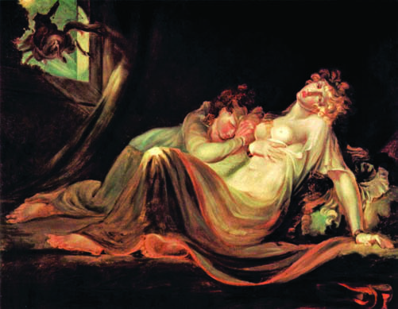

<!-- pdf-page: 21 -->

Figure 9

Early Investigations of Sleep. Sleep medicine pioneer Nathaniel Kleitman and his student Eugene Aserinsky were the first to describe rapid eye movement (REM) sleep in humans, starting with observations of their own children. Kleitman also investigated the circadian aspects of sleep on subjects isolated in Kentucky’s Mammoth Cave (shown here). (From Mammoth Cave National Park collection [public domain].)

night drags on, and I toss till dawn” (Job 7:3-4; NIV [5]). The ancient Hebrews attributed insomnia to anxiety, stress, or a guilty conscience. Later on in the ancient Greek period, Hippocrates theorized that old age caused what he termed agrypnia (sleeplessness) and Pliny recommended sips of “peony in wine” to prevent an attack of what he called suppressionibus nocturnis. Insomnia has probably always been the most common sleep disorder, and many remedies have been proposed throughout the ages. Although less common than insomnia, hypersomnia has also been noted throughout the centuries. Descriptions of sleeping sickness (i.e., African trypanosomiasis) date back centuries (circa AD 1374) to when Sultan Mansa Djata (1360-1374) of Mali died from what was called a sleeping illness that “frequently afflicts the inhabitants of that climate” (34). History also documents epidemics of hypersomnia, including an illness that the English physician Thomas Sydenham (1624-1689) called febris comatosa that swept London from 1673 to 1675 and the better known encephalitis lethargica outbreak that occurred in Europe and North America from 1916 to 1927, affecting more than one million people and causing a half-million deaths (35). In retrospect, history also contains vivid examples of more recently defined sleep disorders. For example, the earliest recorded description of what is now referred to as OSA originated around 360 BC. Dionysius (360-305 BC), the massively obese ruler of Heracleaia, fell asleep frequently; to awaken him, servants had to stick sharp needles into his skin and fat (36,37).

Accordingly, Nymphis of Heraclea, in the second book of his History of Heraclea, says—‘Dionysius, the son of Clearchus, who was the first tyrant of Heracleia, who was himself afterwards tyrant of his country, grew enormously fat without perceiving

it, owing to his luxury and to his daily gluttony; so that on account of his obesity he was constantly oppressed by a difficulty of breathing and a feeling of suffocation. On which account his physicians ordered thin needles of an exceedingly great length to be made, to be run into his sides and chest whenever he fell into a deeper sleep than usual. . . . and was awakened by them (38).’

The first clinical description of what is now called complex sleep apnea, a sleep-related breathing disorder with features of both obstructive and central sleep apnea phenotypes, was probably published in 1877 by Sir William Broadbent. He wrote that in some snoring patients, “every now and then the inspiration fails to overcome the resistance in the pharynx of which stertor or snoring is the audible sign” and he noted in his own patient that “the snoring ceased at regular intervals,” whereas other events were not due merely to upper airway obstruction, “but actual cessation of all respiratory movements” (39). Twelve years later, the English physician Richard Caton presented a case to the Clinical Society of London of an obese poulterer who would fall asleep anywhere—even while working:

He would wake and find himself holding in his hand the duck or chicken which he had been selling to a customer a quarter of an hour before, the customer having at the meantime departed (39).

Caton’s full description of the patient shows that the man had severe OSA, which Caton incorrectly called narcolepsy, a term coined in 1880 by Jean-Baptiste Edouard Ge´lineau (1828- 1906). What we now know as narcolepsy was actually first

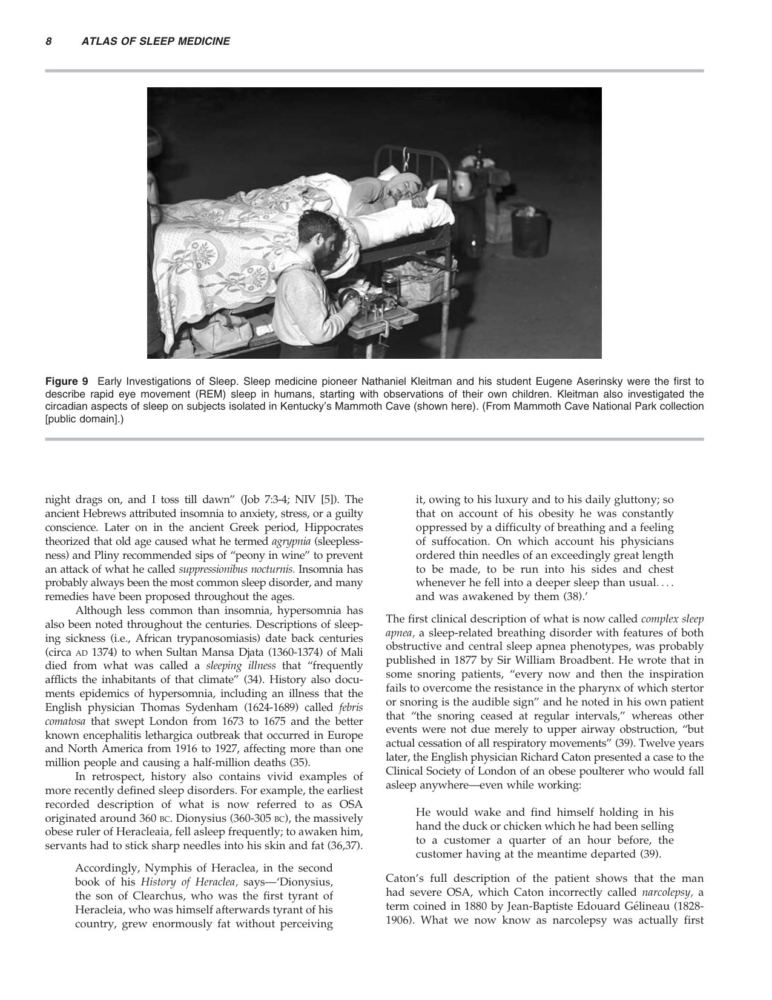

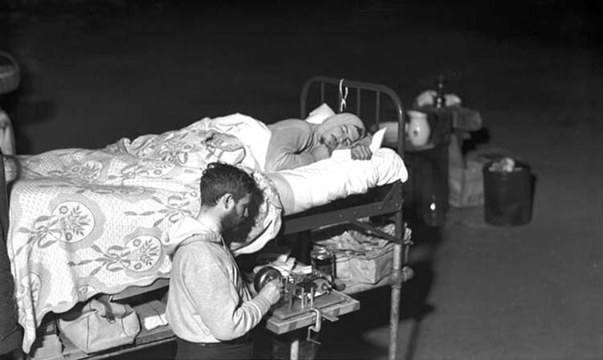

<!-- pdf-page: 22 -->

Figure 10

Encephalitis Lethargica. Nearly coincident with the influenza epidemic of 1917, Constantin von Economo described a series of unusual cases characterized by intense hypersomnolence that either worsened after presentation, culminating in coma and death, or gradually improved after 1 to 2 weeks. Less well known is his description of a hyperkinetic form of the disease characterized by severe back and neck pain, weakness, agitation, and insomnia or circadian abnormalities. He proposed the site of the lesion causing prolonged sleepiness as the junction of the brainstem and forebrain (diagonal hatching) and the site of the lesion causing insomnia as the anterior hypothalamus (horizontal hatching). Von Economo’s investigation was a foundational step toward understanding the neurobiology of sleep. The “a” indicates dotted line boundary containing the field that Von Economo found important in the regulation of sleep; Aq, aqueduct; Hy, hypophysis; J, infundibulum; N. oculamot., nervus oculomotorius; O, optic chiasm; Th, optical thalamus; V3, third ventricle; and V4, fourth ventricle. (Line drawing from von Economo [32]. [Used with permission.])

identified in 1877 by Karl Friedrich Otto Westphal (1833-1890) (40). The identification and naming of the condition that came to be called the Pickwickian syndrome is a popular topic in the history of sleep medicine and will be discussed further in Chapter 6. The term derives from the vivid description by Charles Dickens of a fat boy named Joe in his serialized novel The Posthumous Papers of the Pickwick Club published in 1836- 1837 (Figure 12). Somnolence, hypoventilation, and obesity were first linked in the medical literature as a disorder called Pickwickian syndrome in a 1956 report by C. Sidney Burwell. However, William Shakespeare (1564-1616) probably deserves credit for an earlier description, albeit literary, of the clinical features of OSA in his portrayal of the rotund Falstaff (Figure 13) in his plays, including King Henry IV:

Falstaff: Now, Hal, what time of day is it, lad? Prince Henry: Thou art so fat-witted, with drinking of old sack, and unbuttoning thee after supper and sleeping upon benches after noon. . . . (act 1, scene 2)

Peto: Falstaff! Fast asleep behind the arras, and snorting like a horse. Prince Henry: Hark, how hard he fetches breath. . . . (act 2, scene 4)

The OSA syndrome as we define it today was first medically reported at a conference in 1965 by Henri Gastaut and colleagues, who explained it as an interruption of activity in the respiratory center (41). Audience members Richard Jung and Wolfgang Kuhl were intrigued enough to conduct further research and attributed OSA to an intermittent blockage of the upper airways. The pattern of central sleep apnea that is best recognized is named Cheyne-Stokes respiration after the two men who first observed and described it. The initial observation by John Cheyne (1777-1836) of the rhythmic cessation of breathing was eventually published more than 30 years later in 1854 by William Stokes:

The decline in the length and force of the respirations is as regular and remarkable as their progressive increase. The inspirations become each one less deep than the preceding, until they are all but

Figure 11

Electroencephalographic Activity During Sleep. In the first report of rapid eye movement (REM) in a sleeping person in 1953, Aserinsky and Kleitman (24) used electro-oculogram tracings (first and third lines from top) to document REM in the right eye of a sleeper (calibration 200 microvolts for RV and RH and 50 microvolts for RF; paper speed, 10 seconds). Resp, respiration; RF, right frontal electroencephalogram; RH, horizontal leads on right eye; RV, vertical leads on right eye. (From Aserinsky and Kleitman [24]. [Used with permission.])

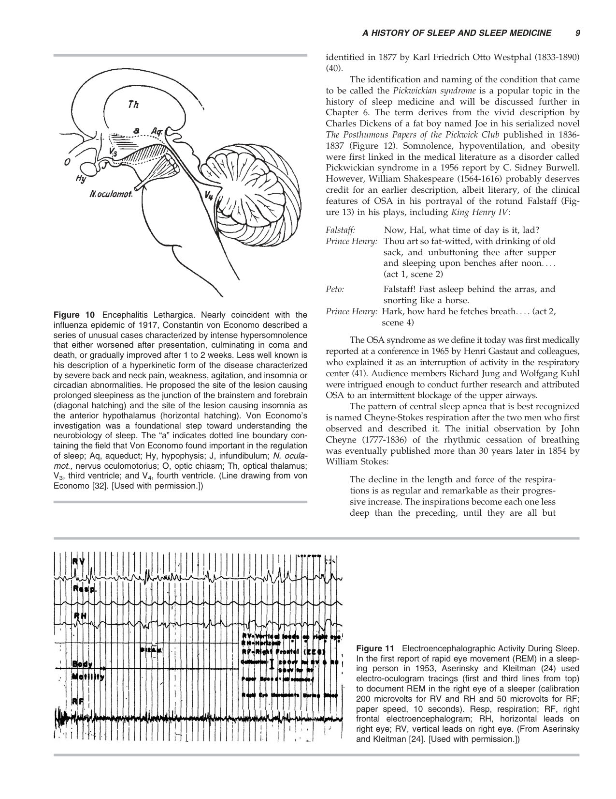

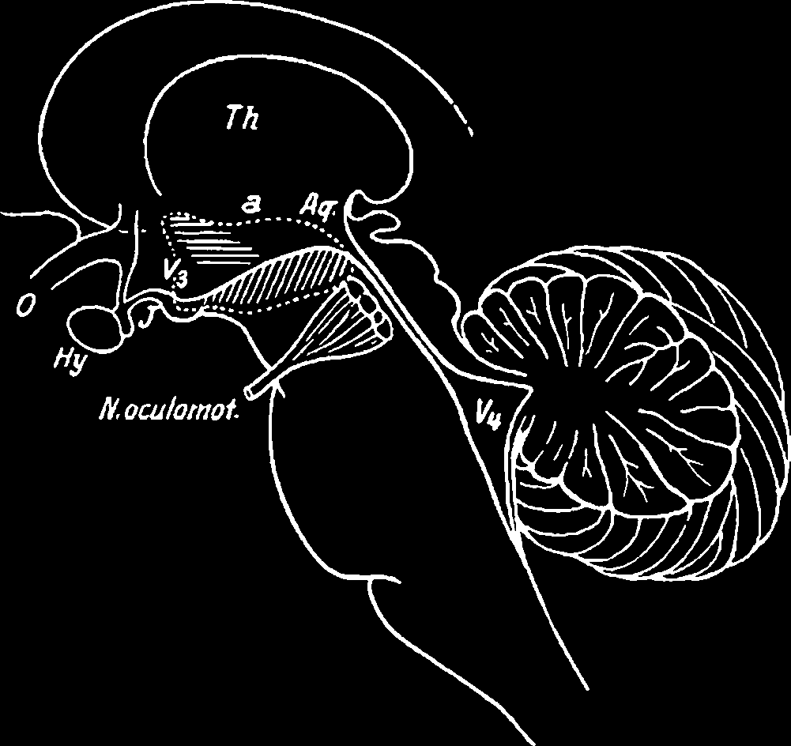

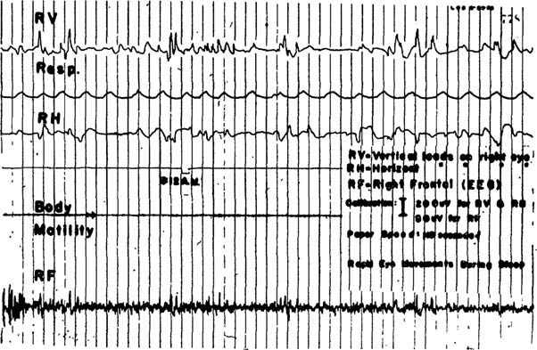

<!-- pdf-page: 23 -->

Figure 12

Joe—The Fat Boy. An illustration by Thomas Nast of the obese minor character Joe appeared in the book-length version of The Posthumous Papers of the Pickwick Club by Charles Dickens (first published in serial form between March 1836 and October 1837). The description of Joe as a perennially sleepy servant who falls asleep anytime he is not eating has led sleep experts to diagnose Joe’s condition as resulting from impaired sleep due to obstructive sleep apnea. (From Dickens C. The Posthumous Papers of the Pickwick Club. New York: Harper and Brothers, 1873.)

imperceptible; and then the state of apparent apnoea occurs. This is at last broken by the faintest possible inspiration: the next effort is a little stronger, until, so to speak, the paroxysm of breathing is at its height, again to subside by a descending scale! (42)

Although Hippocrates is thought to have also alluded to this same breathing pattern in sleepers, the most vivid description was made in 1781 by John Hunter (1728-1793), preceding Cheyne’s report by 37 years:

His breathing was very particular: he would cease breathing for twenty or thirty seconds, and then begin to breathe softly, which increased until he breathed extremely strong, or rather with violent strength, which gradually died away till we could not observe that he breathed at all (43).

Thus a case for naming it “Hunter respirations” could be advanced with some merit. The developments in understanding sleep apnea, coupled with the discovery of REM sleep, produced burgeoning interest in sleep medicine as a clinical field (Table 2). The germination of the European Sleep Research Society probably occurred during a well-attended electroencephalography conference organized by Henri Gastaut and Elio Lugaresi that was held in Bologna, Italy, in 1967 (proceedings published as The Abnormalities of Sleep in Man). The formation of the European Sleep Research Society was completed during a meeting organized by U. J. Jovanovic´ and held in Wu¨rzburg in 1971. Meanwhile, in 1970 Stanford University launched the world’s first

Figure 13

Obesity and Obstructive Sleep Apnea. The English playwright William Shakespeare often portrayed an obese character, a favorite in literature for his wit and roguery. One such character was Falstaff, who was known for his somnolent tendencies and his loud snoring, both symptoms of obstructive sleep apnea. These qualities, no doubt familiar to all observers of the human condition, are portrayed in musical form in Edward Elgar’s Falstaff, Symphonic study in C minor, Op. 68. There, in the second movement, Eastcheap, the bassoon, portrays the corpulent snoring form of Falstaff. In another musical rendition of Falstaff (1799), Antonio Salieri also highlighted the snoring and sleeping form. (Oil painting on canvas titled Falstaff mit großer Weinkanne und Becher [Falstaff With Large Wine Can and Cup] [1896] by Eduard von Gru¨tzner.)

sleep disorders clinic, which produced rapid developments in diagnostic and therapeutic techniques, as well as in research (41). In 1972, the same year that treatments for OSA were described, a sleep conference on “Hypersomnia With Periodic Breathing” was held in Rimini, Italy, sparking international interest in sleep research (50). In the United States, the Association of Sleep Disorders Centers (now the American Academy of Sleep Medicine) was started in 1975, and in 1989 the first sleep medicine textbook (47) was published. In the ongoing maturation process, the specialty of sleep medicine, no longer an awkward progeny of several feeder sciences and specialties, was admitted to the American Board of Medical Specialties, and the first American Board of Medical Specialties Examination in Sleep Medicine was offered in fall 2007.

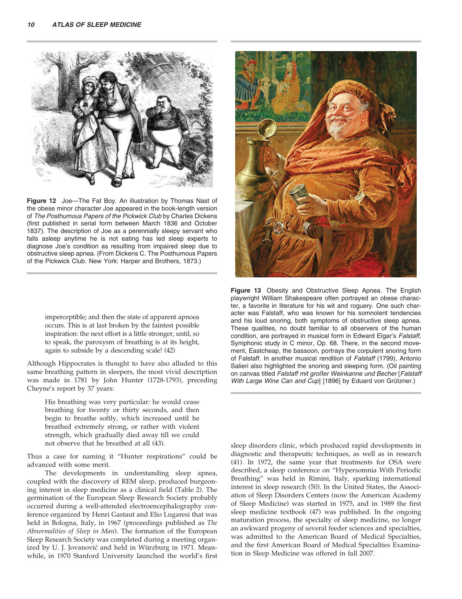

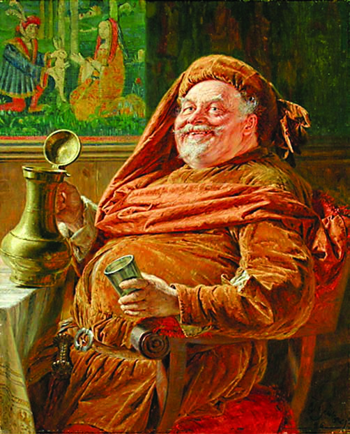

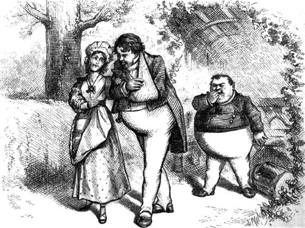

<!-- pdf-page: 24 -->

Table 2

Landmarks in sleep medicine

Year Landmark

1781 Periodic breathing is described by John Hunter 1854 William Stokes (44) publishes a description of the respiration pattern common in central sleep apnea (Cheyne-Stokes respiration), as observed by John Cheyne 30 years earlier 1880 Narcolepsy is first named by Jean-Baptiste Edouard Ge´lineau 1889 First medical description of obstructive sleep apnea syndrome is given by Richard Caton, speaking to the Clinical Society of London 1939 Nathaniel Kleitman publishes Sleep and Wakefulness (45) 1964 Stanford Narcolepsy Center is founded 1964 Henri Gastaut presents a polysomnographically complete picture of obstructive sleep apnea (published in 1965) 1965 Sleeping pills are evaluated using polysomnography 1967 International conference on sleep disorders is held, the proceedings of which are published as The Abnormalities of Sleep in Man (46) 1968 Manual for scoring sleep is developed 1970 Effectiveness of tracheostomy for treatment of obstructive sleep apnea is reported by Lugaresi and colleagues 1972 Respiratory and cardiac monitors enter routine use with polysomnography, thus increasing awareness of obstructive sleep apnea 1972 First academic course is offered on “The Diagnosis and Treatment of Sleep Disorders” (a 1-day course at Stanford University) 1975 Association of Sleep Disorders is established, with five centers as charter members 1975 Polysomnography is deemed a medical test worthy of financial reimbursement by third-party payers in the U.S. 1976 Multiple Sleep Latency Test is developed by Mary Carskadon to quantify degrees of sleepiness 1978 Specialty journal Sleep is launched 1981 Continuous positive airway pressure is described by Colin Sullivan and colleagues as a nonsurgical treatment for obstructive sleep apnea 1987 American Sleep Disorders Association is founded 1989 First textbook of sleep medicine, the Principles and Practice of Sleep Medicine by Meir Kryger and colleagues (47), is published 1991 American Board of Sleep Medicine is founded; first edition of The International Classification of Sleep Disorders (ICSD) (48) is published 1999 American Academy of Sleep Medicine replaces the American Board of Sleep Medicine 2003 Behavioral Sleep Medicine Certification is initiated 2005 Second edition of the International Classification of Sleep Disorders (ICSD-2) (49) is published; specialty journal Clinical Sleep Medicine is launched 2007 Examination for sleep medicine board certification is offered under the parent organization, the American Board of Medical Subspecialties

#### REFERENCES

1. Gordon NP, Clearly PD, Parker CE, Czeisler CA. The prevalence and health impact of shiftwork. Am J Public Health 1986; 76: 1225–8. 2. The Iliad of Homer. Trans. Alexander Pope. London: Grant Richards, 1902. 3. Genesis 2:21 (New King James Version). 4. Buhler G. Indian History Sourcebook: The Laws of Manu, c. 1500 BCE [Internet] [cited 2009 Oct 27]. Available from: http://www. fordham.edu/halsall/india/manu-full.html. 5. Judges 16:19 (New International Version). 6. Butcher SH, Lang M. The Odyssey of Homer. New York: The Macmillan Co., 1900. 7. Macnish R. The Philosophy of Sleep. New York: D. Appleton, 1834. 8. Lavie P. The Enchanted World of Sleep. Trans. Anthony Berris. New Haven (CT): Yale University Press, 1996. 9. Gallop D, editor. Aristotle on Sleep and Dreams: A Text and Translation With Introduction, Notes, and Glossary. Warminster (England): Aris & Phillips, 1996. 10. Dannenfeldt KH. Sleep: theory and practice in the late Renaissance. J Hist Med Allied Sci 1986; 41: 415–41. 11. Lavie P, Hobson JA. Origin of dreams: anticipation of modern theories in the philosophy and physiology of the eighteenth and nineteenth centuries. Psychol Bull 1986; 100: 229–40. 12. Siegel JM. Clues to the functions of mammalian sleep. Nature 2005; 437: 1264–71. 13. Gottesmann C. The golden age of rapid eye movement sleep discoveries. 1. Lucretius: 1964. Prog Neurobiol 2001; 65: 211–87. 14. Meier C. Caesar: A Biography. MJF Books, 2003. 15. Holowchak MA. Interpreting dreams for corrective regimen: diagnostic dreams in Greco-Roman medicine. J Hist Med Allied Sci 2001; 56: 382–99.

16. Hippocrates. Trans. William Henry Samuel Jones. Cambridge (MA): Harvard University Press, 1984. 17. Adler RE. Medical Firsts: From Hippocrates to the Human Genome. Hoboken (NJ): John Wiley & Sons, 2004. 18. Artemidorus. Interpretation of Dreams: Oneirocritica. 2nd ed. Original Books, 1990. 19. Oberhelman SM. Galen: on diagnosis from dreams. J Hist Med Allied Sci 1983; 38: 36–47. 20. St. Augustine. Concerning the City of God Against the Pagans. Trans. Henry Bettenson. New York (NY): Penguin Books, 2003. 21. Wirsung C. Praxis Medicine Universalis. Londoni: Impensis Georg. Bishop, 1598. 22. Reid T. Essays on the Intellectual Powers of Man [Internet] [cited 2009 Oct 27], p. 799. Available from: http://www.earlymodern texts.com/f_reid.html. 23. Freud S. The Interpretation of Dreams. In: Strachey J, editor and translator. The Standard Edition of the Complete Psychological Works of Sigmund Freud. Vol. 4-5 (1900). London: Hogarth Press, 1953. 24. Aserinsky E, Kleitman N. Regularly occurring periods of eye motility, and concomitant phenomena, during sleep. Science 1953; 118: 273–74. 25. The Confessions of St. Augustine. Trans. EB Pusey. New York: EP Dutton and Co., 1907. 26. Thorpy MJ. The Encyclopedia of Sleep and Sleep Disorders. New York: Facts on File, 1991. 27. Lavie P. Restless Nights: Understanding Snoring and Sleep Apnea. New Haven: Yale University Press, 2003. 28. Achillini A. Annotationes Anatomiae. Bonon: Per Hieronymum de Benedictis, 1520. 29. Finger S. Origins of Neuroscience: A History of Explorations Into Brain Function. New York: Oxford University Press, 1994.

<!-- pdf-page: 25 -->

30. Berger H. U¨ ber das electroenkphalogramm des menschen. J Psychol Neurol 1930; 40: 160–79. 31. Reid AH, McCall S, Henry JM, Taubenberger JK. Experimenting on the past: the enigma of von Economo’s encephalitis lethargica. J Neuropathol Exp Neurol 2001; 60: 663–70. 32.
v. Economo C. Sleep as a problem of localization. J Nerv Ment Dis 1930; 71: 249–59. 33. Kerkhofs M, Lavie P. Frederic Bremer 1892-1982: a pioneer in sleep research. Sleep Med Rev 2000; 4: 505–14. 34. Cox FE. History of sleeping sickness (African trypanosomiasis). Infect Dis Clin North Am 2004; 18: 231–45. 35. Triarhou LC. The percipient observations of Constantin von Economo on encephalitis lethargica and sleep disruption and their lasting impact on contemporary sleep research. Brain Res Bull 2006; 69: 244–58. Epub 2006 Mar 3. 36. Bray GA. What’s in a name? Mr. Dickens’ “Pickwickian” fat boy syndrome. Obes Res 1994; 2: 380–83. 37. Kryger MH. Sleep apnea: from the needles of Dionysius to continuous positive airway pressure. Arch Intern Med 1983; 143: 2301–3. 38. Athenaesus, of Naucratis. The Deipnosophists. Trans. Charles Duke Yonge. London: HG Bohn, 1853-54. 39. Lavie P. Nothing new under the moon: historical accounts of sleep apnea syndrome. Arch Intern Med 1984; 144: 2025–8. 40. Schenck CH, Bassetti CL, Arnulf I, Mignot E. English translations of the first clinical reports on narcolepsy and cataplexy by Westphal

and Gelineau in the last 19th century, with commentary. J Clin Sleep Med 2007; 3: 301–11. 41. Dement WC. History of sleep medicine. Neurol Clin 2005; 23: 945–65. 42. Lavie P. Restless Nights: Understanding Snoring and Sleep Apnea. Trans. Anthony Berris. New Haven: Yale University Press, 2003. 43. Ward M. Periodic respiration: a short historical note. Ann R Coll Surg Engl 1973; 52: 330–4. 44. Stokes W. The Diseases of the Heart and the Aorta. Philadelphia: Lindsay and Blakiston: 1854. 45. Kleitman N. Sleep and Wakefulness as Alternating Phases in the Cycle of Existence. Chicago: University of Chicago Press, 1939. 46. Gastaut H, editor. The Abnormalities of Sleep in Man. Proceedings of the 15th European Meeting on Electroencephalography, 1967; Bologna, Italy; 1968. 47. Kryger MH, Roth T, Dement WC, editors. Principles and Practice of Sleep Medicine. Philadelphia: Saunders, 1989. 48. Thorpy MJ, American Sleep Disorders Association, Diagnostic Classification Steering Committee. The International Classification of Sleep Disorders: Diagnostic and Coding Manual. Rochester (MN): American Sleep Disorders Association, 1991. 49. American Academy of Sleep Medicine. The International Classification of Sleep Disorders: Diagnostic and Coding Manual. 2nd ed. Westchester (IL): American Academy of Sleep Medicine, 2005. 50. Sadoul P, Lugaresi E, editors. Hypersomnia with periodic breathing: symposium. Bull Physiopathologie Respiratoire 1972; 8: 967–1292.
