# Chapter 2 Cross-Cultural Aspects of Sleep

<!-- pdf-page: 26 -->

## 2 Cross-Cultural Aspects of Sleep

#### Lois E. Krahn, MD

Culture is considered to be the patterns of behavior, norms, and shared experiences among the members of a group of people. This chapter explores how cultural practices influence sleep by identifying and exploring 1) the cultural factors that predispose to healthy and unhealthy sleep, 2) the cultural explanations for sleep complaints, and 3) the traditional treatments for sleep disorders that are used in different cultural settings. Given all the cultures and subcultures within the global community, this chapter is necessarily limited to select examples that illustrate the main points of this fascinating but less well-studied topic.

#### CULTURAL PRACTICES THAT INFLUENCE SLEEP

Cultural issues are especially relevant to understanding insomnia and disorders of circadian rhythm, conditions in which the patient’s interaction with the sleep environment with respect to timing and comfort is especially influential. This chapter is divided into sections that describe important aspects of sleep environment and scheduling that influence sleep duration, quality, and synchronization with the community. The quality and duration of sleep are greatly influenced by cultural practices that may determine the sleep environment (e.g., bedding or location of bed), sleep schedule, duration of sleep, nap schedule, and customs that increase the risk for specific sleep disorders.

#### Sleep Environment

Over the millennia, beds have varied in shape and size (1). From the relics found in the tomb of Tutankhamen (circa 1370- 1352 BC), it is apparent that the bed of a wealthy Egyptian royal family member was an elaborate and comfortable place to sleep (Figure 1). In the ancient Greek and Roman cultures, people of sufficient wealth slept on wooden couches that were also used for eating (Figure 2). In Rome, depending on the person’s means, these couches might be topped with a mattress made of straw, reeds, herbs, wool, feathers, or swan down. Canopies, curtains, and mosquito nets were added to provide warmth, privacy, and protection from insects. For many centuries, bedding remained basically unchanged. By the Tudor era in England (1485-1603), beds had evolved into elegant pieces of furniture decorated with ornate carvings and draped with heavy curtains. The bedchamber became the accepted site for publicly celebrated ceremonies such as receiving guests, as well as births, marriages, and deaths (Figure 3). Later a style of bedding was adopted in northern Europe that utilized cupboards to optimize privacy and warmth (Figure 4).

For the working class, beds evolved from bundles of straw on the ground shared by whole families. Native American Indians used a woven mat to demarcate the sleeping area of their dwelling (Figure 5). Animal hides were used to provide warmth. Harsh climatic conditions, such as in the polar regions, required the Eskimo (Inuit) people to adopt specialized bedding made of animal fur and elevated from the ground to conserve body heat (Figure 6). In warmer regions, efforts to provide a sufficiently cool sleeping environment were necessary by optimizing ventilation and airflow (Figure 7). Bedding sometimes evolved that did not incorporate comfortable materials, for example, the rigid pillow used by some African tribes (Figure 8). Over the centuries, comfortable mattresses were more fully upgraded by using cloth bags stuffed with rags and pieces of wool and were eventually placed on simple wooden platforms rather than the floor. Beds were prized possessions, representing a large proportion of a family’s assets, and were passed down throughout the generations as bequests. Bedbugs were a hazard until bedding materials could be thoroughly cleaned by boiling them. By the time of the industrial revolution in the late 18th century, beds were more available and the working class had beds that consisted of basic mattresses on frames. After the long-time use of natural filler materials such as straw, feathers, rags, cotton, or wool, technological advances led to the placement of springs inside mattresses in the mid 1850s. Since then innumerable types of spring mattresses have been developed that combine natural or synthetic foams to add layers of comfort. Further innovation over the next 150 years led to mattresses filled with latex foam or water and to mattresses with electronically programmable degrees of firmness. In more geographically isolated societies such as that of Japan, bedding developed along distinct cultural lines, with tatami mats being adopted to provide a softer surface than wood (Figure 9). Tatami mats consisted of compressed rice straw (doko) covered by layers of paper, woven rush grass (omote), and cloth (heri). In the 17th century, wealthy Japanese placed a mattress stuffed with cotton (futon) on top of the tatami. The Japanese used a characteristic pillow, presumably to enhance comfort (Figure 10). In Japanese port communities, futons might be stuffed with seaweed rather than cotton. The loft in the futon was preserved by airing it regularly. In geographic areas around the world where sleeping on the ground posed risks of exposure to vermin (e.g., Venezuela), a sling-type bed was made of netting or cloth and suspended from each end (i.e., the hammock) (Figure 11). Some cultural groups functioned for centuries with minimal or no bedding.

<!-- pdf-page: 27 -->

Figure 1

The Egyptians designed impressive beds raised from the floor that were meant to provide comfort and convey the social status or class of the bed’s occupant. Egyptian bed (reproduction) from tomb of Queen Hetepheres I (circa 2582-2575 BC) made of wood, gold, copper, silver, leather, faience (glazed earthenware), and ebony. (Photograph # 2010, Museum of Fine Arts, Boston [Used with permission.])

Figure 2

The Romans placed a high value on regal yet comfortable bedding. Roman couch or bed (reproduction) with bronze fittings and wooden body and slats that would have been covered with a cushion. (From Roma, Museo della Civilta Romana. [Used with permission.])

The Efe pygmies in Zaire slept on a thin layer of leaves on the ground whereas the !Kung of Botswana slept directly on the ground (2).

#### Sleep-Wake Schedule

Sleeping patterns and schedules vary widely across cultures. Steger and Brunt (3) developed a framework to assist with the classification of cultural differences in sleeping patterns from

Figure 3

Beds in the Tudor era (1550-1603) were intended to provide privacy but also to allow the bedchamber to be used for special occasions, such as entertaining guests. Elaborate Tudor bed (at right) draped with curtains depicted in the oil painting The Birth of the Virgin (1504) by Vittore Carpaccio. (From Bergamo/Accademia Carrara 81LC00235. [Used with permission.])

Figure 4

Some societies further refined beds over time to provide increased warmth and privacy. French cupboard bed depicted in the oil painting Le Retour (The Return) (circa 1883) by Henry Mosler. (From Muse´e de´partemental Breton, Quimper, France.)

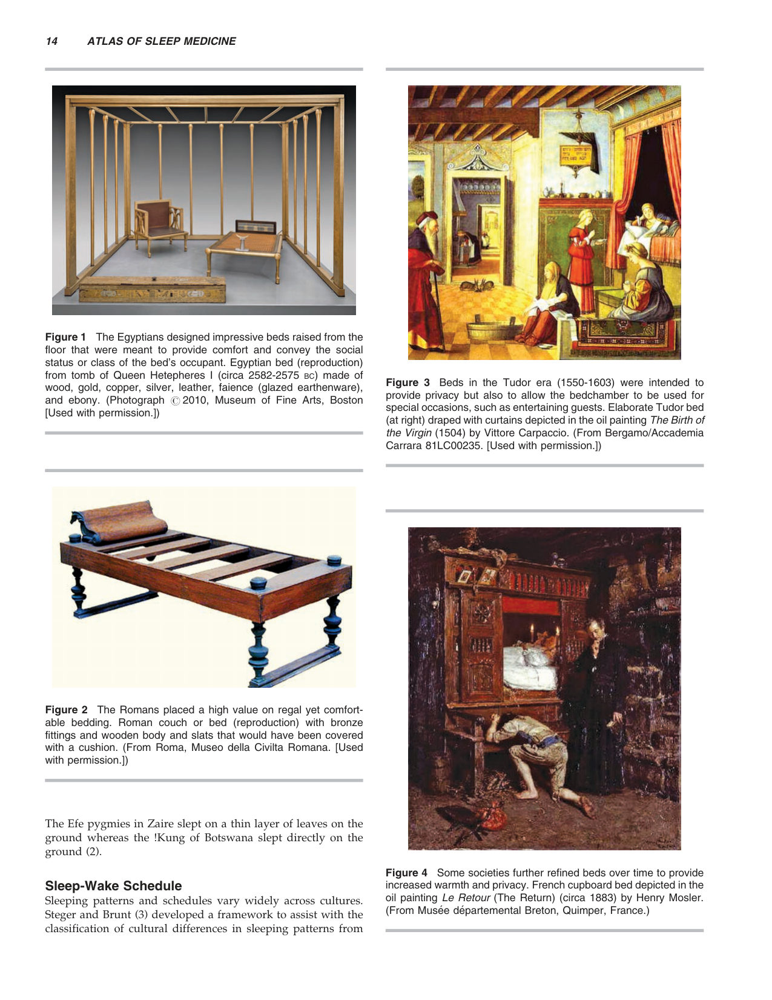

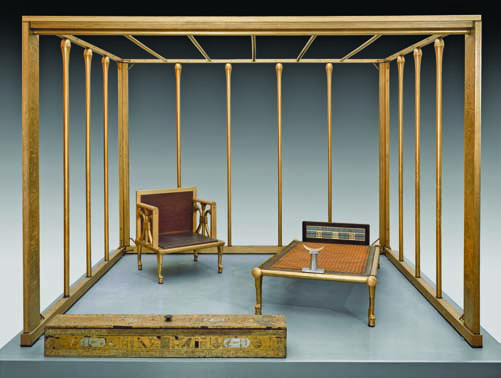

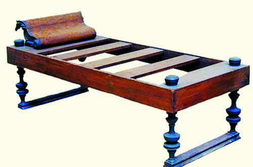

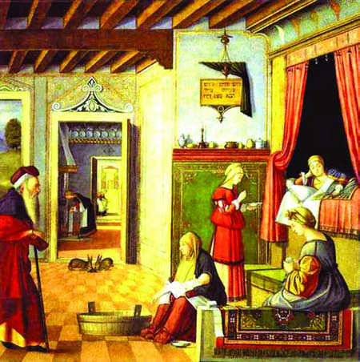

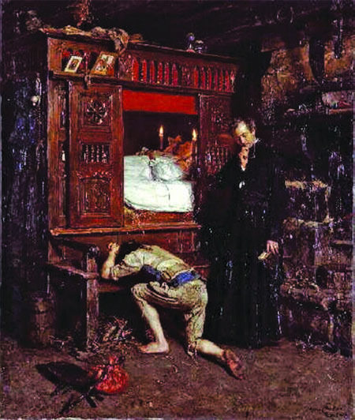

<!-- pdf-page: 28 -->

Figure 5

Nomadic cultural groups required bedding that was portable and could be constructed from local materials. Woven sleeping mat (circa 1880) of Ojibwa People of North America made from rosewood and reeds and dyed with vegetable dye. (From Museum of International Folk Art, Santa Fe, NM. Gift of Lloyd Cotson and the Neutrogena Corporation. Photo by Pat Pollard. [Used with permission.])

Figure 6

Harsh climatic conditions in the globe’s polar regions require modification to preserve body heat. Inuit sleeping arrangements inside an ice igloo include an elevated sleeping bench covered by fur. (Interior of Harry’s Snowhouse in the Northwest Territories/Nunavut. Harry was Chief of the Aivilingmiut at Cape Fullerton. Courtesy # Canadian Museum of Civilization, Quebec, Canada [photograph by A. P. Low, 1903, image 2904]. [Used with permission.])

Figure 7

In warm and humid climates, a comfortable sleeping environment required the means to ensure an adequate air flow. Sleeping habits in India depicted in the watercolor Krishna and Balarama, Watched Over by Nanda and Yashoda, Who Fans Them to Sleep (circa 1725). (Courtesy of Francesca Galloway, London. [Used with permission.])

Figure 8

For some cultural groups, bedding materials are viewed as a means to promote both sleep and spiritual needs. African pillows (circa 1950) were headrests made from wood and sometimes decorated with beads. (From The Metropolitan Museum of Art/ Art Resource, New York. [Used with permission.])

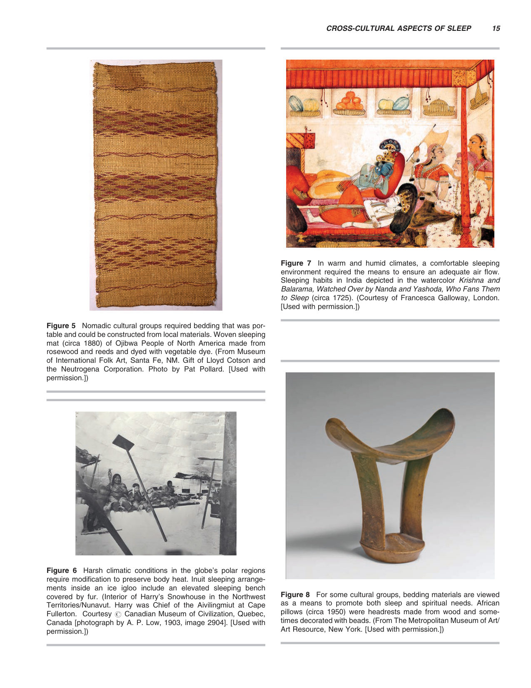

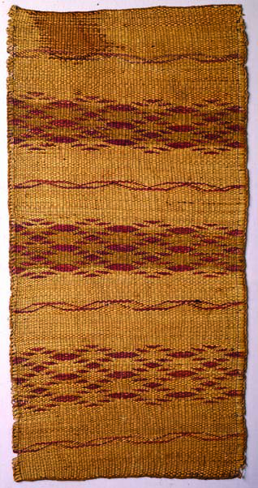

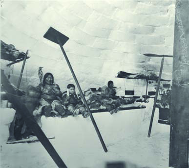

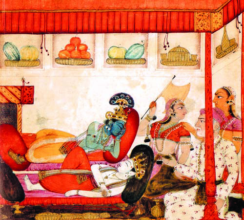

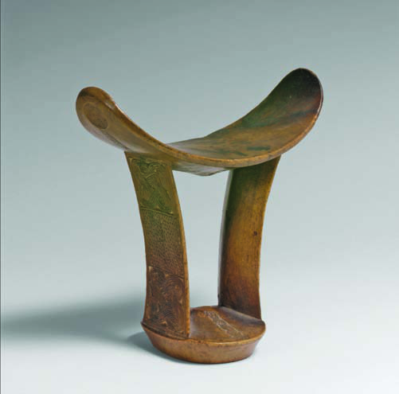

<!-- pdf-page: 29 -->

Figure 9

Japanese tatami mat with futon is depicted in photograph, Girls in Bed Room (circa 1880). (From Philipp March Old Japan Photography, Bern, Switzerland.)

Figure 10

Japanese bedding developed along distinct lines that include specific mattress materials and other features. Japanese pillows (circa 1950) were headrests made from a lacquered wood base topped with a cylindrical pillow wrapped in paper and tied to the base to hold it in place. (From Museum of International Folk Art, Sante Fe, NM. International Folk Art Foundation Collection. Photo by Paul Smutko. [Used with permission.])

no daytime napping to polyphasic sleep. In North America and northern Europe, a monophasic sleep pattern is common. This entails one major nighttime sleep period that lasts eight hours. In contrast, a biphasic sleep pattern is common in Spain and former Spanish colonies that includes a major nocturnal sleep period and a shorter scheduled afternoon nap called a siesta that lasts about two hours. The term is derived from the Latin word sexta for the sixth hour (i.e., noon), and it means an afternoon rest. The siesta is sometimes thought to have evolved

Figure 11

Figure in Hammock, Florida (1917 by John Singer Sargent). (From The Metropolitan Museum of Art/Art Resource, New York. [Used with permission.])

because of a desire to escape the heat of the day. However, the siesta’s association with heat and climate is not absolute because siestas were practiced in northern Europe until the industrial revolution; today they are common in some Chinese communities but largely absent in Portugal. The sleep obtained during the siesta permits activities to continue later into the evening than those which are observed in monophasic cultures. In both the monophasic and biphasic patterns, the need to sleep takes priority. Traditionally, the siesta sleeper dons pajamas and sleeps in bed in a manner similar to that for nighttime sleep. In biphasic cultures, community activities are largely scheduled to avoid night and siesta sleep times (Figure 12). The third variant, the polyphasic pattern, occurs around the globe, and it entails people napping during the day at will. The societies of Japan and India both have polyphasic sleep patterns. The nap schedule is flexible, depending on the degree of sleepiness and the opportunity to sleep. The primary nocturnal sleep period still satisfies most of the sleep debt, but the community is accepting of people sleeping during the day in many public settings. In Japan the widespread practice of sleeping in public places is called inemuri. It is viewed as evidence that persons have made hard work a priority and that they have an overarching commitment to their career or schoolwork. To satisfy their basic sleep needs, people take these brief naps whenever and wherever possible. These spontaneous episodes of sleep allow people to stay up later at night to study or work. One study found that 65% of Japanese men and 71% of Japanese women sleep while riding on trains, a situation that is facilitated by long commuting times (4). Although opportunistic napping is acceptable, the sleep environment is often less private and less conducive to sleep. Japan has been hailed as the noisiest nation on earth, with loudspeakers, buzzers, and sirens creating a nearly continuous stream of noise. No laws exist that place limits on sound amplification, even in residential neighborhoods. In this era of globalization, these simplified patterns of sleep-wake activity are in transition. North American and European societies are becoming more accepting of the benefits of a brief daytime “power nap” to enhance subsequent alertness. Spain and Japan are increasingly conforming to the

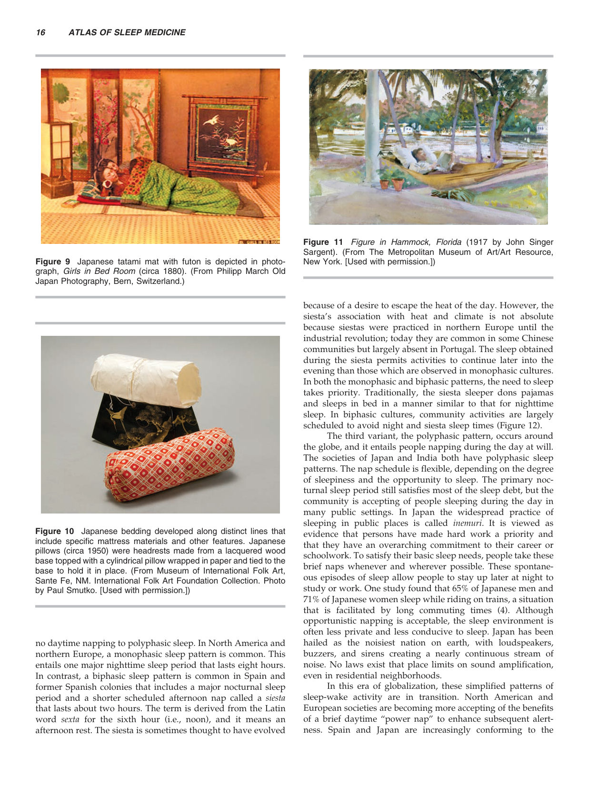

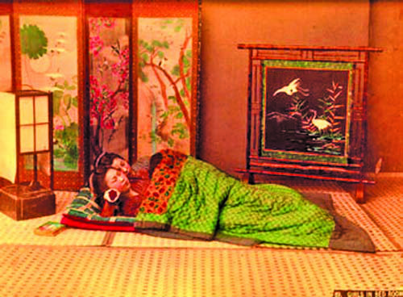

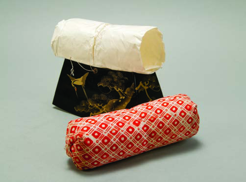

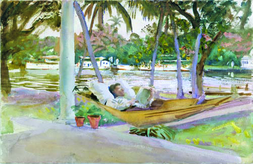

<!-- pdf-page: 30 -->

Figure 12

Sleep schedules of different cultural groups around the world based on Steger and Brunt’s classification of sleep schedules (3).

conventional workday that precludes an opportunity for a planned siesta or an unplanned nap. The timing of the major sleep period is culturally determined as well. In the desert of the Arabian peninsula, the workday starts earlier, particularly for outdoor laborers in the summer. Bedtime is advanced accordingly. Year round in traditional Brazilian society, dinner is eaten at 11:00 PM, with bedtime following several hours later. Nonetheless, Brazilians have adequate time for nighttime sleep because daytime activities start later in the morning than they do in northern European and North American countries. The siesta is not practiced in traditional Brazilian society. Seasonal variations in sleep patterns are especially common at higher latitudes. In the Northern Hemisphere, the sleep period of the Inuit people is relatively restricted during extended daylight hours in the summer but lengthened to as long as 14 hours during the darkness of winter. Cultural preferences may at times explain a patient’s failure to adhere to conventional medical advice or to implement techniques suggested by patient education materials about healthy sleep practices. For example, a patient from Brazil, where dinner is customarily served late in the evening, may not readily accept a recommendation for an earlier bedtime to ensure adequate sleep. The sleep clinician may

therefore be more effective by discussing the need for adequate sleep, which the patient can perhaps obtain by sleeping in later in the morning, rather than by asking the patient to give up an important social activity for sleep. The lack of adherence to sleep hygiene recommendations made by conventional sleep specialists because of the patient’s cultural preferences has not been well studied. Within the sphere of the cross-cultural aspects of sleep, one complication occurs when a person’s sleep behaviors do not reflect the practices of others within the surrounding community. In these situations, the divergence of the person’s practices from those of the community at large increases the risk for problematic sleep patterns. For example, a Muslim who is observing the month of Ramadan while living in the Middle East will reflect the practices of the majority culture; thus, for a month, he or she can fast and nap during the day while feasting and celebrating every night. Such communities typically reduce the duration of the workday during this period to permit culturally acceptable napping. However, an observant Muslim who is living in the culturally diverse setting of Europe or North America will have no daytime accommodation and thus may struggle more with problematic sleep issues during Ramadan. Nonetheless, even in the case of a Muslim living in the Middle East, the practice of Ramadan that encourages daytime

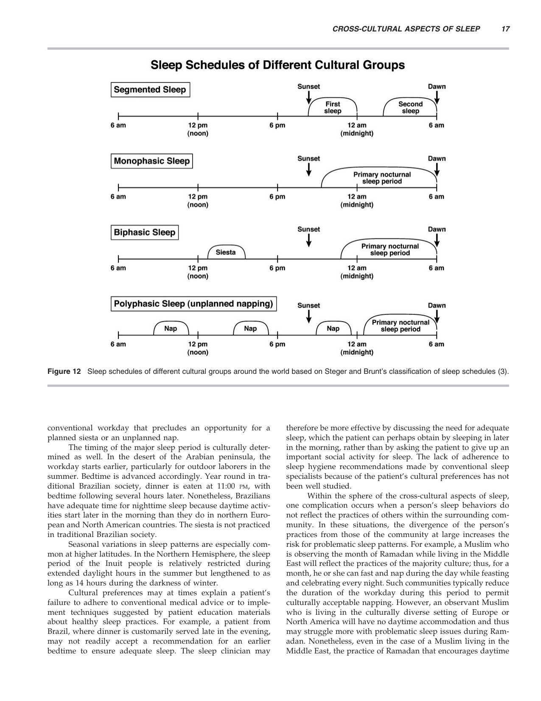

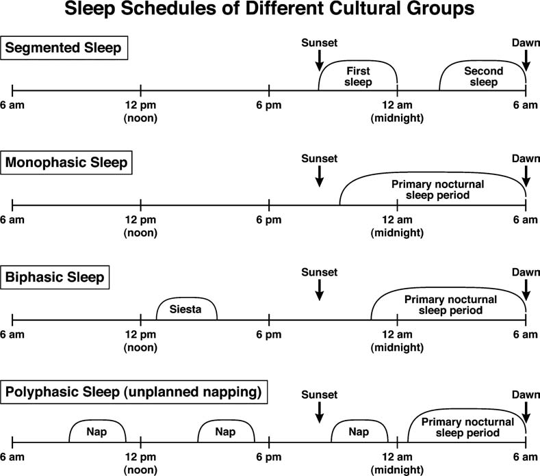

<!-- pdf-page: 31 -->

napping at a time when meals would typically be consumed may conflict with human physiologic needs and result in poor sleep quality. Immigrants, particularly refugee groups, provide a specific example of the challenges of acculturation. A recent study examining new Sudanese immigrants to Canada found that those whose expectations were unfulfilled or who were experiencing economic hardship were 3 to 4 times as likely to have insomnia or to feel stress and sadness as those whose transition was less difficult (5).

#### CULTURAL EXPLANATIONS OF SLEEP

#### COMPLAINTS

When patients experience a problem with sleep, whether it be insomnia, excessive sleep, or unusual behaviors at night, they usually seek to determine the cause and then to understand its meaning. When there is no clear medical reason for an inability to sleep, such as because of pain, some persons within specific cultural communities may seek other causes, even looking to their beliefs for guidance. Clinicians can best support such patients by becoming knowledgeable about how a community viewed sleep in the past compared with the present; such information may be accessed through various sources that range from art and literature to the Internet. The development of ayurvedic medicine more than five thousand years ago was based on the theory that, vital energy—referred to as prana—is the basis of all life and healing. As prana circulates throughout the human body, it is governed by the five elements: earth, air, fire, water, and ether. Health, a state of balance and harmony among the five elements, is referred to as a person’s prakriti (i.e., constitution). Illness occurs when there is imbalance or lack of harmony among them. This philosophy recognizes the importance of chronobiology. The five elements combine with one another into pairs called doshas. The three doshas are vata (ether and air), pitta (fire and water), and kapha (earth and water). Illness is perceived in terms of how the doshas are out of balance in comparison with the prakriti. The three doshas have specific roles in a person’s daily rhythm. Ayurvedic medicine holds that each 24-hour cycle is divided into 4-hour segments that are governed by the doshas (Table 1). In turn, the daily cycles of the three doshas are synchronized with the configuration of the sun, moon, earth, and planets in the solar system. These time periods are believed to correspond with nature and to dictate optimal times for certain functions such as exercise, work, rest, digestion, fasting, or healing. Each dosha can become imbalanced by an unhealthy lifestyle, poor diet, excessive activity, minimal activity, and external factors such as germs or weather. Of the three doshas, the vata is the most relevant to sleep. For example, imbalance can be caused by staying up late at night, which is thought to trigger skin, neurological, and mental disorders. A

Table 1

Three doshas of ayurvedic medicine that complete two cycles during a 24-hour day

Dosha Elements Timing

Vata Space and air 2:00 PM to 6:00 PM 2:00 AM to 6:00 AM Kapha Water and earth 6:00 AM to 10:00 AM 6:00 PM to 10:00 PM Pitta Fire and water 10:00 AM to 2:00 PM 10:00 PM to 2:00 AM

Figure 13

The societal view of sleep, and daytime napping in particular, has changed over the years to a more favorable one. Old Woman Dozing (circa 1655) by the Dutch baroque portraitist Nicolaes Maes. (From Muse´es Royaux des Beaux-Arts de Belgique, Brussels, Belgium. [Used with permission.])

healthy person wakes up before 6:00 AM, ideally between 4:30 and 5:00 AM, before the end of the vata dosha, which corresponds with sunrise. Bedtime is at 10:00 PM, which corresponds with the start of the pitta dosha. Adherence to this sleep-wake schedule allows for 6 to 7 hours of sleep time. Another example of how a specific cultural group views sleep and how these beliefs change over the centuries comes from northern Europe. Several 17th century Dutch paintings depict a sleeping person, including Old Woman Dozing by Nicolaes Maes (Figure 13). The woman sleeps with her lace bobbins nearby (a symbol of productivity) and two open books, one of which is a Bible. It is believed that such paintings were intended to convey a warning against idleness or a message that sleep renders a person vulnerable to danger or, if alcohol is depicted, a caution against the risks of excessive alcohol use. Sleeping during the day was considered sinful for people of all ages. For an older person, sleep was viewed as an even greater waste of time because such persons have a shortened life expectancy. In this painting, an hourglass is depicted, which symbolizes that time (i.e., life) is running out, and the Bible is open to the book of Amos, the “prophet of doom” who warns about moral depravity. Assuming that Maes’ message reflected the values of 17th century Dutch society, the need to nap during the day must not have been acceptable (6).

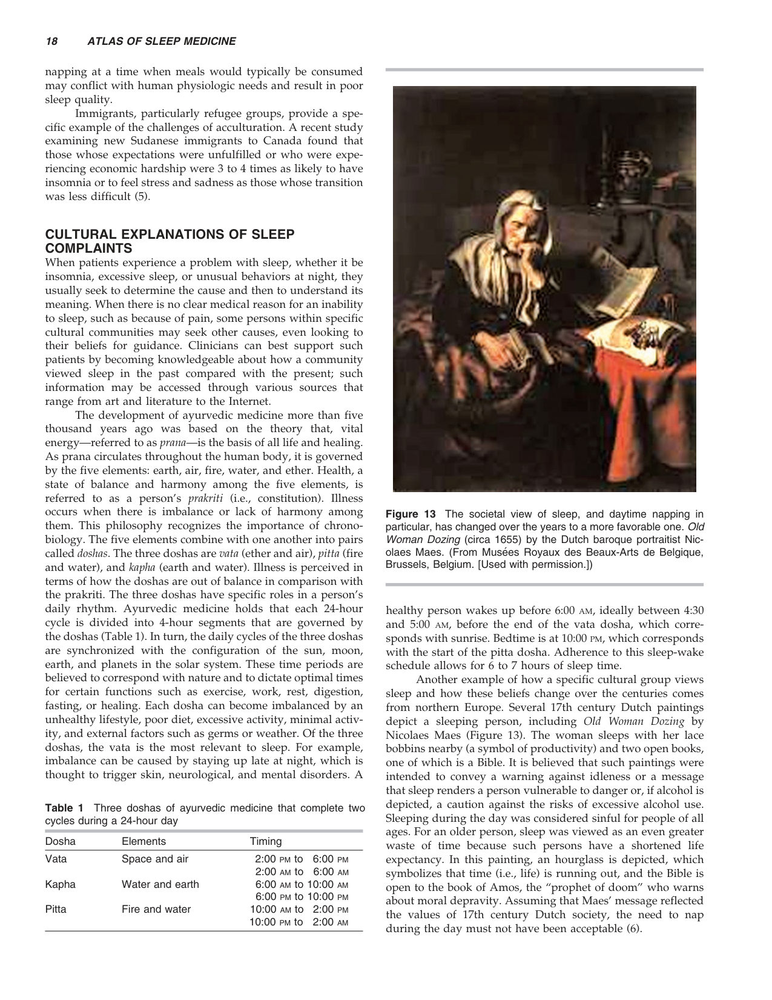

<!-- pdf-page: 32 -->

Balkans Buttermilk Beverage used to aid digestion and induce sleep Europe Chamomile Chamaemelum nobile, Matricaria recutita Tea brewed from dried leaves is used as a sedative, an anxiolytic, and a digestive aid Europe, Asia Valerian; garden heliotrope Valeriana officinalis Dried roots are ground into a powder for sedative and anxiolytic purposes Europe (Roma or Gypsy) Lettuce Lactuca sativa Leaves are boiled for tea or dried and smoked to induce sound sleep and to alleviate constipation and anxiety India Basil Ocimum basilicum Tea brewed from leaves is used as a sedative Mediterranean Lavender Lavandula angustifolia Tea brewed from dried flowers is used as a sedative and to alleviate menstrual cramps Mediterranean Thyme Thymus vulgaris Tea brewed from leaves is used to induce sleep and prevent nightmares Mexico Citrus Citrus spp Flowers are used fresh or dried for tea to relieve tension and induce sleep Southern Europe, Africa, Asia Citronella grass; lemongrass Cymbopogon citratus, Cymbopogon nardus Tea brewed from tops and leaves is used as a hypnotic and to stimulate appetite, relieve menstrual cramps, and alleviate gastrointestinal complaints Southern Europe, Mediterranean, Mexico

Insomnia is the predominant feature of a condition called Hwa-Byung that is found in the Korean culture. This term translates as “anger sickness.” Traditional healers observe an excessive fire (i.e., anger) relative to the other four universal elements within ancient Asian medicine (i.e., earth, water, wood, and metal). Patients will typically have epigastric pain initially that they fear will cause their death. These symptoms are closely associated with insomnia, fatigue, and other pain complaints. The condition generally develops in women with traditional beliefs who become assertive and subsequently face stressful circumstances such as a strained marriage. With its symptoms of depressed mood and anxiety, this condition is similar to the somatoform disorder diagnosed in Western medicine. Polysomnography reveals alpha intrusion into slow-wave sleep. Traditional treatment involves various combinations of Chinese herbs. Conventional treatment provided by health care providers includes various expressive psychotherapies that help the patient to express anger, improve quality of life, and reduce symptom intensity (7). Insomnia is one of the symptoms of an illness called susto, a condition found among persons in the Mexican-American culture. When a person dreams while asleep, the spirit supposedly leaves the body to wander far and wide. If the spirit is not near enough to the body to reenter when needed, its absence can lead to insomnia, irritability, anorexia, and anxiety. A related but more serious condition is espanto, which is the loss of spirit caused by being awakened by something frightening, such as a natural disaster, falling out of bed, or a nightmare (8). From a cross-cultural standpoint, sleep paralysis has been studied more than other sleep conditions. Sleep paralysis can be a frightening experience because the inability to move is often coupled with dreaming that persists as the patient progressively awakens. To explain this phenomenon, patients may turn to plausible events in their life experience. The Inuit people call sleep paralysis uqumangirniq or aqtuqsinniq, depending on their geographic region within the polar region. Older Inuit people explain these phenomena with the belief that the person’s soul was vulnerable during sleep and dreaming and

Table 2

Traditional remedies and products used for insomnia

Name

Cultural origin Common Latin Use

thus was subjected to an attack by evil spirits. This older group interprets the lack of control over sleep paralysis by turning to supernatural beliefs that themselves serve as evidence of such spirits. However, Inuit society is modernizing and younger persons have identified several more quantifiable factors that may contribute to sleep paralysis, including personal, medical, mystical, traditional, and Christian factors (9). In Nigeria, a similar condition of ogun oru (also known as nocturnal warfare) is attributed to demonic possession of a person while dreaming. Traditional healers assess the patient by hearing a description, observing the patient, and conducting divination. The features of ogun oru include being attacked at night while asleep or being poisoned by an enemy while dreaming about eating. The patient then awakens and is unable to fall asleep again. The patient may become agitated, usually at night but sometimes during the day. The dreams are not typically recalled by the patient because of spiritual concealment but are only identified by the traditional healer in the course of the assessment. A recent paper described three cases of ogun oru in three women ranging in age from 20 to 38 years (10). Conventional medical tests revealed nocturnal complex partial seizures in two of the women and night terrors in the third. It is important to recognize that seizures have long been poorly understood and accepted in Nigerian culture; such a lack of understanding may also be common in other less developed countries.

#### TRADITIONAL CULTURAL TREATMENTS FOR

#### SLEEP DISORDERS

This section provides an outline of select traditional remedies for sleep problems that are used by various cultural groups drawing on their own specific beliefs or knowledge (Table 2). Because struggling to fall asleep is a common problem within many cultures, many different techniques have been sought to assist with insomnia. Folk remedies have been developed to provide relief from nightmares, excessive daytime sleepiness, and other sleep disturbances (Tables 3–5). Some of the

Lemon balm Melissa officinalis Same as above for citronella grass

(Continued)

<!-- pdf-page: 33 -->

Table 2

Traditional remedies and products used for insomnia (Continued )

Name

Cultural origin Common Latin Use

Europe, eastern North America, Mexico Linden tree Tilia spp Tea brewed from flowers is used as a tranquilizer and a hypnotic North America (Native American), Mexico Passion flower; maypop Passiflora incarnata Tea brewed from stems and leaves is used as a sedative and a hypnotic to alleviate insomnia, headaches, and gastrointestinal complaints Southeast Asia Bitter orange Citrus aurantium Dried leaves or the more potent dried peel and flowers are used to make tea for insomnia, as a calming agent, to aid digestion, and to reduce palpitations; if used in excess, it can be toxic and has been linked to heart attacks and strokes Southeast Asia Ginseng Panax spp Dried roots are used to make various products, such as tea, for insomnia and many other conditions Southeast Asia Nutmeg Myristica fragrans Dried seeds are ground and added to various beverages and foods to aid sleep Southeast Asia Star anise Illicium verum, Pimpinella anisum, Anis estrella

Tea from dried seeds is used to aid sleep and calm nerves; the FDA has warned of toxicity in teas made from Japanese star anise (Illicium religiosum) South Pacific Kava kava Piper methysticum Roots are dried and ground into a powder or are used fresh to prepare extracts or make beverages for use as hypnotics, anxiolytics, and sleep medicines; associated with liver damage, including hepatitis and nephrotoxicity

Table 3

Folk remedies and products used to induce dreams or alleviate nightmares

Abbreviation: FDA, US Food and Drug Administration.

Asia Mugwort Artemisia spp Dried leaves are stuffed into pillows to induce dreams of the future Mediterranean Thyme Thymus vulgaris Tea brewed from dried leaves is used to induce sleep and prevent nightmares

Name

Cultural origin Common Latin Use

Amazon Guarana Paullina cupana Dried seeds (berries) are ground for tea and other beverages for use as a stimulant and to treat headache Ethiopia Coffee Coffea spp Dried seeds (beans) are ground for beverages or are chewed to release caffeine, which acts as a stimulant India, China, Asia Tea Camellia sinensis Dried leaves are brewed for tea, which contains caffeine that acts as a stimulant Latin America Cacao Theobroma cacao Dried seeds (beans) are ground for beverages, which contain the stimulant caffeine, and for numerous other uses Southeast Asia Betel palm Areca catechu Dried seeds (nuts) and leaves are ground into a powder for use in tea or as a mild stimulant Mediterranean, Asia Mint Spearmint Peppermint Mentha spicata Mentha piperita

Table 4

Traditional remedies and products used as stimulants

Name

Cultural origin Common Latin Use

Leaves are brewed for tea, which acts as a mild stimulant

West Africa Kola tree Cola spp Dried seeds (nuts) are ground for beverages or chewed to release the stimulant caffeine, which acts as a cognitive aid

North America Corn silk; maize Zea mays Strands of corn silk are boiled to make a tea to relieve water retention; it is given in the morning to children with nocturia Northern Europe, Asia Stinging nettle Urtica dioica Leaves are brewed for tea to use to alleviate bed-wetting

Table 5

Folk remedies and products used for other sleep-related problems

Name

Cultural origin Common Latin Use

<!-- pdf-page: 34 -->

Table 6

Gemstones worn to prevent sleep problems

Cultural origin Gemstone Purpose

Europe in the Middle Ages Aquamarine To grant freedom from insomnia and to cure laziness India (ayurvedic medicine) Opal To enhance prophetic dreams and reduce stress Roman Empire Citrine To ensure a good night’s sleep, chase away nightmares, and provide energy; worn into battle by Roman soldiers during Augustus Caesar’s time Roman Empire and ancient Egyptian civilization Carnelian Carved into different shapes, it is used to increase energy

Table 7

Traditional remedies used for sleep that are now controlled or illegal substances because of deleterious psychoactive properties

Cultural origin Common Latin Use

Name

Central Asia Cannabis, marijuana, hemp, and hashish Cannabis spp Dried leaves, flowers, and seeds are smoked or brewed to make tea or other beverages for use as a mild stimulant; oil extracted by solvents is smoked, added to food, or vaporized and inhaled Central Europe, Asia Opium poppy Papaver somniferum, P. album

The milky exudate of unripe capsules (seed pods) is air dried to be smoked; as an insomnia treatment, it was used as early as AD 161-180 by the Roman Emperor Marcus Aurelius East Africa, Arabia Qat or khat Catha edulis Leaves are brewed to make tea or are chewed to release cathinone (similar to amphetamine), which acts as a stimulant Near East (viticulture started 6000–4000 BC) Alcohol (distilled from multiple products, including corn, rye, and barley)

Various grains are distilled to make beverages that act as intoxicants in low doses or as sedatives in higher doses

North America Peyote cactus, mescal Lophophora williamsii The crown of the cactus, which contains mescaline that acts as a stimulant, is dried and chewed or brewed South America Coca Erythroxylon coca The leaves are dried and chewed, smoked, or brewed to make a beverage; all act as a stimulant

strategies used to modulate sleep or sleepiness have eventually been deemed illegal (Tables 6 and 7). Caffeine became a particularly central part of social events in the Middle East, which led to the development of elaborate serving pieces (Figure 14). In the case of opium and its derivatives, intricate vessels were crafted for the purpose of storing these highly prized substances (Figure 15). Insomnia is among the top 10 conditions for which people in the United States most frequently use complementary and alternative medicine (Figure 16). The most common alternative therapy for any condition is prayer for one’s own health (43% of U.S. adults), having others pray for one’s health (24%), and using a prayer group (10%) (National Center for Health Statistics 2004) (11). Praying for another person’s benefit (i.e., intercessory prayer) is most widely used for patients with lifethreatening diseases such as cancer. However, an Internet search for “prayer” as an intervention for “insomnia” or “sleeplessness” will yield multiple references and requests for intercessory prayer for persons with subacute and chronic insomnia. The frequency with which prayer is used as the primary means to alleviate insomnia is unknown. Some patients describe prayer as a relaxation technique they use to reduce tension and facilitate sleep. Prayers for alleviation of insomnia and nightmares are mentioned in the Medicine of the Prophet by As-Suyuti (12). Praying in Islam demands periods of inaction intermingled with different positions (e.g., standing,

bowing, and prostrating), which leads to relaxation of both the body and the mind (Figure 17). Within the tradition of the Catholic church, prayers to ask for help with insomnia could be directed before the reforms of the 1960s to a group of Christian saints called “the seven sleepers of Ephesus” (Figure 18) (13). The story dates from around AD 250 when seven young men accused of being Christians sought sanctuary in a mountain cave. While praying, they fell asleep. The Roman Emperor Decius ordered that the cave be sealed with them inside. The men, who were supposedly discovered and awakened by a farmer about 150 years later, believed that they had slept for only 1 night. However, during the intervening years, Christianity had spread across the region near Ephesus. This myth was embraced within the Christian church of the Byzantine era and a similar story was incorporated into the Koran (14). Many cultural practices promote a relaxed state and have been used to prevent or manage sleeplessness. Ancient Egyptians and Greeks, including Aristotle and Hippocrates, believed that spirits in the brain could cause arousal. Navajo Indians in the southwestern U.S. continue to seek care for insomnia from native healers who practice elaborate rituals to help ill persons regain balance and recover their health (15). In ayurvedic medicine, precious and semiprecious gems are believed to interact with the vedic astrologic system (Table 6). They relate to specific planets and produce a balancing effect that moderates human disease.

<!-- pdf-page: 35 -->

Figure 14

The ornate coffeepots used in Middle Eastern cultures illustrates the importance of the ritual of making and serving coffee. Arabian coffeepot. (Photograph from Paul Cowan. [Used with permission.])

#### Rituals and Symbolic Objects to Cure Sleep

#### Complaints

To cure the conditions of susto or espanto found in Mexican- American culture, both of which are associated with insomnia, Mexican traditional folk healers called curanderos typically combine into several rituals some of the elements of Catholicism with herbal remedies. One cure consists of a series of rituals performed over three consecutive nights. The patient lies supine on the bed with his arms outstretched like a cross. His body is “rinsed” with an alum rock or a whole egg rubbed over the skin, then swept with a broom of herbs, typically made from horehound, rosemary, California peppertree, redbrush, or nakedseed weed. A variant of this practice calls for the curandero to bless the afflicted person’s bed with a brush made of cenizo and to use holy water to cleanse and bless the person. The folk healer recites prayers from his personal prayer book and the Christian Apostles’ Creed, after which the patient’s spirit is called upon to return. The herb brush is later arranged in the shape of a cross and placed under the patient’s pillow. Sometimes pomegranate leaves are also used in these ceremonies (8). In modern Africa, for patients affected by ogun oru, traditional folk healers sometimes work side by side with Christian clergy. Both groups use spiritual practices to fend off the spiritual attack. Some healers and clergy believe that afflicted women are being punished by a “spirit husband” for their loyalty to their earthly husbands. Others believe that ogun oru results from women being fed toxic food produced as a result of witchcraft directed at them. The traditional healer

Figure 15

Tin-glazed earthenware (circa 1520-1530) used as a pharmacy vessel for “Persian philonium” made from ingredients such as opium, saffron, white pepper, pearls, and amber. (From The J. Paul Getty Museum, Los Angeles. [Used with permission.])

might call for a sacrifice to appease the witches. Spiritual intervention involves fasting, praying, nighttime vigils, and rituals of spiritual deliverance involving food, red or white candles, cloth, spiritual perfume, coconuts, and a whole egg. When traditional methods prove unsuccessful, the patients may be referred for conventional medical assessment and treatment, including anticonvulsant medication (10). For more than 5,000 years, yoga has been used in India to promote health as a component of ayurvedic medicine. The basic tenet is to restore harmony and cure illness by maintaining the balance of the three doshas (vata, pitta, and kapha) and the elements they represent. Treatment involves eliminating impurities through cleansing rituals such as the use of enemas, by fasting, and by adhering to special diets. Symptoms are reduced by practicing yoga exercises, stretching, breathing, meditating, and lying in the sun. As a relaxation technique, yoga combines movement and meditation to minimize worry

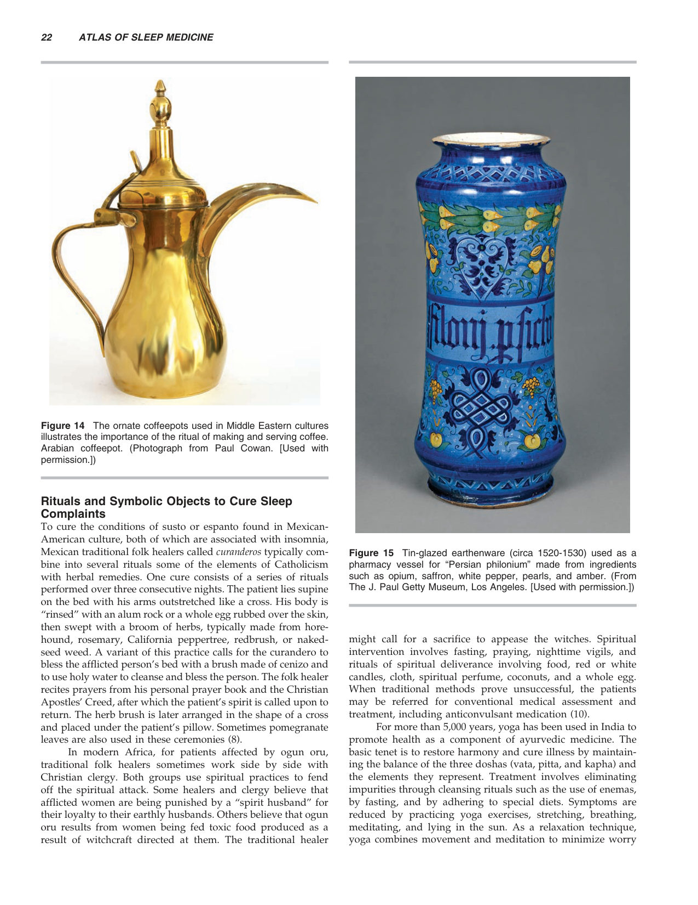

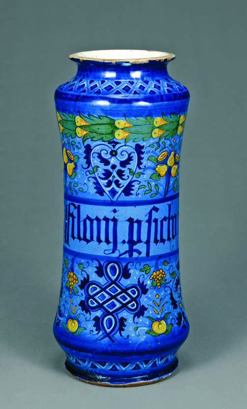

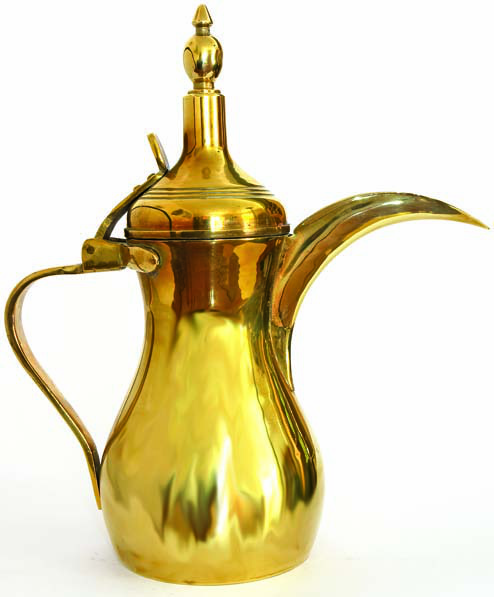

<!-- pdf-page: 36 -->

Figure 16

Insomnia is among the diseases and conditions for which complementary and alternative therapy (excluding the use of megavitamins and prayer) is most commonly used. (From National Center for Complementary and Alternative Medicine, National Institutes of Health, Bethesda, MD, 2004.)

Figure 17

Prayer is the most commonly used complementary and alternative therapy. (From National Center for Complementary and Alternative Medicine, National Institutes of Health, Bethesda, MD, 2004.)

and anxiety. As worry is reduced, harmony is increased. Massage or vital points therapy using the 107 targets where energy is stored can be used to reduce pain and decrease fatigue. Herbs, plant products, oils, spices, and other substances are used, often in combination, to heal, promote vitality, or relieve pain. However, some of these compounds have been found to contain unacceptable levels of toxic substances such as heavy metals, including lead.

Traditional Chinese medicine is based on the ancient Chinese philosophy of Tao, which stresses a balance in life between the concepts of yin (i.e., female: cold and passive activity) and yang (i.e., male: hot and active). In healthy persons, the blood and life energy called chi flows unobstructed along the body’s 12 meridians that connect the major organs. If the flow of chi is disrupted, herbs, massage, acupuncture, and other means can be used to improve it (Figure 19).

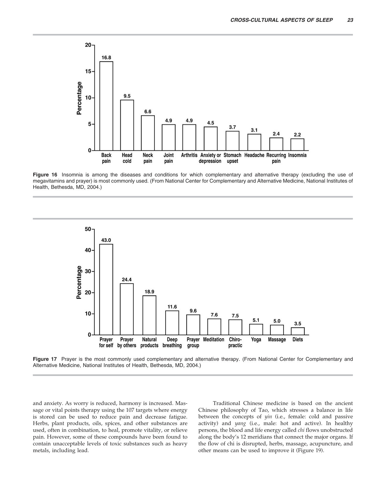

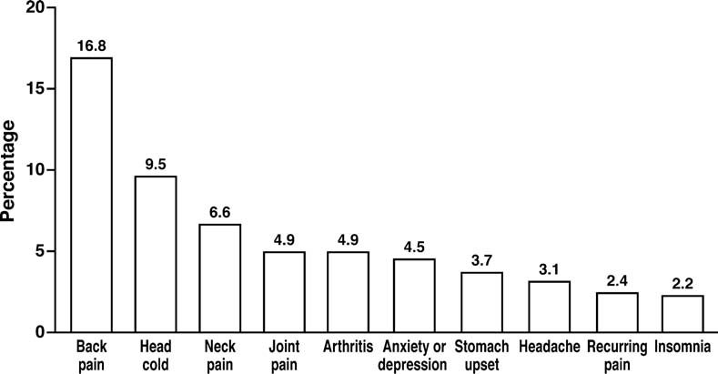

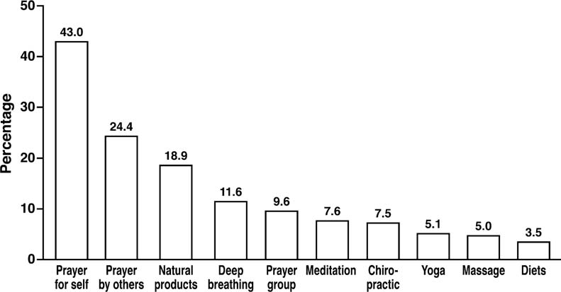

<!-- pdf-page: 37 -->

Figure 18

Turkish miniature depicting the seven sleepers of Ephesus. (From Zubat-al Tawarikh in the Museum of Turkish and Islamic Art, Istanbul, Turkey, dedicated to Sultan Murad III in 1583. [Used with permission.])

Figure 19

Statues of the sleeping Buddha are found in numerous cultures, such as those of India and Thailand. The sleep of the Buddha is viewed as an act of prayer. (From ThaiWorldView. [Used with permission.])

A diverse set of beliefs and practices may influence the patient with a sleep complaint. This overview of the topic should encourage clinicians to begin to pursue possible cultural aspects of sleep problems with their patients. Asking patients why they believe that they have a particular issue and what remedies they have already tried can be fruitful. Clinicians can gain insight into why the patients perceive themselves to have developed a problem, which allows for more effective patient education. Potential treatments can then be selected that are compatible with the individual patient’s belief system. The overarching goal is to provide evidence-based medical care in a culturally competent fashion that respects patient preferences whenever possible.

#### REFERENCES

1. Haex B. Back and Bed: Ergonomic Aspects of Sleeping. Boca Raton: CRC Press, 2005. 2. Williams SJ. Sleep and Society: Sociological Ventures Into the (Un) known. New York: Routledge, 2005. 3. Steger B, Brunt L. Night-time and Sleep in Asia and the West: Exploring the Dark Side of Life. New York: Routledge Curzon, 2003. 4. Ken Y-N. Trains Are the Japanese’s Second Bedroom. What Japan Thinks [Internet] [cited 2007 Feb 28]. Available from: http://www.whatjapanthinks.com/2005/12/07/trains-are-the japaneses-second-bedroom/. 5. Simich L, Hamilton H, Baya BK. Mental distress, economic hardship and expectations of life in Canada among Sudanese newcomers. Transcult Psychiatry 2006; 43: 418–44. 6. de Rynck P. How To Read a Painting: Lessons From the Old Masters. New York: HN Abrams, 2004. p. 306–7. 7. Choi YJ, Lee KJ. Evidence-based nursing: effects of a structured nursing program for the health promotion of Korean women with Hwa-Byung. Arch Psychiatr Nurs 2007; 21: 12–6. 8. Torres E. Healing With Herbs and Rituals: A Mexican Tradition. Albuquerque: University of New Mexico Press, 2006. 9. Law S, Kirmayer LJ. Inuit interpretations of sleep paralysis. Transcult Psychiatry 2005; 42: 93–112. 10. Aina OF, Famuyiwa OO. Ogun Oru: a traditional explanation for nocturnal neuropsychiatric disturbances among the Yoruba of Southwest Nigeria. Transcult Psychiatry 2007; 44: 44–54. 11. Mayo Clinic Book of Alternative Medicine: The New Approach to Using the Best of Natural Therapies and Conventional Medicine. New York: Time Inc Home Entertainment, 2007. 12. As-Suyuti JA. As-Suyuti’s Medicine of the Prophet. London: Ta-Ha, 1994. 13. Herbermann CG, Pace EA, Pallen CB, Shahan TJ, Wayne JJ (eds). The Catholic Encyclopedia: An International Work of Reference on the Constitution, Doctrine, Discipline, and History of the Catholic Church. New York: The Encyclopedia Press, Inc, 1913. 14. Ali AY. The Qur’an: Translation. 5th ed. Elmhurst (NY): Tahrike Tarsile Qur’an, 2000. pp. 184–92. 15. Kim C, Kwok YS. Navajo use of native healers. Arch Intern Med 1998; 9: 2245–49.

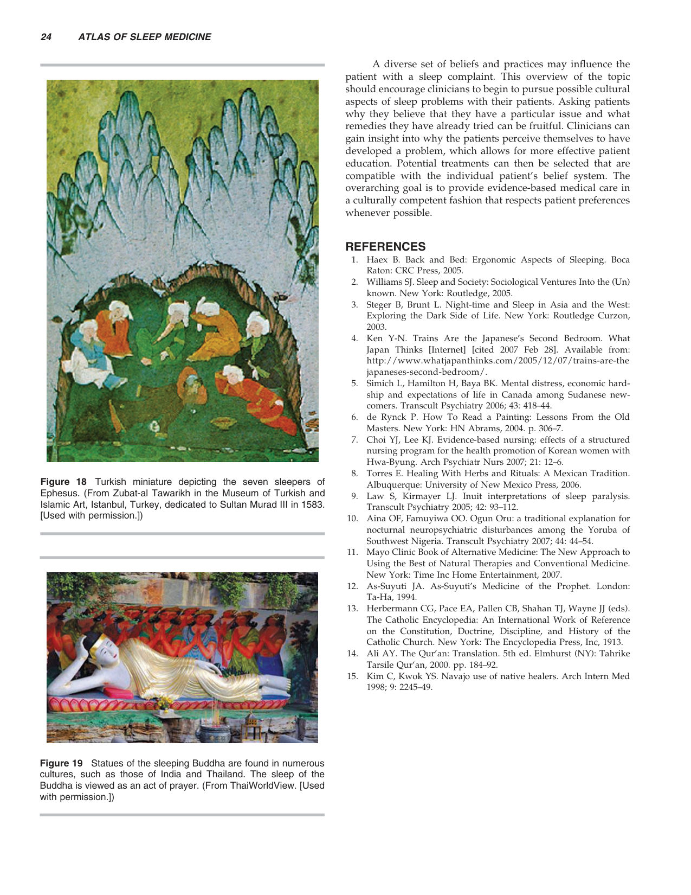

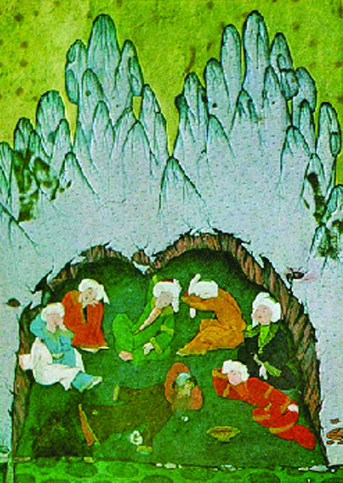

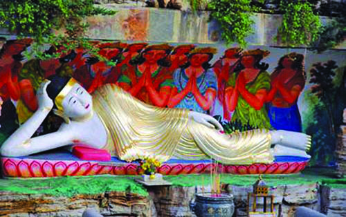
