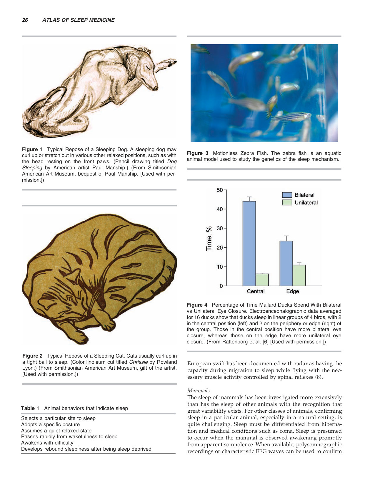
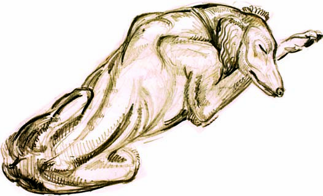
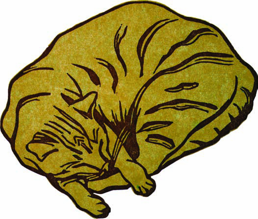
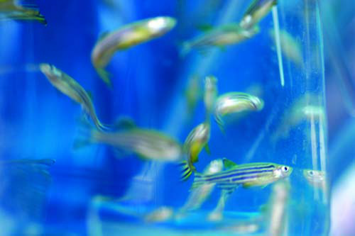
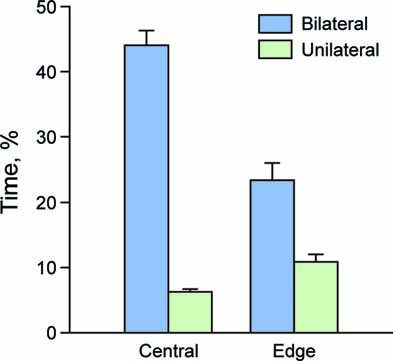
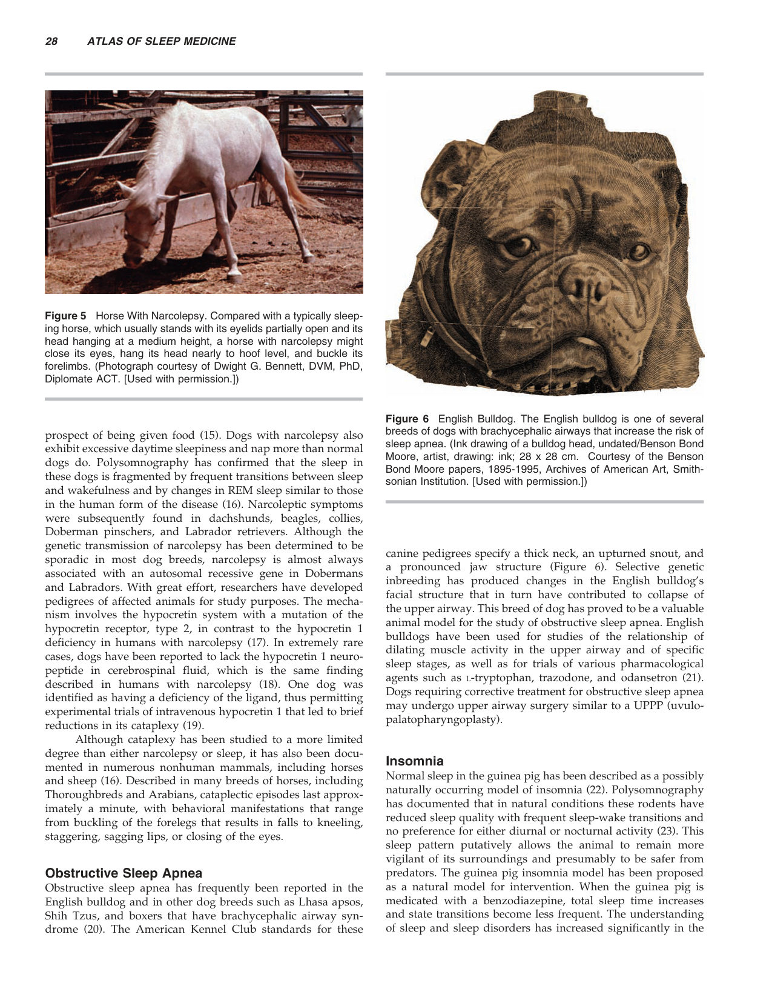
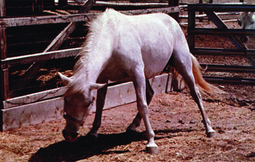
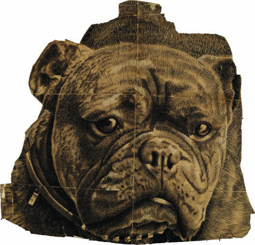

# Chapter 3 Animals and Sleep

<!-- pdf-page: 38 -->

## 3 Animals and Sleep

#### Lois E. Krahn, MD, and Timothy I. Morgenthaler, MD

#### ABBREVIATIONS

EEG, electroencephalograph; electroencephalographic

NREM, non–rapid eye movement

REM, rapid eye movement

#### SLEEP IN ANIMALS

The American inventor Thomas A. Edison exhibited a remarkable lack of understanding in 1903 about the sleep habits of animals. His misperceptions led him to make an unfounded observation, proven eventually to be erroneous, about the omnipresence and need for sleep across the animal kingdom.

Sleep is an acquired habit. Cells don’t sleep. Fish swim about in the water all night; they don’t sleep. Even a horse don’t [sic] sleep, he just stands still and rests. A man don’t [sic] need any sleep. (Thomas A. Edison, circa 1903) (1)

Since Edison’s era, research has focused on the tremendous diversity that exists in the duration, physiology, and setting of sleep across species. These discoveries have led to insights on the role of sleep for both animals (Figure 1) and humans. Depending on the class and species of animal, intriguing differences have been detected that clarify the function and risks of sleep. Sleep research in animals is necessarily multidisciplinary and requires both tenacity and innovation. Investigators collecting electroencephalographic (EEG) data from animals face huge technical challenges; these hurdles are even bigger for projects conducted in the wild. Animals in captivity, whether on a farm or in a zoo or laboratory, typically have sleep patterns that have adapted to their environment. Studying the sleep of animals in the wild enables the recognition of sleep patterns that have evolved to serve the needs of specific animals while they are hunting for food, avoiding predators, preserving body temperature, and maintaining buoyancy or migration. This chapter highlights the discoveries regarding sleep physiology, sleep patterns, and sleep disorders that occur naturally in several animals. Animal models of sleep disorders have been developed specifically to facilitate research and have resulted in exciting scientific discoveries; however, an examination of these advances is beyond the scope of this chapter.

#### Detecting Sleep in Animals

The data needed to confirm whether an animal is asleep have generated considerable discussion. EEG data are the most definitive; however, obtaining EEG data is seldom feasible for animals not in captivity or for very small creatures (e.g., insects). When EEG leads are placed on a free-roaming animal in its natural habitat, there is always the potential for them to

malfunction or to become dislodged. Accordingly, given the limited availability of EEG data for many species, there has been a clear need for consensus about which behaviors indicate sleep (Figure 2) (Table 1).

Fish, Amphibians, and Reptiles Little is known about sleep in fish. Contrary to Thomas Edison’s expectation, fish have been observed to exhibit behaviors thought to represent sleep, including periods of inactivity and decreased responsiveness to available food. Sleep has been studied in only a few of the thousands of species of fish. During periods of inactivity, for example, tilapia have been observed to be less responsive to noxious stimuli, which suggests that they are asleep (2). No data are available regarding non–rapid eye movement (NREM) or REM (rapid eye movement) sleep in fish. Nonetheless, zebra fish, likely because of convenience and rapid reproduction, in particular are increasingly used in gene expression experiments that include efforts to better understand the role of neurochemistry in influencing sleepwake behavior (Figure 3). However, hypocretin loss in the zebra fish is associated with insomnia and therefore appears to function basically in a fashion opposite to that in humans (3). Amphibians represent a large class of animals that bridges the aquatic and terrestrial environments. Frogs and toads are known to have periodic inactivity suggestive of sleep, although whether it represents actual sleep or a state of drowsiness has been debated (4). However, to protect against predators, the bullfrog is believed to maintain vigilance even when inactive. To date REM sleep has not been identified in amphibians.

Birds The sleep of birds is fairly similar to that of humans and can be subdivided into three main states: 1) active sleep, 2) quiet sleep, and 3) wakefulness. Wakeful birds keep their eyes open and scan their environment. During active or REM sleep, their eyes are closed and clusters of eye movements have been recorded (5). Relaxed muscle tone leading to head drooping has been observed in geese and ducks. Avian REM sleep is bihemispheric. In contrast, quiet or NREM sleep in birds is primarily unihemispheric (5). Unihemispheric sleep has been described as occurring more often in mallard ducks sleeping in a setting with more risks for predators, which suggests that it serves to increase vigilance (Figure 4) (6). Birds have frequent sleep-wake transitions. This has led to speculation that vigilance is increased by intermittent brief episodes of quiet sleep (7). Sleep positions in birds are incredibly diverse, ranging from parrots that sleep hanging upside down by their feet to birds sleeping perched on a wire. Many birds sleep with the head turned so that the bill rests on the shoulders. The

<!-- pdf-page: 39 -->

Figure 1

Typical Repose of a Sleeping Dog. A sleeping dog may curl up or stretch out in various other relaxed positions, such as with the head resting on the front paws. (Pencil drawing titled Dog Sleeping by American artist Paul Manship.) (From Smithsonian American Art Museum, bequest of Paul Manship. [Used with permission.])

Figure 2

Typical Repose of a Sleeping Cat. Cats usually curl up in a tight ball to sleep. (Color linoleum cut titled Chrissie by Rowland Lyon.) (From Smithsonian American Art Museum, gift of the artist. [Used with permission.])

Table 1

Animal behaviors that indicate sleep

Selects a particular site to sleep Adopts a specific posture Assumes a quiet relaxed state Passes rapidly from wakefulness to sleep Awakens with difficulty Develops rebound sleepiness after being sleep deprived

Figure 3

Motionless Zebra Fish. The zebra fish is an aquatic animal model used to study the genetics of the sleep mechanism.

Figure 4

Percentage of Time Mallard Ducks Spend With Bilateral vs Unilateral Eye Closure. Electroencephalographic data averaged for 16 ducks show that ducks sleep in linear groups of 4 birds, with 2 in the central position (left) and 2 on the periphery or edge (right) of the group. Those in the central position have more bilateral eye closure, whereas those on the edge have more unilateral eye closure. (From Rattenborg et al. [6] [Used with permission.])

European swift has been documented with radar as having the capacity during migration to sleep while flying with the necessary muscle activity controlled by spinal reflexes (8).

Mammals The sleep of mammals has been investigated more extensively than has the sleep of other animals with the recognition that great variability exists. For other classes of animals, confirming sleep in a particular animal, especially in a natural setting, is quite challenging. Sleep must be differentiated from hibernation and medical conditions such as coma. Sleep is presumed to occur when the mammal is observed awakening promptly from apparent somnolence. When available, polysomnographic recordings or characteristic EEG waves can be used to confirm

<!-- pdf-page: 40 -->

Table 2

Predominant sleep-wake patterns in select species

Monophasic sleep

the presence of sleep, but these data are rarely available for wild animals. Newborn mammals have more REM sleep than adults, and the percentage of REM sleep declines as the brain matures (9). Physiological variations in REM sleep, most notably the lack of complete muscle paralysis, exists in some species. The lack of complete muscle paralysis in a sleeping dog can lead to twitching, pawing, sniffing, whimpering, and even barking. These sleep movements are considered to be physiological rather than representative of a pathologic condition because they are ubiquitous in dogs and typically do not lead to adverse consequences. These canine sleep behaviors undoubtedly exist on a continuum with the human disorder parasomnia REM sleep behavior disorder, which involves abnormal behaviors during REM sleep that can result in potentially dangerous actions, including flailing of the arms, kicking, and shouting. This disorder primarily affects aging men with degenerative neurological disorders (10). Canines that merit treatment because of injurious behavior have been responsive to clonazepam, the same medication used for parasomnias in humans. These behaviors have been theorized to be an enactment of the dog’s dreams, although there is no way to confirm the existence of dreams in dogs or in any other nonhuman creature. These movements were sufficiently well known by the middle of the 20th century to have been incorporated into the Walt Disney animated films Cinderella in 1950 and Lady and the Tramp in 1955 (11). Aquatic mammals live in an environment where the sustained inactivity associated with sleep places the animals at risk of drowning. Two groups of aquatic mammals have been studied, cetaceans (e.g., dolphins and beluga whales) and otariids (e.g., sea lions and fur seals) (12). The cetaceans never experience bihemispheric sleep but do sleep with one hemisphere at a time, whether swimming at depth or floating on the surface. Interestingly, bottlenose dolphins in the northern hemisphere circle counterclockwise while sleeping. The life of the seal differs because this aquatic mammal spends time ashore. The sleep of the seal while on land is bihemispheric. At sea the seal rolls to one side and keeps one eye open while using a single flipper to swim. Recordings of seals at sea have revealed only unihemispheric NREM sleep vs REM sleep or a combination. Studies of aquatic mammals have generated fundamental questions about whether the REM state and, indeed, whether sleep itself as defined by inactivity followed by abrupt reversal, are universal conditions in all animals. The duration of sleep appears to be regulated by homeostatic and circadian factors. Longer durations are observed in carnivores, perhaps because of the greater weight of their brains or their lower metabolic rate. In contrast, the giraffe, a large herbivore that needs to graze often to meet its caloric needs, has a total sleep time of as little as two hours over a 24-hour period (9). It has long been believed that the sloth, an animal so sedentary that algae sometimes grows on its fur, sleeps more than any other mammal, with a sleep time ranging from 15 to 20 hours a day (13). Newer reports based on EEG results rather than on behavioral data have revealed that the sloth has a substantially lower total sleep time of 9.5 hours. Circadian patterns of sleep and wakefulness in terrestrial mammalian species include major sleep periods that are diurnal, nocturnal, polyphasic, and irregular (Table 2). Several species, including the squirrel monkey, apes, and humans, can alternate circadian patterns from monophasic to biphasic when necessary. Studies based on physiological data collected

Nocturnal sleep Diurnal sleep Bird (most types) Barred owl Chimpanzee Cockroach Elephant Fox Gorilla Kangaroo Horse Opossum Human Rat Orangutan Wolf Tamarin

Polyphasic sleep Cat Cow Dog Hedgehog Lemur Sheep

Unihemispheric slow-wave sleep Armadillo Beluga whale Bottlenose dolphin Fur seal (at sea) Reptile White whale

in the wild are needed to examine and better understand the balance of homeostatic and circadian factors influencing sleepwake patterns. The choice of sleep location and posture while asleep varies by species and environmental conditions. Aquatic animals must continue to maintain some degree of movement in order to keep swimming. Many terrestrial mammals find a well-defended or hidden location where they can close their eyes and sleep in a recumbent position. The Papio sp of baboon sleeps on its heels high up in trees, presumably sacrificing comfort to increase its safety from predators (14). Apes create a nest on the ground each night in which to sleep. Many large herbivores, including giraffes and elephants, sleep while standing, most likely to reduce their vulnerability to predators. Domesticated cattle sleep with their eyes open, presumably to watch out for anything that might threaten them (12). Horses adapt the depth of their sleep and their posture while asleep to avoid deep sleep when alone, because of the need to be vigilant for predators. Most equine sleep is obtained while standing (Figure 5). The stifle joint, a structure that presses the femur to the patella, prevents the horse’s legs from bending even when its muscles are relaxed. Horses achieve REM sleep only when lying down. Rituals that precede sleep have also been observed, although their function is unclear. One example is the instinctual action of dogs to circle their sleeping spot several times before lying down.

#### SLEEP DISORDERS IN MAMMALS

#### Narcolepsy

Narcolepsy is the best-known example of a natural model of a sleep disorder in any animal. In the 1970s, symptoms of cataplexy were reported in a French poodle that developed a transient muscle paralysis whenever it was excited by the

<!-- pdf-page: 41 -->

Figure 5

Horse With Narcolepsy. Compared with a typically sleeping horse, which usually stands with its eyelids partially open and its head hanging at a medium height, a horse with narcolepsy might close its eyes, hang its head nearly to hoof level, and buckle its forelimbs. (Photograph courtesy of Dwight G. Bennett, DVM, PhD, Diplomate ACT. [Used with permission.])

prospect of being given food (15). Dogs with narcolepsy also exhibit excessive daytime sleepiness and nap more than normal dogs do. Polysomnography has confirmed that the sleep in these dogs is fragmented by frequent transitions between sleep and wakefulness and by changes in REM sleep similar to those in the human form of the disease (16). Narcoleptic symptoms were subsequently found in dachshunds, beagles, collies, Doberman pinschers, and Labrador retrievers. Although the genetic transmission of narcolepsy has been determined to be sporadic in most dog breeds, narcolepsy is almost always associated with an autosomal recessive gene in Dobermans and Labradors. With great effort, researchers have developed pedigrees of affected animals for study purposes. The mechanism involves the hypocretin system with a mutation of the hypocretin receptor, type 2, in contrast to the hypocretin 1 deficiency in humans with narcolepsy (17). In extremely rare cases, dogs have been reported to lack the hypocretin 1 neuropeptide in cerebrospinal fluid, which is the same finding described in humans with narcolepsy (18). One dog was identified as having a deficiency of the ligand, thus permitting experimental trials of intravenous hypocretin 1 that led to brief reductions in its cataplexy (19). Although cataplexy has been studied to a more limited degree than either narcolepsy or sleep, it has also been documented in numerous nonhuman mammals, including horses and sheep (16). Described in many breeds of horses, including Thoroughbreds and Arabians, cataplectic episodes last approximately a minute, with behavioral manifestations that range from buckling of the forelegs that results in falls to kneeling, staggering, sagging lips, or closing of the eyes.

#### Obstructive Sleep Apnea

Obstructive sleep apnea has frequently been reported in the English bulldog and in other dog breeds such as Lhasa apsos, Shih Tzus, and boxers that have brachycephalic airway syndrome (20). The American Kennel Club standards for these

Figure 6

English Bulldog. The English bulldog is one of several breeds of dogs with brachycephalic airways that increase the risk of sleep apnea. (Ink drawing of a bulldog head, undated/Benson Bond Moore, artist, drawing: ink; 28 x 28 cm. Courtesy of the Benson Bond Moore papers, 1895-1995, Archives of American Art, Smithsonian Institution. [Used with permission.])

canine pedigrees specify a thick neck, an upturned snout, and a pronounced jaw structure (Figure 6). Selective genetic inbreeding has produced changes in the English bulldog’s facial structure that in turn have contributed to collapse of the upper airway. This breed of dog has proved to be a valuable animal model for the study of obstructive sleep apnea. English bulldogs have been used for studies of the relationship of dilating muscle activity in the upper airway and of specific sleep stages, as well as for trials of various pharmacological agents such as L-tryptophan, trazodone, and odansetron (21). Dogs requiring corrective treatment for obstructive sleep apnea may undergo upper airway surgery similar to a UPPP (uvulopalatopharyngoplasty).

#### Insomnia

Normal sleep in the guinea pig has been described as a possibly naturally occurring model of insomnia (22). Polysomnography has documented that in natural conditions these rodents have reduced sleep quality with frequent sleep-wake transitions and no preference for either diurnal or nocturnal activity (23). This sleep pattern putatively allows the animal to remain more vigilant of its surroundings and presumably to be safer from predators. The guinea pig insomnia model has been proposed as a natural model for intervention. When the guinea pig is medicated with a benzodiazepine, total sleep time increases and state transitions become less frequent. The understanding of sleep and sleep disorders has increased significantly in the

<!-- pdf-page: 42 -->

years since Thomas Edison published his observations. What has been learned about sleep in animals has aided the understanding of sleep mechanisms and sleep pathology in humans. As technology and funding permit, more research on sleep in animals is expected to lead to future discoveries.

#### REFERENCES

1. Edison in His Laboratory. Harper’s Magazine. 1932 Sep: 407. 2. Shapiro CM, Hepburn HR. Sleep in a schooling fish, Tilapia mossambica. Physiol Behav 1976; 16: 613–5. 3. Yokogawa T, Marin W, Faraco J, et al. Characterization of sleep in zebrafish and insomnia in hypocretin receptor mutants. PLoS Biol 2007; 5: e277. 4. Hobson JA. Electrographic correlates of behavior in the frog with special reference to sleep. Electroencephalogr Clin Neurophysiol 1967; 22: 113–21. 5. Rattenborg NC, Amlaner CJ, Lima SL. Behavioral, neurophysiological and evolutionary perspectives on unihemispheric sleep. Neurosci Biobehav Rev 2000; 24: 817–42. 6. Rattenborg NC, Lima SL, Amlaner CJ. Facultative control of avian unihemispheric sleep under the risk of predation. Behav Brain Res 1999; 105: 163–72. 7. Roth TC 2nd, Lesku JA, Amlaner CJ, Lima SL. A phylogenetic analysis of the correlates of sleep in birds. J Sleep Res 2006; 15: 395–402. 8. Cramp S editor. The birds of the western paleartic. Oxford University Press, 1985. p. 661-3. 9. Siegel JM. Clues to the functions of mammalian sleep. Nature 2005; 437: 1264–71. 10. Olson EJ, Boeve BF, Silber MH. Rapid eye movement sleep behaviour disorder: demographic, clinical and laboratory findings in 93 cases. Brain 2000; 123 (Pt 2): 331–9.

11. Iranzo A, Schenck CH, Fonte J. REM sleep behavior disorder and other sleep disturbances in Disney animated films. Sleep Med 2007; 8: 531–6. Epub 2007 May 18. 12. Siegel JM. Do all animals sleep? Trends Neurosci 2008; 31: 208–13. Epub 2008 Mar 6. 13. Rattenborg NC, Voirin B, Vyssotski AL, et al. Sleeping outside the box: electroencephalographic measures of sleep in sloths inhabiting a rainforest. Biol Lett 2008; 4: 402–5. 14. Anderson JR. Sleep-related behavioural adaptations in free-ranging anthropoid primates. Sleep Med Rev 2000; 4: 355–73. 15. Delashaw JB Jr, Foutz AS, Guilleminault C, Dement WC. Cholinergic mechanisms and cataplexy in dogs. Exp Neurol 1979; 66: 745–57. 16. Nishino S, Mignot E. Pharmacological aspects of human and canine narcolepsy. Prog Neurobiol 1997; 52: 27–78. 17. Lin L, Faraco J, Li R, et al. The sleep disorder canine narcolepsy is caused by a mutation in the hypocretin (orexin) receptor 2 gene. Cell 1999; 98: 365–76. 18. Nishino S, Ripley B, Overeem S, Lammers GJ, Mignot E. Hypocretin (orexin) deficiency in human narcolepsy. Lancet 2000; 355: 39–40. 19. Nishino S. Clinical and neurobiological aspects of narcolepsy. Sleep Med 2007; 8: 373–99. Epub 2007 Apr 30. 20. Kimoff RJ, Makino H, Horner RL, et al. Canine model of obstructive sleep apnea: model description and preliminary application. J Appl Physiol 1994; 76: 1810–7. 21. Veasey SC, Fenik P, Panckeri K, Pack AI, Hendricks JC. The effects of trazodone with L-tryptophan on sleep-disordered breathing in the English bulldog. Am J Respir Crit Care Med 1999; 160(5 Pt 1): 1659–67. 22. Tobler II, Franken P, Trachsel L, Borbely AA. Models of sleep regulation in mammals. J Sleep Res 1992; 1: 125–7. 23. Gvilia I, Darchia N, Darchia TO. The guinea pig as a natural model of insomnia. Actas de Fisiologia 2001; 7: 21.
