# Chapter 4 The Physiology of Sleep

<!-- pdf-page: 43 -->

## 4 The Physiology of Sleep

#### Michael H. Silber, MBChB, FCP (SA)

#### ABBREVIATIONS

EEG, electroencephalogram; electroencephalography

EMG, electromyogram; electromyography

EOG, electro-oculogram; electro-oculography

GABA, g-aminobutyric acid

NREM, non–rapid eye movement

REM, rapid eye movement

SCN, suprachiasmatic nuclei

VLPO, ventrolateral preoptic

#### THE STATES OF WAKE AND SLEEP

Human existence can be conceptualized as occurring in three states, one of wakefulness and two of sleep. The discovery in 1953 that periods of rapid eye movement (REM) occur during sleep (1) led to a realization that sleep consists of two states with much different physiology. Non–rapid eye movement (NREM) sleep makes up most of a person’s sleep but is interspersed by periods of REM sleep. In a young adult, sleep is composed of approximately five successive cycles, each consisting of a period of NREM sleep followed by a period of REM sleep. In the early cycles of sleep, the duration of NREM sleep considerably exceeds that of REM sleep, but in the later cycles, REM sleep makes up a larger percentage of each cycle (Figure 1). The different states of wakefulness and sleep can be most accurately described by their electrophysiological characteristics on electroencephalography (EEG), electro-oculography (EOG), and electromyography (EMG). An EEG of the state of wakefulness is characterized by alpha rhythm, which consists of 9-Hz to 10-Hz rhythmic sinusoidal waves recorded over the occipital head region during relaxed wakefulness with the eyes closed (Figure 2). NREM sleep is subdivided into three stages of increasing depth: stages N1, N2, and N3 sleep (2). In stage N1 sleep, low-amplitude, mixed-frequency (predominantly 4-Hz to 7-Hz) rhythms replace alpha activity and slow, rolling eye movements, predominantly horizontal (Figure 3), develop. The two signs of the descent into stage N2 sleep are the presence of K complexes and sleep spindles (Figure 4). K complexes are high-amplitude diphasic waves lasting at least 0.5 second; they are recorded maximally over the frontal regions. Sleep spindles are trains of 11-Hz to 16-Hz (predominantly 12-Hz to 14-Hz) waves that last at least 0.5 second; they are maximally expressed over the central head regions. Stage N3 sleep is characterized by slow waves (0.1–0.5 Hz) of high amplitude (at least 75 microvolts over the frontal regions), composing at least 20% (6 seconds) of each 30-second period,

or epoch, of sleep (Figure 5). During NREM sleep, decreases occur in heart rate, blood pressure, respiratory minute volume, skeletal muscle tone, and cerebral blood flow. Breathing becomes regular, except during the transition between wakefulness and sleep. The physiological characteristics of REM sleep differ greatly from those of NREM sleep (Figure 6). The EOG shows bursts of irregular, conjugate rapid eye movements, whereas the EMG shows profound loss of skeletal muscle tone. Skeletal muscle activity persists only in the diaphragm, extraocular muscles, and middle ear muscles. The EEG shows desynchronized, low-amplitude, mixed-frequency activity with bursts of sawtooth waves (2-Hz to 4-Hz sharply contoured or serrated waves maximal over the central regions, often preceding clusters of rapid eye movements). Superimposed on muscle atonia are short bursts of transient muscle activity. Irregular acceleration occurs in the heart rate and the respiratory rate. Penile erection or clitoral engorgement occurs, thermal regulation becomes poikilothermic, cerebral blood flow increases, and vivid, emotionally charged dreams are experienced. Total sleep time declines between childhood and age 60 years (3). Sleep efficiency (the percentage of time in bed spent asleep; determined by dividing the amount of time asleep by the amount of time in bed) decreases with age due to increased sleep latency (the amount of time from “lights out” until the onset of sleep) and increased wake time after sleep onset (Figure 7). A young adult spends about 25% percent of the night in REM sleep (Figure 8). In contrast, about 50% of a neonate’s sleep is active sleep (the neonatal equivalent of REM sleep) and 50% is quiet sleep (the neonatal equivalent of NREM sleep). The percentage of slow-wave sleep declines from childhood through old age, whereas the percentage of REM sleep falls until about age 60 years. Concomitantly, the percentage of stages N1 and N2 sleep increase with age.

#### THE GENESIS OF WAKEFULNESS

Arousal and consciousness are mediated through a series of interlocking neural pathways. Two ascending systems, the cholinergic and monoaminergic pathways, are stabilized by a third regulatory system, the hypocretin (also known as orexin) pathway. Together, these networks are responsible for the perception of multimodal sensory stimuli, the sense of consciousness, and the inhibition of sleep (4). The cholinergic system originates in neurons of the dorsal pontine tegmentum, specifically, the pedunculopontine and the lateral dorsal tegmental nuclei. Their axons project to the reticular and relay nuclei of the thalamus, thereby opening the gate that controls the transmission of incoming sensory stimuli to

<!-- pdf-page: 44 -->

Figure 2

Stage W. This 30-second epoch of wakefulness was recorded with the subject’s eyes closed. Blinking continued, visible as in-phase, upward deflections in the electro-oculogram (channels 1 and 2). The cortical electroencephalogram shows alpha rhythm over the occipital head region (sinusoidal 9-Hz to 10-Hz activity) (channel 4). Muscle tone (measured below the chin) is relatively high (channel 6). EMG indicates electromyogram.

Figure 3

Stage N1 Sleep. Stage N1 sleep is the lightest stage of non–rapid eye movement sleep. Eye blinks are replaced by slow, rolling, generally horizontal eye movements, visible as out-of-phase deflections in the electrooculogram (channels 1 and 2). Alpha rhythm is replaced by low-amplitude, mixed-frequency electroencephalogram activity, predominantly in the 4-Hz to 7-Hz range (channels 3–5). Muscle tone is reduced (channel 6). EMG indicates electromyogram.

Figure 4

Stage N2 Sleep. K complexes and sleep spindles are present in stage N2 sleep. K complexes are prominent diphasic waves maximal frontally (channels 1–5) and lasting at least 0.5 second. Sleep spindles are trains of 11-Hz to 16- Hz (predominantly 12-Hz to14-Hz) activity maximal centrally (channels 4 and 5) and lasting at least 0.5 second. EMG indicates electromyogram.

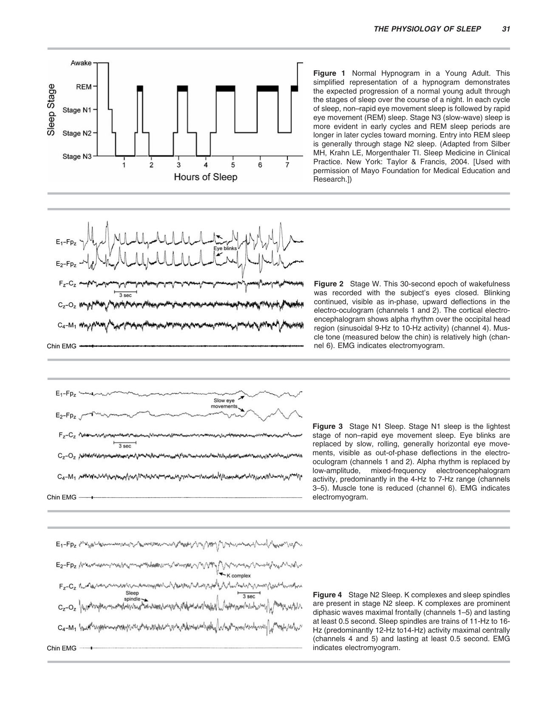

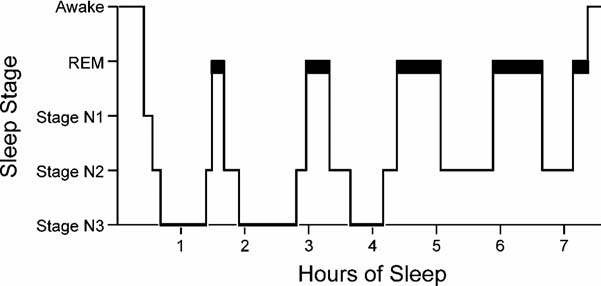

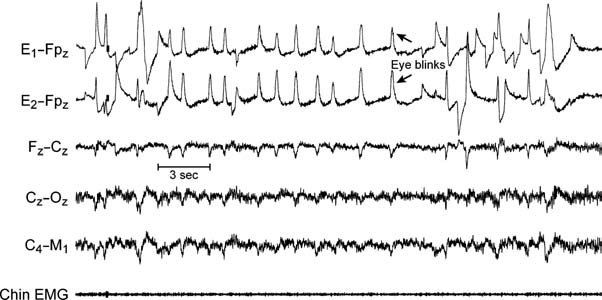

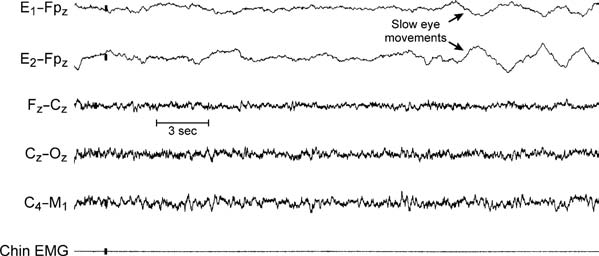

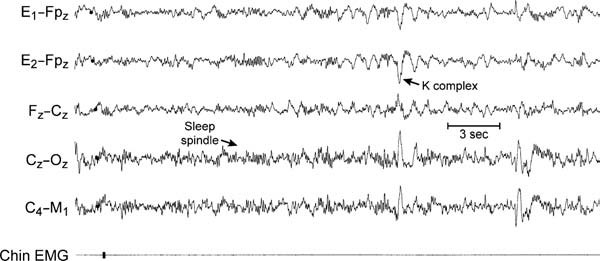

<!-- pdf-page: 45 -->

Figure 5

Stage N3 Sleep. Stage N3 sleep is characterized by high-amplitude (75 microvolts) slow waves (0.5 Hz) composing at least 20% of each 30-second epoch, visible in all electroencephalogram (and electro-oculogram) derivations. EMG indicates electromyogram.

Figure 6

Stage REM Sleep. The most striking polysomnographic feature of rapid eye movement (REM) sleep is the presence of irregular, conjugate, predominantly horizontal or oblique rapid eye movements (channels 1 and 2). These out-of-phase deflections have a rapid upstroke in the first two channels and clearly differ from the blinks of wakefulness or the slow eye movements of stage N1 sleep shown in

Figure 3. The electroencephalogram is desynchronized: low amplitude with mixed frequencies and lacking the rhythmicity of stages N2 and

N3 sleep. A run of sawtooth waves (2-Hz to 6-Hz sharply contoured or serrated waves over the central area) often precedes REM bursts. Muscle tone is low, never higher than in any other sleep stage (channel 6). EMG indicates electromyogram.

the cerebral cortex (Figure 9) (5). Predictably, these neurons fire actively during wakefulness and are inactive during NREM sleep; paradoxically, they are also active during REM sleep (Table 1). The monoaminergic system consists of numerous ascending axons, which are linked by the release of monoaminergic neurotransmitters (Figure 10). Neurons in the pontine locus coeruleus release norepinephrine, the pontine raphe nuclei release serotonin, the midbrain periaqueductal

gray neurons release dopamine, and the hypothalamic tuberomammillary nuclei release histamine (Figure 11) (6). Stimulation of these neurons activates the cerebral cortex, thereby facilitating the processing of thalamic information (Figure 9). In addition, the neurons inhibit the primary generator of NREM sleep, the ventrolateral preoptic (VLPO) nuclei. They fire rapidly during wakefulness, discharge slowly during NREM sleep, and are inactive during REM sleep (Table 1).

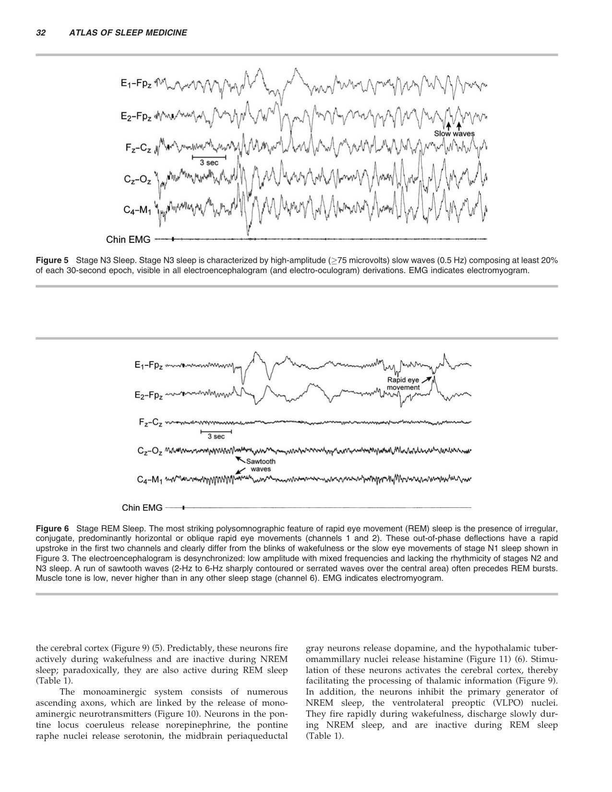

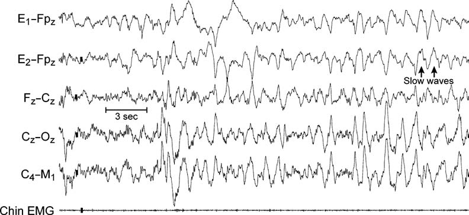

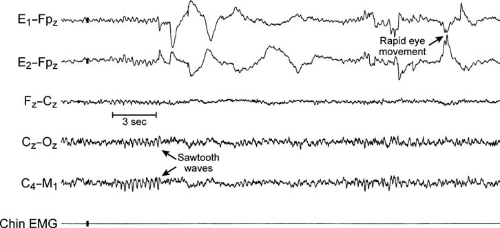

<!-- pdf-page: 46 -->

Figure 7

Changes in Sleep With Age. An extensive meta-analysis of 65 studies involving 3,577 subjects statistically combined results about changes in sleep stages with age. Despite considerable individual variability, several clear trends emerged. With increased age, there were decreases in (A) total sleep time and (B) sleep efficiency (time asleep divided by time in bed), which are accounted for by (C) increasing wake time after sleep onset. The decrease in the percentage of stage N3 sleep starts in adolescence and continues to decline throughout adulthood (D). The percentage of rapid eye movement (REM) sleep also declines with increasing age (E). Percentages of lighter non–rapid eye movement (NREM) sleep (stages N1 and N2) proportionally increase. (Adapted from Ohayon et al [3]. [Used with permission.])

The third pathway controlling arousal, the hypocretin neurons, serves as a wake-stabilizing system. The hypocretins are peptide neurotransmitters synthesized by a small cluster of cells in the posterolateral hypothalamus. Their axons,

however, project widely to the cell bodies of the cholinergic and monoaminergic ascending arousal systems and to the cerebral cortex (Figure 12). They fire actively during wakefulness and are inactive during NREM and REM sleep (Table 1).

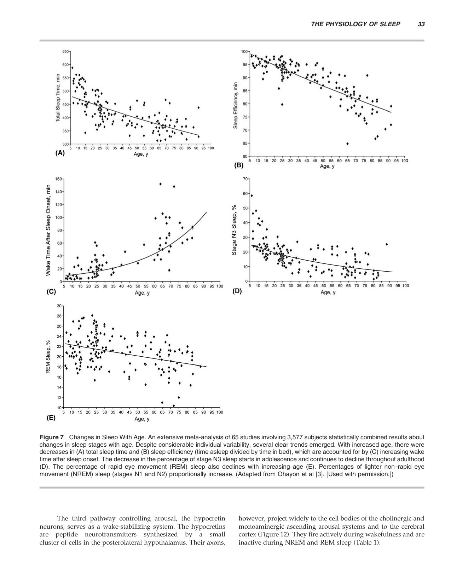

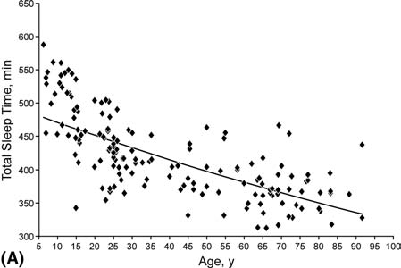

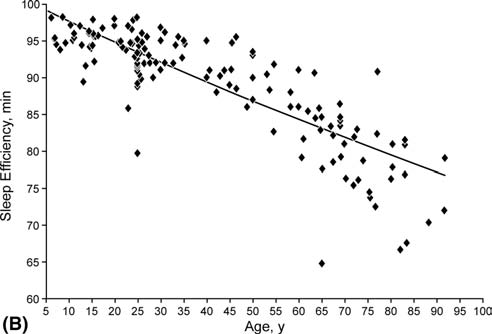

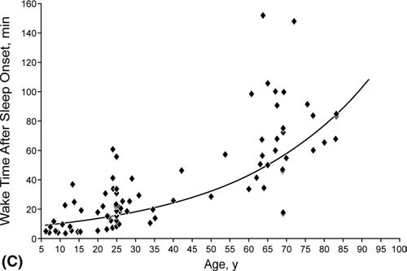

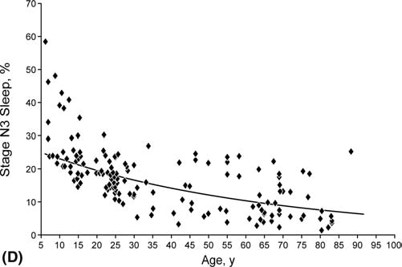

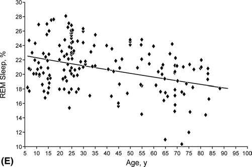

<!-- pdf-page: 47 -->

Table 1

Action of neurotransmitter systems in wakefulness and sleep

Sleep

Neurons Wakefulness NREM REM

Cholinergic Active Inactive Active Noradrenergic Active Partially active Inactive

Serotoninergic Active Partially active Inactive

Figure 9

Monoaminergic and Cholinergic Systems: Axonal Distribution. Two ascending arousal systems maintain wakefulness. The first involves acetylcholine (ACh), a neurotransmitter with neurons in the brainstem tegmentum (pedunculopontine [PPT]) and lateral dorsal tegmental nuclei (LDT) projecting to the thalamus. The second system uses monoamine neurotransmission and is composed of several neuronal groups with different monoamine neurotransmitters. These include the locus coeruleus (LC) (norepinephrine), the raphe nuclei (serotonin [5-HT]), the periaqueductal gray (PAG) (dopamine [DA]), and the tuberomammillary nuclei (TMN) (histamine [His]). Axons from these neurons project to the cerebral cortex, the ventrolateral preoptic and basal forebrain (BF) areas, and the lateral hypothalamic (LH) areas. GABA indicates g-aminobutyric acid; NA, noradrenaline. (Adapted from Saper et al [5]. [Used with permission.])

Hypocretinergic Active Inactive Inactive

Abbreviations: NREM, non–rapid eye movement; REM, rapid eye movement.

#### THE GENESIS OF NREM SLEEP

The VLPO nuclei in the anterior hypothalamus are the primary generators of NREM sleep (Figure 13) (5). Releasing the inhibitory neurotransmitters g-aminobutyric acid (GABA) and galanin, VLPO axons project to all three neuronal systems controlling arousal: the ascending cholinergic and monoaminergic neurons and the hypocretin neurons (Figure 14). A flip-flop switch is an electronic circuit consisting of two mutually inhibitory, self-reinforcing elements. Activation of one pole of the circuit inhibits the other and thus disinhibits the first, resulting in discrete states with sharp transitions. The

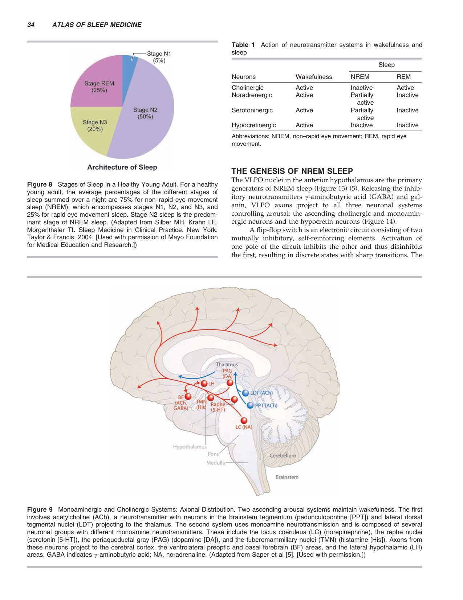

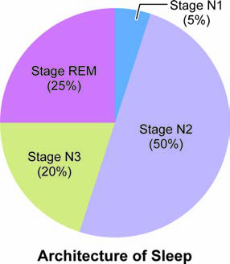

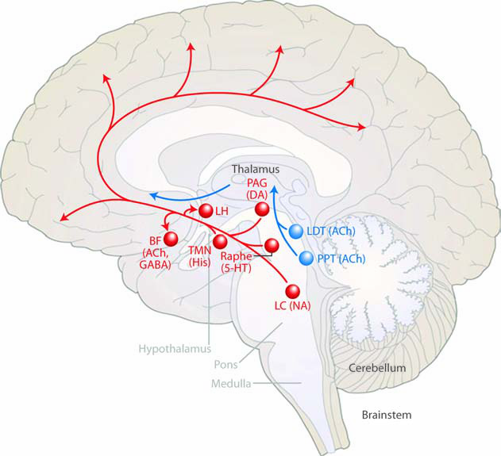

<!-- pdf-page: 48 -->

Figure 10

Monoamine Synthetic Pathways. Monoamine neurotransmission is fundamental for maintaining alertness. Knowledge of the neurochemistry of monoamine synthesis is essential for understanding many disease processes and medications used to treat sleep disorders.

Figure 11

Monoamine Pathways. These sagittal and transverse sections through the pons and midbrain illustrate the location of (A and B), the periaqueductal gray (PAG) (dopamine-alerting system) and (C), the locus coeruleus (LC) (norepinephrine-alerting system). (Adapted from Boeve et al [6]. [Used with permission.])

weakening of either pole causes more rapid transitions between states. The monoaminergic neurons of the ascending arousal system and the neurons of the VLPO act as the two poles of a flip-flop switch (Figure 15) (5). When the monoaminergic pole fires, the VLPO is inhibited, which results in wakefulness. In contrast, when the VLPO neurons fire, the monoaminergic neurons are inhibited, which results in the onset of sleep. The switch is stabilized by the hypocretin system. During wakeful-

Figure 12

Hypocretin Systems: Axonal Distributions. The cells of the hypocretin (i.e., orexin) wake-stabilizing system originate in the perifornical area of the brain and their axons are widely distributed to the brainstem, hypothalamus, thalamus, basal forebrain, and cerebral cortex. (Adapted from Silber MH, Rye DB. Solving the mysteries of narcolepsy: the hypocretin story. Neurology 2001; 56: 1616–8. [Used with permission.])

ness, the VLPO is inactive; thus the hypocretin-synthesizing neurons are able to discharge. Monoaminergic neurons are activated, stabilizing the state of wakefulness. During sleep, the active VLPO neurons inhibit the hypocretin neurons, which

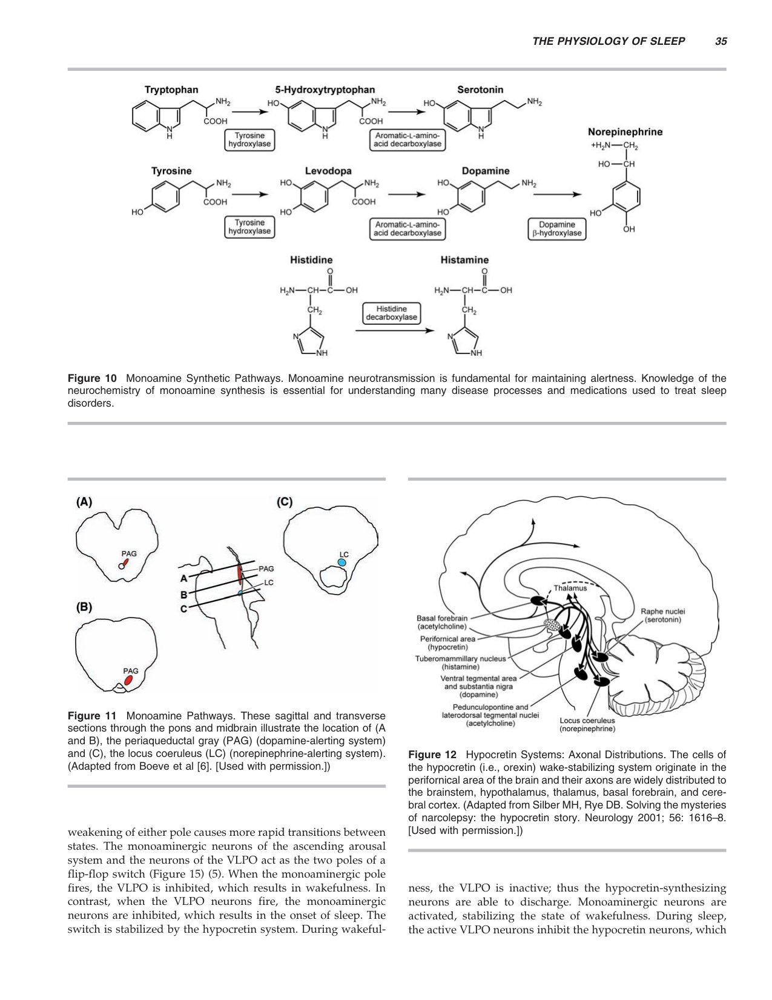

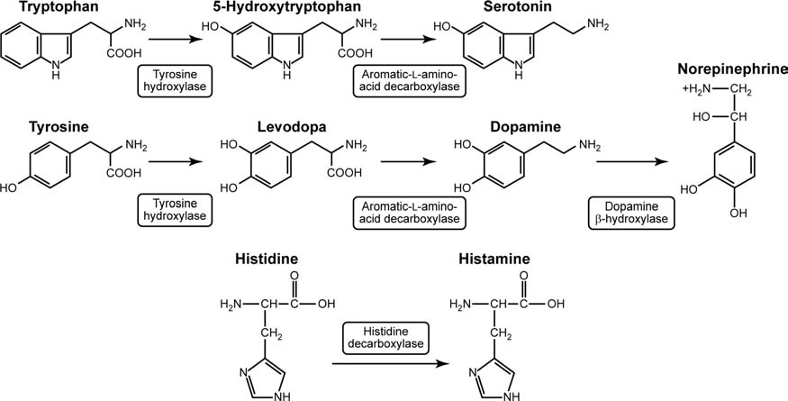

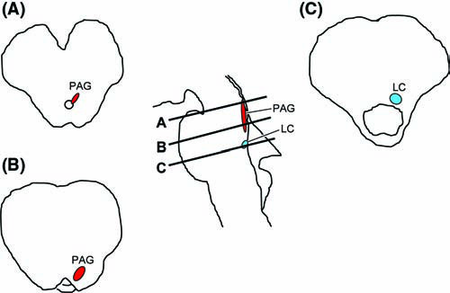

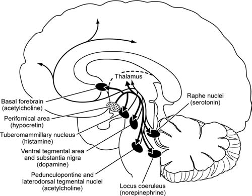

<!-- pdf-page: 49 -->

prevent activation of the monoamine system and thus stabilize the state of NREM sleep. NREM sleep is characterized by the intense synchronicity of neural discharges, resulting in cortical sleep spindles and high-amplitude slow waves. Sleep spindles arise in the thalamus (7) (Figure 16). Inactivity of the pontine tegmental cholinergic arousal system during NREM sleep results in hyperpolarization of GABA-releasing thalamic cells. This hyperpolarization results in the opening of calcium channels which, in turn, generate self-perpetuating action potentials at spindle frequency. The discharge of thalamocortical afferents results in similar cortical potentials that are recorded by scalp EEG as sleep spindles.

#### THE GENESIS OF REM SLEEP

The primary generator of REM sleep lies in the pontine tegmentum, just ventral to the locus coeruleus (8). Although this group of cells has several names, it is simplest to refer to it as the subcoeruleus region (Figure 17). Animals whose subcoeruleus regions have been ablated do not exhibit manifestations of REM sleep. During REM sleep, subcoeruleus cells fire actively (“REM-on cells”) and the region demonstrates a high concentration of c-fos expression. In contrast, “REM-off cells,” which are inactive during REM sleep, have been identified in the lateral pontine tegmentum and in the ventrolateral peri-

Figure 14

Ventrolateral Preoptic Axonal Distributions. Cells of the ventrolateral preoptic (VLPO) area produce the inhibitory neurotransmitters g-aminobutyric acid (GABA) and galanin (Gal). Their axons project to the monoaminergic and cholinergic neurons of the ascending arousal systems, as well as to the cells of the lateral hypothalamus (LH) producing hypocretin (HYP). These pathways control the onset and maintenance of non–rapid eye movement sleep. ACh, acetylcholine; DA, dopamine; His, histamine; LC, locus coeruleus; 5-HT, serotonin; LDT, lateral dorsal tegmental nuclei; NA, noradrenaline; PPT, pedunculopontine; TMN, tuberomammillary nuclei; PAG, periaqueductal gray. (Adapted from Saper et al [5]. [Used with permission.])

aqueductal gray matter. REM-on and REM-off cells are mutually inhibitory. The suprapontine control of REM sleep has not been fully delineated, but activation of hypothalamic cells surrounding the VLPO (extended VLPO) is known to result in inhibition of REM-off areas. This action disinhibits the neurons of the subcoeruleus region, initiating REM sleep (9) (Figure 18). How are the diverse manifestations of REM sleep generated by a small group of pontine neurons? The pathways underlying skeletal muscle atonia are understood the best. Anterior horn cells are presynaptically inhibited by glycine or GABA-releasing neurons. In cats, glutaminergic or cholinergic neurons of the pontine tegmentum adjacent to the subcoeruleus region activate ventromedial medullary interneurons in the nucleus magnocellularis, which synapse on the anterior horn cells (8). Rats do not appear to have medullary interneurons, and pontine neurons synapse directly on inhibitory interneurons in the anterior horn (5) (Figure 19). The neural circuitry in humans is not fully known, but pontine lesions can cause REM sleep behavior disorder, a condition with loss of REM sleep atonia and resultant dream enactment behaviors, such as screaming, kicking, and punching (6).

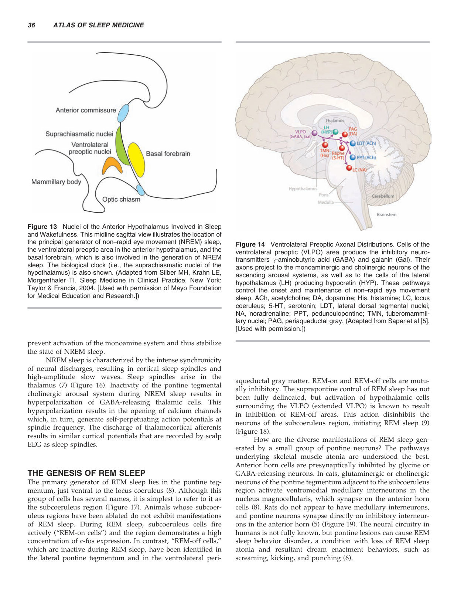

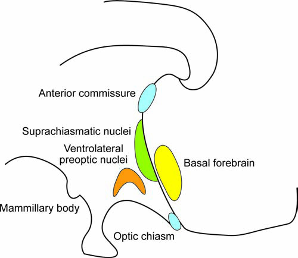

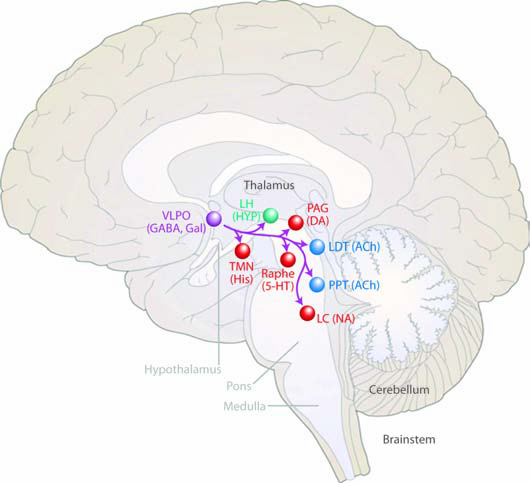

<!-- pdf-page: 50 -->

Figure 15

The Flip-Flop Switch in Wakefulness and Sleep. The principle of the flip-flop switch (A) applies to the understanding of the onset and maintenance of wakefulness (B) and sleep (C). The ventrolateral preoptic (VLPO) area and the monoaminergic arousal neurons serve as opposite poles of a flip-flop switch. The hypocretin (HCRT) system, which is active in wakefulness (D), stabilizes the wake state, whereas (E) its inhibition stabilizes sleep. Minus signs indicate inhibitory pathways; plus signs indicate excitatory pathways. The degree of inhibition or excitation is indicated by the number of signs and the thickness of the arrows. (Adapted from Saper et al [5]. [Used with permission.])

#### THE TIMING OF WAKE AND SLEEP

Humans sleep predominantly at night. We become drowsy by the mid-afternoon but feel more alert in the early evening. We are refreshed by short catnaps. What determines the timing of wake and sleep? There are two sleep-control systems, homeostatic and circadian (Figure 20). The homeostatic system results in an increase in sleep drive that is directly proportional to the number of hours one spends awake. After an adequate period of sleep, the homeostatic system resets. Homeostatic control is mediated by a buildup of extracellular adenosine (4), the neuromodulator whose receptor is blocked by xanthine derivatives such as caffeine. The site of action of adenosine is

uncertain; for many years, sleep-on neurons in the basal forebrain region were thought to be the target cells, but recent research has failed to confirm this hypothesis. A complex, genetically programmed, circadian system controls the timing of most physiological processes, from hormone secretion to temperature cycles. Maximal sleepiness occurs in the late evening and at night with a second, less intense, peak in mid-afternoon. The biological clock is localized to the suprachiasmatic nuclei (SCN) of the hypothalamus (Figure 13). Genetic control is exerted by an array of circadian genes that control the synthesis of proteins, which diffuse back into the nucleus, inhibiting further gene transcription (10). This process results in molecular oscillation over an approximately circadian period.

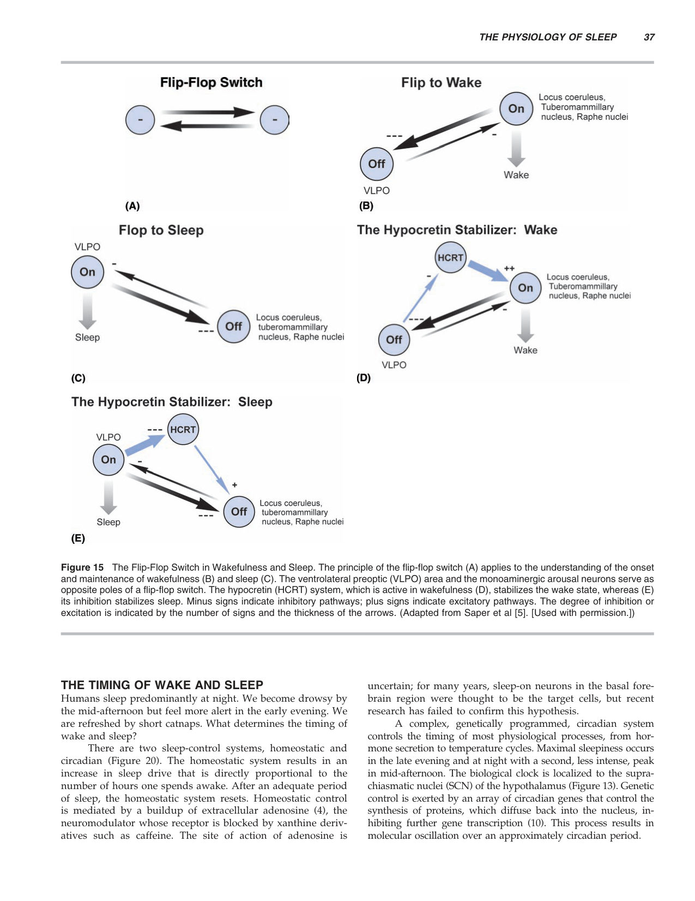

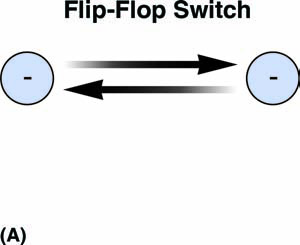

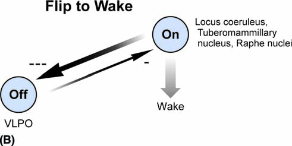

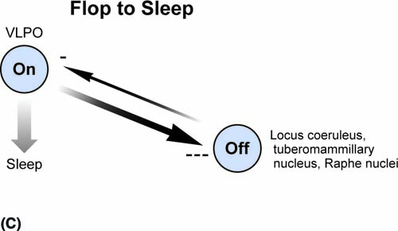

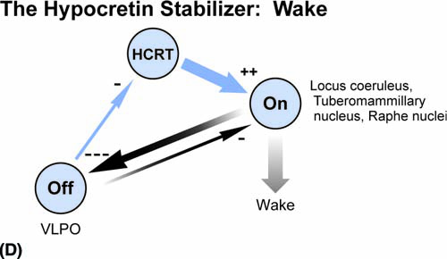

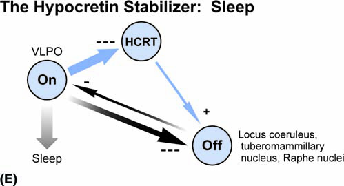

<!-- pdf-page: 51 -->

Figure 16

Genesis of Sleep Spindles. This diagram represents the membrane potential of a thalamic reticular neuron in non–rapid eye movement sleep, illustrating the genesis of sleep spindles. (A) g- Aminobutyric acid (GABA) thalamic neurons become hyperpolarized as a result of the cessation of cholinergic input from the brainstem. (B) This hyperpolarization results in the firing of a calcium spike with a superimposed burst of action potentials. (C) The entry of calcium into the neuron is accompanied by the efflux of potassium, resulting in pronounced hyperpolarization. (D) Slight rebound depolarization occurs, which (E) again triggers a subsequent calcium spike. Thalamocortical afferent transmission results in similar changes in cortical neurons that are recorded as sleep spindles.

Figure 18

Control of Rapid Eye Movement (REM) Sleep. (A) A flipflop switch is the proposed mechanism for the control of transitions between non–rapid eye movement (NREM) and REM sleep. REMon cells in the subcoeruleus region form one pole of the switch, whereas REM-off cells in the periaqueductal gray (PAG) matter and the lateral pontine tegmentum (LPT) form the other pole. GABA indicates g-aminobutyric acid. (B) The extended ventrolateral preoptic area (eVLPO) is active during REM sleep, inhibiting REM-off cells. This inhibition in turn results in disinhibition of the REM-on cells and the onset of REM sleep. Minus signs indicate inhibitory pathways. The degree of inhibition is indicated by the number of signs and the thickness of arrows. (Adapted from Lu et al [9]. [Used with permission.])

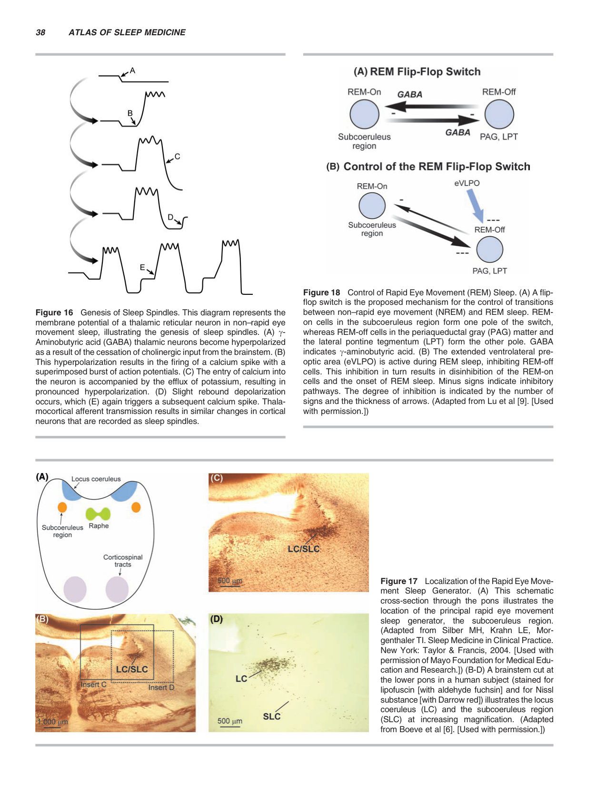

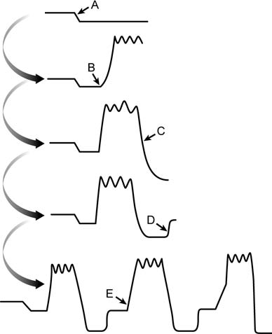

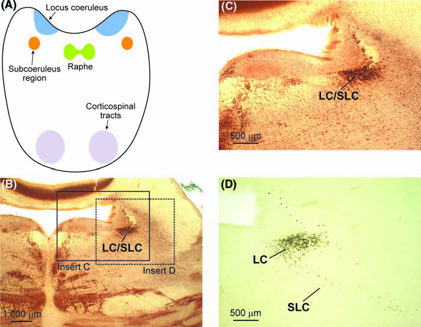

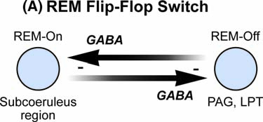

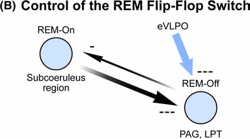

<!-- pdf-page: 52 -->

Figure 19

REM Atonia Pathways. Rapid eye movement (REM) sleep atonia is mediated through a descending inhibitory pathway from the pontine tegmentum to the alpha motor neurons in the anterior horn of the spinal cord. (A) In cats a relay station is present in the medulla, whereas (B) in rats the interneuron appears to be located in the spinal cord itself. The first-order descending neuron has glutamate (Glu) or acetylcholine (ACh) as a neurotransmitter, whereas the second-order neuron utilizes the inhibitory neurotransmitters glycine (Gly) or gaminobutyric acid (GABA). LC indicates locus coeruleus; SLC, subcoeruleus region.

In a constant low-illumination environment, the intrinsic periodicity of the human clock is 24.3 hours (11) (Figure 21). The influence of light during the day entrains this free-running cycle to a geophysical time of 24 hours. A special class of retinal ganglion cells secretes the pigment melanopsin, which is responsible for the transduction of short wavelength (predominantly blue) light (12). The resultant neural pathway along the retinohypothalamic tract terminates on the SCN and alters the periodicity of its neuronal discharges. Light administered at specific times during the circadian cycle can have profound effects on circadian rhythms, delaying or advancing them, depending on the timing of the light exposure (Figure 22).

Figure 20

Homeostatic Drive and Circadian Rhythm. The timing of sleep and wakefulness depends on an interaction of homeostatic and circadian factors. The homeostatic drive (light blue) increases sleepiness from the time of waking in the morning until it is relieved by sleep at night. The circadian rhythm (dark blue) shows a minor peak of sleepiness in the early afternoon and a major peak in the evening and night.

The SCN cells fire during the day and are inactive at night. The SCN outflow tract leads to the dorsomedial hypothalamic nuclei (13) (Figure 23). Axons from these neurons inhibit the VLPO and stimulate the hypocretin-synthesizing cells in the lateral hypothalamus, which results in the transition from the sleep state to the wake state. Under the control of the SCN, the pineal gland secretes the peptide hormone melatonin at night. The presence of melatonin receptors in the SCN supports the hypothesis that melatonin modulates control of circadian rhythms (Figure 24). Ontogenic and cultural factors also play a role in the timing of sleep. Neonates sleep in many short stretches spread

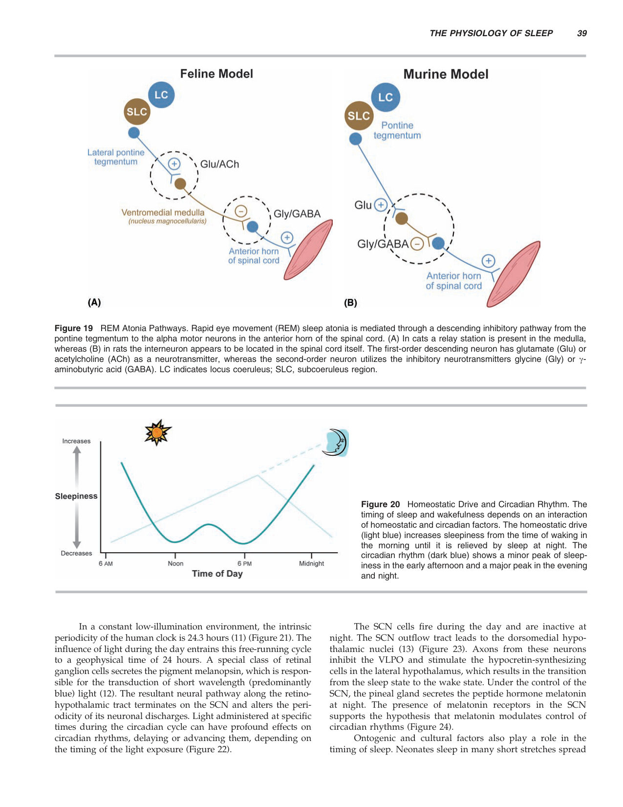

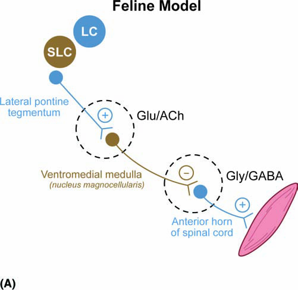

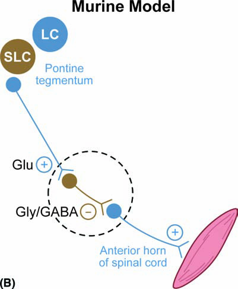

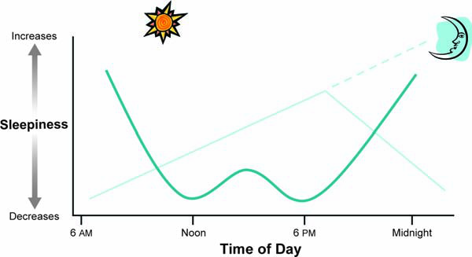

<!-- pdf-page: 53 -->

Figure 21

Temporal Isolation Experiment. In a classic temporal isolation experiment, the subject was aware of the time of the day and slept approximately 7 hours a night with regular sleep and wake times for the first 20 days (boxed horizontal bars). Then on day 21, the subject was placed in a time isolation environment with no cues to the time of day. His sleep time shifted later each day by a mean of 1.3 hours, demonstrating that the intrinsic periodicity of the human biological clock is longer than 24 hours. More recent experiments conducted in constant low illumination have shown that the true periodicity is about 24.3 hours (11). Zero on the horizontal axis represents the subject’s habitual bedtime. T indicates tau, the endogenous circadian periodicity. (Adapted from Czeisler CA, Richardson GS, Coleman RM, et al. Chronotherapy: resetting the circadian clocks of patients with delayed sleep phase insomnia. Sleep 1981; 4: 1–21. [Used with permission.])

Figure 22

Human Phase Light Response Curve. Light is the most potent extrinsic factor controlling circadian timing. Light has a variable effect at different times of the circadian cycle, with early morning light shifting circadian rhythms in a backward direction (“phase advance”) and late evening light resulting in a forward shift (“phase delay”). Thus a patient with delayed sleep phase disorder who can only initiate sleep at 2 AM would benefit from early morning light, whereas a patient with advanced sleep phase disorder who sleeps from 8 PM to 3 AM can be effectively treated with evening light. Circadian zero (about 4 AM), when the effects of light shift from delaying to advancing, is indicated by the vertical line.

Figure 23

Outflow Pathways from the Biological Clock. The suprachiasmatic nuclei (SCN) control a vast array of circadian physiological processes. This schematic illustrates the outflow pathways from the SCN, concentrating specifically on circadian control of sleep and wakefulness. Relay neurons in the ventral subparaventricular zone of the hypothalamus (vSPZ) project to the dorsomedial nucleus of the hypothalamus (DMH) during the circadian day. Excitatory glutaminergic (Glu) neurons from the DMH project to cells in the lateral hypothalamus (LH) that produce hypocretin (HCRT), whereas GABAergic (g-aminobutyric acid–mediated) inhibitory neurons from the DMH project to the ventrolateral preoptic (VLPO) nuclei. The inhibition of the VLPO and the conjoint release of hypocretin activate monoamine pathways, resulting in wakefulness.

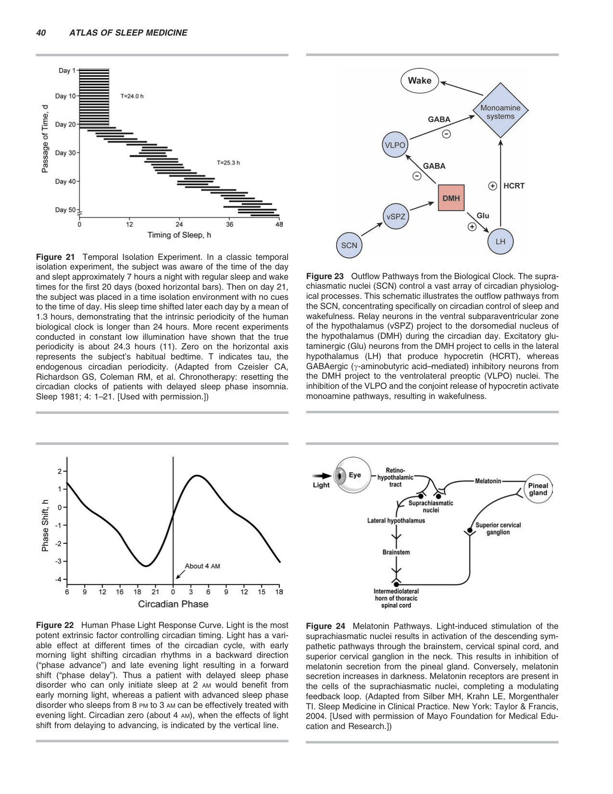

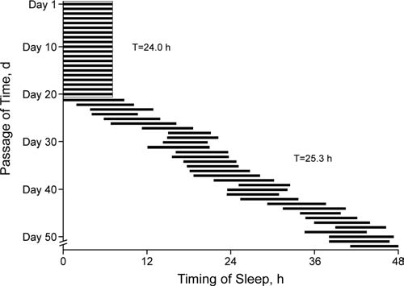

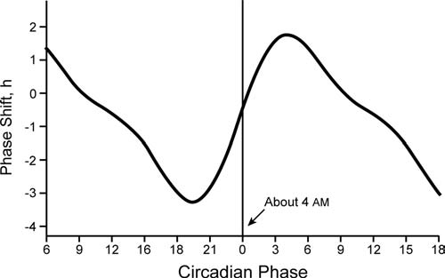

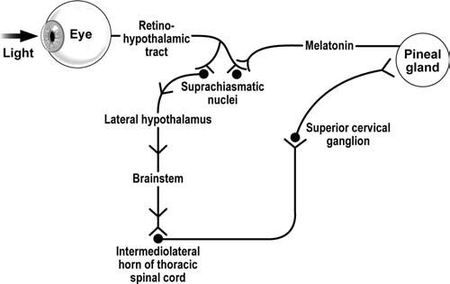

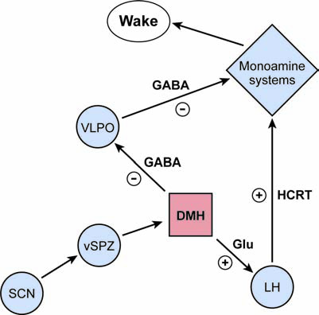

<!-- pdf-page: 54 -->

evenly throughout the day and night. First-decade children tend to go to bed earlier and rise earlier than adults. In midadolescence, a biological change occurs with the development of evening alertness and a forward shift of several hours for desired sleep and wake times. By the early to middle part of the third decade, this delayed sleep-phase pattern usually reverts to a conventional adult pattern. Some older persons may develop an advanced sleep-phase pattern, struggling to remain awake during the early evening and then waking at an undesirably early hour. Persons in cultures that embrace the siesta have developed a split pattern of sleep, with a short period of sleep occurring during the afternoon circadian dip and a longer period occurring during the night, often with a relatively late time of sleep onset. In the Middle Ages, the absence of reliable artificial light resulted in an early to bed time soon after sunset, a period of quiet wakefulness at midnight or later that lasted an hour or longer, and a second period of sleep until sunrise (14).

#### THE FUNCTIONS OF SLEEP

All mammals and birds sleep, as probably do other vertebrates, whereas invertebrates experience observable quiescent states similar to sleep. Clearly, this highly conserved function must play an important biological role but the identification of that role has proven elusive. Many hypotheses about the function of sleep have been proposed, and all may be partially correct. Possible functions include body repair, brain restoration, memory and learning, unlearning, immunocompetence, and thermoregulation and energy conservation. It has been hypothesized that sleep, especially NREM sleep, is necessary for protein synthesis and for cell division and growth, thus allowing for repair of the body or restoration of brain function. REM sleep can enhance the consolidation of memory, and it may serve a role in deleting unnecessary memory traces. Sleep may help maintain immunocompetence. It may be required to maintain a positive energy balance by providing a period of rest and low metabolic activity. At the cellular or molecular level, the functions of sleep remain undetermined.

#### LOSS OF SLEEP

The consequences of sleep deprivation in animals and humans have interested researchers for more than a century. A series of elegant experiments conducted by Allan Rechtschaffen at the University of Chicago in the 1980s conclusively demonstrated the effects of sleep deprivation in the rat (15) (Figure 25). Sleepdeprived rats died after a mean of 21 days, with death preceded by loss of weight, ulcerative skin lesions, hypothermia, and hypercatabolism. When sleep deprivation was terminated before death, most of the rats survived, with recovery sleep characterized by large quantities of paradoxical (REM) sleep. Selective deprivation of REM sleep produced similar results, but with longer survival (mean, 37 days). Autopsy studies did not yield a definite cause of death, although subsequent unconfirmed experiments suggested that death may have resulted from septicemia. Sustained total sleep deprivation in humans is difficult to produce experimentally. Short periods of sleep start intruding, and experiments usually terminate after a maximum of 5 to 10 days. The principal effect of such sleep deprivation is an intense desire for sleep. Psychomotor test performance

Figure 25

Sleep Deprivation in Rats. In an experimental model to study sleep deprivation in rats, the experimental and control rats are placed on a disk that can rotate over shallow pans of warm water. When the electroencephalogram of the experimental animal detects sleep, the turntable rotates and both rats have to walk in the opposite direction of the turntable’s rotation to avoid falling into the water. When the control rat sleeps, the turntable does not move. This results in a 72% loss of sleep in the experimental rat but only a 9% loss in the control rat. (Adapted from Bergmann BM, Kushida CA, Everson CA, Gilliland MA, Obermeyer W, Rechtschaffen A. Sleep deprivation in the rat. II. Methodology. Sleep 1989; 12: 5–12. [Used with permission.])

declines, mood changes develop, and visual distortions or hallucinations may occur. Partial sleep deprivation of as little as two hours of sleep per night results in measurable increases in sleepiness. With increasing duration of chronic reduced sleep time, cognitive and psychomotor skills become impaired, and feelings of anxiety, sadness, and hostility may develop. Cognitive functioning progressively worsens, with little evidence for adaptation, at least over 14 days, while subjects perceive that they have overcome their initial sleepiness (16) (Figure 26). This dichotomy between objective performance measures and subjective perception of competence may result in potentially dangerous outcomes, especially in activities and occupations that may compromise public safety. The quantity of sleep needed for recuperation after complete or partial sleep deprivation is less than the amount of sleep debt incurred. Subjects usually will sleep 12 to 15 hours on the first recovery night, with marked rebound of slow-wave sleep and increased sleep efficiency. REM sleep rebound will occur on the second recovery night, and sleep structure will usually normalize by the third night.

#### SLEEP AND EATING

Sleep profoundly affects almost all organ systems, but there is increasing recognition of an intricate relation between sleep and the control of appetite. Both represent fundamental biological drives regulated by the hypothalamus. Hypocretins, the excitatory neuropeptides of hypothalamic origin, stimulate wakefulness and increase food intake. The hormone leptin, secreted by adipocytes, acts on the hypothalamus to reduce

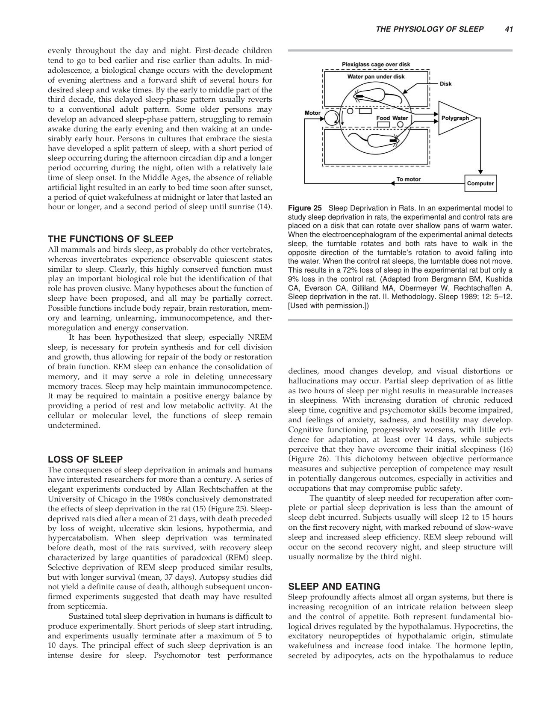

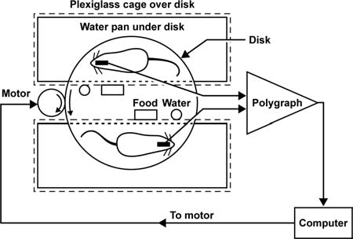

<!-- pdf-page: 55 -->

appetite whereas ghrelin, a hormone secreted by the stomach, increases appetite. The concentration of both hormones increases during sleep. Sleep deprivation results in decreased secretion of leptin and increased secretion of ghrelin, which results in increased appetite and weight gain (Table 2). Leptin also increases in patients with obstructive sleep apnea. There are many clinical conditions in which a relation exists between sleep and eating behaviors (Table 3).

Figure 26

Effects of Partial Sleep Deprivation in Humans. In a study of partial sleep deprivation in humans, progressive difficulty with a psychomotor vigilance task (PVT) occurred with partial sleep deprivation (i.e., 4 to 6 hours of sleep per night) from baseline to 14 days, with no evidence of adaptation to the state of chronic partial sleep deprivation. In contrast, subjects did not perceive themselves as experiencing increasing sleepiness: their self-reported scores on the Stanford Sleepiness Scale (SSS) reached a plateau and did not worsen over time. Zero on x-axis indicates baseline. (Adapted from Van Dongen et al [16]. [Used with permission.])

Table 2

Characteristics of leptin and ghrelin

Hormone

Characteristic Leptin Ghrelin

Source Adipocytes Stomach Target Hypothalamus Hypothalamus Effect on appetite Suppresses Stimulates Effect of sleep deprivation Decreases Increases

Table 3

The spectrum of sleep and eating disorders

Disorder Nature of relation

Anorexia or bulimia nervosa Eating at night Kleine-Levin syndrome Hypersomnia; binge eating Narcolepsy Linked to obesity Night (nocturnal) eating syndrome Eating at night with preserved consciousness Obstructive sleep apnea Linked to obesity Prader-Willi syndrome Hypersomnia; hyperphagia Sleep-related eating disorder Unconscious or partially conscious eating during sleep

#### REFERENCES

1. Aserinsky E, Kleitman N. Regularly occurring periods of eye motility, and concomitant phenomena, during sleep. Science 1953; 118: 273–4. 2. Silber MH, Ancoli-Israel S, Bonnet MH, et al. The visual scoring of sleep in adults. J Clin Sleep Med 2007; 3: 121–31. 3. Ohayon MM, Carskadon MA, Guilleminault C, Vitiello MV. Metaanalysis of quantitative sleep parameters from childhood to old age in healthy individuals: developing normative sleep values across the human lifespan. Sleep 2004; 27: 1255–73. 4. Szymusiak R, McGinty D. Hypothalamic regulation of sleep and arousal. Ann N Y Acad Sci 2008; 1129: 275–86. 5. Saper CB, Scammell TE, Lu J. Hypothalamic regulation of sleep and circadian rhythms. Nature 2005; 437: 1257–63. 6. Boeve BF, Silber MH, Saper CB, et al. Pathophysiology of REM sleep behaviour disorder and relevance to neurodegenerative disease. Brain 2007; 130: 2770–88. 7. Steriade M. Brain Electrical Activity and Sensory Processing During Waking and Sleep States. In: Kryger MH, Roth T, Dement WC, editors. Principles and Practice of Sleep Medicine. 4th ed. Philadelphia (PA): Elsevier Saunders, 2005. p. 101–19. 8. Siegel JM. REM Sleep. In: Kryger MH, Roth T, Dement WC, editors. Principles and Practice of Sleep Medicine. 4th ed. Philadelphia (PA): Elsevier Saunders, 2005. p. 120–35. 9. Lu J, Sherman D, Devor M, Saper CB. A putative flip-flop switch for control of REM sleep. Nature 2006; 441:589–94. 10. Vitaterna MH, Pinto LH, Turek FW. Molecular Genetic Basis for Mammalian Circadian Rhythms. In: Kryger MH, Roth T, Dement WC, editors. Principles and Practice of Sleep Medicine. 4th ed. Philadelphia (PA): Elsevier Saunders, 2005. p. 363–74. 11. Czeisler CA, Duffy JF, Shanahan TL, et al. Stability, precision, and near-24-hour period of the human circadian pacemaker. Science 1999; 284: 2177–81. 12. Hankins MW, Peirson SN, Foster RG. Melanopsin: an exciting photopigment. Trends Neurosci 2008; 31: 27–36. 13. Szymusiak R, Gvilia I, McGinty D. Hypothalamic control of sleep. Sleep Med 2007; 8: 291–301. 14. Ekirch AR. At Day’s Close: Night in Times Past. New York: Norton, 2005. 15. Rechtschaffen A, Bergmann BM, Everson CA, Kushida CA, Gilliland MA. Sleep deprivation in the rat: X. Integration and discussion of the findings. Sleep 1989; 12: 68–87. 16. Van Dongen HP, Maislin G, Mullington JM, Dinges DF. The cumulative cost of additional wakefulness: dose-response effects on neurobehavioral functions and sleep physiology from chronic sleep restriction and total sleep deprivation. Sleep 2003; 26: 117–26.

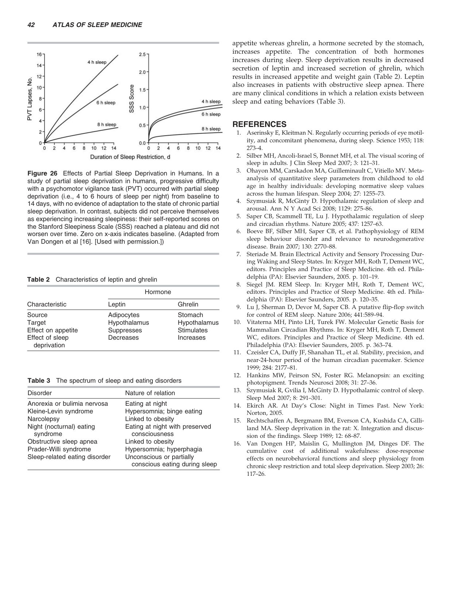

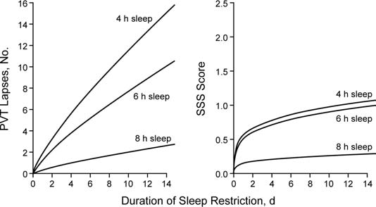
