# Chapter 5 Diagnostic Tools in Sleep Medicine

<!-- pdf-page: 56 -->

## 5 Diagnostic Tools in Sleep Medicine

#### Timothy I. Morgenthaler, MD, and Michael H. Silber, MBChB, FCP (SA)

#### ABBREVIATIONS

EEG, electroencephalogram

EMG, electromyogram; electromyography

ESS, Epworth Sleepiness Scale

MSLT, multiple sleep latency test

MWT, maintenance of wakefulness test

NREM, non–rapid eye movement

OSA, obstructive sleep apnea

PSG, polysomnography

REM, rapid eye movement

The field of sleep medicine has evolved slowly over the past half-century from a somewhat obscure branch of physiology to a mature medical specialty. The discovery of the electroencephalogram (EEG) for use in humans in 1929 (1) was followed shortly by the recording of brain electrical activity during sleep and by the first classification of sleep rhythms (2). After rapid eye movement (REM) sleep was discovered in 1953 (3), appreciation grew for the full spectrum of sleep-related changes in brain, eye, and muscle electrical activity. However, the application of these findings to clinical sleep disorders took another one to two decades. In the 1960s the relation of narcolepsy to premature intrusion of REM sleep (4) and sleepwalking to arousals from non–rapid eye movement (NREM) sleep was recognized (5), and the first descriptions of sleep apnea were published (6,7). The early 1970s saw the development of the first clinical sleep laboratories, which relied on polysomnography (PSG) as the main diagnostic tool. Today, to reach accurate diagnoses and plan specific treatments, comprehensive sleep medicine centers use, as appropriate, careful histories from patients and observers, quantitative scales, physical examination findings, laboratory PSG, daytime nap studies (multiple sleep latency test [MSLT] and maintenance of wakefulness test [MWT]), wrist actigraphy, and portable sleep studies.

#### QUANTITATIVE SCALES

Quantitative scales are vital diagnostic tools in sleep medicine. Many of these are used to assess the degree of sleepiness, including the Epworth Sleepiness Scale (ESS) (8), the Stanford Sleepiness Scale (9), and the Ullanlinna Narcolepsy Scale (10). The ESS (Figure 1) is the most widely used and has a high level of test-retest reliability. However, it correlates poorly with MSLT data, presumably measuring different facets of sleepiness.

#### CLINICAL PREDICTION RULES

Several clinical prediction rules have been developed to screen populations for sleep-disordered breathing and to act as decision aids in determining which persons merit further testing or monitoring. Among the more commonly used are the Berlin Questionnaire and that of Flemons et al (11,12). The Berlin Questionnaire has been validated in a general practice setting, showing a sensitivity of 87%, a specificity of 78%, a positive predictive value of 90%, and a likelihood ratio of 3.79 in predicting patients who have a measured apnea-hypopnea index of 5 or greater. It is widely used in research for case finding, and it has been found somewhat useful in screening preoperative populations to detect high risk for obstructive sleep apnea (OSA). The Flemons model takes into consideration the patient’s neck circumference, history of snoring and snorting or choking during sleep, and history of hypertension. Patients who score at high risk have an 81% posttest probability of having OSA compared with 17% for those scoring at low risk (Figure 2) (13). Currently, none of the clinical prediction rules is sufficient to either exclude or diagnose OSA. However, they may be combined with clinical judgment to prioritize the need or urgency for testing.

#### POLYSOMNOGRAPHY

Comprehensive PSG is a technique used to assess multiple physiological parameters over the course of a night’s sleep in a sleep laboratory (Table 1) (14). In modern sleep centers, the sleep rooms are designed to resemble small hotel rooms with a comfortable, bedroom-like atmosphere to avoid the typical clinical appearance of hospital rooms (Figure 3). In a standard study (Table 2), brain electrical activity is measured with 3 EEG derivations, eye movement activity with 2 electro-oculogram derivations, and muscle activity with surface electromyogram (EMG) derivations recorded from the chin and anterior tibial muscles. Other channels assess respiratory activity: surrogate measures of airflow include oronasal thermocouples and nasal pressure monitors; thoracic and abdominal inductance plethysmography measures chest and abdominal movement; pulse oximetry measures oxyhemoglobin saturation; and a microphone records the intensity of snoring. The electrocardiogram is recorded. Optional additional channels can record end-tidal or transcutaneous carbon dioxide levels, esophageal pH or pressure, body position, penile tumescence, and additional EEG activity if nocturnal seizures are suspected. Signals are appropriately filtered and displayed using digital polygraphs (Figure 4 and Figure 5). EEG derivations record the differences between cerebral electric potentials at two sites on the head. A minimum of three

<!-- pdf-page: 57 -->

Figure 2

Clinical Prediction Rule for Obstructive Sleep Apnea: The Modified Sleep Apnea Clinical Score. To obtain the Modified Sleep Apnea Clinical Score, one begins with the neck circumference (in cm), and then adds points as indicated in the diagram if the patient snores for more than 3 nights per week, has nocturnal choking or apneic pauses to breathing, or has hypertension (treated or untreated). When the sum is <43, the risk of having obstructive sleep apnea (judged by an AHI 5 on polysomnography) is low (posttest probability of 17%). When the sum is 48, the risk is high, with a posttest probability of 81%. Such high-risk patients may be good candidates for portable home sleep studies, depending on other clinical circumstances. For comparison, clinical judgment by sleep specialists alone has an estimated specificity of 70% to 80%. (Data from Flemons WW et al [23].)

Figure 1 Epworth Sleepiness Scale. The Epworth Sleepiness Scale is a questionnaire that measures the degree of sleepiness on a scale of 0 to 24. The upper limit of normal is generally considered to be 10 to 11 points. The Epworth Sleepiness Scale has acceptable test-retest reliability. However, its poor correlation with multiple sleep latency tests suggests that it may be measuring a different component of sleepiness. (From Johns MW [8]. [Used with permission.])

Evaluation of suspected sleep–disordered breathing Initial diagnosis Titration of positive airway pressure therapy Follow-up of surgical or dental appliance therapy Follow-up after substantial changes in weight Evaluation of sleep symptoms in patients with neuromuscular diseases Evaluation of excessive daytime sleepiness suspected to be due to narcolepsy or idiopathic hypersomnia Evaluation of suspected periodic limb movement disorder Evaluation of some suspected parasomnias Violent or potentially injurious behaviors Atypical features with diagnostic uncertainty, especially if seizures are possible Situations with forensic implications Evaluation of select cases of persistent insomnia Suspected movement or respiratory disorder as the cause Failure to respond to behavioral or pharmacological treatment

Table 1

Indications for polysomnography

Data from Kushida (14).

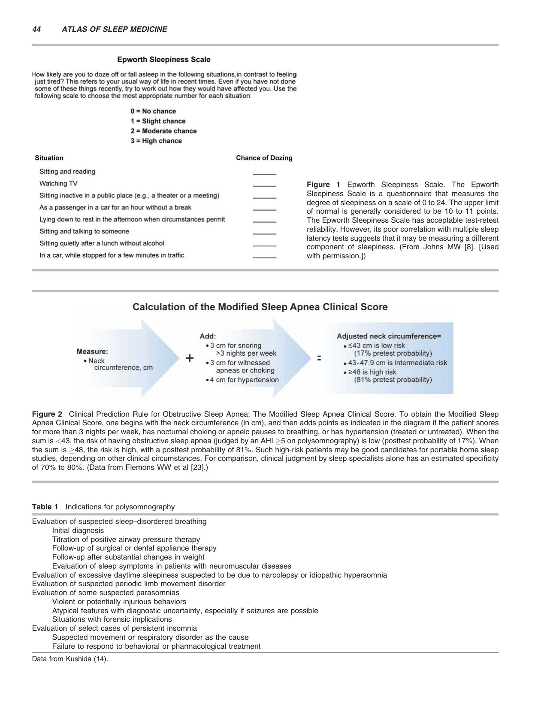

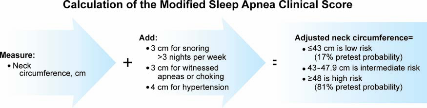

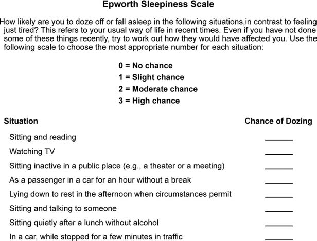

<!-- pdf-page: 58 -->

Figure 3

Sleep Recording Room. A typical sleep recording room is designed to resemble a small hotel room rather than a hospital room. Attention is paid to the comfort of the mattress and to the general ambience of the surroundings. A private bathroom is generally available, and the room has adequate soundproofing. A video camera allows a technologist to monitor the patient, who can use a bellpull to summon assistance, if necessary.

Table 2

Usual physiological parameters measured by polysomnography

System Parameters

Neurological Electroencephalogram Electro-oculogram Electromyogram Submental Anterior tibial Respiratory Airflow (both sensors required) Oronasal air temperature Nasal air pressure Respiratory effort Oxyhemoglobin saturation Upper airway sound Cardiac Electrocardiogram

derivations is used to sample potentials over the frontal, central, and occipital areas with one of two montages (a series of derivations) (Figure 6). K complexes and slow waves are maximally represented over the frontal region, sleep spindles over the central region, and waking alpha rhythm over the occipital region (see Chapter 4 on “The Physiology of Sleep”). The electro-oculogram derivations record changes in the corneoretinal potentials of the eyeball, allowing the direction and speed of eye movements to be measured (Figure 7). Slow eye movements, usually horizontal, can be observed in light (stage N1) NREM sleep, whereas rapid, irregular eye movements are characteristic of REM sleep. EMG activity falls to a minimum level during REM sleep. The EMG channels also record sleep

phenomena such as periodic limb movements and the abnormal motor activity of REM sleep behavior disorder, sleepwalking, and bruxism. Considerable quantitative information can be obtained from an all-night PSG (Figure 8). This includes the distribution of sleep stages throughout the night, scored in 30-second intervals called epochs. Formal rules for scoring each stage have been developed (Table 3) (15). In addition, the frequency of arousals, respiratory events, and periodic limb movements is calculated, as well as parameters of sleep duration, timing, and continuity. Qualitative information includes the presence of parasomnias, seizure activity, cardiac arrhythmias, and intrusion of alpha frequencies into NREM sleep.

#### MULTIPLE SLEEP LATENCY TEST

The MSLT is a test of sleepiness (16). Patients are offered 4 or 5 nap opportunities at 2-hour intervals over the course of a day. The patient lies in bed in a dark quiet room and tries to sleep. The time from lights out until the first epoch of sleep is measured, and the mean sleep latency is calculated. If the patient does not sleep, the test is terminated after 20 minutes and an arbitrary sleep latency of 20 minutes is assigned. If the patient does fall asleep within 20 minutes, the nap opportunity continues for 15 minutes after sleep onset to assess whether REM sleep occurs (see Figure 11 in Chapter 7 on “Narcolepsy”). In between naps, the patient engages in quiet activities but is not allowed to exercise or sleep. The MSLT is usually performed the day after a night of PSG. For meaningful results, it is

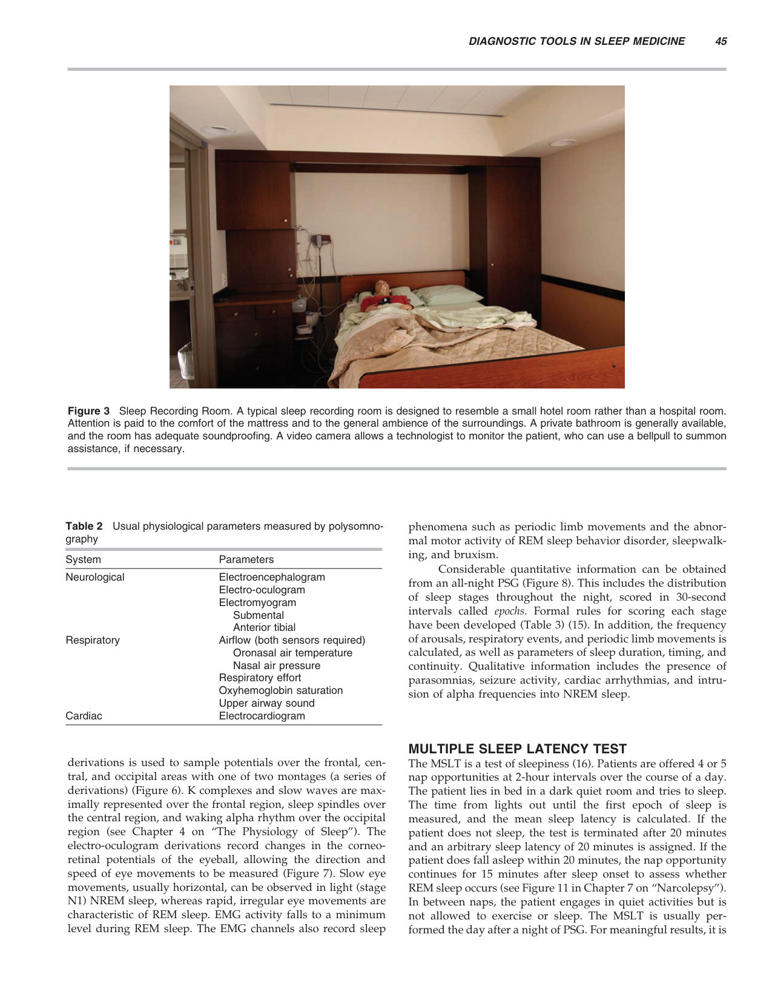

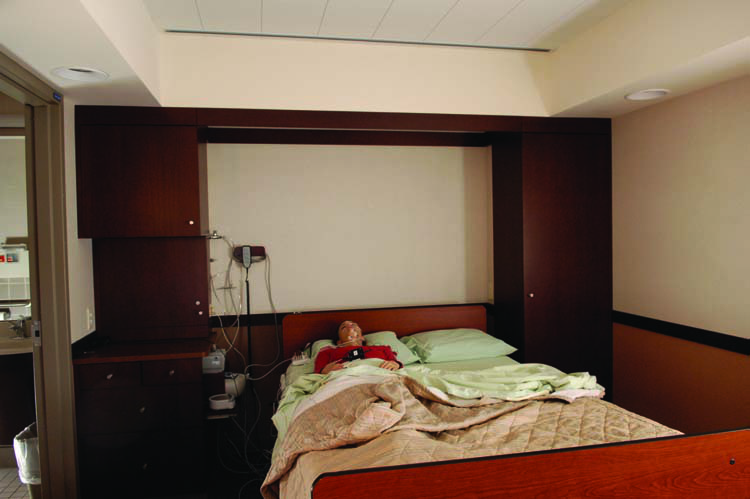

<!-- pdf-page: 59 -->

Figure 4

Sleep Laboratory Control Room. (A) All sleep studies being performed in a sleep laboratory are monitored from a control room. (B) Technologists monitor the sleep and well-being of patients in real time with the help of video cameras and microphones in the sleep recording rooms and a continuous display of physiological variables on the computer monitors. (C) Two patients can be monitored by a single technologist at one console. The technologist can communicate with the patients by microphone and can alter the settings of positive airway pressure devices without entering the sleeping rooms. However, the control room is situated in close proximity to the sleeping rooms, which allows technologists to rapidly assist the patients, if necessary.

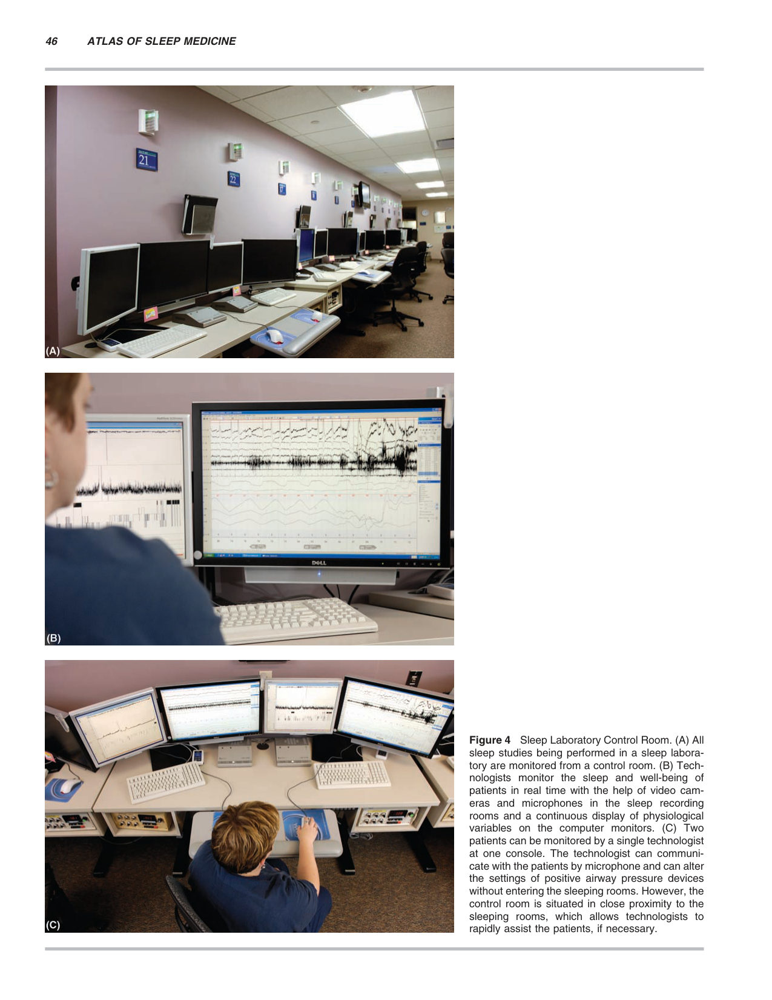

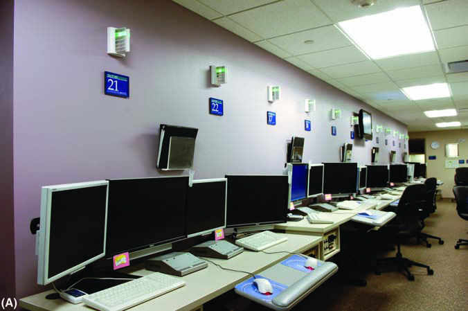

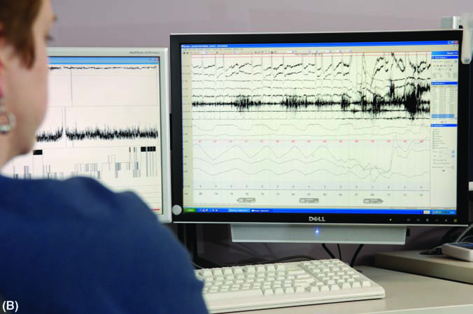

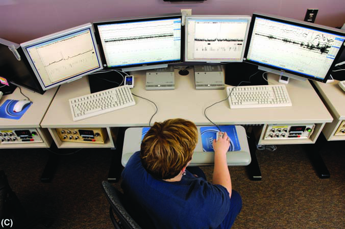

<!-- pdf-page: 60 -->

Figure 5

Sensors Used in Polysomnography. (A) Prior to the sleep study, the technologist applies sensors to monitor multiple physiological signals. The sensors include metal disk electrodes to record electroencephalographic, electro-oculographic, and electromyographic data, as well as nasal pressure monitors, chest and abdominal bands to record movements associated with breathing, electrocardiographic electrodes, a finger oximeter, and a microphone to record snoring or vocalization. (B) Despite the many wires, the patient can change position at will and can move about freely in bed. If the patient needs to get up from the bed, a technologist can be summoned to temporarily disconnect the sensors.

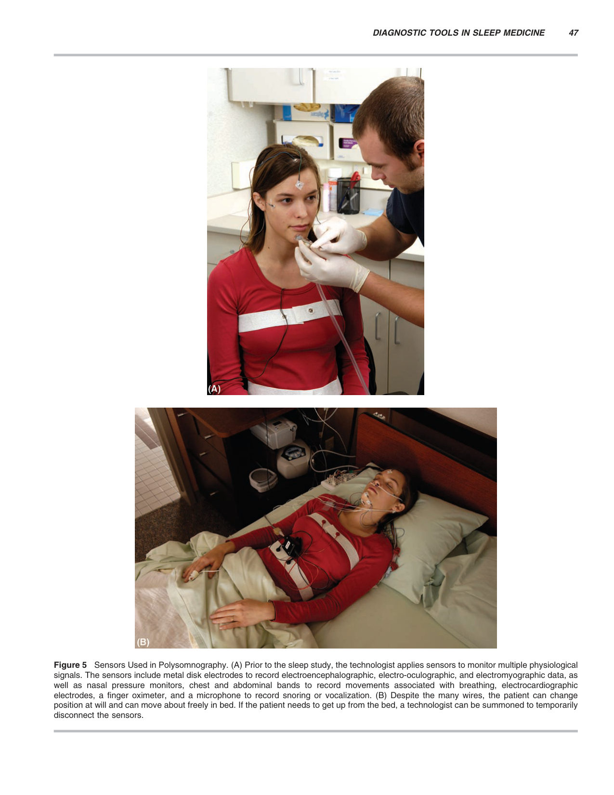

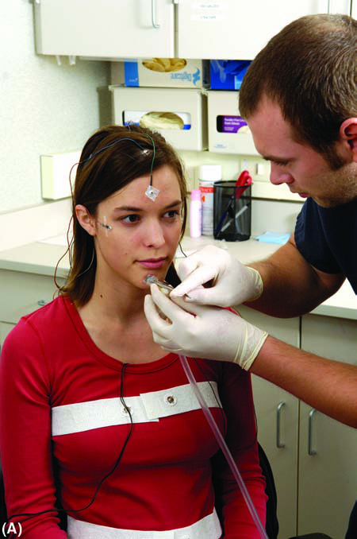

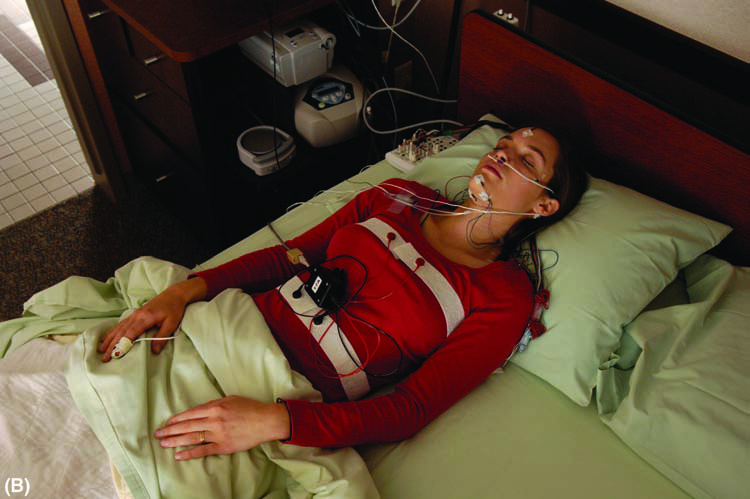

<!-- pdf-page: 61 -->

Figure 6

Electroencephalograph Derivations Used in Polysomnography. This illustration indicates the usual electroencephalography (EEG) electrodes (circled) that are used in routine polysomnography. Electrodes are placed according to the international 10-20 system. Three EEG derivations (linked pairs of electrodes) are used, monitoring the frontal (F), central (C), and occipital (O) regions. The recommended derivations are F4-M1, C4-M1, and O2-M1. Acceptable alternative derivations are Fz-Cz, Cz-Oz, and C4- M1. Fp indicates prefrontal; M, mastoid; P, parietal; T, temporal.

important to ensure that the patient has had adequate amounts of sleep for the week before the test and is not taking medications, including most psychotropic drugs, which can affect the outcome. Normal mean sleep latency is greater than 10 minutes. Less than 5 minutes generally indicates excessive daytime sleepiness, whereas values between 5 and 10 minutes fall along a continuum, with the lower the value, the greater the probability of pathologic sleepiness (17). Most patients with narcolepsy will have a mean sleep latency of <8 minutes (18). The presence of REM sleep occurring within 15 minutes after sleep onset (sleeponset REM) in two or more naps (16) is considered to be the neurophysiological marker of narcolepsy, but it can also be due to abrupt withdrawal from REM-suppressant medication, such as stimulants and antidepressants, moderate or severe OSA (19), or sleep deprivation (see Figure 11 in Chapter 7 on “Narcolepsy”).

#### MAINTENANCE OF WAKEFULNESS TEST

The MWT is a variant of the MSLT used to measure the ability to remain awake (16). It is not a diagnostic test for sleepiness but rather provides objective data regarding the response to treatment of patients with disorders of hypersomnia. For example, it can play a role in determining whether patients with treated OSA can return safely to flying a plane or driving a school bus. The MWT is also conducted in a relatively dark

Figure 7

Electro-oculography Derivations Used in Polysomnography. This illustration indicates recommended derivations (E1-M2 and E2-M2) and acceptable alternative derivations (E1-Fpz and E2-Fpz) for recording eye movements. Eye movements are assessed by recording changes in the difference between the positive corneal potentials and the negative retinal potentials of the eyeball as the eyes move in various directions. E indicates eye; Fp, prefrontal; M, mastoid.

quiet room but the patient sits up in bed with the back and head supported by a headrest. Instead of being asked to fall asleep, the patient is asked to remain awake. Each of four tests lasts 40 minutes and the mean unequivocal sleep latency (three consecutive epochs of stage N1 sleep or one epoch of any other stage) is calculated (Figure 9). Normal mean sleep latency on the MWT is 30.4 minutes, but the data are not normally distributed and 42% of all subjects remain awake for 40 minutes on all four tests (17,20). A study determining the ability of the MWT to predict simulated driving performance in patients with OSA suggested that a mean latency of 19 minutes or less correlated with driving impairment (21). Another study found that subjects with a mean latency of 33 minutes demonstrated increased errors driving along real roads (22). Although no consensus has been reached, current data suggest that patients with a latency of 19 minutes are unacceptably sleepy, whereas those with a latency in the 20- to 33-minute range may also carry a risk of driving impairment.

#### ACTIGRAPHY

An actigraph is a small device on a wristband worn by the patient like a wristwatch for 1 to 2 weeks (Figure 10). This device measures the number of wrist movements that occur over each 1-minute epoch. When the patient sleeps, movements reduce to a minimum and thus periods of apparent quiesence are interpreted as probable sleep (Figure 11). Conversely, periods of high activity are considered to represent wakefulness. Of course, the actigraphic appearance of lying quietly awake may mimic that of sleep, whereas active movements of

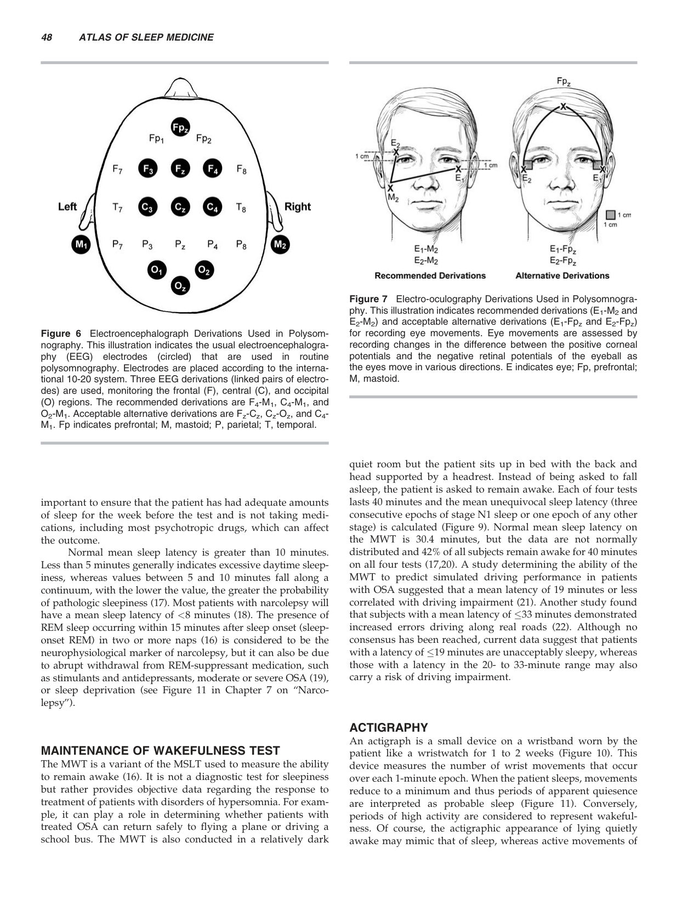

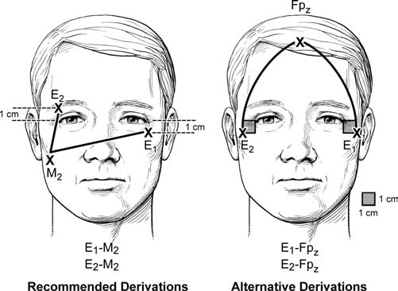

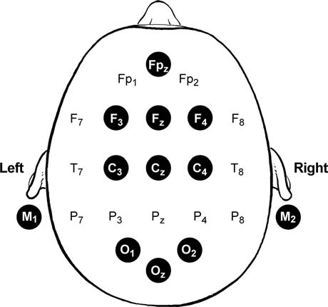

<!-- pdf-page: 62 -->

Figure 8

Polysomnogram Report. This figure illustrates a typical polysomnogram report. Information is available regarding sleep time, sleep efficiency, latency to sleep, different sleep stages, arousals, body position, periodic limb movements of sleep, sleep-disordered breathing, and oxyhemoglobin saturation. AHI indicates apnea-hypopnea index; CPAP, continuous positive airway pressure; ECG, electrocardiogram; EEG, electroencephalogram; EMG, electromyogram; EOG, electro-oculogram; HR, heart rate; NREM, non–rapid eye movement; PLM, periodic limb movement; REM, rapid eye movement; RERA, respiratory effort–related arousal; TRT, total recording time; TST, total sleep time.

Parameter W N1 N2 N3 REM

Table 3

Criteria for sleep staging

Sleep stage

EOG Blinks and voluntary REM Slow eye movements None or slow eye movements None REM

EEG Alpha or low amplitude, mixed frequency

Low amplitude, mixed frequency; predominantly theta

20% 0.5-2 Hz activity Low amplitude, mixed frequency; may be sawtooth waves

K complexes (not associated with arousals) and/or sleep spindles

EMG High Usually lower than in stage W As in stage N1 As in stage N2, or lower Low or absent; transient muscle activity

Abbreviations: EEG, electroencephalogram; EMG, electromyogram; EOG, electro-oculogram; REM, rapid eye movement; W, wakefulness.

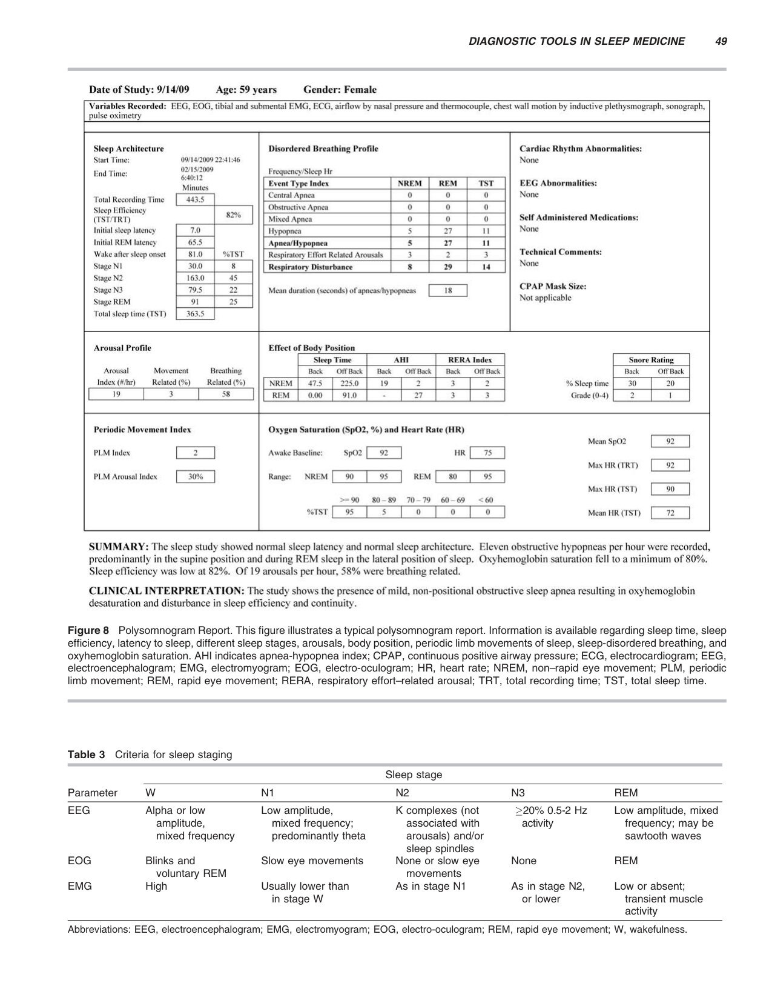

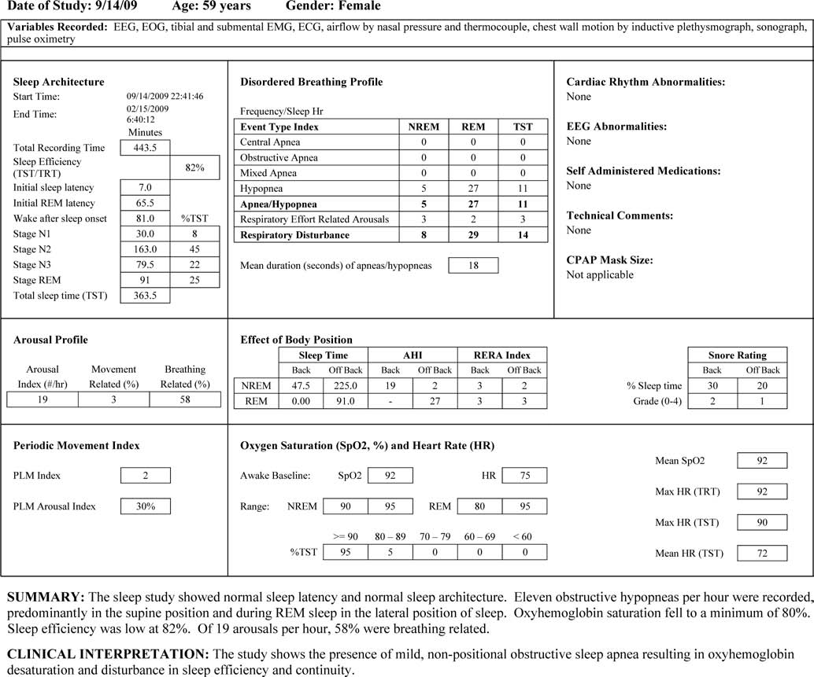

<!-- pdf-page: 63 -->

Figure 9

Maintenance of Wakefulness Test Report. This report illustrates typical findings in a patient undergoing a maintenance of wakefulness test to assess the effectiveness of continuous positive airway pressure therapy for sleep apnea. The mean sleep latency of 36.5 minutes is well within acceptable limits. A mean latency of <20 minutes suggests impairment in the ability to sustain wakefulness. CPAp indicates continuous positive airway pressure.

Figure 10

Actigraph. An actigraph is a small device that monitors movement. It is worn on the wrist throughout the day and night and is removed only when the patient is bathing or swimming. An actigraph is generally worn for 1 to 2 weeks. The resultant tracing provides a surrogate measure of wakefulness and sleep and is generally correlated with a sleep log kept by the patient.

the arm during sleep may mimic the appearance of wakefulness. Nevertheless, actigraphy is a valid technique for measuring total sleep time and sleep-wake patterns in normal subjects and in patients with many types of sleep disorders (23). Actigraphy is useful in characterizing the sleep patterns of

patients with insomnia, including insomnia with depression, and in assisting in the diagnosis of circadian rhythm disorders, such as delayed sleep phase disorder. It is also commonly used in association with a sleep log for documenting adequate sleep time before the performance of an MSLT.

#### PORTABLE MONITORING

Attended complex PSG affords the opportunity for direct observations to be recorded by a trained observer (the sleep technologist), for readjustment of any sensors that might become detatched or otherwise fouled, and for direct introduction and adjustment of any therapeutic interventions such as positive airway pressure. However, a skilled attendant increases the cost of testing and intrudes upon the privacy of the patient. Testing capacity is also limited by the number of beds with PSG equipment and by the number of technologists available in sleep laboratories. In contrast, portable monitors are being advocated as more widely available, less expensive, and capable of being used in various settings, including in the home or in another health care setting. Because many portable monitors record only a limited number of signals, the American Sleep Disorders Association has proposed a portable monitoring classification scheme to categorize the largest number of permutations possible (Table 4) (24). Unattended complex PSG (type II portable monitors) differs from PSG conducted with the type I monitor (attended complex PSG) only in that it is unattended. Lacking the benefits of attended PSG and the

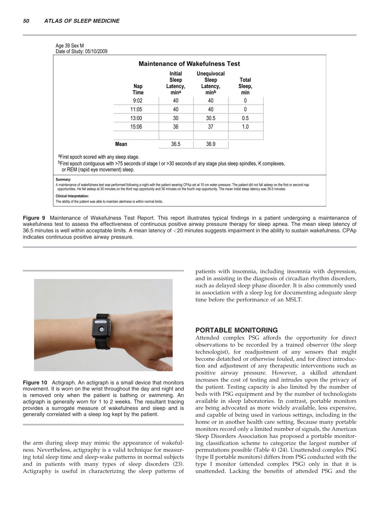

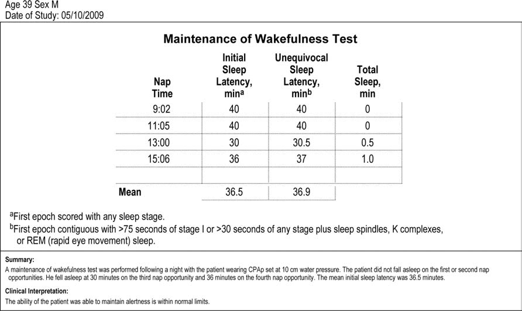

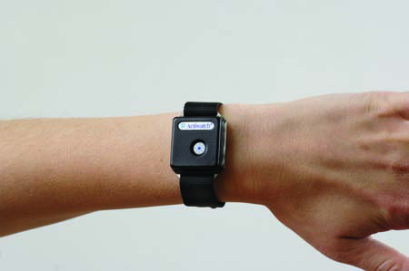

<!-- pdf-page: 64 -->

Figure 11

Display of Actigraphy Recording. This eight-day recording of rest–activity cycles shows black as activity (corresponding approximately to wakefulness) and white as rest (corresponding approximately to sleep). This patient has a variable bedtime and a long sleep period of more than 12 hours. On Friday a period of apparent wakefulness is present between 8 and 9 AM. Estimated sleep periods and sleep efficiency as calculated by the algorithm are shown.

Monitors Signals recorded Position Leg movements Interventions possible

Table 4

AASM classification of types of monitors for evaluation of sleep apneaa

Type I  7 Parameters, including EEG, chin EMG, ECG, airflow, respiratory effort, oximetry Yes Yes Yes

Type II  7 Parameters, including EEG, chin EMG, heart rate or ECG monitor, airflow, respiratory effort, oximetry Yes Yes No

Type IV 1-2 Parameters, typically oximetry plus heart rate or airflow Yes Yes Yes

Type III  4 Parameters, including ventilation or airflow (at least two channels of respiratory movement, or respiratory movement and airflow), heart rate or ECG, oximetry

Yes Maybe No

Abbreviations: AASM, American Academy of Sleep Medicine; ECG, electrocardiogram; EEG, electroencephalogram; EMG, electromyogram. aWith a minimum of six hours of recording.

convenient and less complicated hookups of type III and type IV monitors, type II devices are most often used in research settings. The most commonly used portable monitors are type III (Figure 12) and type IV. Such a device may be configured to provide continuous data from oximetry, airflow (using either thermocouple or nasal pressure), respiratory impedence plethysmography, snoring, body position, and actigraphy (Figure 13). The most common type IV monitor is ambulatory pulse oximetry, which provides a continuous recording of oxygen saturation (Figure 14). Pulse oximetry is not recommended as a diagnostic test for OSA, but it may be used to screen for sleepdisordered breathing in patients at high risk (such as those with heart failure), and to assess the impact on oxygenation of therapeutic interventions such as continuous positive airway pressure.

Type III portable monitors may be used as part of the evaluation strategy for patients with a high pretest probability of having moderate or severe OSA (see Chapter 6 on “Sleep- Related Breathing Disorders”). Their validity in patients with comorbid conditions such as central sleep apnea, obstructive lung disease, hypoventilation disorders, or neuromuscular disease has not been firmly established. Otherwise, they are suitable for diagnostic studies that do not require intervention and for reassessing the efficacy of therapy in patients previously diagnosed with sleep apnea and treated for it. Studies conducted with portable monitors experience rates of lead failure or data loss as high as 16%. Nonetheless, OSA may be diagnosed with confidence when the clinical picture suggests a high probability of OSA and an acceptable type III portable monitor study reveals more than five apneas and hypopneas per hour of recording (24).

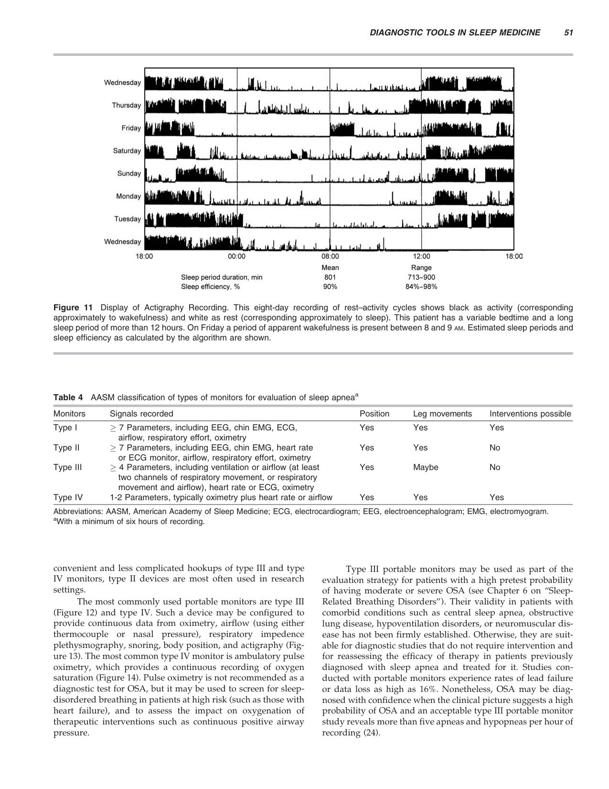

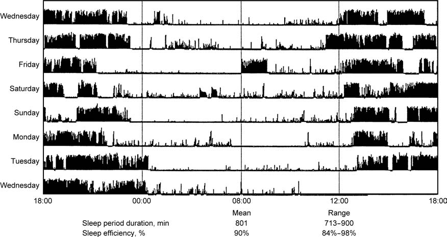

<!-- pdf-page: 65 -->

Figure 13

Type III Portable Monitor Recording. This recording was obtained using an Embletta respiratory monitor (Embla, Broomfield, Colorado) worn by a patient suspected of having obstructive sleep apnea. From top to bottom, tracings are: 1) snoring (may be derived from a microphone or from high-frequency oscillations of a nasal pressure transducer; here, not showing snoring that was actually present); 2) nasal pressure as an indicator of flow; 3) thoracic and abdominal excursion with impedance plethysmography; 4) finger pulse oximetry; 5) pulse rate from pulse oximetry; 6) position derived from a gravitometric sensor located in the recording box (see Figure 12); 7) movement from the actigraph located in the recording box (see Figure 12); 8) XFlow, a summation of the thoracic and abdominal plethysmographic recordings; and 9) the flattening index, an indicator of upper airway obstruction, with “flat” indicating more obstruction than “round.” The pink markings denote apneas detected in the flow channel that are considered obstructive because of the ongoing (and at times paradoxical) effort shown in the thorax and abdominal channels. Desaturations (in gray) are marked by algorithm or manually. Excessive movement, suggesting wakefulness or arousal, is marked in the first moments of this tracing. The “roundest” (least obstructed) flow is observed during the recovery breaths following obstructive apneas.

Figure 12

Type III Portable Monitor. This type III portable respiratory monitor (Embletta; Embla, Broomfield, Colorado) is configured to record airflow using a nasal pressure transducer (via the nasal cannula) and a thermocouple (located over the nares and mouth), respiratory chest and abdominal excursion with respiratory impedance plethysmography, and oximetry with a finger probe. The recording device, strapped to the chest, also serves as a position monitor (able to indicate supine, left, right, prone, and upright positions) and an actigraph. This and other marketed devices may also have additional sensors, such as leg motion sensors. The device may be self-applied, and it can be used in various settings.

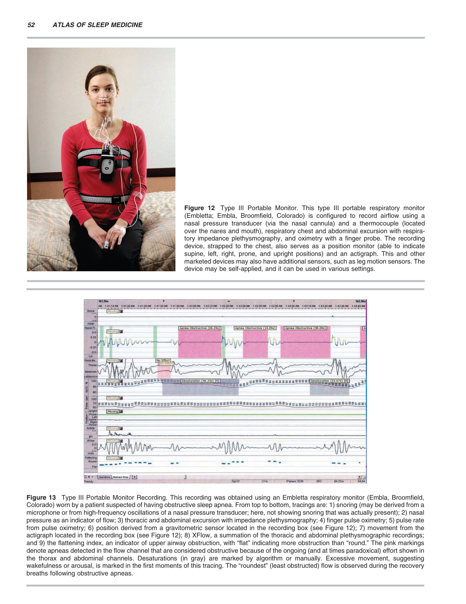

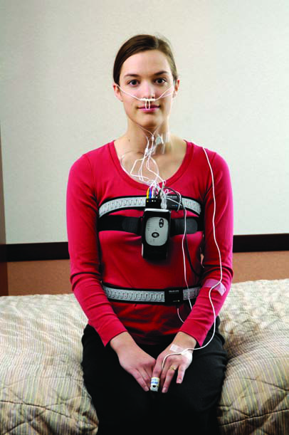

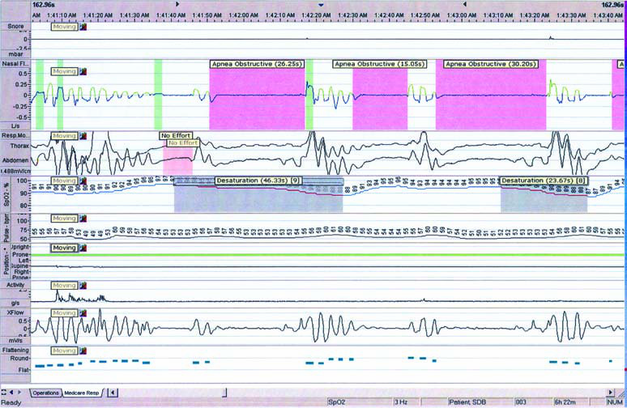

<!-- pdf-page: 66 -->

Figure 14

Ambulatory Overnight Oximetry. This oximetry tracing is from a patient suspected of having obstructive sleep apnea because of symptoms of snoring and obesity, but who reported no other symptoms of sleep apnea. The recording was requested to help prioritize the decision of whether to pursue more definitive testing in view of other health care concerns being addressed at the time of the evaluation (preoperative assessment for total knee arthroplasty in a patient with interstitial lung disease; awake upright arterial oxygen saturation, 90.5%). The tracing shows an abnormal supine baseline oxygen saturation averaging 87% with repetitive oscillatory desaturations (desaturations of at least 4% from baseline, shown in red, totaled 179 over 7 hours and 48 minutes of valid recording time, for an oxygen desaturation index of 22.9 per hour). Some of the deeper desaturations clump together and occur about every two hours, suggesting a worsening of sleep-disordered breathing with the transition to rapid eye movement sleep or with a change in position. The pulse rate is highly variable during these deeper desaturations as one might find with rapid eye movement or with the tachycardia-bradycardia phenomenon seen with obstructive apneas. The recording period (starting at 16:25 hours and ending at 01:20 hours) seems advanced for sleep consistent with the shift work of the patient. Like many ambulatory portable monitor recordings, this one has data loss (scalloped line [***] between 20:45 and 21:45 hours). Surgery plans for the patient were delayed while other aspects of his pulmonary and sleep health were evaluated.

#### REFERENCES

1. Berger H. Uber das elektrenkephalogramm des menschen. Arch Psychiatr 1929; 87: 527–70. 2. Loomis AL, Harvey EN, Hobart GA. Cerebral states during sleep, as studied by human brain potentials. J Exp Psychol 1937; 21: 127–44. 3. Aserinsky E, Kleitman N. Regularly occurring periods of eye motility, and concomitant phenomena, during sleep. Science 1953; 118: 273–4. 4. Vogel G. Studies in psychophysiology of dreams. III. The dream of narcolepsy. Arch Gen Psychiatry 1960; 3: 421–8. 5. Broughton RJ. Sleep disorders: disorders of arousal? Enuresis, somnambulism, and nightmares occur in confusional states of arousal, not in “dreaming sleep”. Science 1968; 159: 1070–8. 6. Gastaut H, Tassinari CA, Duron B. Etude polygraphique des manifestations episodiques (hypniques et respiratoires), diurnes et nocturnes, du syndrome de Pickwick. Rev Neurol 1965; 112: 568–79. 7. Jung R, Kuhlo W. Neurophysiological studies of abnormal night sleep and the Pickwickian syndrome. Prog Brain Res 1965; 18: 140–59. 8. Johns MW. A new method for measuring daytime sleepiness: the Epworth Sleepiness Scale. Sleep 1991; 14: 540–5. 9. Hoddes E, Zarcone V, Smythe H, Phillips R, Dement WC. Quantification of sleepiness: a new approach. Psychophysiology 1973; 10: 431–6. 10. Hublin C, Kaprio J, Partinen M, Koskenvuo M, Heikkila K. The Ullanlinna Narcolepsy Scale: validation of a measure of symptoms in the narcoleptic syndrome. J Sleep Res 1994; 3: 52–9.

11. Flemons WW. Clinical practice: obstructive sleep apnea. N Engl J Med 2002; 347: 498–504. 12. Netzer NC, Stoohs RA, Netzer CM, Clark K, Strohl KP. Using the Berlin Questionnaire to identify patients at risk for the sleep apnea syndrome. Ann Intern Med 1999; 131: 485–91. 13. Flemons WW, Whitelaw WA, Brant R, Remmers JE. Likelihood ratios for a sleep apnea clinical prediction rule. Am J Respir Crit Care Med 1994; 150(5 Pt 1):1279–85. 14. Kushida CA, Littner MR, Morgenthaler T, et al. Practice parameters for the indications for polysomnography and related procedures: an update for 2005. Sleep 2005; 28: 499–521. 15. Iber C, Ancoli-Israel S, Chessonn A, Quan SF for the American Academy of Sleep Medicine. The AASM Manual for the Scoring of Sleep and Associated Events: Rules, Terminology and Technical Specifications. Westchester (IL): American Academy of Sleep Medicine, 2007. 16. Littner MR, Kushida C, Wise M, et al; Standards of Practice Committee of the American Academy of Sleep Medicine. Practice parameters for clinical use of the multiple sleep latency test and the maintenance of wakefulness test. Sleep 2005; 28: 113–21. 17. Arand D, Bonnet M, Hurwitz T, Mitler M, Rosa R, Sangal RB. The clinical use of the MSLT and MWT. Sleep 2005; 28: 123–44. 18. American Academy of Sleep Medicine. The International Classification of Sleep Disorders: Diagnostic and Coding Manual. 2nd ed. Westchester (IL): American Academy of Sleep Medicine, 2005. 19. Aldrich MS, Chervin RD, Malow BA. Value of the multiple sleep latency test (MSLT) for the diagnosis of narcolepsy. Sleep 1997; 20: 620–9.

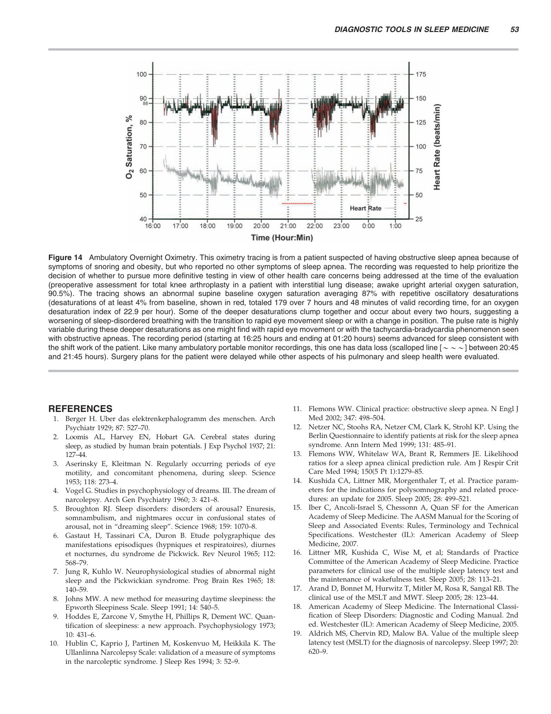

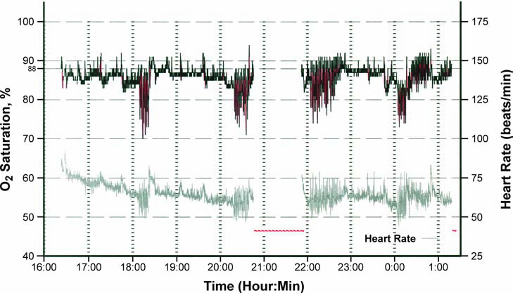

<!-- pdf-page: 67 -->

20. Doghramji K, Mitler MM, Sangal RB, et al. A normative study of the maintenance of wakefulness test (MWT). Electroencephalogr Clin Neurophysiol 1997; 103: 554–62. 21. Sagaspe P, Taillard J, Chaumet G, et al. Maintenance of wakefulness test as a predictor of driving performance in patients with untreated obstructive sleep apnea. Sleep 2007; 30: 327–30. 22. Philip P, Sagaspe P, Taillard J, et al. Maintenance of wakefulness test, obstructive sleep apnea syndrome, and driving risk. Ann Neurol 2008; 64: 410–6.

23. Morgenthaler T, Alessi C, Friedman L, et al; Standards of Practice Committee; American Academy of Sleep Medicine. Practice parameters for the use of actigraphy in the assessment of sleep and sleep disorders: an update for 2007. Sleep 2007; 30: 519–29. 24. Collop NA, Anderson WM, Boehlecke B, et al; Portable Monitoring Task Force of the American Academy of Sleep Medicine. Clinical guidelines for the use of unattended portable monitors in the diagnosis of obstructive sleep apnea in adult patients. J Clin Sleep Med 2007; 3: 737–47.
