# Chapter 6 Sleep-Related Breathing Disorders

<!-- pdf-page: 68 -->

## 6 Sleep-Related Breathing Disorders

#### Timothy I. Morgenthaler, MD

#### ABBREVIATIONS

AHI, apnea-hypopnea index

BMI, body mass index (weight in kg/height in m2)

CPAP, continuous positive airway pressure

CSBP, Cheyne-Stokes breathing pattern

ICSD-2, International Classification of Sleep Disorders, 2nd edition

MAD, mandibular advancement device

NREM, non–rapid eye movement

OSAS, obstructive sleep apnea syndrome

PAP, positive airway pressure

REM, rapid eye movement

#### VENTILATORY CONTROL

The respiratory system is complex and responds to diverse challenges. It not only maintains homeostatic levels of PaO2, PaCO2, and pH over a wide range of activity levels but it also does this in spite of less continuous challenges such as speaking, breath holding, micturition, defecation, emesis, coughing, parturition, blowing out birthday candles, and singing. Control of the upper airway allows persons not only to breathe but also to phonate and eat, while either stationary or moving and while in various positions. The upper airway in humans, rather than being a bony tube of fixed diameter, is a flexible structure held patent by a balance of muscle tone and tensions. Sleep changes the respiratory control and muscle tone in the upper airway. Given the variety of challenges that the ventilatory control system must meet, it is perhaps not surprising that the system is not always successful. When abnormal breathing patterns occur during sleep, the condition is called sleep-disordered breathing. Table 1 summarizes the most common types of sleep-disordered breathing. These disorders have unique pathophysiology and typical clinical presentations, and most can be addressed with management strategies that are highly effective. At its simplest level, the signal to breathe originates with a special set of neurons called the Bo¨tzinger complex, which is located in the medulla (Figure 1). When unmodulated by other influences, the breathing pattern would be steady, periodic, and almost mechanical, similar to the pattern observed in patients who are entirely ventilator dependent. However, the rhythmic output of this complex is modified by the integration of inputs by at least six other neurons located primarily in the medulla, which altogether are called the respiratory control center. These neurons receive input from the Bo¨tzinger complex and a wide variety of influences (Table 2). Many of these influences are automatic and consist of feedback from chemoreceptors and

mechanoreceptors. Other inputs descend from cortical areas and attend to our desire to perform intermittent activities such as speaking or breath holding. One very important additional influence is known as the wakefulness input. Before examining the wakefulness input, it is important to understand the automatic parts of the respiratory control system. The output of this system travels via phrenic motoneurons, spinal nerves, and cranial nerves to produce the coordinated movements of ventilation. These movements produce gas exchange that influences chemoreceptors, which in turn provide input back to the respiratory control system. In addition, the actual movements, pressure changes, and vascular dynamics of ventilation elicit responses from various mechanoreceptors and nocioceptors that are also relayed to the respiratory control system. Thus, the whole system is a classic feedback system (Figure 2). The respiratory control system is one component (i.e., the controller), and the moving parts (i.e., the muscles, lungs, chest wall, circulation, and corporeal metabolism) may be thought of as the plant. Output from the controller influences the plant and vice versa, whereas input from the plant influences the controller and vice versa. Conceptualizing the respiratory control system this way is useful when one ponders the stability of the system. In a totally homeostatic system, there is complete balance between input and output, and the system behaves in a predictable fashion, producing rhythmic breathing, even gas exchange, and uniform neural output. However, this does not sound like real life. In real life, we must be able to respond to various perturbations or disturbances in the system. For example, what if there is a momentary increase in production of CO2, such as may happen with exertion or a fever? What if one ascends to a high altitude, with a resulting change in the inspired fraction of oxygen? What if mucus production in the airways produces segmental atelectasis and changes ventilation/perfusion matching? Feedback systems may respond to such disturbances in one of three ways. If they do not respond at all, due to inflexibility on the part of the controller or the plant, then homeostasis will be lost entirely, with migration of the system’s set-point in a constant direction away from its originally healthy one. In the case of ventilation, this could be fatal because PCO2, PO2, and pH must be regulated within a relatively small tolerance. Alternatively, the system could adjust to the disturbance to find a new safe set-point close to the healthy one by adjusting output to meet the new demand, thus dampening the result of the disturbance. Nonetheless, the system could destabilize, producing a fluctuating circumstance without finding a new stable homeostatic set-point (Figure 3). The likelihood of the feedback system responding to a disturbance by finding a new homeostasis has been estimated

<!-- pdf-page: 69 -->

Table 1

Sleep-disordered breathing syndromes

Syndrome Characteristics

Obstructive sleep apnea syndrome Recurrent episodes of partial or complete upper airway obstruction during sleep. Breathing events include obstructive apneas, obstructive hypopneas, mixed apneas, and respiratory effort–related arousals. Idiopathic central sleep apnea Recurrent apneic episodes during sleep in the absence of upper airway obstruction or hypercapnia (hypercapnic patients are considered to have alveolar hypoventilation syndrome). Central sleep apnea due to Cheyne-Stokes breathing pattern Cyclic fluctuation in ventilatory pattern during sleep with periods of central apnea or hypopnea alternating with hyperpnea in a crescendo-decrescendo manner. The period of the cycles typically exceeds 45 seconds. Central sleep apnea due to high altitude periodic breathing Recurrent central sleep apneas primarily during NREM sleep at a frequency of more than 5 per hour occurring after ascent to 4,000 meters. Often a periodic crescendo-decrescendo pattern is noted in a period of 12 to 34 seconds. Central sleep apnea due to a medical condition other than Cheyne-Stokes breathing pattern

Central sleep apnea in the presence of a medical condition other than heart failure believed to be its cause. Stroke, trauma, or demyelinating diseases may be the cause. In stroke, the period is typically <30 seconds. In other cases, aperiodicity may be more common. Central sleep apnea due to drug use or substance abuse Repetitive central apneas or periodic breathing in a patient chronically using substances, usually opioids, associated with this pattern. The pattern is often less rhythmic “ataxic breathing.” Complex sleep apnea syndrome Patients demonstrate a predominant obstructive pattern, but when obstruction is relieved, a persistent central sleep apnea pattern is revealed. Central sleep apnea of infancy Patients demonstrate prolonged sleep-disordered breathing events associated with physiological compromise such as hypoxemia, bradycardia, or the need for interventions to sustain breathing. Alveolar hypoventilation syndrome (sleep hypoventilation syndrome) Hypercapnia and hypoxemia during sleep due to inappropriate central hypoventilation and not due exclusively to obstructive apneas and hypopneas. Diurnal hypercapnia is often present.

Abbreviation: NREM, non–rapid eye movement.

Figure 1

The Respiratory Control System. Control of ventilation is achieved by a feedback control system, with the main controlling neurons located in the medulla. The inputs to the respiratory pattern generating neurons (at right) include the rhythmic input from the Bo¨tzinger complex and modulation from the medullary chemoreceptors, the carotid bodies, the mechanoreceptors located throughout the airway and chest wall, and the cortex. The medullary control center integrates these inputs to produce the efferent signals (at left) that control the respiratory muscles of the oropharynx, the intercostal muscles, and the diaphragm.

by determining the system’s “loop gain,” which is the ratio of the response to a disturbance to the magnitude of the disturbance (Figure 2). When loop gain is >1, the system is predictably prone to instability. With a loop gain of <1, the system tends to absorb disturbances more easily (Figure 3). When the components of the respiratory system are examined this way, one might be able to predict factors that would tend to destabilize the breathing pattern. For example, factors that increase the output of the ventilatory control center in response to a rise in PaCO2 (the hypercapnic ventilatory response) or a decline in PaO2 (the hypoxic ventilatory response) would tend to destabilize the system. We will return to this concept during the discussion of central sleep apnea syndromes because factors that increase loop gain favor the development of many types of central sleep apnea syndrome. Thus, at its most basic, the ventilatory control system is a classic feedback system that is further modulated by voluntary inputs from cortical regions and also strongly influenced by sleep state. During NREM (non–rapid eye movement) sleep, the ventilatory system is predominantly governed by the feedback system described above and, if undisturbed by arousal or other perturbation, it is generally rhythmic and regular. During healthy steady state breathing while asleep, blood oxygen saturation is 1% to 2% lower, and both hypercapnic responsiveness and hypoxic ventilatory responsiveness are diminished compared with those of the wake state (Figure 4). This difference in ventilatory drive between sleep and wake has been called the wakefulness input. Wakefulness input changes not only the ventilatory response curves but also the apneic threshold, that is, the PaCO2 below which ventilatory drive essentially ceases, thus causing centrally mediated apnea (Figure 4). Another important physiological change during sleep that may affect ventilation is the regulation of muscle tone, which is reduced in NREM sleep compared with wake and which is minimal during REM (rapid eye movement) sleep. This

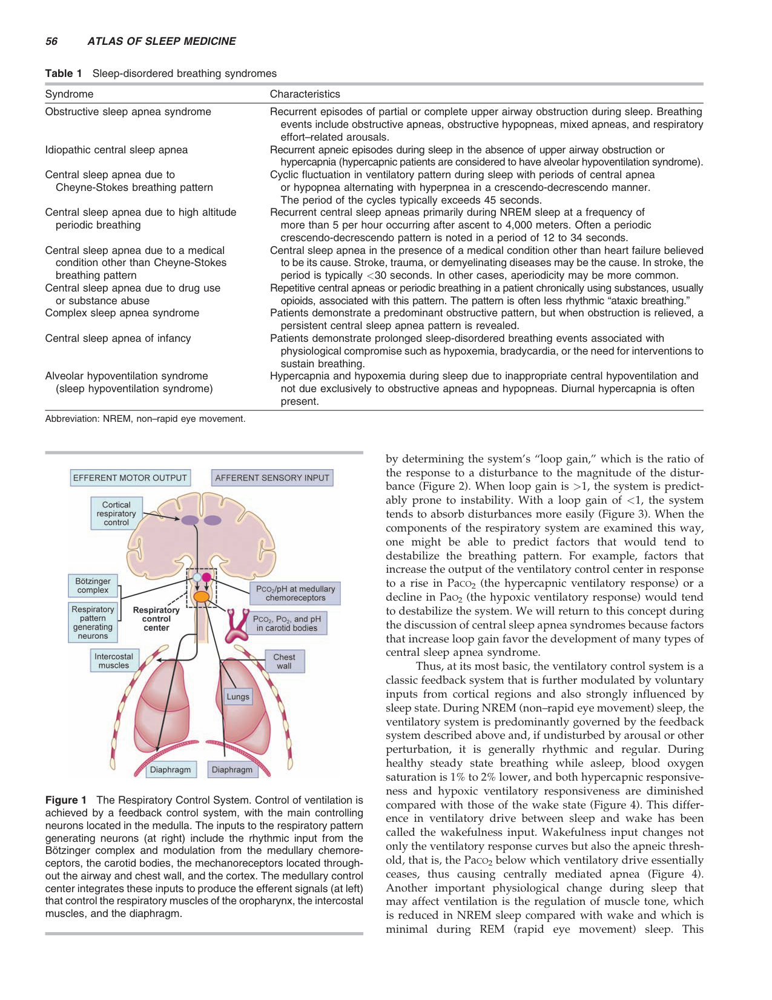

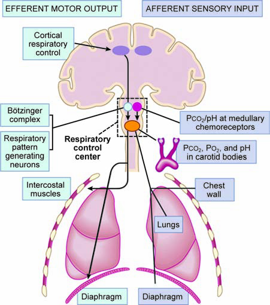

<!-- pdf-page: 70 -->

Table 2

Components influencing respiratory control

I. Automatic respiratory control system A. Medullary respiratory center 1. Afferents to the medullary respiratory center a) Chemoreceptors (1) Medullary chemoreceptors (a) Influenced predominantly by PaCO2 via changes in cerebrospinal fluid pH; to a lesser extent, influenced by PaO2, oxygen consumption (2) Peripheral chemoreceptors (carotid bodies, aortic bodies) (a) Influenced predominantly by PaO2 b) Mechanoreceptors (1) Mechanoreceptors in the upper respiratory tract (a) Influenced by temperature, pressure, contact/touch, humidity, and various chemical substances (2) Mechanoreceptors in lower respiratory tract and lungs (a) Irritant receptors i) Respond to mechanical as well as nonspecific chemical irritation (b) Stretch receptors i) Responsible for the Hering-Breuer reflex (c) J receptors i) Stimulate ventilation in response to a variety of stimuli, including microembolization of the pulmonary circulation, pulmonary edema (3) Mechanoreceptors in the muscle spindles and tendon organs in the respiratory muscles (a) Monitor the effectiveness of the peripheral effector system 2. Efferents from the medullary respiratory center to respiratory organs a) Phrenic nerve (1) Innervate the diaphragm b) Spinal nerves to the intercostal and abdominal muscles (1) Innervate the intercostal and abdominal muscles c) Cranial and spinal nerves to the upper airway (1) Innervate numerous muscles of the pharynx, hypopharynx, larynx, and tongue, including the genioglossals, tensor palatini, medial pterygoids, cricothyroid, and posterior cricoarytenoids (2) Voluntary respiratory control system B. Cortical neurons 1. Voluntarily direct variability in respiratory processes, such as breath holding, coughing, or singing, while awake

Figure 2

Ventilatory Feedback Loop. The respiratory central pattern generator is the “controller” that sends signals to initiate and modulate ventilation. The primary purpose of this center is to support the physiology of the rest of the body, which altogether may be thought of as a sort of “plant” that generates useful work (e.g., labor, thought, or metabolism). The feedback from the plant influences the output of the controller, completing a classic feedback loop. Any new disturbance to the function of the plant, such as exercise, fever, a new meal, stress, upper airway obstruction, or, importantly, changes in sleep state (e.g., falling asleep or an arousal from sleep) will result in feedback from the plant. The output of the controller will, in turn, be modulated by that feedback. How much response is generated by the controller because of the disturbance is determined by the “controller gain.” For example, some people may have a more marked ventilatory response to a certain degree of hypercapnia. The output of the plant in response to its input from the control center is described by the “plant gain.” For example, the plant response of a patient with neuromuscular disease to a given level of output from the medullary control center may be substantially lower than that of an athletic mountain climber (see Figure 3). DVE indicates change in minute ventilation.

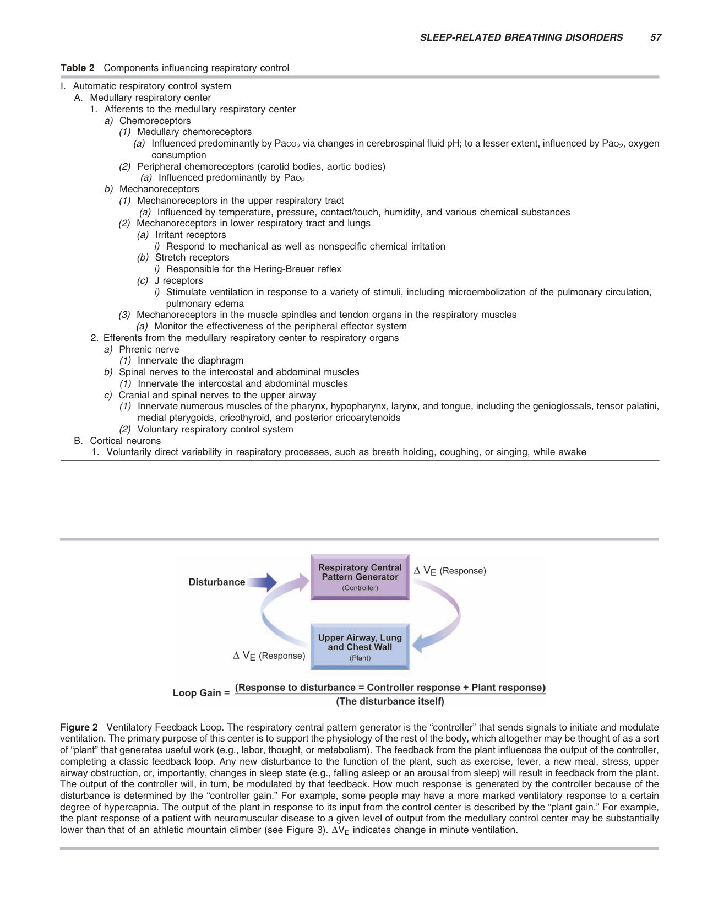

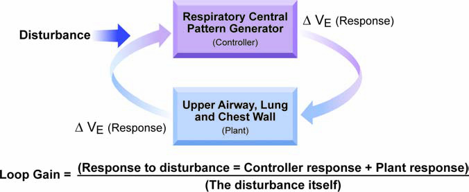

<!-- pdf-page: 71 -->

Figure 3

Loop Gain. The ratio of the response to a disturbance to the disturbance itself may be conceptualized as the loop gain (LG), a way to characterize the function of the entire feedback system (see Figure 2). In general, systems with loop gains of 1 tend toward instability, whereas those with loop gains of slightly <1 are more stable. A system with a loop gain of 0 would be an unchanging system, unable to respond to even routine challenges to homeostasis, such as walking across the room, coughing, or talking. In this hypothetical example, the disturbance is an apnea (cause unimportant). After the response thresholds are crossed, the response to the ensuing hypercapnia and hypoxemia is to increase ventilation. In the top example, with a loop gain of 0.5, the response is just enough to restore the system close to homeostasis, and steady state is achieved with only one more iteration. In the bottom example with a loop gain of 1.0, the response to the apnea overshoots homeostasis and becomes a disturbance in its own right, leading to yet another apnea and so on. Even greater swings away from equilibrium would result as the loop gain is increased to >1. VT indicates tidal volume. (From White DP. Pathogenesis of obstructive and central sleep apnea. Am J Respir Crit Care Med 2005; 172:1363-70. [Used with permission.])

Figure 4

Ventilatory Response Curves at Steady State, Awake, and Asleep. The ventilation at a given PaCO2 while breathing a constant high inspiratory pressure of oxygen, is depicted at left. Below the threshold value of PaCO2 40 mm H2O, the ventilation changes only slightly with PaCO2 and is low during wakefulness and absent during non–rapid eye movement (NREM) sleep. This point is called the apneic threshold, and it varies a bit between wakefulness and sleep. Note that above the apneic threshold, the change in ventilation per unit change in PaCO2, a measure of the ventilatory drive, is lower in NREM sleep than in wakefulness. At right is depicted the eucapneic ventilatory drive related to arterial oxygen saturation (SaO2). Note that the hypoxic ventilatory drive is also lower in NREM sleep than in wakefulness. ·VE indicates minute ventilation.

reduction in muscle tone, combined with changes in ventilatory drive, helps explain the changes in minute ventilation, tidal volume, and respiratory rate that are noted across the range of sleep stages.

#### SLEEP-RELATED RESPIRATORY EVENTS

#### Obstructive Apneas and Hypopneas

Understanding ventilatory control is essential to a proper understanding of sleep-disordered breathing. However, the controller is only part of the system; the plant is also an essential component. The output of the controller instructs the ventilatory muscles to activate. However, activation must occur in a precise manner. When either the controller or the plant fails to function in a coordinated fashion, a ventilatory event results (Table 3). For example, in a situation where activation of phrenic nerves would produce an inspiratory maneuver by the diaphragms, if the output to the upper airway muscles was inadequate or ill timed, the airway would not be patent. The diaphragms would produce a negative intrathoracic pressure sufficient to promote airflow from the atmosphere into the lungs, but the closed airway would prevent that flow. This lack of airflow is called an apnea (Greek for “no breath”), and it is precisely the mechanism underlying an obstructive apnea (obstructive because it is airway obstruction that produces the apnea rather than the lack of forces sufficient to produce negative intrathoracic pressure). By convention, apneas are not counted until the absence of ventilation has lasted for at least 10 seconds (Figure 5). In the event that the airway is not totally collapsed but remains too narrow to allow normal airflow, the

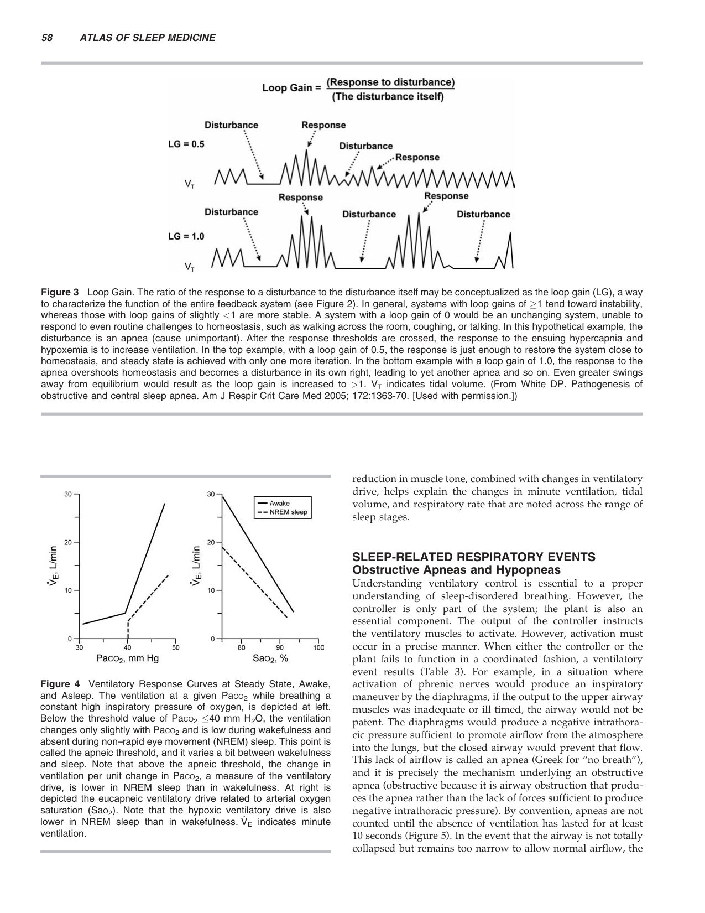

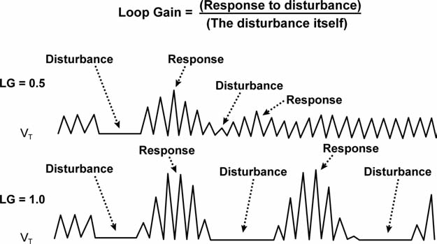

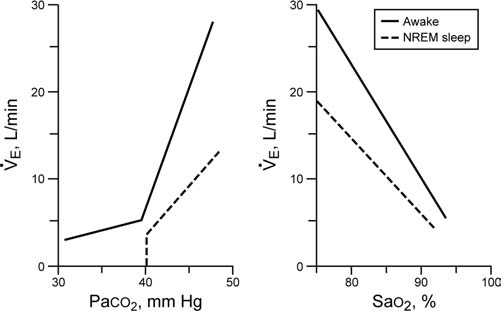

<!-- pdf-page: 72 -->

Table 3

Sleep-related breathing events and their definitions

Event Definition

Obstructive apnea A cessation of airflow for at least 10 seconds, during which there is effort to breathe. Central apnea A cessation of airflow for at least 10 seconds, during which there is no effort to breathe. Mixed apnea A cessation of airflow for at least 10 seconds, with the event commencing as a central apnea but terminating as an obstructive apnea. Hypopnea An abnormal respiratory event lasting at least 10 seconds, with at least a 30% reduction in thoracoabdominal movement or airflow as compared to baseline, and with at least a 4% oxyhemoglobin desaturation. A hypopnea can be proven obstructive only with an esophageal balloon that shows increasing effort with reduced airflow, but it can often be inferred from the shape of the airflow signal or when snoring intensity increases during the event. Respiratory effort–related arousal A sequence of breaths with increasing respiratory effort leading to arousal from sleep. This is best demonstrated by progressively more negative esophageal pressure efforts for at least 10 seconds preceding an arousal with resumption of more normal pressures, but it often can be inferred from other measured signals.

Figure 5

Obstructive Apnea. In this 60-second polysomnographic epoch of stage N2 sleep, an apnea begins almost immediately upon entering the epoch (nasal pressure tracing shows no evidence of air movement). The apnea is confirmed by the sum (Sum) of the chest and abdominal (Abd) respiratory impedance bands, which also shows no significant tidal volume during the apnea. There is clear evidence of thoracoabdominal paradox, with the Abd and chest bands moving in opposite rather than synchronous directions. The rhythm is sinus and does not demonstrate the clinically significant tachy-bradycardia often observed with more profound desaturations and longer apneas. This apnea lasts about 40 seconds. Note the abrupt resumption of ventilation (not a gradually increasing or crescendo pattern) that is characteristic of the termination of obstructive events. The arousal is practically concurrent with termination of the apnea. Unfortunately for this patient, another apnea ensues with the return to sleep. Vertical lines are 15 seconds apart; the total epoch time is 30 seconds. Abd indicates abdominal; Ant. tibial, anterior tibial muscles; ECG, electrocardiogram; EMG, electromyogram; HR, heart rate; LOC, left outer canthus; Nasal P, nasal pressure; ROC, right outer canthus; SaO2, arterial oxygen saturation; Sono, sonographic microphone to record snoring; Sum, sum of the chest and abdominal respiratory impedance bands.

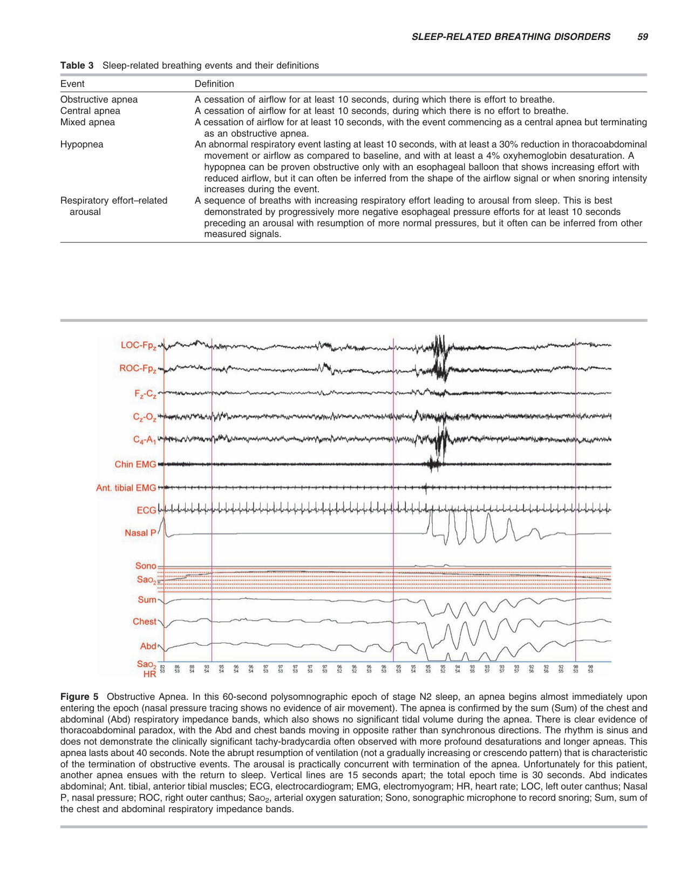

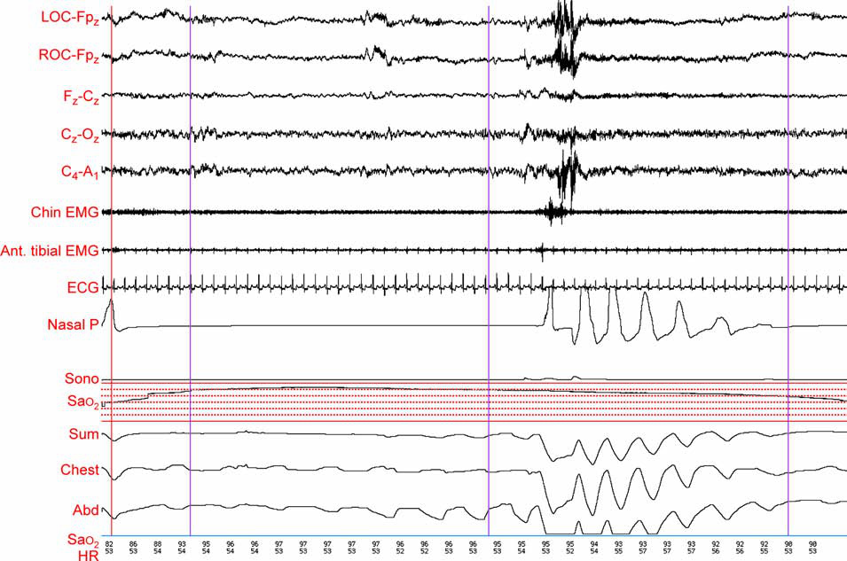

<!-- pdf-page: 73 -->

Figure 6

Hypopnea. During this 60-second epoch, a hypopnea begins at about 3 seconds into the tracing and lasts about 12 seconds. The nasal pressure transducer signal is often the most sensitive in picking up hypopneas and flow limitations. In this polysomnographic tracing, it is flat throughout the hypopnea. The thermocouple (Oronasal airflow) shows ongoing evidence of air movement, but it is of lower magnitude than surrounding breaths and is shown to be sufficient to cause a significant decline in arterial oxygen saturation (SaO2) from 95% to 88%. Note the delay in oxygen saturation decline of about 12 seconds, which is typical of patients without clinically significant heart disease. The time between cessation of breathing and the nadir of oxygen saturation, which is called the lung-to-finger circulation time, is about 15 seconds in patients without heart failure in contrast to 22 to 35 seconds for patients with impaired left ventricular function (1,2). Note also the abrupt resumption of airflow at hypopnea termination, which, along with the flattening of the inspiratory breaths observed after the hypopnea, is characteristic of an obstruction. One might expect more activity in the sonographic microphone channel (Sono), but the gain may be low. To be certain of whether the hypopnea was due to upper airway obstruction or centrally mediated causes would require the use of an esophageal manometer. For explanation of labels, see Figure 5. (For more information, see Silber MH, Krahn LE, Morgenthaler TI. Sleep Medicine in Clinical Practice. New York [NY]: Taylor & Francis, 2004. p. 131-2.)

resulting inadequate tidal volumes and decline in minute ventilation define an obstructive hypopnea. A decline in ventilation could also result from reduced ventilatory control output or weak output from the ventilatory muscles. Because of this, hypopneas that are scored during clinical polysomnography without using some measure of intrathoracic pressure such as an esophageal pressure manometer are not usually classified as either obstructive or central in origin (Figure 6). Although the concept of a hypopnea is clear, the definition conventions by which events should be counted as such are more variable. Most commonly, hypopneas are defined as respiratory events with evidence of ongoing ventilatory efforts but with at least 30% reduced airflow lasting 10 seconds and sufficient enough to result in a decline in blood oxygen saturation of at least 4% (3). Apneas and hypopneas have in common three characteristics: 1) alteration in the normal ventilatory pattern that involves a reduction in airflow; 2) transience, but with each lasting at least 10 seconds; and 3) frequently, decreased oxygenation. After these events occur, ventilation resumes. The curious reader might wonder about two things. First, what signals cause ventilation to resume; and second, what happens

when it does resume? How does the ventilatory control center compensate for this disruption?

Recovering From an Obstructive Apnea or Hypopnea Traditionally, it has been taught that an arousal from sleep is required to increase airway tone in order to open the upper airway and allow a resumption of ventilation after an obstructive apnea. However, this is not always the case. Recent studies analyzing the relationship between airway opening and arousal show a more complicated arrangement (4). The airway may be opened in response to an increase in control center output despite the absence of arousal, or it may occur at the time of arousal or even afterward (Figure 7). The signal to open the closed airway arises from the central controller, whose output may be modulated by inputs from mechanoreceptors in the lungs and airway that indicate the discrepancy between output and effect, as well as inputs from chemoreceptors indicating hypoxia or hypercapnia. Why some apneas and hypopneas are terminated by arousal, whereas others are overcome without arousal, is not entirely understood.

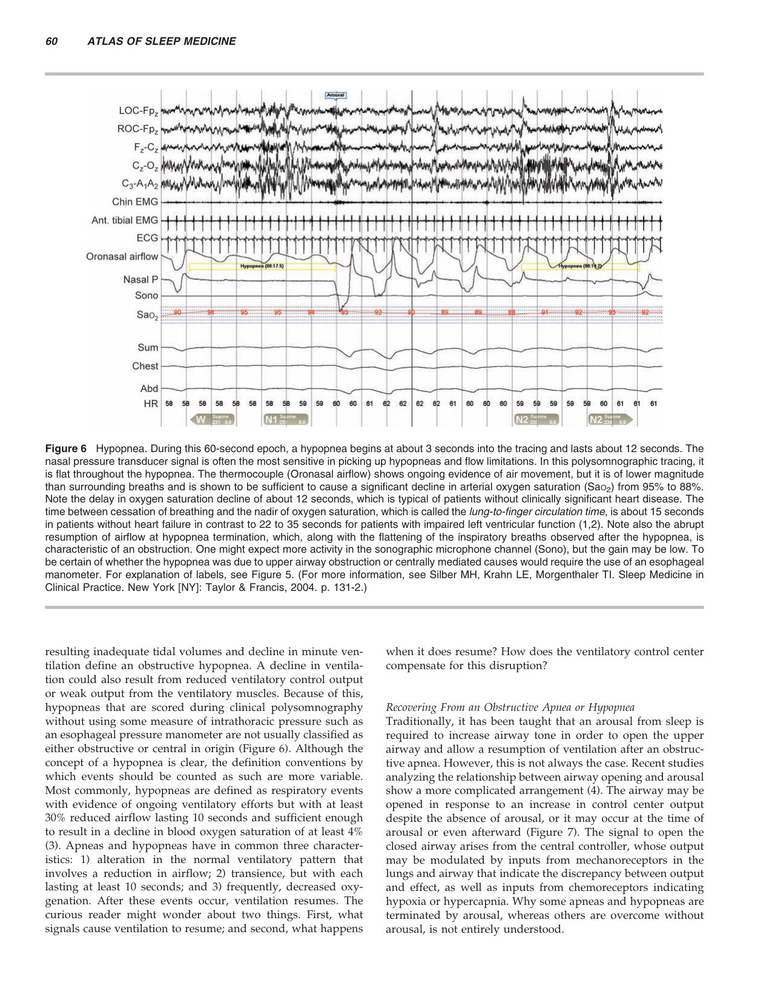

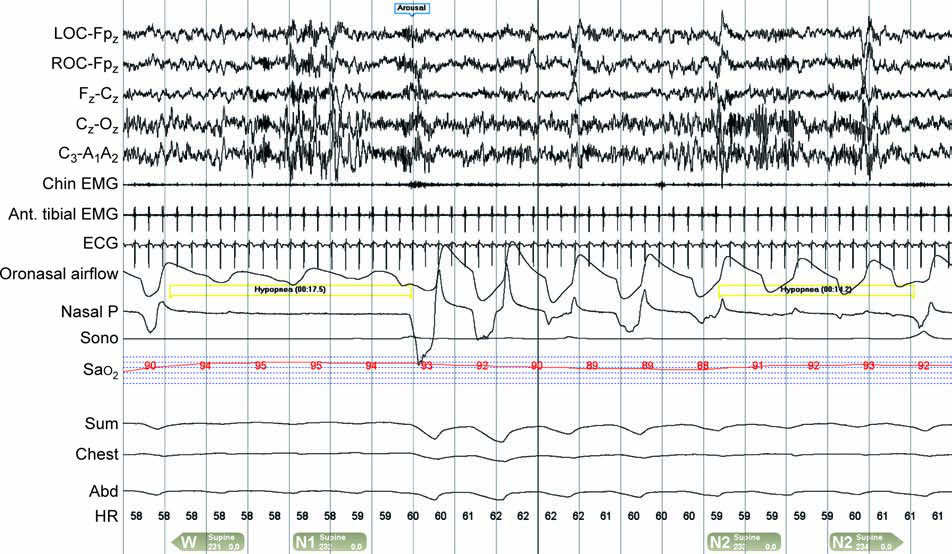

<!-- pdf-page: 74 -->

Because snoring results from muscle tone–related reductions in airway dimensions, it is frequently also present in patients with apneas and hypopneas. At times, the resistance increases so much that the ventilatory effort needed to maintain flow is great enough to stimulate an arousal from sleep. Figure 8 illustrates how a patient’s increasing effort to maintain airflow results in arousing him from sleep. When the increased effort lasts 10 seconds and terminates in an arousal, the event is called a respiratory effort–related arousal.

Figure 7

Time Between Onset of Airflow After an Obstructive Apnea and an Arousal. The idea that arousal is necessary to “rescue” the patient from upper airway obstruction is a logical but erroneous conclusion. Recent studies show an inconsistent relationship between the timing of arousal and upper airway opening. This graph depicts results from a study in which obstructive apneas and hypopneas were induced by the dial-down of continuous positive airway pressure in patients with obstructive sleep apnea. The time was measured from the beginning of the obstructive event until arousal and until airway opening with resumption of airflow. The graph depicts the time difference between airflow resumption and an electroencephalogram (EEG) arousal on the ordinate, and the frequency at which those time differences are observed is depicted along the abscissa. The response to induced obstructive apneas or hypopneas was assigned to one of three types on the basis of the relationship to any EEG arousal. Type 1 responses were those wherein the subjects resumed airflow without apparent arousal; type 2 responses were those involving resumption of airflow before arousal; and type 3 responses showed airflow only after arousal. Clearly, many obstructive events are terminated without arousal or before arousal (5). (From Younes [4]. [Used with permission.])

#### Snoring and Respiratory Effort–Related Arousals

Upper airway resistance is not constant during wake or sleep. However, as long as ventilatory effort increases or decreases in proportion to the change in resistance, airflow will remain stable. The degree of inspiratory effort can be described by the magnitude of intrathoracic pressure (as estimated by intraesophageal pressure manometry). During normal ventilation, the intrathoracic pressure required to maintain ventilation typically ranges from 5 to 35 cm H2O, depending on the airflow needed and the upper airway resistance. The audible vibrations of the upper airway set in motion by the turbulent flow through the narrowed airway produce snoring, which can range in volume from insignificant to highly disruptive for persons sharing space with the snoring sleeper. Snoring occurs in 30% to 50% of adults older than age 50 years, and it is loud enough to be heard in an adjacent room in 5% to 10% of these adults (6). In a recent study of patients referred for sleep evaluations, snoring produced sound intensity levels that averaged 46.2 decibels and that exceeded regulatory outdoor noise limits in 12.3% of patients. Snoring is more common in patients with nasal congestion measured objectively by rhinometry (7).

#### Central Apneas

When there is no signal sent from the central respiratory controller, there is no airflow. This event, called a central apnea, is most frequent during lighter stages of sleep, particularly with the transition from wake to sleep (Figure 9). Isolated sleep-onset central apneas are not infrequent in normal sleepers because the central controller may interpret the normal PaCO2 of wakefulness as too low when measured against the higher CO2 apnea threshold of sleep. The change from wake to sleep serves as the “disturbance” to the respiratory system. As the apneic threshold is crossed, the signal to begin breathing increases, and if it is not too great, stable ventilation resumes after a short period of readjustment. However, if either the controller or the plant gain is too high, the loop gain will be greater than one, and the ventilatory response will overshoot, giving rise to hyperventilation and hypocapnia with or without arousal; hypopnea or apnea may subsequently result because of crossing the apneic threshold, and the pattern may be set up to repeat (Figure 10). This response sequence gives rise to periodic breathing, consisting of a series of repetitive central apneic events interspersed with a crescendo hyperpnea and subsequent hypopneic phase (Figure 11). Risk factors for this pattern include factors that increase controller gain, such as a low PaCO2, a low FiO2 (observed at altitude), or increased stimulation of afferents to the control center. When this periodic breathing pattern is accompanied by other clinical associations, central sleep apnea syndromes result.

#### Mixed Apneas

Occasionally, at the end of an otherwise predominantly central apnea, the resumption of the central signal occurs, but upper airway obstruction interferes with restoration of ventilation. This situation is termed a mixed apnea, and is depicted in Figures 12 and 13. Such events are similar to obstructive events in their associations with arousals and sleep fragmentation. However, mixed apneas may be more prevalent in patients with risk factors for central sleep apnea syndromes, such as congestive heart failure.

#### OBSTRUCTIVE SLEEP APNEA SYNDROME

Obstructive sleep apnea syndrome (OSAS) is currently defined by a combination of clinical factors and polygraphically measured factors. The most common accepted definitions of OSAS include an increased apnea-hypopnea index (the number of apneas plus hypopneas per hour of sleep) combined with symptoms or evidence of increased cardiovascular risk (Table 4). However, this definition must be regarded as a work in progress. Although it makes sense for the definition to include measures of observed breathing and sleep events, which events are most important: apneas, hypopneas, respiratory effort–related

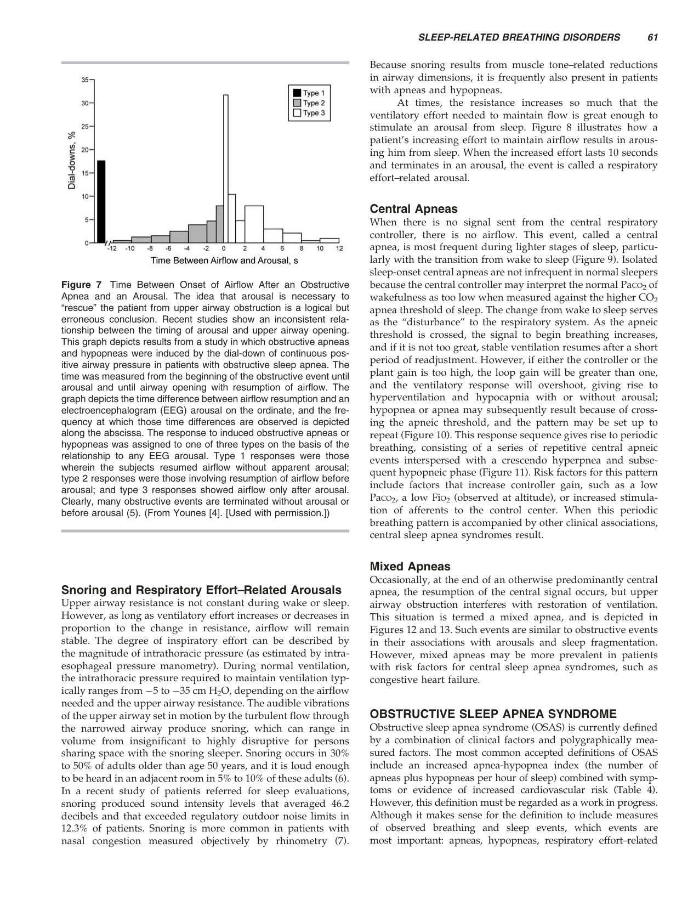

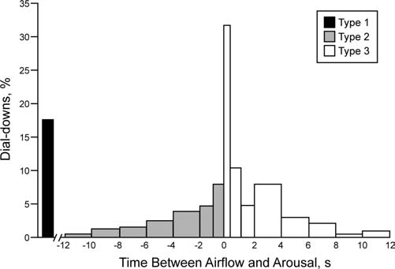

<!-- pdf-page: 75 -->

Figure 8

Respiratory Effort–Related Arousal. Bar shows period of increasing effort and decreasing flow, but no resulting significant desaturation. The event caused arousal (arrowhead), and lasted longer than 10 seconds, for a respiratory effort–related arousal. Note the crescendo of snore (Sono) volume and the thoracoabdominal paradox consistent with upper airway resistance. Vest indicates airflow from positive airway pressure pneumotachometer. For explanation of other labels, see Figure 5.

arousals, oxyhemoglobin desaturation events, overall arousals, or alterations in sleep architecture (e.g., the percentage of stage N1 in disease compared with normal)? Each of these variables has been studied with regard to the clinical manifestations of OSAS, and none of them seem closely correlated. For example, some studies show that cardiovascular risk correlates most closely with the frequency of oxygen desaturation from baseline, whereas sleepiness may correlate better with overall arousal index (5,8). The prevalence of an elevated apnea-hypopnea index (AHI) varies across age groups regardless of the presence or absence of sleep symptoms (Figure 14). For the present, the consensus definition of OSAS is an AHI 5 per hour with symptoms of sleepiness, cognitive difficulties, fatigue, or documented cardiovascular disease or hypertension, or an AHI 15 per hour even without symptoms (9). OSAS is the most common of the sleep-related breathing disorders, with prevalence estimates of OSAS (when limited to persons with AHI 5 per hour and sleep symptoms) of 3% to 28%, with a prevalence of probably about 5% in Western countries (10). Independent risk factors for OSAS include age, increasing body mass index (BMI [weight in kg/height in m2]), African American ethnicity, male sex, and pregnancy. Neck circumference is correlated with increased risk of OSAS, especially if exceeding 16.5 inches (40 cm) in men.

#### Clinical Presentation of Obstructive

#### Sleep Apnea Syndrome

Sleep apnea syndromes are generally considered when a patient presents either with clinical symptoms of sleep apnea or clinical risk factors that are closely associated with sleep apnea. Once the patient is encountered, the clinical examination focuses on the elicitation of the symptoms of sleep-related breathing disorders and the identification of risk factors for either OSAS or central sleep apnea syndromes, concurrent cardiovascular risk factors, and factors that will influence treatment plans.

Symptoms, Associated Conditions, and Examination Findings The clinical presentation of OSAS includes both daytime and nocturnal symptoms (Table 5). Disruptive snoring and excessive daytime sleepiness are most common, each being present in nearly 70% of patients (11). Various conditions have been associated with the increased prevalence of OSAS, chiefly due to the effect of associated craniofacial abnormalities or complex interactions of neuromuscular tone and anatomy (Table 6). Other diseases associated with a high prevalence of OSAS, but which may be complications of OSAS rather than causative factors, include hypertension, congestive heart failure, coronary artery disease, and stroke.

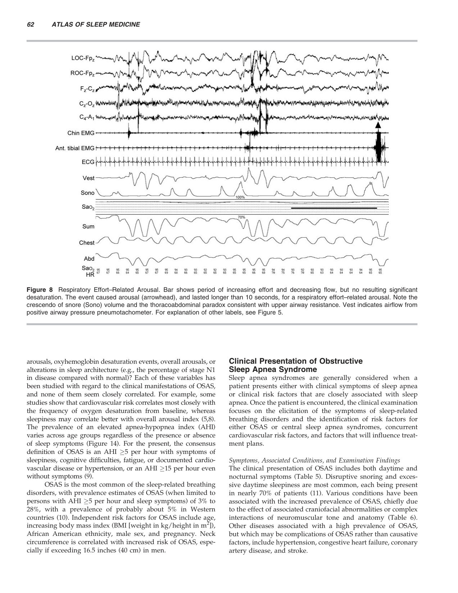

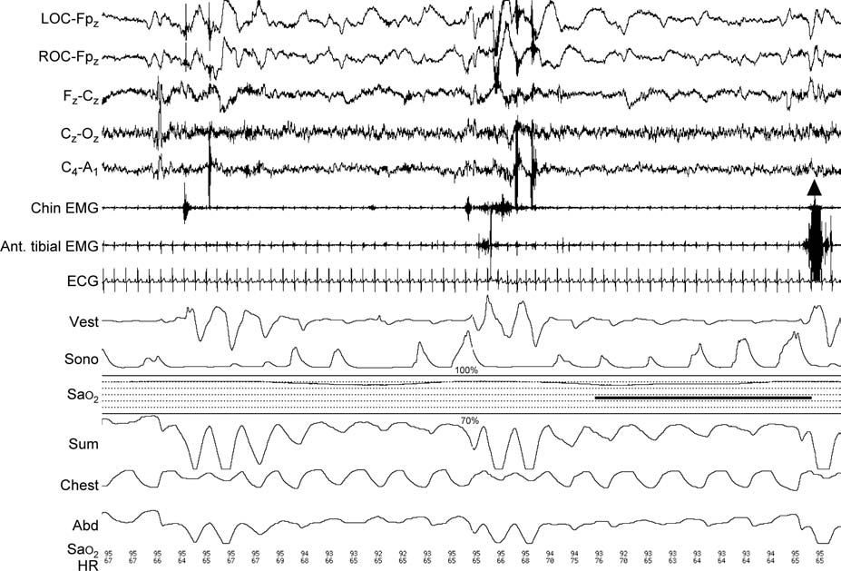

<!-- pdf-page: 76 -->

Figure 9

Central Apnea. The central apnea in this polysomnographic tracing is typical in that there is a lack of evidence for respiratory effort for 18.2 seconds. The lack of airflow is demonstrated both in the thermocouple (Oronasal airflow) and in the nasal pressure transducer. Resumption of breathing is gradual rather than abrupt. Central apneas during rapid eye movement (REM) sleep are less common than during non–rapid eye movement (NREM) sleep. Also unusual is the fact that arousals often occur after normal or even hyperpneic ventilation is achieved following central apnea, rather than at the onset of ventilation as shown here. This patient had Arnold-Chiari syndrome with frequent central apneas in both REM and NREM sleep. The electrocardiogram (ECG) shows an atrial premature contraction, but otherwise the patient is in sinus rhythm. For explanation of labels, see Figure 5.

During the physical examination, particular effort should be expended to examine the upper airway. In general, anatomical features that reduce upper airway patency when awake or at rest are correlated with an increased risk of OSAS (Table 7). Of these, the most practical and predictive seem to be the tongue position in relation to the soft palate, narrowing of the tonsillar pillars, tonsillar hypertrophy, tongue ridging, and neck circumference (12). The relationship between tongue position and the soft palate is conveniently summarized by the Friedman tongue position classification (also called the modified Mallampati scheme) as shown in Figure 15 (13). There is a good correlation between Friedman tongue position class and the prevalence of OSAS. In view of the similarity between the clinical symptoms of OSAS and Cheyne-Stokes breathing pattern (CSBP) or central sleep apnea, it is a good idea to also pay special attention during the cardiovascular examination to the possibility of atrial fibrillation or signs of left or right heart failure. Before turning to diagnostic testing for OSAS, it is best to discuss the clinical presentation of a central sleep apnea syndrome, since many aspects are similar. The testing strategy should take into account both the likelihood of central sleep apnea syndrome and its probable treatment modalities.

#### CENTRAL SLEEP APNEA SYNDROMES

As shown in Table 1, there are six different types of central sleep apnea syndrome. By far the most common are CSBP, central sleep apnea secondary to stroke (medical conditions other than CSBP), and central sleep apnea due to chronic narcotic use.

#### Cheyne-Stokes Breathing Pattern

Central sleep apnea syndrome with CSBP (Figure 11) is common in patients with congestive heart failure, affecting 40% to 60% of such patients (14,15). Although the primary breathing events in this condition are repetitive centrally mediated apneas and hypopneas, snoring is also frequently present, as are witnessed apneas. Symptoms of CSBP are generally similar to those of patients with OSAS, except that insomnia, especially sleep-maintenance insomnia, appears to be more prevalent. Factors that are associated with an increased likelihood of having central rather than obstructive sleep apnea include the presence of atrial fibrillation, reduced left ventricular ejection fraction, male sex, and age older than 60 years (7). In slightly less than 20% of patients with CSBP and heart failure, periodic breathing may be observed during relaxed wakefulness in the

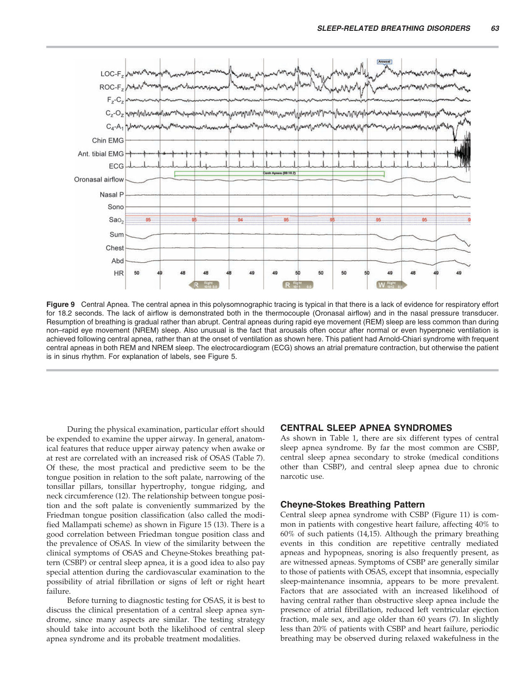

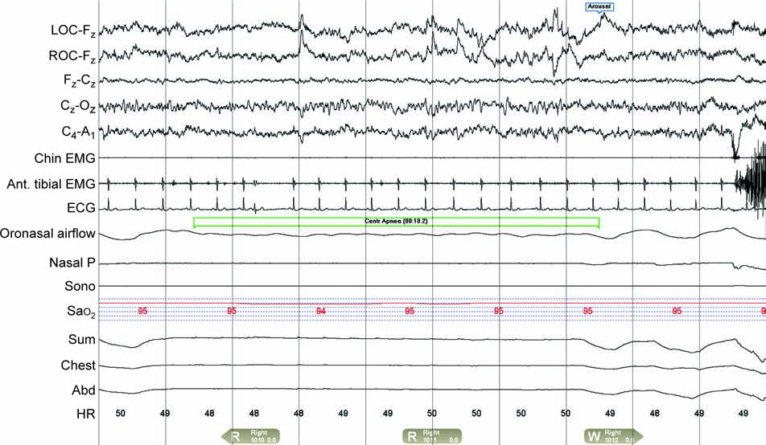

<!-- pdf-page: 77 -->

Figure 10

The Role of the Ventilatory Drive and the Apneic Threshold in the Genesis of Central Apnea. This sequence depicts a circumstance in which the sleeper begins with stable respiration but then experiences repetitive central apnea after arousal. (A [top and bottom panels]) At onset (far left), the patient is in stable stage N2 non–rapid eye movement (NREM) sleep. Tidal volume (top panel) is nearly constant; PCO2 (lower 4-part panel) is constant at about 42 mm Hg. (B [top and bottom panels]) The patient experiences an arousal (cause not important) that rapidly moves the ventilatory control curve to the “Wake” line (bottom panel, B), and ventilation therefore increases (increased tidal volume and frequency, upper panel). If ventilatory drive is high, as may be seen in patients with congestive heart failure, for example, the PaCO2 will fall rapidly. In this example, PaCO2 falls to 36 mm Hg. (C [top and bottom panels]) The patient falls asleep, and the PaCO2 is below the apneic threshold of approximately 40 mm Hg. Therefore, there is no ventilatory drive until PaCO2 reaches 40 mm Hg, at which time ventilatory drive rises and ventilation begins again. If the ventilatory drive is high, the needed steady state ventilation may be overshot, producing an abrupt fall in PaCO2. In central apnea syndromes, an arousal often occurs coincident with the hyperpnea following the central apnea. Ventilatory control is again governed by the steeper wake curve (panel C), and as CO2 falls and the patient returns to sleep, PaCO2 is again below the apneic threshold of 40 mm Hg, leading to repetitive cycling of central apneas interspersed with hyperpnea. REM indicates rapid eye movement; ·VE, minute ventilation.

daytime office encounter (16). Examination may disclose findings consistent with impaired left ventricular dysfunction, although patients often present for evaluation in a compensated condition. The presence of any of these risk factors, or the notable absence of risk factors associated with OSAS (e.g., increased BMI, increased neck circumference, or upper airway narrowing) should prompt consideration of CSBP.

#### Central Sleep Apnea Secondary to Stroke

Both central and obstructive sleep apneas are common and coexist in the setting of acute stroke, being present in more than 70% of patients in some reports. Over time, the prevalence of central sleep apnea events declines, with about 40% of patients found to have OSAS and fewer than 10% found to have central sleep apnea (17). In the acute situation, and occasionally in the

chronic case, central sleep apnea associated with stroke mimics the pattern seen in CSBP but with one notable exception: the period of the periodic cycles is much shorter in stroke than in CSBP associated with congestive heart failure (Figure 16) (17). Symptoms are often dominated by those attributable to the stroke acutely, but later in the course of stroke, sleepiness that fails to resolve should prompt consideration of sleep apnea. Since both sleep apnea syndromes (i.e., obstructive and central) are associated with increased blood pressure and increased blood pressure lability, these factors should also prompt consideration of the diagnosis. There are many reasons to consider that treatment of either type of sleep apnea in patients with acute stroke might improve outcomes, including more favorable cardiovascular conditions, a reduction in circulating catecholamines, improved sleep quality, and a decrease in inflammatory markers. However, no studies to date show

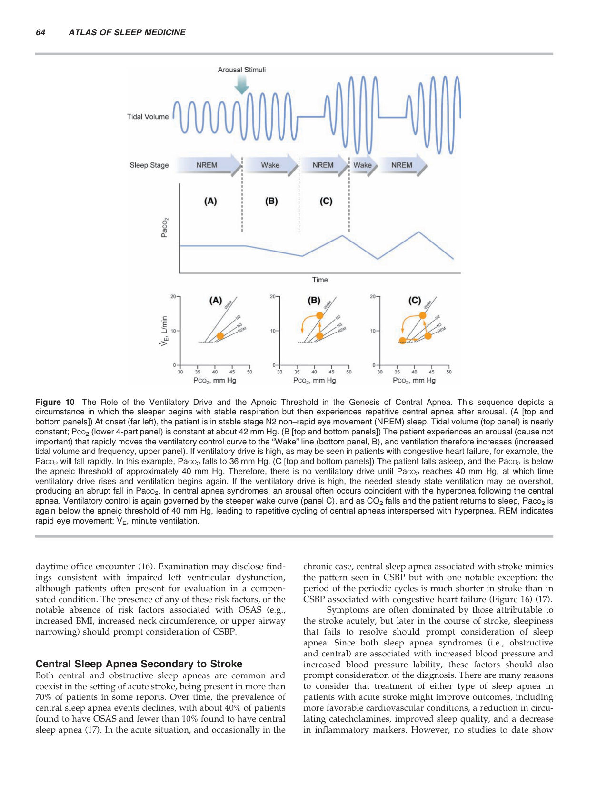

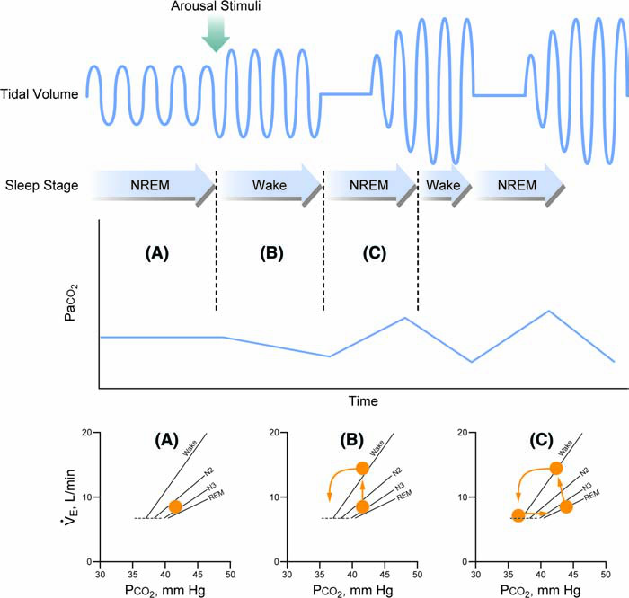

<!-- pdf-page: 78 -->

Figure 11

Periodic Breathing and Cheyne-Stokes Breathing. This polysomnographic tracing shows 600 seconds of non–rapid eye movement sleep with an apnea-hypopnea index of 69.2. The tracing demonstrates repetitive central apneas that are entered through a decrescendo breathing pattern and exited with a crescendo pattern. These apneas occur with mathematical periodicity; in this case the cycle time is 75 seconds (arrow), consistent with Cheyne-Stokes breathing, which is observed most often in patients with impaired heart failure, especially left ventricular dysfunction. Patients with acute stroke or who are not acclimated may also demonstrate periodic breathing patterns (with or without central apneas), but most often the cycle length is shorter, more on the order of 30 seconds. Current nosological efforts suggests that the diagnosis of Cheyne-Stokes breathing be reserved for cases in which the cycle length exceeds 45 seconds. Scrutiny of the electrocardiographic (ECG) tracing may reveal atrial fibrillation, a common accompaniment to Cheyne-Stokes breathing. For explanation of labels, see Figure 5.

unambiguously improved outcomes, and at least some studies show that positive airway pressure (PAP) therapy is poorly tolerated by many stroke patients.

#### Central Sleep Apnea Associated With Opiates

In recent years increased attention has focused on the management of patients with acute and chronic pain, and there has been a marked proliferation in chronic opiate use (Figure 17). Concomitantly, there is growing awareness that opiates are associated with central sleep apnea syndromes. For example, in a recent study of 98 patients using chronic opiates who were referred for suspected sleep-disordered breathing, 36% had OSAS, 24% had central sleep apnea syndrome, and 21% had a combination of obstructive and central sleep apneas (19). In contrast, most sleep disorders centers find that central sleep apnea syndrome is present in fewer than 5% of the patients referred to them for assessment. The proportion of central sleep apneas to obstructive sleep apneas in patients who use opiates appears to be dose dependent, with an increasing proportion of central apneas with higher doses of narcotics (Figure 18) (9,18,20). Not only is central sleep apnea syndrome more common among opiate users but it also has characteristics that differ

from those of either CSBP or central sleep apnea secondary to stroke. The breathing pattern in opiate users frequently demonstrates an irregular ataxic pattern with central apneas randomly inserted throughout NREM sleep (Figure 19) (9,19,20). Other than a high prevalence and a somewhat unique pattern, the clinical presentation of opiate-related central sleep apnea syndrome does not appear substantially different from that of OSAS. However, this has not been systematically evaluated.

#### OTHER FORMS OF SLEEP-DISORDERED

#### BREATHING

In addition to OSAS and central sleep apnea syndromes, which are mostly defined by discrete breathing events during sleep, there are primary sleep-related hypoventilatory disorders such as idiopathic sleep-related nonobstructive alveolar hypoventilation syndrome and congenital central alveolar hypoventilation syndrome (Table 1). In both of these disorders, intrinsic respiratory dysregulation leads to chronic hypoventilation with diurnal hypercapnia and, at times, to overt respiratory failure or sudden death. By far the most common causes of chronic sleep-related hypoventilation are obesity hypoventilation syndrome and hypoventilation due to neuromuscular or chest wall disorders.

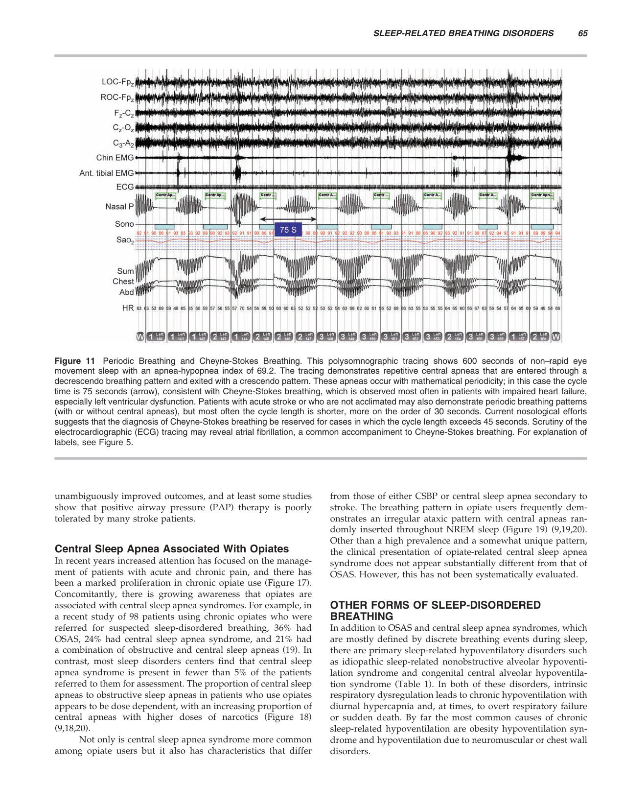

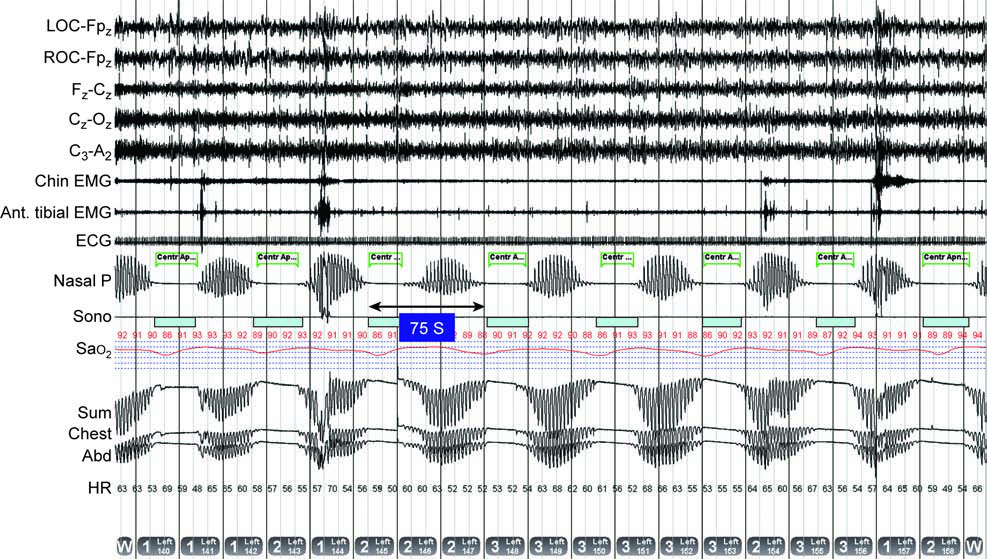

<!-- pdf-page: 79 -->

Figure 12

Mixed Apnea. In this polysomnographic tracing, the patient falls asleep and a sleep-onset central apnea ensues (see Figure 11). Resumption of ventilatory effort occurs but the upper airway is closed (arrowhead), and the apnea continues until an arousal (asterisk). Note the abrupt resumption of actual air movement, which is characteristic of an obstructive event. This event is a classic mixed apnea because it begins as a central event but ends as an obstructive one. For explanation of labels, see Figure 5.

Congenital central alveolar hypoventilation syndrome usually affects children, but it has also been reported in young adults (10). This unique sleep-related breathing disorder is associated with Hirschsprung disease and tumors of neural crest origin; in more than 90% of cases, it appears to result from a polyalanine repeat expansion mutation of the paired-like homobox 2b (PHOX2B) gene. Some investigators note that late-onset central alveolar hypoventilation syndrome may involve other mutations of the PHOX2B gene. There is considerable debate as to whether congenital central alveolar hypoventilation syndrome and late-onset central alveolar hypoventilation syndrome are separate disease entities or merely parts of a spectrum of congenital alveolar hypoventilation syndrome. In addition, since the genetic mutations involved in alveolar hypoventilation were discovered relatively recently, some speculative reports on adults with idiopathic central alveolar hypoventilation syndrome construe it as perhaps instead being due to PHOX2B mutations (10,21). Congenital central alveolar hypoventilation syndrome typically presents in an otherwise normal-appearing infant noted to breathe radically or only very shallowly during sleep. A diligent search reveals no endocrine, cardiac, pulmonary, or neuromuscular causation. Infants who present at birth often require intubation and mechanically assisted ventilation.

Other infants may appear to breathe adequately, while awake or when being examined clinically, but they also have abrupt intervals of hypoventilation with hypoxemia and hypercapnia that are noted typically when they sleep or occasionally when they are awake. Clinical findings may be noted as cyanosis, an apparent life-threatening event, right heart failure, or even hypoxic neurological damage. In infancy, congenital central alveolar hypoventilation syndrome is a severe disease, most often requiring diurnal ventilatory support. Hirschsprung disease is noted in approximately 16% of cases, and neural tumors such as ganglioneuromas or ganglioneuroblastomas, swallowing dysfunction, strabismus, or other autonomic dysfunction may be present. Irregular breathing patterns, apnea, edema, and lethargy are presenting features. Notably, when hypoxic, these children do not show clinically significant signs of respiratory distress, such as retractions or nasal flaring. Therefore, significant gas exchange abnormalities may be present over long periods of time without detection. Because the severity of hypoventilation varies, upper respiratory tract infections, diarrhea, or other causes of fever may precipitate bouts of respiratory failure. Late-onset central alveolar hypoventilation syndrome is characterized by sequelae of hypoventilation, such as morning headache, polycythemia, poorly refreshing sleep, daytime

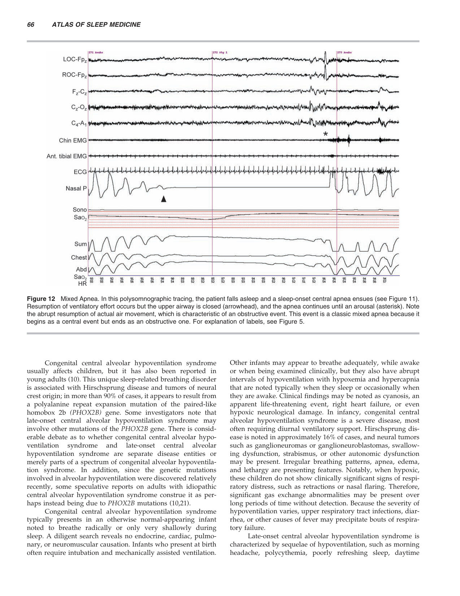

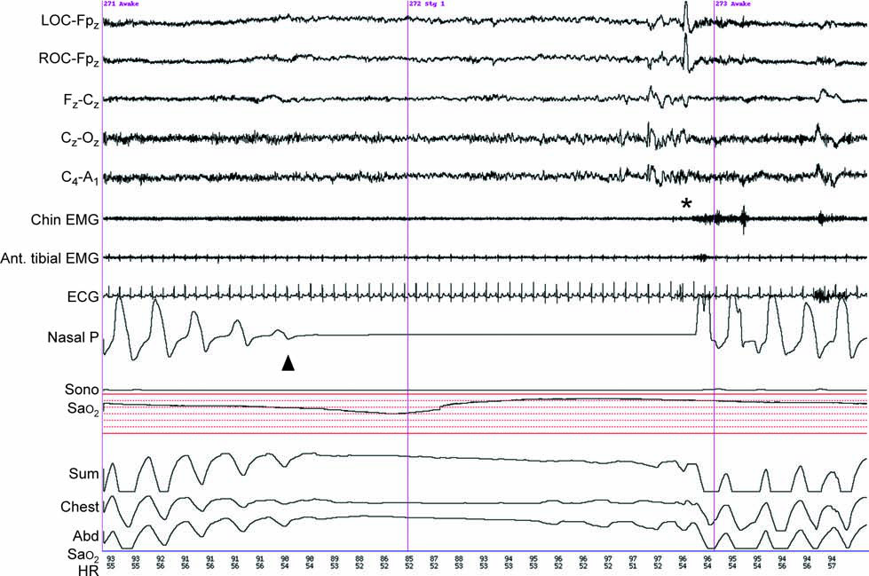

<!-- pdf-page: 80 -->

Figure 13

Central and Mixed Apneas. This figure depicts 120 seconds of stage N2 sleep that is interrupted by four ventilatory events. Focusing on the second marked event, we recognize a central apnea lasting 14.9 seconds. There is a lack of perceivable respiratory effort (no movement in the chest [Chest] or abdominal [Abd] respiratory inductance plethysmography bands), and at the beginning of the apnea there are fine oscillations in the nasal pressure (Nasal P) and oronasal airflow thermocouple tracings coincident with cardiac contractions (cardioballistographic tracings). Following recovery breaths, there is again the onset of a central apnea, but this time it is accompanied by the onset of efforts to breathe during the terminal 5 seconds of the apnea. Apneas that contain such central and obstructive components are called mixed apneas. Because these contain an obstructive component, some guidelines have suggested that they be counted along with other purely obstructive events (here the event is labeled an obstructive apnea, although it is actually a mixed apnea). Since the genesis of mixed apneas may be quite different from purely obstructive events, one might expect this practice to change in the coming years. For explanation of labels, see Figure 5.

Clinical factors Polysomnographic factors

Table 4

Diagnostic criteria for obstructive sleep apnea syndrome

Cardiovascular disease, such as hypertension, coronary artery disease, or stroke Data indicate increased cardiovascular events in untreated patients with AHI 5 per hour of sleep. Treatment is therefore often advised with AHI 5 and existing cardiovascular disease, even without significant symptoms, and third-party payers often supplement the cost of therapy. These events are assumed to be predominantly consistent with obstructive events.

Complains of unintentional sleep episodes during wakefulness, daytime sleepiness, unrefreshing sleep, fatigue, or insomnia Self-reported breath holding, gasping, or choking upon awakening Witnessed loud snoring, breathing interruptions, or both

Apneas plus hypopneas plus RERAs occur 5 times per hour of sleep. These events are assumed to be predominantly consistent with obstructive events.a

None required Apneas plus hypopneas plus RERAs occur 15 times per hour of sleep.a For many insurance companies, only apneas and hypopneas are considered, so AHI 15 will suffice.

Abbreviations: AHI, apnea-hypopnea index; RERA, respiratory effort–related arousal. aAASM. The International Classification of Sleep Disorders: Diagnostic and Coding Manual. 2nd ed. Westchester (IL): American Academy of Sleep Medicine, 2005.

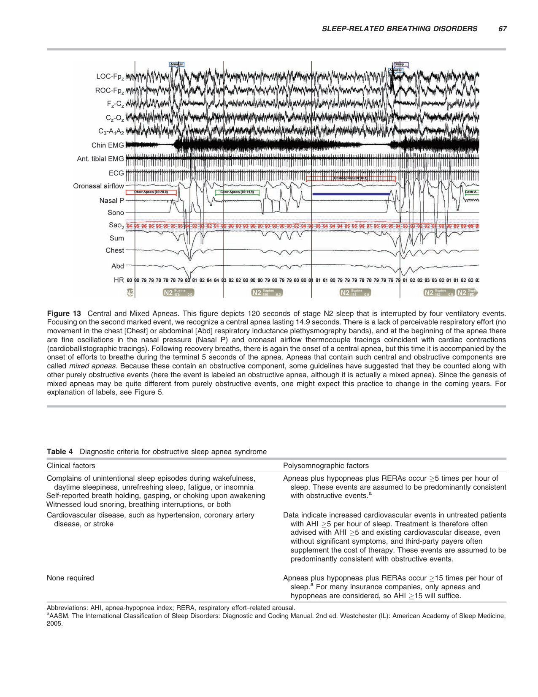

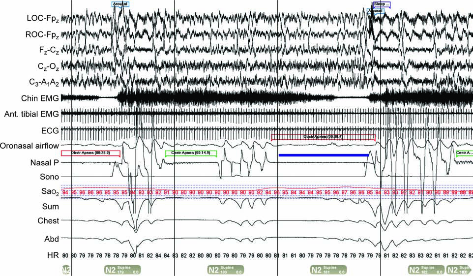

<!-- pdf-page: 81 -->

Table 6

Conditions associated with increased risk of obstructive sleep apnea syndrome

Figure 15

Friedman Tongue Position Classification (Modified Mallampati Scheme). During the physical examination, the patient is asked to open the mouth widely with the tongue left in place. Oropharyngeal crowding is graded as follows: (A) Grade 1: tonsils, pillars, and soft palate are clearly visible; (B) grade 2: only the uvula, pillars, and upper pole are visible; (C) grade 3: only part of the soft palate is visible, and the tonsils, pillars, and tip of the uvula cannot be seen; or (D) grade 4: only the hard palate is visible and not even the arches on either side of the uvula can be seen. Using this scheme rather than adjectives such as “crowded oropharynx” results in clearer communication and greater reproducibility among examiners about the degree of airway crowding. (Adapted from Friedman et al [13]. [Used witih permission.])

Figure 14

Age and Prevalence of Sleep-Disordered Breathing. The prevalence of sleep-disordered breathing with an apnea-hypopnea index of >15 increases with aging until about age 60 years. (From Young T, Shahar E, Nieto FJ, et al; Sleep Heart Health Study Research Group. Predictors of sleep-disordered breathing in community-dwelling adults: the Sleep Heart Health Study. Arch Intern Med 2002; 162:893-900. [Used with permission.])

Table 5

Symptoms of obstructive sleep apnea syndrome

Daytime symptoms Nocturnal symptoms

Snoring Witnessed apneas Choking spells Restless sleep Insomnia Nocturia Diaphoresis Reflux Drooling Moaning

Sleepiness Morning headaches Poor concentration Cognitive dysfunction Personality changes Erectile dysfunction in men Lower-extremity edema

Conditions Acromegaly Alcohol use Arnold-Chiari malformation Congestive heart failure Coronary artery disease Crouzon disease Cushing syndrome (exogenous or endogenous) Heart transplantation Hypertension Klippel-Feil syndrome Myxedema Obesity Pierre Robin syndrome Postpolio syndrome Prader-Willi syndrome Stroke Trisomy 21

Table 7

Features on examination associated with obstructive sleep apnea syndrome

Features Obesity Increased neck circumference Nasal obstruction Retrognathia Overjet Enlarged tongue (dental ridging on lateral aspects may indicate that tongue is too large for existing space) High-arched palate Tonsillar hypertrophy Narrowing of the tonsillar pillars Elongation or enlargement of the uvula

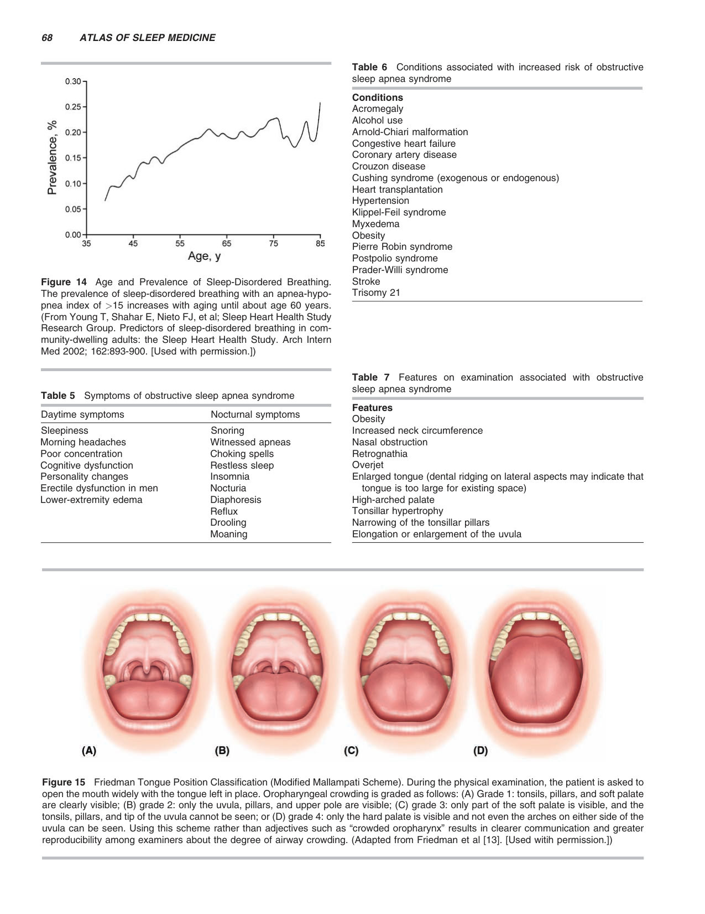

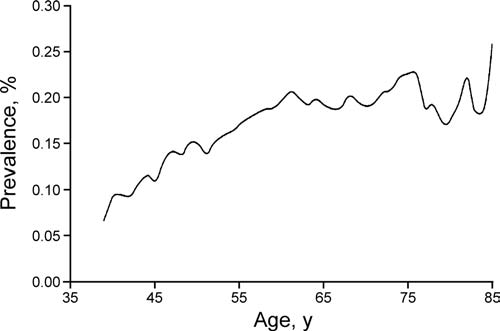

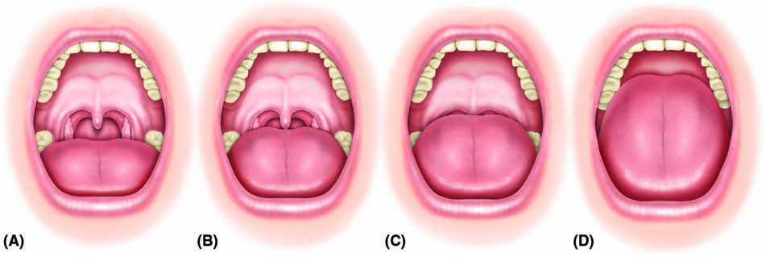

<!-- pdf-page: 82 -->

Figure 16

Periodic Breathing in Stroke. In contrast to the long cycle time seen in Cheyne-Stokes breathing, this tracing, obtained from a patient shortly after a left hemispheric stroke, shows an apnea-hypopnea index of 23 that is composed almost exclusively of repetitive central apneas marching in a periodic fashion with a short cycle time of less than 30 seconds. Continuous positive airway pressure is usually highly ineffective for this pattern, and it was poorly tolerated by the patient. For explanation of labels, see Figure 5.

sleepiness, pulmonary hypertension, peripheral edema, or cor pulmonale. Ventilatory studies demonstrate decreased hypercapnic and hypoxic ventilatory drive during both wakefulness and sleep. During polysomnography, decreased tidal volume may last many minutes, and the patient may experience sustained severe arterial oxygen desaturation. Perhaps somewhat counterintuitively, the episodes worsen during REM sleep,

Figure 17

Percentage Increases in Use of Prescription Narcotics (1997–2006). Over about a decade in which there was increased treatment of chronic pain, there was a doubling in the number of patients for whom narcotics were prescribed and increases in the number of prescribed narcotic doses per patient. Thus, the total grams prescribed annually also increased substantially. It is therefore likely that physicians treating patients with sleep apnea will encounter patients who are chronic users of high-dose opiates. (From Morgenthaler [18]. [Used with permission.])

which would not be expected in a defect of chemosensitivity ventilatory regulation because such defects typically manifest primarily during NREM sleep. For many neuromuscular disorders, ventilatory insufficiency is life limiting. In nearly all cases, ventilatory insufficiency is most severe during sleep. For example, in amyotrophic lateral sclerosis, diaphragm strength is often

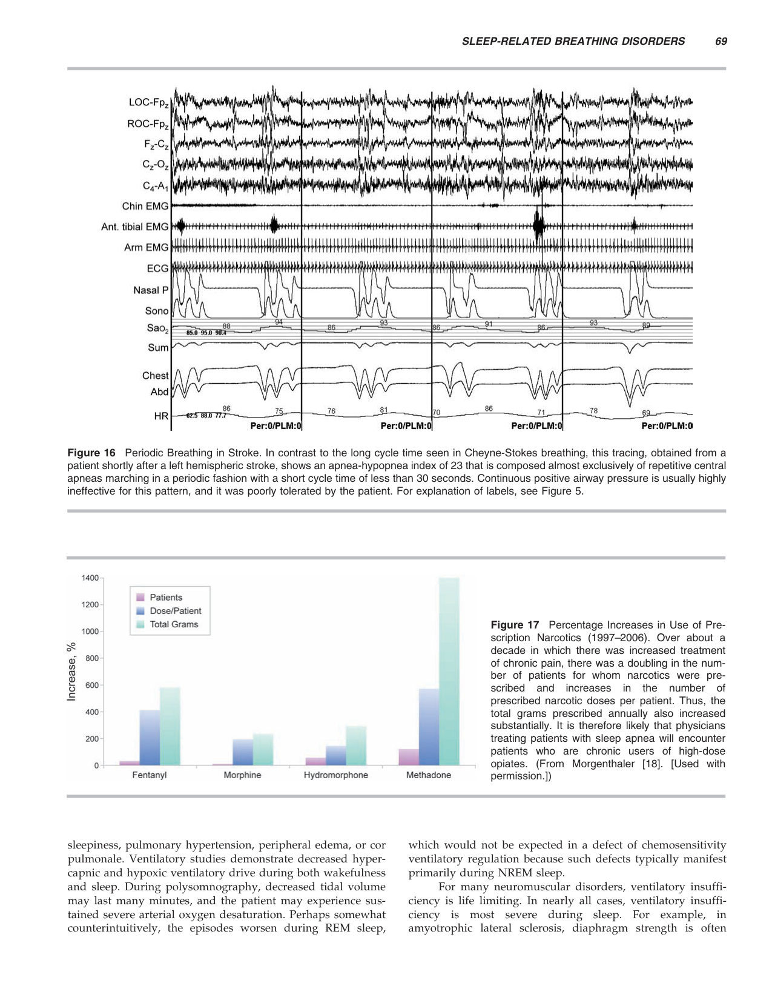

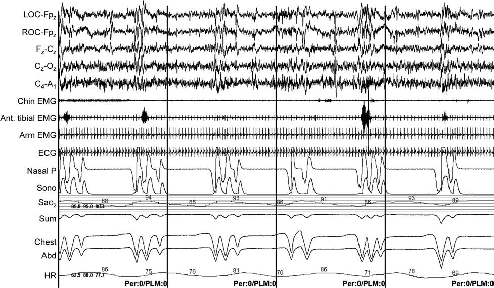

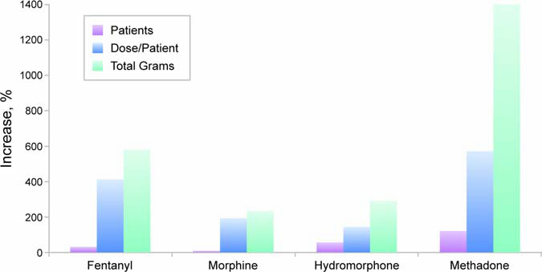

<!-- pdf-page: 83 -->

reduced disproportionately to axial muscles. In these cases, the atonia associated with normal REM sleep provides a severe challenge to ventilation because the patient is dependent upon diaphragm function at that time. The result is deep oxyhemoglobin desaturation, hypercapnia, and deteriorating sleep quality. The presentation consists of both ventilatory and sleep-related abnormalities. A gradual reduction in baseline oxygen saturation, increased diurnal PCO2, decreased vital capacity, and decreased inspiratory muscle strength are accompanied by a decline in the quality of sleep. Patients may begin to notice orthopnea and headaches on awakening.

#### DIAGNOSIS OF SLEEP-RELATED

#### BREATHING DISORDERS

All sleep-related breathing disorders may be diagnosed with polysomnography. A patient suspected of having a sleeprelated breathing disorder on the basis of a clinical presentation

Figure 18

Rate of Apneas as a Function of Opioid Dose. The rate ratio for the development of central apneas, hypopneas, obstructive apneas, and apnea-hypopnea index (AHI) during rapid eye movement (REM) sleep was explored as a function of morphine equivalent doses in a population of chronic opiate users referred to a sleep center compared with patients not using opioids who were referred to the same center and matched by sex, age, and body mass index. In all cases, narcotic dose significantly affected the frequency of these events compared with those in nonusers. (From Walker et al [9]. [Used with permission.])

Figure 19

Irregular Breathing Pattern in Chronic Opiate Users. Not only is the frequency of central apneas increased with opiate use but also the ventilatory pattern becomes more irregular, or ataxic. Various gradations of ataxic breathing patterns occur in chronic opiate users, ranging from mild ataxia, to Biot breathing as seen here, to cluster breathing pattern. (From Farney RJ, Walker JM, Boyle KM, Cloward TV, Shilling KC. Adaptive servoventilation [ASV] in patients with sleep disordered breathing associated with chronic opioid medications for non-malignant pain. J Clin Sleep Med 2008; 4:311-9. [Used with permission.])

or risk factors should be considered for polysomnography. When OSAS is thought likely and the patient has no concurrent risk factors for central sleep apnea syndrome or central alveolar hypoventilation syndromes, a portable cardiopulmonary monitor may prove sufficient (see chapter 5). In situations with considerable risk of central sleep apnea syndrome or alveolar hypoventilation syndromes, polysomnography is the test of choice.

#### Obstructive Sleep Apnea Syndrome

The diagnosis of OSAS requires a combination of clinical and polysomnographic findings. In the presence of clinical findings as described above, five or more respiratory events (obstructive apneas, hypopneas, or respiratory effort–related arousals) per hour of sleep are sufficient to diagnose OSAS. Some patients have little or no discernible clinical symptoms. In these cases, 15 or more respiratory events per hour of sleep are sufficient to

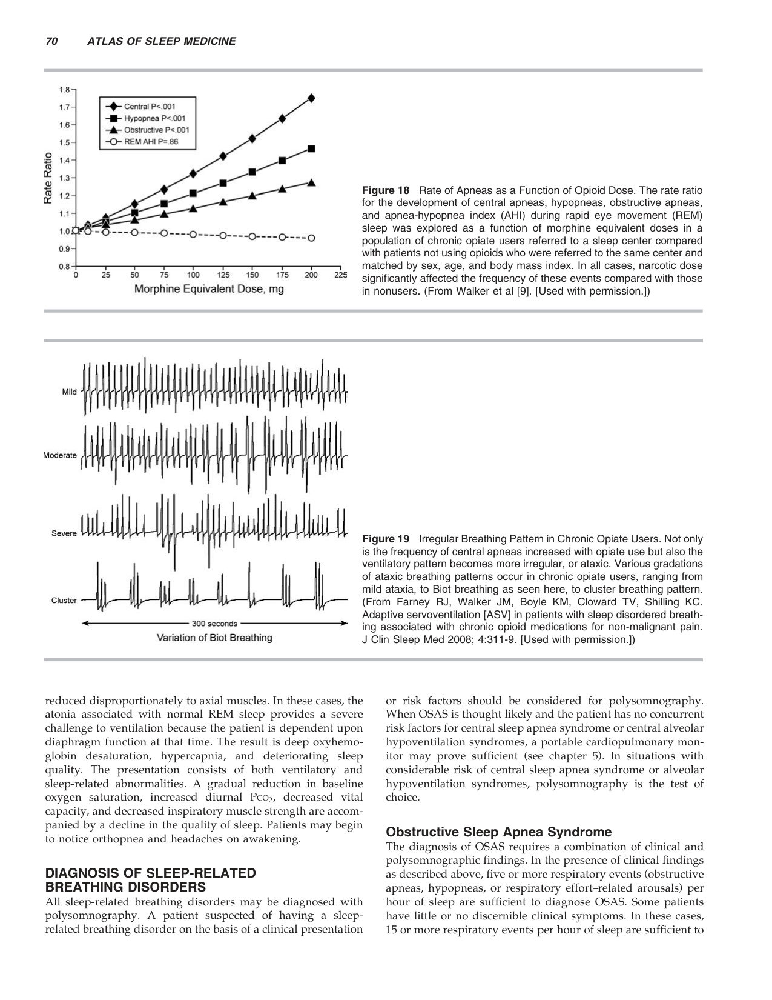

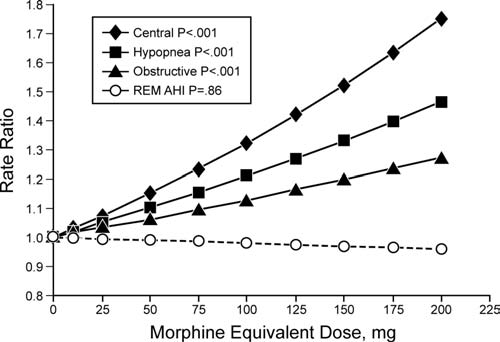

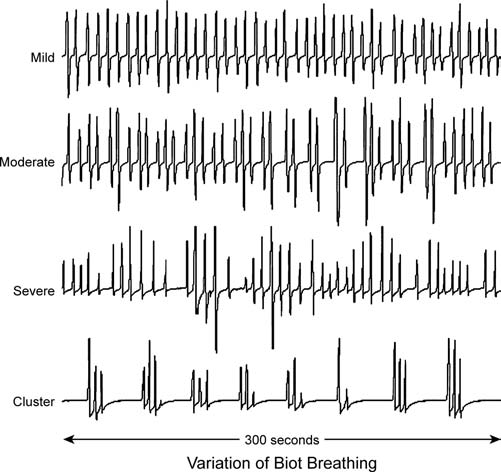

<!-- pdf-page: 84 -->

diagnose OSAS. A severity grading system has been suggested: mild obstructive sleep apnea (AHI 5-15), moderate obstructive sleep apnea (AHI 15-30), and severe obstructive sleep apnea (AHI 30). Of course, this scheme does not take into account the severity of oxyhemoglobin desaturation or of sleepiness experienced by the patient. Some patients with a relatively mild AHI experience severe daytime hypersomnolence that corrects or improves with therapy, and vice versa. The diagnostic criteria for pediatric OSAS are in a state of flux, but generally symptoms combined with more than one scorable respiratory event per hour and polysomnographic evidence of an association of arousals or gas exchange abnormalities related to upper airway obstruction are sufficient for diagnosis.

#### Central Sleep Apnea Syndrome

Central sleep apnea syndrome is said to be present when there are five or more central apneas per hour of sleep. Because central and obstructive events often coexist in a given patient, many clinicians diagnose central sleep apnea syndrome when the central apnea index is greater than or equal to five AND the total central apnea index is greater than or equal to 50% of the total number of respiratory events. CSBP has historically been described by the visual recognition of the waxing and waning ventilatory pattern in the appropriate clinical setting. In the recently published ICSD-2 (International Classification of Sleep Disorders, 2nd edition) (22), it has been suggested that polysomnography shows at least 10 central apneas and hypopneas per hour of sleep with the hypopneas demonstrating the crescendo-decrescendo pattern and frequent arousals from sleep. Other scoring schemes try to impose measures of either the duration or percentage of CSBP, as noted, but there is little agreement in this regard. The central periodic breathing pattern associated with stroke is considered to be a subset of central sleep apnea syndrome or periodic breathing, and it is identified by a central apnea index of five or more associated with a short crescendo-decrescendo ventilatory pattern.

#### Central Alveolar Hypoventilation Syndrome

The polysomnographic diagnosis of central alveolar hypoventilation syndrome requires episodes of shallow breathing or apneas longer than 10 seconds combined with oxyhemoglobin desaturation and frequent arousals and/or heart rate variability as a result of these breathing abnormalities. Observed apneas should be central, and hypopneas should not show signs of increased upper airway resistance. In a literal sense, an increase in PaCO2 of at least 10 mm Hg should be demonstrated as a result of sleep. However, current technology does not provide a very reliable means of measuring this directly; its measurement is generally reserved for research settings. Clinical measurements of PaCO2 may be estimated by using transcutaneous CO2 or end-tidal CO2 sensors. By definition, patients with these syndromes ought to demonstrate diurnal hypercapnia by an arterial blood gas showing a PaCO2 greater than 45 mm Hg.

#### TREATMENT OF OBSTRUCTIVE SLEEP

#### APNEA SYNDROMES

OSAS is a chronic medical condition that requires proper diagnosis, a comprehensive treatment plan, and long-term follow-up (Table 8). It is important to note that the mortality associated with OSAS is predominantly due to cardiovascular

disease; thus, the comprehensive care of these patients should ensure that such issues are addressed in concert with OSAS. Chronic diseases are best managed by enlisting patients in self-care. Therapy for OSAS begins with educating the patient about the disease. Patients should be taught how it affects their health and quality of life, with an emphasis on the fact that leaving it untreated puts them at increased risk for motor vehicle accidents, possible cognitive and mood disturbances, and an increased likelihood of experiencing cardiovascular events. Patients should avoid driving when drowsy and, in the case of professional drivers and pilots, should be aware that their licensing and employment may require proof that therapy is adequate.

#### Lifestyle

Lifestyle factors that contribute to airway collapse include alcohol ingestion and obesity, so patients should be counseled to avoid alcohol close to bedtime and should be encouraged to obtain a healthy weight. In some patients, these efforts alone may suffice to treat their OSAS. Weight loss is fairly reliably associated with improvement in airway patency. In some studies, as many as 30% of patients achieve a cure (23). Unfortunately, achieving adequate weight loss is difficult and takes time, so moderate to severe OSAS requires careful monitoring and definitive treatment in the interim. Furthermore, some patients who maintain their weight loss will still experience a worsening of their OSAS. The reasons for this have not been systematically investigated, but it may be that fat redistribution or adaptation in neuromuscular control over time adversely affects airway patency during sleep. Additional attention should be focused on addressing ways to improve sleep hygiene and ensure adequate total sleep duration.

#### Positional Therapy

Changing from a supine sleeping posture may be a successful positional therapy for some patients, especially if they have demonstrated mild to moderate OSAS with a largely positional component. Positional therapy should not be recommended for persons who cannot maintain a side sleeping posture due to orthopedic- or pain-related problems. Positional therapy may be initiated by using feedback devices that prompt side sleeping postures (Figure 20). Long-term adherence to these therapies is incompletely understood. One survey found that only about 30% of patients were adherent to positional recommendations after a year, with the most common reason for discontinuation being pain or discomfort (24).

#### Oral Appliances

The most common oral appliance used in the management of OSAS is the mandibular advancement device (MAD) (Figure 21) (25,26). It mechanically protrudes the mandible. Although protrusion of the mandible might be expected to enhance airway patency predominantly by increasing the anteroposterior airway dimension, this has not proved to be the case. Instead, studies using magnetic resonance imaging before and after the fitting of a MAD show that the improvement occurs predominantly in the lateral dimension. These devices, when properly fitted and adjusted, lead to a 50% improvement in AHI in about 65% of patients and to cure (AHI <5) in about 35% to 40% of patients (27). Patients with mild or moderate obstructive sleep apnea are the most suitable for MAD

<!-- pdf-page: 85 -->

Table 8

Management of obstructive sleep apnea syndrome

Phase Suggested time Objectives Tools

Promotion of healthy lifestyles; ideal body weight Screening questionnaires for sleep apnea Pointed questioning of patients with strong risk factors

Preventive care Periodic health examinations; engagement of health care system

Prevent development of obstructive sleep apnea Detect presence of risk factors for obstructive sleep apnea so that health care system may be activated toward detection, if indicated

Diagnosis When disease is suspected Obtain accurate diagnosis of suspected sleep disorder Polysomnography Portable monitors Initial care plan formulation As soon as diagnosis is confirmed Integrate evidence-based practice with patient preferences and constraints to decide on best treatment modalities Consider multiple issues that require attention (airway, lifestyles, comorbidities such as cardiovascular disease, diabetes, obesity, hypertension)

Positional therapy Oral appliances Positive airway pressure Surgical modification of the upper airway Weight loss and management Cardiovascular primary and secondary prevention Management of diabetes (primary or referral) Lifestyle modification (tobacco, alcohol, caffeine) Sleep hygiene improvement Initial follow-up care 1 Day to 4 weeks after initiation of treatment plan

Assessment of efficacy of initial care plan Reinforcement of initial care plan interventions and education Reformulation of plans based on open and active listening and assessment Assure proper function of technology such as PAP machines, masks, humidifiers, and oral appliances

Interview Sleepiness assessment (Epworth Sleepiness Scale, visual analog scales, quality-of-life assessment) Direct visual inspection of equipment; observation of patient on equipment at treatment pressure Downloading of PAP compliance and effectiveness data Overnight oximetry or portable monitoring, if needed Longitudinal management Every 6 to 12 months Prevent complications of obstructive sleep apnea Address any side effects of therapy Ensure ongoing effectiveness of therapy plan Adapt plans to changing health and social status of patient

Periodic follow-up visits with interview and examination Reassessment of comorbidities such as cardiovascular disease, hypertension, diabetes control, and weight management or referral as appropriate Sleepiness assessment (Epworth Sleepiness Scale, visual analog scale, quality-of-life assessment) Direct visual inspection of equipment; observation of patient on equipment at treatment pressure Downloading of PAP compliance and effectiveness data Overnight oximetry or portable monitoring

Figure 20

Positional Therapy Devices. The most common positional therapy assist devices make sleeping supine uncomfortable or impossible. These range in level of complexity from simple “tennis-ball-in-a-T-shirt” devices to complex strap-on backpack-like devices. Not pictured, and not truly tested for sleep apnea, are electronic devices that issue chirps or alarms when the sleeper moves to the supine position. Special pillows also may attempt to optimize head position, but these have shown only modest improvement at best in the apneahypopnea index of patients with obstructive sleep apnea.

Abbreviation: PAP, positive airway pressure.

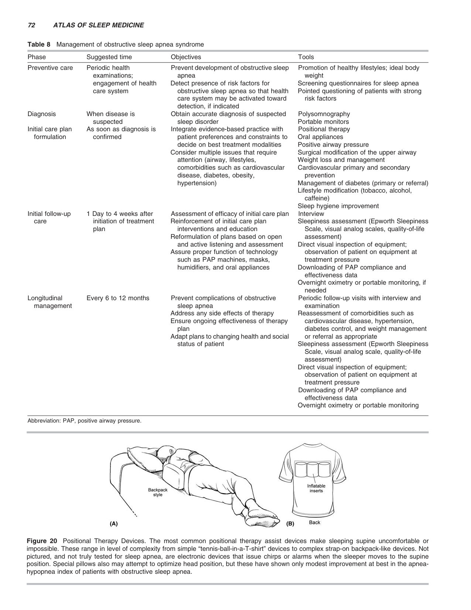

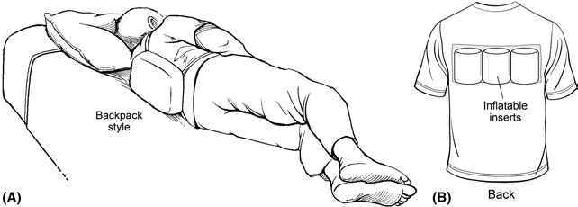

<!-- pdf-page: 86 -->

Figure 21

Mandibular Advancement Device for Treatment of Obstructive Sleep Apnea. The mandibular advancement device is the most common type of oral appliance for treating patients with obstructive sleep apnea. The one pictured here is a titratable device. (A) There is minimal protrusion of the mandible early in treatment. (B) Over time, the protrusion may be lengthened to the extent of the patient’s tolerance or of the device’s effectiveness.

Table 9

Complications of oral appliances used for treatment of obstructive sleep apnea syndrome

Complication or side effect Frequency, %a

Gagging 10 Temporary or permanent occlusive change 6–12 Gum pain 9–40 Muscle or myofascial pain 10–40 Excessive salivation 20–30 Dry mouth 23–30 Dental discomfort or pain 26–60 Temporomandibular joint pain 26 Unable to wear 10–30

a Ferguson KA, Cartwright R, Rogers R, Schmidt-Nowara W. Oral appliances for snoring and obstructive sleep apnea: a review. Sleep 2006; 29:244-62.

treatment. Positional improvement in the AHI in the lateral position and lower BMI are predictive of a better response. MADs may be used only in patients with an adequate number of healthy teeth in each dental arch (usually eight) and can lead to complications (Table 9). Although PAP is uniformly more successful in reducing the AHI and improving sleepiness, some patients adhere better to a MAD. Therefore, in patients without contraindications and with favorable prognostic indicators, a MAD should be offered as a therapy choice. When immediate or certain improvement in OSAS is needed, continuous positive airway pressure (CPAP) should be considered first.

#### Positive Airway Pressure Therapy

PAP therapy provides a pneumatic splint to the upper airway. Airway pressure sufficient to open the airway enough to eliminate airflow limitations to breathing does so by increasing the retropharyngeal space in the lateral dimension more so than in the anteroposterior dimension (Figures 22 and 23). The components of a PAP device are shown in Figure 24. There is a wide variety of such devices available to enhance patient comfort or

address specific breathing disorders. By far the most common modality is CPAP. The treatment pressure for CPAP is most reliably determined by adjusting the pressure during attended polysomnography until the sleep-disordered breathing events have stopped. Because obstructive events are more common in stage REM sleep and when supine, optimal CPAP titration requires that the treatment pressure be observed during polysomnography in REM sleep while the patient is supine (28). In select patients with moderate to severe OSAS and no complicating medical conditions, automatic titrating PAP devices may be used either as primary therapy or as a temporary treatment to determine a fixed pressure for ongoing therapy with a CPAP device (Figure 25). The optimal time over which an automatic titrating PAP device must gather data in order to estimate the CPAP treatment is not known, but it is typically a period of at least two weeks of compliant use. PAP is foreign to every patient initially, and its proper introduction is essential to long-term success in CPAP therapy. There are no studies evaluating the impact of prepolysomnographic patient education, but nearly all patients and sleep laboratories can testify to the benefits of educating the patient about OSAS and CPAP therapy, and of introducing and fitting CPAP before the sleep study. At our facility, patients are allowed to sit with a CPAP device on at low pressures before the study. This allows adjustments to fit, and if needed, desensitization to the apparatus. Such an approach also seems prudent before sending a PAP-naı¨ve patient home with an automatic titrating PAP device. The interface fit and comfort cannot be overemphasized. Fortunately, there are a wide variety of interface types and sizes, some of which may be seen in Figure 26. In addition to careful mask fitting, other ways to improve patient comfort include use of a heated humidity chamber (especially when the patient has underlying nasal or sinus symptoms, uses drying medications, or lives in a dry or cool climate), pressure-contouring devices (Figure 27), or special pillows that assist in maintaining a comfortable position while using a PAP device (29).

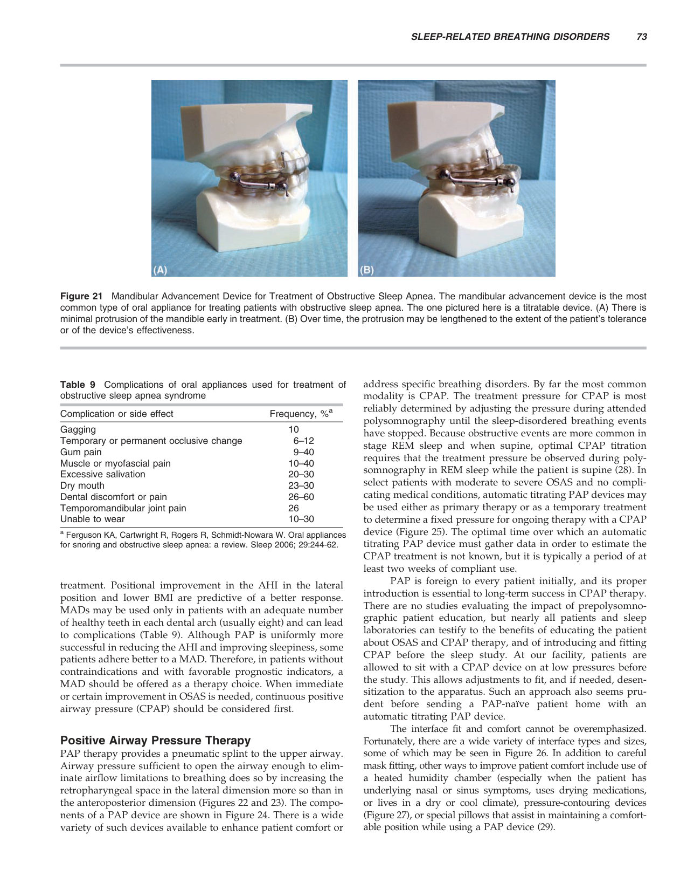

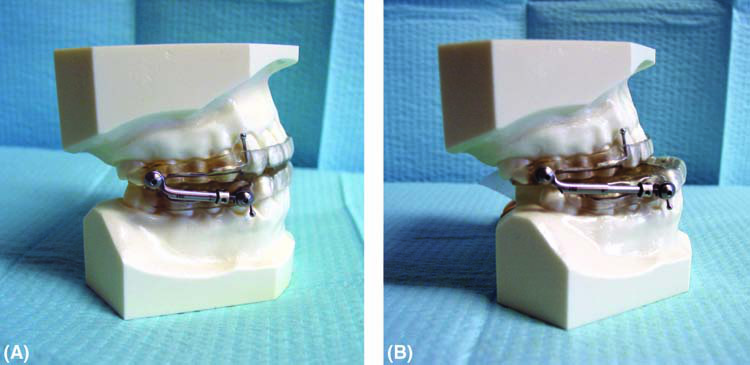

<!-- pdf-page: 87 -->

Figure 22 Upper Airway Dimensions in Obstructive Sleep Apnea. Magnetic resonance imaging scans show transverse sections of the pharynx (arrowhead) in (A) a subject without obstructive sleep apnea compared to (B) a subject with obstructive sleep apnea. Note that, compared with that of the subject without obstructive sleep apnea, the lateral dimension of the pharynx is decreased more so than the anteroposterior dimension. (From Ryan CM, Bradley TD. Pathogenesis of obstructive sleep apnea. J Appl Physiol 2005; 99:2440-50. [Used with permission.])

Figure 23

Effects of Continuous Positive Airway Pressure on Upper Airway Dimensions. Magnetic resonance imaging scans of the airway (arrowhead) of this subject under light propofol sedation reveal (A) a resemblance to the normal airway observed in Figure 22A. (B) With deeper propofol anesthesia, the airway more closely resembles that of a patient with obstructive sleep apnea (OSA) as seen in Figure 22B. (C) When continuous positive airway pressure (CPAP) of 10 cm H2O is applied, the lateral dimensions of the airway increase dramatically. (D) With removal of CPAP and deepening of propofol anesthesia, the airway returns to a more collapsed configuration like that of a patient with OSA. Other studies have also shown that CPAP seems to increase the lateral dimension of the airway more so than it does the anteroposterior position. Similarly, the lateral walls of the pharynx appear more collapsible in patients with OSA. (From Crawford MW, Rohan D, Macgowan CK, Yoo S-J, Macpherson BA. Effect of propofol anesthesia and continous positive airway pressure on upper airway size and configuration in infants. Anesthesiology 2006; 105:45-50. [Used with permission.])

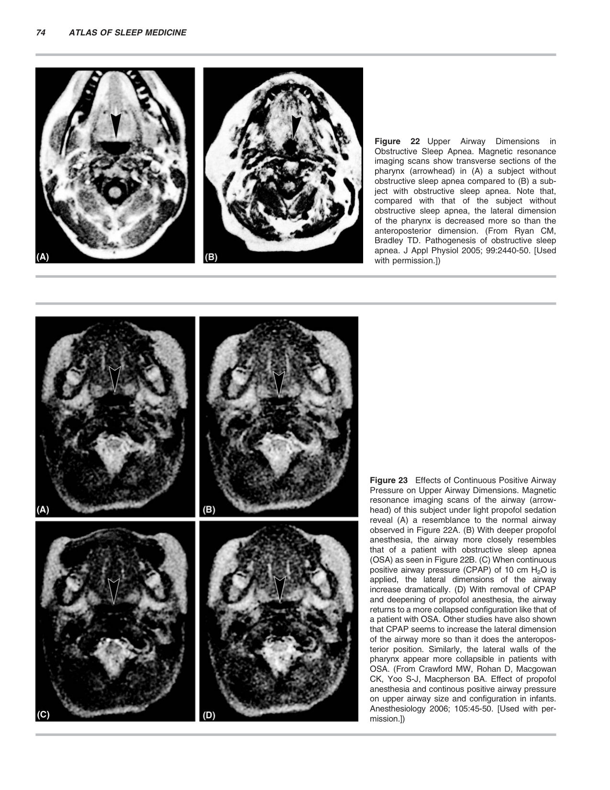

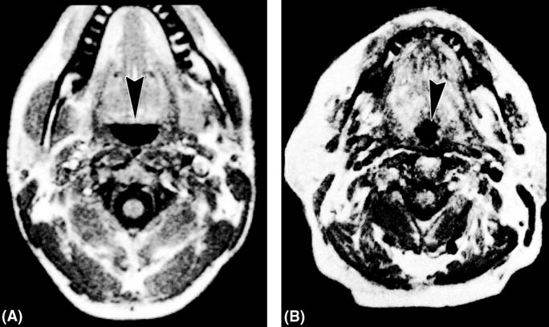

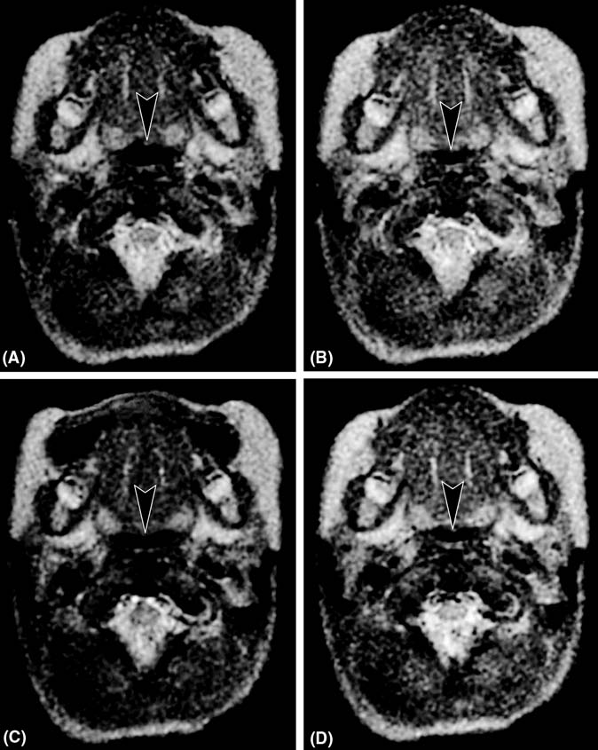

<!-- pdf-page: 88 -->

Figure 24

Components of Positive Airway Pressure Therapy. The basic components of positive airway pressure therapy for treatment of obstructive sleep apnea include a flow generator that produces pressurized air. The pressure may be continuous positive airway pressure (CPAP) or other pressure designed to best address the patient’s underlying problem. Different flow generators may deliver pressure with expiratory pressure relief, bilevel pressure, automatically titrating pressure, variable pressure contours, or adaptive pressure levels with or without contours. For enhanced comfort and compliance, the air should be warmed and humidified (heated humidity chamber). In modern designs, the humidity chamber is often directly attached to the flow generator and the pressurized air passes through the humidifier before passing through the hose (or tubing) to the interface. Numerous interfaces, such as the nasal mask pictured here, are available to help provide a seal with the patient’s airway.

Figure 25 Autotitrating Positive Airway Pressure. (A) These data were downloaded from an autotitrating positive airway pressure device used to treat patients with moderately severe obstructive sleep apnea. The bottom panel shows a running tally of apneas and hypopneas detected by the machine over time. In the top panel, the delivered pressure is constantly being adjusted to the conditions being detected. When there is a lack of events, the pressure tends downward to 10 to 11 cm H2O. However, when the device detects events, it increases pressure in an attempt to eliminate them. During this particular night, the pressure varied from 7 cm H2O to 13 cm H2O. Note that in the middle of the night there was a marked increase in estimated mask leak. Such leaks make the estimate of respiratory events less sensitive and less specific. If high leak is an ongoing or common problem, the patient may find continuous positive airway pressure uncomfortable and/or ineffective. AHI indicates apneahypopnea index. (Continued next page.)

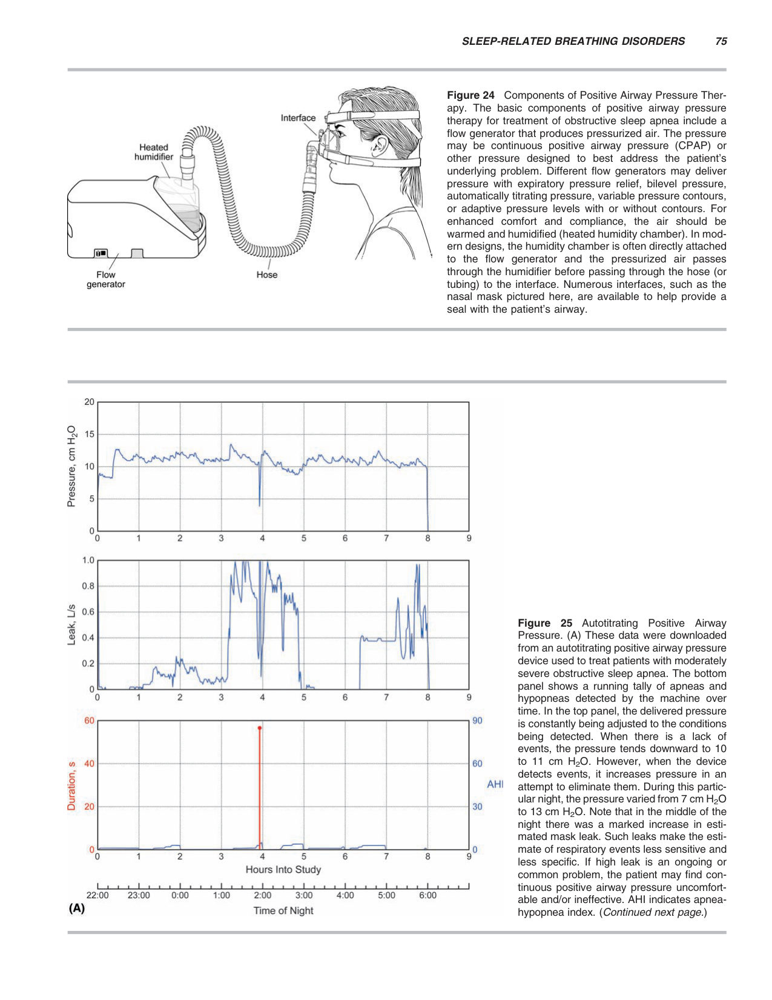

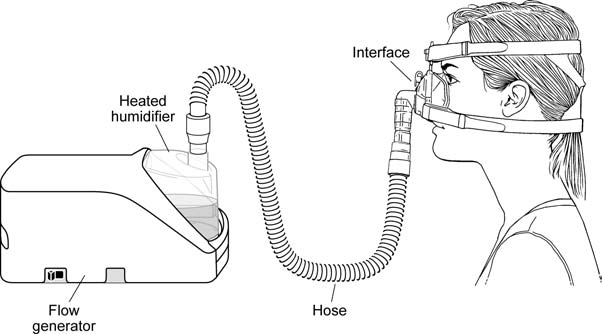

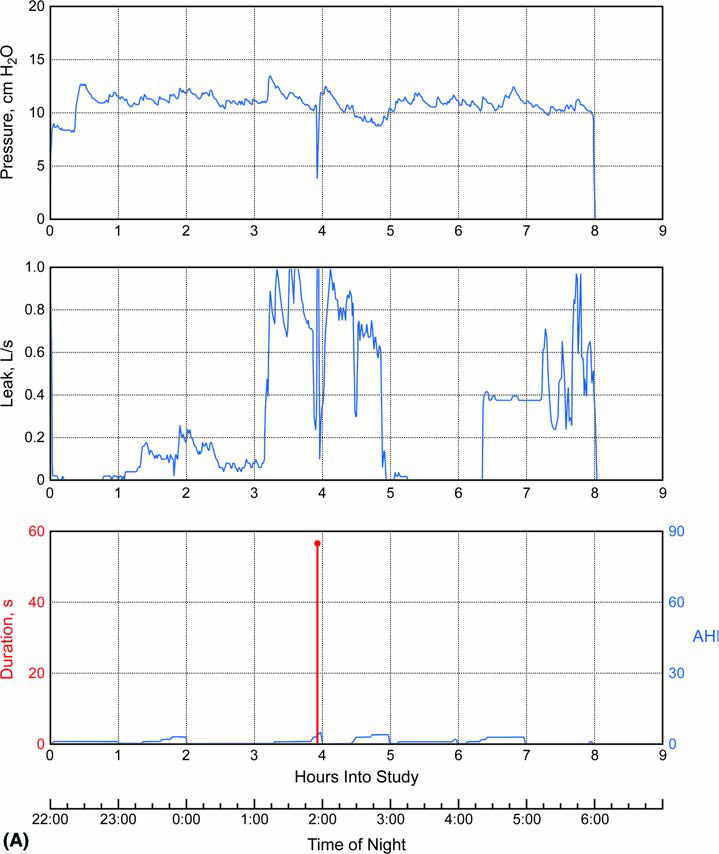

<!-- pdf-page: 89 -->

Figure 26

Types of Positive Airway Pressure Interfaces. (A) The nasal mask is among the most common of the interfaces used in positive airway pressure therapy. It fits over the nose, does not cover the mouth, and is highly stable over the face. It distributes pressure over a large area and can be tightened when high pressures are needed without inducing too much discomfort. (B) Nasal pillows are also favorites of patients. Since these interfaces have a lower profile and footprint on the face, some studies show a reduced sense of claustrophobia and enhanced compliance with them compared with nasal masks. Because the contact area is small, the interfaces may become dislodged or not seal well at higher pressures or when the patient rolls to one side. Tightening the mask to improve the seal may result in too much pressure for comfort. (C) Oronasal, or “full face” masks, cover both the nasal and oral airways. This type of mask may be necessary when the patient has a great deal of mouth leak or when the patient prefers the fit. These are not our usual first choice for patients with obstructive sleep apnea, but they are often used to provide noninvasive positive airway pressure ventilation. (D) The hybrid interface combines nasal pillows with an oral airway. It may work for patients who have significant mouth leak problems but do not want the bulk of an oronasal mask. This type of mask covers little of the area over or near the eyes, so may induce less claustrophobia in those requiring a mouth seal.

Figure 25

Continued (B) The data from many such nights may be tabulated to develop a cumulative distribution of pressures. These data were taken at 2 months of use. They show that 90% of the time, the estimated needed pressure is 9 cm H2O, whereas 95% of the time the needed pressure appears to be 10 cm H2O. A reasonable choice for a fixed pressure for ongoing treatment might be 10 cm H2O.

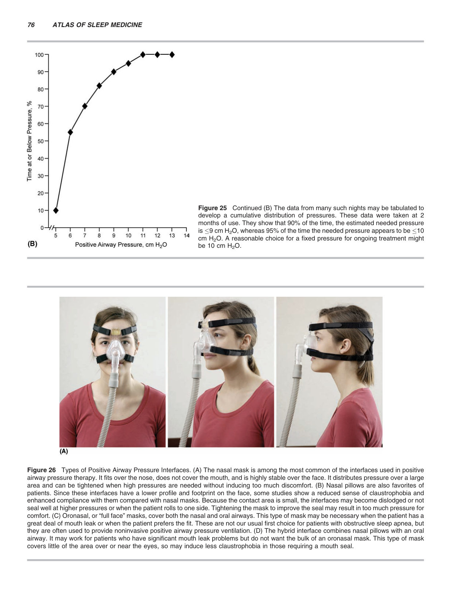

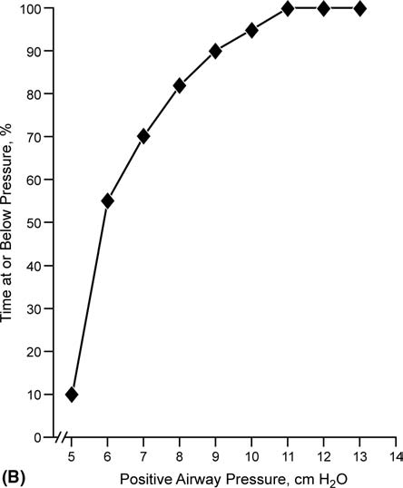

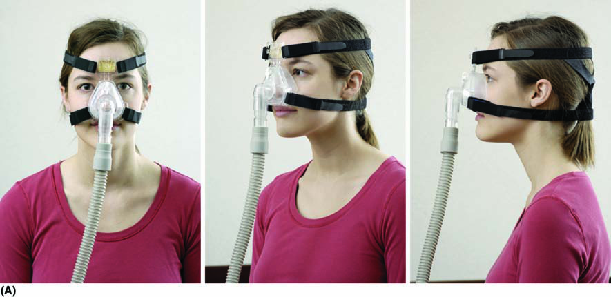

<!-- pdf-page: 90 -->

Figure 26

Continued

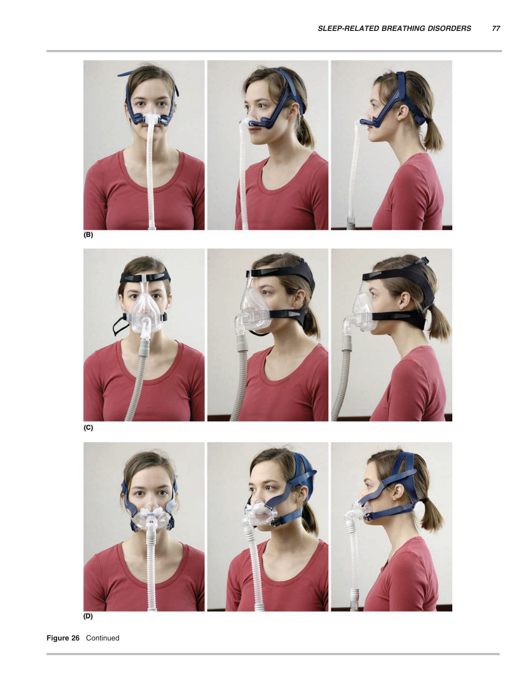

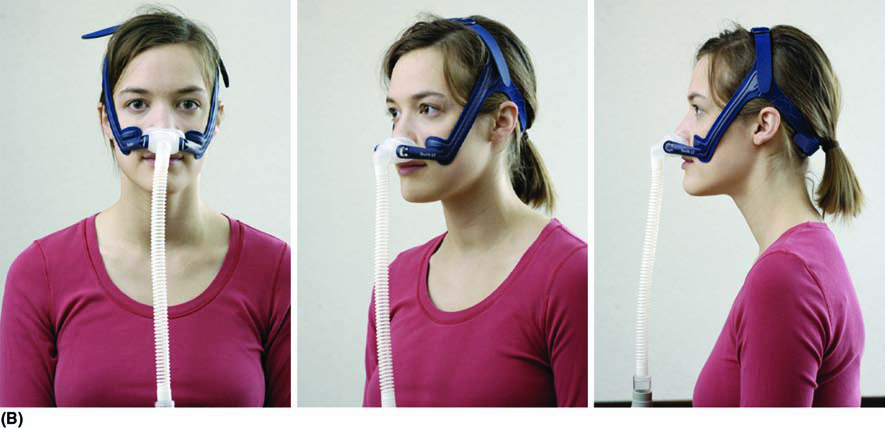

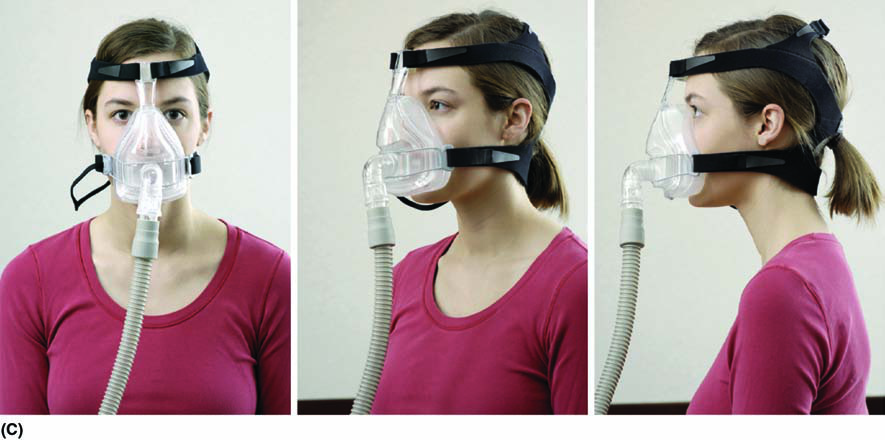

<!-- pdf-page: 91 -->

Figure 27

Expiratory Pressure Relief in Otherwise Continuous Positive Airway Pressure Therapy. Sometimes patients have a heightened sensitivity to pressure that is particularly evident during exhalation against pressure. Some flow generators automatically reduce the pressure when they detect the exhaled breath, which is called expiratory pressure relief. In this polysomnographic tracing, the patient is in stage N2 sleep with continuous positive airway pressure (CPAP) of 12 cm H2O. The arousal (vertical red line) occurs without definite cause, although the flattening of the inspiratory contour on the flow channel (Vest) suggests that there may yet be some residual obstruction despite the CPAP of 12 cm H2O. The technologist elects to set the C-Flex (Philips Respironics, Inc, Andover, Massachusetts) at the least resistant setting of 3 (just after the second epoch of stage N2). The CPAP contour (bottom tracing) shows a transient reduction of pressure of about 3 cm H2O with each exhale. CPAP with expiratory pressure relief has been shown to be as effective as CPAP without expiratory pressure relief, and in some cases it may even enhance patient comfort. Vest indicates airflow as measured by positive airway pressure pneumotachometer. For explanation of other labels, see Figure 5.

Despite these measures, PAP may prove difficult for the patient to use. Long-term compliance is determined to some extent by early experiences with PAP, often within a week or so of initiation. Because of this, follow-up is recommended within 1 to 4 weeks after initiating PAP therapy. The follow-up visit should focus clinically on any comfort issues, on whether snoring is noted during use (an indicator of inadequate pressure to control obstruction), and on whether there has been subjective improvement in sleepiness or other pretreatment symptoms. Additionally, downloaded compliance reports may produce much useful information about the degree of leak and the patterns and regularity of use (Figures 28 and 29).

#### Surgical Modifications of the Airway for

#### Obstructive Sleep Apnea Syndrome

Surgical interventions primarily focus on increasing the dimension and tone of the oropharynx. The most common types of surgical procedures are the uvulopalatopharyngoplasty, the genioglossus advancement and hyoid myotomy, the modified

hyoid myotomy and suspension, and maxillomandibular advancement (Figure 30). After a rhinolaryngoscopy assessment, the primary sites of obstruction are determined and a surgical approach is chosen to address the site of obstruction (Table 10). Successful surgical therapies would be desirable because they will ensure adherence. However, although improvement in the AHI and subjective symptoms is observed in nearly half the patients who are treated surgically, cure is less common (Figure 31) (30). Because surgery is more expensive, has higher risks, and is less predictably effective, most patients are encouraged to try PAP or an oral appliance before considering surgery. Exceptions to this conservative approach would be children or young adults with notable adenotonsillar hypertrophy, for whom a surgical approach is often the initial treatment. Even in these cases, cure rates are often not as good as hoped and patients should undergo follow-up evaluation with home sleep testing or polysomnography. The results with maxillomandibular advancement have been a bit more encouraging, with objective treatment success rates typically greater than 80% when the treatment is provided

<!-- pdf-page: 92 -->

Figure 28

Positive Airway Pressure Compliance Reports. (A) Actual compliance data from November 19, 2008, to August 30, 2009, in a patient with severe obstructive sleep apnea (apnea-hypopnea index, 46): (Top) Summary of all compliance data, and (Bottom) hours of usage and pressure readings over time. A previously highly successful and compliant user of continuous positive airway pressure (CPAP) had a follow-up visit on August 7, 2009, and reported good usage and improvement in symptoms, with a reduction in her Epworth Sleepiness Scale score from 16 to 7. However, a review of the compliance data showed actual usage of the CPAP device on only 53% of all days, and the patient admitted that she “just got sick of it” sometimes and had not used it on those nights. She had several other health problems, including a recent kidney transplant, hypertension, diabetes mellitus, and obesity, and she was also struggling with depression. Inspection of the system showed an open oxygen port that had been attached during a hospitalization in March 2009. Removal of the oxygen port returned leakage to the normal range. Mask comfort was readdressed, and the patient was shown how to use the heated humidity (left turned off before this visit). A return visit was scheduled for August 30, 2009. (B, see next page) At that time, the patient showed an improved pattern of CPAP use (daily use from 08/14/09 to 08/30/09). She still had not turned on the heated humidity and had to be reminded about how to do so. At the first visit, her sleep schedule had been noted to be highly erratic; coaching on sleep hygiene measures and paying increased attention to her depression seem to have helped. In panel B, red indicates usage <4 hours, green denotes usage 4 hours, and black denotes either a large air leak or device malfunction. (Continued next page.)

<!-- pdf-page: 93 -->

Figure 28

Continued

Figure 29

Autotitrating Positive Airway Pressure Compliance Report. (A) This report shows very good treatment compliance, with use on 180 of 181 days and an average daily use of 6 hours and 11 minutes. This autotitrating positive airway pressure (APAP) device has the ability to monitor for apneas, hypopneas, and vibrations in the frequency range of snoring. It calculates an estimated apnea-hypopnea index (AHI), listed here as 9.7. (B) The summary graphs show that the AHI rose over the last 2 months before the follow-up visit on September 17, 2009. It turned out that there was a problem with the function of the mask during those months. Replacement of the mask resulted in an improved AHI, and the patient reported ongoing excellent sleep. AI indicates apnea index.

<!-- pdf-page: 94 -->

Figure 29

Continued

either as a stand-alone procedure or in combination with phase 1 procedures (Figure 32).

#### TREATMENT OF CENTRAL

#### SLEEP APNEA SYNDROME

The primary problem in central sleep apnea syndrome is inadequate or irregular output from the medullary respiratory control center. Treatments involve treating the underlying disease with pharmacologic agents to alter respiratory respon-

siveness, with gases such as oxygen or CO2 to alter respiratory patterns, or with machines that help regulate ventilation. For example, successful treatment of congestive heart failure reduces the frequency of central apneas. Unfortunately, even in well-compensated congestive heart failure, up to 40% of patients may exhibit CSBP (15). Acetazolamide and even theophylline have been tried to help control central sleep apnea syndrome, but they are rarely successful as long-term treatments (31). Oxygen reliably reduces, but rarely resolves, centrally mediated breathing events. Even when the AHI is

<!-- pdf-page: 95 -->

<!-- pdf-page: 96 -->

Goal of procedure Obstruction location Surgical procedure

Figure 30

Continued

Table 10

Surgical management of obstructive sleep apnea syndrome

Bypass all obstructions NA Tracheostomy Modify site of obstruction Palatal abnormality (tongue normal) Uvulopalatopharyngoplasty Adenotonsillectomy (more often useful in children) Palate and base of tongue abnormal Uvulopalatopharyngoplasty plus genioglossus advancement and hyoid myotomy or Uvulopalatopharyngoplasty plus temperature-controlled radiofrequency tongue base reduction Base of tongue abnormal (palate normal) Genioglossus advancement and hyoid myotomy Temperature-controlled radiofrequency tongue base reduction Multiple, especially retrolingual Maxillomandibular advancement Indirect surgical treatment NA Bariatric surgery

Abbreviation: NA, not applicable.

substantially diminished, arousals and other markers for central sleep apnea persist (11). Most clinicians have suggested that PAP, either as CPAP, or more recently as adaptive servoventilation, is the first-line

therapy. However, a recent randomized controlled trial of CPAP versus best medical therapy did not demonstrate a mortality benefit (32). The results may have been influenced by the fact that in many patients, CPAP did not effectively treat

<!-- pdf-page: 97 -->

Figure 31

Surgical Cure Rates of Phase 1 Surgical Modifications of the Upper Airway for Obstructive Sleep Apnea. A Forest plot from a meta-analysis of reports of phase 1 surgical procedures (like those shown in Figure 30A-C) shows a relatively low rate of success. When treatment success is defined as a postoperative AHI 5 or 10, the rates are about 16% and 31%, respectively. These procedures have been performed for more than 30 years, but the selection of ideal candidates remains speculative. Most sleep specialists, because of the disappointing efficacy data, rarely consider these procedures to be the first-line treatment for obstructive sleep apnea. AHI indicates apneahypopnea index; CI, confidence interval. [From Elshaug et al [30]. [Used with permission.])

Figure 32

Maxillomandibular Advancement. Typically performed by oral or facial surgeons, maxillomandibular advancement results in a marked increase in the retropharygeal space. (A) Left panel shows a narrowed soft tissue space (arrowhead) in the retrolingual space in this soft tissue lateral film. (B) Right panel shows the increased size of the space after surgery. This patient had a good result, with reduction in the AHI from 46 to 7 and resolution of symptoms.

central sleep apnea, with residual AHI of about 20. In patients in whom CPAP reduced the AHI to <10, there was an improvement in mortality (33). Curiously, even in those patients, the arousal index was not improved, which suggests that the arousals originate from some cyclic input other than respiratory afferents (11,32).

Adaptive servoventilation is more uniformly successful in improving the AHI in patients who have central sleep apnea syndrome (34–37). These devices analyze each breath and adjust the delivered respiratory rate and pressure support in attempts to normalize the breathing pattern (Figure 33). Most studies thus far are small, but adaptive servoventilation

<!-- pdf-page: 98 -->

Figure 33

Adaptive Servoventilation in the Treatment of Central and Complex Sleep Apnea Syndromes. (A) The diagnostic polysomnogram of a male patient demonstrates a mix of purely central apneas, obstructive apneas, and hypopneas that often resemble periodic breathing. Application of continuous positive airway pressure (CPAP) eliminated obstructive events, but more than 46 central apneas and centralappearing hypopneas occurred per hour on the best CPAP setting, a situation that has been termed complex sleep apnea syndrome (38). (B) This polysomnogram shows the effect of adaptive servoventilation therapy (VPAP AdaptSV; ResMed Corp, Poway, California). The device analyzes each breath and applies an analytic to determine the instantaneous pressure support to apply to try to stabilize the breathing pattern. In the bottom tracing, the end-expiratory pressure is maintained at 5, while the inspiratory positive airway pressure adjusts as seen in the device’s pressure channel (VPAPp) in response to the flow recorded in the device pneumotachometer (VPAPfL). Thus, when several breaths with increased tidal volume are seen following an arousal (B, arrowhead), the subsequent pressure support is scaled back until the breathing pattern stabilizes. Later, when there is a decline in tidal volume (B, asterisk [*]), the pressure support increases. With this decline in tidal volume, the inspiratory flow shows a concave pattern and a flattening. This should prompt an increase in the end-expiratory pressure, since it likely indicates flow limitation caused by increased upper airway resistance. End-expiratory pressure stabilizes the upper airway, while the machine selects the appropriate inspiratory pressure and ventilatory rate (Rate) (if need be, in the case of apneas) to try to regulate the breathing pattern. For explanation of labels, see Figure 5.

<!-- pdf-page: 99 -->

appears to improve sleep and ejection fraction in heart failure patients; it is also better tolerated than CPAP. Studies are underway to determine whether treatment with adaptive servoventilation improves survival in patients with heart failure. Adaptive servoventilation has proven to be an effective way of managing complex sleep apnea syndrome, but there is debate over whether the repetitive central apneas in this variant abate over time while the patient is using CPAP or require adaptive servoventilation for effective treatment (31,39).

#### REFERENCES

1. Stanchina ML, Ellison K, Malhotra A, et al. The impact of cardiac resynchronization therapy on obstructive sleep apnea in heart failure patients: a pilot study. Chest 2007; 132:433–9. Epub 2007 Jun 15. 2. Kasravi B, Boehmer JP, Leuenberger UA. A noninvasive method for estimating cardiac output using lung to finger circulation time of oxygen. Am J Cardiol 1998; 82:915–7. 3. Iber C, Ancoli-Israel S, Chesson A, Quan SF, editors. The AASM Manual for the Scoring of Sleep and Associated Events: Rules, Terminology and Technical Specifications. Westchester (IL): American Academy of Sleep Medicine, 2007. 4. Younes M. Role of arousals in the pathogenesis of obstructive sleep apnea. Am J Respir Crit Care Med 2004; 169:623–33. Epub 2003 Dec 18. 5. Cui R, Tanigawa T, Sakurai S, Yamagishi K, Iso H. Relationships between sleep-disordered breathing and blood pressure and excessive daytime sleepiness among truck drivers. Hypertens Res 2006; 29:605–10. 6. Wilson K, Stoohs RA, Mulrooney TF, et al. The snoring spectrum: acoustic assessment of snoring sound intensity in 1,139 individuals undergoing polysomnography. Chest 1999; 115:762–70. 7. Sin DD, Fitzgerald F, Parker JD, Newton G, Floras JS, Bradley TD. Risk factors for central and obstructive sleep apnea in 450 men and women with congestive heart failure. Am J Respir Crit Care Med 1999; 160:1101–6. 8. Roehrs T, Zorick F, Wittig R, Conway W, Roth T. Predictors of objective level of daytime sleepiness in patients with sleep-related breathing disorders. Chest 1989; 95:1202–6. 9. Walker JM, Farney RJ, Rhondeau SM, et al. Chronic opioid use is a risk factor for the development of central sleep apnea and ataxic breathing. J Clin Sleep Med 2007; 3:455–61. Erratum in: J Clin Sleep Med 2007; 3. 10. Lee P, Su YN, Yu CJ, Yang PC, Wu HD. PHOX2B mutationconfirmed congenital central hypoventilation syndrome in a Chinese family: presentation from newborn to adulthood. Chest 2009; 135:537–44. 11. Ruttanaumpawan P, Logan AG, Floras JS, Bradley TD; CANPAP Investigators. Effect of continuous positive airway pressure on sleep structure in heart failure patients with central sleep apnea. Sleep 2009; 32:91–8. 12. Schellenberg JB, Maislin G, Schwab RJ. Physical findings and the risk for obstructive sleep apnea: the importance of oropharyngeal structures. Am J Respir Crit Care Med 2000; 162(2 Pt 1):740–8. 13. Friedman M, Soans R, Gurpinar B, Lin HC, Joseph NJ. Interexaminer agreement of Friedman tongue positions for staging of obstructive sleep apnea/hypopnea syndrome. Otolaryngol Head Neck Surg 2008; 139:372–7. 14. Javaheri S, Parker TJ, Wexler L, et al. Occult sleep-disordered breathing in stable congestive heart failure. Ann Intern Med 1995; 122:487–92. Erratum in: Ann Intern Med 1995; 123:77. 15. Javaheri S. Central sleep apnea in congestive heart failure: prevalence, mechanisms, impact, and therapeutic options. Semin Respir Crit Care Med 2005; 26:44–55. 16. Brack T, Thuer I, Clarenbach CF, et al. Daytime Cheyne-Stokes respiration in ambulatory patients with severe congestive heart

failure is associated with increased mortality. Chest 2007; 132:1463–71. Epub 2007 Jul 23. 17. Bassetti C, Aldrich MS. Sleep apnea in acute cerebrovascular diseases: final report on 128 patients. Sleep 1999; 22:217–23. 18. Morgenthaler TI. The quest for stability in an unstable world: adaptive servoventilation in opioid induced complex sleep apnea syndrome. J Clin Sleep Med 2008; 4:321–3. 19. Teichtahl H, Wang D. Sleep-disordered breathing with chronic opioid use. Expert Opin Drug Saf 2007; 6:641–9. 20. Farney RJ, Walker JM, Cloward TV, Rhondeau S. Sleep-disordered breathing associated with long-term opioid therapy. Chest 2003; 123:632–9. 21. Grigg-Damberger M, Wells A. Central congenital hypoventilation syndrome: changing face of a less mysterious but more complex genetic disorder. Semin Respir Crit Care Med 2009; 30:262–74. Epub 2009 May 18. 22. AASM. The International Classification of Sleep Disorders: Diagnostic and Coding Manual. 2nd ed. Westchester, IL: American Academy of Sleep Medicine, 2005. 23. Sampol G, Munoz X, Sagales MT, et al. Long-term efficacy of dietary weight loss in sleep apnoea/hypopnoea syndrome. Eur Respir J 1998; 12:1156–9. 24. Wenzel S, Smith E, Leiacker R, Fischer Y. [Efficacy and longterm compliance of the vest preventing the supine position in patients with obstructive sleep apnea]. Laryngorhinootologie 2007; 86: 579–83. German. 25. Ferguson K. Oral appliance therapy for obstructive sleep apnea: finally evidence you can sink your teeth into. Am J Respir Crit Care Med 2001; 163:1294–5. 26. Morgenthaler TI, Kapen S, Lee-Chiong T, et al; Standards of Practice Committee; American Academy of Sleep Medicine. Practice parameters for the medical therapy of obstructive sleep apnea. Sleep 2006; 29:1031–5. 27. Kushida CA, Morgenthaler TI, Littner MR, et al; American Academy of Sleep. Practice parameters for the treatment of snoring and obstructive sleep apnea with oral appliances: an update for 2005. Sleep 2006; 29:240–3. 28. Kushida CA, Chediak A, Berry RB, et al; Positive Airway Pressure Titration Task Force; American Academy of Sleep Medicine. Clinical guidelines for the manual titration of positive airway pressure in patients with obstructive sleep apnea. J Clin Sleep Med 2008; 4:157–71. 29. Weaver TE, Chasens ER. Continuous positive airway pressure treatment for sleep apnea in older adults. Sleep Med Rev 2007; 11:99–111. Epub 2007 Feb 1. 30. Elshaug AG, Moss JR, Southcott AM, Hiller JE. Redefining success in airway surgery for obstructive sleep apnea: a meta analysis and synthesis of the evidence. Sleep 2007; 30:461–7. 31. Allam JS, Morgenthaler TI. Central sleep apnea syndrome. BMJ Point of Care 5 June 2008. 32. Bradley TD, Logan AG, Kimoff RJ, et al; CANPAP Investigators. Continuous positive airway pressure for central sleep apnea and heart failure. N Engl J Med 2005; 353:2025–33. 33. Arzt M, Floras JS, Logan AG, et al; CANPAP Investigators. Suppression of central sleep apnea by continuous positive airway pressure and transplant-free survival in heart failure: a post hoc analysis of the Canadian Continuous Positive Airway Pressure for Patients with Central Sleep Apnea and Heart Failure Trial (CAN- PAP). Circulation 2007; 115:3173–80. Epub 2007 Jun 11. 34. Oldenburg O, Schmidt A, Lamp B, et al. Adaptive servoventilation improves cardiac function in patients with chronic heart failure and Cheyne-Stokes respiration. Eur J Heart Fail 2008; 10:581–6. Epub 2008 May 16. 35. Allam JS, Olson EJ, Gay PC, Morgenthaler TI. Efficacy of adaptive servoventilation in treatment of complex and central sleep apnea syndromes. Chest 2007; 132:1839–46. 36. Philippe C, Stoica-Herman M, Drouot X, et al. Compliance with and effectiveness of adaptive servoventilation versus continuous

<!-- pdf-page: 100 -->

positive airway pressure in the treatment of Cheyne-Stokes respiration in heart failure over a six month period. Heart 2006; 92: 337–42. Epub 2005 Jun 17. 37. Pepperell JC, Maskell NA, Jones DR, et al. A randomized controlled trial of adaptive ventilation for Cheyne-Stokes breathing in heart failure. Am J Respir Crit Care Med 2003; 168:1109–14. Epub 2003 Aug 19.

38. Morgenthaler TI, Kagramanov V, Hanak V, Decker PA. Complex sleep apnea syndrome: is it a unique clinical syndrome? Sleep 2006; 29:1203–9. 39. Morgenthaler TI, Gay PC, Gordon N, Brown LK. Adaptive servoventilation versus noninvasive positive pressure ventilation for central, mixed, and complex sleep apnea syndromes. Sleep 2007; 30:468–75.
