# Chapter 7 Narcolepsy

<!-- pdf-page: 101 -->

## 7 Narcolepsy

#### Michael H. Silber, MBChB, FCP (SA)

#### ABBREVIATIONS

CSF, cerebrospinal fluid

hcrt, hypocretin

HLA, human leukocyte antigen

REM, rapid eye movement

Narcolepsy has been recognized as a distinct condition for 130 years. First described by the German neuropsychiatrist Karl Friedrich Otto Westphal and the French physician Jean Baptiste Ge´lineau, narcolepsy is the classic example of a disorder of excessive sleep (1). It also illustrates how advances in the knowledge of sleep physiology have led to dramatic insights into the pathogenesis of a sleep disorder. Parallel with the understanding of the mechanisms of the disease has come the development of new medications for its treatment. The prevalence of narcolepsy in various American and European studies ranges from 26 to 67 per 100,000 population (2), indicating that one might expect to find about 400 persons with narcolepsy in an area with a population of 1 million at any one time. The incidence rate of narcolepsy has been calculated as 1.4 per 100,000 population per year, which translates to the diagnosis of 14 new patients each year in a population of 1 million (3). The disorder most frequently commences between the ages of 10 and 20 years, and rarely starts after age 40 (Figure 1). It is slightly more common in men than in women (1.5:1) (3).

#### CLINICAL FEATURES

The essential clinical characteristic of narcolepsy is excessive sleepiness. Although this symptom is not specific for the disorder, the sleepiness inherent to narcolepsy is usually more severe than that in many other conditions causing hypersomnia. Persons with narcolepsy can fall asleep in any sedentary situation, such as while reading, studying, watching television, or sitting in an audience. Driving can be especially problematic because persons with narcolepsy may fall asleep while stopped at red traffic lights and frequently experience near-accidents. Automatic behavior may occur during drowsiness, such as continuing to type or write but producing only meaningless strings of letters. The most specific symptom of narcolepsy is cataplexy, which consists of sudden, transient, bilateral muscle weakness precipitated by emotion. In a full attack of cataplexy, all the skeletal muscles are paralyzed with the exception of the extraocular muscles and the diaphragm. Despite an inability to speak, the patient remains fully conscious and perceives normal sensation. More common are partial cataplectic attacks

with a sudden buckling of the knees or with sagging of the face, jaw, or neck that may be accompanied by slurred speech. Attacks usually last from seconds to minutes. Neurological examination during a cataplectic event reveals transient loss of deep tendon reflexes. The most common precipitant emotion is laughter, related either to the patient hearing or telling a joke (Figure 2) (4). Less commonly, cataplexy can be induced by other emotions, such as surprise, anger, or excitement, which sometimes occur during a sporting event or a recreational activity such as fishing or hunting. Depending on the definition of the symptom and the population being studied, cataplexy has been found to occur in 64% to 80% of patients with narcolepsy (3,5). It usually commences after the onset of sleepiness, most often within 4 years but sometimes as much as 10 or more years after disease onset (Figure 3) (6). In some patients, the frequency of cataplectic attacks appears to decrease with age, but this decline may occur as those patients learn how to control precipitant emotions. In other patients the attacks seem to occur more frequently with age and may be less clearly precipitated by emotion. Sleepiness, cataplexy, hypnagogic hallucinations, and sleep paralysis have long been considered the tetrad of symptoms of narcolepsy. However, hypnagogic hallucinations and sleep paralysis are neither specific nor particularly sensitive for the diagnosis, and thus they should be considered ancillary clinical features with low diagnostic usefulness. Hypnagogic hallucinations, experienced in the transition between wakefulness and sleep, are usually visual but may be auditory, tactile, or vestibular. Similar experiences at sleep termination are known as hypnopompic hallucinations. Sleep paralysis refers to the transient inability to move, with preserved consciousness, at sleep onset or on wakening. Attacks of sleep paralysis may be accompanied by hallucinations and can often be aborted by touching the patient. About 25% of the normal population report having had hallucinations at sleep onset, and 7% describe episodes of sleep paralysis (7,8). In contrast, about 60% of patients with narcolepsy and cataplexy experience hypnagogic hallucinations and 66% experience sleep paralysis. However, only 32% of patients who have narcolepsy without cataplexy report having hypnagogic hallucinations and only 7% report sleep paralysis (9). Paradoxically, patients with narcolepsy frequently complain of poor-quality sleep at night. Sleep is fragmented with frequent awakenings, periodic limb movements are common, and dream enactment behavior may occur. Rapid eye movement (REM) sleep occurs earlier than normal and is often fragmented with multiple periods of REM sleep evenly distributed throughout the night (Figure 4). The body mass index

<!-- pdf-page: 102 -->

Figure 1

Age of Onset of Narcolepsy. The incidence rate of narcolepsy varies by age, as illustrated by this graph of results from a population-based study. Narcolepsy generally commences in childhood or young adulthood, with the highest rate occurring between the ages of 10 and 20 years. The highest rates after that occur in persons younger than 10 years of age or between 20 and 30 years of age. Onset of idiopathic narcolepsy after age 40 is rare. (Adapted from Silber et al. [3]. [Used with permission.])

Figure 2

Algorithm for Diagnosis of Cataplexy. Because many normal persons endorse feelings of weakness with intense laughter, the clinical diagnosis of cataplexy can sometimes be challenging. This simple algorithm, based on a study of 78 patients and 78 control subjects, is highly sensitive and specific for the diagnosis. (Data from Moore WR et al. [4].)

of patients with narcolepsy is higher than that of controls, and patients often report a sudden increase in weight around the time of onset of the disorder (10).

#### PATHOPHYSIOLOGY

During the first 80 years after narcolepsy was initially recognized, its clinical features were fully described. Rare cases of narcolepsy associated with other neurological disorders were

Figure 3

Onset of Cataplexy in Relation to Onset of Sleepiness in Patients With Narcolepsy. After the onset of sleepiness in patients with narcolepsy, there is usually a gap of a year or longer before the onset of cataplexy. Cataplexy commences simultaneous to or within a few years after the development of sleepiness in most patients. However, in a few patients cataplexy first develops one or more decades after the start of narcolepsy. (Adapted from Okun ML et al. [6]. [Used with permission.])

identified, many with pathology in the hypothalamus or in the region of the third ventricle. Deeper understanding of the pathophysiology of the disorder has occurred in three phases, starting in 1960.

#### REM Sleep Abnormalities

Seven years after the discovery of REM sleep in 1953, researchers noted that it occurred earlier than expected in the sleep of patients with narcolepsy (11). The normal mean REM latency (time from sleep onset to the first period of REM sleep) is about 90 minutes, but REM latency is considerably shortened in patients with narcolepsy. This phenomenon is made use of in the multiple sleep latency test, in which the presence of REM sleep during daytime naps is used as a test for narcolepsy. In addition to having abnormal timing of REM sleep, persons with narcolepsy have a dissociation of REM phenomena, with cataplexy representing the muscle paralysis of REM sleep intruding into wakefulness and hypnagogic hallucinations representing the dreams of REM sleep occurring atypically at wake-sleep transition. Abnormally increased muscle activity may also be present during REM sleep.

#### Association With the HLA System

A 1984 report that Japanese patients with narcolepsy were highly likely to carry the human leukocyte antigen (HLA) haplotype DR2 initiated a different direction of research (12). This initial finding was later confirmed in white patients with narcolepsy, but less consistently in African Americans with the disorder. On the basis of these data, genetic studies revealed that the actual linkage was to the DQ1 antigen, specifically the DQB1*0602 subtype (Figure 5) (13). Of persons with narcolepsy who are affected with clear-cut cataplexy, 85% to 93% test positive for HLA DQB1*0602, compared with 35% to 56% of

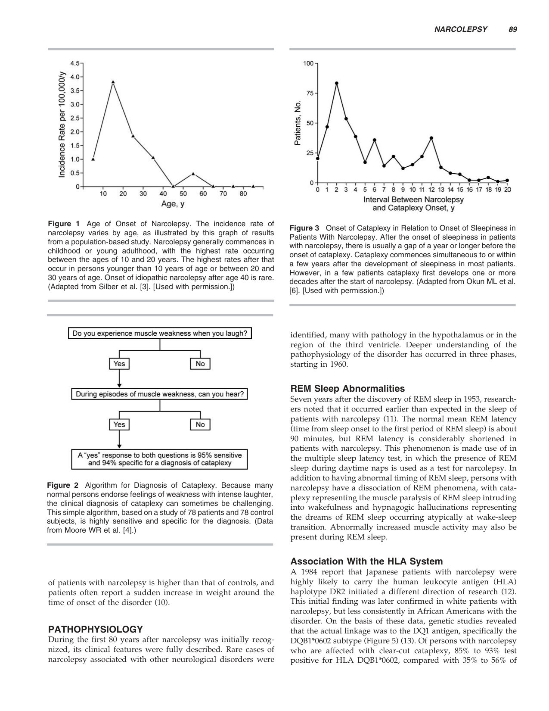

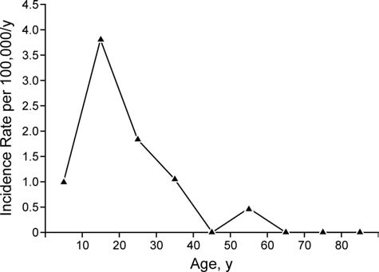

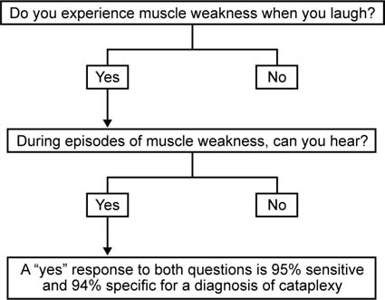

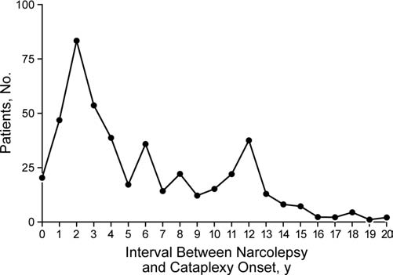

<!-- pdf-page: 103 -->

Figure 4

Graphical Representation of Nocturnal Sleep in Narcolepsy. The nocturnal sleep of a patient with narcolepsy is typically unsustained, with frequent awakenings. The first rapid eye movement (REM) sleep period may occur earlier than expected. Rapid eye movement sleep may be fragmented, with REM sleep periods evenly distributed throughout the night rather than clustering in the second half. (Adapted from Krahn LE, Black JL, Silber MH. Narcolepsy: new understanding of irresistible sleep. Mayo Clin Proc 2001 76: 185–94. [Used with permission.])

Figure 5

Structure of the Short Arm of Chromosome 6. This figure illustrates the location of the major histocompatability complex in humans at the HLA locus on the short arm of chromosome 6. Approximately 90% of patients with cataplexy secondary to narcolepsy carry the HLA DQB1*0602 allele compared with about 20% of controls. This relationship strongly supports the hypothesis that the disorder is of autoimmune origin. (From Cruse JM, Lewis RE. Illustrated Dictionary of Immunology. 3rd ed. Boca Raton: CRC Press, 2009. [Used with permission.])

those without cataplexy and about 20% of the white control population. Despite this close relationship to a genetically determined biological marker, environmental factors are believed to play a more important role in the pathogenesis of narcolepsy. Only 1% to 2% of first-degree relatives of narcoleptic patients will also have the disease, whereas 70% to 75% of monozygotic twins are discordant for the disorder (14). Diseases associated with a specific HLA subtype are almost always autoimmune in nature, but searches for general serum autoimmune markers in narcolepsy have been negative (15) and there are no reported conventional changes identified by magnetic resonance imaging or cerebrospinal fluid (CSF) analysis that suggest narcolepsy is an inflammatory disease of the brain. No antibodies to any component of the hypocretin (hcrt) system (see below) have been detected in the serum or CSF of persons with narcolepsy (16). Several other studies have provided some supportive evidence for the autoimmune hypothesis of narcolepsy. Purified serum immunoglobulin G from patients resulted in increased contractile response of mouse bladder detrusor muscle to cholinergic stimulation compared

with immunoglobulin G from controls (17). In another study, CSF immunoglobulin G from patients that was incubated with homogenized rat hypothalamic protein extract demonstrated significant binding compared with that of controls (18). A recent study linked narcolepsy to a specific polymorphism of the T-cell receptor a locus, part of the protein-binding HLA molecules (19). Streptococcal antibodies were found at higher titers in the serum of patients with narcolepsy commencing less than 3 years before testing compared to patients with a longer duration of disease and normal control subjects (20). Despite these tantalizing hints, no definitive proof has been found to confirm an autoimmune mechanism for the pathogenesis of narcolepsy.

#### Association With the Hypocretin (orexin) System

The next phase in understanding narcolepsy emerged from the painstaking work of Emmanuel Mignot and his team at Stanford University, who were interested in determining the cause of autosomal recessive narcolepsy in dogs (Figure 6). In 1999

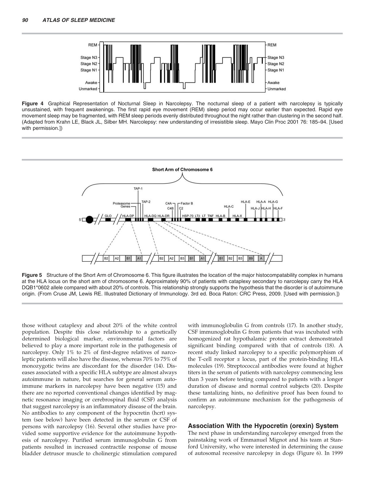

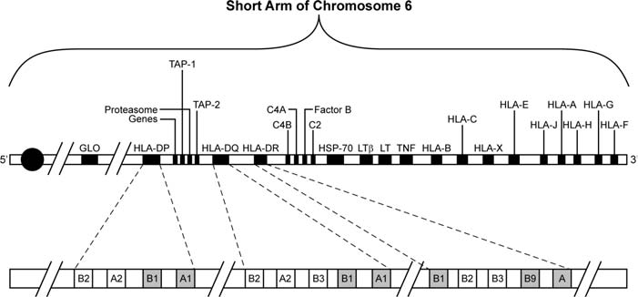

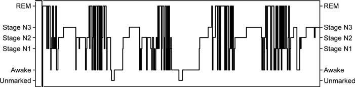

<!-- pdf-page: 104 -->

they discovered that the disorder was caused by a deletion in the hcrt (orexin) receptor-2 gene (21). Hypocretins, first discovered in 1998, are peptide neurotransmitters secreted by the posterolateral hypothalamus (Figure 7). About the same time, another group of investigators, working with an hcrt knockout mouse model, serendipitously recognized that episodes of either REM sleep or cataplexy developed in the mutant mice while they were awake (22). In humans, hcrt-1 (orexin-A) concentrations in the CSF can be measured. In patients with narcolepsy and associated cataplexy, 87% have undetectable hcrt-1 levels in the CSF compared with 14% of patients who have narcolepsy without cataplexy and 2% of neurological controls (Figure 8) (23). Human autopsy studies have documented the loss of >90% of the hcrt-secreting cells in the hypothalamus with evidence of gliosis (Figure 9) (24). The mechanism of this cell loss remains undetermined. These findings presumably explain rare reports of secondary narcolepsy arising from lesions of the hypothalamus or pituitary gland (Figure 10) (25).

#### DIAGNOSIS

The presence of excessive sleepiness and definite cataplexy precipitated by laughter is highly suggestive of a diagnosis of narcolepsy. However, in view of the lifelong nature of the disorder and the need for treatment with often potentially addictive medication, objective confirmation of the disorder is advisable. If cataplexy is not present, further testing is essential. When transient loss of deep tendon reflexes can be

Figure 6

Cataplexy in Narcoleptic Dogs. This series of consecutive photographs shows a narcoleptic Doberman pinscher undergoing food-elicited cataplexy tests at the Center for Narcolepsy in the Stanford School of Medicine at Stanford University. The emotional stimuli of the sight and smell of pellets of food induce cataplexy in the dog, which is awake but unable to move. Unlike narcolepsy in humans, narcolepsy in dogs is generally inherited as an autosomal recessive trait due to the genetic absence of the hypocretin- 2 receptor. (From Nishino S. Clinical and neurobiological aspects of narcolepsy. Sleep Med 2007; 8: 373-99. [Used with permission.])

Figure 7

The Structure of Preprohypocretin. This figure represents the amino acid structures of preprohypocretin and the two active neurotransmitters, hypocretin 1 and 2. Serum and cerebrospinal fluid of patients with narcolepsy have been tested unsuccessfully for antibodies to each component of the molecule indicated on the figure. Antibodies to hypocretin receptor 1 and 2 were also not detected. Further work to confirm or refute the autoimmune hypothesis of narcolepsy should concentrate on cellular immune mechanisms and other components of the hypocretin-synthesizing neurons. (From Silber MH, Black JL, Krahn LE, Fredrickson PA. Autoimmune Studies in Narcolepsy. In: Bassetti CL, Billiard M, Mignot E. Narcolepsy and Hypersomnia. New York [NY]: Informa Healthcare, 2007. [Used with permission.])

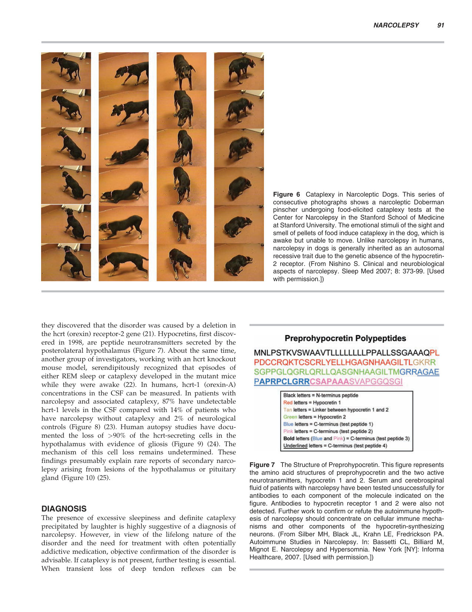

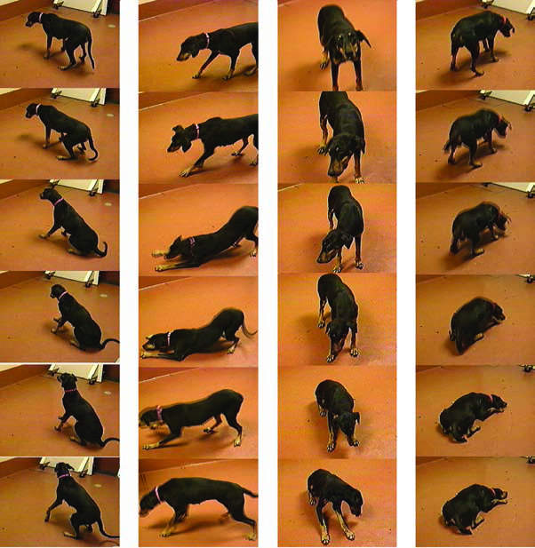

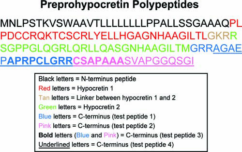

<!-- pdf-page: 105 -->

Figure 9

Loss of Hypothalamic Hypocretin-Synthesizing Cells With Gliosis in Narcolepsy. The autopsy study described here was based on four narcoleptic and 12 control brains. Figure 9A shows the number of neurons in the perifornical and dorsomedial hypothalamus immunolabeled for hypocretin in a patient with narcolepsy (right) and in a control subject (left). The lower panels show low-power photomicrographs of outlined areas in the top images. Note the marked loss (average, 93%) of neurons (arrowheads [right image]) in the narcoleptic patient. Figure 9B shows the same region demonstrating astrocytes stained for glial fibrillary acidic protein (GFAP). Note the increased number of GFAP-labeled astrocytes in the narcoleptic patient (right), indicating the presence of gliosis, which suggests acquired loss of neurons in the region. (From Thannickal TC et al. [24]. [Used with permission.])

Figure 8

Hypocretin Levels in Patients With Narcolepsy vs in Controls. This graph indicates hypocretin-1 levels in the cerebrospinal fluid of 42 patients who had narcolepsy with cataplexy, 137 patients with a variety of other neurological disorders, and 48 normal controls. As can be seen, 88% (37/42) of narcoleptic patients had levels <110 pg/mL. The only control patients with such low levels were a small subset of the patients with Guillain-Barre´ syndrome. Some patients with a variety of other neurological disorders had levels between the lower limit of normal (190 pg/mL) and 110 pg/mL. It should be noted that other studies have demonstrated that fewer than 20% of patients who have narcolepsy without cataplexy have low hypocretin-1 levels. ALL indicates acute lymphoblastic leukemia; ANLL, acute nonlymphoblastic leukemia; CNS, central nervous system; GBS, Guillain-Barre´ syndrome. (From Ripley B et al. [23]. Used with permission.])

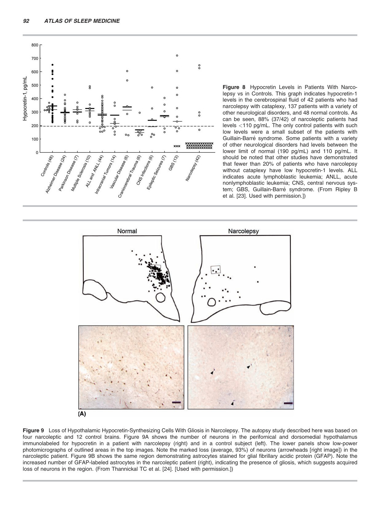

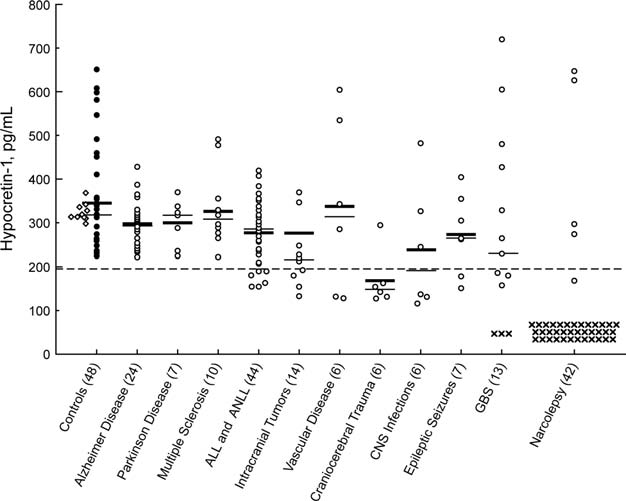

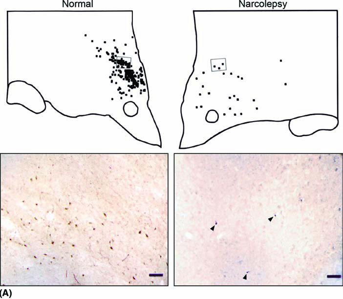

<!-- pdf-page: 106 -->

Figure 10

Suprasellar Pituitary Tumor Causing Narcolepsy. (A and B) These magnetic resonance imaging scans are of a patient in whom sleepiness without cataplexy developed at the age of 17 years. Headaches and visual loss led to the diagnosis of a suprasellar pituitary adenoma (A and B [arrow]) at the age of 23 years. He underwent transsphenoidal partial resection of the tumor, followed by radiation therapy. A multiple sleep latency test showed a mean sleep latency of 2.6 minutes with REM (rapid eye movement) sleep occurring within 15 minutes of sleep onset on all four naps. Narcolepsy was diagnosed. The magnetic resonance imaging scans are those of T1-weighted images in the axial and coronal planes with gadolinium enhancement. They show a residual left-sided sellar and suprasellar mass. Secondary narcolepsy is uncommon but usually associated with hypothalamic or pituitary pathology and presumably results from destruction of hypocretinsynthesizing cells or the interruption of hypocretin outflow tracts.

Figure 9

Continued

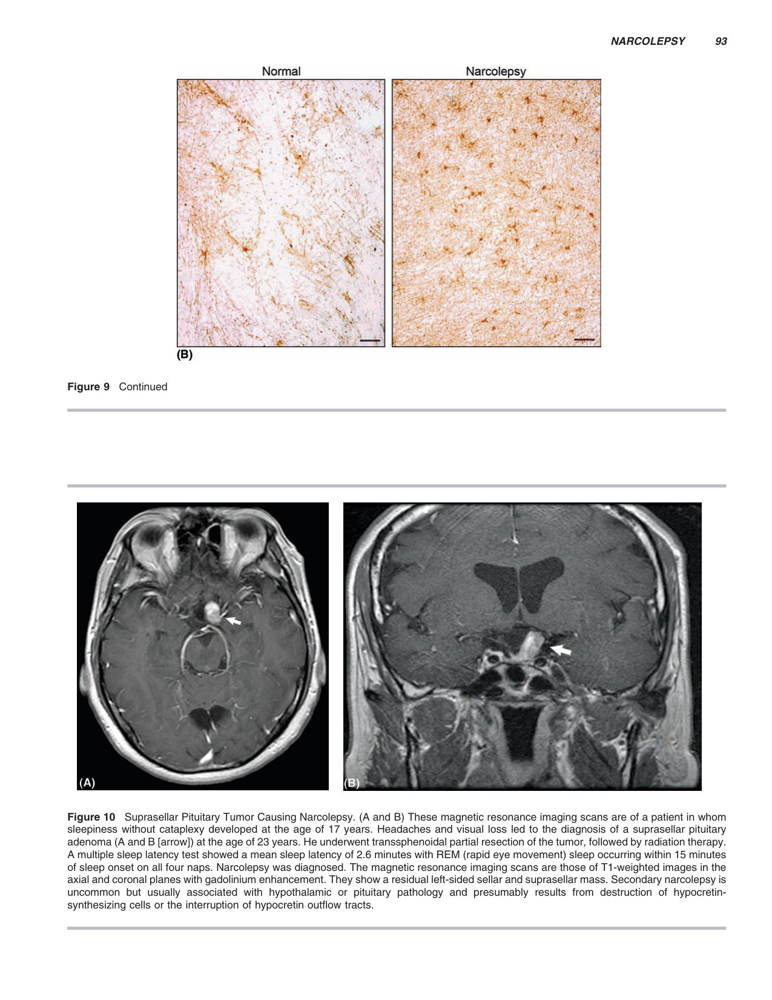

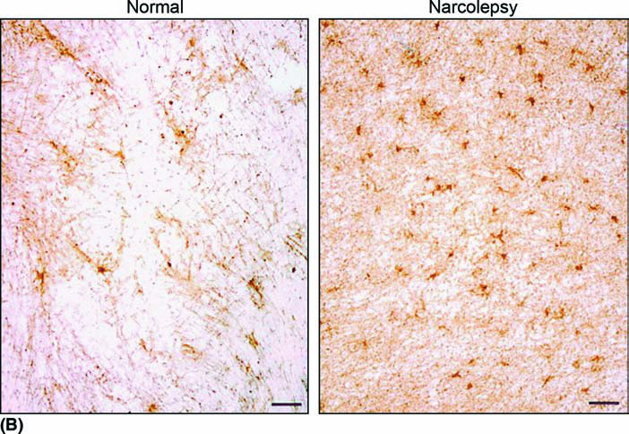

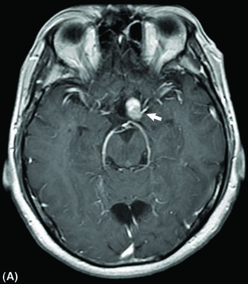

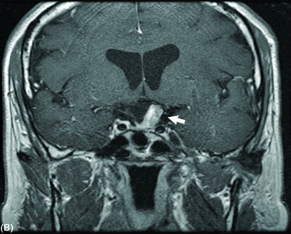

<!-- pdf-page: 107 -->

demonstrated during a presumed cataplectic attack, the diagnosis can be firmly established. For most patients, a multiple sleep latency test should be performed (see chapter 5) (Figure 11). The presence of two or more sleep-onset REM periods is highly suggestive of narcolepsy, as long as the test has been performed

under standardized conditions, excluding the confounding effects of sleep deprivation, sudden withdrawal of REM suppressant medication, or obstructive sleep apnea (Figure 12). The mean sleep latency should be less than eight minutes and is usually less than five (26). Alternatively, the diagnosis can be

Figure 11

Multiple Sleep Latency Report in a Patient With Narcolepsy. This report of a multiple sleep latency test of a 25-year-old man shows the typical findings associated with severe narcolepsy. The neurophysiological marker of narcolepsy is REM (rapid eye movement) sleep occurring within 15 minutes of sleep onset. It is measured by the multiple sleep latency test, in which patients are given 4 or 5 nap opportunities every 2 hours over the course of a day under standardized conditions. A patient who falls asleep within 20 minutes after the lights are turned off is allowed 15 minutes of sleep to assess for the presence of REM sleep. REM sleep recorded on 2 or more naps within 15 minutes of sleep onset is diagnostic for narcolepsy as long as the test has been adequately performed, with the exclusion of confounders such as severe obstructive sleep apnea, withdrawal of REM-suppressant drugs, or sleep deprivation. In addition, the mean sleep latency over the 4 naps is calculated; more than 90% of patients with narcolepsy have a mean latency of less than 8 minutes, with most having less than 5 minutes.

Figure 12

REM-Onset Polysomnogram. (A-C) These three consecutive 30-second epochs from a multiple sleep latency test illustrate a sleep-onset rapid eye movement (REM) period in a patient with narcolepsy. The patient rapidly transitions from wakefulness to REM sleep one minute after lights have been turned off. EMG indicates electromyogram; LOC, left outer canthus; ROC, right outer canthus.

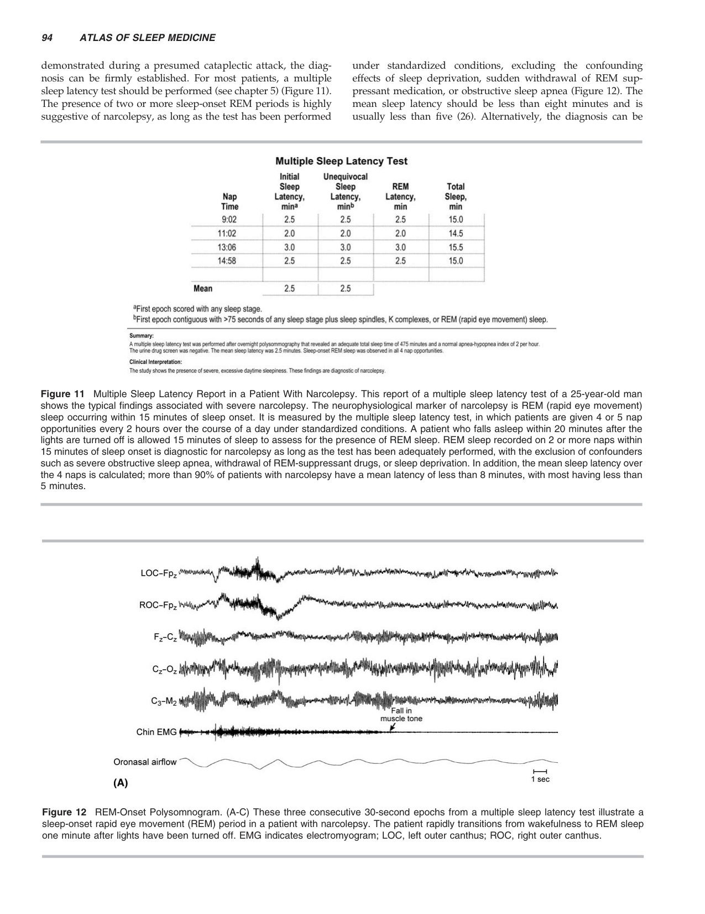

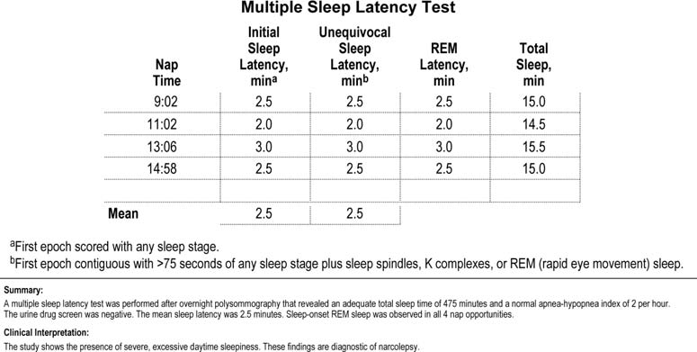

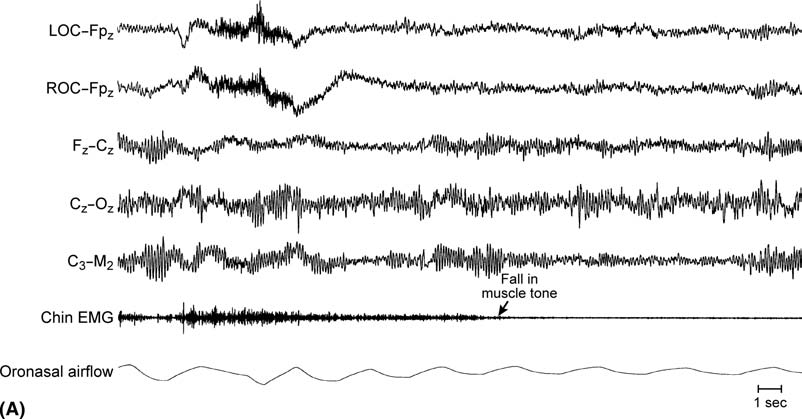

<!-- pdf-page: 108 -->

Figure 12

Continued

confirmed by demonstrating absent hcrt-1 in the CSF, but this test is currently available only as a research tool. It is also of note that the sensitivity of a positive result in the absence of cataplexy is very low. The broad differential diagnosis of narcolepsy encompasses most other causes of excessive sleepiness (Table 1 and

Figure 13). In particular, one must rule out obstructive sleep

apnea, insufficient sleep syndrome, and the sedating effects of medications, such as opioids, benzodiazepines, and dopaminergic agents. The disorder most similar to narcolepsy and most likely to be confused with it is idiopathic hypersomnia. This condition is characterized by an absence of cataplexy, the exclusion of other causes of somnolence, and multiple sleep latency test results that show a short mean sleep latency but fewer than two sleep-onset REM periods. Idiopathic hypersomnia is currently divided into two subcategories: idiopathic hypersomnia with long sleep time and idiopathic hypersomnia

Table 1

Causes of excessive daytime sleepiness

Extrinsic causes Sleep deprivation (insufficient sleep syndrome) Drug-related hypersomnia Shift work disorder Jet lag disorder Environmental sleep disorder

Intrinsic causes Sleep-related breathing disorder Narcolepsy Idiopathic hypersomnia Restless legs syndrome and periodic limb movement disorder Circadian rhythm sleep disorders (including delayed sleep phase disorder) Recurrent hypersomnia (including Kleine-Levin syndrome)

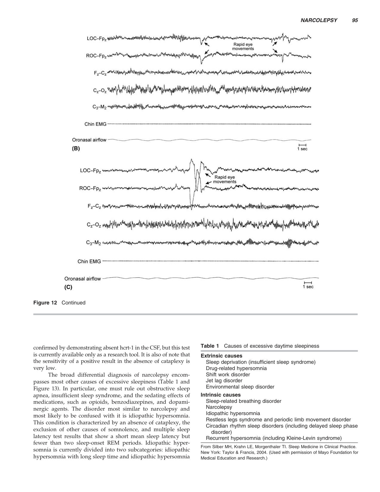

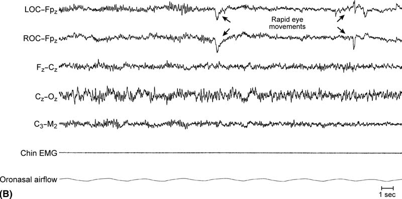

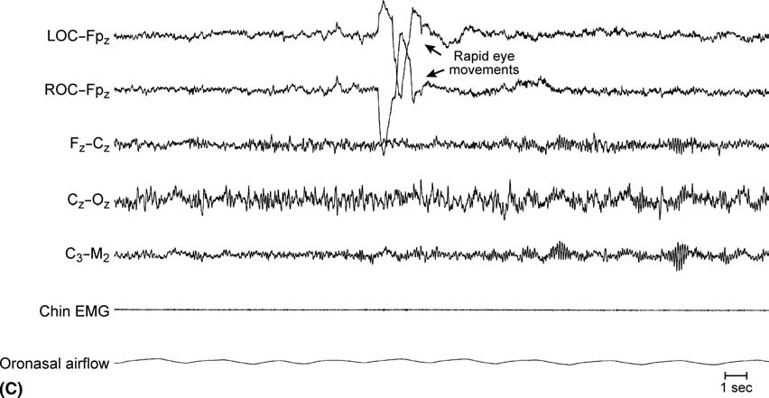

<!-- pdf-page: 109 -->

Medication Typical daily starting dose Recommended maximum daily dose

without long sleep time (26). In the former condition, nocturnal sleep is deep and undisturbed, lasting at least 10 hours. Waking in the morning is difficult and may be accompanied by transient confusion referred to as sleep drunkenness. Patients take long but unrefreshing naps. Idiopathic hypersomnia without long sleep time has none of these associated features. More recent work has cast doubt on the validity of subdividing the condition in this manner (27).

Table 2

Commonly used short-acting and long-acting stimulants

#### MANAGEMENT

Until recently, sympathomimetic agents were the mainstay of treatment for narcolepsy. First introduced in the 1930s, these medications enhance the release of monoamines into the synaptic cleft and block their reuptake. Methylphenidate has been used the most frequently, but various amphetamine preparations have proved useful in more severely affected patients (Table 2). Although these drugs are clearly effective in most

Short-acting stimulants Methylphenidate 30 mg 100 mga

Dextroamphetamine 15 mg 100 mga

Mixed dextroamphetamine and levoamphetamine (Adderall) 20 mg 60 mgb

Methamphetamine 15 mg 80 mga

Long-acting stimulants Extended-release methylphenidate 20 mg 60 mgb

Extended-release methylphenidate (Concerta) 18 mg 72 mg (for attention-deficit/hyperactivity disorder)b

Extended-release dextroamphetamine (Dexedrine Spansule) 60 mgb

Extended-release mixed dextroamphetamine and levoamphetamine (Adderall XR) 20 mg 60 mgc

Modafinil 100 mg 400 mgb

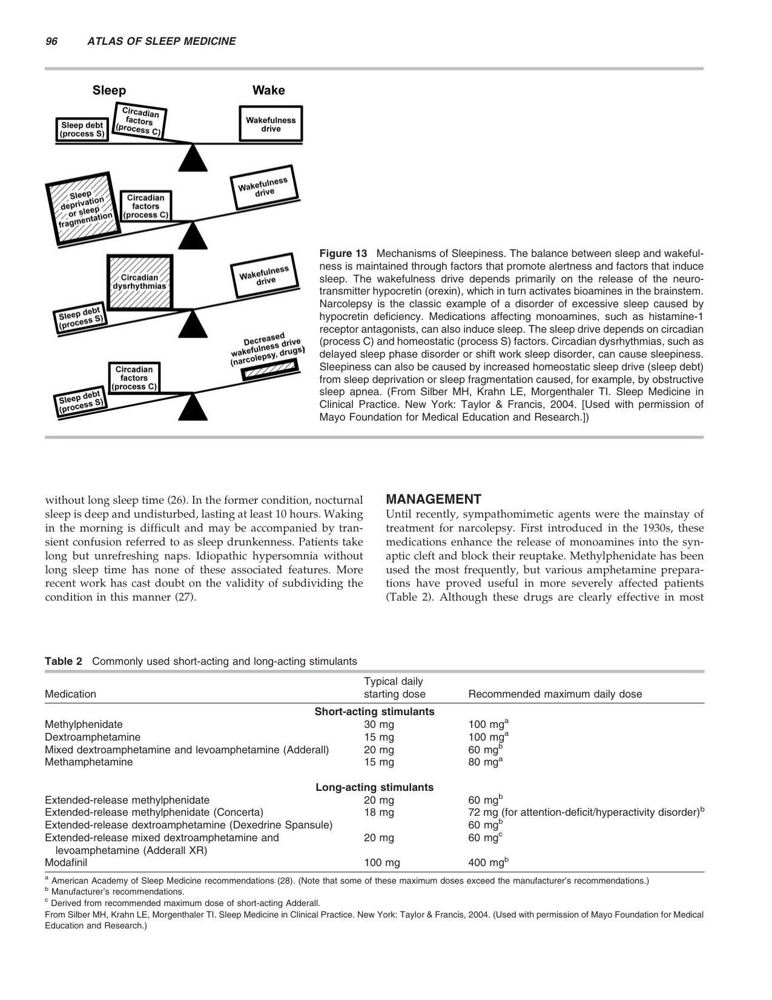

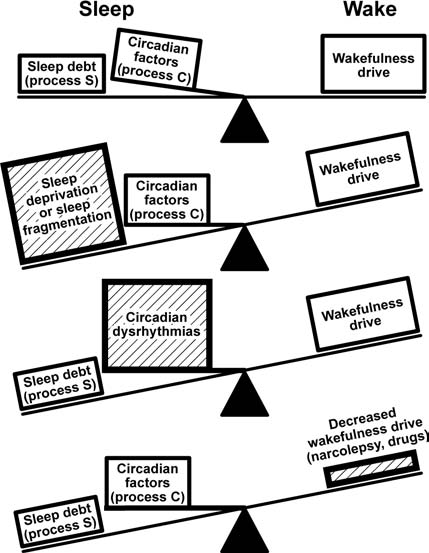

<!-- pdf-page: 110 -->

Figure 15

Modafinil for Treatment of Narcolepsy. These graphs illustrate the primary results of a multicenter controlled trial of modafinil in 271 patients with narcolepsy. The maintenance of wakefulness test (MWT) measures the ability of subjects to remain awake while sitting in dim illumination for as long as 40 minutes over four trials in the course of a day. The data show that modafinil results in increased alertness in doses of 200 and 400 mg daily compared with placebo. However, the degree of alertness with the drug is still far below the levels reported for normal subjects (mean, 32.6 minutes). (From US Modafinil in Narcolepsy Multicenter Study Group [31]. [Used with permission.])

patients, adverse effects often limit their use. With doses high enough to relieve sleepiness, patients may experience undesirable sympathetic side effects, including irritability, tremor, palpitations, anorexia, and weight loss. Amphetamines, especially in high doses, may lead to the development of psychosis in an occasional patient (29). Amphetamine preparations have been associated with sudden death in children, and they should not be used in patients with long QT syndrome or cardiomyopathy. Short-acting agents may result in severe peak and trough effects, with the patient experiencing rapid transitions between unpleasantly enhanced alertness and severe sleepiness (Figure 14). These effects can be attenuated by substituting slow-release preparations, which are available for both methylphenidate and the amphetamines. These medications are potentially dependence-producing and tolerance may occur. The development of the novel central nervous system stimulant modafinil has led to a different approach to the management of narcolepsy (Figure 15) (30,31). The mechanism of action of modafinil has not been firmly established, but it is now the most commonly prescribed first-line agent for treatment of narcolepsy. It is taken once or twice daily and does not have the peak and trough effects of conventional stimulants. Despite occasional headaches, nausea, and rhinitis, it is relatively free of side effects. Modafinil is probably not addictive. However, it is a milder stimulant than the sympathomimetic agents, so patients with moderately severe narcolepsy often find that it provides inadequate alertness. Modafinil is metabolized through the cytochrome P450 system, and it can theoretically reduce the effectiveness of oral contraceptives. It has also been approved for use in shift work sleep disorder and for patients with obstructive sleep apnea whose sleepiness persists despite the use of continuous positive airway pressure. Mild cataplexy often responds to medications that improve alertness because the phenomenon is facilitated by the presence of drowsiness. The classic anticataplectic medica-

tions are the antidepressants, including tricyclic drugs such as protriptyline, selective serotonin reuptake inhibitors such as sertraline, and combined serotonin and norepinephrine reuptake inhibitors such as venlafaxine. However, side effects,

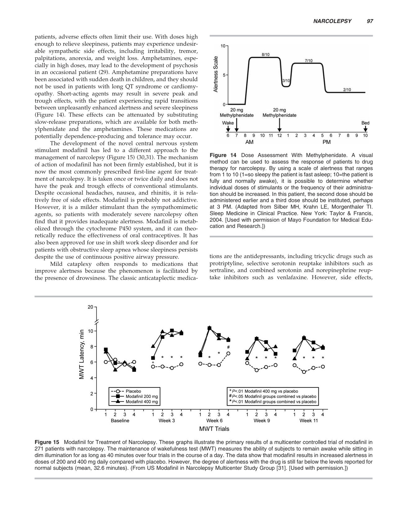

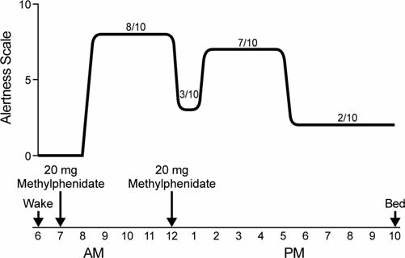

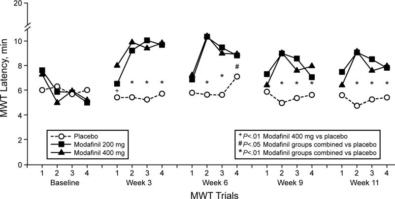

<!-- pdf-page: 111 -->

Figure 16

Results of Controlled Trials of Sodium Oxybate for Cataplexy. (A) A multicenter controlled trial of sodium oxybate for the treatment of cataplexy in 136 patients with narcolepsy showed a dose-dependent decrease in the frequency of cataplectic attacks with a clinically significant 69% reduction from baseline at a dose of 9 g per day. (From The US Xyrem Multicenter Study Group. A randomized, double-blind, placebo-controlled multicenter trial comparing the effects of three doses of orally administered sodium oxybate with placebo for the treatment of narcolepsy. Sleep 2002; 25: 42-4. [Used with permission.]) (B) A multicenter controlled trial of adjunctive therapy with sodium oxybate for the treatment of excessive daytime sleepiness in 228 patients with narcolepsy showed significant improvement in the subjective Epworth Sleepiness Scale with 6 g and 9 g per day. Most (78%) patients continued taking other stimulants during the trial. However, the objective maintenance of wakefulness test data (not shown) demonstrated significance at only the 9-g dose. Fifteen of 47 patients (32%) assigned to the 9-g dose discontinued the trial due to adverse events, including nausea, dizziness, and enuresis. B indicates baseline; D, drug. (From Xyrem International Study Group [33]. [Used with permission.])

including weight gain, often limit the use of such anticataplectic medications. More recently, sodium oxybate (g-hydroxybutyrate), has been found to be highly effective against cataplexy, with reductions of as much as 85% of attacks reported in controlled trials (32). It is administered in liquid form in two doses, the first before sleep and the second 2.5 to 4 hours later. The drug is metabolized in the liver and then excreted as carbon dioxide. Its mechanism of action is undetermined. In addition to its anticataplectic effect, it enhances slow-wave sleep and, at higher doses, increases daytime alertness (Figure 16) (33). However, it is potentially dependence-producing, and its side effects, especially noticeable at high doses, include headache, dizziness, nausea, constipation, nocturnal enuresis, sleepwalking, and nocturnal confusion. It can cause depression of the central nervous system and the respiratory system, and it should not be used in conjunction with alcohol or other sedative hypnotics. It should not be used in patients with untreated sleep apnea, obesity-hypoventilation syndrome, or chronic obstructive pulmonary disease. Nonpharmacological approaches may be helpful as adjunct therapies or as the sole treatment for patients with mild narcolepsy, especially for those who refrain from driving. Strategic napping for brief periods may subsequently increase alertness for several hours. Judicious use of caffeinated drinks may enhance alertness at those times when it is essential. Many patients with disabling or embarrassing cataplexy learn to control their emotions to avoid spells of muscle weakness. The autoimmune hypothesis of narcolepsy has led to several attempts at immunosuppressant or immunomodulatory therapy in patients for whom the disease was identified soon after onset. Prednisone, plasmapheresis, and intravenous

immunoglobulin have been used in single reported cases with rather disappointing results. In some patients, the frequency of cataplectic episodes has appeared to decline, but there have been no consistent changes in objective measures such as latency on the multiple sleep latency test or the maintenance of wakefulness test or CSF hcrt-1 concentrations (34–36). To be effective, such therapies may have to be administered at the start of the disease process before the death of any hcrtsynthesizing neurons.

#### REFERENCES

1. Schenck CH, Bassetti CL, Arnulf I, Mignot E. English Translations of the First Clinical Reports on Narcolepsy by Ge´lineau and on Cataplexy by Westphal in the Late 19th Century, with Commentary. In: Bassetti CL, Billiard M, Mignot E, editors. Narcolepsy and Hypersomnia. New York: Informa Healthcare, 2007. p. 7–24 2. Longstreth WT Jr, Koepsell TD, Ton TG, Hendrickson AF, van Belle G. The epidemiology of narcolepsy. Sleep 2007; 30: 13–26. 3. Silber MH, Krahn LE, Olson EJ, Pankratz VS. The epidemiology of narcolepsy in Olmsted County, Minnesota: a population-based study. Sleep 2002; 25: 197–202. 4. Moore WR, Silber MH, Decker PA, et al. Cataplexy Emotional Trigger Questionnaire (CETQ): a brief patient screen to identify cataplexy in patients with narcolepsy. J Clin Sleep Med 2007; 3: 37–40. 5. Guilleminault C, Mignot E, Partinen M. Controversies in the diagnosis of narcolepsy. Sleep 1994; 17(8 Suppl):S1–6. 6. Okun ML, Lin L, Pelin Z, Hong S, Mignot E. Clinical aspects of narcolepsy-cataplexy across ethnic groups. Sleep 2002; 25: 27–35. 7. Ohayon MM. Prevalence of hallucinations and their pathological associations in the general population. Psychiatry Res 2000; 97: 153–64.

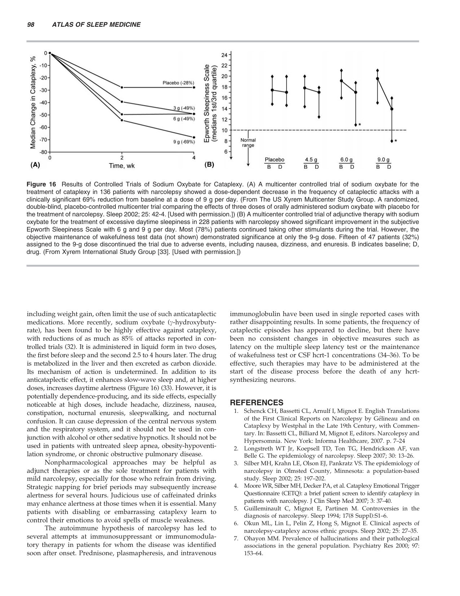

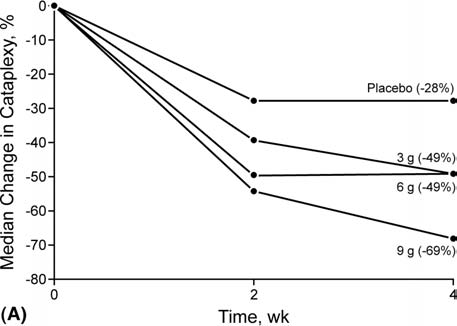

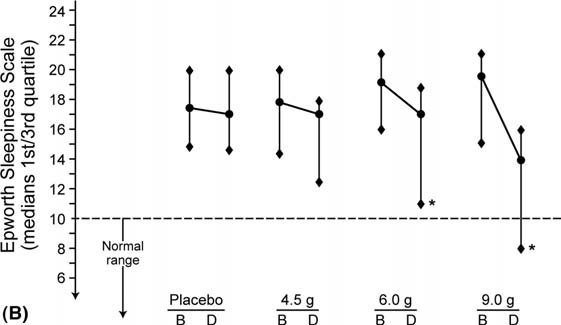

<!-- pdf-page: 112 -->

8. Ohayon MM, Zulley J, Guilleminault C, Smirne S. Prevalence and pathologic associations of sleep paralysis in the general population. Neurology 1999; 52: 1194–200. 9. Silber MH, Krahn LE, Slocumb NL. Clinical and polysomnographic findings of narcolepsy with and without cataplexy: a population-based study [abstract]. Sleep 2003; 26(Suppl): A282–3. 10. Kotagal S, Krahn LE, Slocumb N. A putative link between childhood narcolepsy and obesity. Sleep Med 2004; 5: 147–50. 11. Vogel G. Studies in psychophysiology of dreams. III. The dream of narcolepsy. Arch Gen Psychiatry 1960; 3: 421–8. 12. Juji T, Satake M, Honda Y, Doi Y. HLA antigens in Japanese patients with narcolepsy: all the patients were DR2 positive. Tissue Antigens 1984; 24: 316–9. 13. Mignot E, Hayduk R, Black J, Grumet FC, Guilleminault C. HLA DQB1*0602 is associated with cataplexy in 509 narcoleptic patients. Sleep 1997; 20: 1012–20. 14. Mignot E. Genetic and familial aspects of narcolepsy. Neurology 1998; 50(2 Suppl 1): S16–22. 15. Black JL 3rd, Krahn LE, Pankratz VS, Silber M. Search for neuronspecific and nonneuron-specific antibodies in narcoleptic patients with and without HLA DQB1*0602. Sleep 2002; 25: 719–23. 16. Black JL 3rd, Silber MH, Krahn LE, et al. Analysis of hypocretin (orexin) antibodies in patients with narcolepsy. Sleep 2005; 28: 427–31. 17. Smith AJ, Jackson MW, Neufing P, McEvoy RD, Gordon TP. A functional autoantibody in narcolepsy. Lancet 2004; 364: 2122–4. 18. Black JL 3rd, Avula RK, Walker DL, et al. HLA DQB1*0602 positive narcoleptic subjects with cataplexy have CSF IgG reactive to rat hypothalamic protein extract. Sleep 2005; 28: 1191–2. 19. Hallmayer J, Faraco J, Lin L, et al. Narcolepsy is strongly associated with the T-cell receptor alpha locus. Nat Genet 2009; 41: 708–11. Epub 2009 May 3. Erratum in: Nat Genet 2009; 41: 859. 20. Aran A, Lin L, Nevsimalova S, et al. Elevated anti-streptococcal antibodies in patients with recent narcolepsy onset. Sleep 2009; 32: 979–83. 21. Lin L, Faraco J, Li R, et al. The sleep disorder canine narcolepsy is caused by a mutation in the hypocretin (orexin) receptor 2 gene. Cell 1999; 98: 365–76. 22. Chemelli RM, Willie JT, Sinton CM, et al. Narcolepsy in orexin knockout mice: molecular genetics of sleep regulation. Cell 1999; 98: 437–51. 23. Ripley B, Overeem S, Fujiki N, et al. CSF hypocretin/orexin levels in narcolepsy and other neurological conditions. Neurology 2001; 57: 2253–8.

24. Thannickal TC, Moore RY, Nienhuis R, et al. Reduced number of hypocretin neurons in human narcolepsy. Neuron 2000; 27: 469–74. 25. Malik S, Boeve BF, Krahn LE, Silber MH. Narcolepsy associated with other central nervous system disorders. Neurology 2001; 57: 539–41. 26. AASM. The International Classification of Sleep Disorders: Diagnostic and Coding Manual. 2nd ed. Westchester (IL): American Academy of Sleep Medicine, 2005. 27. Anderson KN, Pilsworth S, Sharples LD, Smith IE, Shneerson JM. Idiopathic hypersomnia: a study of 77 cases. Sleep 2007; 30: 1274–81. 28. Littner M, Johnson SF, McCall WV, et al; Standards of Practice Committee. Practice parameters for the treatment of narcolepsy: an update for 2000. Sleep 2001; 24: 451–66. 29. Auger RR, Goodman SH, Silber MH, Krahn LE, Pankratz VS, Slocumb NL. Risks of high-dose stimulants in the treatment of disorders of excessive somnolence: a case-control study. Sleep 2005; 28: 667–72. 30. US Modafinil in Narcolepsy Multicenter Study Group. Randomized trial of modafinil for the treatment of pathological somnolence in narcolepsy. Ann Neurol 1998; 43: 88–97. 31. US Modafinil in Narcolepsy Multicenter Study Group. Randomized trial of modafinil as a treatment for the excessive daytime somnolence of narcolepsy: Neurology 2000; 54: 1166–75. 32. Xyrem International Study Group. Further evidence supporting the use of sodium oxybate for the treatment of cataplexy: a double-blind, placebo-controlled study in 228 patients. Sleep Med 2005; 6: 415–21. 33. Xyrem International Study Group. A double-blind, placebo-controlled study demonstrates sodium oxybate is effective for the treatment of excessive daytime sleepiness in narcolepsy. J Clin Sleep Med 2005; 1: 391–7. 34. Fronczek R, Verschuuren J, Lammers GJ. Response to intravenous immunoglobulins and placebo in a patient with narcolepsy with cataplexy. J Neurol 2007; 254: 1607–8. Epub 2007 Sep 4. 35. Plazzi G, Poli F, Franceschini C, et al. Intravenous high-dose immunoglobulin treatment in recent onset childhood narcolepsy with cataplexy. J Neurol 2008; 255: 1549–54. Epub 2008 Sep 3. 36. Valko PO, Khatami R, Baumann CR, Bassetti CL. No persistent effect of intravenous immunoglobulins in patients with narcolepsy with cataplexy. J Neurol 2008; 255: 1900–3. Epub 2008 Sep 25.
