# Chapter 8 Insomnia

<!-- pdf-page: 113 -->

## 8 Insomnia

#### Lois E. Krahn, MD

#### ABBREVIATIONS

FDG, [18F]fluorodeoxyglucose

GABA, g-aminobutyric acid

ICSD-2, International Classification of Sleep Disorders: Diagnostic and Coding Manual, 2nd edition

NREM, non–rapid eye movement

PET, positron emission tomography

REM, rapid eye movement

Insomnia, the most common sleep disorder, causes distress to millions of people worldwide. The International Classification of Sleep Disorders: Diagnostic and Coding Manual (2nd ed [ICSD-2]) (1) defines insomnia as the inability to fall asleep or stay asleep or the experience of only unrefreshing sleep, with the result that one’s daytime functioning is compromised (Figure 1). Insomnia cannot be defined simply in terms of the number of hours of sleep missed. This important point arises in clinical practice because some patients seek treatment out of concern that they are not sleeping eight hours a night. No universally accepted minimum sleep duration has been established because there is considerable interindividual variability. Some persons (<5%) are short sleepers, as defined by the ICSD-2, and they function well day after day on five hours of sleep or less (1). No existing sleep test can affirm the optimum amount of sleep to help distinguish between a patient with insomnia and a patient who is a short sleeper. The most important diagnostic step is for the clinician to ascertain that the patient experiences some degree of daytime impairment because of unsatisfactory sleep. The two extremes of the sleep spectrum range from excessive time in bed to insufficient sleep syndrome. Patients who overestimate their sleep needs can aggravate their sleep problem by allocating excessive time for sleep (Figure 2). This mismatch may result in undesired wakefulness relative to the person’s sleep expectations. In these cases, inadequate sleep hygiene is commonly a major contributor to insomnia. Patient education that helps individual patients develop an awareness of their functioning, including drowsiness and alertness, allows them to gauge their preferred bedtime and awakening times. Underestimating the amount of sleep achieved and excessively restricting the patient’s time in bed may lead to daytime fatigue (but not to nighttime wakefulness).

#### MECHANISMS OF INSOMNIA

Insomnia has numerous causes (Figure 3). In clinical practice, chronic insomnia is not due to a single etiologic factor but instead has multiple intertwined mechanisms, both physiolog-

ical and psychological. A valuable model of chronic insomnia proposed by Spielman (2) conceptualizes three components: vulnerability, triggers, and a perpetuating process. For example, physiologically a patient may be a lifelong “light sleeper” with an increased risk of insomnia because of heightened baseline levels of central nervous system arousal. After a psychologically stressful event triggers insomnia, the sleeplessness is then sustained by environmental factors, behavioral issues, or concurrent illnesses. An alternate approach is to classify insomnia into primary and secondary types by whether a cause of the sleep disruption can be identified. However, this more simplistic scheme does not reflect the complexity of insomnia nor does it identify to the same degree the perpetuating conditions that could eventually be addressed in a treatment plan. The nosology for insomnia that was adopted in 2005 by ICSD-2 will be discussed in more detail later in this chapter.

#### Physiological Vulnerability

Persons may be vulnerable physiologically to insomnia for various reasons. In isolation, the precondition is not sufficient to produce insomnia but it does provide a substrate that is conducive to sleeplessness in the context of other factors. Recognizing the perpetuating conditions is useful in predicting which patients will be at higher risk of relapse and who might benefit from continuing therapy.

<!-- pdf-page: 114 -->

Figure 1

Venus and Mars by Sandro Botticelli (Tempura and Oil on Poplar; Circa 1485). Sleep and its disruption have been depicted in paintings throughout the centuries. (From National Gallery, London/Art Resource, New York. [Used with permission.]).

Figure 2

Spectrum of Time in Bed to Total Sleep Duration. The two extremes of the sleep spectrum range from excessive time asleep in bed to insufficient sleep syndrome.

Figure 3

Possible Mechanisms of Insomnia. The key factors contributing to insomnia are predisposition, stress, environment, lifestyle, and medical disorders.

Nofzinger et al. (3) theorized that these observations may be due to less reduction in activity in subcortical structures during the transition from wake to sleep compared with that of healthy controls. They furthermore speculated that neural networks exist in the neurobiology of insomnia, including a general arousal system (ascending reticular formation and hypothalamus), a cognitive system (prefrontal cortex), and an emotionregulating system (hippocampus, amygdala, and anterior cingulate cortex) (3). Neurochemical imbalances, such as a deficit of inhibitory neurotransmitters or an excess of stimulating ones, may cause a state of chronic hyperarousal (4). To date, sparse research data support this theory. Nonetheless, the theory that underdeveloped homeostatic pressure contributes to insomnia is plausible in view of the recent finding that hypocretin deficiency plays a critical role in the mechanism of narcolepsy, a disorder of excessive daytime sleepiness. The absence or excess of a

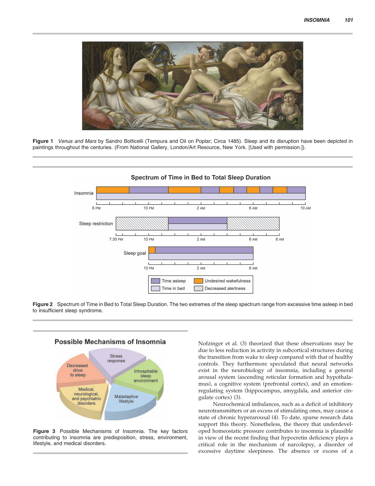

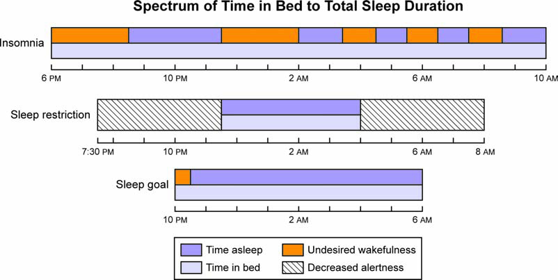

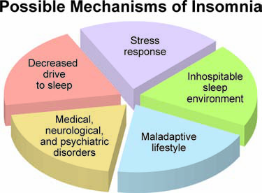

<!-- pdf-page: 115 -->

Figure 4

Positron Emission Tomography Scans of the Brain of a Patient With Insomnia. (A) A patient with insomnia who is in non–rapid eye movement (NREM) sleep has less change than controls in relative metabolism during the transition from awake to NREM sleep as measured by regional glucose metabolism. (B) A patient with insomnia who is awake has reduced activity (compared to that in controls) in the frontal cortex bilaterally, in the left hemisphere and thalamus, and in the hypothalamus and brainstem reticular formation. These changes may represent subjective daytime fatigue. (From Nofzinger et al. [3]. [Used with permission.])

neurochemical factor (or factors) that contributes to disorders of excessive wakefulness is certainly possible. However, the lack of a highly specific phenotype of insomnia, as exists in the case of narcolepsy with cataplexy, has hampered research efforts.

Genetic Factors The degree to which genetic factors predispose a person to insomnia is little understood. The ICSD-2 standardized outline uses the category of familial pattern for each recognized subtype of insomnia but cites little research. A positive family history of insomnia has been reported in 73% of patients with insomnia compared with 24% in controls (5). The responsible genes are still largely unknown. Described mechanisms include a point mutation in the prion protein gene (PRNP) that causes a rare disease called fatal familial insomnia and a missense mutation of the gene responsible for the GABA (g-aminobutyric acid) subunit GABAA b3 (6).

#### Triggers

Patients with insomnia often describe sleep of acceptable duration and quality up to a discrete point in time when something triggers disturbed sleep. The insomnia evaluation traditionally focuses on the identification of the trigger. The precipitants of insomnia can be subdivided into two main categories: 1) external circumstances (e.g., a new lawsuit) or 2) internal experiences (e.g., catastrophic thinking) (Table 1).

External Circumstances Tremendous interindividual variability exists regarding which events are stressful, to which degree a person perceives these events as threatening, and whether emotional distress or tension results in disrupted sleep. Many persons experience difficulty sleeping from time to time when their coping mechanisms are overwhelmed by stress. Emotionally charged events can be either negative (e.g., an ill parent) or positive (e.g., an upcoming family wed-

Table 1

Events that may trigger insomnia

Type of circumstance Events

External circumstances Loss or bereavement Relationship breakup Relocation Career transitions (termination or initiation) Examinations Health concerns Financial challenges (mortgage, pension, investments) Regulatory concerns (tax returns or audit) Legal problems (lawsuit) Internal experiences Catastrophic thinking Lack of control over circumstances Fear of the unknown Loneliness Boredom Uncertainty regarding direction in life Perfectionism Low self-esteem Suppressed emotions

ding). Individuals vary in their capacity to handle stress. Routine events, such as a looming tax deadline, can be a substantial source of worry and tension for some persons, whereas others view them as just another mundane task. Persons susceptible to stress, many of whom have an obsessive personality type or a history of trauma, amplify the necessary preparation for, or the possible consequences of, an event. In so doing, they escalate their stress level, which leads to heightened muscle tension and poorer sleep (Figure 5). Not everyone is vulnerable to stressrelated insomnia. In contrast, some persons crave excitement and consciously seek out stressful careers (e.g., firefighting) or

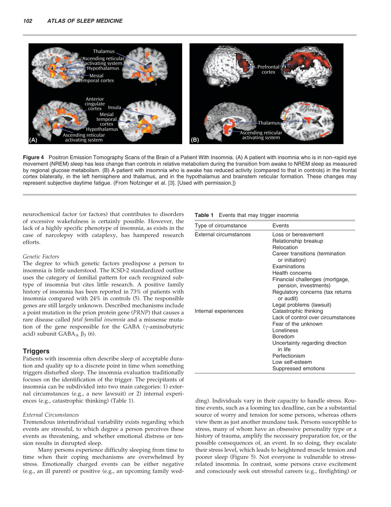

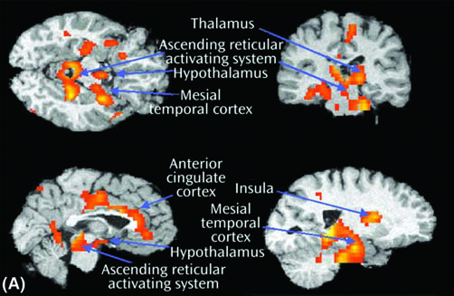

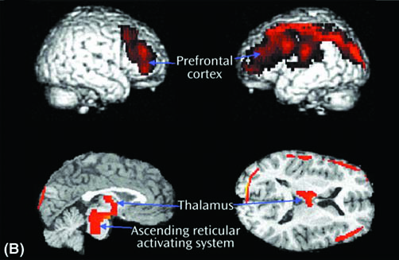

<!-- pdf-page: 116 -->

Figure 5

Influence of Stress in Patients With Insomnia. Stress contributes to increased tension and initial insomnia.

extreme leisure activities (e.g., skydiving) because they thrive on unpredictable and emotionally demanding situations. These persons have a higher threshold for perceiving an event as stressful and also do not experience the sustained muscle tension that interferes with sleep. The absence of a diathesis that confers a vulnerability for insomnia may play a protective function as well.

Internal Experiences Only insomnia that evolves into chronic disease is typically brought to the attention of medical providers. Whatever precipitated the sleeplessness may have occurred months or years earlier. The insomnia may have taken on a life of its own and may no longer be linked directly to the past trigger. Other conditions emerge and exert influence over time that maintain the ongoing process. Both the trigger and the perpetuating process may stem from a common source, such as anxiety; for example, initially time-limited anticipatory anxiety related to an upcoming event may be followed by generalized anxiety that persists over time. In the absence of enduring anxiety, the sleep loss would likely be more limited in duration.

#### Perpetuating Process

Three conditions that compromise sleep quality are 1) environments that are not conducive to restful sleep, 2) behaviors and attitudes of the sleeper that prove to be maladaptive, and 3) underlying psychiatric or medical disorders. These problems can function both as the initial trigger for the onset of insomnia and, if ongoing, as sustainers of the process. Figure 6 depicts how chronic insomnia develops when there is convergence of the three components of predisposition, triggers, and perpetuating process.

Inhospitable Environment A wide array of circumstances can be disruptive to sleep (Table 2), including the actions of other persons (Figure 7) or an unsettling sleep environment (Figure 8). When persons travel, for example, they recognize that they may have to sleep temporarily under less-than-desirable circumstances and they are usually well aware that the quality of their sleep will suffer. However, other sleep

Figure 6

Factors Contributing to Development and Perpetuation of Insomnia. Insomnia has a multifactorial basis.

Table 2

Environmental conditions associated with insomnia

Environmental condition Examples

Noise Snoring Coughing Music; television Traffic Telephone; pager Child or adult seeking attention Burglar, car, and other alarms Mechanical sounds (e.g., elevator in motion or ticking clock) Barking dog Light Bright light (e.g., during summer at extreme latitudes or because of shift work) Movement Vibration (e.g., while traveling by airplane or car) Body movement (e.g., thrashing about by bed partner) Pets Foods Heartburn; gastroesophageal reflux disease Bloating; excessive gas Extreme temperatures Heat (e.g., lack of air conditioning) Cold (e.g., insufficient bedcovers) Bedding materials Uncomfortable bed Hard pillow Allergies to laundry soap, fabric softeners, or feathers

environments less conducive to sleep that are more enduring may be less obvious. Patients may underestimate the degree to which familiar and accepted environmental conditions contribute to insomnia. Notable examples are the cultural practices that influence sleeping arrangements. Beds, bedding materials, and the number of other sleepers in the bed may vary, with subcultures maintaining traditions in which a good quality of sleep may not be the highest priority (Figure 9). A snoring bed partner or the proximity of pets can also compromise sleep quality (Figure 10).

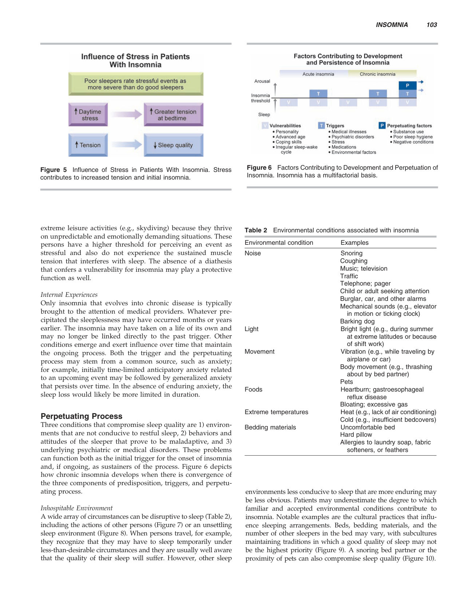

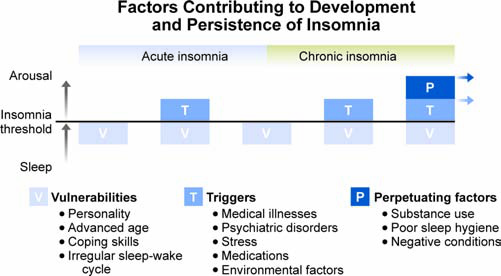

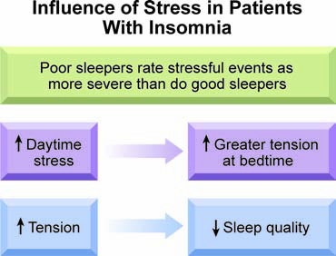

<!-- pdf-page: 117 -->

Figure 7

Teasing a Sleeping Girl by Gaspare Traversi (Oil on Canvas; Circa 1750). Poor quality sleep may be due to environmental factors, including body position or disruptive people or animals. (From The Metropolitan Museum of Art/Art Resource, New York. [Used with permission.])

Figure 8

Crowded Sleeping Conditions During Nineteenth-Century River Travel. In this print made from a wood engraving (circa 1875), John Maynard Woodward aptly conveys the crowded conditions on a Mississippi River steamboat filled with men, women, and children deck passengers. (From U.S. National Library of Medicine, Bethesda, MD.)

Potentially Maladaptive Behaviors and Attitudes

Table 3 lists behaviors and attitudes that can lead to acute

insomnia becoming a chronic disorder. The cognitive experiences that serve as triggers of insomnia may also perpetuate the process. An inconsistent sleep-wake schedule is a common cause of insomnia (Figure 11). Some patients have long-standing insights into the thoughts and behaviors that fuel their insomnia, yet they have been incapable of changing them.

Figure 9

African Wooden Pillow. Nineteenth-century wooden headrests such as this one (16 cm [about 6.5 inches] high) were made by the Shona carvers of Zimbabwe and used mainly by men who were thought to be visiting their ancestors during sleep. (From The Trustees of the British Museum, London. [Used with permission.])

Figure 10

A Sleeping Child Being Disturbed by a Dog. The sleep environment may be disruptive to quality of sleep because of the activity of companion animals. (Sleeping Child With Dog; Convent of St. Joseph’s, St. Louis, MO; 1886) (From Girard Foundation Collection. Museum of International Folk Art (DCA), Sante Fe, NM. Photo by Blair Clark. [Used with permission.])

Other patients at the onset of a sleep evaluation have only a limited awareness and recognition of the contributing factors.

Psychiatric and Medical Disorders Medical conditions, such as clinically significant gastroesophageal reflux disease, can contribute to insomnia, as can

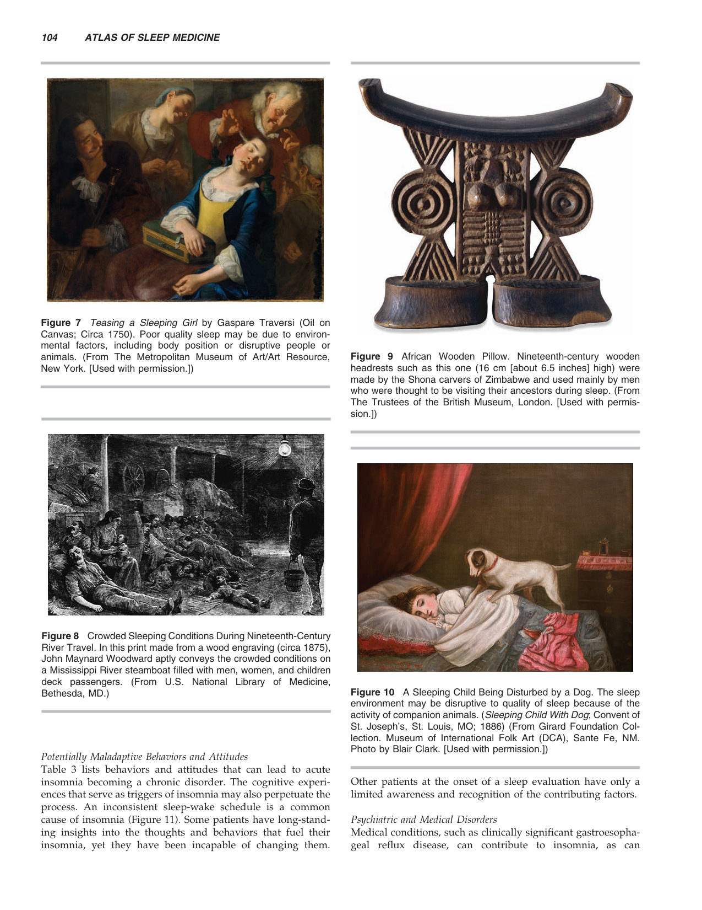

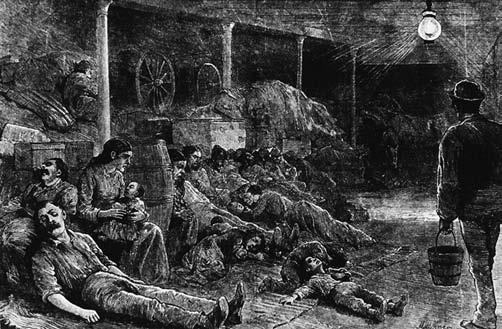

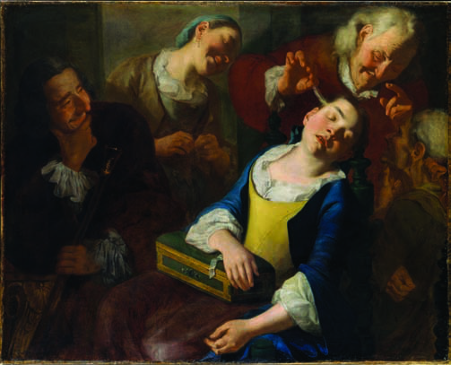

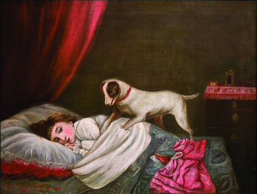

<!-- pdf-page: 118 -->

Table 3

Lifestyle issues that may compromise sleep

Lifestyle issues

Demanding schedules filled with physically or mentally stimulating activity right up to bedtime Mind and body unprepared at bedtime to drift off to sleep Using the bed for activities other than sleep or physical intimacy (e.g., paying bills, reading mail, or using laptop computer) Increasingly frustrating thought patterns when unable to fall asleep promptly Heightened muscle tension after failing to fall asleep promptly Anticipating difficulty falling asleep hours before bedtime Reduced confidence in ability to fall asleep Frequent checking of bedside clock Switching to potentially stimulating activities (e.g., browsing the Internet, watching television, or doing housework) or worrying when unable to sleep Inconsistent sleep-wake schedule Excessive use of caffeine Use of alcohol as sleep aid Inadequate physical exercise or sedentary lifestyle

psychiatric conditions, such as generalized anxiety disorder. A multitude of conditions, from associated illnesses (Figure 12) to associated psychiatric disorders (Table 4), can lead to complaints of insomnia.

Insomnia at Perimenopause Perimenopausal sleep disruption provides an excellent example of insomnia’s multifactorial nature. Compared with the rate of insomnia in premenopausal women, the rate of insomnia in women undergoing the perimenopausal transition is increased dramatically (Figure 13). Thus the risk of chronic insomnia increases as women age, especially when the trigger and the

Figure 11

Inconsistent Sleep Schedule Exacerbating Insomnia. An inconsistent sleep-wake schedule can have a disruptive effect on the timing of sleep.

Figure 12

Conditions That Cause or Exacerbate Insomnia. A wide range of conditions is associated with insomnia. CNS, central nervous system; COPD, chronic obstructive pulmonary disease; GERD, gastroesophageal reflux disease; OSA, obstructive sleep apnea.

perpetuating process coexist in a woman with a premenopausal predisposition toward insomnia. By examining this example more closely, we can see that multiple risk factors play a role in insomnia that develops at perimenopause; these risk factors include ones that cannot be modified (e.g., being female and undergoing the aging process)

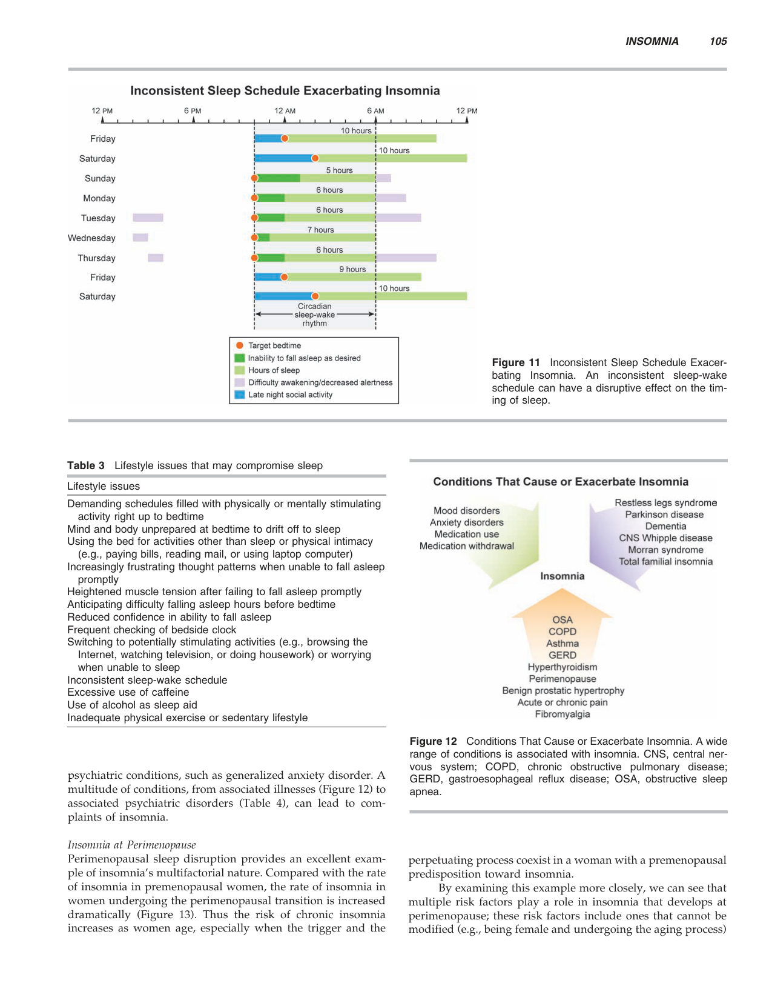

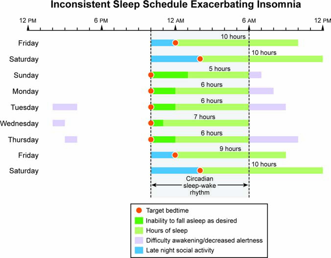

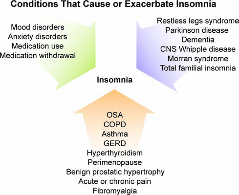

<!-- pdf-page: 119 -->

Table 4

Sleep disturbances due to psychiatric disorders

Sleep disturbance Psychiatric disorders

Insomnia Major depression Dysthymia Manic phase Hypomanic phase Posttraumatic stress disorder Acute stress disorder Generalized anxiety disorder Panic disorder Somatization disorder Chronic pain secondary to psychological factors Schizophrenia Attention deficit disorder with hyperactivity Nightmares Posttraumatic stress disorder

Figure 13

Insomnia in Perimenopause. Sleep disruptions often increase in women during the time just before and after menopause.

and others that can often be altered with therapy (e.g., hot flashes, anxiety, depressed mood, thyroid insufficiency, and increased upper airway resistance). Hot flashes, widely recognized as a cause of sleep disruption during the perimenopausal transition, are abrupt surges in body temperature that can lead to bouts of sweating. The typical hot flash lasts about 3 minutes. The patient is awakened either by warmth or the subsequent chill related to damp clothing and bedding. Hot flashes are precipitated by declines in estrogen levels that signal a narrowing of the thermoregulatory zone of the hypothalamus, which has a diminished capacity to adapt to a wide range of ambient temperatures. The neurotransmitters serotonin and norepinephrine are believed to play secondary roles in this thermo-

Figure 14

Factors Contributing to Development and Perpetuation of Insomnia During Perimenopause. Women at highest risk of insomnia during perimenopause have a combination of vulnerable preconditions, triggering events, and perpetuating factors.

regulatory control pathway. Perimenopausal insomnia can be exacerbated by anxiety. Women who feel anxious have been found to have more hot flashes than control subjects (7). The three-component multifactorial model aptly illustrates the issues at play in this example of insomnia and points toward potential targets of therapy (Figure 14).

#### SUBTYPES OF INSOMNIA

The National Sleep Foundation conducts annual surveys in the United States (8) to examine the epidemiology of sleep disorders using a scheme that classifies insomnia by the duration of symptoms. The 2002 community survey conducted by the National Sleep Foundation documented that most respondents (58%) reported having insomnia at least a few nights a month (Figure 15) (8). There has been an attempt in ICSD-2 to be more precise in the approach to insomnia (Table 5). A more specific conceptualization of insomnia is particularly important for research purposes because observations about the epidemiology, etiology, natural history, and treatment of sleeplessness may apply only to distinctive subsets of patients who share similar characteristics. Subdividing insomnia has been challenging because of limited clinical and laboratory data about the possible subtypes and causes. Focusing on the interplay of vulnerabilities, triggering events, and the perpetuating process of insomnia can be useful in understanding the differences between insomnia subtypes (Figure 16).

Figure 15

Prevalence of Insomnia. Data from the 2002 National Sleep Foundation survey showed that most respondents reported insomnia. (From National Sleep Foundation. [Used with permission.])

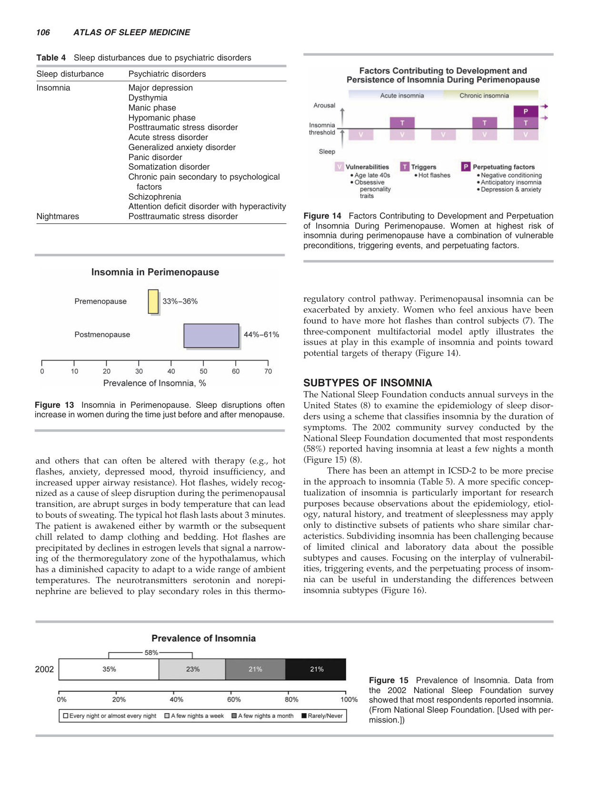

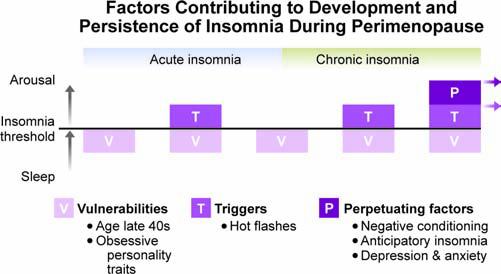

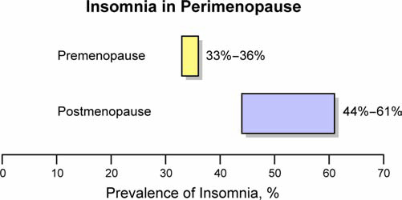

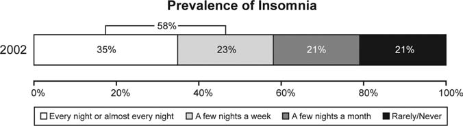

<!-- pdf-page: 120 -->

Unknown

Female sex, anxiety, obsessive thinking Variable Negative thought patterns and increased muscle tension at bedtime Paradoxical insomnia (sleep state misperception; severe insomnia without objective evidence of any sleep disturbance)

Prevalence in general population, % Onset Duration Primary mechanism Vulnerabilities Triggers Perpetuating process

Unknown Unknown Unknown Unknown

Specific stressor (positive or negative life event)

Adjustment (acute, shortterm, or transient) 15–20 Acute <3 months Stress Increased age, female sex, history of light sleep, anxiety, obsessive thinking, depressed mood

1–2 Acute or gradual Chronic Maladaptive sleep behaviors, stress (about falling asleep)

Unknown but likely rare Unknown Variable from months to years

Table 5

ICSD-2 subtypes of insomnia

Psychophysiological insomnia (conditioned insomnia)

Subtype

Unknown Caretakers’ behaviors

Unknown Poor sleep hygiene, use of caffeine and other substances Behavioral insomnia of childhood (sleep onset association disorder)

Insomnia due to psychiatric disorder 3 Any age Variable Anxiety, depression, bipolar disorder Female sex, younger age Psychiatric disorder None specifically

None specifically Substance abuse None specifically

None specifically Medical disorder None specifically

Idiopathic insomnia (childhood-onset insomnia) 0.7–1 Childhood Chronic Increased CNS arousal Unknown; minimization of interpersonal issues None known Unknown

Abbreviations: CNS, central nervous system; ICSD-2, International Classification of Sleep Disorders: Diagnostic and Coding Manual, 2nd edition; NA, not available. Data from The International Classification of Sleep Disorders: Diagnostic and Coding Manual (1). Used with permission.

Unknown Maladaptive sleep behaviors Demanding temperament, caretakers’ behaviors, active medical disorder

Younger age, poor knowledge of healthy sleep habits

Chronic Environmental factors, maladaptive sleep behaviors

Insomnia due to medical disorder Unknown Any age Variable Hot flashes, night sweats, dyspnea, wheezing, coughing

Insomnia due to drugs or substances 0.2 Any age Variable Alcohol, stimulants, excessive use of caffeine, hypnotic withdrawal, food allergy, toxins

10–30 Not before age 6 months

Unknown but likely gradual

Inadequate sleep hygiene 1–2 in adults <30 years of age

<!-- pdf-page: 121 -->

Comprehensive sleep history Interview, sometimes supplemented by questionnaires, collecting a wide range of data Sleep diary Detailed prospective account of sleep schedule completed daily by patient Wrist actigraphy Compact portable motion detector to measure limb movement Polysomnography Test used selectively to confirm whether insomnia is secondary to sleep-disordered breathing Physiological assessment Surface frontalis muscle electromyography and skin temperature measurement to gauge degree of relaxation (used in specialized sleep disorders centers)

Figure 16

ICSD-2 Subtypes of Insomnia. Subtypes of insomnia vary by age of onset and natural course. ICSD-2, International Classification of Sleep Disorders: Diagnostic and Coding Manual, 2nd edition.

#### DIAGNOSIS OF INSOMNIA

Obtaining a comprehensive sleep history from the patient is the pivotal component of an insomnia evaluation. The clinician needs to gain an in-depth understanding of the patient’s sleep over time by covering all the components discussed in the preceding section that could be producing unsatisfactory sleep. The clinician should strive to determine the relative importance of the identified factors and whether they might be modified with treatment. Other diagnostic tools may also be used to augment the comprehensive sleep history (Table 6); however, these should never be viewed as a substitute for the sleep history. The diagnosis of insomnia does not depend on the presence of any particular physiological event. Consequently, polysomnography has only a limited role as a diagnostic tool in the assessment of patients with insomnia (9). Sleep studies are difficult to conduct because sleeping in a sleep laboratory causes a subset of patients with insomnia to experience increased muscle tension and anxiety. The experience of being observed or of having

Table 6

Diagnostic tools for evaluating patients with insomnia

Type of diagnostic tool Characteristics

to wear multiple monitors can further inhibit the ability to drift off to sleep. In contrast, a paradoxical response has also been described (10). Patients who struggle to fall sleep and stay asleep in the familiar setting of home are more relaxed and sleepy in a sleep disorders center. This phenomenon illustrates the negative conditioning whereby a familiar setting can prevent the mental and muscle relaxation necessary for a rapid transition from wakefulness to sleep. Polysomnography is indicated as a diagnostic test for patients with insomnia when their sleeplessness exists in the context of other suspected sleep disorders. When snoring, apnea, or unusual behaviors are present, sleep studies conducted in a sleep laboratory can be invaluable. After determining that another sleep disorder is present, the clinician can decide whether to treat it before treating the insomnia or to treat them both currently if the insomnia is of sufficient severity to merit a concurrent approach. With the subtype of insomnia called paradoxical insomnia, polysomnography aids in establishing the diagnosis. Patients with this condition seek care for sleeplessness that seems disproportionate to the objective findings. The insomnia typically persists despite treatment trials of behavioral and pharmacologic approaches. Family members may be able to offer observations about whether the patient appears to sleep at some points during the night. In this situation, a sleep study can reveal whether the patient is sleeping better than indicated by self-report. These data can refocus efforts away from trials of hypnotic agents and instead lead to an exploration of whether anxiety is causing the patient to amplify the insomnia. Physiological assessment is an additional tool available in select sleep disorders centers. Drifting off to sleep is difficult when a patient is wound up tightly and has a high level of physiological arousal. Surface measurements of the muscle tone and the skin temperature of the forehead can help discriminate between tense and relaxed states. Biofeedback assessments of this type are typically conducted by psychologists but are not standard practice in many sleep disorders centers. Sensors that show ongoing hyperarousal, even as patients endeavor to relax, indicate that the patient has insufficient relaxation skills or a high baseline level of tension. These observations are not necessary but can be most helpful in establishing the diagnosis of psychophysiological insomnia, particularly when patients overestimate their ability to relax. The diagnostic algorithm for insomnia (Figure 17) indicates how the sleep history and other diagnostic tools can be used to work through the differential diagnosis.

#### TREATMENT OF INSOMNIA

Numerous treatment options have been developed to aid patients with insomnia. Clinicians should investigate whether a medical, psychiatric, or substance disorder is a trigger or a perpetuating process or both. When insomnia is secondary to

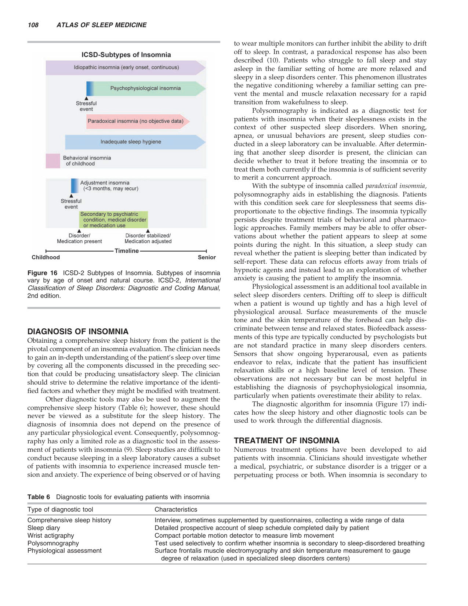

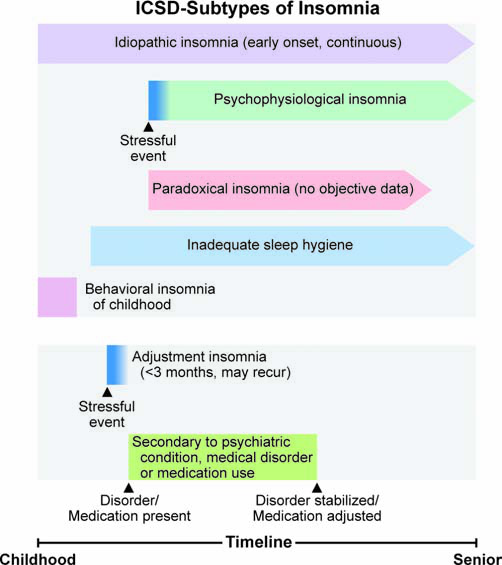

<!-- pdf-page: 122 -->

Attend to general sleep hygiene Make getting adequate sleep a priority; strive for consistent sleep-wake schedule

Table 7

Basic principles of good sleep hygiene for patients with insomnia

Principle Actions

Figure 17

Diagnostic Algorithm for Insomnia. The differential diagnosis of insomnia requires numerous diagnostic steps. PSG, polysomnogram.

Optimize sleep environment Eliminate disruptive elements (e.g., pets or noise) Enhance bedtime routines Adopt bedtime rituals that aid the relaxing process (e.g., grooming, reading light material, meditation, or listening to soothing music) Minimize nighttime awakenings Limit caffeine use; prevent gastroesophageal reflux; avoid excessive exercise close to bedtime; cover up clock face; if awake, do not start stimulating activities (e.g., chores or E-mail)

another condition, a stepwise therapeutic approach can optimize treatment of the overarching primary disorder to whatever degree possible. As a subsequent step, treatment may be used that specifically targets the symptom of insomnia; for example, a hypnotic medication may be prescribed. The clinician should also keep in mind that some insomnia treatments have the potential to aggravate the primary condition. For example, physically demanding yoga techniques may aggravate musculoskeletal pain and benzodiazepines may diminish ventilation in patients with severe chronic obstructive pulmonary disease.

#### Sleep Education and Hygiene

Patient education about the importance of sleep is an essential part of every treatment plan for insomnia. Health education in U.S. schools historically has not focused on the role played by good quality sleep in overall health. Teaching patients how to achieve good sleep is a key aspect of patient education (Table 7). Sleep education overlaps with sleep hygiene, a term which refers to the lifestyle choices that influence sleep patterns. Patient education and counseling about optimal sleep hygiene are necessary but often are not sufficient as the sole intervention for patients with insomnia (11). When probing sleep hygiene, clinicians should

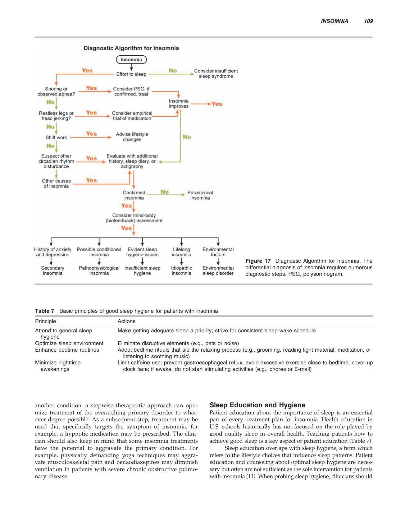

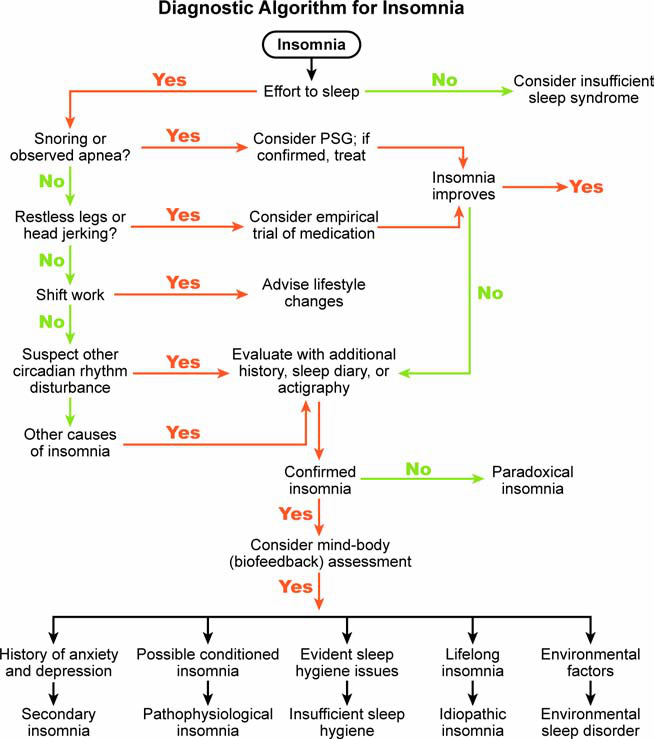

<!-- pdf-page: 123 -->

Type of therapy Implementation techniques

ask patients to label lifestyle choices as “stimulating” or “relaxing.” Patients should be encouraged to consciously participate in activities in the 30 to 60 minutes before going to bed that will help them unwind. Engaging in relaxing, routine behaviors before bedtime is usually beneficial. The focus should be on reinforcing the importance of a regular sleep-wake schedule, with the patient encouraged to have a structured day that includes regular exercise and consistent mealtimes. All subsequent treatments for insomnia will be less effective if sleep hygiene issues are left unaddressed. Optimizing sleep hygiene may be particularly helpful for patients who have sleep-onset insomnia. An effective treatment algorithm (Figure 18) for insomnia builds on the foundation of good sleep education and hygiene.

#### Nonpharmacologic Treatment

Nonpharmacologic techniques (Table 8) are viewed as the optimal treatment of insomnia, resulting in long-term remission, a sense of mastery for the patient, and no side effects (Figure 19). Several reviews of behavioral techniques for insomnia have examined the efficacy of these techniques (12). The various behavioral treatments have been critically reviewed in a practice parameter published by the American Academy of Sleep Medicine (13). This critical evaluation concluded that stimulus control was the most well-accepted management strategy (Figure 20). Biofeedback, progressive muscle relaxation, and paradoxical intention (i.e., avoiding trying to fall asleep) all have value. Additional useful therapies include sleep restriction (Figure 21)

Table 8

Recommended behavioral therapies for insomnia

Figure 18

Treatment Algorithm for Insomnia. Treatment of insomnia differs by whether a clear trigger (primary or secondary) can be identified.

Stimulus control therapy Reassociate bed with rapid initiation of sleep Sleep restriction therapy Reduce time in bed (5-hour minimum) to decrease amount of fragmented sleep Paradoxical intention Engage in other relaxing activities instead of trying to fall asleep Relaxation therapy Reduce muscle tension to decrease mental arousal; use meditation, hypnosis, imagery training Cognitive therapy Identify and modify distorted or catastrophic beliefs about sleep (e.g., a person cannot function after one night of poor-quality sleep) Biofeedback Use electromyographic monitoring to reinforce successful relaxation Multicomponent cognitive-behavioral therapy Identify and modify attitudes and behaviors unfavorable to sleep

Figure 19

The Effect of Psychotherapy on Insomnia. Psychotherapy is beneficial in treating insomnia whether measured by sleep diary or sleep study. CBT, cognitivebehavioral therapy; combined, cognitive-behavioral therapy and hypnotic medication; med, hypnotic medication.

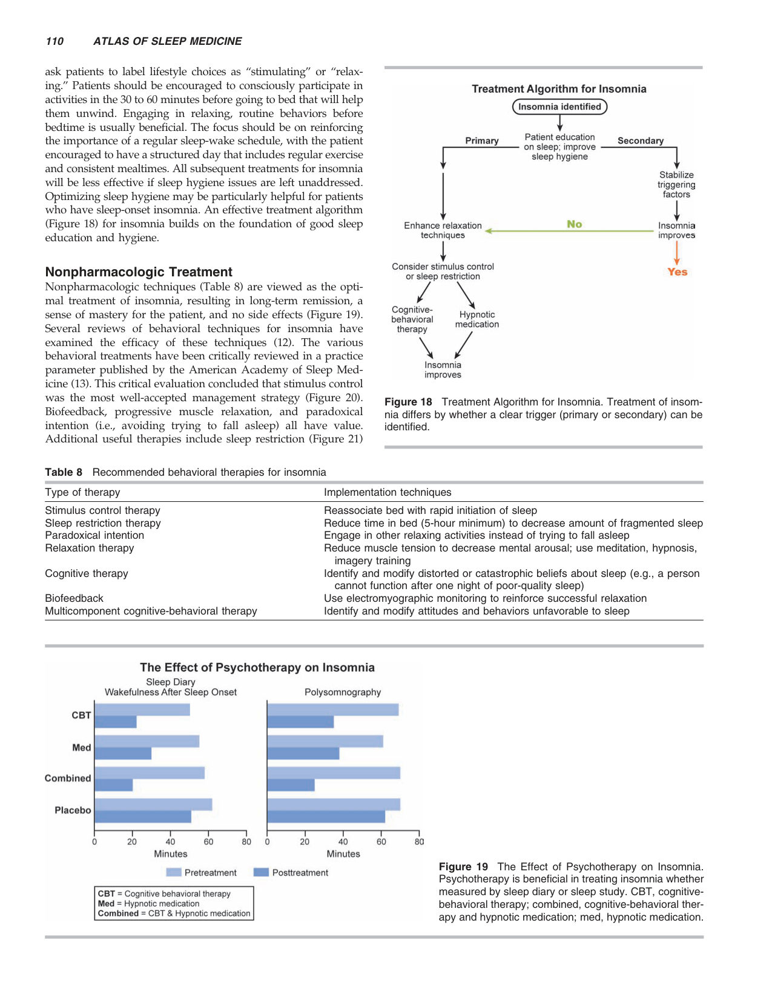

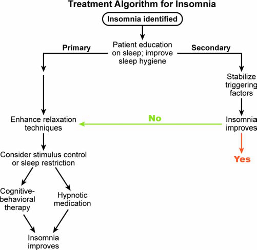

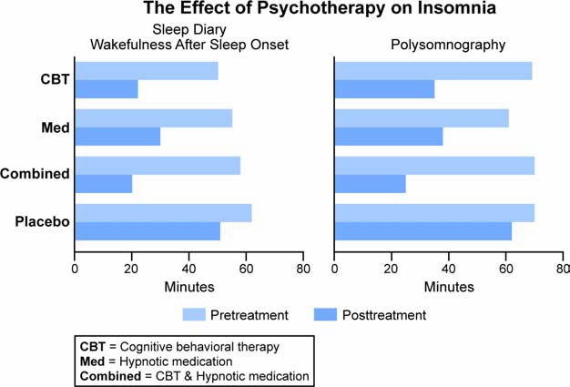

<!-- pdf-page: 124 -->

Figure 20

Stimulus-Control Therapy. The essential element of stimulus-control therapy is not thinking about falling asleep by diverting one’s attention to other activities.

Figure 21

Sleep Restriction Therapy. Deliberately reducing time in bed aids continuity and quality of sleep. TIB, time in bed; TST, total sleep time.

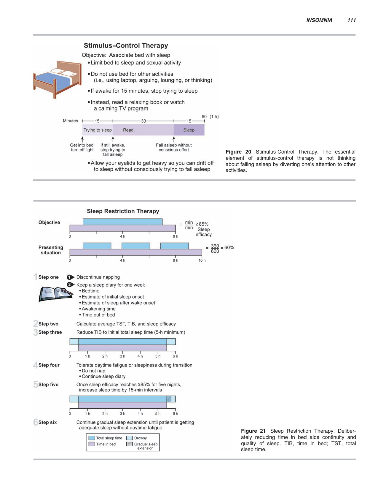

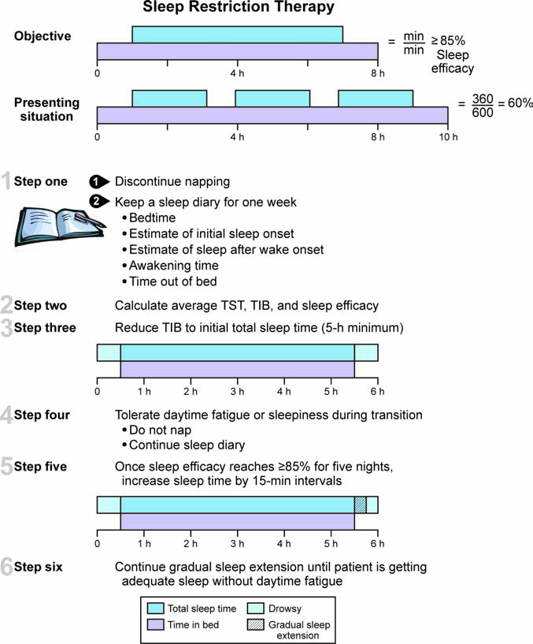

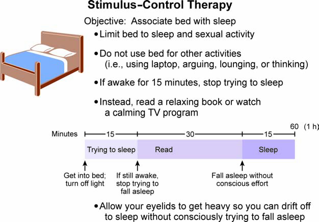

<!-- pdf-page: 125 -->

Table 9

Relevant characteristics of hypnotic medications

Characteristics

Figure 22

Clock Watching. Patients with insomnia may focus on the time and worry about its passage while they try to fall asleep.

Figure 23

Cognitive-Behavioral Model of Insomnia. Cognitivebehavioral therapy addresses the maladaptive thoughts and habits that perpetuate insomnia.

and cognitive therapy, which concentrates on the maladaptive and distressing thoughts. Patients who overvalue the role of sleep may fear that going without sufficient sleep for a stretch of time will be lethal. A closely linked perception is that a night of sleeplessness necessarily predicts incurable and enduring sleep problems. Persons with insomnia may also be tempted to monitor the clock during the night to repeatedly verify the exact time, which can serve to escalate their worry about sleeplessness (Figure 22). Cognitive-behavioral therapy is even more advantageous than pharmacologic treatment in that it addresses both the beliefs and the behaviors that perpetuate insomnia. These include anxiety, lack of confidence in the ability to sleep, and increased muscle tension (14) (Figure 23). Unfortunately, some patients may have limited access to behavioral therapies. Communities may lack appropriate thera-

Rate of absorption Rapidity of distribution to central nervous system Action on specific neurotransmitters Duration of elimination half-life Speed of clearance from central nervous system Site of metabolism Presence of active metabolites Rebound insomnia Likelihood of tolerance Risk of dependence

pists or insurance coverage may restrict access to this form of treatment. Thus pharmacologic treatment may be used until a provider of behavioral treatment can be obtained. Whether Internet-based behavioral treatment of insomnia proves effective and fills the relative void in behavioral therapy is being evaluated (15).

#### Pharmacologic Treatment

General Principles Sedative hypnotic medications are widely used. Even though starting a sleeping medication may seem straightforward to both the patient and the clinician, a comprehensive sleep assessment should be completed first. A multifaceted treatment plan should precede consideration of any hypnotic (Table 9). Even when it is clear that a medication will be initiated, sleep hygiene issues should be addressed. The goal of hypnotic therapy is to improve subjective sleep quality and quantity, decrease daytime fatigue, improve concentration, and enhance global daytime functioning. Good medical practice calls for using the lowest effective dose for the shortest possible duration. The onset of medication action, which is important for patients with prominent complaints about initial insomnia, is determined by the rate of absorption and distribution. Especially in aging patients or those with hepatic disease, prolonged elimination time increases the risk of excessive sedation, which places patients at increased risk for falls and cognitive impairment. Hypnotics with longer half-lives also increase the risk of a hangover effect, leading to undesired morning sedation (Figure 24). Some patients interpret morning sleepiness as a need for more sleep and wish to increase the dose of the hypnotic, which instead exacerbates their insomnia. Hypnotics with a short halflife raise a different set of concerns because the sedation can wear off before dawn, leading patients to experience early morning awakenings or rebound insomnia. Triazolam, in particular, has been associated with amnesia. Its relatively high potency and short half-life can cause a patient to awaken abruptly from sleep with residual cognitive impairment. The challenge of tolerance is another important general pharmacologic consideration. When a medication used long term ceases to induce sleep, patients may increase the dose on their own. Newer agents have been developed to minimize the risks of tolerance and dose escalation. Barbiturates and benzodiazepines are suspected of producing tolerance at a higher rate than do newer medications such as the benzodiazepine receptor agonists. The older agents also can cause physical dependence when patients experience withdrawal symptoms after abrupt discontinuation. The ideal hypnotic would be used long

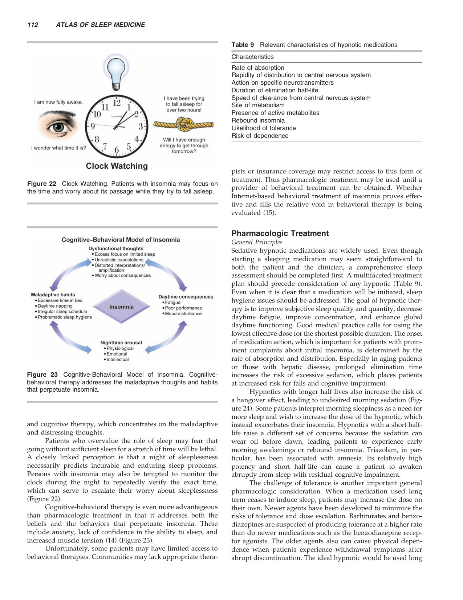

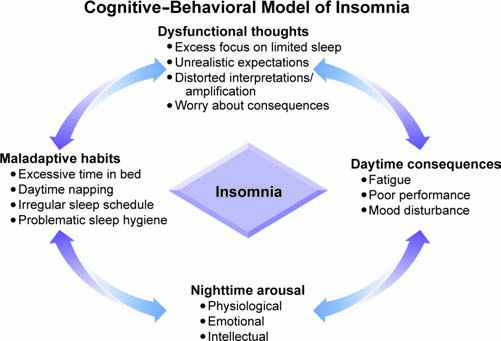

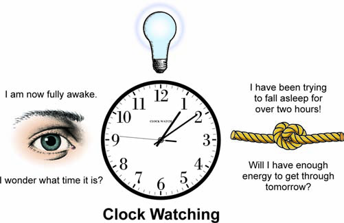

<!-- pdf-page: 126 -->

Figure 24

Hypnotic Options for Insomnia. The property of the hypnotic medication should be matched to the needs of the patient.

term without tolerance developing to its sedative qualities and without withdrawal on discontinuation.

Contemporary Hypnotics The U.S. Food and Drug Administration has approved several benzodiazepines to treat primary insomnia, including flurazepam hydrochloride, triazolam, quazepam, estazolam, and temazepam. Benzodiazepines increase total sleep time with decreased initial sleep latency and reduced wakefulness after sleep onset. Of this group of medications, temazepam is particularly useful because of its intermediate-duration half-life and its lack of an active metabolite. When a clinician prefers to prescribe a benzodiazepine for insomnia, temazepam is a reasonable first choice (Table 10). Agents other than benzodiazepines are increasingly used as the first-line treatment for insomnia (Table 11). Initially, the agents zaleplon and zolpidem tartrate were approved only for short-term treatment of insomnia. Most patients with insomnia who seek medical intervention have chronic symptoms, which creates an unfortunate mismatch of short-term treatment with a long-standing disorder. The 2005 National Institutes of Health Consensus Conference called for more clinical trials of treatments for chronic insomnia (16). Medications such as eszopiclone, zolpidem CR (extended release), and ramelteon have been approved for treatment of chronic insomnia without restrictions on longer-term use.

The benzodiazepine-receptor agonists do not share the chemical structure of benzodiazepines but do act on the benzodiazepine receptor interacting with the GABAA a1 subunit that opens chloride channels (Figure 25). The benzodiazepinereceptor agonists are intended to be more selective than conventional benzodiazepines and thus cause less rebound insomnia and have a lower risk of being abused or contributing to respiratory depression. All the benzodiazepine-receptor agonists have a relatively short half-life that minimizes excessive daytime sleepiness and does not substantially alter sleep architecture. Zolpidem is a selective agonist at the GABAA a1 subunit that is preferentially found in the cortex. Because of its short half-life, this agent is used primarily to treat sleep-onset insomnia. The newer formulation of zolpidem CR has a biphasic release of the compound that facilitates the drug’s ability to target both sleep onset and sleep maintenance insomnia (17). Zaleplon acts on a similar site and has a shorter half-life of about an hour. Like zolpidem, it is used primarily for sleep initiation or it can be used partway through the night to help patients with middle insomnia because of its long half-life. Eszopiclone is the S-isomer of the older medication zopiclone, used extensively outside the United States. On the basis of a six-month study (18), this medication was the first insomnia treatment approved for longer-term use. Eszopiclone is not associated with clinically significant tolerance or morning sedation. Sleep is improved with respect to decreased sleep latency, increased sleep efficiency, and increased total sleep time. However, patients using this medication have reported that it has an unpleasant taste (19). Like zolpidem, zaleplon and eszopiclone do not appear to alter normal sleep architecture. The most novel pharmacologic agent for treatment of insomnia is ramelteon, which acts as an agonist on melatonin receptor types 1 and 2 (20). This agent has a different mechanism than that of the other GABAergic hypnotic agents. It is the only prescription hypnotic not classified by the U.S. Drug Enforcement Administration as a controlled substance. It has shown benefit for improving insomnia but its role with respect to circadian rhythm issues remains unclear. Over the years, various agents not officially classified as hypnotics have been used as sleep aids. Clinicians may view antidepressants as a convenient way of addressing both insomnia and a coexisting mood disorder. The preferred agents have been mirtazapine, trazodone hydrochloride, and the tricyclic antidepressants. Unfortunately, these agents have not been carefully studied with respect to their sleep benefit. In particular, the duration of sedation may be excessive, leading to a hangover effect. They also may have multiple adverse effects, such as weight gain. Likewise, antipsychotic medications, particularly quetiapine fumarate, can sometimes be helpful. Atypical antipsychotic agents have been found to be especially helpful for patients with serious psychiatric disorders such as bipolar disorder, schizophrenia, or dementia with psychosis. However, in the absence of coexisting psychiatric disorders, the adverse effects of these medications should be carefully weighed against the benefits. For example, patients may be affected by weight gain and excessive daytime sleepiness. Anticonvulsants have been used for various sleep complaints. Clonazepam is a benzodiazepine that is classified by the U.S. Food and Drug Administration as an anticonvulsant. Despite its long half-life, clonazepam can be helpful for patients who have difficulty sleeping, especially when their insomnia coexists with a parasomnia such as rapid eye movement (REM)

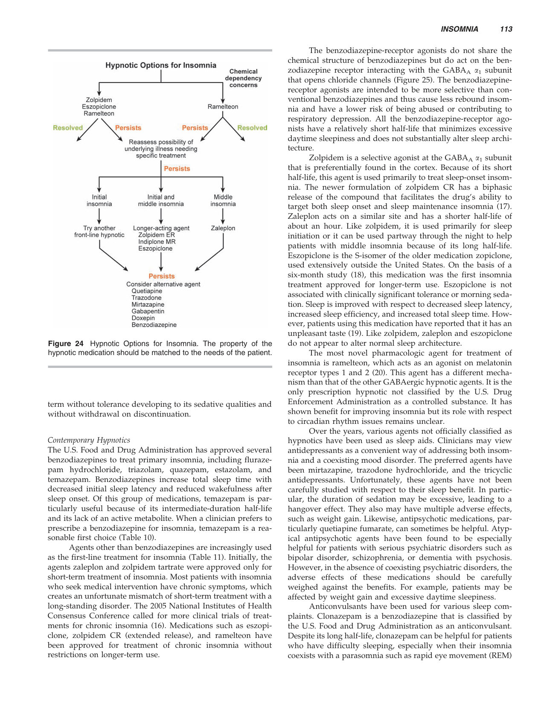

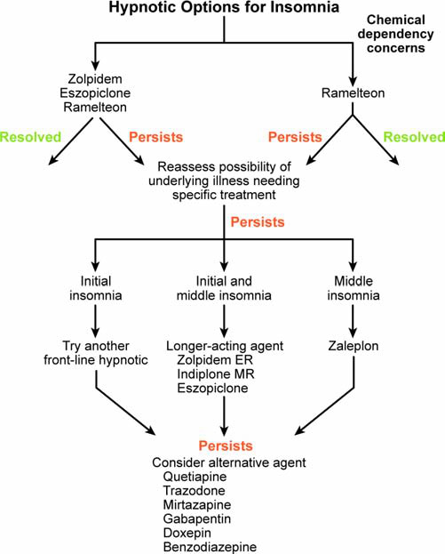

<!-- pdf-page: 127 -->

Mirtazapine Remeron Antidepressant 20–40 Insomnia in context of depression; minimize risk of addiction Weight gain; less sedating at doses >15 mg Doxepin Adapin, Sinequan, and Zonalon Antidepressant 8–24 Insomnia in context of depression or chronic pain Constipation; dry mouth; orthostatic hypotension; cardiac conduction delay Quetiapine fumarate Ketipinor and Seroquel Atypical antipsychotic 6 Insomnia in context of bipolar disorder or psychotic disorder; parasomnia (especially RBD in context of dementia with Lewy bodies); minimize CD risk

Antidepressant 8 Need to minimize chemical dependence risk Falls; orthostatic hypotension; priapism

Falls; cognitive impairment

Falls; cognitive impairment

Generic name U.S. Trade name Drug class Duration of action, h Indications Concerns

Clonazepam Klonopin Benzodiazepine 8–15 Benzodiazepine-dependent insomnia; insomnia with existing RBD; insomnia with treatment-refractory RLS

Benzodiazepine 8–15 Benzodiazepine-dependent insomnia; insomnia with existing RBD; insomnia with treatment-refractory RLS

Table 10

Medication options for insomniaa

Trazodone HCl Desyrel, Molipaxin, Thombran, Trazorel, Trialodine, and Trittico

Temazepamb Euhypnos, Norkotral, Normison, Remestan, Restoril, and Tenox

Pharmacologic agent

Weight gain; metabolic syndrome; slightly increased risk of stroke in dementia patients Gabapentin Neurontin Anticonvulsant 5–7 Insomnia in context of RLS or chronic pain; hot flashes; minimizes CD risk; coexisting seizures Unsteady gait at higher doses; poor clearance in patients with renal impairment

Abbreviations: CD, chemical dependency; HCl, hydrochloride; RBD, rapid eye-movement (REM) sleep behavior disorder; RLS, restless legs syndrome. aTemazepam as a representative benzodiazepine plus other agents not classified as hypnotics. bApproved for insomnia by the U.S. Food and Drug Administration.

<!-- pdf-page: 128 -->

Table 11

Hypnotic medications other than benzodiazepines

Pharmacologic agent

Generic name U.S. Trade name Initiates sleep Maintains sleep Appropriate for limited time in bed Minimal required sleep time, h

Eszopiclone Lunesta X X 8 Ramelteon Rozerem X 2–5 Zaleplon Sonata, Starnoc X X 4 Zolpidem tartrate Ambien X X 7–8 Zolpidem tartrate CR Ambien CR X X 7–8

Abbreviation: CR, extended release.

Figure 25

Sensitivity of the GABAA/Benzodiazepine Receptors.

sleep behavior disorder. However, the long half-life also can lead to excessive daytime sleepiness. Some patients opt to obtain over-the-counter sleeping medications that contain diphenhydramine. These agents are widely used because they are available without a prescription. However, tolerance quickly develops, and the usefulness of these agents is considerably limited as a result. Lastly, antihistamines can contribute to cognitive impairment (21). The variety and availability of hypnotics threaten to eclipse the role of behavioral therapies for insomnia. Several studies indicate that behavioral techniques offer more promise for sustained benefit. One response is to compromise by combining behavioral therapies with medications. This approach is optimal, especially when using behavioral therapy in isolation is not an option either due to the time lag in symptom improvement or the patient’s lack of access to therapists. Relatively few studies have examined the value of combining these two approaches. Whether a patient may be as motivated to pursue behavioral therapy when medications

are concurrently prescribed has been a matter of debate (22). Nonetheless, in clinical practice this approach is commonplace. Patients often welcome the symptom relief they obtain from hypnotics. Ideally, patients can also be persuaded to look at their behaviors and attitudes that may have led to the development of insomnia or that may have perpetuated this condition.

#### REFERENCES

1. American Academy of Sleep Medicine. The International Classification of Sleep Disorders: Diagnostic and Coding Manual. 2nd ed. Westchester (IL): American Academy of Sleep Medicine, 2005. 2. Spielman AJ. Assessment of insomnia. Clin Psych Rev 1986; 6:11–25. 3. Nofzinger EA, Buysse DJ, Germain A, Price JC, Miewald JM, Kupfer DJ. Functional neuroimaging evidence for hyperarousal in insomnia. Am J Psychiatry 2004; 161:2126–8. 4. Perlis ML, Smith MT, Pigeon WR. Etiology and Pathophysiology of Insomnia. In: Kryger MH, Roth T, Dement WC, editors. Principles and Practice of Sleep Medicine. Philadelphia (PA): Elsevier Saunders, 2005. p. 714–25. 5. Dauvilliers Y, Morin C, Cervena K, et al. Family studies in insomnia. J Psychosom Res 2005; 58: 271–8. 6. Hamet P, Tremblay J. Genetics of the sleep-wake cycle and its disorders. Metabolism. 2006 (10 Suppl 1); S7–12. 7. Juang KD, Wang SJ, Lu SR, Lee SJ, Fuh JL. Hot flashes are associated with psychological symptoms of anxiety and depression in peri- and post- but not premenopausal women. Maturitas 2005; 52:119–26. 8. National Sleep Foundation Website [Internet] [cited 2009 Nov 10]. Available from http://www.sleepfoundation.org/. 9. Littner M, Hirshkowitz M, Kramer M, et al; American Academy of Sleep Medicine, Standards of Practice Committee. Practice parameters for using polysomnography to evaluate insomnia: an update. Sleep 2003; 26:754–60. 10. Salin-Pascual RJ, Roehrs TA, Merlotti LA, Zorick F, Roth T. Longterm study of the sleep of insomnia patients with sleep state misperception and other insomnia patients. Am J Psychiatry 1992; 149:904–8. 11. Hauri PJ. Sleep Hygiene, Relaxation Therapy, and Cognitive Interventions. In: Hauri PJ, editor. Case Studies in Insomnia. New York: Plenum Medical Book, 1991. p. 65–84. 12. Morin CM, Culbert JP, Schwartz SM. Nonpharmacological interventions for insomnia: a meta-analysis of treatment efficacy. Am J Psychiatry 1994; 151:1172–80. 13. Morgenthaler T, Kramer M, Alessi C, et al; American Academy of Sleep Medicine. Practice parameters for the psychological and behavioral treatment of insomnia: an update: an American Academy of Sleep Medicine report. Sleep 2006; 29:1415–9. 14. Smith MT, Huang MI, Manber R. Cognitive behavior therapy for chronic insomnia occurring within the context of medical and psychiatric disorders. Clin Psychol Rev 2005; 25:559–92.

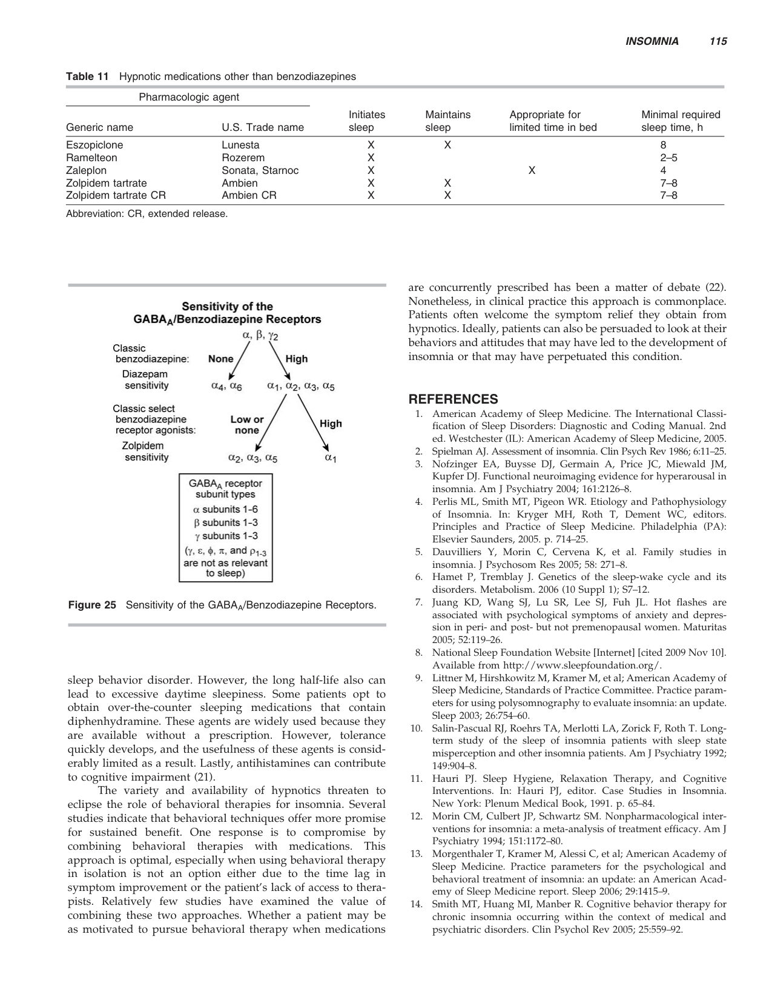

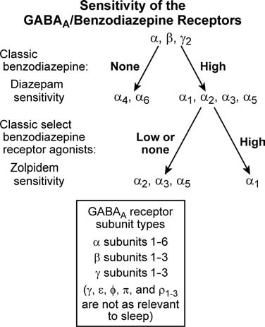

<!-- pdf-page: 129 -->

15. Ritterband LM, Thorndike FP, Gonder-Frederick LA, et al. Efficacy of an Internet-based behavioral intervention for adults with insomnia. Arch Gen Psychiatry 2009; 66:692–8. Erratum in: Arch Gen Psychiatry 2010; 67: 311. 16. NIH State of the Science Conference statement on manifestations and management of chronic insomnia in adults statement. J Clin Sleep Med 2005; 1:412–21. 17. Scharf MB, Roth T, Vogel GW, Walsh JK. A multicenter, placebocontrolled study evaluating zolpidem in the treatment of chronic insomnia. J Clin Psychiatry 1994; 55:192–9. 18. Krystal AD, Walsh JK, Laska E, et al. Sustained efficacy of eszopiclone over 6 months of nightly treatment: results of a randomized, double-blind, placebo-controlled study in adults with chronic insominia. Sleep 2003; 26:793–9.

19. Zammit GK, Gillin JC, McNabb L, Caron J, Roth T. Eszopiclone, a novel non-benzodiazepine anti-insomnia agent: a six-week efficacy and safety study in adult patients with chronic insomnia [abstract]. Sleep 2003; 26(Suppl): A297. 20. Richardson GS, Zammit G, Wang-Weigand S, Zhang J. Safety and subjective sleep effects of ramelteon administration in adults and older adults with chronic primary insomnia: a 1-year, open-label study. J Clin Psychiatry 2009; 70:467–76. Epub 2009 Mar 10. 21. Witek TJ Jr, Canestrari DA, Miller RD, Yang JY, Riker DK. Characterization of daytime sleepiness and psychomotor performance following H1 receptor antagonists. Ann Allergy Asthma Immunol 1995; 74:419–26. 22. Hauri PJ. Can we mix behavioral therapy with hypnotics when treating insomniacs? Sleep 1997; 20:1111–8.
