# Chapter 9 Movement Disorders and Parasomnias

<!-- pdf-page: 130 -->

## 9 Movement Disorders and Parasomnias

#### Michael H. Silber, MBChB, FCP (SA)

#### ABBREVIATIONS

NREM, non–rapid eye movement

RBD, rapid eye movement sleep behavior disorder

REM, rapid eye movement

RLS, restless legs syndrome

Abnormal movements and sensory perceptions during the night are rather arbitrarily divided into sleep-related movement disorders and parasomnias (1). Nocturnal seizures are considered a separate category of disorder, although they are commonly considered in the differential diagnosis of the other conditions. Clinical acumen and experience are often needed to identify the correct diagnosis from this fascinating spectrum of disorders.

#### SLEEP-RELATED MOVEMENT DISORDERS

#### Restless Legs Syndrome

In 1945 Doctor Karl-Axel Ekbom of Sweden published a 123- page monograph entitled Restless Legs (Figure 1) (2). This seminal work, with its meticulous clinical descriptions, was the first clear presentation about what has proven to be one of the most common sleep disorders. About 5% to 10% of the population experiences restless legs syndrome (RLS) (3–5), with severity ranging from an intermittent mild annoyance to a devastating disorder causing profound insomnia, daytime fatigue, and intense distress. RLS is characterized by four clinical criteria: 1) an irresistible urge to move the legs, usually but not always associated with discomfort; 2) occurrence at rest (while sitting or lying down); 3) at least temporary relief by movement; and 4) worsening of symptoms during the evening or at night (6). There are no tests with high sensitivity or specificity, and RLS is usually diagnosed on the basis of the patient’s history. Periodic limb movements of sleep on polysomnography are found in about 85% of patients with RLS (7), but these movements are nonspecific, being associated with a range of other sleep disorders as well as occurring with high frequency in normal older persons (Figure 2) (8). Some patients with RLS describe spontaneous jerking of the legs at rest while awake, which is known as periodic limb movements of wakefulness (Figure 3). RLS is more common in women, and it can start at any age, including during childhood. Current concepts of the pathogenesis of RLS center on a presumed dopamine deficiency in the basal ganglia that is associated with reduced iron content in regions of the brain. At least 50% of patients have a family history of the disorder,

especially if the symptoms commence before 50 years of age (7). The usual inheritance pattern is autosomal dominant, and linkages have been found to six chromosomal sites (Table 1). Genome-wide association studies have also identified predisposing polymorphisms on several genes (Table 2), but a coherent picture of the genetic influences contributing to the disorder has not yet emerged. Systemic iron deficiency, caused by conditions such as menorrhagia, gastrointestinal blood loss, or frequent blood donation, have been clearly associated with RLS; more severe symptoms are linked to serum ferritin concentrations in the low normal to low range (<50 mcg/L) (18). Cerebrospinal ferritin concentrations are lower in RLS patients than in controls, even in the presence of normal serum ferritin levels (19), and magnetic resonance imaging and autopsy studies have revealed low iron content in the basal ganglia (Figure 4) (20). The mechanism underlying low cerebral iron stores and the relation between iron and dopamine deficiency require further elucidation. Other associations with RLS include chronic renal failure, peripheral neuropathy, pregnancy, and the use of antidepressants, antihistamines, and neuroleptic agents. Management of RLS (Figure 5) commences with nonpharmacologic approaches (21). Physical activity, warm baths, massage, and mental alerting techniques can provide symptom relief. Some patients may benefit from a reduction in caffeine, nicotine, or alcohol intake. If low iron stores are detected, supplementation with oral iron preparations may be beneficial. Open-label studies of intravenous iron therapy have yielded promising results, but one controlled trial was stopped due to a lack of efficacy (22). Four groups of medications have been found useful in RLS management, and most patients can be helped by drug therapy. Dopaminergic agents, especially nonergot agonists such as pramipexole and ropinirole, are the first-line drugs for daily treatment of RLS (23). Antiseizure medications, especially gabapentin, are useful alternative or additional agents, whereas benzodiazepines may assist in providing relief by enhancing sleep. The opioids are highly effective agents, with high-potency opioids having a distinct role to play in treating refractory disease. The dopaminergic agents (especially levodopa) can induce a phenomenon known as augmentation (24), defined as an exacerbation of RLS that occurs after the commencement of treatment. It is usually characterized by the development of new RLS symptoms at a time of day before administration of the medication. Symptoms may also spread to the arms or increase in intensity. Augmentation occurs in 85% of patients taking levodopa and in about 32% of patients taking dopamine

<!-- pdf-page: 131 -->

agonists. The underlying mechanisms are poorly understood. Dopamine agonists can sometimes cause daytime sleepiness and impulse control disorders, such as compulsive gambling (25). The ergot agonists, such as cabergoline and pergolide, are seldom used today because of their tendency to cause cardiac valvular fibrosis.

#### Other Sleep-Related Movement Disorders

Periodic limb movement disorder consists of insomnia or hypersomnia in patients with periodic limb movements during sleep who do not have RLS or any other sleep disorder that can better explain their symptoms (1). As periodic limb movements are

Figure 1

Cover Page of First Comprehensive Monograph on Restless Legs Syndrome. In 1945 Dr Karl-Axel Ekbom, a Swedish neurologist, published the first comprehensive account of a disorder he called restless legs. His 123-page monograph covers clinical features, differential diagnosis, etiology, and therapy. Although concepts about the pathogenesis of restless legs syndrome and its therapy have evolved since Ekbom’s day, his description of the symptoms remains detailed, accurate, and vivid. (From Ekbom KA [2].)

generally asymptomatic epiphenomena of other sleep disorders or of aging, considerable caution should be exercised in relating the movements observed on a polysomnogram to the clinical complaints. Treatment of periodic limb movement disorder is similar to that for RLS. Sleep-related leg cramps are characterized by sudden painful spasms of leg muscles that wake the patient from sleep. In contrast to RLS, sleep-related cramps cause the muscle to feel hard upon palpation, and relief can best be obtained by massaging the cramp or standing on the leg rather than by walking. Most cases of sleep-related leg cramps are idiopathic. Treatment is difficult; quinine has been suggested, but controlled trials are unconvincing and quinine preparations have

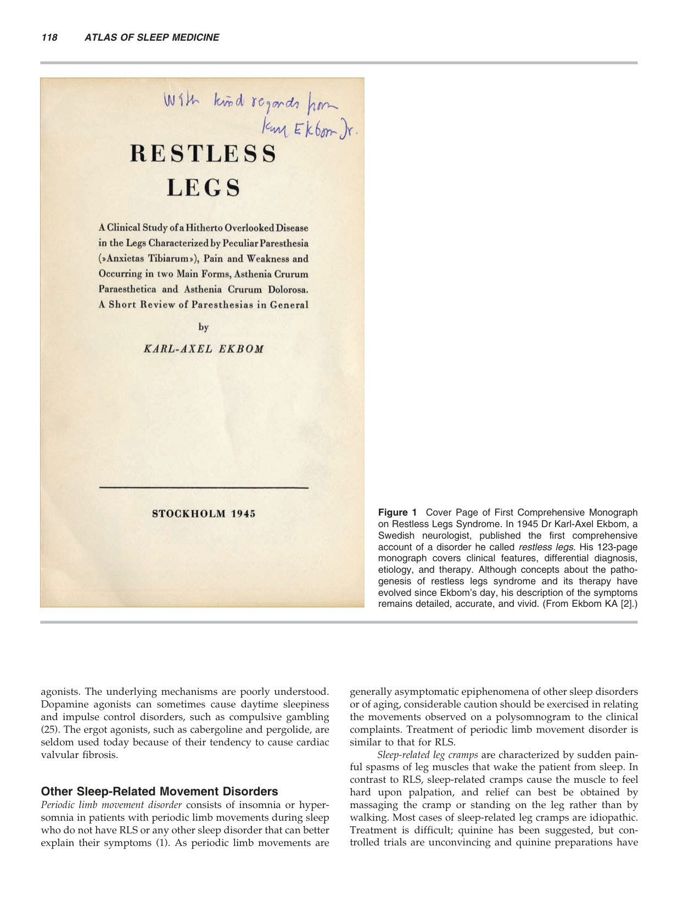

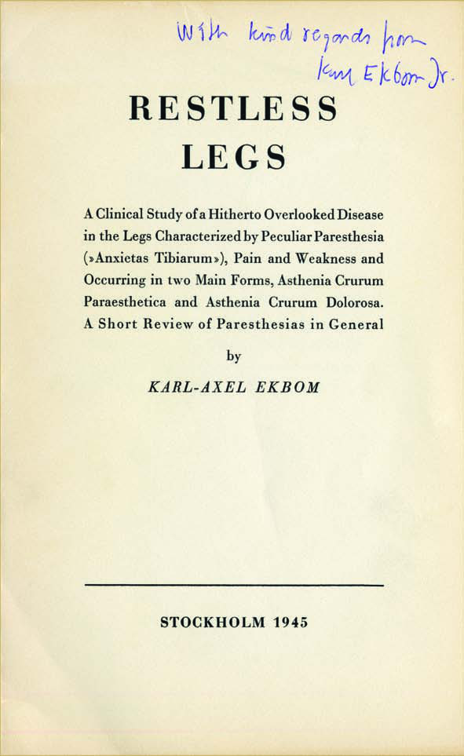

<!-- pdf-page: 132 -->

Figure 2

Periodic Limb Movements of Sleep. Periodic limb movements of sleep (PLMS) can be found in 85% of patients with restless legs syndrome but are nonspecific, often accompanying other sleep disorders such as obstructive sleep apnea and narcolepsy. This polysomnogram fragment shows PLMS. The duration of an individual movement is 0.5 to 10 seconds, the amplitude at least 8 microvolts, and the intermovement interval 5 to 90 seconds. At least 4 movements must occur successively in order for them to be classified as PLMS. Ant. tibial indicates anterior tibial muscles; ECG, electrocardiogram; EMG, electromyogram; LOC, left outer canthus; Oronasal airflow, airflow recorded by nasal pressure transducer; ROC, right outer canthus.

Genetic Subtypes Population Linkage Inheritance Reference

Table 1

Genetic linkage studies in restless legs syndrome

Figure 3

Periodic Limb Movements of Wakefulness. Periodic limb movements of wakefulness frequently accompany restless legs syndrome, as can be seen on this polysomnogram fragment. For explanation of labels, see Figure 2.

RLS 1 French Canadian 12q Autosomal recessive Desautels et al, 2001 (9) RLS 2 Italian 14q Autosomal dominant Bonati et al, 2003 (10) RLS 3 United States 9p Autosomal dominant Chen et al, 2004 (11) RLS 4 French Canadian 20p Autosomal dominant Levchenko et al, 2006 (12) RLS 5 Italian Tyrol 2q Autosomal dominant Pichler et al, 2006 (13) RLS 6 Italian 19p Autosomal dominant Kemlink et al, 2008 (14)

Abbreviation: RLS, restless legs syndrome.

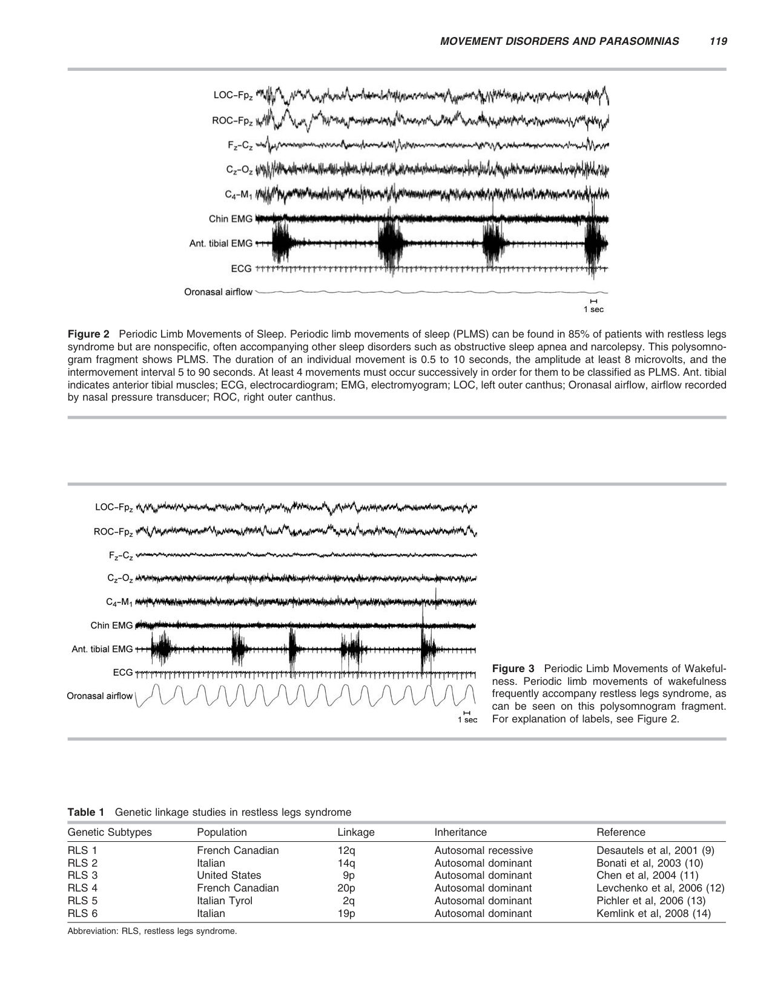

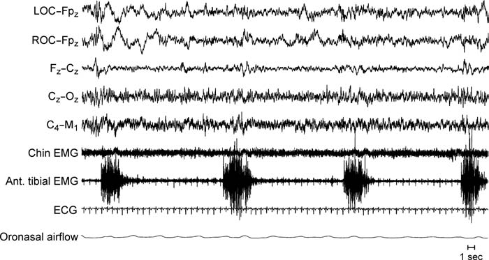

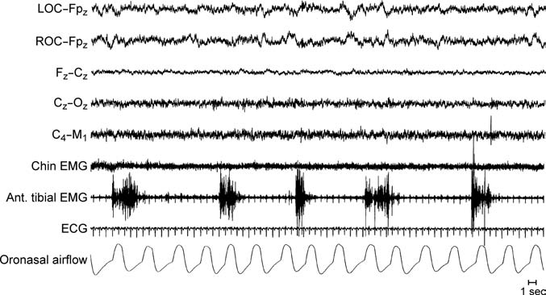

<!-- pdf-page: 133 -->

Table 2

Genome-wide association studies in restless legs syndrome

Population Disorder Chromosome Gene Protein Reference

French Canadian; European RLS 2p MEIS-1 Expressed in substantia nigra; spinal motor neuron connectivity; limb formation

Winkelmann et al, 2007 (15)

RLS and PLMS 6p BTBD9 Widely expressed in brain Winkelmann et al, 2007 (15) Stefansson et al, 2007 (16)

French Canadian; European; Icelandic

Winkelmann et al, 2007 (15)

French Canadian; European RLS 15q MAP2K5- LBOXCOR1 Neuroprotection of dopamine neurons; development of sensory pathways in spinal cord dorsal horn

Icelandic; United States PLMS 6p GLO1 Glycoxalase 1 (glycolytic pathway) Stefansson et al, 2007 (16)

Icelandic; United States PLMS 6p DNAH8 Microtubule-associated complex Stefansson et al, 2007 (16)

European; Canadian RLS 9p PTPRD Embryonic axon guidance of motor neurons Schormair et al, 2008 (17)

Abbreviations: PLMS, periodic limb movements of sleep; RLS, restless legs syndrome.

the potential for serious cardiac and hematologic side effects (26). The only quinine preparation still being marketed in the United States is not approved for the treatment of leg cramps. Sleep-related rhythmic movement disorder is characterized by regular stereotyped contractions of large muscle groups that occur during drowsiness or sleep (Figure 6) (1). It includes body rocking and head banging, but it may occasionally manifest as other movements such as leg jerking. Rhythmic movement disorder falls into a twilight area between involuntary movements and quasi-voluntary activity. Many patients report being aware of their movements when they are lying in bed and indicate that they have always moved their body to facilitate the onset of sleep. However, the movements often persist into

Figure 4

Reduced Iron Stores in the Brains of Patients With Restless Legs Syndrome. Seven brains from patients with restless legs syndrome were compared with the brains of 5 controls. The number of substantia nigra neuromelanin cells immunostaining for tyrosine hydroxylase was compared. (A and B) In both of these parts of Figure 4, neuromelanin stains brown and tyrosine hydroxylase stains blue. (Arrows point to typical cells as examples.) There was no significant difference between the brains of controls (A) and those of persons with restless legs syndrome (RLS) (B). (C and D) In both of these parts of Figure 4, the sections were stained for H-ferritin (blue). In the control brain (C), H-ferritin can be seen in the neuromelanin cells (white arrow) and in the parenchyma (black arrow). In contrast, in the RLS brain (D), there is no detectable H-ferritin in the neuromelanin cells and H-ferritin is present in only a few glial cells (black arrows). These findings are consistent with absent iron stores in the substantia nigra neurons in RLS brains. (From Connor JR, Boyer PJ, Menzies SL, et al. Neuropathological examination suggests impaired brain iron acquisition in restless legs syndrome. Neurology 2003; 61:304–9. [Used with permission.])

stage N1 and stage N2 sleep and occasionally can even be observed during rapid eye movement (REM) sleep. Rhythmic movement disorder is extremely common in infants but usually resolves by five years of age. However, in some patients it may persist into adulthood. It is more common in mentally handicapped or autistic children, who might have to wear a helmet to protect the head from injury. Drug therapy is rarely helpful. Sleep-related bruxism is a common complaint (27,28) that consists of grinding the teeth during sleep (Figure 7). Bruxism may result in jaw pain and physical damage to the teeth. It is most common during stage N1 and stage N2 sleep, and it can sometimes be seen during arousal from episodes of sleep apnea. Treatment usually involves the wearing of a dental protection device at night.

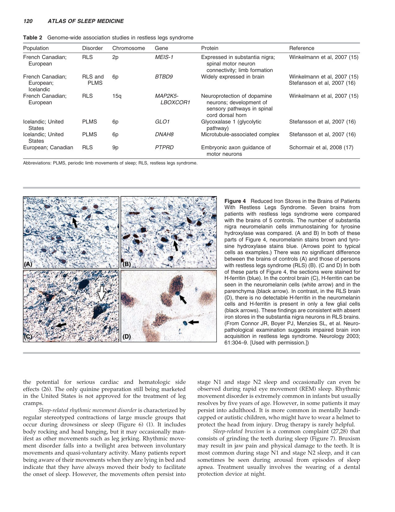

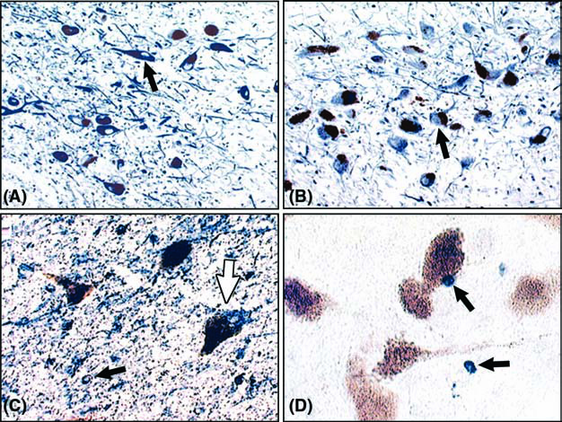

<!-- pdf-page: 134 -->

Figure 5

Management of Restless Legs Syndrome. The Medical Advisory Board of the Restless Legs Syndrome (RLS) Foundation has formulated an algorithm for the management of RLS. (A) Intermittent RLS is troublesome enough to require treatment but does not occur sufficiently often to require daily therapy. (B) Daily RLS is troublesome and occurs frequently enough to require daily therapy. (C) Refractory RLS has been treated with a dopamine agonist, resulting in at least one of the following outcomes: inadequate response, intolerable side effects, development of tolerance, or uncontrollable daytime augmentation. (From Silber MH, Ehrenberg BL, Allen RP, et al; Medical Advisory Board of the Restless Legs Syndrome Foundation. An algorithm for the management of restless legs syndrome. Mayo Clin Proc 2004; 79: 916-22. [Used with permission.])

#### PARASOMNIAS

Parasomnias are undesirable, paroxysmal, motor, or sensory phenomena that occur during sleep. Parasomnias are classified according to the state of sleep from which they arise: non–rapid eye movement (NREM) parasomnias, REM parasomnias, or non–state-dependent parasomnias. Many of the terrifying

Figure 6

Rhythmic Movement Disorder. This 30-second polysomnogram fragment shows movement artifact at 1.5 Hz visible on the electro-oculogram, electroencephalogram, and respiratory channels. The patient rocked his head from side to side at the same frequency. Abd indicates abdominal inductance plethysmography; Chest, thoracic inductance plethysmography; Ext. digitorum, extensor digitorum communis; Oronasal therm., oronasal thermocouple; SaO2, arterial oxygen saturation; Sono, recording of upper airway sound; Sum, the arithmetic sum of the signals of chest and abdominal inductance plethysmography. For explanation of other labels, see Figure 2.

nighttime phenomena of folklore, such as incubi and night hags, are due to parasomnias. The diagnosis of a parasomnia can often be made by taking a careful history from the patient and bed partner or another observer, especially when the disorder manifests in childhood. However, when the diagnosis is uncertain, further

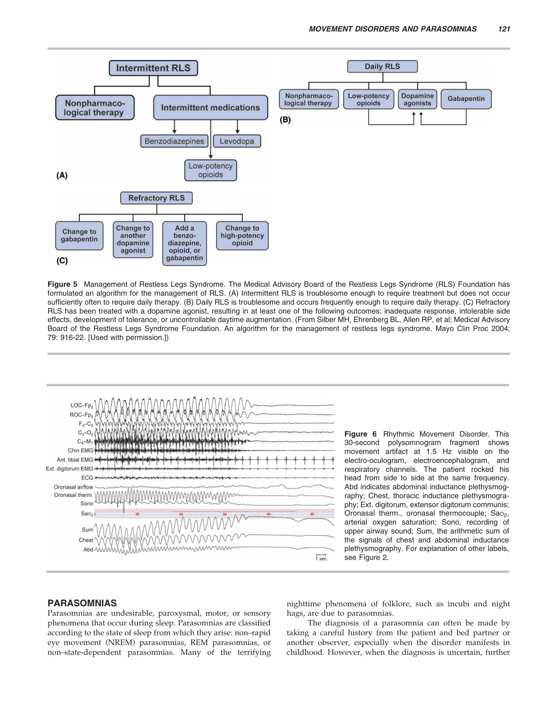

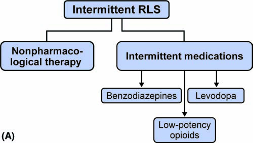

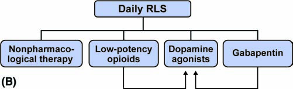

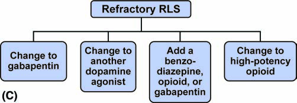

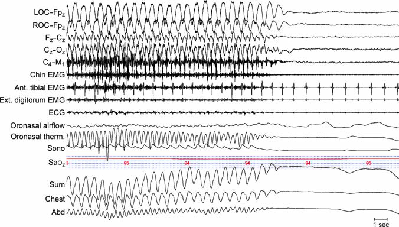

<!-- pdf-page: 135 -->

Figure 7

Bruxism. This 30-second polysomnogram fragment indicates rhythmic electromyogram activity from the outer canthi and mastoid electrodes at a frequency of 0.5 to 1 Hz. These findings are typical of bruxism. Airflow indicates oronasal airflow recorded by nasal pressure transducer. For explanation of other labels, see Figure 2.

studies are required, especially if either a seizure disorder or obstructive sleep apnea are possible alternatives or if the events are potentially injurious to the patient or others (Figure 8). Although a wake and sleep electroencephalogram and mag-

netic resonance imaging scan of the brain may be important for some patients, the most useful investigation is extended polysomnography. Video electroencephalographic polysomnography consists of a traditional comprehensive polysomnogram

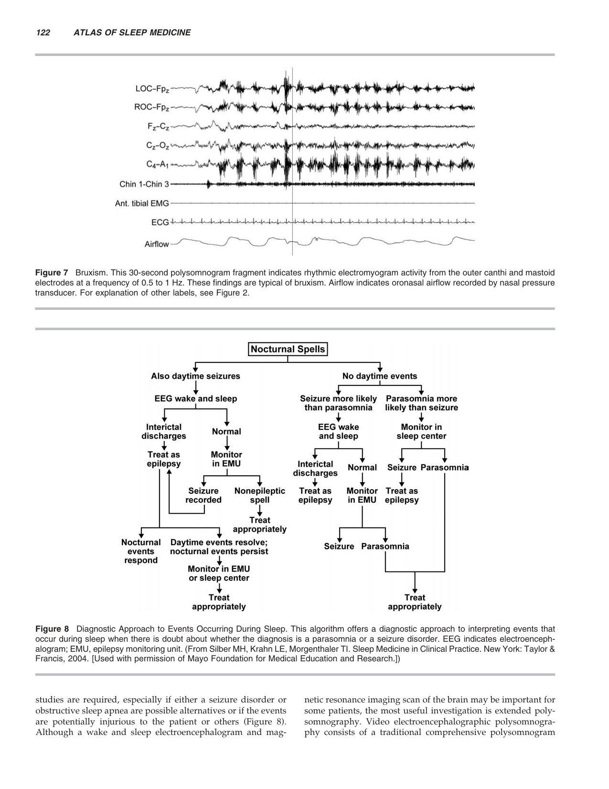

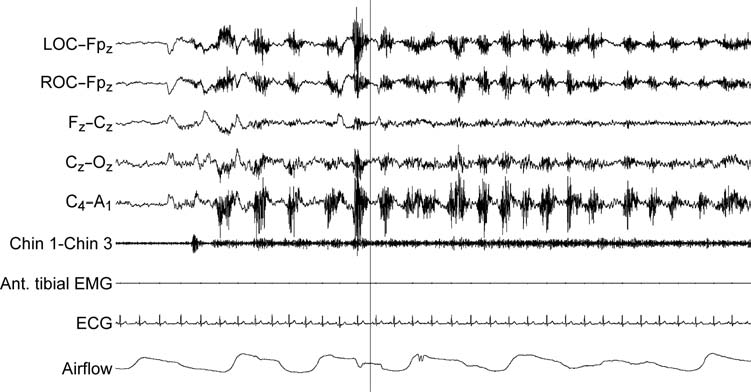

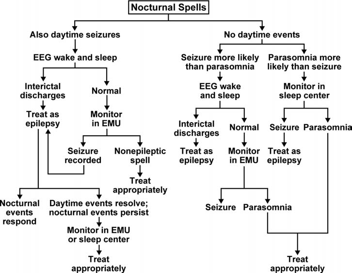

<!-- pdf-page: 136 -->

combined with an additional 16 electroencephalographic derivations, additional arm surface electromyography, and timesynchronized video and audio recordings (29). Interpreters of these studies should be familiar with the polysomnographic manifestations of sleep-disordered breathing as well as with the electroencephalographic changes caused by seizures (Figure 9). The primary goal, of course, is to record one of the patient’s typical events. However, even if such a recording cannot be obtained, helpful information may be gleaned from a careful review of the record: increased muscle tone during REM sleep suggests REM sleep behavior disorder (RBD); the presence of confusional arousals suggests that sleepwalking may occur on other nights; and interictal spike discharges may be evidence of a seizure disorder.

#### Parasomnias Associated With NREM Sleep

The arousal disorders are characterized by abnormal behavior following sudden partial arousals from NREM, usually slowwave sleep (Figure 10) (30). These disorders include sleepwalking, sleep terrors, and confusional arousals, but the clinical manifestations often overlap among the three entities. Events occur generally in the first third of the night, corresponding to the timing of most slow-wave sleep. Patients are unresponsive to external stimuli during the arousal events and are usually confused when awakened, with little memory of what transpired. Dream recall is rare. In classic sleepwalking, the patient exhibits coordinated motor activity, such as standing by the bed or walking around. Sleep terrors manifest with autonomic, motor, and vocal manifestations of intense fear, whereas

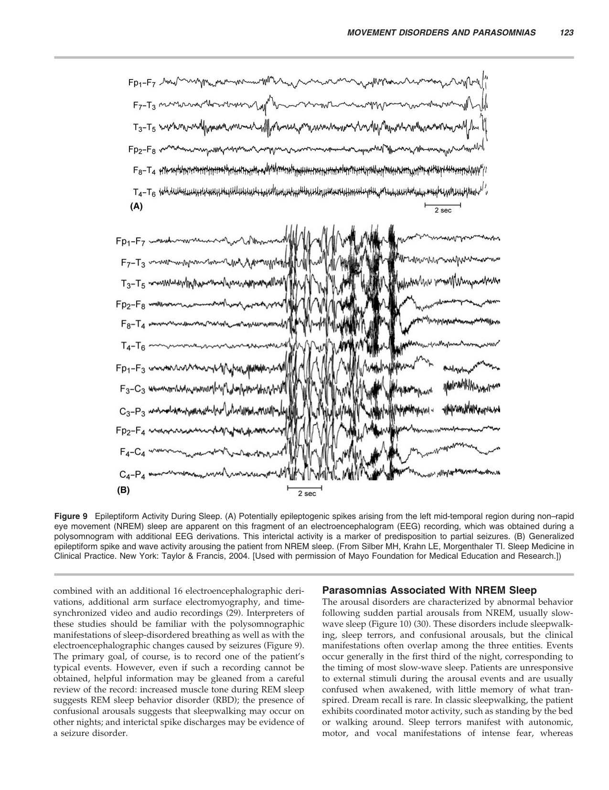

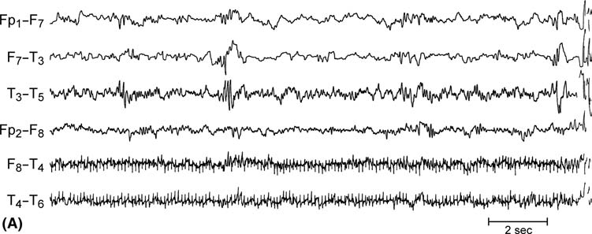

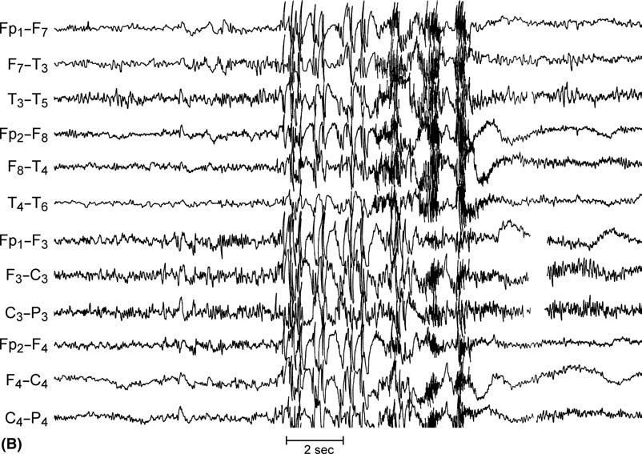

<!-- pdf-page: 137 -->

Figure 10

Confusional Arousal. A 30-second polysomnogram shows a sudden arousal from slow-wave sleep followed by muscle artifact and mixed-frequency electroencephalographic (EEG) activity. The patient sat up and fidgeted with the EEG leads. Ext. digitorum indicates extensor digitorum communis. For explanation of other labels, see Figure 2.

patients with confusional arousals generally appear disorientated but have neither the complex mobility of sleepwalking nor the severe fright of sleep terrors. Arousal disorders are common in childhood, and as many as 2% to 4% of adults report walking in their sleep (31,32). The pathophysiology of arousal disorders remains obscure. Patients appear to be “entrapped” between the states of slow-wave sleep and wakefulness, with possibly a blunted arousal response. The high frequency of arousal disorders in young persons suggests the possibility of delayed maturation of the neural pathways that mediate the transition to wake, possibly with a genetic basis, as evidenced by the occurrence of many familial cases. Numerous factors precipitate the events on any particular night. These include circumstances that deepen slow-wave sleep, such as rebound from sleep deprivation or unusual sleep-wake cycles, medications that prevent complete awakening from sleep, and factors that increase arousals, such as environmental noise, medical conditions including sleep apnea, and psychological stress (Figure 11). Violent behavior during arousal parasomnias is rare but can have profound consequences (33). Sleepwalkers have been known to throw themselves out of windows, sometimes resulting in severe injuries. Sleepwalkers may walk into furniture, leave their homes, and very occasionally even start up and drive their cars. Violence against others rarely occurs, but there have been documented cases of physical and sexual assault or even homicide perpetrated by sleepwalkers. To successfully sustain a claim that such behaviors occurred while asleep, the assailant must provide evidence of a past history of sleepwalking, should have had no motive for the assault, should react with perplexity and horror to being told about it, and should have made no attempt at concealment when confronted with the consequences of the actions (34). Management of noninjurious parasomnias in children may often only involve reassurance to the parents that the events are of little clinical consequence and that most children will outgrow them. Treatment may be needed if the events are violent or dangerous, disruptive to the family, or result in

embarrassment, such as while away from home (e.g., during sleepovers or while away at college). Behavioral techniques include addressing sleep hygiene, hypnosis (35), or scheduled anticipatory awakenings in which the patient is awakened a few minutes before the habitual time of the events. Medications that may be effective include the intermediate- or long-acting benzodiazepines, such as clonazepam (36). Short-acting hypnotics, such as zolpidem, should be used with caution, as they may sometimes induce sleepwalking themselves (37).

#### Parasomnias Associated With REM Sleep

RBD is characterized by loss of the skeletal muscle atonia that characterizes normal REM sleep and resultant complex motor activity associated with dreaming (38,39). For unknown reasons, about 90% of patients with RBD are men. It is predominantly a disorder of middle to older age, with the mean age of onset being reported in different series as 53 and 61 years. However, RBD has been identified in younger patients, including children. Patients kick, flail their arms, punch, shout, and scream during REM sleep. These behaviors can be injurious to the patients and their bed partners: patients may throw themselves out of bed, sometimes causing severe personal injuries, and they may punch, slap, kick, or even throttle their bed partners. Dreams may change and become more violent; usually patients with RBD dream that they are being attacked by a person or an animal and are trying to defend themselves when they inadvertently assault their bed partners. There is no change in their waking personality; however, one study showed that RBD patients scored lower than controls on daytime aggression scales (40). The polysomnogram shows increased muscle tone during the REM sleep of persons with RBD (Figure 12). Even if actual events are not recorded in the laboratory, the loss of REM sleep atonia and the presence of a typical history are diagnostic of the disorder. RBD is closely related to neurodegenerative disorders, especially the synucleinopathies, which include Parkinson disease, dementia with Lewy bodies, and multiple system atrophy (41).

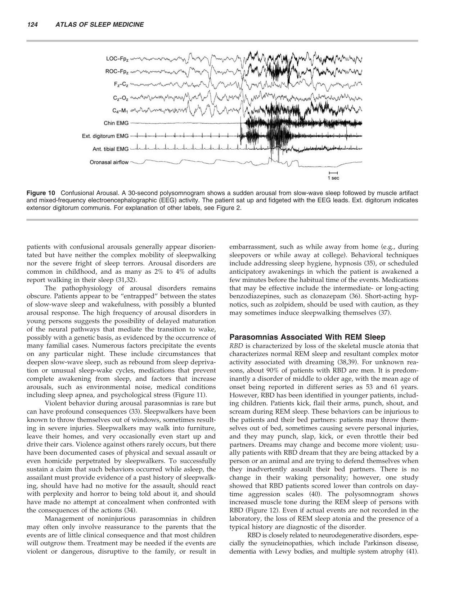

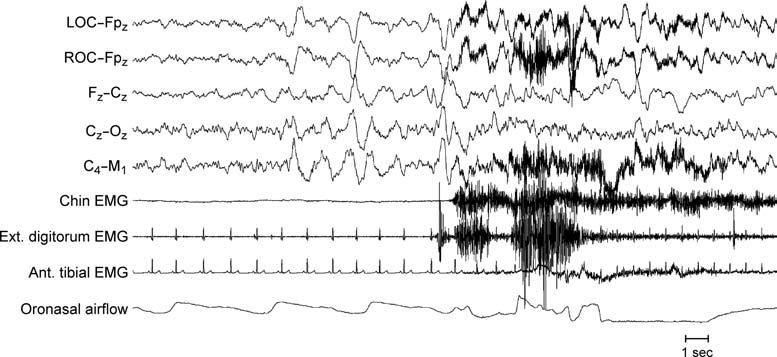

<!-- pdf-page: 138 -->

It has been detected in 15% to 33% of patients with Parkinson disease (42) and in 60% to 90% of patients with multiple system atrophy (43,44). There is extensive convergent evidence that Lewy body disease will develop in most patients with idiopathic RBD,

Figure 11

Lady Macbeth Sleepwalking. Lady Macbeth, a central character in William Shakespeare’s play, Macbeth, is perhaps the most famous fictional sleepwalker. Tormented by the murder of King Duncan, which she and her husband planned and he executed, she walks in her sleep, trying to wash off the blood she imagines is on her hands. Shakespeare’s dialogue shows that he understood the essence of sleepwalking. The watching doctor comments, “You see, her eyes are open,” to which Lady Macbeth’s gentlewoman in waiting replies, “Ay, but their sense is shut.” (Act V, Scene 1, Macbeth.) (Oil on canvas titled Lady Macbeth Sleep Walking [1784] by John Henry Fuseli.) (From the Muse´e du Louvre, Paris, France. [Used with permission.])

and thus RBD alone most often represents an early manifestation of this disorder. Of 29 patients with idiopathic RBD in one study, Parkinsonism or dementia developed in 65%, a mean of 13 years after onset of RBD (45). Autopsy findings of extensive Lewy

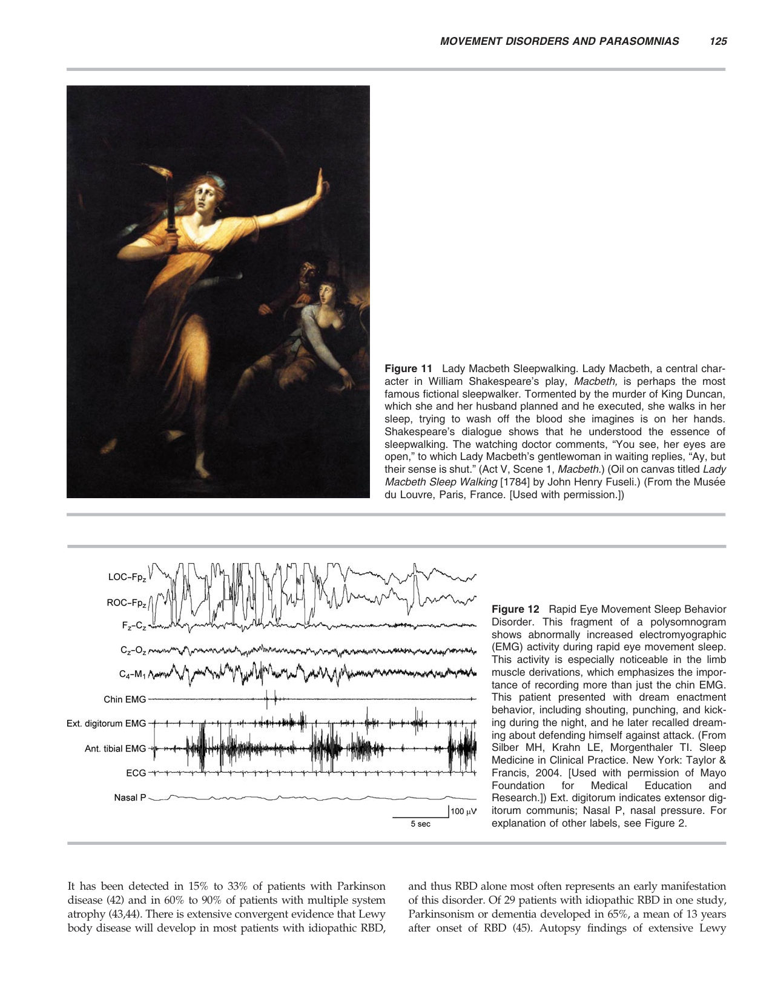

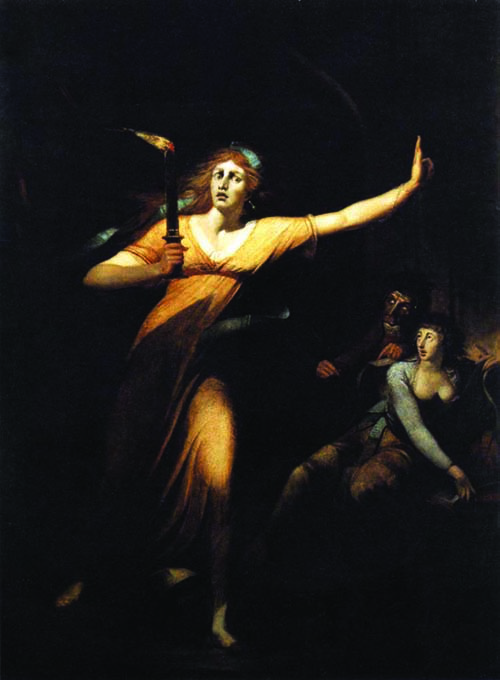

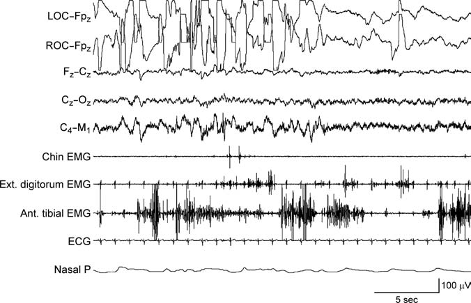

<!-- pdf-page: 139 -->

Figure 13

Positron Emission Tomography Studies Show Rapid Eye Movement Sleep Behavior Disorder as a Precursor of Parkinson Disease. Six patients with rapid eye movement sleep behavior disorder (RBD) without definite Parkinsonism and 19 age-matched control subjects underwent positron emission tomography scans performed with [11C]dihydrotetrabenazine (DTBZ). DTBZ binds to the brain vesicular monoamine transporter, and its density in the striatum is a measure of the number of dopaminergic neurons in the substantia nigra. Significant reduction in DTBZ binding was found in the striatum of two of the patients (middle and right) compared with that of the controls (left). This finding suggests that patients with RBD have reduced dopaminergic neurons in the substantia nigra, which is compatible with subclinical Parkinson disease. RBD is often an early marker of Lewy bodies pathology. (From Albin RL, Koeppe RA, Chervin RD, et al. Decreased striatal dopaminergic innervation in REM sleep behavior disorder. Neurology 2000; 55:1410-12. [Used with permission.])

bodies were reported in two RBD patients with normal neurological examinations at the time of death (41,46). Otherwise asymptomatic RBD patients have been shown to exhibit subtle changes in visuospatial function, olfaction, autonomic function, electroencephalographic power, and positron emission tomography (Figure 13) (47). Not all RBD patients have a neurodegenerative disorder. RBD can occur with antidepressant treatment, narcolepsy, and, rarely, with structural lesions affecting the lower brainstem (Figures 14-16) (41,48). Management includes improving the safety of the bedroom environment by moving furniture away from the bed and sometimes placing cushions or a soft mattress on the floor adjacent to the bed. The most effective medication is clonazepam, with about a 90% success rate in open-label studies (38,39). Unfortunately,

this drug can cause sleepiness, cognitive impairment, gait unsteadiness, and impotence in older patients, especially in those with a neurodegenerative disorder. An alternative agent is melatonin, which has been found to be effective in several open-label studies (49–51). Nightmare disorder is characterized by recurrent frightening dreams. Although occasional nightmares are common and of little clinical significance, recurrent nightmares should raise suspicion of posttraumatic stress disorder. Nightmares differ from sleep terrors in that they arise from REM sleep and are associated with vivid dream recall, and they differ from RBD by the absence of motor activity. Recurrent isolated sleep paralysis consists of repeated episodes of paralysis of voluntary muscles, accompanied by the inability to speak or move the

Figure 14

Association of Lesions Causing Rapid Eye Movement Sleep Behavior Disorder With Brainstem Neurons. This schematic figure shows the overlap between lesions reported to cause rapid eye movement sleep behavior disorder (RBD) and areas of the brainstem known to be associated with rapid eye movement (REM) sleep. The red areas represent the REM-off regions and the green areas represent the REM-on regions. The orange area is the raphe nuclei, the blue area is the locus coeruleus and the yellow regions are the lateral dorsal tegmental and pedunculopontine nuclei. The gray and hatched regions indicate lesions in three patients with RBD due to multiple sclerosis, a cavernous hemangioma, or an infarct. As can be seen, there is considerable overlap of the lesions with the neuronal groups associated with REM sleep. Figures A to D show transverse sections through the brainstem at the levels indicated on the midline sagittal section. (From Boeve BF, Silber MH, Saper CB, et al. Pathophysiology of REM sleep behaviour disorder and relevance to neurodegenerative disease. Brain 2007; 130:2770-88. [Used with permission.])

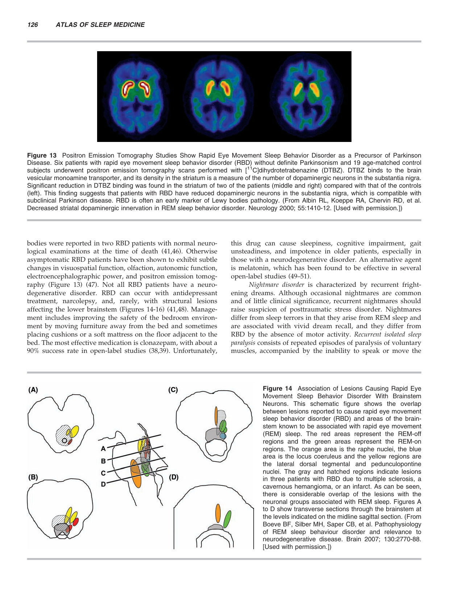

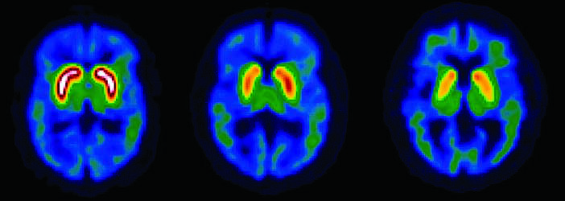

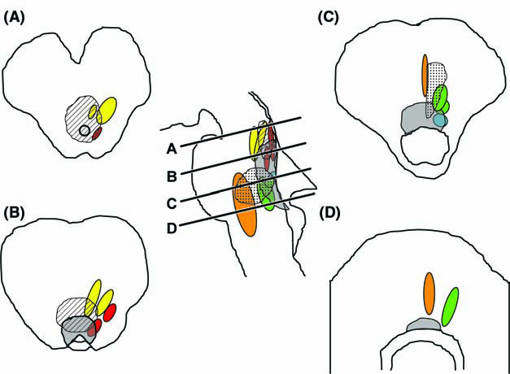

<!-- pdf-page: 140 -->

Figure 16

An Extra-Axial Brain Tumor Causing Rapid Eye Movement Sleep Behavior Disorder. A 64-year-old man presented with a twoyear history of daily dream-enactment behavior due to rapid eye movement sleep behavior disorder (RBD). He would flail his arms, yell, kick, and hit the wall or his wife. He dreamed that he was being chased by animals. For the preceding nine months before presentation, he had noticed diplopia, decreased cognition, and shuffling gait. Examination revealed a right abducens neuropathy and a left hemiparesis. Magnetic resonance imaging showed a large right clivus meningioma (A and B [arrows]) compressing and displacing the pons and causing hydrocephalus. (A) T1-weighted sagittal view without contrast; (B) T1-weighted axial view with contrast. After the hydrocephalus was shunted and the meningioma was resected, the patient had complete resolution of the dream-enactment behavior.

Figure 15

A Case of Rapid Eye Movement Sleep Behavior Disorder and Multiple Sclerosis. A 51-year-old woman with known multiple sclerosis had an acute attack of rapid eye movement sleep behavior disorder that affected the brainstem and was accompanied by vertigo, dysarthria, ataxia, diplopia, and bifacial weakness. She had an acute onset of dream enactment behavior, with screaming, groaning, flailing, and thrashing. T2-weighted magnetic resonance imaging ([A] midline sagittal view and [B] transverse view) showed an area of inflammation in the dorsal pons (A and B [arrow]), whereas polysomnography (C) showed increased muscle tone during REM sleep. Abd indicates abdominal plethysmography; Chest, rib cage plethysmography; Ext. digitorum, extensor digitorum communis; Nasal P, nasal pressure; SaO2, arterial oxygen saturation; Sono, recording of upper airway sound; Sum, the arithmetic sum of rib cage and abdominal plethysmography. For explanation of other labels, see

Figure 2. (From Tippmann-Peikert M, Boeve BF,

Keegan BM. REM sleep behavior disorder initiated by acute brainstem multiple sclerosis. Neurology 2006; 66:1277-9. [Used with permission.])

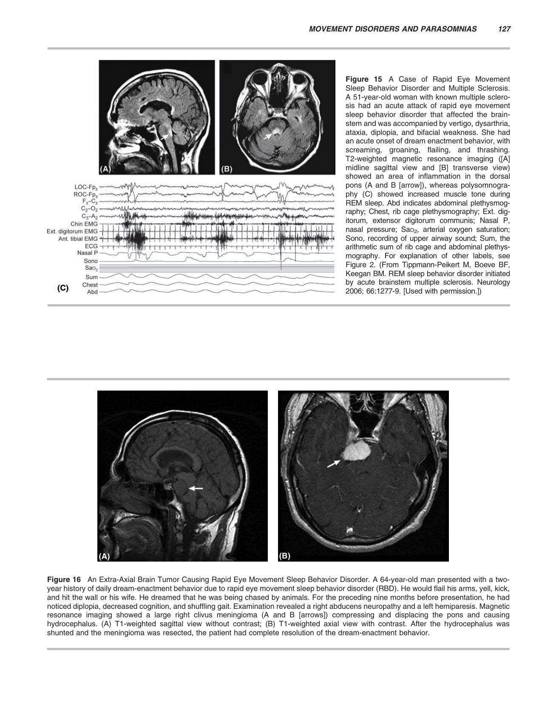

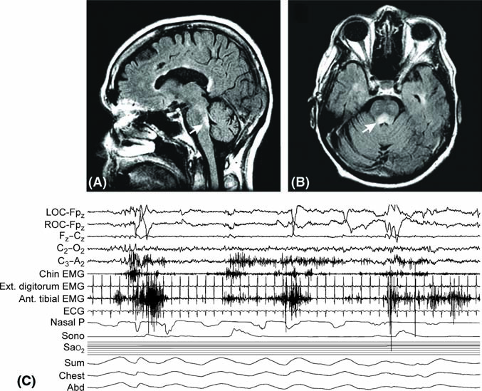

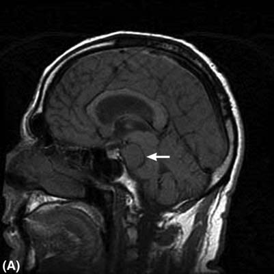

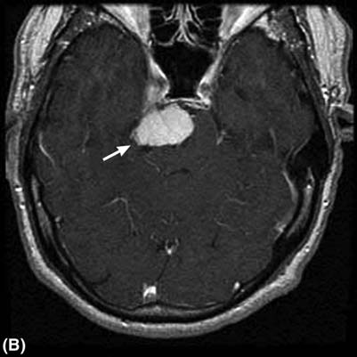

<!-- pdf-page: 141 -->

limbs at sleep onset or upon awakening in the absence of narcolepsy. These events appear to arise from REM sleep and may be associated with hallucinatory experiences. They generally commence during adolescence and resolve later in life without clinical consequences.

#### Non–State-Dependent Parasomnias

Sleep-related eating disorder is a parasomnia in which patients, most commonly women, leave their beds to eat but later have little or no recall of their actions (52). Patients often eat unusual combinations of high-calorie food in a sloppy manner. Sleeprelated eating disorder has been associated with other forms of sleepwalking, affective disorders, anxiety disorder, prior substance abuse, sleep apnea, and RLS. It can occur in patients taking short-acting hypnotics, especially zolpidem (37). The differential diagnosis includes night-eating syndrome in which patients, with full awareness, consume more than half their daily caloric intake during the night and then have early morning satiety. These two conditions may be related because some patients show variable recall of their night eating (53). In addition, the use of zolpidem has been known to transform voluntary night eating into amnestic sleep eating. Treatment of sleeprelated eating disorder is challenging. Comorbid conditions, including sleep apnea and RLS, should be treated, and shortacting hypnotics should be discontinued. Longer-acting agents such as temazepam or clonazepam may be helpful. Topiramate has been suggested as a possible therapeutic agent (54).

Sleep-related groaning (catathrenia) is a rare phenomenon characterized by deep inspirations followed by prolonged expirations during which the patient makes a monotonous groaning sound (Figure 17) (55,56). The events occur predominantly during REM sleep but the sleeper’s muscles remain atonic. The only apparent consequence is disruption of the sleep of the bed partner. The disorder usually commences in early adulthood and is more common in men. Its pathophysiology is unknown. Management is extremely difficult, but some cases respond to continuous positive airway pressure. Sleep-related hallucinations include multimodal hallucinatory experiences at sleep onset (hypnagogic hallucinations), as well as complex visual hallucinations on waking during the night. Although hypnagogic hallucinations may be associated with narcolepsy, in isolation they are extremely common and are not considered pathologic. Complex nocturnal hallucinations, which are characterized by vivid figures of distorted people and animals, occur after waking during sleep and usually last less than 5 minutes, disappearing when a light is switched on (57). They may be associated with a number of different etiologies, including anxiety disorder, the use of b-adrenergic antagonists, Lewy body disease, and visual loss (Charles Bonnet syndrome [release hallucinations]). Exploding head syndrome is characterized by an impression of a usually painless explosion in the head or a sudden loud noise that occurs at the transition between wake and sleep or sleep and wake (1). Its pathophysiology is unknown, but the condition appears to be a sensory analogue of the more

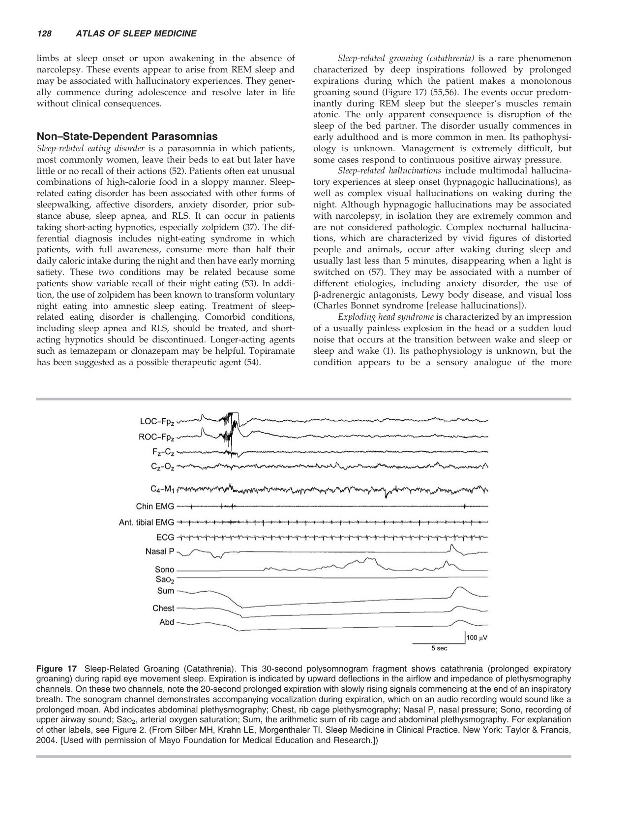

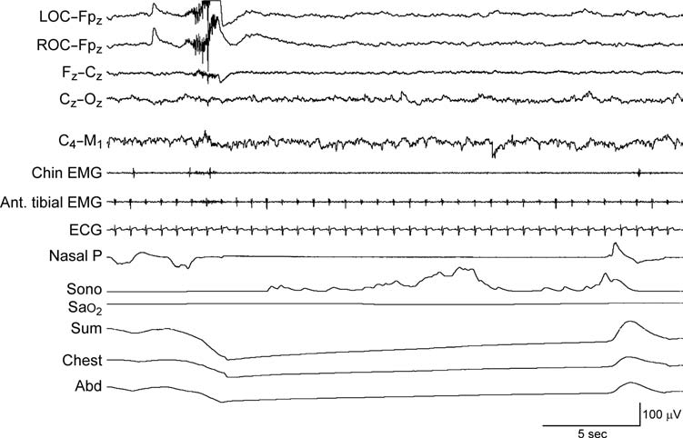

<!-- pdf-page: 142 -->

common benign sleep starts, which manifest as sudden jerks of the body at sleep onset. Sleep-related dissociative disorders are psychogenic dissociative events that occur during wakefulness after arousal from sleep. Most patients with this disorder also manifest dissociative behaviors during the day. It is important to differentiate this entity from the arousal parasomnias. Sleep enuresis consists of the involuntary voiding of urine after an age (about 5 years) at which a child can generally maintain bladder control throughout the night. Urologic abnormalities should be excluded. Management involves the use of behavioral techniques and occasionally the administration of nasal desmopressin.

#### REFERENCES

1. American Academy of Sleep Medicine. The International Classification of Sleep Disorders: Diagnostic and Coding Manual. 2nd ed. Westchester (IL): American Academy of Sleep Medicine, 2005. 2. Ekbom KA. Restless Legs: A Clinical Study of a Hitherto Overlooked Disease in the Legs Characterized by Peculiar Paresthesia (“Anxietas Tibiarum”), Pain and Weakness and Occurring in Two Main Forms, Asthenia Crurum Paraesthetica and Asthenia Crurum Dolorosa: A Short Review of Paresthesias in General. Stockholm: Ivar Hoeggstroms, 1945. 3. Hogl B, Kiechl S, Willeit J, et al. Restless legs syndrome: a community-based study of prevalence, severity, and risk factors. Neurology 2005; 64:1920–4. 4. Nichols DA, Allen RP, Grauke JH, et al. Restless legs syndrome symptoms in primary care: a prevalence study. Arch Intern Med 2003; 163:2323–9. 5. Phillips B, Young T, Finn L, Asher K, Hening WA, Purvis C. Epidemiology of restless legs symptoms in adults. Arch Intern Med 2000; 160:2137–41. 6. Allen RP, Picchietti D, Hening WA, Trenkwalder C, Walters AS, Montplaisir J; Restless Legs Syndrome Diagnosis and Epidemiology Workshop at the National Institutes of Health; International Restless Legs Syndrome Study Group. Restless legs syndrome: diagnostic criteria, special considerations, and epidemiology. A report from the Restless Legs Syndrome Diagnosis and Epidemiology Workshop at the National Institutes of Health. Sleep Med 2003; 4:101–19. 7. Montplaisir J, Boucher S, Poirier G, Lavigne G, Lapierre O, Lesperance P. Clinical, polysomnographic, and genetic characteristics of restless legs syndrome: a study of 133 patients diagnosed with new standard criteria. Mov Disord 1997; 12:61–5. 8. Ancoli-Israel S, Kripke DF, Klauber MR, Mason WJ, Fell R, Kaplan O. Periodic limb movements in sleep in community-dwelling elderly. Sleep 1991; 14:496–500. 9. Desautels A, Turecki G, Montplaisir J, Sequeira A, Verner A, Rouleau GA. Identification of a major susceptibility locus for restless legs syndrome on chromosome 12q. Am J Hum Genet 2001; 69:1266–70. Epub 2001 Nov 6. 10. Bonati MT, Ferini-Strambi L, Aridon P, Oldani A, Zucconi M, Casari G. Autosomal dominant restless legs syndrome maps on chromosome 14q. Brain 2003; 126(Pt 6):1485–92. 11. Chen S, Ondo WG, Rao S, Li L, Chen Q, Wang Q. Genomewide linkage scan identifies a novel susceptibility locus for restless legs syndrome on chromosome 9p. Am J Hum Genet 2004; 74:876–85. Epub 2004 Apr 7. 12. Levchenko A, Provost S, Montplaisir JY, et al. A novel autosomal dominant restless legs syndrome locus maps to chromosome 20p13. Neurology 2006; 67:900–1. 13. Pichler I, Marroni F, Volpato CB, et al. Linkage analysis identifies a novel locus for restless legs syndrome on chromosome 2q in a South Tyrolean population isolate. Am J Hum Genet 2006; 79:716–23.

14. Kemlink D, Plazzi G, Vetrugno R, et al. Suggestive evidence for linkage for restless legs syndrome on chromosome 19p13. Neurogenetics 2008; 9:75–82. 15. Winkelmann J, Schormair B, Lichtner P, et al. Genome-wide association study of restless legs syndrome identifies common variants in three genomic regions. Nat Genet 2007; 39:1000–6. 16. Stefansson H, Rye DB, Hicks A, et al. A genetic risk factor for periodic limb movements in sleep. N Engl J Med 2007; 357:639–47. 17. Schormair B, Kemlink D, Roeske D, et al. PTPRD (protein tyrosine phosphatase receptor type delta) is associated with restless legs syndrome. Nat Genet 2008; 40:946–8. 18. Sun ER, Chen CA, Ho G, Earley CJ, Allen RP. Iron and the restless legs syndrome. Sleep 1998; 21:371–7. 19. Earley CJ, Connor JR, Beard JL, Malecki EA, Epstein DK, Allen RP. Abnormalities in CSF concentrations of ferritin and transferrin in restless legs syndrome. Neurology 2000; 54:1698–700. 20. Connor JR, Boyer PJ, Menzies SL, et al. Neuropathological examination suggests impaired brain iron acquisition in restless legs syndrome. Neurology 2003; 61:304–9. 21. Silber MH, Ehrenberg BL, Allen RP, et al; Medical Advisory Board of the Restless Legs Syndrome Foundation. An algorithm for the management of restless legs syndrome. Mayo Clin Proc 2004; 79:916–22. Erratum in: Mayo Clin Proc 2004; 79: 1341. 22. Earley CJ, Horska A, Mohamed MA, Barker PB, Beard JL, Allen RP. A randomized, double-blind, placebo-controlled trial of intravenous iron sucrose in restless legs syndrome. Sleep Med. 2009; 10:206–11. Epub 2008 Feb 14. 23. Hening WA, Allen RP, Earley CJ, Picchietti DL, Silber MH; Restless Legs Syndrome Task Force of the Standards of Practice Committee of the American Academy of Sleep Medicine. An update on the dopaminergic treatment of restless legs syndrome and periodic limb movement disorder. Sleep 2004; 27:560–83. 24. Garcı´a-Borreguero D, Allen RP, Benes H, et al. Augmentation as a treatment complication of restless legs syndrome: concept and management. Mov Disord 2007; 22(Suppl 18):S476–84. Erratum in: Mov Disord 2008; 23: 1200–2. 25. Tippmann-Peikert M, Park JG, Boeve BF, Shepard JW, Silber MH. Pathologic gambling in patients with restless legs syndrome treated with dopaminergic agonists. Neurology 2007; 68:301–3. 26. Man-Son-Hing M, Wells G, Lau A. Quinine for nocturnal leg cramps: a meta-analysis including unpublished data. J Gen Intern Med 1998; 13:600–6. 27. Lavigne GJ, Montplaisir JY. Restless legs syndrome and sleep bruxism: prevalence and association among Canadians. Sleep 1994; 17:739–43. 28. Ohayon MM, Li KK, Guilleminault C. Risk factors for sleep bruxism in the general population. Chest 2001; 119:53–61. 29. Aldrich MS, Jahnke B. Diagnostic value of video-EEG polysomnography. Neurology 1991; 41:1060–6. 30. Broughton RJ. Sleep disorders: disorders of arousal? Enuresis, somnambulism, and nightmares occur in confusional states of arousal, not in “dreaming sleep”. Science 1968; 159:1070–8. 31. Hublin C, Kaprio J, Partinen M, Heikkila K, Koskenvuo M. Prevalence and genetics of sleepwalking: a population-based twin study. Neurology 1997; 48:177–81. 32. Ohayon MM, Guilleminault C, Priest RG. Night terrors, sleepwalking, and confusional arousals in the general population: their frequency and relationship to other sleep and mental disorders. J Clin Psychiatry 1999; 60:268–76. 33. Mahowald MW, Schenck CH, Cramer Bornemann MA. Sleeprelated violence. Curr Neurol Neurosci Rep 2005; 5:153–8. 34. Bonkalo A. Impulsive acts and confusional states during incomplete arousal from sleep: crinimological and forensic implications. Psychiatr Q 1974; 48:400–9. 35. Hauri PJ, Silber MH, Boeve BF. The treatment of parasomnias with hypnosis: a 5-year follow-up study. J Clin Sleep Med 2007; 3:369–73.

<!-- pdf-page: 143 -->

36. Schenck CH, Mahowald MW. Long-term, nightly benzodiazepine treatment of injurious parasomnias and other disorders of disrupted nocturnal sleep in 170 adults. Am J Med 1996; 100:333–7. 37. Morgenthaler TI, Silber MH. Amnestic sleep-related eating disorder associated with zolpidem. Sleep Med 2002; 3:323–7. 38. Olson EJ, Boeve BF, Silber MH. Rapid eye movement sleep behaviour disorder: demographic, clinical and laboratory findings in 93 cases. Brain 2000; 123(Pt 2):331–9. 39. Schenck CH, Mahowald MW. REM sleep parasomnias. Neurol Clin 1996; 14:697–720. 40. Fantini ML, Corona A, Clerici S, Ferini-Strambi L. Aggressive dream content without daytime aggressiveness in REM sleep behavior disorder. Neurology 2005; 65:1010–5. 41. Boeve BF, Silber MH, Saper CB, et al. Pathophysiology of REM sleep behaviour disorder and relevance to neurodegenerative disease. Brain 2007; 130(Pt 11):2770–88. Epub 2007 Apr 5. 42. Gagnon JF, Bedard MA, Fantini ML, et al. REM sleep behavior disorder and REM sleep without atonia in Parkinson’s disease. Neurology 2002; 59:585–9. 43. Plazzi G, Corsini R, Provini F, et al. REM sleep behavior disorders in multiple system atrophy. Neurology 1997; 48:1094–7. 44. Tachibana N, Kimura K, Kitajima K, Shinde A, Kimura J, Shibasaki H. REM sleep motor dysfunction in multiple system atrophy: with special emphasis on sleep talk as its early clinical manifestation. J Neurol Neurosurg Psychiatry 1997; 63:678–81. 45. Schenck CH, Bundlie SR, Mahowald MW. REM behavior disorder (RBD): delayed emergences of Parkinsonism and/or dementia in 65% of older men initially diagnosed with idiopathic RBD, and an analysis of the minimum and maximum tonic and/or phasic electromyographic abnormalities found during REM sleep [abstract]. Sleep 2003; 26: A316. 46. Uchiyama M, Isse K, Tanaka K, et al. Incidental Lewy body disease in a patient with REM sleep behavior disorder. Neurology 1995; 45:709–12.

47. Albin RL, Koeppe RA, Chervin RD, et al. Decreased striatal dopaminergic innervation in REM sleep behavior disorder. Neurology 2000; 55:1410–2. 48. Tippmann-Peikert M, Boeve BF, Keegan BM. REM sleep behavior disorder initiated by acute brainstem multiple sclerosis. Neurology 2006; 66:1277–9. 49. Boeve BF, Silber MH, Ferman TJ. Melatonin for treatment of REM sleep behavior disorder in neurologic disorders: results in 14 patients. Sleep Med 2003; 4:281–4. 50. Kunz D, Bes F. Melatonin as a therapy in REM sleep behavior disorder patients: an open-labeled pilot study on the possible influence of melatonin on REM-sleep regulation. Mov Disord 1999; 14:507–11. 51. Takeuchi N, Uchimura N, Hashizume Y, et al. Melatonin therapy for REM sleep behavior disorder. Psychiatry Clin Neurosci 2001; 55:267–9. 52. Schenck CH, Hurwitz TD, O’Connor KA, Mahowald MW. Additional categories of sleep-related eating disorders and the current status of treatment. Sleep 1993; 16:457–66. 53. Vetrugno R, Manconi M, Ferini-Strambi L, Provini F, Plazzi G, Montagna P. Nocturnal eating: sleep-related eating disorder or night eating syndrome? A videopolysomnographic study. Sleep 2006; 29:949–54. 54. Winkelman JW. Treatment of nocturnal eating syndrome and sleep-related eating disorder with topiramate. Sleep Med 2003; 4:243–6. 55. Pevernagie DA, Boon PA, Mariman AN, Verhaeghen DB, Pauwels RA. Vocalization during episodes of prolonged expiration: a parasomnia related to REM sleep. Sleep Med 2001; 2:19–30. 56. Vetrugno R, Provini F, Plazzi G, Vignatelli L, Lugaresi E, Montagna P. Catathrenia (nocturnal groaning): a new type of parasomnia. Neurology 2001; 56:681–3. 57. Silber MH, Hansen MR, Girish M. Complex nocturnal visual hallucinations. Sleep Med 2005; 6:363–6.
