# Chapter 10 Circadian Rhythm Sleep Disorders: Physiology of the Circadian Clock

<!-- pdf-page: 144 -->

## 10 Circadian Rhythm Sleep Disorders:

## Physiology of the Circadian Clock

#### ABBREVIATIONS

ASPT, advanced sleep phase type

CRSD, circadian rhythm sleep disorder

DSPT, delayed sleep phase type

FRT, free-running type

ISWT, irregular sleep-wake type

MSLT, multiple sleep latency test

REM, rapid eye movement

SCN, suprachiasmatic nuclei

VPLO, ventrolateral preoptic nuclei

Healthy sleep requires not only a sufficient quality and quantity of sleep but also sleep that occurs at the desirable time. The timing of sleep has long been known to be controlled by the interplay of circadian, homeostatic, and environmental factors. Newer findings (1) have pointed to mutations in the genes that control the human clock and to increased recognition of cultural practices as additional influences. In recent years considerable progress in molecular genetics has been made, particularly in understanding the physiology of the human circadian clock. Chapter 1 includes an overview of the mechanisms that control the periodic transition from wakefulness to sleep. The circadian clock, which is located in the suprachiasmatic nuclei (SCN), is part of a network of hormonal and neurochemical influences. Quiescent during the day and active at night, SCN cells communicate with the nuclei of the dorsolateral hypothalamus. In turn these neurons regulate sleep by stimulating hypocretin cells in the lateral hypothalamus, leading to wakefulness by inhibiting the ventrolateral preoptic nuclei (VPLO) cells. The SCN also determines arousal by interacting with the locus coeruleus, whose cells trigger wakefulness and prevent sleep (2). Light stimulating the photoreceptors of the retina creates a signal to the pineal gland that is transmitted through noradrenergic pathways. Through this mechanism, light of sufficient intensity, especially of the blue wavelength, interferes with the pineal gland that produces melatonin long known to influence sleep onset. However, the degree to which melatonin actually regulates circadian rhythms or simply serves as a circadian marker is unknown. In healthy human beings, the SCN has a circadian rhythm of 24.3 hours, rather than precisely 24 hours (3). This slightly longer rhythm predisposes the sleep-wake schedule to be progressively delayed (Figure 1). The circadian rhythm modulates the propensity to fall asleep, which is also

#### Lois E. Krahn, MD

determined by the duration of wakefulness, a homeostatic factor. The duration of wakefulness is controlled by intrinsic neurochemical factors such as adenosine and histamine, as well as by exogenous influences such as specific stimulating substances (e.g., caffeine or nicotine). Compared with circadian and homeostatic factors, environmental factors have been researched less but there is agreement that they also play a key role in the timing of sleep (1).

#### ENVIRONMENTAL FACTORS: SCHEDULES

#### AND TIMEKEEPING

The schedules and activities of people are not dictated simply by the human need for sufficient sleep. If sleep was the only concern, a person’s existence could revolve around going to sleep and awakening on demand by keying in to light in the form of sunset and dawn as time cues. Since awakening would occur naturally, there would be no need for clocks or timekeeping because the rising sun would serve this purpose. Nonetheless, for millennia other priorities have existed that require some means of timekeeping other than solar time, including the need to procure food, maintain a safe shelter, and interact with others. Different tools have been developed over the centuries to keep time to allow people the ability to communicate with each other and coordinate activities and schedules. Communities have put particular effort into discovering or developing tools that assist with awakening. Historically, sunlight or its absence was essential to determining the passage of time. Sunrise indicated the start of the day and sunset the end; people awoke and arose and also went to bed accordingly. Animals, particularly roosters, who are alerted by the sun, created wakeup sounds. However, over the course of a year, the duration of daylight varies markedly in the higher latitudes. In Glasgow, Scotland, for example, sunset in the winter occurs in the early evening, well before most adults might complete their goals for the day. Thus artificial light in the form of candles and oil lamps was created and used worldwide to extend the workday. Communities employed lamplighters to light and extinguish lights at specified time (Figure 2). At even higher latitudes, such as the polar regions, daylight lasts for 24 hours during the summer, which necessitated the modification of dwellings to block out sunlight during the day and night. The timing and duration of sleep in such locales must be determined by factors other than the presence or absence of sunlight. Technological advances have also evolved to assist with tracking time and alerting people to its passage. Sundials were

<!-- pdf-page: 145 -->

Figure 2

Lamplighter. Communities gradually adopted methods of artificial means of illumination that permitted more activities after sunset. Manually lit gasoline street lamps, such as the one shown in this 1947 photograph of a Chicago lamplighter, were used before the introduction of electricity. (From General Electric. [Used with permission.])

Figure 3

Clock With Its Precursor, the Sundial. Sundials such as the one on this clock tower in Ascona, Switzerland, were used to keep time before the development of reliable watches and clocks and the widespread acceptance of standard time zones. Bells sounded the time for those in the surrounding area. (Courtesy of Eric A. Gordon, Scottsdale, Arizona. [Used with permission.])

used initially, but these required a cloudless day and placement unobstructed by buildings (Figure 3). Churches, schools, and other community buildings often featured bells placed in conspicuous bell towers to help signal the time of day. One of the earliest public time systems was established in 1829 in Portsmouth, England, when a time ball was dropped from a height to signal midday. The time ball (Figure 4) instrument triggered a flag that was devised to maximize visibility from a distance so marine navigational equipment could be calibrated (4). This tradition of dropping a ball to signify the passage of time continues as a part of the annual New Year’s Eve celebration in Times Square, New York City, New York. No consistent system existed to synchronize time, so church bells announcing a specific time in one community might ring minutes before or after those in a neighboring community.

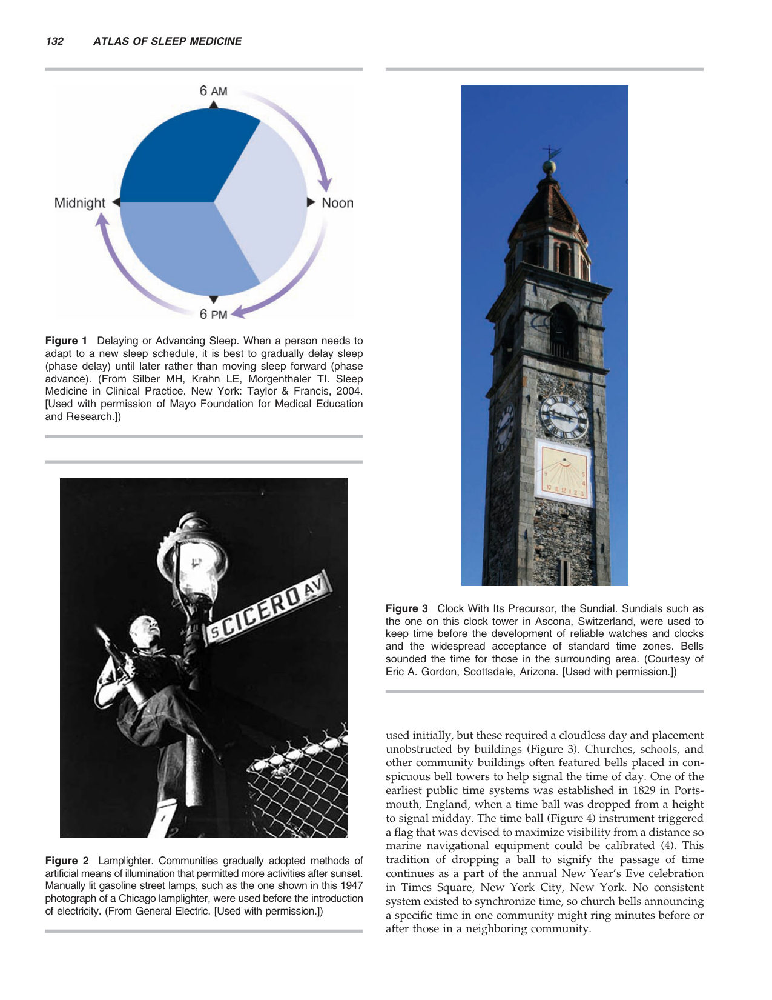

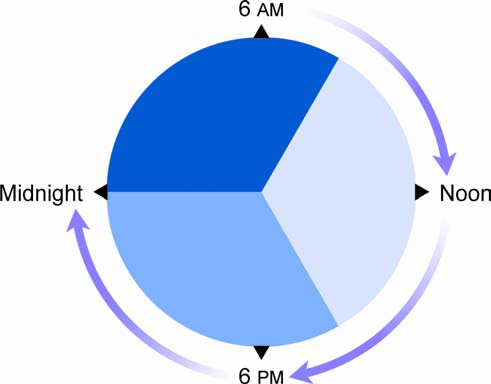

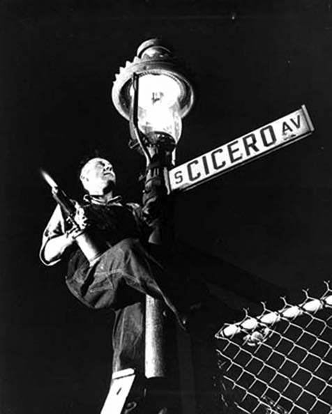

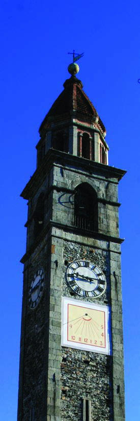

<!-- pdf-page: 146 -->

CIRCADIAN RHYTHM SLEEP DISORDERS: PHYSIOLOGY OF THE CIRCADIAN CLOCK 133

Figure 4

One of the First Time Balls. Time balls have been used since the 1800s to signal time change, with the most famous one being used on New Year’s Eve in Time Squares in New York City to signal the transition to the new year. By 1833 in Greenwich, England, this technology was adopted to communicate specific times across long distances to ships. (From Bartky and Dick [4]. [Used with permission.])

A coordinated system of timekeeping did not exist until 1879 when Canadian engineer Sanford Fleming proposed 24 time zones that would span the globe (5). In 1884 the International Meridian Conference in Washington, DC, was attended by 41 delegates from 25 countries who adopted this standardization, and Greenwich, England, was selected as the prime meridian, with the adjacent meridians progressively – 1 hour to the east and +1 hour to the west. Previously, every community developed its own arrangement for time, with noon being marked by the point when the sun was at its zenith overhead. Clocks were set differently in each city. This arrangement proved particularly problematic for the railroads in maintaining a consistent schedule across geographic regions. Every railway company used a company-specific measurement (“railroad time”), which was based on the time in the major hub of that company. Needless to say, railroad time was not conducive to efficient interstate commerce because it differed from local time (Figure 5). According to the Chicago Tribune, in the 1850s there were 27 different time zones within the state of Illinois alone (6). By 1883 the railroad companies in the eastern United

Figure 5

Double-Time Pocket Watch. The double-time watch (circa 1850) with two clock faces showing local time and railroad time side by side was used to coordinate times from region to region prior to the adoption of time zones. (From National Museum of American History, Smithsonian Institution, Washington, DC. [Used with permission.])

States sought a solution and agreed to “Philadelphia time,” with noon in the Philadelphia region as the reference point. This led to the establishment of several time systems (Philadephia, New York, Chicago, Detroit, and Columbus time) that were not coordinated. These arrangements promoted agreement among communities within each region to synchronize their local time, but some communities, such as major metropolitan areas extending into two time zones, exerted their right to vary the boundaries in a limited way to select their own time zone. The result is a matrix of fairly irregular time zone boundaries that are influenced by both local and national considerations. As radio and television broadcasting emerged, the need for time zones became even more compelling to allow listeners to tune in to specific programs. Together with the implementation of worldwide time zones (Figure 6), rapid travel by air led to a new cause of sleep disruption. Travelers making transmeridian trips, either from west to east or vice versa, must adjust their sleep-wake schedule to accommodate to the time at their destination. Jet lag will be discussed in more depth later in the chapter. Daylight saving time, adopted in early 1918 by the U.S. Congress with its passage of the Standard Time Act to boost manufacturing production during wartime, represents another level of complexity (Figure 7). Many jurisdictions worldwide currently agree to move clocks forward by one hour in the summer to ensure that there are more daylight hours in the morning than in the afternoon. However, even this modest advance in time has been linked in several countries with a surge in motor vehicle accidents, presumably due to decreased alertness and fatigue caused by incomplete adaptation to the new time (7).

#### CIRCADIAN RHYTHM SLEEP DISORDERS

In the absence of an alarm clock, persons will conceivably awaken after they have obtained sufficient sleep. Factors that contribute to the timing of sleep include total sleep time and

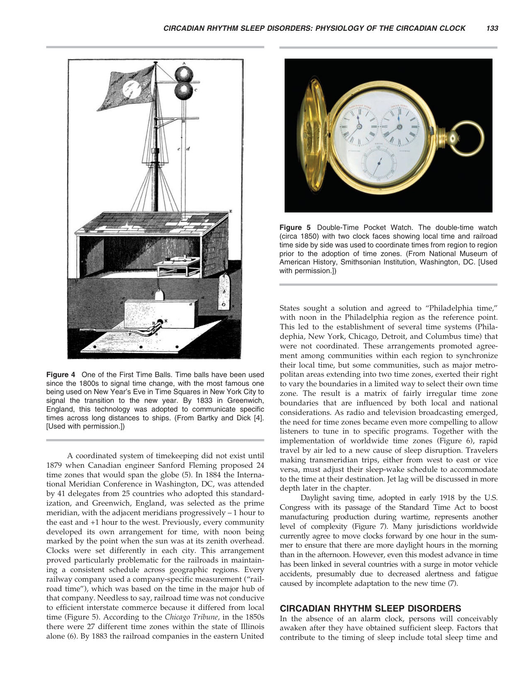

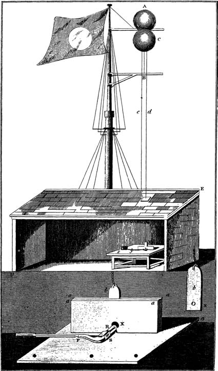

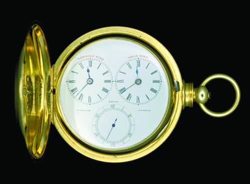

<!-- pdf-page: 147 -->

Figure 6

Standard Time Zones Around the World. A system of 24 time zones spaced at intervals of 158 longitude representing 1-hour time intervals was adopted worldwide in the late 1800s to coordinate transportation and communication. Letter key indicates times east or west of the prime meridian (universal time [Greenwich mean time]), with 1 hour plus (to east) or 1 hour minus (to west) for each time zone. (From HM Nautical Almanac Office, Taunton, England, United Kingdom. [Used with permission.])

accumulated sleep debt (homeostatic), time of sleep onset, core body temperature, conditioned awakening (circadian), genetic mutations (8), and exposure to sunlight, noise, and vibration (environmental). Other significant contributors include cultural factors, such as the practice of the siesta. The circadian rhythm sleep disorders (CRSD) are defined as a persistent pattern of sleep disturbances primarily caused by alterations in circadian timekeeping that lead to impairment (Table 1; Figure 8). In clinical populations the most common type of CRSD is delayed sleep phase type (DSPT), which represented 83% of the identified cases in one study (9).

#### Free-Running Type

Free-running type (FRT) sleep disorder, a type of CRSD also known as non–24-hour sleep-wake disorder or hypernychthemeral disorder, is diagnosed in patients lacking an entrained sleep rhythm. The medical and social consequences of FRT have not been well studied but might be expected to include family and professional difficulties. This condition, which is rare in persons with normal vision, is most often detected in blind patients, 50% of whom have it (10). These patients cannot benefit from the powerful entraining effect of light on the SCN and instead experience a free-running rhythm without a consistent sleep phase. Clinically, such patients may present with intermittent insomnia and excessive daytime sleepiness. Although their sleep-wake activity may briefly be synchronized with that of the community where they reside, it will again drift out of phase after

several days. The observed sleep patterns of persons with FRT CRSD are similar to those seen in subjects living without environmental time cues. Other unpredictable circadian rhythms may also develop, and melatonin secretion will no longer be synchronized with the sleep-wake pattern when it is irregular. Patients complain of undesired daytime sleepiness corresponding to diurnal melatonin that is not suppressed in the absence of light perception (11). In a process of internal desynchronization, the sleep-wake rhythm dissociates from the body’s other circadian rhythms, such as temperature, cortisol, and melatonin. Difficulty in initiating sleep may be exacerbated when the FRT for sleep-wake activity corresponds to points on the temperature rhythm other than the nadir. When FRT is identified in persons with normal retinal function, psychiatric difficulties are also often present (12). In such circumstances, FRT must be distinguished from irregular sleep-wake type (ISWT). Actigraphy and sleep logs can be helpful in documenting a non–24-hour sleep rhythm. Treatment depends on whether patients have functioning retinas. Melatonin levels and core body temperatures can be used as markers of circadian phase. Social or cultural cues are especially important because phototherapy is generally unsuccessful in patients with neurological impairment. Timed administration of melatonin is useful for moving blind patients along in a carefully planned sleep-wake schedule. For those rare patients with intact vision who have non–24-hour sleep rhythm, light exposure may be a useful addition to melatonin and to a prescribed sleep schedule.

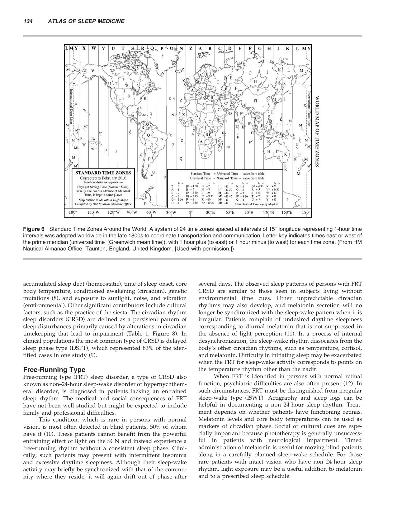

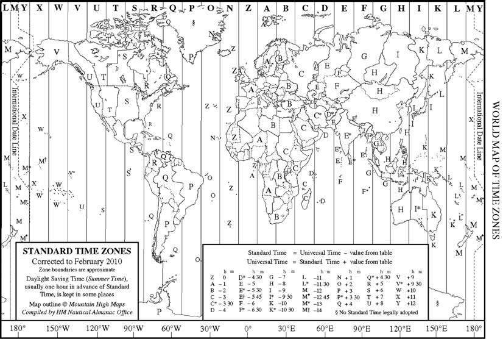

<!-- pdf-page: 148 -->

CIRCADIAN RHYTHM SLEEP DISORDERS: PHYSIOLOGY OF THE CIRCADIAN CLOCK 135

Figure 7

Poster Promoting Daylight Saving Time. “Saving Daylight” poster (circa 1918) publicized the idea of advancing the clock in the spring for the summer months nationwide in the United States during World War I to boost productivity as part of the war effort. (From Warshaw Collection of Business Americana, National Museum of American History, Smithsonian Institution, Washington, DC. [Used with permission.])

Table 1

Classification of the circadian rhythm sleep disorders

Disorders with persistent misalignment to time due to intrinsic factors related to time in the community Free-running type (FRT) Irregular sleep-wake type (ISWT) Delayed sleep phase type (DSPT) Advanced sleep phase type (ASPT) Disorders resulting from imposed or voluntary shifts in the timing of sleep due to external factors that lead to an incomplete adaptation Jet lag type Shift work type

Data from The International Classification of Sleep Disorders: Diagnostic and Coding Manual. 2nd ed. Westchester (IL): American Academy of Sleep Medicine, 2005. Used with permission.

One recent sleep study used polysomnography, actigraphy, and Braille sleep logs to examine the sleep of 26 totally blind patients and 26 matched controls (13). These patients were living in the community but had multiple sleep complaints,

Figure 8

Diagnostic Algorithm for Circadian Sleep Disorders. This flow chart indicates the sequential order of the issues that should be considered when a clinician assesses a patient with a potential circadian rhythm sleep disorder.

presumably due to an FRT cycle. Patients who were employed had a longer major sleep period than those who were retired or unemployed. Similarly, in my experience, patients with FRT who are mentally retarded may cope more poorly because of increased difficulty in conforming to social routines. Free-running type should be suspected in any patient without light perception who has sleep complaints. The medical and social consequences of FRT have not been well studied but might be expected to include family and professional difficulties. FRT should be differentiated from the other circadian rhythm disorders, including DSPT. Patients with DSPT initially have insomnia. In contrast to non–24-hour sleep-wake rhythm disorder, DSPT patients experience a stable sleep-wake cycle, albeit delayed, sometimes to an extreme degree. Irregular sleep-wake type is another diagnostic consideration. Patients with an inconsistent sleep-wake schedule are capable of entrainment but disregard the cues. A detailed sleep diary recording several weeks of functioning, accompanied by wrist actigraphy, can assist in distinguishing among these syndromes. Few studies have examined therapeutic options. Melatonin has been explored as a means to entrain circadian rhythms. Low-dose (0.5 mg) melatonin is typically administered at 8 PM (expected to be near the time of melatonin onset), provided a person is in dim light to achieve an effect by 11 PM (14). A sleep diary should be used initially, with melatonin treatment beginning only after the major sleep period occurs at night. Despite the absence of sight in blind persons, it is worthwhile to assess whether bright light suppresses melatonin because the retinohypothalamic pathway occasionally remains intact. In such cases, bright light may be used for entrainment. Since FRT is

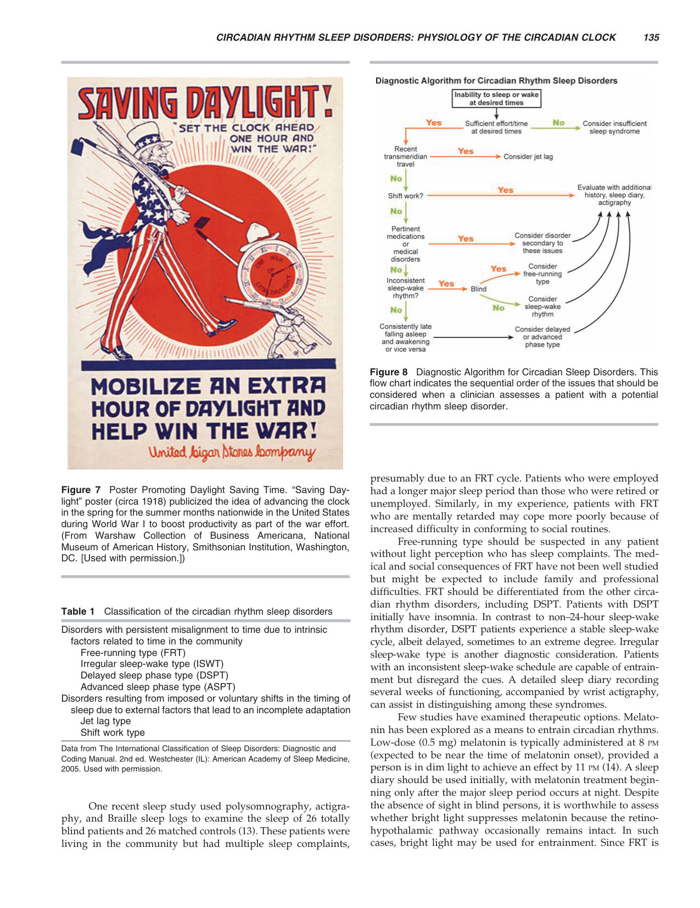

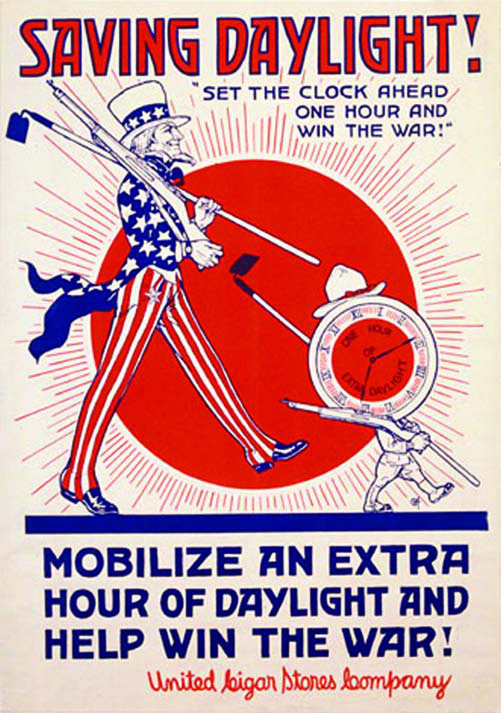

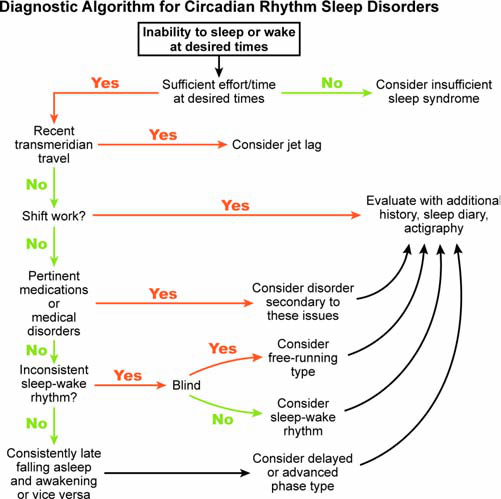

<!-- pdf-page: 149 -->

typically a lifelong disorder, other environmental cues such as social activities and exercise also have enhanced therapeutic value.

#### Irregular Sleep-Wake Type

Patients with ISWT have the capacity for entrainment yet fail to develop a consistent sleep-wake rhythm. They lack the normal sleep-wake pattern of a major sleep period, possibly with a secondary nap in the early afternoon. Instead, their sleep is randomly scattered and interspersed with wakefulness throughout the 24-hour day (Figure 9). This disorder evolves

from poor sleep hygiene. Patients may be unable to adhere to a more consistent sleep-wake cycle because of dementia or mental retardation (15). Whether SCN function is normal in patients with ISWT is unknown because little research has been conducted on patients with this type of sleep disorder. Patients at higher risk of ISWT are older and have more psychiatric problems (16). Many elderly patients have dementia and live in institutional settings where they are less likely to be exposed to sunlight during the day. Alzheimer disease and related disorders may be associated with degenerative retinal changes. Actigraphy and/or a sleep diary can be extremely helpful in documenting this irregular sleep pattern.

Figure 9

Wrist Actigraphy of Irregular Sleep-Wake Type Circadian Rhythm Disorder. This patient had substantial social isolation and coexisting obsessive-compulsive disorder, which contributed to the irregular sleep-wake pattern. WASO, wakefulness after sleep onset.

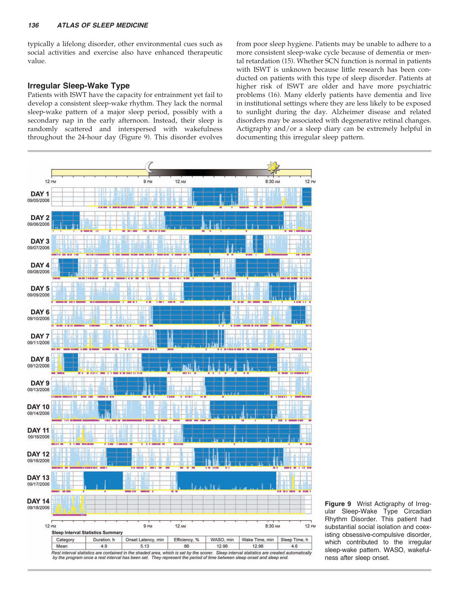

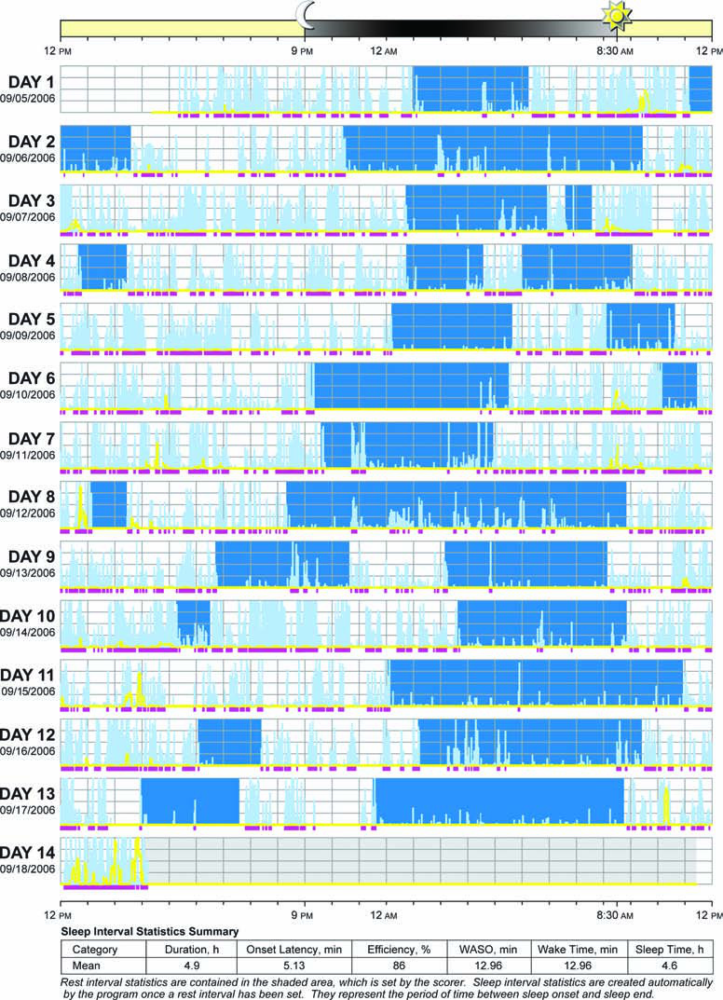

<!-- pdf-page: 150 -->

CIRCADIAN RHYTHM SLEEP DISORDERS: PHYSIOLOGY OF THE CIRCADIAN CLOCK 137

Treatment for ISWT involves striving to establish a more conventional circadian rhythm of sleep-wake activity. This can be pursued by enhancing cues to sleep and awaken. Research results have been inconsistent, but exposure to bright morning light has been found to improve the quantity of nighttime sleep if not wakefulness. Melatonin has been tried but the results of such studies have been conflicting. Hypnotic agents should be used with caution because of the risk of aggravating preexisting cognitive impairment. Patient education in sleep hygiene and daily physical activity to establish a daily routine are safe and likely beneficial.

#### Delayed Sleep Phase Type

Patients with DSPT fall asleep later and awaken later than expected or desired. This disorder may be quite common, although in-depth epidemiological studies are lacking. In one study of 10,000 Scandinavians followed with sleep logs, a prevalence of 0.72% was reported (17). This number is probably an underestimate because of the limitations of survey research and because few affected people will actually seek treatment for DSPT. The mean age of onset is 15 years. Although DSPT is a chronic condition, it rarely starts after 30 years of age so is seldom seen in older persons. Some studies report a male predominance, but the mix by sex is uncertain (18). There are fewer reports of a familial predisposition for DSPT than there are for advanced sleep phase type (ASPT) sleep disorder. Genetic studies of familial DSPT have revealed some intriguing clues; for example, there may be an autosomal dominant means of inheritance with incomplete penetrance (19). A higher than expected frequency of hPer3, an abnormality of the period (Per3) gene that influences the circadian period, has been observed (20,21). Studies of patients with a propensity for eveningness (the natural propensity to be active in the evening vs in the morning) but lacking a familial predisposition have revealed alterations in the CLOCK gene but have identified no specific polymorphism (22,23). DSPT is relatively common in adolescents, possibly because persons in this developmental stage of maturation have the highest propensity to delay going to sleep by staying up late and then to extend the time to awakening by sleeping in. Mechanisms that explain the higher rate of DSPT during adolescence include a longer circadian period or reduced sensitivity to light. These two factors may be intertwined because adolescents who sleep late into the morning have less opportunity for exposure to morning light with its recognized benefits in advancing sleep phase. DSPT can have major consequences. For adolescents, arising late interferes greatly with school attendance and academic success. Over time patients may develop poor selfesteem because they are struggling not only with the academic but also with the social components of school. The high association of DSPT and depression is likely explained by the combination of sleep difficulties and the resulting frustrating school experience. Thus treatment should involve both phototherapy and psychotherapy to target both sleep and psychosocial issues. The diagnosis of DSPT requires careful assessment of the patient’s sleep-wake schedule over the course of at least one week. A sleep diary is valuable but highly dependent on patient compliance in completing the daily forms accurately and on time. Wrist actigraphy is a useful technology that detects a person’s movement and, by extrapolation, the sleepwake cycle in the home environment. Its comparison with the

sleep diary permits the clinician to determine whether the patient is reliably reporting his or her sleep schedule. The self-assessment Morningness-Eveningness Questionnaire is used widely to assist in characterizing the natural propensity to be a night owl or a morning lark (24). DSPT is characterized by initial sleep and wake times that are consistently later than desired. The total sleep time over a 24-hour period is normal. Many patients report that the problem arises after a stretch of late-night studying or social activities. Those who manage to arise at a socially acceptable hour usually experience excessive daytime sleepiness during the morning. On vacation, when they are not trying to conform to a specified schedule, their wake time will be delayed. Patients with DSPT often recognize that they have the long-standing trait of being night owls because they feel most alert and perform best late at night. Some individuals cope by selecting careers that involve evenings and avoid mornings, such as restaurant work. Students may compensate by going to night school. DSPT is often associated with psychiatric disorders, specifically depression (25). It is unclear whether affected adolescents first have psychiatric symptoms and then develop DSPT or whether the circadian rhythm disorder leads to absenteeism which, in turn, results in psychiatric, academic, and social problems. Patients and their families are often intensely frustrated by the condition. The differential diagnosis includes major depression in patients with DSPT who have an increased need to sleep that sometimes coexists with an initial insomnia. If a patient pursues treatment for the mood disorder and has improvement in mood and other symptoms but persistent delayed sleep phase, then a coexisting CRSD should be suspected. Some patients with avoidant or schizoid personality disorder will seek out the solitude of night. A careful history taking not only should explore the person’s sleep-wake schedule but also should look for signs of deliberate avoidance of daytime interactions. Some people who are disabled, unemployed, or on vacation may voluntarily select a late-night schedule. Determining the motivation and effort expended to conform to the more conventional timetable can help differentiate them from true DSPT patients. Patients with DSPT will occasionally appear to have a disorder of excessive daytime sleepiness such as narcolepsy or idiopathic hypersomnia. Thus assessment should include careful exploration for the presence of excessive sleepiness during the evening and night because normal alertness during these times more likely indicates DSPT. Patients with DSPT may have periods of sleep-onset rapid eye movement (REM) during the first or second naps of the multiple sleep latency test (MSLT), especially if the MSLT start time was not delayed in accordance with the patient’s phase shift. The finding of REM sleep in an early MSLT nap would not reflect REM sleep intruding into daytime alertness but rather the patient’s final REM sleep of the major sleep period. Initial sleep latency usually increases with successive naps in DSPT. For all the CRSD, polysomnography may be indicated if there is any suspicion of a coexisting sleep disorder such as obstructive sleep apnea. When polysomnography is used, the start time of the sleep study may have to be adjusted. Patients must strive toward a consistent sleep-wake schedule because deliberately staying up late on weekends and holidays can interfere with falling asleep as desired on weeknights (26). Patient motivation is an essential component in a successful treatment plan. If the patient does not actively

<!-- pdf-page: 151 -->

embrace the practices necessary to correct the CRSD, then treatment is unlikely to be effective. In some cases a patient may espouse an intention to strive for a phase shift but actually maintain a passive-aggressive attitude that can contribute significantly to family strain. Thus in many cases psychotherapy may be essential to give the patient an opportunity to understand and modify the factors that may be contributing to sleepinterfering activities engaged in late at night. Family therapy as well as individual therapy may be useful in finding solutions to complex family and school problems. The most commonly recommended treatment for DSPT is to have patients use bright-light therapy in the morning from 6 AM to 9 AM to adjust the sleep-wake cycle. When patients adhere to this approach, it can be effective. Patients typically start at a later time (e.g., 9 AM) and advance the time of light exposure as their ability to awake earlier improves. However, adherence to these procedures is difficult because patients are typically more pressed for time in the morning, and many patients have difficulty awakening earlier just for the purpose of getting light exposure from a light box or the sun. Adherence is often inconsistent, with patients complaining that they cannot find the necessary 30 minutes each morning for the treatment. The light intensity used in clinical trials has been 2,500 to 25,000 lux (26,27). Several different light units are available and the manufacturers’ specifications should be followed concerning the distance for the patient to sit from the light box. The distance varies, depending on whether the unit has a single central light or two smaller units that are placed on either side of the patient. Patients should make light exposure their priority and should engage in activities such as reading, applying makeup, or eating breakfast only if their eyes are positioned adequately in front of the box. Many patients prefer to combine their exposure to natural sunshine with exercise by jogging, biking, or running outside in clear weather. To prevent eye damage, patients should never look directly at the sun. Potential side effects of light boxes include retinal burns, which are more likely to develop if the patient is taking anticholinergic medications that increase pupillary diameter (28). Patients taking photosensitizing medications should not be advised to use phototherapy. Patients with DSPT should also be advised to avoid bright light, possibly by wearing sunglasses, from 4 PM to dark. Other treatment options have included the use of melatonin, which has been beneficial in several controlled trials (29–31). Melatonin should be taken one to three hours (depending on the severity of the phase delay) before the desired bedtime and it should continue to be used on an ongoing basis. The dose of melatonin is typically low (3 mg). Melatonin has not been tested as rigorously for side effects as have hypnotic agents. Since it is not considered a pharmaceutical agent by the U.S. Food and Drug Administration but rather is classified as a nutritional supplement available in health food stores, patients may have difficulty verifying the purity of the product available for purchase. Safety data regarding the longterm use of melatonin have not appeared in the medical literature, although no anecdotal reports of serious side effects have surfaced to date. In general, melatonin is only weakly sedating. Some experts advocate combining melatonin with phototherapy (32). This combined approach may be desirable when patients are suspected of having poor adherence with phototherapy and would be more likely to take a tablet. Apart from the increased cost, there are no known risks to combining melatonin with light therapy.

Most treatment plans for DSPT no longer emphasize the role of chronotherapy. Using this approach, patients in one study sequentially delayed their bedtime by one to two hours a night around the clock until they finally could fall asleep at the desired time (33). Outcomes were poor because of the understandable difficulty in conforming to this complex regimen and the tendency for many patients to slip back into a DSPT pattern over time. Hypnosis and psychostimulants have not been found to be useful because patients fundamentally get adequate sleep but are not synchronized with their community. If the patient has coexisting major depression, antidepressant medication may be appropriate. Some clinicians opt to prescribe sedating antidepressants such as mirtazapine, although these medications have not been demonstrated to be preferable to agents that are not sedating.

#### Advanced Sleep Phase Type

Patients with ASPT fall asleep and awaken at earlier times than desired and may inappropriately fall asleep during evening activities. While awake in the early morning, they may experience loneliness or boredom. The condition is thought to be rare, although its incidence may be underestimated since patients may not recognize or report this problem to their physician. The institutional routines in nursing homes and assisted living facilities frequently encourage bedtime in the early evening, sometimes because of reduced staffing at those times. A survey of 10,000 Scandinavians did not identify a single case of ASPT (17). This condition is thought to be markedly less common than DSPT because the period of the human circadian rhythm is slightly longer than 24 hours, which makes it easier to stay up late than to fall asleep earlier. The condition likely becomes more common with age. ASPT may be more common in older adults because they often live in institutional settings that reinforce an earlier bedtime. The striking difference in prevalence between ASPT and DSPT is likely because the human sleep-wake circadian period of slightly more than 24 hours promotes phase delay. The diagnostic evaluation for ASPT is the same as that for DSPT. Unless the clinician is aware of the timing of the patient’s major sleep period, this condition may be mistaken for a disorder of excessive daytime sleepiness because those affected with ASPT can fall asleep during evening activities or can experience insomnia due to prior wakefulness during the latter part of the night. Major depression is another important part of the differential diagnosis because early morning insomnia can be observed in both conditions. ASPT has provided an invaluable clue to the genetics of the mechanisms controlling sleep-wake behavior. Patients in four families were studied and all of those affected fell asleep four hours earlier and also awakened earlier than expected (8). The melatonin levels and temperature rhythms of these patients were advanced by three to four hours. Their circadian sleep-wake period was shortened to 23.3 hours. An autosomal dominant familial form of ASPT was identified. The genetic defect was traced to hPer2, a mutation in the Per2 gene. Affected individuals have a mutation in the casein kinase 1–binding region of the hPer2 gene with a serine to glycine mutation. This mutation interferes with the functioning of the CLOCK component, which causes a significant advance in the circadian period that is consistent with ASPT (8). Most research on the treatment of ASPT has focused on the role of light in shifting the sleep-wake rhythm. Treatment

<!-- pdf-page: 152 -->

CIRCADIAN RHYTHM SLEEP DISORDERS: PHYSIOLOGY OF THE CIRCADIAN CLOCK 139

involves avoidance of morning bright light and implementation of a daytime schedule that encourages entrainment to a conventional sleep-wake schedule. Evening light therapy has also been successfully used in short-term studies (34,35). Progressive earlier shifting of bedtime by three hours every two days has been reported as having short-term utility in several cases (34,35). One recent study examined therapy of ASPT in a group of children with Smith-Magenis syndrome, a complex genetic disease caused by a deletion in chromosome 17p (36). Sleep, as well as melatonin phase, was delayed with the administration in the evening of controlled-release melatonin combined with administration in the morning of a b1-adrenergic antagonist to block the noradrenergic neurotransmission to the pineal gland that releases melatonin (34,35).

#### Jet Lag Type

With the development of long-distance transmeridian travel, a new sleep disorder has emerged. Jet lag type (otherwise known as time zone change syndrome) represents an acute problem in which the sleep-wake circadian rhythms of travelers become out of phase with the light-dark cycle at their destination. The magnitude of the problem increases as travelers cross more time zones. In general, without measures to accelerate adjustment, one day must lapse to adjust to every hour of time zone change. Longitudinal (north-south) air travel may result in sleep debt related to the inability to obtain quality sleep while aboard an airplane, but it does not challenge travelers in the same fashion by requiring them to adapt to a new time zone. The entrainment process is facilitated for travelers with jet lag as they attempt to adapt to the sleep-wake cycle of the destination community. Most people can more readily phase delay than they can phase advance the timing of their major sleep period, probably because of the longer than 24-hour periodicity of the human circadian pacemaker. Thus east to west travel is typically easier to adjust to than the equivalent travel west to east. Travelers who make frequent long-distance trips can develop a chronic condition of jet lag when they do not adequately adapt before a further change in sleep-wake schedule is required. For travelers such as airline personnel who face frequent circadian adjustments because of their work schedules, jet lag overlaps with shift work sleep disorder. The consequences of jet lag are similar to those of other CRSDs: excessive daytime sleepiness, insomnia, disturbed nocturnal sleep, and occupational problems due to inadequate alertness (Figure 10). The effect of jet lag on other circadian rhythms is less well known. Some travelers tolerate transmeridian travel without significant jet lag, but the reasons for individual variations are not well understood. There are no known differences in jet lag by sex, but there is a decrease with age in the ability to adjust sleep-wake rhythms. Treatment options are controversial and no one strategy is clearly preferred. Numerous research studies have been conducted on jet lag but most have significant limitations, primarily due to study design issues such as the inability to control light exposure or to ensure subject adherence with the protocol. Few experimental models exist for jet lag that account for all the variables encountered in the real world of travel. For example, one protocol might call for three successive days of exposure to bright light at a consistent time for approximately 3 hours after arrival at a destination, which might not be feasible for most tourists or business travelers.

The most commonly used strategies are optimization of sleep hygiene, manipulation of the sleep-wake schedule, use of melatonin, use of phototherapy, and the judicious use of caffeinated beverages and foods or hypnotics. A daytime flight eliminates the need for adequate sleep in an uncomfortable setting. Helpful measures at the destination include using a bedroom that is dark and quiet, and of a comfortable temperature. Relaxation techniques such as diaphragmatic breathing or progressive muscle relaxation may hasten sleep onset at an unfamiliar hour. The use of alcohol is not recommended. Dietary measures have been proposed, such as a presleep tryptophan-rich carbohydrate diet (promoting sedation mediated by serotonin and therefore initiating melatonin production) and protein intake upon awakening (increasing alertness by means of tyrosine), but these programs are not supported by convincing evidence. Herbal remedies, other than melatonin, are of limited usefulness. One practical approach is to try to adapt the time of the major sleep period as quickly as possible to the new schedule. For example, if a traveler arrives at 6 AM in Europe after a west to east trans-Atlantic flight, that person is phase delayed by as much as six or seven hours behind the time at the destination. For example, the traveler’s sleep-wake rhythm may be at 1 to 2 AM when the morning activities start in Europe. The traveler could stay awake all day, causing an abrupt advance in sleep phase by avoiding sleep until as close as possible to the desired bedtime. For westward flights, the circadian challenge is the opposite. Such persons need to adapt to their advanced sleep phase by phase delaying their sleep-wake schedule to conform to the time at their destination. Meals and exercise at the destination should be timed carefully to serve as social cues that encourage and reinforce an appropriate sleep-wake cycle. Some experts advocate naps before, during, and after transmeridian travel to prevent development of a substantial sleep debt. These naps should be timed carefully to allow sufficient sleep pressure to build up so that the traveler can still initiate sleep at the desired bedtime at the destination. Caffeine use should be carefully tracked so as to minimize caffeine-related insomnia. In moderation, caffeine can be used to enhance alertness. Armodafinil, an isomer of modafinil approved for treatment of excessive sleepiness due to obstructive sleep apnea, shift work disorder, or narcolepsy, has been studied for jet lag disorder (37) but was not approved by the U.S. Food and Drug Administration for that indication in a March 2010 decision. Hypnotics, traditionally the short-acting benzodiazepines such as triazolam, have been shown to be of some benefit in treating jet lag. These compounds decrease sleep latency, reduce awakenings, and increase total sleep time. Nonbenzodiazepine agents with short half-lives (e.g., zolpidem, zaleplon, and zopiclone) are a more recently available but less studied option. The half-life of any hypnotic should be short to avoid a hangover effect. Potential side effects of both classes of hypnotics include amnesia, and cognitive impairment may occur with benzodiazepines. Since bright light is known to exert the strongest influence on the SCN, this modality has clear potential for resetting the sleep-wake circadian rhythm to match the schedule at the destination. Numerous studies have led to jet lag algorithms. If a phase advance is desired, the intent is to get light exposure before the concurrent melatonin peak and temperature nadir. If a phase delay is sought, the light exposure should come after these circadian markers. Use of carefully timed light exposure

<!-- pdf-page: 153 -->

Figure 10

Wrist Actigraphy of Jet Lag. Jet lag is especially common in travelers flying between North America and Europe. WASO, wakefulness after sleep onset.

may accelerate phase adjustments from a change of one hour to a change of three hours per day. This strategy, while scientifically based on the physiology of the SCN, is difficult to implement in real-life travel. There are no simple tools for determining peak melatonin or for measuring core body temperature. In addition, the optimal duration of a session of phototherapy, the number of successive daily sessions, the light spectrum, and the effects of age and individual differences are all unknown. Nonetheless, awareness of the effects of light on circadian rhythms is important because travelers should at least avoid exposure to

bright light at critical times. If phase advance is desired, morning bright light exposure should be minimized (potentially by using wraparound sunglasses); for a desired phase delay, bright light should be avoided in the evening. Melatonin has been the subject of intense interest as a tool for the prevention or treatment of jet lag. Some, but not all, studies show the value of this compound as a chronotherapeutic agent for subjectively improving jet lag (38,39). Melatonin should be administered at a 12-hour phase difference from light therapy. If provided before the nadir of the core body

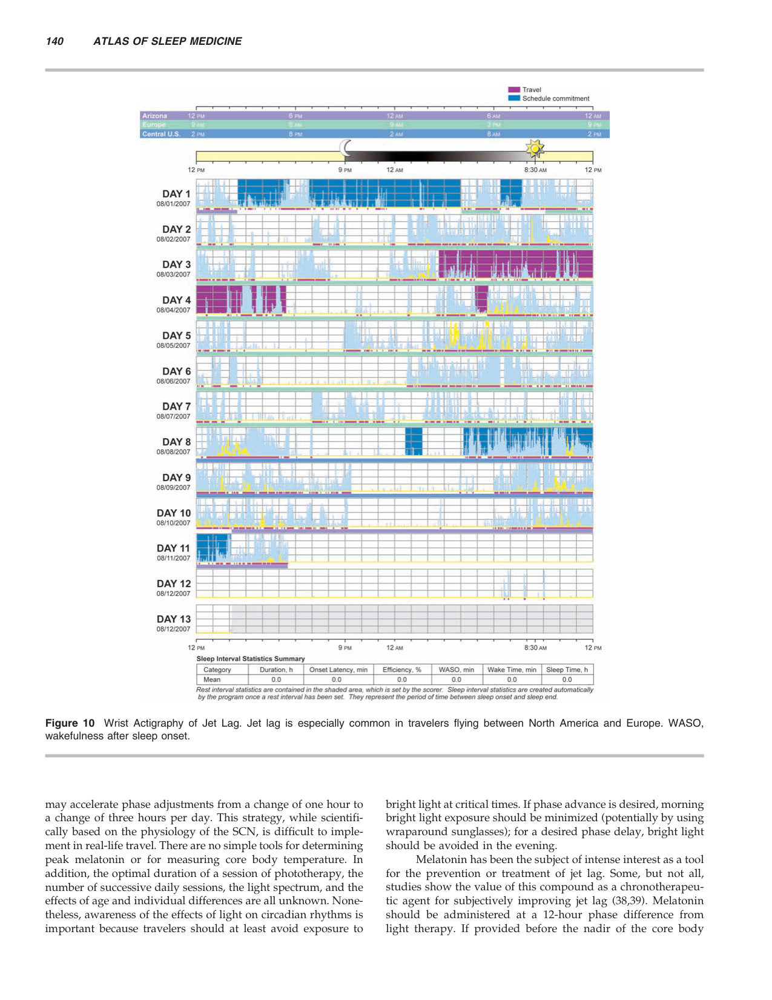

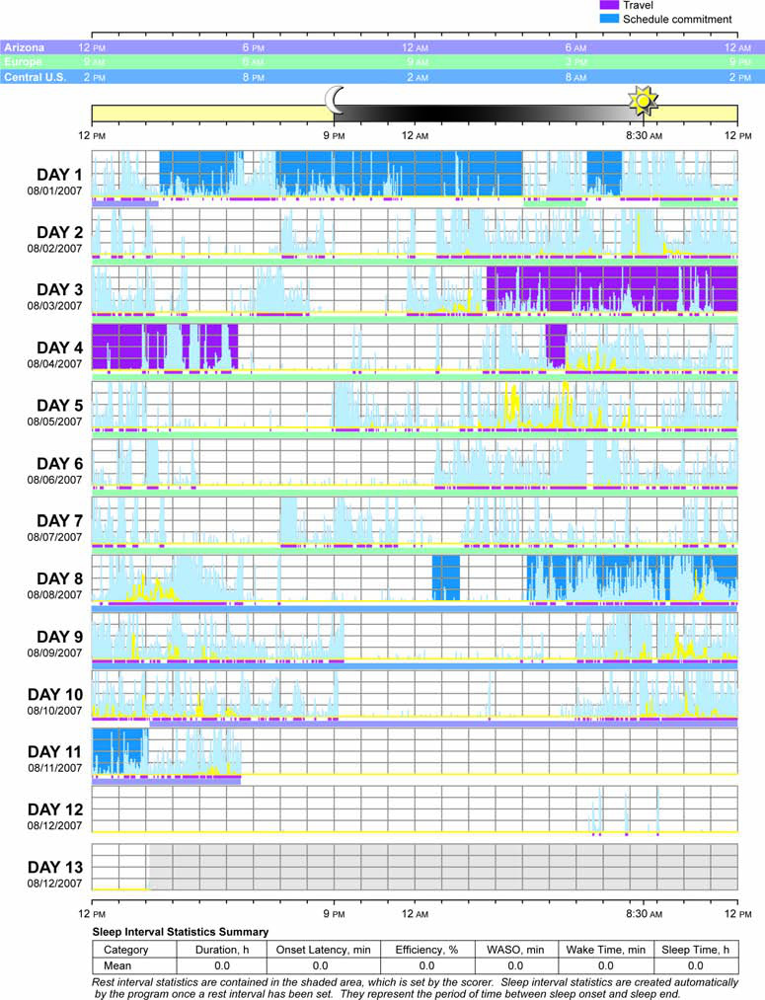

<!-- pdf-page: 154 -->

CIRCADIAN RHYTHM SLEEP DISORDERS: PHYSIOLOGY OF THE CIRCADIAN CLOCK 141

temperature, melatonin will advance the sleep-wake circadian rhythm. If administered after this pivotal point, rhythms will delay. Experts advise travelers to start using melatonin during the early evening before departure for eastward trips and thereafter at the desired bedtime at the destination. For westward travel after arrival at the destination, melatonin should be administered at 11 PM or even later to promote a phase delay.

Time of shift Type of work or worker

#### Shift Work Type

Many occupations involve work shifts that may encompass night work, evening shifts, split 24-hour schedules, early morning start times, and on-call responsibilities (Table 2). Workers with rotating schedules are at higher risk for complications because their sleep-wake circadian rhythm is constantly adapting to a new timetable as opposed to straight second (evening) or third (night) shift (Figure 11). Workers with family or school responsibilities face even more difficulties finding adequate time to sleep (Figure 12). In general, older persons find it harder to adapt to shift changes than do younger ones. Shift workers have high rates of both insomnia and excessive daytime sleepiness. Because of environmental factors, such as neighborhood noise or sunlight, it may be difficult to initiate or maintain sleep during the day. Many night-shift workers are chronically sleep deprived, getting as little as two to four hours of sleep, because they have difficulty sleeping during the day or end up sacrificing sleep to spend time with family, in leisure activities, or in running errands. Those with a coexisting sleep disorder, such as obstructive sleep apnea, have an increased probability of excessive daytime sleepiness. Shift

Table 2

Occupations frequently requiring shift work

work puts persons at high risk for several problems. Working when not fully alert poses the risk of performance difficulties because of diminished vigilance. Research into fatigue reveals that patients can experience cognitive or motor impairment (40). Many devastating industrial or transportation incidents, including the Exxon Valdez oil tanker spill in Alaska in 1989 and the Three Mile Island nuclear power plant accident in Pennsylvania in 1979, have occurred at night, which suggests that worker fatigue may have been a contributing factor. Social and medical problems are also associated with shift work. Missing opportunities to interact with family or friends because of the timing of the shift or the subsequent recovery sleep can lead to social problems and family strain. Young children in particular may have difficulty understanding that a parent must be allowed to get adequate sleep after returning home from work. One recent study found an increase in common respiratory infections and gastroenteritis in shift workers, with more in the third shift than in the second, possibly because fatigue renders employees more vulnerable to infections (41). Several strategies have been identified to assist workers who must incorporate shift work into their lifestyle. Some people can use their affinity for functioning well at certain times; for example, people with a tendency toward a delayed sleep phase may actually cope satisfactorily with an evening work schedule, providing they can sleep in late the following morning. Meals should be timed to promote sleep. Hunger or foods that cause dyspepsia may fragment sleep. The workplace environment should be carefully planned to take into account the safety and sleep needs of workers. Bright lights and a

Early shift Agriculture (dairy) Bakeries Health care (surgical staff, anesthesiology) Late shift Restaurant (food preparation and serving) Entertainment (musicians, performers) Private security (guards, patrols) Custodial (janitors, after-hours construction/renovation) Astronomers/astrophysicists (telescope/observatory) Transporation (taxi, limousine) Schedules designed to provide continuous coverage Aviation (pilots, flight attendants, mechanics, reservations staff) Seafaring/nautical (captains, pilots, engineers, lighthouse) Information technology (help desk staff) Health care (physicians, nurses, pharmacists, technologists) Military (air traffic control, navy, combat) Public safety (police, firefighters, emergency medical personnel) Public security (coast guard, border control, airport security) Mining/natural resources (offshore oil rigs, mines) Manufacturing (assembly lines, factories) Retail (convenience marts, superstores) Schedules dependent on time zone differences with other offices Investment (stock exchanges, commodities exchanges) International finance News media deadlines Diplomacy/international affairs Multinational companies Schedules with seasonal variation Accountants (tax deadlines) Researchers (grant deadlines) Agriculture (planting, harvest) Fisheries (seasonal catches) Movie production (filming on location)

<!-- pdf-page: 155 -->

Figure 11

Wrist Actigraphy of Shift Work Sleep Disorder. Registered nurses who work varying shifts (eg, nights and then days) often have shift work sleep disorder. WASO, wakefulness after sleep onset.

slightly cool air temperature may improve alertness. Ideally, attention should be given to the type of tasks undertaken by employees, especially on the night shift, with stimulating activities interspersed among monotonous duties. Controlling light exposure is critically important. A person might wear dark glasses for the drive home from work after dawn. The sleeping environment at home might have to be modified. A quiet and dark bedroom is more important to a

shift worker than to those who work day jobs. Special window coverings may be required. The telephone should be switched off and an answering machine should be used to collect messages. Family members should be reminded not to awaken the shift worker in the midst of his or her major sleep period. Sleep hygiene should be optimized in all respects. Studies have shown that workers cope better when switching from one shift to another if they delay, rather than

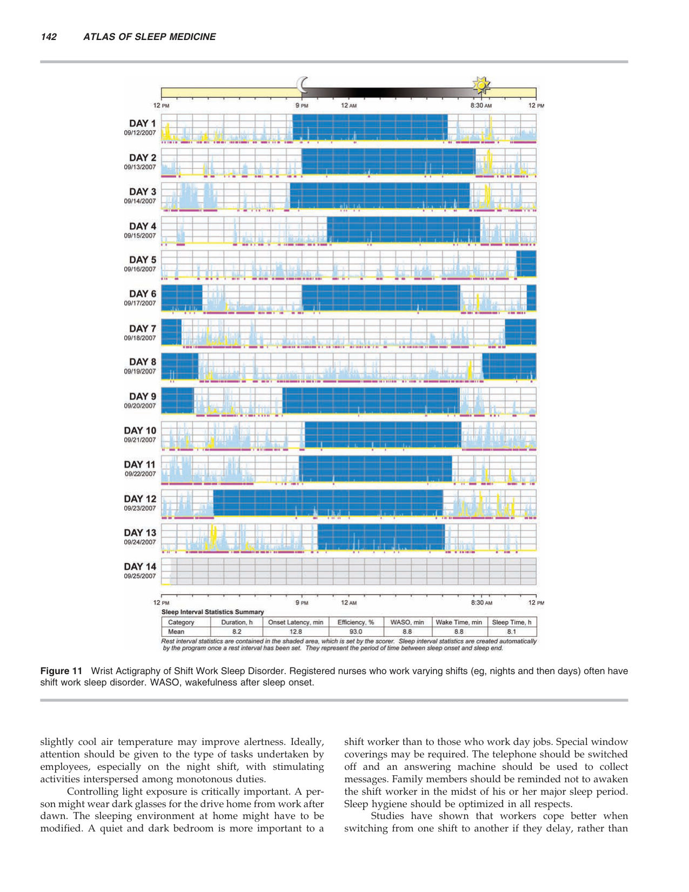

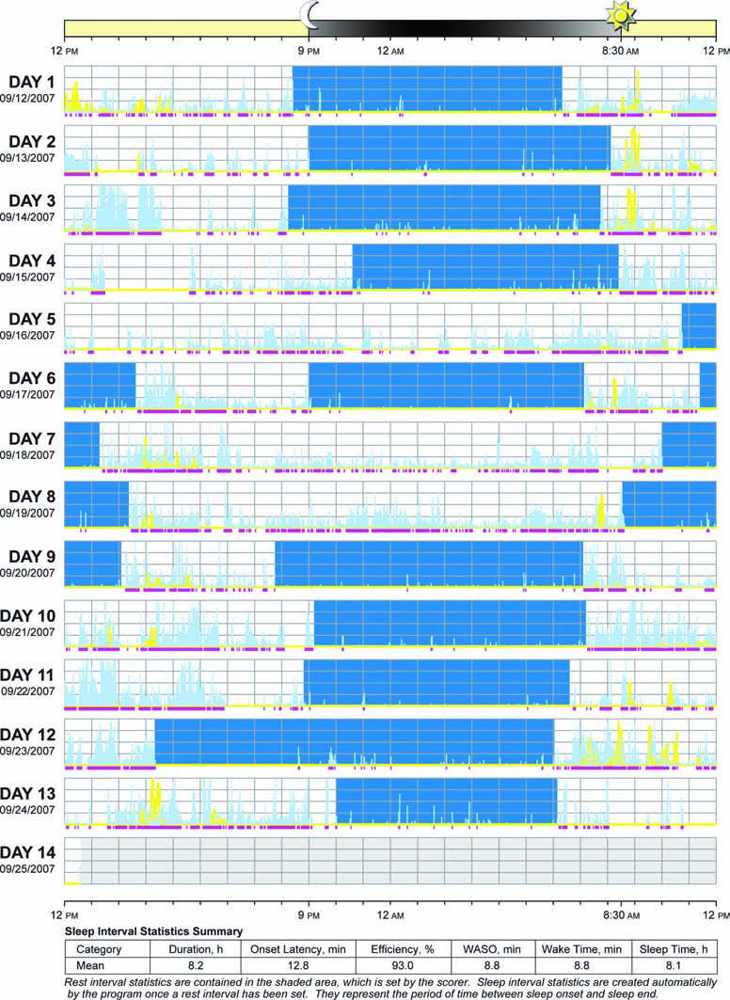

<!-- pdf-page: 156 -->

CIRCADIAN RHYTHM SLEEP DISORDERS: PHYSIOLOGY OF THE CIRCADIAN CLOCK 143

Figure 12

Delayed Sleep Phase Type of Sleep Disorder. Oil painting entitled Poor Student (1932) by Fred Gardner illustrates the delayed sleep phase type of sleep disorder common in adolescents. (From Smithsonian American Art Museum, Washington, DC. [Used with permission.])

advance, their work and sleep times (42). For instance, most persons who move from an evening shift to a night shift will adjust more easily to the change than if they were moving from a night shift to an evening shift. Preparing for an approaching change to a later shift by gradually moving bedtime and wake time back by two hours starting several days before the switch has been found to be beneficial. However, family responsibilities often complicate carefully planned sleep schedule adjustments of this type. Other effective coping strategies include taking a sleep break during work hours. Recent research that has focused on the transportation industry, specifically airline personnel, indicates that a 30-minute nap partway through the shift increases productivity, reduces fatigue, and improves employee satisfaction (43). Long-haul aircraft have now been designed to include bunks or reclining seats for scheduled naps. Some employers and employees prefer work schedules that use permanent shift assignments. Night shift workers should endeavor to keep to a consistent sleep-wake schedule even on days when they do not work. Reverting to nighttime sleep over a weekend or on a single day off presents adjustment problems similar to those faced by workers assigned to rotating shifts. Again, family and social responsibilities make it difficult for people to follow an exclusive night activity schedule. Workers with on-call schedules present a slightly different problem,

as they cannot predict when they will be required to perform a task. Typically, the shifts for on-call workers are longer than those for most other shift workers (for example, the 24-hour shift common among firefighters). Sleep is encouraged and accommodations provided, but workers cannot count on being able to sleep. Under these circumstances, naps may be especially important. Although people are generally urged to have a major sleep period each 24-hour day, as opposed to several shorter stretches of sleep, naps are acceptable if they are the only means by which adequate sleep can be obtained. Medications have been examined to help shift workers initiate sleep at the desired time (26,44). Regular use of longacting benzodiazepines not only creates a hangover effect, especially with longer-acting agents, but also runs the risk of physical dependence. Short-term use of a newer nonbenzodiazepine hypnotic such as zaleplon or ramelteon is preferable to a benzodiazepine. Even with these agents, caution must be taken because few studies have examined their long-term use or addressed their interaction with shift work. Medications are not the first choice of intervention. First, workers should fully explore various means to get adequate sleep by making careful schedule changes, keeping sufficient sleep a priority, and taking naps as indicated. The hypnotics provide symptomatic relief without addressing the underlying circadian rhythm disturbance inherent in shift work. Alcohol should be avoided as a means of inducing sleep because of its tendency to reduce the quality of non-REM sleep and its detrimental effects on the patency of the upper airway. Caffeine may be useful to boost alertness, but it should be avoided close to bedtime because it can interfere with sleep onset. Judicious use of the alerting agent modafinil, the only medication approved by the U.S. Food and Drug Administration for managing shift work sleep disorder, is an appropriate means of treatment. Modafinil represents the compensation strategy of boosting alertness, but it carries the risk of inadequately addressing the sleep deprivation responsible for sleepiness. Bright-light therapy delivered at precise times may also be useful. Melatonin has been explored as a possible chronotherapeutic agent. More recently, the melatonin agonist ramelteon has shown promise in pilot studies but large-scale studies are not yet available (45).

#### REFERENCES

1. Sack RL, Auckley D, Auger RR, et al. American Academy of Sleep Medicine. Circadian rhythm sleep disorders. Part I: basic principles, shift work and jet lag disorders. An American Academy of Sleep Medicine review. Sleep 2007; 30:1460–83. 2. Gonzalez MM, Aston-Jones G. Circadian regulation of arousal: role of the noradrenergic locus coeruleus system and light exposure. Sleep 2006; 29:1327–36. 3. Czeisler CA, Duffy JF, Shanahan TL, et al. Stability, precision, and near-24-hour period of the human circadian pacemaker. Science 1999; 284:2177–81. 4. Bartky IR, Dick SJ. The first time balls. J Hist Astronomy 1981; 12:155–64. 5. Zerubavel E. The standardization of time: a sociohistorical perspective. Am J Sociol 1982; 88:1–23. 6. Downing M. Spring Forward: The Annual Madness of Daylight Saving. Washington (DC): Shoemaker & Hoard, 2005. 7. Coren S. Daylight savings time and traffic accidents. N Engl J Med 1996; 334:924. 8. Toh KL, Jones CR, He Y, et al. An hPer2 phosphorylation site mutation in familial advanced sleep phase syndrome. Science 2001; 291:1040–3.

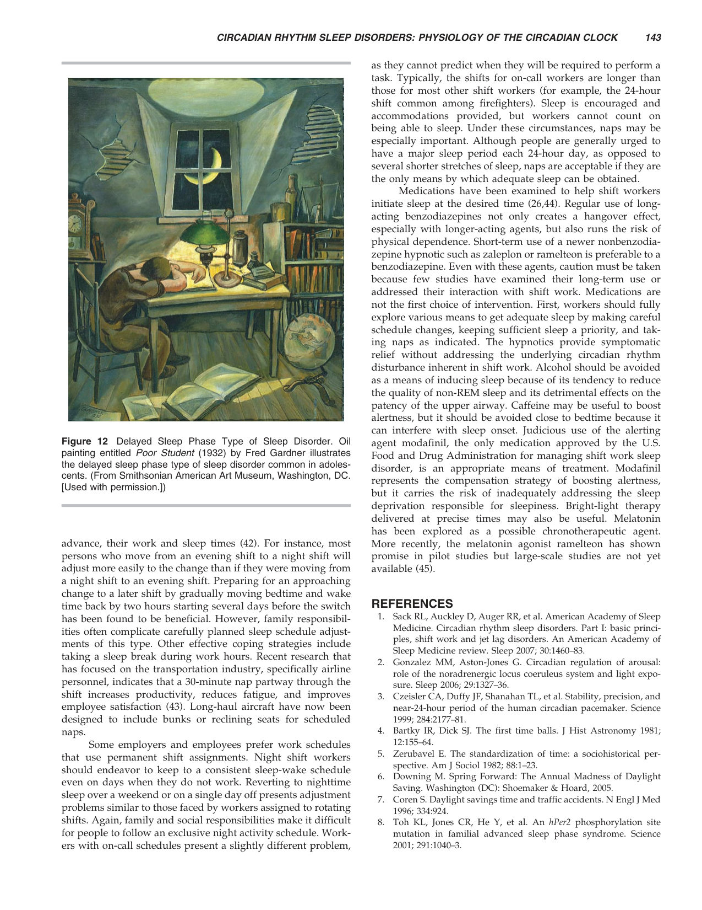

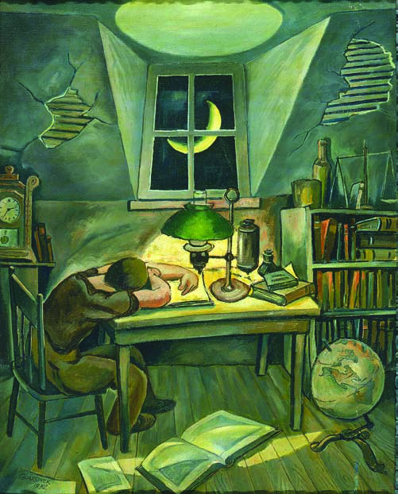

<!-- pdf-page: 157 -->

9. Dagan Y, Eisenstein M. Circadian rhythm sleep disorders: toward a more precise definition and diagnosis. Chronobiol Int 1999;16: 213–22. 10. Sack RL, Lewy AJ, Blood ML, Keith LD, Nakagawa H. Circadian rhythm abnormalities in totally blind people: incidence and clinical significance. J Clin Endocrinol Metab 1992; 75:127–34. 11. Sack RL, Brandes RW, Kendall AR, Lewy AJ. Entrainment of freerunning circadian rhythms by melatonin in blind people. N Engl J Med 2000; 343:1070–7. 12. Sack RL, Auckley D, Auger RR, et al; American Academy of Sleep Medicine. Circadian rhythm sleep disorders. Part II: advanced sleep phase disorder, delayed sleep phase disorder, free-running disorder, and irregular sleep-wake rhythm. An American Academy of Sleep Medicine review. Sleep 2007; 30:1484–501. 13. Leger D, Guilleminault C, Santos C, Paillard M. Sleep/wake cycles in the dark: sleep recorded by polysomnography in 26 totally blind subjects compared to controls. Clin Neurophysiol 2002; 113:1607–14. 14. Lewy AJ, Bauer VK, Hasler BP, Kendall AR, Pires ML, Sack RL. Capturing the circadian rhythms of free-running blind people with 0.5 mg melatonin. Brain Res 2001; 918:96–100. 15. Martin JL, Webber AP, Alam T, Harker JO, Josephson KR, Alessi CA. Daytime sleeping, sleep disturbance, and circadian rhythms in the nursing home. Am J Geriatr Psychiatry 2006; 14:121–9. 16. Foley D, Ancoli-Israel S, Britz P, Walsh J. Sleep disturbances and chronic disease in older adults: results of the 2003 National Sleep Foundation Sleep in America Survey. J Psychosom Res 2004; 56:497–502. 17. Schrader H, Bovim G, Sand T. The prevalence of delayed and advanced sleep phase syndromes. J Sleep Res 1993; 2:51–5. 18. Adan A, Natale V. Gender differences in morningness-eveningness preference. Chronobiol Int 2002; 19:709–20. 19. Ancoli-Israel S, Schnierow B, Kelsoe J, Fink R. A pedigree of one family with delayed sleep phase syndrome. Chronobiol Int 2001; 18:831–40. 20. Archer SN, Robilliard DL, Skene DJ, et al. A length polymorphism in the circadian clock gene Per3 is linked to delayed sleep phase syndrome and extreme diurnal preference. Sleep 2003; 26:413–5. 21. Pereira DS, Tufik S, Louzada FM, et al. Association of the length polymorphism in the human Per3 gene with the delayed sleepphase syndrome: does latitude have an influence upon it? Sleep 2005; 28:29–32. 22. Iwase T, Kajimura N, Uchiyama M, et al. Mutation screening of the human CLOCK gene in circadian rhythm sleep disorders. Psychiatry Res 2002; 109:121–8. 23. Katzenberg D, Young T, Finn L, et al. A CLOCK polymorphism associated with human diurnal preference. Sleep 1998; 21:569–76. 24. Horne JA, Ostberg O. A self-assessment questionnaire to determine morningness-eveningness in human circadian rhythms. Int J Chronobiol 1976;4:97–110. 25. Dagan Y, Stein D, Steinbock M, Yovel I, Hallis D. Frequency of delayed sleep phase syndrome among hospitalized adolescent psychiatric patients. J Psychosom Res 1998; 45:15–20. 26. Morgenthaler TI, Lee-Chiong T, Alessi C, et al; Standards of Practice Committee of the American Academy of Sleep Medicine. Practice parameters for the clinical evaluation and treatment of circadian rhythm sleep disorders. An American Academy of Sleep Medicine report. Sleep 2007; 30:1445–59. Erratum in: Sleep 2008; 31.

27. Rosenthal NE, Joseph-Vanderpool JR, Levendosky AA, et al. Phase-shifting effects of bright morning light as treatment for delayed sleep phase syndrome. Sleep 1990; 13:354–61. 28. Krahn LE. Circadian Rhythm Disorders. In: Pagel JF, Pandi- Perumal SR, editors. Primary Care Sleep Medicine: A Practical Guide. Totowa (NJ): Humana Press, 2007. p. 261–74. 29. Arendt J, Deacon S, English J, Hampton S, Morgan L. Melatonin and adjustment to phase shift. J Sleep Res 1995; 4:74–9. 30. Kayumov L, Brown G, Jindal R, Buttoo K, Shapiro CM. A randomized, double-blind, placebo-controlled crossover study of the effect of exogenous melatonin on delayed sleep phase syndrome. Psychosom Med 2001; 63:40–8. 31. Nagtegaal JE, Kerkhof GA, Smits MG, Swart AC, Van Der Meer YG. Delayed sleep phase syndrome: a placebo-controlled cross-over study on the effects of melatonin administered five hours before the individual dim light melatonin onset. J Sleep Res 1998; 7:135–43. 32. Lu BS, Zee PC. Circadian rhythm sleep disorders. Chest 2006; 130:1915–23. 33. Ito A, Ando K, Hayakawa T, et al. Long-term course of adult patients with delayed sleep phase syndrome. Jpn J Psychiatry Neurol 1993; 47:563–7. 34. Campbell SS, Dawson D, Anderson MW. Alleviation of sleep maintenance insomnia with timed exposure to bright light. J Am Geriatr Soc 1993; 41:829–36. 35. Murphy PJ, Campbell SS. Enhanced performance in elderly subjects following bright light treatment of sleep maintenance insomnia. J Sleep Res 1996; 5:165–72. 36. De Leersnyder H, Bresson JL, de Blois MC, et al. Beta 1-adrenergic antagonists and melatonin reset the clock and restore sleep in a circadian disorder, Smith-Magenis syndrome. J Med Genet 2003; 40:74–8. 37. Sack RL. Clinical practice: jet lag. N Engl J Med 2010; 4:440–7. 38. Petrie K, Dawson AG, Thompson L, Brook R. A double-blind trial of melatonin as a treatment for jet lag in international cabin crew. Biol Psychiatry 1993; 33:526–30. 39. Spitzer RL, Terman M, Williams JB, et al. Jet lag: clinical features, validation of a new syndrome-specific scale, and lack of response to melatonin in a randomized, double-blind trial. Am J Psychiatry 1999; 156:1392–6. 40. Wright SW, Lawrence LM, Wrenn KD, Haynes ML, Welch LW, Schlack HM. Randomized clinical trial of melatonin after nightshift work: efficacy and neuropsychologic effects. Ann Emerg Med 1998; 32:334–40. 41. Mohren DC, Jansen NW, Kant IJ, Galama J, van den Brandt PA, Swaen GM. Prevalence of common infections among employees in different work schedules. J Occup Environ Med 2002; 44:1003–11. Erratum in: J Occup Environ Med 2003; 45: 105. 42. Czeisler CA, Moore-Ede MC, Coleman RH. Rotating shift work schedules that disrupt sleep are improved by applying circadian principles. Science 1982; 217:460–3. 43. Rosekind MR, Smith RM, Miller DL, et al. Alertness management: strategic naps in operational settings. J Sleep Res 1995; 4:62–6. 44. Hart CL, Ward AS, Haney M, Foltin RW. Zolpidem-related effects on performance and mood during simulated night-shift work. Exp Clin Psychopharmacol 2003;11:259–68. 45. Nickelsen T, Samel A, Vejvoda M, Wenzel J, Smith B, Gerzer R. Chronobiotic effects of the melatonin agonist LY 156735 following a simulated 9h time shift: results of a placebo-controlled trial. Chronobiol Int 2002; 19:915–36.
