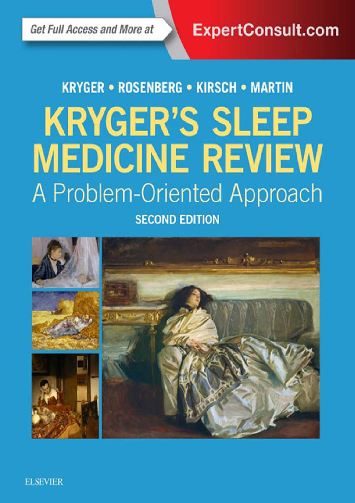
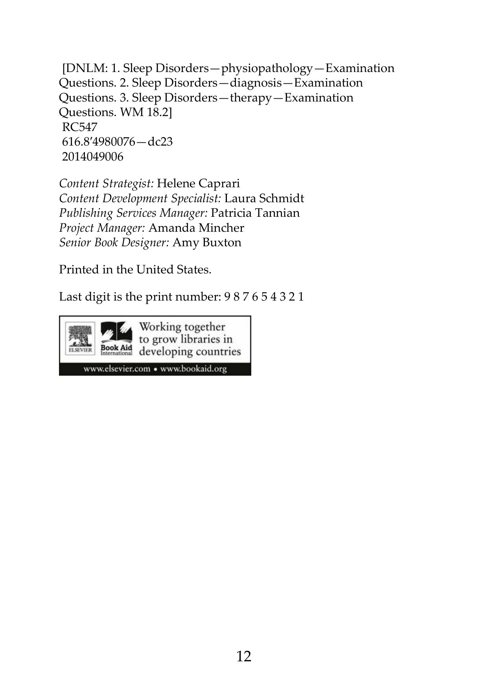
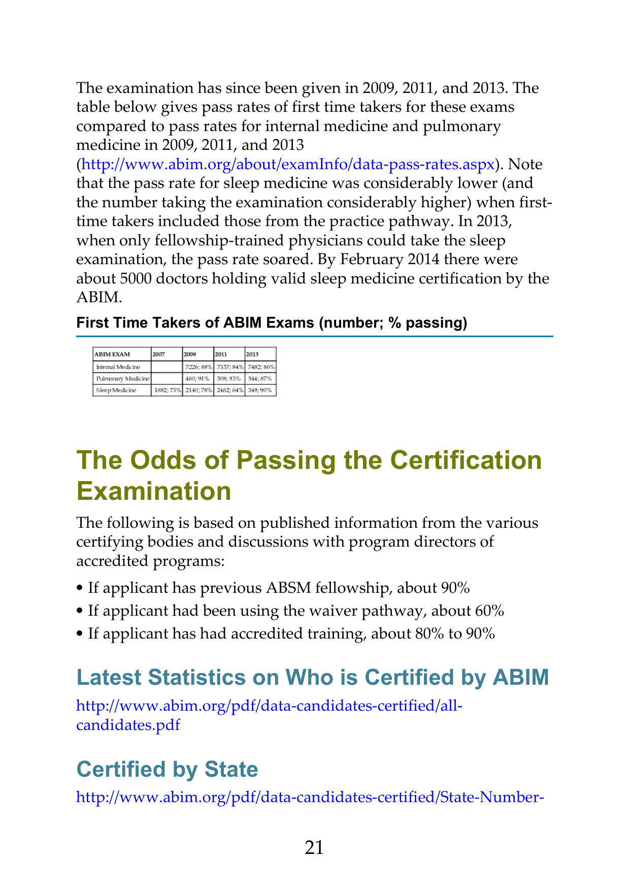
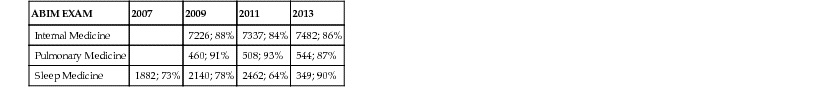
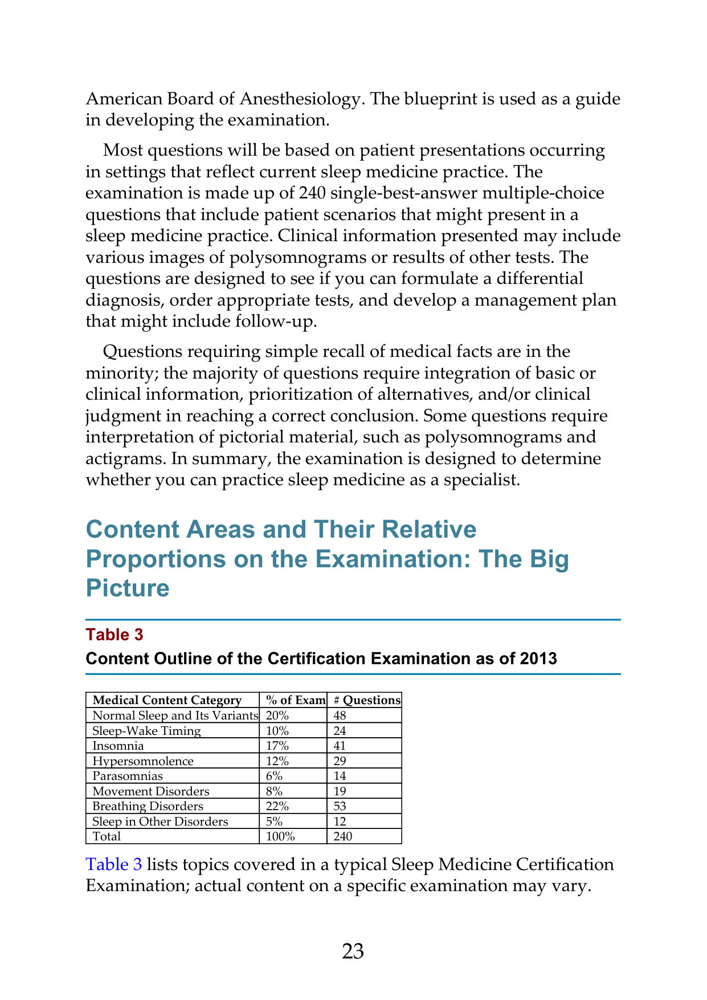
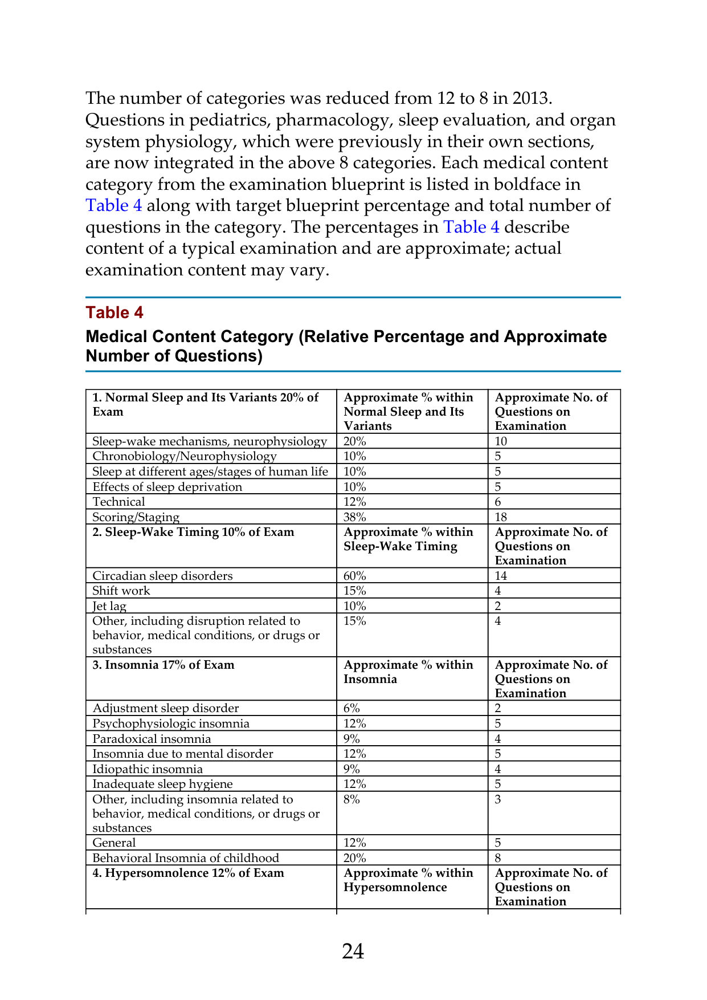

# Front Matter

<!-- pdf-page: 1 -->

<!-- pdf-page: 2 -->

## Kryger's Sleep

## Medicine Review

## Meir H. Kryger, MD, FRCPC

## A Problem-Oriented

## Approach

#### SECOND EDITION

## Russell Rosenberg, PhD, DABSM

Professor of Medicine Yale School of Medicine New Haven, Connecticut

CEO The Atlanta School of Sleep Medicine and Technology Atlanta, Georgia

### 2

<!-- pdf-page: 3 -->

## Douglas Kirsch, MD, FAASM

## Lawrence Martin, MD, FCCP

Medical Director, Carolinas Sleep Medicine Carolinas HealthCare System Charlotte, North Carolina

Clinical Professor of Medicine Case Western Reserve University School of Medicine Cleveland, Ohio

### 3

<!-- pdf-page: 4 -->

## Table of Contents

For Those Wishing to Use the Book as a Self-Assessment and Learning Tool

Cover image

Title page

Copyright

Preface

Acknowledgments

Using This Book to Review Sleep Medicine

How the Book Is Organized

Study Guide for the ABIM Sleep Medicine Certification Examination

Differences between the Old and New Examinations

Recent Pass Rates of the Sleep Medicine Examination

Who Has Taken and Passed the Examination?

The Odds of Passing the Certification Examination

### 4

<!-- pdf-page: 5 -->

Content Areas of the Examination

Sleep Medicine Certification Examination Blueprint (from the ABIM Website)

Tips to Help You Pass the Sleep Medicine Board Examination

1.3. Sleep at Different Ages and Stages of Human Life

Get Going

Continuing Medical Education

CME for Physicians

Continuing Education Credit for Other Groups

Section 1 Normal Sleep and Its Variants

1.1. Sleep-Wake Mechanisms and Neurophysiology

1.2. Circadian Mechanisms and Neurophysiology

1.5. Polysomnography: Methods, Rules, Event Scoring, Sleep Staging

1.4. Sleep Deprivation

Section E1. Normal Sleep and Its Variants

Section 2 Sleep-Wake Timing

Questions

Answers

Summary

References

Section E2 Sleep-Wake Timing

Section 3 Insomnia

### 5

<!-- pdf-page: 6 -->

Questions

Answers

Summary

References

7.3. Sleep-Related Hypoventilation and Hypoxemic Syndromes

Section E3 Insomnia

Section 4 Hypersomnolence

4.1. Narcolepsy

4.2. Other Hypersomnias

4.3. Potpourri of Sleepiness

Section 5 Parasomnias

5.1. Non–Rapid Eye Movement Parasomnias

5.2. Rapid Eye Movement Parasomnias

5.3. Other Parasomnias

5.4. Name That Stage

Section 6 Movement Disorders

6.1. Limb Movement Disorders

6.2. Other Movement Disorders

Section 7 Breathing Disorders

7.1. Obstructive Sleep Apnea

7.2. Central Sleep Apnea

### 6

<!-- pdf-page: 7 -->

7.4. Other Sleep-Breathing Disorders

Section 8 Sleep in Other Disorders

8.1. Neurologic Disorders

Appendix 1 Highly Recommended Lists by Section

8.2. Psychiatric Disorders

8.3. Other Disorders

Section 9 Gone but Not Forgotten

Why This Chapter?

References

Appendix 3 Knowledge Base for Sleep Medicine Practitioners in Europe

Section 1: Normal Sleep and Its Variants

Section 2: Sleep-Wake Timing

Section 3: Insomnia

Section 4: Hypersomnolence

Section 5: Parasomnias

Section 6: Movement Disorders

Section 7: Breathing Disorders

Section 8: Sleep in Other Disorders

Section 9: Gone but Not Forgotten

Appendix 2 Topics Index

### 7

<!-- pdf-page: 8 -->

A Physiologic Basis of Sleep (ATLAS2, Chapter 3)

B Assessment of Sleep Disorders and Diagnostic Procedures (ATLAS2, Chapters 13.1, 17, 18, and 19)

C Insomnia (ATLAS2, Chapter 10)

D Sleep-Related Breathing Disorders (ATLAS2, Chapter 13)

E Hypersomnias of Central Origin (ATLAS2, Chapter 11.1)

F Circadian Rhythm Sleep Disorders (ATLAS2, Chapter 9)

H Sleep-Related Movement Disorders (ATLAS2, Chapter 11.2)

G Parasomnias (ATLAS2, Chapter 12)

I Miscellaneous Sleep-Related Conditions and Disorders

J Societal, Economic, Organizational, and Research Aspects of Sleep Medicine (ATLAS2, Chapter 5)

Appendix 4 Knowledge Base for Sleep Medicine Practitioners in Japan

1. Fundamentals of Sleep (Section 1; ATLAS2, Chapter 3)

2. Interview of Patients (Section 1; ATLAS2, Chapters 8 and 20)

3. Symptoms of Sleep Disorders (Section 1; ATLAS2, Chapter 8)

4. Therapeutics (Sections 2-8; ATLAS2, Chapters 6, 10, 13, 17)

5. Tests Used for Sleep Evaluation (Sections 1-8; ATLAS2, Chapters 8 and 18)

Appendix 5 International Sleep Medicine Board Certification Examinations

6. Specific Sleep Disorders

WSF

WASM

### 8

<!-- pdf-page: 9 -->

Appendix 6 Knowledge Base for Dental Sleep Medicine Practitioners

Skills Tested

Examination Content Areas

### 9

<!-- pdf-page: 10 -->

## Copyright

1600 John F. Kennedy Blvd. Ste 1800 Philadelphia, PA 19103-2899

No part of this publication may be reproduced or transmitted in any form or by any means, electronic or mechanical, including photocopying, recording, or any information storage and retrieval system, without permission in writing from the publisher. Details on how to seek permission, further information about the Publisher's permissions policies and our arrangements with organizations such as the Copyright Clearance Center and the Copyright Licensing Agency, can be found at our website: www.elsevier.com/permissions.

This book and the individual contributions contained in it are protected under copyright by the Publisher (other than as may be noted herein).

Notices Knowledge and best practice in this field are constantly changing. As new research and experience broaden our understanding, changes in research methods, professional practices, or medical

### 10

<!-- pdf-page: 11 -->

treatment may become necessary. Practitioners and researchers must always rely on their own experience and knowledge in evaluating and using any information, methods, compounds, or experiments described herein. In using such information or methods they should be mindful of their own safety and the safety of others, including parties for whom they have a professional responsibility. With respect to any drug or pharmaceutical products identified, readers are advised to check the most current information provided (i) on procedures featured or (ii) by the manufacturer of each product to be administered, to verify the recommended dose or formula, the method and duration of administration, and contraindications. It is the responsibility of practitioners, relying on their own experience and knowledge of their patients, to make diagnoses, to determine dosages and the best treatment for each individual patient, and to take all appropriate safety precautions. To the fullest extent of the law, neither the Publisher nor the authors, contributors, or editors, assume any liability for any injury and/or damage to persons or property as a matter of products liability, negligence or otherwise, or from any use or operation of any methods, products, instructions, or ideas contained in the material herein.

#### Library of Congress Cataloging-in-Publication Data

Kryger's sleep medicine review : a problem-oriented approach / Meir H. Kryger, Russell Rosenberg, Lawrence Martin, Douglas Kirsch.—Second edition.

Kryger, Meir H., author.

p. ; cm. Sleep medicine review Preceded by Kryger's sleep medicine review / Meir H. Kryger … [et al.]. c2011.

Includes bibliographical references. ISBN 978-0-323-35591-9 (pbk. : alk. paper) I. Rosenberg, Russell, author. II. Martin, Lawrence, 1943-, author. III. Kirsch, Douglas B., author. IV. Title. V. Title: Sleep medicine review.

### 11

<!-- pdf-page: 12 -->

[DNLM: 1. Sleep Disorders—physiopathology—Examination Questions. 2. Sleep Disorders—diagnosis—Examination Questions. 3. Sleep Disorders—therapy—Examination Questions. WM 18.2]

RC547 616.8′4980076—dc23 2014049006

Content Strategist: Helene Caprari Content Development Specialist: Laura Schmidt Publishing Services Manager: Patricia Tannian Project Manager: Amanda Mincher Senior Book Designer: Amy Buxton

Printed in the United States.

Last digit is the print number: 9 8 7 6 5 4 3 2 1

### 12

<!-- pdf-page: 13 -->

Why another edition of this sleep medicine review book? The short answer is to help identify areas of strength and weakness for practitioners of the field. The longer answer is that the field has changed. The Board examination has changed! Home sleep testing is now the norm for first assessment of sleep apnea, there is an update to the classification system (ICSD3), and updates to the scoring manual and new treatments are available. The task of keeping up becomes even more important with the introduction of Maintenance of Certification.

## Preface

At the age of 62, one of the authors, Meir Kryger, decided to take the ABIM sleep medicine board examination. He had previously obtained board certification via the American Board of Sleep Medicine (ABSM) and didn't really need to take the new ABIM exam; nonetheless, he wanted the experience in order to better teach trainees and others preparing for a career in sleep medicine.

The authors have taught at many Board Review courses and wanted to see the other side—what students and trainees have to go through in preparation for this examination. We were surprised to discover that there really aren't many resources available for examinees that present current standards and scoring techniques and that are in sync with what is expected of a modern sleep medicine practitioner.

Colleagues who have been practicing sleep medicine for many years and are excellent clinicians have confessed hesitancy about taking sleep medicine certification exams. Mainly they were worried that some sections may be too difficult. Pulmonologists

### 13

<!-- pdf-page: 14 -->

worry about neurophysiology and anatomy of the brain, while neurologists are concerned about blood gases, sleep apnea, and CPAP. Yes, the examination is quite diverse, but perceived weakness in one or even a few areas can be overcome.

In preparation for board examinations like the sleep boards, you should never rely on a single source of information. You learn from seeing patients, reviewing many polysomnograms, discussing cases with colleagues, working with registered sleep technologists, reading textbooks and journal articles, attending lectures, and challenging yourself with board preparation questions. This book is but one aid in your preparation for the examination. It should not be your only resource, and that is why you will find numerous key references throughout the text. If you have experience in sleep medicine, either through practice or a sleep fellowship, and use the available resources intensely and wisely, you stand an excellent chance of passing the examination.

Recent research in learning suggests that tests offer a very good way to learn and to assess your areas of strength and weakness. Thus an important added benefit of this book is that you will learn more about sleep medicine and therefore take better care of your patients.

Meir H. Kryger MD, FRCPC

Russell Rosenberg PhD, DABSM

Douglas Kirsch MD, FAASM

Lawrence Martin MD, FCCP

### 14

<!-- pdf-page: 15 -->

## Acknowledgments

Many people helped in the preparation of this volume, including those listed below.

The staff members at Elsevier who helped this book in its journey were Helene Caprari, Laura Schmidt, Amanda Mincher, Amy Buxton, and many others involved in development, production, and design for both the printed volume and the online content.

Gail Reid was invaluable in helping with the continuing medical education aspects of this volume.

### 15

<!-- pdf-page: 16 -->

## Using This Book to

## Review Sleep

## Medicine

## How the Book Is Organized

The main part of this book is divided into 8 sections that correspond to the clinical areas tested by the ABIM sleep medicine certification examination (see below). Most sections contain several subsections with clinical vignettes followed by multiple-choice questions covering diagnosis or management. After the questions section is an answer section with detailed explanations. The end of each subsection includes a brief summary of key learning points. At the end of the book is a listing of key sources called Highly Recommended that form a core of knowledge. In addition there is a content guide in the Appendix for practitioners in Europe (Appendix 3), Japan (Appendix 4), and other countries (Appendix 5), and there is also a content guide for dentists (Appendix 6).

This book is directed to two main groups: those who wish to use the book as a self-assessment and learning tool, and those who are preparing to take sleep medicine certification examinations.

## For Those Wishing to Use the Book

### 16

<!-- pdf-page: 17 -->

## as a Self-Assessment and Learning

## Tool

Over the past two decades sleep medicine has evolved into a recognized specialty with board certification. Whereas it used to be a minor academic field with patient assessments carried out in a university hospital, today it is integral to primary care practice. Most patient assessments now take place in the outpatient setting. Even so, sleep specialists are often called on to evaluate inpatients, including patients in the ICU. While sleep apnea has been the driving force behind the growth in sleep medicine, studying for the boards will make you realize that the field is far more than just OSA and CPAP. You also need to know some neurology, psychiatry, otolaryngology, pharmacology, circadian physiology, pediatrics, and much more.

If you are just getting into the field of sleep medicine—a trainee doing a rotation in sleep medicine or still in your sleep fellowship —Sleep Medicine Review will give you a sense of the overall field, where it is heading, what types of patients you will be seeing, and where the research opportunities are. Go through the book from cover to cover and see what interests you most about the field. If you have recently passed the sleep exam, Sleep Medicine Review will be a refresher and will help keep you up to speed in your new field. Like all specialties, sleep medicine is constantly evolving; what may have been conventional wisdom just a few years ago may now be wrong. Sleep Medicine Review will also provide opportunity for you to obtain CMEs in your field. We recommend first reviewing clinical problems you are currently handling. This will help you help your patients and increase your knowledge base.

#### If you are an experienced sleep medicine practitioner and/or have

already passed the sleep medicine exam, this book will help keep you from getting stale. Long-term practitioners run this risk because they tend to see the same types of patients over and over again, often developing expertise in a narrow area (e.g., sleep breathing disorders, movement disorders, or insomnia). Sleep Medicine Review presents a wonderful opportunity to study areas that you may not have reviewed for some time. There have been

### 17

<!-- pdf-page: 18 -->

marvelous advances in the field, and we all need to learn about them. We suggest you begin this book by taking the online examination and then focus on areas new to you.

Sleep Medicine Review will also be useful to you for maintenance for certification (MOC) and to obtain CMEs in your field.

## Study Guide for the ABIM Sleep

## Medicine Certification Examination

If you are preparing for the sleep medicine examination, you should find this an excellent study guide. The book is divided into major topic areas defined by the certifying boards that make up the certification examination.

The sleep medicine or “board” examination is administered by the American Board of Internal Medicine and so is often called “the ABIM exam.” However, it is a joint effort by five board specialties under the umbrella of the American Board of Medical Specialties (ABMS), not to be confused with the old sleep medicine examination, which was administered by the American Board of Sleep Medicine (ABSM). The old ABSM examination is no longer given; there is only one sleep medicine board examination—“the ABIM exam”—and candidates for it may be admitted via prior certification in one of the following ABMS specialties: the American Board of Internal Medicine, the American Board of Psychiatry and Neurology, the American Board of Pediatrics, the American Board of Otolaryngology, the American Board of Family Medicine, or the American Board of Anesthesiology. The examination is the final requirement to become board certified in sleep medicine. The list of requirements for the ABIM version of the exam is*:

• At the time of application, maintain current, valid ABIM

certification in internal medicine or a subspecialty • Satisfactorily complete the requisite formal training requirements • Demonstrate clinical competence, procedural skills, and moral

and ethical behavior in the clinical setting • Hold a valid, unrestricted, and unchallenged license to practice

### 18

<!-- pdf-page: 19 -->

medicines • Pass the ABIM Sleep Medicine Certification Examination

Note that the practice pathway for admission to the Sleep Medicine examination, available for the 2007, 2009, and 2011 examinations, is no longer an option. Now, first-time applicants for admission to the examination must fulfill requirements of the training pathway, which requires a one-year fellowship. (There are a few exceptions spelled out in the ABIM website under the heading “Candidates for Special Consideration.”)

## Differences between the Old and New

## Examinations

The now-discontinued American Board of Sleep Medicine examination was much more difficult than the current certification examination. For starters, it was given over 2 days, whereas the ABIM examination is 1 day only. The ABSM exam had two parts; you had to pass Part 1 before taking Part II, and they were given months apart. Part I focused on knowledge of sleep medicine and physiology, and Part II focused on polysomnography and its interpretation. Part II also dealt with technical issues, and the applicant had to know a great deal about instrumentation of the patient, setting up of equipment, and interpretation of what was for many years a paper-based technology. When one of the authors did the ABSM examination in 1997, Part II included going through two 1000-page (yes, on paper) polysomnographic recordings and walking around the room to view a large number of paper or PSG fragments plastered on the walls. There was a high failure rate.

When that examination was initially created, the purpose was to certify that people could perform and interpret polysomnography. One did not have to be a physician to sit for the examination. For example, many psychologists took the examination and passed. One unintended consequence of the process was that, when people without actual medical training became certified, health systems often employed them not only to interpret polysomnograms, but also to evaluate patients with significant severe medical problems.

### 19

<!-- pdf-page: 20 -->

It was not appreciated that being ABSM certified in sleep medicine was not the same as being certified in a clinical specialty. Now only physicians can take the certification examination, so basic clinical skills are assumed.

## Who Has Taken and Passed the

## Examination?

A total of 1882 people took the first ABIM Sleep Medicine Examination in 2007, and the overall pass rate was 73%. Tables 1 and 2 below show who took the exam and who passed.

Candidates Who Took the 2007 ABIM Exam Number % of Test Takers ABIM (internal medicine and its subspecialties) 1228 65 ABPN (psychiatry and neurology) 460 25 ABP (pediatrics) 83 4 ABO (otolaryngology) 78 4 ABFM (family medicine) 33 2

Table 1

Data from Quan SF, Berry RB, Buysse D, et al: Development and results of the first ABMS Subspecialty Examination in Sleep Medicine, J Clin Sleep Med 4:505, 2008.

Admission Pathway to Exam No. Taking Exam % Passing Exam Self-attestation (by waiver; no fellowship) 1034 59 Valid ABSM sleep medicine certificate 683 93 Formal training (sleep medicine fellowship) 165 82

Table 2

Data from Quan SF, Berry RB, Buysse D, et al: Development and results of the first ABMS Subspecialty Examination in Sleep Medicine, J Clin Sleep Med 4:505, 2008.

Data released in February 2010 about the 2009 examination reported that 2512 people took the sleep examination and 76% of them passed. People taking the examination for the first time had a pass rate of 78%, while repeaters had a pass rate of 66%.

## Recent Pass Rates of the Sleep

## Medicine Examination

### 20

<!-- pdf-page: 21 -->

The examination has since been given in 2009, 2011, and 2013. The table below gives pass rates of first time takers for these exams compared to pass rates for internal medicine and pulmonary medicine in 2009, 2011, and 2013 (http://www.abim.org/about/examInfo/data-pass-rates.aspx). Note that the pass rate for sleep medicine was considerably lower (and the number taking the examination considerably higher) when firsttime takers included those from the practice pathway. In 2013, when only fellowship-trained physicians could take the sleep examination, the pass rate soared. By February 2014 there were about 5000 doctors holding valid sleep medicine certification by the ABIM.

#### First Time Takers of ABIM Exams (number; % passing)

## The Odds of Passing the Certification

## Examination

The following is based on published information from the various certifying bodies and discussions with program directors of accredited programs:

• If applicant has previous ABSM fellowship, about 90%
• If applicant had been using the waiver pathway, about 60%
• If applicant has had accredited training, about 80% to 90%

### Latest Statistics on Who is Certified by ABIM

http://www.abim.org/pdf/data-candidates-certified/allcandidates.pdf

http://www.abim.org/pdf/data-candidates-certified/State-Number-

### Certified by State

### 21

<!-- pdf-page: 22 -->

of-Certificates-Issued.pdf

## Content Areas of the Examination

The examination covers most topic areas that are likely to be encountered by a sleep medicine practitioner. The ABIM blueprint for the sleep medicine examination is online at http://www.abim.org/pdf/blueprint/sleep_cert.pdf.

Reprinted below are parts of the website with some modification of the tables. Also shown are sections in this book that relate to the content areas in the examination. It is important to note that although 60% to 80% of patients in a sleep disorders center likely have a sleep breathing disorder, only 22% of the examination will cover this topic. However, even that number may be misleading, since content related to sleep breathing disorders may be covered in other areas of the examination.

## Sleep Medicine Certification

## Examination Blueprint (from the ABIM

## Website)

### What Does the Examination Cover?

The exam is designed to evaluate the extent of the candidate's knowledge and clinical judgment in areas in which a sleep medicine specialist should demonstrate a high level of competence. Expertise in the broad domain of sleep disorders, including diagnosis and treatment of both common and rare conditions, will be assessed.

Examination content will be consistent with an established blueprint or table of specifications. The blueprint has been developed by the Sleep Medicine Test Committee, whose members represent the boards sponsoring the exam: the American Board of Internal Medicine, the American Board of Pediatrics, the American Board of Psychiatry and Neurology, the American Board of Otolaryngology, the American Board of Family Medicine, and the

### 22

<!-- pdf-page: 23 -->

American Board of Anesthesiology. The blueprint is used as a guide in developing the examination.

Most questions will be based on patient presentations occurring in settings that reflect current sleep medicine practice. The examination is made up of 240 single-best-answer multiple-choice questions that include patient scenarios that might present in a sleep medicine practice. Clinical information presented may include various images of polysomnograms or results of other tests. The questions are designed to see if you can formulate a differential diagnosis, order appropriate tests, and develop a management plan that might include follow-up.

Questions requiring simple recall of medical facts are in the minority; the majority of questions require integration of basic or clinical information, prioritization of alternatives, and/or clinical judgment in reaching a correct conclusion. Some questions require interpretation of pictorial material, such as polysomnograms and actigrams. In summary, the examination is designed to determine whether you can practice sleep medicine as a specialist.

### Content Areas and Their Relative

### Proportions on the Examination: The Big

### Picture

Table 3

#### Content Outline of the Certification Examination as of 2013

Table 3 lists topics covered in a typical Sleep Medicine Certification

Examination; actual content on a specific examination may vary.

Medical Content Category % of Exam # Questions Normal Sleep and Its Variants 20% 48 Sleep-Wake Timing 10% 24 Insomnia 17% 41 Hypersomnolence 12% 29 Parasomnias 6% 14 Movement Disorders 8% 19 Breathing Disorders 22% 53 Sleep in Other Disorders 5% 12 Total 100% 240

### 23

<!-- pdf-page: 24 -->

The number of categories was reduced from 12 to 8 in 2013. Questions in pediatrics, pharmacology, sleep evaluation, and organ system physiology, which were previously in their own sections, are now integrated in the above 8 categories. Each medical content category from the examination blueprint is listed in boldface in

Table 4 along with target blueprint percentage and total number of

questions in the category. The percentages in Table 4 describe content of a typical examination and are approximate; actual examination content may vary.

Table 4

#### Medical Content Category (Relative Percentage and Approximate

#### Number of Questions)

Approximate No. of Questions on Examination Sleep-wake mechanisms, neurophysiology 20% 10 Chronobiology/Neurophysiology 10% 5 Sleep at different ages/stages of human life 10% 5 Effects of sleep deprivation 10% 5 Technical 12% 6 Scoring/Staging 38% 18 2. Sleep-Wake Timing 10% of Exam Approximate % within Sleep-Wake Timing

1. Normal Sleep and Its Variants 20% of Exam

Approximate % within Normal Sleep and Its Variants

Approximate No. of Questions on Examination Circadian sleep disorders 60% 14 Shift work 15% 4 Jet lag 10% 2 Other, including disruption related to behavior, medical conditions, or drugs or substances

15% 4

3. Insomnia 17% of Exam Approximate % within Insomnia

Approximate No. of Questions on Examination Adjustment sleep disorder 6% 2 Psychophysiologic insomnia 12% 5 Paradoxical insomnia 9% 4 Insomnia due to mental disorder 12% 5 Idiopathic insomnia 9% 4 Inadequate sleep hygiene 12% 5 Other, including insomnia related to behavior, medical conditions, or drugs or substances

8% 3

General 12% 5 Behavioral Insomnia of childhood 20% 8 4. Hypersomnolence 12% of Exam Approximate % within Hypersomnolence

Approximate No. of Questions on Examination

### 24

<!-- pdf-page: 25 -->

Narcolepsy 42% 13 Psychiatric disorders 8% 2 Periodic hypersomnia (Kleine-Levin syndrome)

8% 2

4% 1

Idiopathic hypersomnia 8% 3 Insufficient sleep syndrome 22% 6 Post-traumatic hypersomnia 8% 2 Other, including hypersomnia related to behavior, medical conditions, or drugs or substances

5. Parasomnias 6% of Exam Approximate % within Parasomnias

Approximate No. of Questions on Examination Sleepwalking 9% 1 Sleep terrors 9% 1 REM sleep behavior disorder 25% 4 Nightmare disorder 9% 1 Confusional arousals 8% 1 Enuresis 8% 1 Sleep-related eating disorder 8% 1 Sleep-related hallucinations 8% 1 Sleep paralysis 8% 2 Other 8% 1 6. Movement Disorders 8% of Exam Approximate % within Movement Disorders

Approximate No. of Questions on Examination Restless legs syndrome 44% 8 Periodic limb movement during sleep 25% 5 Rhythmic movement disorder 12% 2 Bruxism 12% 2 Other 7% 2 7. Breathing Disorders 22% of Exam Approximate % within Breathing Disorders

Approximate No. of Questions on Examination Obstructive sleep apnea 43% 23 Central sleep apnea 36% 19 Sleep-related hypoventilation/hypoxemic syndromes

14% 7

Other sleep-related breathing disorders 7% 4 8. Sleep in Other Disorders 5% of Exam Approximate % within Sleep in Other Disorders

Approximate No. of Questions on Examination Neurologic 40% 5 Psychiatric 40% 5 Other medical disorders 20% 2

Examination questions in the content areas above may also address clinical topics in pediatric medicine, pharmacology, sleep evaluation, and organ system physiology that are important to the practice of sleep medicine specialists. We have added to this volume a chapter called “Gone, but Not Forgotten,” which covers some topic areas that may fall between the cracks. A tutorial that

### 25

<!-- pdf-page: 26 -->

has examples of the format of the ABIM examination questions can be found at http://www.abim.org/exam/prepare.aspx.

### How the Examination Day Will Be Organized

The following information reflects how previous examinations were organized and how future examinations will likely be conducted. You will spend all day at the Pearson Vue test site. Up to 8 hours will be spent taking the actual examination, which includes four 2- hour sessions. You don't have to spend the entire 2 hours in the session; you can leave a session early if you have finished it. Between sessions will be either a break that can last up to 20 minutes or a lunch break that can last up to 1 hour. Some people complete each examination session in 60 to 90 minutes and take a short break and a short lunch break, so they are able to leave as early as 4 pm. Others take the maximum amount of time for each activity and may not leave until 6 pm.

How your day goes depends on your exam-taking style, your confidence, and your sense of whether or not additional review of the questions and answers in each session is needed. During the examination you will have the ability to flag questions you want to revisit and to review everything if you have the time available. For some people it may be a race between fatigue and obsession with reviewing. One of the authors found himself very fatigued at the end of the two morning sessions and welcomed the lunch break, during which he had a caffeinated cola beverage (which he usually never drinks after morning).

Table 5

Activity Time* Registration Varies Tutorial Optional, up to 30 minutes Instructions and Pledge of Honesty Up to 10 minutes First Session Up to 2 hours Morning Break Optional, up to 20 minutes Second Session Up to 2 hours Lunch Break Optional, up to 60 minutes Third Session Up to 2 hours Afternoon Break Optional, up to 20 minutes Fourth Session Up to 2 hours Optional Survey Up to 10 minutes

### 26

<!-- pdf-page: 27 -->

Total Approximately 10 hours

*You will have up to 8 hours to answer 240 questions. This averages out to 2 minutes per question, which is more than enough time to complete the examination.

### Distribution of Content Areas and Question

### Types

From discussions immediately after the previous examinations, it appeared that the exact questions and their sequence may have varied from person to person. The number of questions per section may also vary a bit from the blueprint. The vast majority of questions are structurally simple multiple-choice type. Some questions require opening a second window to examine a PSG fragment. Some questions will seem to come from “left field”; in the 2009 examination there were two questions in which the patient had achondroplasia and one in which the patient had Marfan's syndrome!

## Tips to Help You Pass the Sleep

## Medicine Board Examination

It is likely that many older examinees will have never before taken a computer-based board examination. Taking such examinations is quite a different experience from the paper-based examinations of the past.

The testing facilities have more security than an airport. You will not be able to bring anything with you into the examination room except the clothes you are wearing (not even your watch or your keys). You will likely be supplied with a locker. The exam center may have no food or beverages for sale, so bring a lunch and beverages (juices, water, caffeinated drinks if you use them), plus snacks for the breaks between examination modules. You will be able to store these in your locker or car. Some people also brought earplugs and used them during the examination; there may be 15

### The Testing Facility

### 27

<!-- pdf-page: 28 -->

people sitting at computer terminals in the exam area, some of whom may have annoying, noisy habits.

### Are You a Mac or a PC?

Even if you use an Apple Mac at home, chances are overwhelming that you use a Windows-based PC at work, so you are familiar with the Windows operating system, the two-button mouse, and the mechanics of opening and closing Windows. If you don't know how to use a PC, take the online exam tutorial (on a PC) that you can download from the Pearson Vue website:

For the PC (http://www.pearsonvue.com/_abimdemo/abim.exe)

For the Mac (http://www.pearsonvue.com/_abimdemo/ABIM_demo_mac.zip)

At this time the examination sites use only PC-based computers!

### Taking the Tutorial—You Must Do This!

The tutorial that you downloaded (see immediately above) has two modules: an Overview of Functional Features and a Practice Exam. Go through both modules. The first will show you how to navigate through the examination, pick answers, flag questions, write notes, and open and close windows. The latter is especially important because some content (e.g., PSG fragments or images) may be presented this way.

### Certain Rules Will Help You Succeed

RULE 1. The Sleep Medicine Board Exam is entirely computer

#### In the Months before the Examination

based. It will be held in a high-tech facility designed specifically for examinations. The Pearson Vue facility may be limited in how many individuals can be tested, so you should register very early so you can take the exam in the closest testing center; otherwise, you might find yourself taking the exam in Wyoming (which is only an advantage if you live in Wyoming). If the testing center is far away from your home, you might have to stay near the testing

### 28

<!-- pdf-page: 29 -->

center the night before the examination, or you might have to drive a great distance on the morning of the examination. Don't be sleep deprived when you take the examination. Keep all the paperwork (e.g., proof of payment, registration, instructions) you will need in one folder.

RULE 2. Make sure you have enough time to study for this

examination. Even if you have a great deal of clinical experience, you will have difficulty with parts of the examination if you have not studied. Psychologically it is better to approach this type of examination knowing that you have studied. Study for the examination and start early. Many people start a year before the examination. It is very difficult for people in a busy clinical practice to find the time, but clinical practice alone will not prepare you for this examination. If you are expert in certain areas, focus on the areas in which you are less experienced. Pay attention to the relative percentage of content area being tested on the examination, as presented above. As you go through the sections in this book, try to pace yourself as you will on the examination.

RULE 3. We were surprised when we learned that the entire

examination day could last 9 hours, not counting driving to and from the testing facility. As crazy as it sounds, part of the preparation means developing the stamina to focus on an examination that long. Work on your exam-taking stamina by doing long practice examinations over long periods of time. After about 3 hours some exam-takers feel fatigued and unfocused and tend to not pay as much attention to the questions. Sometimes one may just put down an answer without thinking. Take practice examinations offered by the American Academy of Sleep Medicine on their website because some of the questions were actually identical to those that were on my examination. Take the practice examinations offered by this book. Do not drive yourself crazy! (For a detailed list of what to study for the next Sleep Board Exam offered by one of this book's authors, see http://www.lakesidepress.com/sleepboardreview.htm.)

RULE 4. Become familiar with the mechanics of the examination

### 29

<!-- pdf-page: 30 -->

and what the computer screens will look like. Take the tutorial (http://www.abim.org/exam/prepare.aspx) offered by your board or take the brief tutorial at the beginning of examination day. Sample examinations, like those offered by the American Academy of Sleep Medicine, might be helpful for this. You will have the opportunity to become familiar with the computerized system at the venue where the examination is held. It is always good to know what to expect.

RULE 5. Look over all the instructions you received from the board

#### The Night before the Examination

and review the instructions from the testing facility. Prepare a folder to include everything you will need. You are now getting ready for the big day. Prepare a lunch, snacks, and beverages that you will need on testing day. This will be your big chance to eat the chocolate you have been craving. Use a mapping or GPS program if you are not familiar with the location of the examination center. It might be helpful to drive to the site a day or two before the examination.

RULE 6. If you have not taken practice examinations, take the

#### Exam Day: Acing the Examination

optional tutorial practice examination at the testing site so that you become familiar with the screen display, the mouse, etc. You will learn that for some questions you may have to click a tab to bring out additional content related to a question (e.g., a PSG fragment). You will also learn how to flag questions to which you want to return.

RULE 7. It is critical to allocate your time. When each session starts,

calculate how much time you'll have for each question. About every 20 minutes check to make sure that your pace is not too slow.

RULE 8. It is best to answer the questions in order. For each

question, if you can eliminate one or more incorrect answers, it is worth guessing. Urban legend has resulted in the following

### 30

<!-- pdf-page: 31 -->

advice: when you have no clue, the longest answer is frequently correct. Also, “All the above” is frequently correct. However, don't spend too much time on questions when you have absolutely no clue about the answer. Flag them and return when you are finished going through the rest of the examination.

RULE 9. Read each question carefully so you understand what is

being asked. Read the entire question. Every statement in the question is included for a reason—either to help you choose the correct answer or to distract you from answering correctly. Sometimes it helps to ask yourself, “Why are they asking that?”

RULE 10. When you are presented with a PSG or other tracing,

make sure you examine the labeling and data for each channel carefully. Also pay attention to the epoch length.

RULE 11. Don't second guess yourself. Once you have picked an

answer, don't change it simply because you have time on your hands.

RULE 12. Go home, relax, and apologize to your family for

#### After the Examination

spending so much time preparing for the examination. And don't forget to clean up the mess caused by your study materials strewn all over the house.

RULE 13. Don't expect the results to be available until late January.

You will probably receive an email from your board (Internal Medicine, Psychiatry and Neurology, Pediatrics, Otolaryngology, Family Practice) at the last possible moment. The list of people who passed will also be available on the web. You will receive the written scores for the examination broken down by section about a week later.

This book contains sections and subsections that correspond to the content areas of the actual examination. We recommend that you go

## Get Going

### 31

<!-- pdf-page: 32 -->

through the examination questions twice. The number of questions printed in each section is double the number that you will encounter for that topic area on the actual examination. Thus when you finish the entire book you will have finished the equivalent of two examinations.

### Important Note about Some Topics

Although the current blueprint for the examination does not mention pediatrics, this is somewhat misleading. We estimate that 5% to 10% of all questions on the examination require some knowledge of pediatric sleep medicine; therefore, ignoring pediatric sleep disorders is not a good idea when preparing for the examination or in keeping up to date in the field.

### How to Go Through This Book if You Don't

### Have a Great Deal of Sleep Medicine

### Experience

1. We suggest that you go through the book cover to cover, starting at the beginning.

2. Answer the questions for each section in one sitting, marking the answers in light pencil (so you can erase the checkmarks). Check the answers to see how you did in that section. Identify the areas of content that need more attention.

3. Review the Summary at the end of each section. Keep track of your score for each section.

4. When you have finished the entire book, you will have completed the equivalent of two complete examinations (480 questions). Calculate your score.

5. Review the topic areas in which you are weak.

6. Do the web-based examinations.

### 32

<!-- pdf-page: 33 -->

### How to Go Through This Book if You Have a

### Great Deal of Sleep Medicine Experience

1. Do the web-based exams to identify areas of weakness.

2. Go through the book, but first focus on the areas of weakness you have identified.

3. Answer the questions for each section in one sitting, marking the answers in light pencil (so you can erase the checkmarks). Check the answers to see how you did in that section. Identify the areas of content that need more attention.

4. Review the summary at the end of each section. Keep track of your score for each section.

5. When you have finished the entire book, you will have completed the equivalent of two complete examinations (480 questions). Calculate your score.

6. Review the topic areas in which you are weak.

The goal is to obtain at least 75% correct in each of the 12 sections in order to increase the odds of passing.

### About the Questions and Content

We understand that your time is valuable and limited, and nobody will ever know everything about sleep medicine. The questions and other content in this book have been chosen to efficiently cover the material that we believe is important and might be on the examination. On the examination itself, the questions generally test one bit of knowledge. Many of the questions in this book are “high value” and may test several different facts. The Highly Recommended list is in the Appendix of this volume.

You will note that most of the answers have a brief paragraph that

### About the Answers

### 33

<!-- pdf-page: 34 -->

explains why the answer is correct and that contains references if you require them, which will be from one or more of the following:

1. Kryger M, Avidan A, Berry R: Atlas of Clinical Sleep Medicine, ed 2, Philadelphia, 2014, Saunders. This will be abbreviated ATLAS2.

2. American Academy of Sleep Medicine (AASM): International Classification of Sleep Disorders, ed 3, Darien, Ill., 2014, AASM. This will be abbreviated ICSD3.

3. American Academy of Sleep Medicine: The AASM Manual for the Scoring of Sleep and Associated Events, Version 2.1, Darien, Ill., 2014, AASM. This will be abbreviated MANUAL2.

4. Sheldon S, Ferber R, Kryger M, Gozal D: Principles and Practice of Pediatric Sleep Medicine, ed 2, Philadelphia, 2014, Elsevier. This will be abbreviated PEDS2.

If you own it, you will be able to access the online version of the Atlas directly from the online version of this book.

5. Published articles or other sources.

In several places, we refer to resources that we have labeled as Highly Recommended, and the complete list is in Appendix I. “Highly Recommended” means that we strongly recommend you review and know the material in these sources.

### Highly Recommended Lists

### A Note about Illustrations and PSG

### Fragments in This Volume

The polysomnography fragments and illustrations that were presented in the previous examinations were not of particularly high quality, and it is likely that the display of polysomnographic findings that you are used to (such as those in this book) is much better than what you'll find on the examination. It is likely that the quality of images used in the examination will improve with time.

### 34

<!-- pdf-page: 35 -->

### Disclaimer

Going through this book will not guarantee that you pass the examination. Question types and distribution of questions may change. We have made no attempt to replicate the questions that appear on the exam.

*List is from http://www.abim.org/certification/policies/imss/sleep.aspx.

#### GOOD LUCK!

### 35

<!-- pdf-page: 36 -->

## Continuing Medical

## Education

The CME for this activity is based on reading the text, answering the 480 questions and referring to the bibliographic sources for each question before enrolling in and completing the online activity for which this book is the basis. The online activity comprises 24 questions that cover the 8 categories in the book. The good faith estimate is that 64 hours are required to complete all the steps toward earning continuing medical education credit.

## CME for Physicians

Participants must demonstrate a minimum performance level of 70% in the assessment to successfully complete the activity for AMA PRA Category 1 Credit™. These credits will be available from the launch of the online activity, which is based on the book, for 3 years. If there are changes that impact the questions, the activity will be revised during that period.

The Atlanta School of Sleep Medicine and Technology is accredited by the Accreditation Council for Continuing Medical Education (ACCME) to provide continuing medical education for physicians.

### Statement of Accreditation

### Designation of Credit

### 36

<!-- pdf-page: 37 -->

The Atlanta School of Sleep Medicine and Technology designates this enduring material activity for a maximum of 64 AMA PRA Category 1 Credits™. Physicians should claim only the credit commensurate with the extent of their participation in the activity.

This activity is aimed at clinicians in the fields of internal medicine, neurology, otolaryngology, pediatrics, primary care, psychiatry, psychology, pulmonology, and cardiology who wish to assess their knowledge and improve their management of patients with sleep disorders.

### Target Audience

Upon completion of this volume and activity learners will be able to:

### Learning Objectives

• Recognize the symptoms of sleep and circadian disorders and

sleep deprivation. • List the risk factors of sleep and circadian disorders. • Explain the interrelationships between sleep and circadian

disorders, sleep deprivation, and comorbid conditions. • Describe the clinical features of sleep and circadian disorders and

how they affect the learner's field. • Describe the clinical features of the other fields that are part of

sleep medicine, which may include internal medicine, neurology, otolaryngology, pediatrics, primary care, psychiatry, psychology, pulmonology, and cardiology. • Choose appropriate diagnostic evaluation to confirm sleep

disorder diagnoses. • Prescribe scientifically based treatment for patients with sleep and

It is the policy of the Atlanta School of Sleep Medicine to ensure balance, independence, objectivity, and scientific rigor in all its

circadian disorders.

### Disclosure Policy

### 37

<!-- pdf-page: 38 -->

educational activities. All planners, contributors, and speakers participating in programs directly provided or jointly provided by the Atlanta School of Sleep Medicine and Technology are expected to disclose to the program audience any real or apparent conflict(s) of interest related to the content of their contribution or presentation.

Has disclosed that he has a research grant from Philips Respironics, Inc. and ResMed, Inc.

Meir Kryger, MD, FRCPC Planner and Contributor

Has disclosed that the CME content over which he has control does contain information about healthcare products or services but neither he nor partner/spouse has had a financial relationship in any amount during the last 12 months with the manufacturers of the products or providers of the services that may be discussed. Lawrence Martin, MD, FCCP Contributor

Russell Rosenberg, PhD, DABSM Planner and Contributor

Has disclosed that he has a research grant from Merck and Pfizer.

Douglas Kirsch, MD, FAASM Contributor

Has disclosed that the CME content over which he has control does not contain information about healthcare products or services.

### Process to Obtain CME Credits

The process to obtain CME credits for Kryger's Sleep Medicine Review: A Problem-Oriented Approach can be found on the website of the Atlanta School of Sleep Medicine and Technology: www.sleepschool.com/sleepmedicinereviewCME as well as the fee schedule. Maintenance of Certification (MOC) details, which may be required for your specialty, are also included.

## Continuing Education Credit for Other

## Groups

### For Respiratory Therapists, Registered

### 38

<!-- pdf-page: 39 -->

### Sleep Technologists, and Allied Health

### Professionals

The Atlanta School of Sleep Medicine and Technology will issue non-physician health professionals a certificate of participation that references AMA PRA Category 1 Credit™ to help them document their participation in certified educational activities.

### 39
