# Section 1 Normal Sleep and Its Variants

<!-- pdf-page: 40 -->

### SECTION 1

## Normal Sleep and Its

## Variants

## 1.1.

## Sleep-Wake Mechanisms and

## Neurophysiology

#### A 20-Year-Old Student Pulling an All-Nighter

## Questions

A 20-year-old asthmatic student is cramming for a final exam he will take the next morning. He has studied the entire day and now has decided to study through the night. He becomes extremely sleepy at 4 am and has two cups of strong coffee.

1. Which structure is primarily involved in keeping him awake before the sleepiness sets in?

### A. Ascending reticular activating system

### C. Ventrolateral preoptic (VLPO) nuclei

### B. Pineal gland

### 40

<!-- pdf-page: 41 -->

### D. Hypothalamus

2. The system responsible for keeping the student awake is located in the

3. All of the following neurotransmitters are actively involved in keeping his brain awake except

### A. Medullary bulb

### B. Pons

### C. Midbrain

### D. All of the above

### A. Norepinephrine from noradrenergic neurons of the

### ventrolateral medulla and locus coeruleus

### B. Acetylcholine from cholinergic neurons in

### pedunculopontine tegmental and laterodorsal

### tegmental nuclei

### C. Gamma-aminobutyric acid (GABA) and galanin

### D. 5-Hydroxytryptamine (5-HT) from serotoninergic

### (GAL) from the VLPO

4. Pathways of the arousal system reach the cerebral cortex through which structures?

### neurons in the dorsal raphe nucleus

### A. Cerebellum and pons

### 41

<!-- pdf-page: 42 -->

### B. Pons and medulla

### C. Medulla and spinal cord

### D. Thalamus, hypothalamus, and basal forebrain

5. Which chemical involved in hunger regulation also has input into the arousal system?

6. Which chemical is accumulating in his central nervous system (CNS) to cause sleepiness before he drinks coffee?

### A. Orexin (hypocretin)

### B. Leptin

### C. Ghrelin

### D. Insulin

### D. Gamma-hydroxybutyric acid (GHB)

### A. Melatonin

### B. Serotonin

### C. Adenosine

7. He drank coffee for its stimulant effect; it works to increase wakefulness by affecting production of

### A. Melatonin

### B. Serotonin

### 42

<!-- pdf-page: 43 -->

### C. Adenosine

### D. GHB

8. The student becomes jittery about 20 minutes after drinking the coffee and feels his heart beating rapidly. Assuming he is taking all of the following medications, which one is likely producing the tachycardia?

A 16-year-old straight-A high school student is referred for evaluation because she no longer focuses well in school. She is seen to “nod off” in class, and her grades have recently plummeted. You learn that she sleeps 8 hours per night but complains of “broken sleep.” She sometimes awakens in the middle of the night and then has trouble falling back to sleep. She has also noted a panicky feeling during nocturnal awakenings and states, “I feel someone is in the room, and I can't move.” Further history reveals that she has recently started taking afternoon naps and dreams vividly while napping.

### A. Prednisone

### B. Fluticasone

### C. Montelukast

### D. Theophylline

#### Daydreamer

9. Her pediatrician believes that she is exhibiting symptoms of a neurologic disease, perhaps multiple sclerosis, and recommends a spinal tap. If a spinal tap were to be performed, and the cerebrospinal fluid (CSF) were to be analyzed, what abnormality would likely be found?

### A. Reduced hypocretin

### 43

<!-- pdf-page: 44 -->

### B. Reduced adenosine

### C. Elevated interleukin-6 (IL-6)

10. The patient's unintended daytime sleep episodes are most likely caused by what abnormality?

### D. Elevated nerve growth factor

### A. An underactive ascending reticular activating

11. The patient's awakening during the night, unable to move and sensing that someone is in the room, is characteristic of

### system

### B. Loss of hypocretin neurons

### C. Excessive CNS serotonin levels

### D. Overactive CNS GABAA receptors

### B. Posttraumatic stress disorder (PTSD)

### A. Psychomotor epilepsy

12. What is causing her inability to move when she awakens during the night?

### C. Sleep paralysis

### D. Schizophrenic hallucination

### A. Abnormal discharge from the frontal cortex

### inhibiting the motor cortex

### 44

<!-- pdf-page: 45 -->

### B. Excessive stimulation of the ascending reticular

### activating system that thus inhibits the motor cortex

### C. Inhibition of motor neurons in the spine by both

### glycinergic and GABAergic mechanisms

### D. Excessive adrenergic stimulation causing

### vasoconstriction of spinal arteries, resulting in

### ischemia of the spinal motor neurons

A 40-year-old patient with acute influenza is noted to have a severe cough and feels extremely sleepy whenever he is awake.

#### Pandemic of Sleepiness

13. Which of the following is least likely to be the cause of his sleepiness?

### A. Viral encephalitis with influenza virus invading

### B. Viral ribonucleic acid (RNA) and protein that

### hypothalamic cells

### induces cytokine production within the

### hypothalamus

### C. Virus replicating in lung cells and inducing

### D. Activation by cytokines of the acute phase

### production of somnogenic cytokines

14. What is the effect of the infection on sleep architecture?

### response

### A. Increase in wakefulness with inability to

### 45

<!-- pdf-page: 46 -->

### consolidate sleep

### B. Marked increase in rapid eye movement (REM)

### sleep, leading to hallucinations

### C. No systematic effect on the relationship of REM to

### D. Enhancement of NREM sleep and inhibition of

### non-REM (NREM) sleep

15. The cytokines that can explain the infection's effect on sleep include all of the following except

### REM sleep

### C. Tumor necrosis factor and nerve growth factor

### A. Orexin (hypocretin) and leptin

### B. IL-1β and IL-6

### D. Brain-derived neurotrophic factor and growth

16. What is the expected natural history of the sleepiness in this case?

### hormone–releasing factor

### A. Sleepiness starts within hours of infection and lasts

### B. The sleepiness starts once the lung infection begins

### for days to weeks.

### C. The sleepiness usually is present only during the

### to resolve and can last months.

### 46

<!-- pdf-page: 47 -->

### prodromal phase.

### D. The sleepiness can become chronic because of

### damage to the hypothalamus, a condition known as

### encephalitis lethargica.

17. A friend likes to drink red wine up to 30 minutes before bedtime about 5 nights a week. He tells you that the wine does indeed have an effect on his sleep. Which of the following best describes alcohol's effect when taken near bedtime?

#### Potpourri

### C. Reduced wake after sleep onset (WASO)

### A. Bizarre dreams

### B. Increased REM sleep

18. A waitress drinks three pots of coffee to stay alert and energized on her shift. The reason coffee helps her remain alert is because caffeine

### D. Decreased limb movements

### A. Is an adenosine agonist

### B. Is a serotonin antagonist

### C. Is a norepinephrine agonist

### D. Blocks reuptake of dopamine

19. Caffeine has an approximate half-life of

### 47

<!-- pdf-page: 48 -->

### A. 15 to 30 minutes

### B. 1 to 2 hours

20. You are at a social gathering, where someone learns you are a sleep medicine specialist. He brags that he can drink four espresso drinks before bedtime without any effect on his sleep. What should you tell him?

### C. 3 to 5 hours

### D. 6 to 8 hours

### A. Caffeine has no effect on some people.

### B. Caffeine consumption will eventually cause

1. A. Exams (self-assessment or board) often begin with an icebreaker, a question considered to be relatively easy. In this question, ascending reticular activating system should appear as the obvious answer. It is important to know the big picture about arousal and initiation of sleep. In 1935, Fredric Bremer, a pioneer in sleep research, showed that if a transection is made between the pons and midbrain of a cat (the preparation is called cerveau isolé, literally “isolated brain” in French), there is no arousal, and the animal is comatose. If a transection is made between the lower medulla and the spine, the cat is able to demonstrate wakefulness and sleep. This preparation is known as l'encéphale isolé. L'encéphale

### insomnia.

### C. Caffeine reduces REM sleep.

### D. Caffeine reduces stage N3 sleep.

## Answers

### 48

<!-- pdf-page: 49 -->

refers to all the nervous system structures in the cranial vault or skull. In 1949, Moruzzi and Magoun showed that stimulating the structures of the rostral pontine reticular formation (basically in the area between Bremer's two transections) produced a desynchronized (or awake) electroencephalogram (EEG). This area of the brainstem became known as the ascending reticular activating system. (ATLAS2, Ch 3.1)

2. D. This question is a follow-up to the first one. The ascending reticular activating system (ARAS) begins in the medulla and ascends into the pons and midbrain. This is a type of question where “all of the above” is often correct. (ATLAS2, Ch 3.1)

3. C. There are so many chemicals and parts of the brain mentioned that it might make your eyes glaze over. It is desirable to know the sleep-promoting systems and the wakefulness-promoting systems (they are reviewed in the summary that follows). This type of question is relatively easy, because you can often get the right answer by a process of elimination. When confronted with such a question, do not panic; look for terms you know, and start from there. In this question, you need to know any component of the sleep switch (this includes the VLPO, whose cells contain the inhibitory neurotransmitters GABA and GAL), or you might have to generalize from information you learned from an entirely different topic. For example, you might have remembered that GABA has something to do with sleep from understanding hypnotics. You always know more than you think. (ATLAS2, Ch

#### 3.1)

4. D. Again, analyze the question, and you will realize that only one of the answers has anything to do with pathways going into the cerebral cortex. There are two pathways of arousal into the cortex from the ARAS: a dorsal route via the thalamus (associated fact: site of spindle formation) and a ventral route via the basal forebrain and the hypothalamus. The basal forebrain is a ventral structure, and the hypothalamus is ventral and below the thalamus. The hypothalamus is right behind the optic chiasm (associated fact: the suprachiasmatic nucleus, the “conductor” of the circadian system “orchestra,” is here) and is above the pituitary gland. The

### 49

<!-- pdf-page: 50 -->

hypothalamus secretes many endocrine-releasing factors, and because of its location and function, it links the endocrine and circadian systems. (ATLAS2, Ch 3.1)

5. A. All these chemical entities are involved in regulation of hunger and/or energy. Leptin, secreted by fat cells, inhibits hunger. Ghrelin, produced by cells in the stomach, increases hunger. Insulin is produced in response to high glucose levels. Orexin (also called hypocretin) is produced by cells in the lateral and posterior hypothalamus and stimulates hunger and wakefulness. Two orexin neuropeptides, Orexin-A and Orexin-B, promote arousal and stabilize wakefulness by their effect on the OX-1 and OX-2 receptors. Narcolepsy patients have reduced orexin-producing cells and are sleepy as a result.

6. C. It is believed that adenosine, an inhibitory neurotransmitter, increases in the nervous system with prolonged wakefulness.

7. C. Caffeine, a xanthine, is a competitive inhibitor of adenosine, because it is an antagonist of adenosine receptors in the nervous system. It has structural similarities to adenosine. The net result of blocking the effect of a compound that inhibits CNS function is to stimulate the CNS and promote wakefulness.

8. D. Theophylline is a xanthine sometimes used to treat asthma. It is one of the metabolites of caffeine. Both caffeine and theophylline can relax bronchial smooth muscle and increase cardiac contractility, heart rate, and blood pressure. Theophylline affects the nervous system through its action as an adenosine receptor antagonist.

9. A. From the description, this is most likely a case of narcolepsy. Each of the factors mentioned can promote sleepiness or sleep. Although rarely tested for clinical purposes, analysis of CSF in narcoleptics has shown a striking reduction of hypocretin compared with controls.

10. B. The unintended transition from wakefulness to sleep is related to the fact that hypocretin neurons project widely in the

### 50

<!-- pdf-page: 51 -->

cerebral cortex and stabilize wakefulness. The lack of these neurons results in wakefulness and sleep instability. (ATLAS2, Ch 3.1)

11. C. This is a classic description of sleep paralysis. The person awakens, usually from a dream, often with the perception that there is someone else in the room (sometimes a frightening devil-like creature). These events are likely the persistence of REM phenomena (dreaming and motor inhibition) persisting into wakefulness. (ATLAS2, Ch 7)

12. C. The motor weakness is related to the neurons of the sublaterodorsal (SLD) nucleus inhibiting motor spinal neurons by glycinergic and GABAergic mechanisms. (ATLAS2, Ch 3.1) Interestingly, the motor neurons projecting to the diaphragm are spared, and thus the motor atonia does not affect breathing.

13. A. The sleepiness seen with influenza is seldom caused by infection of cells in the nervous system but rather is brought on by the effect of cytokines that are a response to the infection. Cytokines are proteins and glycoproteins that behave like neurotransmitters and are commonly expressed during infections. The remaining three answers (B, C, and D) are mechanisms that likely do play a role in the sleepiness. (ATLAS2, Ch 3.5)

14. D. Infections typically increase NREM sleep (and can increase slow-wave sleep), and they reduce REM sleep. (ATLAS2, Ch 3.5)

15. A. This is the type of question where you might not know much about the topic but can get the right answer from associated bits of knowledge. Orexin is not a cytokine, and leptin, which might be considered a cytokine, is produced by fat cells, and fat cells have nothing to do with infections. Thus knowing either of these facts could help point to the correct answer. The other answers (B, C, and D) are cytokines that can be increased in infections. (ATLAS2, Ch

#### 3.5)

16. A. The sleepiness can start abruptly with infections, sometimes within hours. It is related to cytokine production and will last a few days to a few weeks as the infection resolves. You might have read

### 51

<!-- pdf-page: 52 -->

something about encephalitis lethargica in the distant past, and if so you wonder whether it could be the correct answer. It is not. Encephalitis lethargica is an encephalitis that affects the junction of the posterior hypothalamus and the midbrain, producing severe hypersomnolence (hence the name von Economo sleeping sickness, after the neurologist Constantin von Economo, who described this illness in 1917). Encephalitis lethargica can also cause symptoms such as an inability to move or speak. Between 1915 and 1926, an epidemic of encephalitis lethargica spread around the world; there has been no epidemic of this disease since then, and the cause of the illness was never ascertained (autoimmune and infectious causes have been suggested but never proved). Most victims of encephalitis lethargica died in a coma. Some of the survivors entered into a rigid, Parkinson-like state. This clinical picture was eloquently described by the neurologist Oliver Sacks in his 1973 book Awakenings and was also portrayed in the 1990 movie of the same name starring Robin Williams. (ATLAS2, Ch 3.1, Fig. 3.1-2)

17. A. Many drugs can trigger nightmares and bizarre dreams, including catecholaminergic agents, beta-blockers, antidepressants, barbiturates, and even alcohol. Alcohol is a known sleep disruptor; therefore it does not reduce WASO or improve sleep consolidation. It is also not known to decrease periodic limb movements.

18. B. Adenosine is thought to be a sleep-inducing neurotransmitter that increases with increasing hours of wakefulness. The mechanism of action of caffeine on wakefulness involves nonspecific adenosine receptor antagonism. Caffeine is a xanthine derivative, which is known to be an A1 receptor blocker.

19. C. Caffeine is a very rapidly absorbed drug with a half-life of 3.5 to 5 hours.

20. D. Caffeine is known to delay sleep onset and decrease stage N3 sleep. Caffeine has no known effect on REM sleep, and it can be the source of insomnia, but its effects are acute, because the drug does not accumulate on a daily basis.

### 52

<!-- pdf-page: 53 -->

## Summary

### Highly Recommended

▪ Atlas of Clinical Sleep Medicine, ed 2, Chapter 3.1
▪ de Lecea L, Huerta R: Hypocretin (orexin) regulation of sleep-to-

wake transitions, Front Pharmacol 5:16, 2014. eCollection 2014. Free full text is available online at http://www.ncbi.nlm.nih.gov/pubmed/24575043. ▪ Principles and Practice of Pediatric Sleep Medicine, ed 2, Chapters 1-4,

It is important to understand the structures and mechanisms involved in wakefulness and sleep. Because this topic will make up only about 10 of the 240 questions on the exam, do not spend excessive time reviewing esoteric neural mechanisms.

6

The topic of drug effects on sleep-wake mechanisms can come up in the therapy of many disorders (e.g., narcolepsy, restless legs, insomnia). Learn the key functions of neurotransmitters so you can predict their impact on sleep-wake functioning. Study the pharmacology of the various drug classes, paying attention to mechanism of action, indications, and impact on sleep parameters (e.g., sleep latency, WASO, REM, N3). It is important to know receptor physiology and the effect of medications on sleep.

### Structures and Neurotransmitters Involved in

### Wakefulness (ATLAS2, Chs 3.1 and 3.2)

▪ Noradrenergic (NE) neurons of the ventrolateral medulla and

locus coeruleus (LC) ▪ Cholinergic neurons (ACh) in the pedunculopontine and

laterodorsal tegmental (PPT/LDT) nuclei ▪ Serotoninergic neurons (5-HT) in the dorsal raphe nucleus (DR) ▪ Dopaminergic neurons (DAs) of the ventral periaqueductal gray

matter (vPAG) ▪ Histaminergic neurons (His) of the tuberomammillary nucleus

(TMN) ▪ Orexin neurons in the lateral hypothalamus help stabilize

### 53

<!-- pdf-page: 54 -->

wakefulness and thus prevent unwanted wake-to-sleep transitions.

### The Two Pathways of Cortical Arousal

### (ATLAS2, Ch 3.1)

▪ Dorsal route, through the thalamus
▪ Ventral route, through the hypothalamus and basal forebrain (BF).

The latter pathway receives inputs from the melanin and hypocretin (orexin)–concentrating (MHC) neurons of the lateral hypothalamic area (LH) as well as from GABAergic or cholinergic neurons of the BF.

▪ The VLPO contains cells that contain the inhibitory

### Sleep Switch (ATLAS2, Ch 3.1)

neurotransmitters GABA and GAL. ▪ The VLPO inhibits input into the components of the ascending

reticular activating system; in turn, the ARAS inhibits the VLPO.

▪ REM-off neurons in the ventrolateral periaqueductal gray (vlPAG)

### REM Switch (ATLAS2, Ch 3.1)

area and lateral pontine tegmentum (LPT) receive inputs from the VLPO and orexin neurons. ▪ REM-off neurons have a mutually inhibitory interaction with

REM-on GABAergic neurons of the ventral sublaterodorsal nucleus (SLD) and the precoeruleus (PC)–parabrachial (PB) nucleus.

### Structures and Neurotransmitters That Affect

### REM (ATLAS2, Ch 3.1)

▪ Cholinergic neurons of the pedunculopontine and laterodorsal

tegmental nuclei (PPT-LDT) become REM “on” by inhibiting the LPT. Because these neurons are not in turn directly inhibited by the LPT, they are external to the switch.

### 54

<!-- pdf-page: 55 -->

▪ Dorsal raphe and noradrenergic locus coeruleus (DR-NLC)

neurons activate the REM-off regions but are not inhibited directly by the SLD.

### Cytokines That Promote Sleep (ATLAS2, Ch

### 3.5)

### Pharmacology of Sleep and Wakefulness

### (ATLAS2, Ch 6)

▪ IL-1β
▪ IL-6
▪ Tumor necrosis factor alpha
▪ Nerve growth factor
▪ Brain-derived neurotrophic factor
▪ Growth hormone–releasing factor

▪ Hypothalamic neurons and adjacent groups of basal forebrain

neurons produce the neurotransmitter GABA. ▪ GABA neurons inhibit the firing of cells involved in wakefulness. ▪ GABA inhibits neurons that contain histamine, norepinephrine,

serotonin, hypocretin (orexin), and glutamate, and this inhibition promotes sleep. ▪ Hypocretin (orexin) is a neuropeptide that excites the areas in the

hypothalamus that produce wakefulness-promoting neurotransmitters.

### Effects of Drugs on Sleep (ATLAS2, Ch 6)

▪ Alcohol

### ❍ Decreases sleep latency

### ❍ Disrupts sleep

### 55

<!-- pdf-page: 56 -->

### ❍ Decreases REM sleep

### ❍ Increases snoring and apnea

▪ Anticonvulsants

### ❍ Suppress REM and prolong REM latency

### ❍ Increase sleepiness

### ❍ Can increase N3 sleep

▪ Antidepressants

### • REM rebound occurs after abrupt withdrawal.

### • Selective serotonin reuptake inhibitors (SSRIs) can

### ❍ Low doses of sedating antidepressants are used to

### disrupt sleep.

### ❍ Antidepressants may cause eye movements outside

### treat insomnia.

### ❍ Antidepressants can cause restless legs syndrome

### REM sleep.

### ❍ Over-the-counter (OTC) drugs cause sedation.

### and REM sleep behavior disorder.

▪ Antihistamines

### ❍ Antihistamines do not have a reliable effect on

### 56

<!-- pdf-page: 57 -->

### sleep.

▪ Antihypertensive agents

### ❍ The most sedative include alpha-adrenergic

### ❍ Beta-blockers can disrupt sleep.

### agonists such as methyldopa and clonidine.

### ❍ Some patients taking drugs of this class report

### ❍ Major effects are increased sedation and improved

### nightmares.

▪ Antipsychotics

### ❍ Newer drugs in this class are being used off label

### sleep continuity.

### ❍ Can also disrupt sleep and cause bizarre dreams

### for treating insomnia.

### ❍ Mild elevation of N3 may be seen.

▪ Corticosteroids

### ❍ Can cause slight REM suppression

### ❍ Can cause complaints of nonrestorative sleep

▪ Nicotine

### ❍ Can delay sleep onset

### 57

<!-- pdf-page: 58 -->

### ❍ Nicotine gum has been shown to increase alpha-

### EEG and reduce N3 sleep.

▪ Opiates

### ❍ Can disrupt sleep and reduce REM

### ❍ Can cause sedation

### ❍ May ameliorate restless legs syndrome

### ❍ May cause central and/or complex sleep apnea

### ❍ May cause sleep hypoventilation

### ❍ Benzodiazepines decrease sleep-onset latency,

▪ Hypnotics and sedatives

### improve sleep continuity, and suppress N3 sleep.

### ❍ Mild suppression of REM is also possible.

### ❍ Newer non-benzodiazepine hypnotics (e.g.,

### zolpidem, zaleplon, eszopiclone) have little effect

### on sleep architecture.

### ❍ Decrease total sleep time (TST) and stage N3 sleep

▪ Stimulants

### ❍ Increase wakefulness

### ❍ Amphetamines and cocaine suppress REM sleep.

### 58

<!-- pdf-page: 59 -->

### ❍ Withdrawal causes prolonged periods of sleep and

### profound REM rebound.

▪ Tetrahydrocannabinol (THC)

### ❍ THC increases TST and stage N3 sleep.

### ❍ THC causes mild suppression of REM.

### ❍ REM rebound occurs after discontinuation.

▪ REM atonia is produced by SLD neurons via glutamatergic spinal

### Clinical Correlations

projections to interneurons that inhibit motor neurons in the spine by both glycinergic and GABAergic mechanisms. (ATLAS2, Ch 3.2) ▪ Hippocampal and cortical activation during REM sleep is

generated by glutamatergic inputs from the REM-on region to the medial septum and the BF. ▪ Absence of orexin neurons leads to unintended wake-to-sleep

transitions and to the intrusion of REM-sleep phenomena into the awake state. ▪ Agents that antagonize the orexin (both OX-1 and OX-2) receptors

Box 1.1–1

### Alphabet Soup

Nothing makes doctors break out in a sweat more quickly than the alphabet soup of neurophysiology and neuroanatomy. Most of us last studied neurophysiology and neuroanatomy in medical school and even then likely found the subjects difficult. There are acronyms galore, from ACh to Gal to OX-1 to RAS to VLPO, along with cells, nuclei, centers, receptors, tracts, and projections found by lesions, electrical stimulation, and other methods. The acronyms

have hypnotic properties (Box 1.1-1).

### 59

<!-- pdf-page: 60 -->

tend to be cryptic, mysterious, and nonintuitive. This section will not make you an expert in neuroanatomy and neurophysiology related to sleep, but it is hoped that it will help you gain an understanding of some basic sleep mechanisms. (I like to think that the people writing exam questions may be as baffled as the test takers.)

The first thing to understand is that most of the action controlling sleep and wakefulness occurs in the hypothalamus. Basically, the hypothalamus is the conduit of information that links the nervous and endocrine systems by secreting factors that affect the pituitary gland; the pituitary sits just below the hypothalamus, connected by a stalk of nerve fibers.

Figure 1.1-1 shows the main areas involved in NREM sleep and

wakefulness. It is not complete (see the summary for additional detail) but is provided to help you learn the location of the main anatomic structures involved in sleep and wakefulness.

FIGURE 1.1–1 Sleep-wake regulation—the big picture

(see Box 1.1-1).

### 60

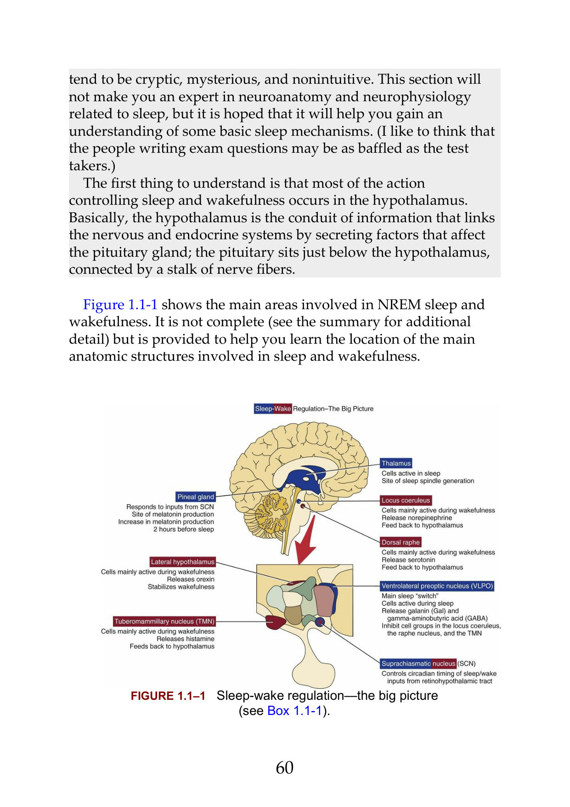

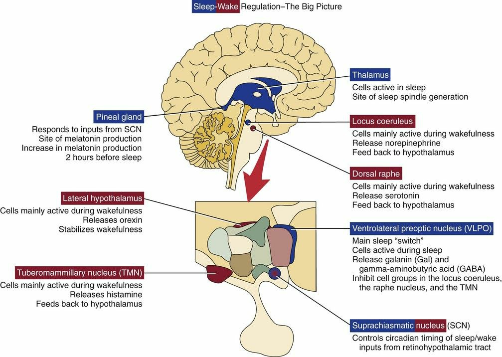

<!-- pdf-page: 61 -->

## References

Kryger MH, Avidan A, Berry R. Atlas of clinical sleep medicine.

An 18-year-old high school senior is referred because of difficulty awakening in the morning, falling grades, and concerns that she will not get into college. She just is not sleepy at normal bedtime and cannot fall asleep until 3 am. On weekends, she sleeps until early afternoon and then feels great the rest of the day.

ed 2. Saunders: Philadelphia; 2014.

## 1.2.

## Circadian Mechanisms and

## Neurophysiology

## Questions

#### Not Sleepy at Bedtime

2. Where are the cells located that synchronize the circadian timing of her sleep-wake pattern?

1. What is the likeliest diagnosis?

### A. Delayed sleep phase disorder

### B. Advanced sleep phase disorder

### C. Sleep-onset insomnia

### D. Free-running circadian rhythm

### A. Optic chiasm

### B. Visual cortex in the occipital lobe

### 61

<!-- pdf-page: 62 -->

### C. Hypocretin nucleus

### D. Suprachiasmatic nucleus

3. Which of the following is involved in synchronizing her circadian system?

4. Which of the following is not involved in generating this patient's circadian rhythm?

### A. Rod cells

### B. Cone cells

### C. Retinohypothalamic tract

### D. Anterior pituitary gland

5. What is the main neurotransmitter released by the pacemaker cells that control her circadian rhythm?

### A. ARNTL (formerly BMAL1)

### B. CLOCK

### C. PER1

### D. Orexin B

### A. GABA

### B. Melatonin

### C. Serotonin

### 62

<!-- pdf-page: 63 -->

### D. Dopamine

#### Insomnia in a Blind Woman

A 39-year-old woman with a genetic visual disorder developed complete blindness by age 35. Over the past few years, she has complained of severe insomnia, which she characterizes as not being able to fall asleep at a normal bedtime. After 18 hours of being awake, she often falls asleep at unpredictable times then sleeps for 8 hours.

6. Her insomnia could be related to abnormalities in each of the following except

7. She is unable to perceive any light. What cells are thought to be the main photoreceptors that synchronize the circadian system?

### A. Retina

### B. Retinohypothalamic tract

### C. Suprachiasmatic nucleus

### D. Visual cortex

8. This patient's suprachiasmatic nucleus (SCN) is unsynchronized to external light cues, yet the SCN does have outputs. Where do these outputs go?

### A. Retinal rod cells

### B. Retinal cone cells

### C. Foveal cells

### D. Ganglion cells

### 63

<!-- pdf-page: 64 -->

### A. Cerebral cortex

### B. Thalamus

9. If you measured her body temperature continuously over several weeks, you would find

### C. Hypothalamus

### D. Pineal gland

### A. No pattern but random variations in temperature

### B. Temperature oscillation at a period of 22 to 23

### C. Temperature oscillation at a period of 24 to 25

### hours

### D. Stable temperature without oscillation

### hours

10. How would you characterize her circadian disorder?

### A. Advanced sleep-wake phase disorder

### B. Delayed sleep-wake phase disorder

### C. Non–24-hour sleep-wake rhythm disorder

### D. Irregular sleep-wake rhythm disorder

## Answers

### 64

<!-- pdf-page: 65 -->

1. A. This brief history is classic for a circadian rhythm sleep disorder, which has been previously classified as a delayed sleep phase type (and before that, a syndrome). Note that it is no longer officially called a syndrome; the term disorder is used to describe it in the third edition of the International Classification of Sleep Disorders (ICSD3). Knowledge of circadian rhythm sleep disorders is important; questions about them will be on the exam. (ATLAS2, Ch

#### 9.1)

2. D. The best answer is the SCN. This nucleus is in the hypothalamus just above the optic chiasm (hence the designation suprachiasmatic). The nucleus is the “conductor” that directs and synchronizes the “orchestra” that creates the circadian rhythm of the various endocrine and physiologic systems of the body. (ATLAS2)

3. C. The retinohypothalamic tract carries information from the eye (melanopsin-containing ganglion cells in the retina) to the hypothalamus (hence the designation retinohypothalamic tract), where the SCN is located. In medical school, you learned about rods and cones, which are necessary for vision. However, they are not involved in circadian physiology. (ATLAS2, p 35)

4. D. The language of genetics is complex: our knowledge of how genes affect circadian rhythmicity is evolving and the names of some genes change. A human gene is generally indicated by all capital letters, while the same gene in mammals is not (e.g., PER1 vs Per1). Mammalian clock genes include three Per (for period) genes: Per1, Per2, and Per3; two cryptochrome genes: Cry1 and Cry2; and Tim, Clock, Bmal, and Csnk1e. These are all expressed in suprachiasmatic neurons. These genes and the proteins they produce interact to form negative and positive autoregulatory transcription–translation feedback loops that define the molecular machinery of the circadian oscillator. You could still get the answer correct if you know that orexin is not directly involved in circadian rhythms. (ATLAS2, p 34)

5. A. Although GABA is the right answer, you might be tempted to pick melatonin because it has something to do with the circadian

### 65

<!-- pdf-page: 66 -->

system and is used to treat circadian disorders. Approach questions like this, for which you might not have a clue as to the correct answer, by ruling out what you know. Here, for example, you should be able to rule out serotonin and dopamine, thus increasing your odds of answering correctly.

6. D. The first three structures listed play a role in transmitting visual information to the SCN, the latter being the location of the circadian pacemaker. After the pathways that carry visual information bifurcate in the optic chiasm, the pathways (from the rods and cones) that continue to the visual cortex play no role in synchronizing the circadian system. Thus people with cortical blindness or those with blindness related to abnormalities in the visual cortex can have normally synchronized circadian systems.

7. D. Besides the rods and cones, the retina also has ganglion cells that contain the protein melanopsin, which functions as a photoreceptor. Axons of rods and cones become the retinohypothalamic tract (RHT), which ends in the SCN. The RHT in the SCN releases glutamate, which leads to increased expression of PER1 and PER2. The SCN contains cellular oscillators that are normally coupled but that can oscillate independently. What is also emerging is that almost all cells in all tissues of the body contain the machinery to produce circadian rhythms.

8. C. There are projections from the SCN to the adjacent subparaventricular zone (SPZ). There is a secondary projection to the dorsomedial hypothalamic nucleus (DMH), which projects to other brain regions that regulate sleep and wakefulness. There are also projections from the SCN to the paraventricular hypothalamic nucleus (PVH) to regulate corticosteroid secretion and synthesis of melatonin (see Summary). Normally the SCN would send out alerting signals when it is daytime and a sleep signal at night, but in this blind patient, the signals would not be synchronized to light and darkness cues, and the patient's circadian rhythm would be free running.

9. C. Without synchronization with light-dark cycles, the patient will demonstrate the normal period of the human free-running

### 66

<!-- pdf-page: 67 -->

circadian rhythm. The consensus at this time is that the freerunning period in humans (called tau) is between 24 and 25 hours and is closer to 24 than 25 hours. If presented with a choice on the exam, select the value that is larger than and closest to 24 hours. The nonentrained period of most plants and animals maintained under constant darkness and temperature is almost always close to 24 hours (hence the term circadian, or about a day) and is rarely less than 23 hours or greater than 25 hours.

10. C. It is important to know the differences between the major circadian disorders. The names of the circadian rhythm sleep-wake disorders seem to change about every 5 years. This patient has a pattern, but it is unsynchronized to light-dark cycles. This is in contrast to people who have no pattern (truly random times of sleep and wakefulness), such as those with dementia, brain injury, or neurocognitive impairment. The difference between answers C and D is that in the latter, there is no pattern. (ATLAS2, Ch 9;

#### ICSD3, pp 189-224)

▪ Atlas of Clinical Sleep Medicine, ed 2, Chapters 3.3 and 9

## Summary

### Highly Recommended

It is important to understand the structures and mechanisms involved in circadian physiology. However, because this topic will make up only about five of the exam's 240 questions, do not spend excessive time reviewing esoteric neural or genetic mechanisms.

### Types of Rhythms That Affect Sleep

▪ Circadian: About a day or 24 hours
▪ Ultradian: The 80- to 110-minute REM-NREM cycle
▪ Infradian: Greater than 24-hour cycles

### The Two-Process Model

▪ Is an interaction of: (ATLAS2, p 26)

### 67

<!-- pdf-page: 68 -->

### ❍ Process S: Sleep homeostasis (the less time asleep,

### the greater the drive to sleep)

### ❍ Process C: Regulation by the circadian system

### ❍ Zeitgebers (time synchronizers), which are:

### • Nonphotic (timing of eating and drinking, social

### • Photic (light)

### interactions, environmental temperature)

### Control of the Circadian System

▪ The master pacemaker is the SCN in the hypothalamus just above

the optic chiasm; it has two main functions: (ATLAS2, p 36)

### ❍ Alerting of the CNS and controlling of circadian

### ❍ Synchronizing the circadian system

### rhythms

### • Light → melanopsin-containing ganglion cells →

### retinohypothalamic tract → SCN of hypothalamus

▪ Receptors in the SCN include: (ATLAS2, p 36)

### ❍ Melatonin 1 (MT1) (whose stimulation decreases

### ❍ Melatonin 2 (MT2) (whose stimulation

### the alerting signal from the SCN)

▪ The genes and proteins that interact to regulate circadian timing

### synchronizes the circadian system)

### 68

<!-- pdf-page: 69 -->

include: (ATLAS2, p 34)

### ❍ Genes

### • Three PER (period) genes: PER1, PER2, PER3

### • Two cryptochrome genes (CRY1 and CRY2), which

### • ARHGEF5 (formerly Tim)

### • CLOCK

### • ARNTL (formerly Bmal)

### • Csnk1e (formerly CK1e)

### are expressed in suprachiasmatic neurons

### ❍ These genes and the proteins they produce interact

### to form negative and positive autoregulatory

### transcription–translation feedback loops that define

### the molecular machinery of the circadian oscillator.

### Relationship between Time and Core Body

### Temperature

▪ The declining portion of the core body temperature (CBT) starts

near the beginning of the sleepy phase of the circadian rhythm. (ATLAS2, p 135)

### ❍ It is difficult to fall asleep unless body temperature

▪ The increasing portion of the CBT starts near the beginning of the

### is falling.

awake phase of the circadian rhythm.

### 69

<!-- pdf-page: 70 -->

### ❍ It is difficult to wake up unless body temperature is

### increasing.

### Dim-Light Melatonin Onset

▪ In normal subjects, dim-light melatonin onset (DLMO) is between

### ❍ DLMO is several hours earlier in patients with

8 pm and 10 pm. (ATLAS2, p 135)

### ❍ DLMO is several hours later in patients with

### advanced sleep phase disorder.

▪ In neonates, sleep is polyphasic.
▪ In adolescents, a delayed sleep phase can develop.
▪ In older people, an advanced sleep phase with reduced amplitude

### delayed sleep phase disorder.

### Circadian Rhythm and Aging

### Circadian, Endocrine, and Physiologic

### Interactions

can develop.

### Circadian Rhythm Sleep Disorders

▪ Reviewed in Chapter 3.9 of ATLAS2.

American Academy of Sleep Medicine. International

▪ Reviewed in Section 2 of this volume.

## References

classification of sleep disorders. ed 3. American Academy of Sleep Medicine: Darien, Ill.; 2014. Kryger MH, Avidan A, Berry R. Atlas of clinical sleep medicine.

### 70

<!-- pdf-page: 71 -->

ed 2. Saunders: Philadelphia; 2014. Sheldon SH, Ferber R, Gozal D, Kryger MH. Principles and

practice of pediatric sleep medicine. ed 2. Elsevier: Philadelphia; 2005.

## 1.3.

## Sleep at Different Ages and Stages of

## Human Life

An internist is pregnant with her first child. Before pregnancy her body mass index (BMI) was 24. At 36 weeks' gestation, her weight gain is normal, but she has begun to snore and manifest restless leg symptoms.

## Questions

#### A Pregnant Internist

1. Which of the following conditions is she most likely to have during sleep?

2. Which statement about snoring in pregnancy is true?

### A. Hypoxemia

### B. Hypoventilation

### C. Hypocapnia

### D. Apnea

### A. Babies born to snoring mothers are larger than

### B. Snoring increases the risk of developing

### normal.

### hypertension during pregnancy.

### 71

<!-- pdf-page: 72 -->

### C. Snoring has no impact on the Apgar score at birth.

### D. Snoring is a risk factor for gestational diabetes.

3. Which statement is true about the sleep of the fetus near term (at 38 to 40 weeks of gestation)?

### B. The fetus sleeps only when the mother sleeps.

### A. Most of its sleep is REM sleep.

### C. No breathing efforts are made during sleep.

### A. Occurs multiple times day or night

### D. Sleep does not occur.

4. The term polyphasic sleep identifies sleep that

5. Features of developing sleep architecture in infants include all of the following except

### B. Occurs only during the daytime

### C. Occurs with early-onset REM

### D. Occurs any time it is dark

### A. Appearance of sleep spindles by 9 weeks of age

### B. Disappearance of the tracé alternant pattern by 6

### C. K complexes that appear by 12 weeks of age

### weeks of age

### 72

<!-- pdf-page: 73 -->

### D. Poor differentiation of NREM stages until 12

### months of age

6. The typical 1-year-old child is most likely to

### A. Sleep up to 10 hours out of every 24-hour period

### C. Enter REM sleep (stage R) at sleep onset

### B. Take two naps during the day

### D. Have central apneas one to five times per hour of

7. Up until what age is napping common in children?

### sleep

8. In school-age children, slow-wave sleep (stage N3) is likely to occur

### A. 1 to 2 years

### B. 2 to 4 years

### C. 4 to 5 years

### D. 7 to 9 years

### B. During the middle third of the night

### A. During the first third of the night

### C. During the last third of the night

### D. 90 minutes after sleep onset

### 73

<!-- pdf-page: 74 -->

#### Older and Wiser, but with Trouble Sleeping

A 77-year-old man complains of restless sleep and awakening early in the morning with an inability to fall asleep again.

9. As the patient ages, there will be a decrease in all of these except

### B. Slow-wave sleep as a percentage of TST

### A. REM sleep as a percentage of TST

10. Which statement about REM sleep is likely to be true in this patient?

### C. Sleep efficiency

### D. Resistance to sleep deprivation

### A. Entering sleep via REM sleep is common in older

### B. REM sleep is minimal or absent in older adults.

### people.

### C. REM sleep diminishes less than slow-wave sleep in

### D. REM sleep is less fragmented with aging.

### older adults.

1. C. Snoring occurs in about 30% of pregnant women and is due in part to edema in the nasal passage and to pharyngeal hypotonia. However, obstructive sleep apnea is relatively uncommon, as are hypoventilation (hypercapnia) and hypoxemia. In contrast, practically all pregnant women hyperventilate by the third

## Answers

### 74

<!-- pdf-page: 75 -->

trimester because of high progesterone levels. (ATLAS2, p 246)

2. B. Snoring in pregnancy increases the risk for pregnancy-induced hypertension (preeclampsia). Babies born to snoring mothers are small and have lower Apgar scores than babies born to nonsnoring mothers. (ATLAS2, p 246; Table 15.2-1 reviews sleep throughout

#### pregnancy and is a must.)

3. A. Indeed the fetus does sleep, and most of the sleep appears to be REM sleep. A fetus at 30 weeks' gestation spends 80% of its sleep time in “active” or REM sleep. (ATLAS2, p 64 and Table 4-2)

4. A. Polyphasic sleep refers to several sleep bouts that occur both during the day and at night. This pattern is found in newborns and in some animals. In newborns, circadian entrainment eventually occurs, and then most sleep occurs at night. This pattern is also seen in older adults in institutions who might lack circadian entrainment and can therefore develop an irregular sleep-wake disorder. (ATLAS2, p 94)

5. D. In the newborn, roughly half the time is spent in REM sleep; the remainder is spent in NREM sleep. At this age, the NREM stages are not well characterized electrophysiologically, and the term nondeterminant sleep is often used to describe the pattern. One transient pattern that is seen is a trace-alternant pattern. (ATLAS2,

#### p 64; PEDS2, Ch 6)

6. B. It is important to know the relationship between sleep and age. A 1-year-old child no longer enters sleep via REM, sleeps 10 to 16 hours out of 24, and has about two naps a day. An apnea index greater than 1 (one hypopnea or apnea/hr) is considered abnormal in this age group. (ATLAS2, p 64, Table 4-2; PEDS2, Ch 6)

7. C. By the time a child is about 6 years old, napping should no longer occur. Imagine if there were naps in first grade! The persistence or return of napping in a child older than 6 years usually indicates sleep deprivation or that the child has developed a sleep disorder. (ATLAS2, p 64)

### 75

<!-- pdf-page: 76 -->

8. A. Slow-wave sleep usually occurs in the first third of the night in all age groups. The percentage of sleep spent in slow-wave sleep is highest in children and decreases with age. (ATLAS2, p 65)

9. D. Resistance to sleep deprivation surprisingly increases with age. Slow-wave sleep as a percentage of total sleep time decreases more in men than women. (ATLAS2, p 67)

10. C. REM sleep diminishes much less than slow-wave sleep in older people, but the REM episodes may be more fragmented. (ATLAS2, p 65)

▪ Atlas of Clinical Sleep Medicine, ed 2, Chapter 4.2

## Summary

### Highly Recommended

The topic of sleep and aging is important, because it overlaps other areas that include pediatrics and polysomnography (PSG) findings. Below are sleep characteristics of each age you should know.

### Sleep by Age Range (ATLAS2, pp 85-97 and

Table 4.2-1)

### ❍ Sleep 16 to 18 hours of each 24 hours; 5 to 10 hours

▪ Newborns

### of this is napping.

### ❍ Sleep is polyphasic.

### ❍ 50% of sleep occurs in REM.

▪ At 2 to 3 months

### ❍ Sleep spindles start to appear.

### 76

<!-- pdf-page: 77 -->

▪ At 3 to 4 months

### ❍ Major sleep period is at night.

▪ At 4 to 4.5 months

### ❍ Stages N1, N2, and N3 can be ascertained.

### ❍ Sleeps 13 to 15 hours of every 24 hours; 2 to 3 hours

▪ At 5 months

### ❍ K complexes start to appear.

▪ At 1 year

### ❍ Sleeps 12 to 14 hours of every 24 hours; 1.5 to 2.5

### of this is napping.

### ❍ 30% of sleep is in REM.

▪ At 2 years

### ❍ 25% of sleep is in REM (percentage remains

### hours of this is napping.

### ❍ Sleeps 11 to 13 hours of every 24 hours; 0 to 2.5

### constant with further aging).

▪ At 3 to 5 years

### hours of this is napping.

▪ At 5 to 12 years

### 77

<!-- pdf-page: 78 -->

### ❍ Sleeps 9 to 12 hours of every 24 hours; no napping.

▪ At 13 to 20 years

### ❍ Sleeps 8 to 9 hours of each 24 hours; no napping.

### ❍ Large decline in amplitude of slow-wave sleep

### ❍ Delay in sleep phase can occur.

▪ At 20 to 65 years

### ❍ Slow but progressive decline in SWS as percentage

### (SWS)

### ❍ Deterioration of sleep with menopause (about age

### of total sleep time

### ❍ Advance in sleep phase is common.

### 50 years)

▪ Older than 65 years

### ❍ Napping returns.

### ❍ Difficulty initiating and maintaining sleep occurs.

### ❍ Sleep is fragmented with increased awakenings.

### ❍ Melatonin production is decreased.

### ❍ Sleep deteriorates with deterioration of overall

### health.

### 78

<!-- pdf-page: 79 -->

### Sleep in Women

▪ Pregnancy

### ❍ Table 1.3-1

Table 1.3–1

#### Features of Sleep Disturbances in Pregnancy and Postpartum

†Beta human chorionic growth hormone (HCG), renin, nitric oxide, interleukin-1, TNF, and interferon may also facilitate sleepiness.

*Narcoleptic symptoms can continue during pregnancy.

‡Multiparous mothers have fewer symptoms compared with primiparous mothers.

§Mothers caring for premature infants with more WASO and even less TST.

OSA, Obstructive sleep apnea; PSG, polysomnography; REM, rapid eye movement; SWS, slow-wave sleep; TNF, tumor necrosis factor; TST, total sleep time; WASO, wake after sleep onset.

From Kryger MH, Avidan A, Berry R: Atlas of clinical sleep medicine, ed 2, Philadelphia, 2014, Saunders; Table 16.2-1.

### 79

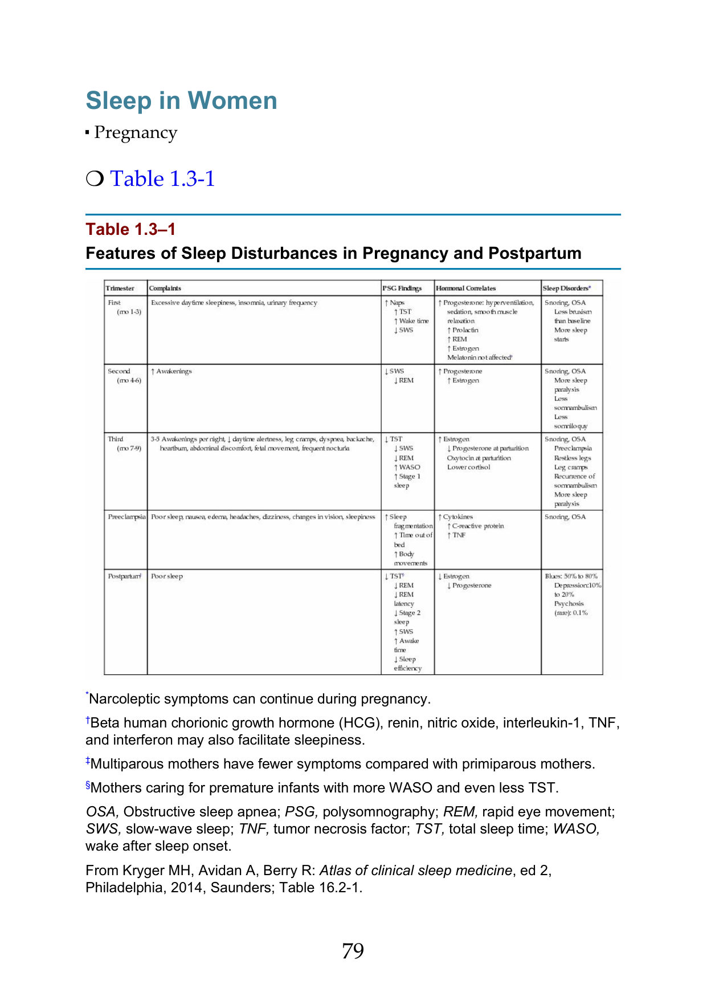

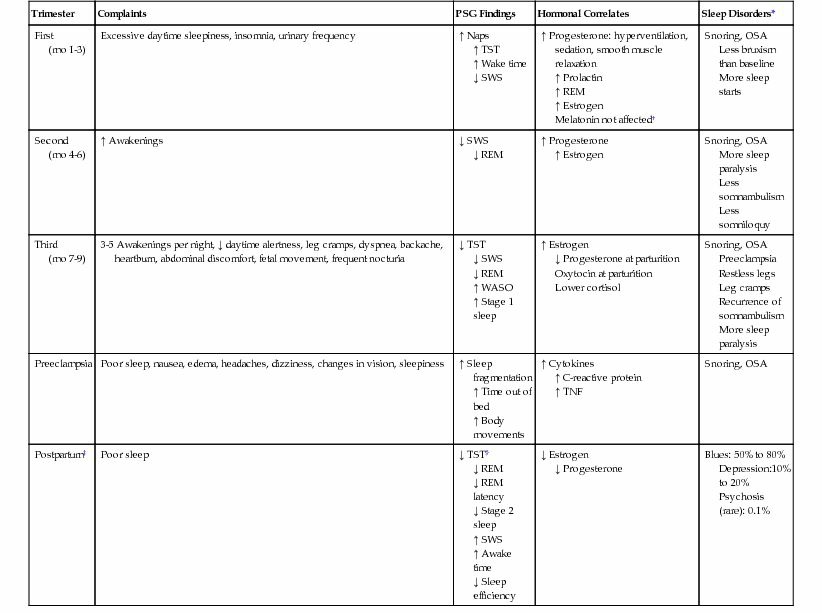

<!-- pdf-page: 80 -->

▪ Postpartum

### ❍ See last row of Table 1.3-1.

▪ Menopause

### ❍ Prevalence of obstructive sleep apnea (OSA)

### increases compared with men of similar age.

### ❍ Hot flashes interfere with sleep; they are not

### ❍ Sleep abnormalities due to depression increase.

### present in REM sleep.

Grigg-Damberger M, Gozal D, Marcus CL, et al. The visual

## References

scoring of sleep and arousal in infants and children. J Clin Sleep Med. 2007;3(2):201–240. Kryger MH, Avidan A, Berry R. Atlas of clinical sleep medicine.

ed 2. Saunders: Philadelphia; 2014. Sheldon SH, Ferber R, Gozal D, Kryger MH. Principles and

practice of pediatric sleep medicine. ed 2. Elsevier: Philadelphia; 2005. Shepertycky MR, Banno K, Kryger MH. Differences between

men and women in the clinical presentation of patients diagnosed with obstructive sleep apnea syndrome. Sleep. 2005;28(3):309–314.

## 1.4.

## Sleep Deprivation

## Questions

#### An Acutely Sleep-Deprived Surgeon

### 80

<!-- pdf-page: 81 -->

A 64-year-old surgeon, Dr. K, flies to Haiti immediately after he learns of the 2010 earthquake there. In Haiti, he operates continuously on one patient after another for about 60 hours, amputating gangrenous extremities. He has been gulping down food and water between cases.

1. After being awake for 60 hours, Dr. K is likely to have all of the following except

2. Although his dexterity is unimpaired, Dr. K. started to make errors such as illogical triaging of cases and performing operative procedures in the wrong sequence. Abnormality in what part of his nervous system is likely causing these mistakes?

### A. Irritability

### B. Difficulty in concentrating

### C. Visual hallucinations

### D. Auditory hallucinations

3. Examination of Dr. K's blood would show which one of the following?

### A. Broca's area

### B. Prefrontal cortex

### C. Parietal lobe

### D. Temporal lobe

### A. Normal growth hormone level

### B. Hypoglycemia

### 81

<!-- pdf-page: 82 -->

### C. Reduced cortisol levels

### D. Increased thyroid activity

4. Others on the surgical team insisted Dr. K have a full night's sleep before continuing to operate because he was endangering patients. Dr. K, on the other hand, felt he just needed a nap. Of the following, which is most correct?

### A. Dr. K. needs one night of recovery sleep before he

### B. Dr. K. needs three nights of recovery sleep before

### is alert again.

### C. If Dr K. were 24 years old, one night of recovery

### he is alert again.

### D. A 4-hour nap would restore alertness.

### sleep would suffice.

5. If this surgeon's recovery night sleep was monitored by PSG, what would be observed?

### A. A large increase in percentage of time spent in

### B. A large increase in percentage of time spent in SWS

### REM sleep

### C. A large increase in percentage of time spent in SWS

### D. Increased REM sleep and reduced SWS

### and REM sleep

6. During recovery sleep, which of the following is likely to be

### 82

<!-- pdf-page: 83 -->

present in Dr. K?

### A. A decrease in plasma glucose

### B. A reduction in adrenocorticotropic hormone

### C. Increased production of growth hormone (GH)

### (ACTH)

#### The Chronically Sleep-Deprived Surgeon

### D. Increased thyroid activity

After 60 hours of being awake, Dr. K sleeps 12 hours, takes a day off from operating, and then sleeps 8 hours the next night. On awakening, he feels great and starts to operate again. He promises the surgical team he will get some sleep every night and settles on a routine of sleeping 4 hours, then staying awake for 20 hours, operating on the continual stream of cases.

7. After four nights of sleeping 4 hours per night, what would you expect to find in his awake EEG?

### A. Increase of power in the delta range

### B. Increase of power in the alpha range

### C. Decrease of power in the theta range

8. What changes in sleep architecture would you find during his fourth night of 4-hour sleep?

### D. No change in his awake EEG

### A. Increased REM sleep as a percentage of his 4-hour

### sleep time

### 83

<!-- pdf-page: 84 -->

### B. Increased SWS as a percentage of his 4-hour sleep

### time

### C. Similar increases in REM and SWS as a percentage

### D. No change in the percentage of the sleep stages as a

### of his 4-hour sleep time

9. Dr. K insisted that with this sleep schedule, he did not feel sleepy during the daytime and he could safely operate. What mean sleep latency would you likely find if Dr. K had a multiple sleep latency test (MSLT) after the fourth night of sleeping only 4 hours a night?

### percentage of his total sleep time

10. On the fourth day of Dr. K's sleeping 4 hours each night, what would you expect if you measured his performance using the psychomotor vigilance task (PVT)?

### A. 20 minutes

### B. 15 minutes

### C. 10 minutes

### D. 5 minutes

### A. PVT lapses would be similar in degree to the

### B. PVT lapses would be greater than after 3 days of no

### findings after 3 days of no sleep.

### C. PVT lapses would be in the range seen in normal

### sleep.

### subjects sleeping 8 hours a night.

### 84

<!-- pdf-page: 85 -->

### D. PVT lapses would be about the same as if he had

### slept for 6 hours each night but much greater than if

### he had slept 8 hours each night.

1. D. Auditory hallucinations are an uncommon manifestation of chronic sleep deprivation. Personality changes and symptoms of psychopathology become apparent with prolonged sleep loss. Hallucinations occur in up to 80% of subjects; they are generally visual and different from the more common auditory hallucinations found in schizophrenia.

## Answers

2. B. Acute sleep deprivation leads to abnormal executive function, which results from loss of function of regions in the prefrontal cortex. This area of the brain plays a role in temporal memory (planning, organization, prioritization). There is also impairment of newly acquired skills and decrement in the ability to perform complex tasks.

3. D. Thyroid activity is increased, suggesting a hypermetabolic state. (Continuous sleep deprivation studies in rodents ultimately led to their death. However, the rodents behaved as though they were hypermetabolic, increasing their food intake but losing weight.) Secretion of GH appears linked to SWS, thus absence of sleep would result in decreased GH levels. Cortisol may be increased after a night of total sleep deprivation.

4. A. Because Dr. K is in his 60s, a full night of recovery sleep is sufficient to restore his alertness to baseline. One night is not sufficient in young adults, who usually need two or more nights to recover after chronic sleep deprivation.

5. B. By far, the most impressive change during recovery sleep in older people is a substantial increase in the percentage of SWS. There occurs a reduction in both REM latency and percentage of REM sleep.

### 85

<!-- pdf-page: 86 -->

6. C. With recovery from acute sleep loss, there is an increase in both ACTH and GH, the latter from the rise in SWS during recovery (GH increases in SWS). The increase in thyroid function that occurred during the prolonged wakefulness would not be expected to continue with recovery.

7. A. With chronic sleep restriction, an overall slowing of the awake EEG occurs that reflects increased homeostatic drive. Thus delta power (3.75 to 4.5 Hz) is increased. There is also an increase in theta power, thought to reflect “spectral leakage” from the changes in delta power. These might reflect a tendency toward microsleeps. Alpha power decreases.

8. B. The body tries to maintain SWS. Thus with chronic sleep deprivation, conservation of the amount of SWS occurs at the expense of the other NREM stages and REM sleep.

9. D. There is progressive decrease in mean sleep latency after successive nights of restricted sleep, and after four nights, the mean latency would be expected to be abnormally low. Interestingly, subjective assessments of sleepiness might not parallel objective impairment as measured by the MSLT or performance tests. Generally, sleep-deprived patients tend to overestimate their level of alertness.

10. D. After the first four nights of sleeping 4 hours per night, PVT results indicate more lapses than in the 8-hour sleep condition but the same as in subjects sleeping 6 hours per night. By the seventh night of 4-hour sleep, the lapses are greater than with 6-hour sleep. By 2 weeks of 4-hour sleep, the results would be similar to three consecutive nights of no sleep. Thus with chronic sleep loss comes a progressive worsening of function.

Sleep deprivation is important in clinical practice, and some of this content overlaps with other sections. Expect about 10 questions

## Summary

### Highly Recommended

### 86

<!-- pdf-page: 87 -->

covering this topic on the exam.

### Acute Total Sleep Deprivation

▪ Effects

### ❍ Memory impairment (Short-term memory is

### ❍ Impairment of executive function (prefrontal lobe:

### affected more.)

### planning, prioritization, organization)

### ❍ Increased thyroid activity but few other metabolic

### ❍ Daytime sleepiness

### ❍ Changes in waking EEG

### • Decreased alpha activity

### • Increased delta and theta activity

### ❍ Performance generally normalizes within one to

### changes noted

### ❍ Increases in IL-1 and IL-6

▪ Recovery sleep

### ❍ MSLT shows recovery occurs more quickly in older

### three nights of normal sleep.

### ❍ An increase in SWS shows, but REM sleep may be

### than in younger people.

### 87

<!-- pdf-page: 88 -->

### unchanged or reduced.

### Chronic Sleep Deprivation

▪ Effects

### ❍ Changes in sleep architecture, conservation of SWS

### ❍ Abnormal awake EEG

### • Increased delta and theta power

### • No effect on alpha power

### ❍ Progressive sleepiness as measured by the MSLT

### ❍ Progressive decrements in performance as

### ❍ Subjective assessment of sleepiness can

### measured by PVTs

### ❍ Impaired driving performance

### underestimate sleepiness and impairment.

### • Elevation of evening cortisol and sympathetic

### ❍ Metabolic changes

### activity and impaired glucose tolerance

### • Increased cardiovascular events, morbidity, and

### • Obesity

### likely mortality; effects are likely mediated by

### 88

<!-- pdf-page: 89 -->

### increased C-reactive protein (a marker of increased

### cardiovascular risk).

### 89

<!-- pdf-page: 90 -->

## 1.5.

## Polysomnography: Methods, Rules,

## Event Scoring, Sleep Staging

In preparation for the sleep board exam, you decide to spend part of the night in the sleep lab. Your goal is to assist the technologist in setting up a sleep study on one of your patients.

## Questions

#### You, the Technologist

1. For the EEG lead placements, you will use the 10-20 system. This means

### A. Ten electrodes are placed so that there are 20

### derivations (two from each electrode).

### B. The electrodes are placed either 10% or 20% of the

### distance between a given pair of skull landmarks.

### C. The electrodes are placed 10 or 20 mm from specific

2. After explaining the test to your patient, your first task is to place electrodes for the recommended EEG derivations. These are

### skull landmarks.

### D. None of the above

### A. F4-M1, C4-M1, O2-M1

### B. F4-M2, C4-M2, O2-M2

### C. F3-M1, C3-M1, O1-M1

### 90

<!-- pdf-page: 91 -->

### D. Fz-Cz, Cz-Oz

3. Next, to detect eye movements, you place electrodes 1 cm below the left eye outer canthus (E1) and 1 cm above the right eye outer canthus (E2). This placement will give the recommended electrooculogram (EOG) derivations, which are

4. Recording of eye movements is possible because

### A. E1-M2 and E2-M2

### B. E1-M2 and E2-M1

### C. E1-M2 and E2-E1

### D. E1-E2 and E2-E1

### A. The cornea is electrically positive with respect to

### B. The retina is electrically positive with respect to the

### the retina.

### C. Gross eye movements generate electrical signals

### cornea.

### that differ slightly owing to the distance of each eye

### to the recording electrode.

5. You next attach leads for the electromyogram (EMG) that will be used for sleep staging purposes; they are attached to the

### D. None of the above

### A. Lower legs

### 91

<!-- pdf-page: 92 -->

### B. Thighs

### C. Chin

6. Once the patient falls asleep, you help monitor the channels. You enjoy figuring out the EEG patterns, knowing that they can be distinguished by all of the following except

### D. Forehead

### A. Frequency: the number of cycles per second (Hz)

### D. Sinusoidal or waxing and waning pattern over 5 or

### B. Amplitude: measured by voltage

### C. Shape of the waveform

### E. Distribution: the location where the waveform is

### more seconds

7. The three distinct states of consciousness for the normal subject are

### normally most prominent

### A. Wakefulness, REM sleep, deep sleep (N3)

### B. Wakefulness, REM sleep, NREM sleep

### C. REM sleep, light sleep (N1 and N2), deep sleep

### D. Wakefulness, transition to sleep, sleep

### (N3)

### 92

<!-- pdf-page: 93 -->

8. The three distinct states of consciousness are identified by

### A. Clinical observation plus EEG

### B. EEG, EOG, and EMG

### D. EEG plus video of the subject sleeping

### C. EEG alone

9. Which EEG waveform is not commonly used to differentiate and classify sleep stages?

10. The term relatively low-voltage, mixed frequency pattern for the EEG most closely describes which sleep stage?

### A. Alpha

### B. Beta

### C. Delta

### D. Sleep spindles

11. Delta activity includes brainwaves with a frequency less than 4 Hz. Within this group, slow waves are defined as

### A. N1

### B. N2

### C. N3

### D. R

### 93

<!-- pdf-page: 94 -->

### A. Synonymous with delta activity

### B. Peak-to-peak amplitude greater than 75 µV and

### frequency 0.5 to 2.0 Hz

### C. Frequency 0.5 to 2.0 Hz, any amplitude

### D. Peak-to-peak amplitude greater than 75 µV,

12. The sleep-staging nomenclature in the American Academy of Sleep Medicine (AASM) manual, version 2.1 (referenced in this text as MANUAL2) includes all of the following stages except

### frequency less than 4 Hz

13. All of the following are true about scoring an EEG arousal except

### A. N1

### B. N2

### C. N3

### D. N4

### E. REM

### A. It requires either an associated body movement or

### B. It requires an abrupt shift of EEG frequency that

### a respiratory event.

### C. It must be preceded by at least 10 seconds of stable

### lasts at least 3 seconds.

### 94

<!-- pdf-page: 95 -->

### sleep.

### D. In REM it requires a concurrent increase in

### submental EMG lasting at least 1 second.

14. The requirement of increase in submental EMG to score arousal in REM sleep is necessary because

### A. Alpha activity (8 to 13 Hz) is not seen in REM.

### B. The background EEG in REM is predominantly

### C. Alpha bursts routinely appear during REM sleep

### alpha activity.

### and do not necessarily represent pathology.

### D. The chin EMG has a higher digital sampling rate

15. The epoch in Figure 1.5-1 shows transition from

### than the EEG.

### A. Wakefulness to stage N1

### B. N1 to N2

### C. N1 to REM

### D. N2 to REM

### 95

<!-- pdf-page: 96 -->

16. Which of the following is true about the artifact shown in the PSG fragment (Fig. 1.5-2)?

FIGURE 1.5–1 Question 15.

### A. Can result from high electrode impedance, a poor

### electrical connection, or excessive current leakage

### from nearby electrical equipment (e.g., computers,

### televisions)

### B. Has the same frequency as electrocardiogram

### C. Is usually indistinguishable from perspiration

### (ECG) artifact

### D. Is best avoided by use of a 60-Hz filter

### artifact

### 96

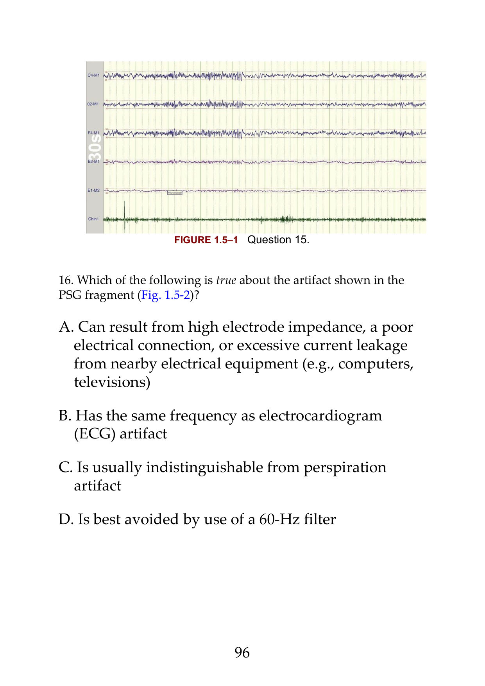

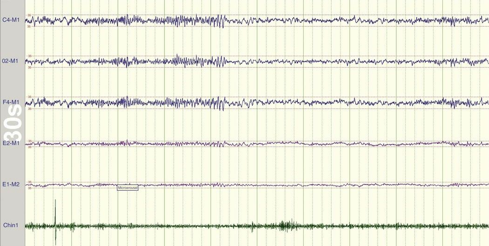

<!-- pdf-page: 97 -->

17. In PSG, most of the recorded signals are amplified by alternating current (AC) amplifiers. A few signals are amplified by direct current (DC) amplifiers. Which of the following is recorded by a DC amplifier in the PSG?

FIGURE 1.5–2 Question 16. (From ATLAS2, Fig. 19-111)

18. All of the following are true about the K complex except

### A. EEG

### B. EOG

### C. ECG

### D. Pulse oximetry

### A. It is defined as a well-delineated negative sharp

### wave immediately followed by a positive

### component standing out from the background, with

### 97

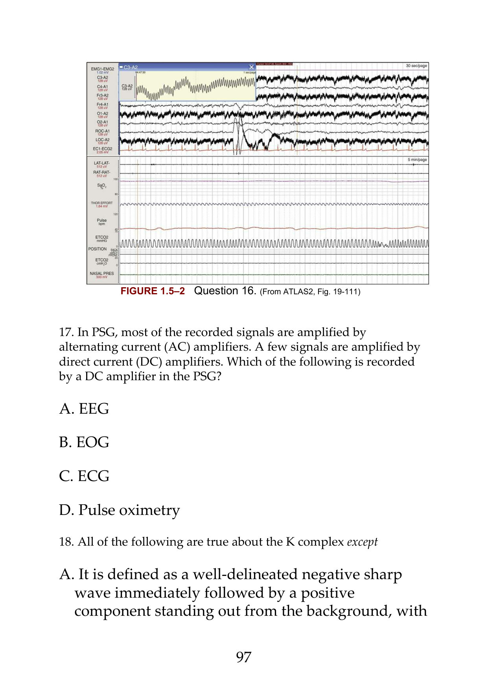

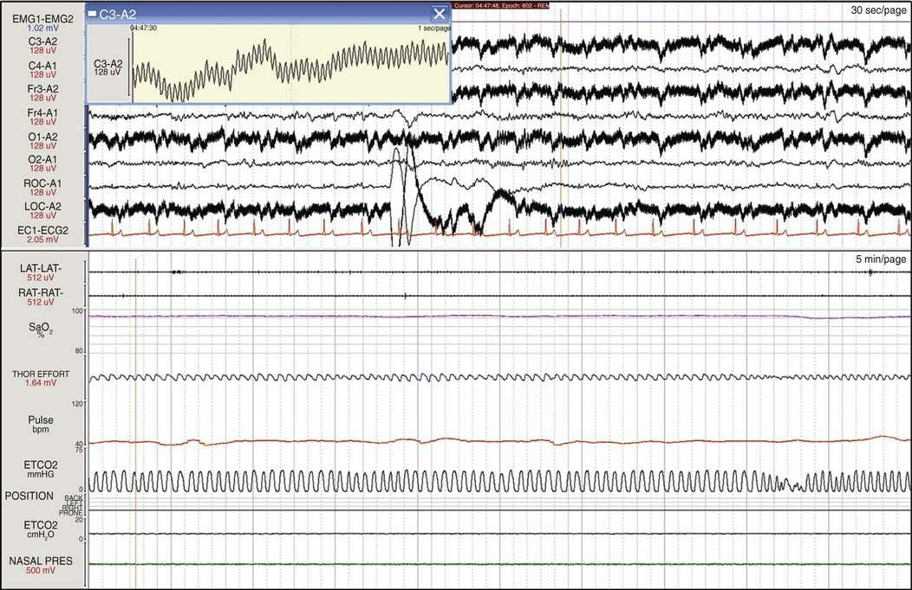

<!-- pdf-page: 98 -->

### a total duration of 0.5 sec or longer.

### B. For an arousal to be associated with a K complex, it

### must commence no more than 1 second after

### termination of the K complex.

### C. It can be used to score an epoch as stage N2.

### D. In the absence of a sleep spindle, a K complex must

19. Figure 1.5-3 is a 30-second epoch. The large waves seen in channel F4-M1 in the first 3 seconds of this epoch (from beginning to first solid vertical line) are

### be present to score an epoch as N2.

### A. K complexes

### B. Vertex sharp waves

### C. Slow waves

### D. Delta waves

### 98

<!-- pdf-page: 99 -->

20. Figure 1.5-4 shows a 30-second epoch. The large waves seen in all three EEG channels (F4-M1, C4-M1, and O2-M1) in the first 3 seconds of this epoch (from beginning to first solid vertical line) are

FIGURE 1.5–3 Question 19.

### A. K complexes

### B. Slow waves

### C. Vertex sharp waves

### D. REM artifact

### 99

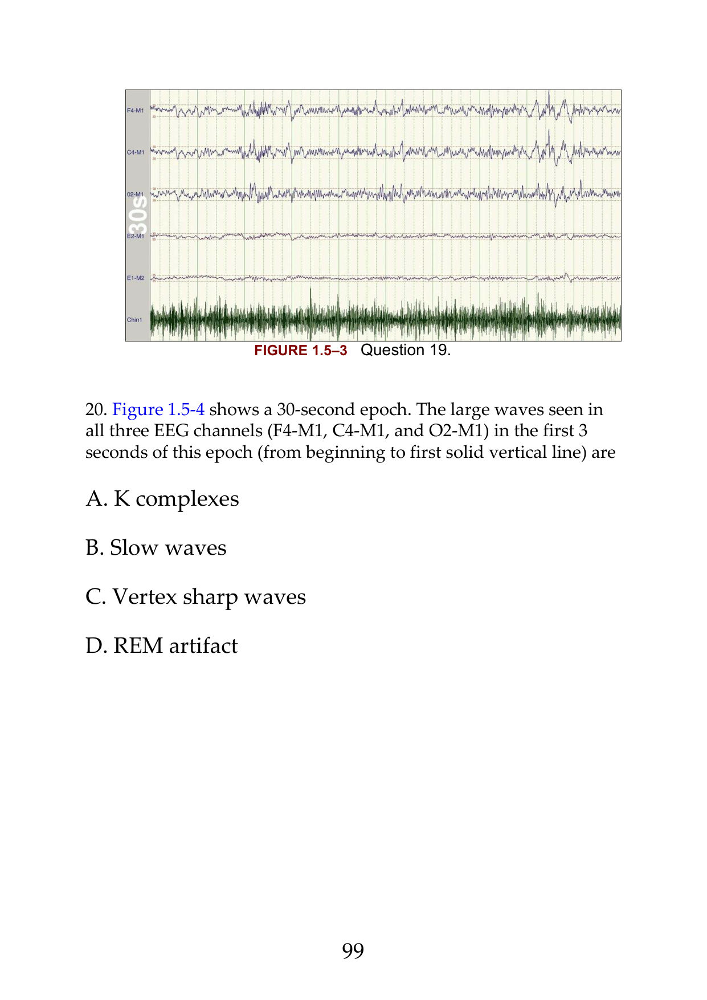

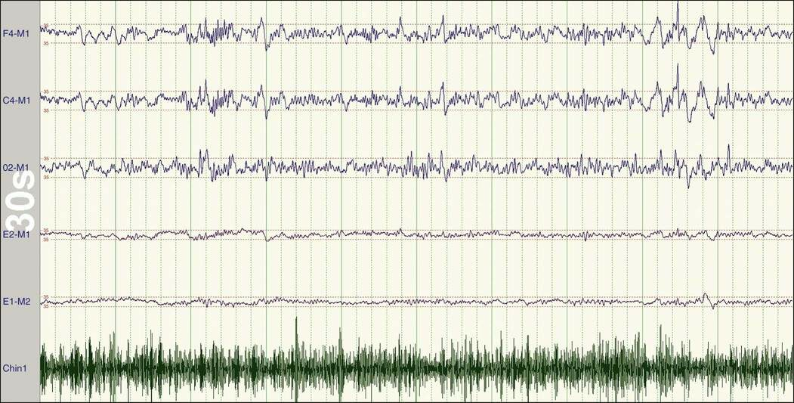

<!-- pdf-page: 100 -->

21. To score respiratory events in adults, all of the following are true except

FIGURE 1.5–4 Question 20.

### A. Oronasal thermal sensor is recommended to detect

### absence of airflow and score an apnea.

### B. Nasal air pressure transducer is recommended to

### detect airflow reduction and score a hypopnea.

### C. Inductance plethysmography is recommended to

### D. To score an apnea, a drop in the peak thermal

### detect respiratory effort.

### sensor excursion by at least 70% of baseline must be

### evident.

22. According to the AASM manual, which of the following is not a criterion for scoring an apnea?

### A. There is a drop in the peak signal excursion by 90%

### or greater of preevent baseline using an oronasal

### 100

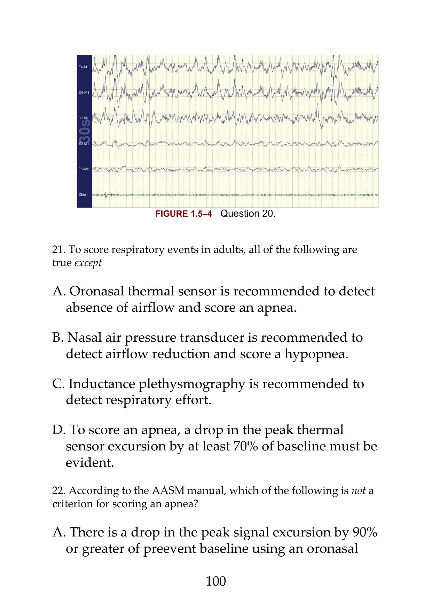

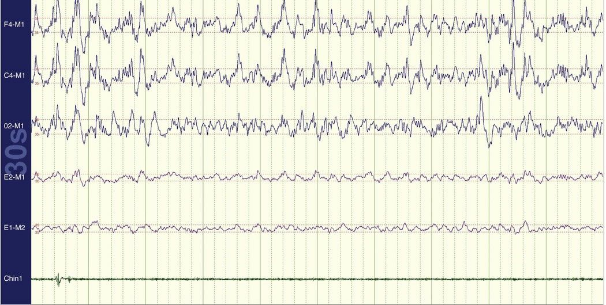

<!-- pdf-page: 101 -->

### thermal sensor.

### B. There is a drop in the peak signal excursion by 90%

### or greater of preevent baseline using a positive air

### pressure (PAP) device flow during a titration study.

### C. The duration of the 90% or greater drop in sensor

### D. There is a drop of at least 3% in Sao2 attributable to

### signal is 10 seconds or longer.

### C. Respiratory effort–related arousal (RERA)

### the apnea event.

23. Figure 1.5-5, A, demonstrates

### A. Obstructive apnea

### B. Hypopnea

### D. Normal breathing

### 101

<!-- pdf-page: 102 -->

FIGURE 1.5–5 Questions 23 and 24. (From ATLAS2, Fig. 18-

25. All of following may be seen in the waking stage except

14)

24. Figure 1.5-5, B, demonstrates

### A. Obstructive apnea

### B. Hypopnea

### C. RERA

### D. Normal breathing

### A. Alpha rhythm

### B. Eye blinks

### C. Reading eye movements

### 102

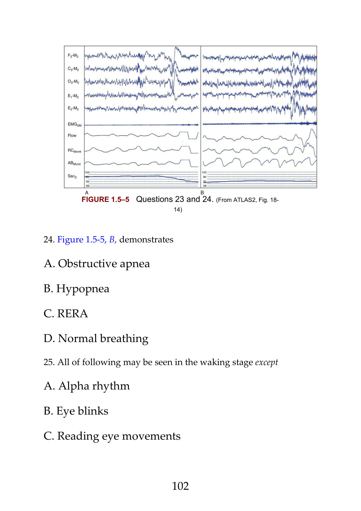

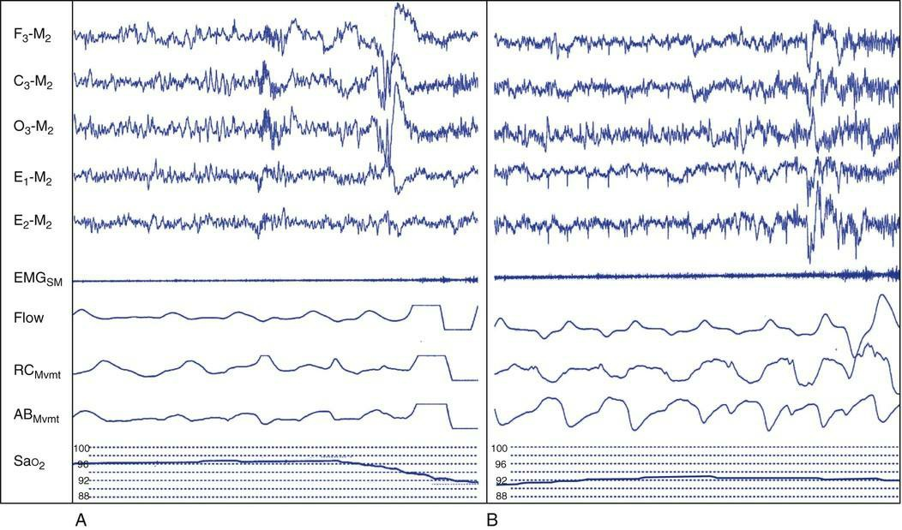

<!-- pdf-page: 103 -->

### D. REM

### E. K complexes

26. A normal sleep hypnogram for a child is shown in Figure 1.5-6. A principal difference compared with adults is that adults have

27. Considering normal sleep, which statement is most accurate?

### A. More REM sleep

### B. Less REM sleep

### C. More SWS

### D. Less SWS

FIGURE 1.5–6 Question 26. (From ATLAS2, Fig. 4.2-25)

### A. REM occurs in several discrete periods,

### lengthening as the sleep progresses.

### 103

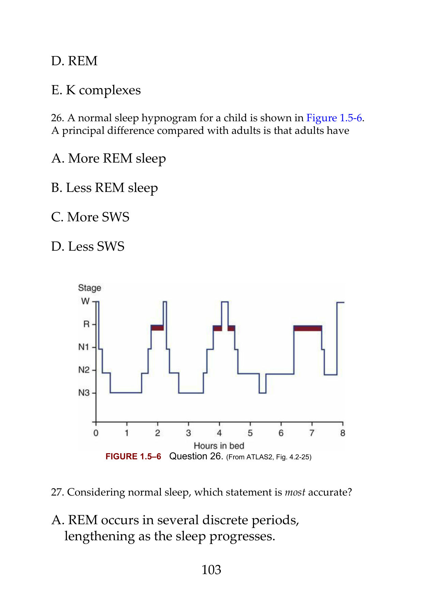

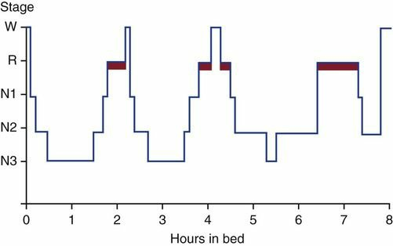

<!-- pdf-page: 104 -->

### B. Deep sleep tends to concentrate in the latter part of

### the sleep cycle.

### C. Wake after sleep onset (WASO) occupies about

### D. REM latency is about 30 to 60 minutes.

### 15% of the sleep cycle.

28. Alpha rhythm is best seen in the EEG during

29. The 30-second epoch in Figure 1.5-7 shows what stage of sleep?

### A. Stage N1

### B. Stage N3

### C. Wakefulness with eyes open

### D. Wakefulness with eyes closed

### A. N1

### B. N2

### C. N3

### D. REM

### 104

<!-- pdf-page: 105 -->

30. The transition from wakefulness to stage N1 sleep may be associated with all of the following except

FIGURE 1.5–7 Question 29.

### B. Low-amplitude, mixed-frequency EEG in the range

### A. Slow-rolling eye movements

### D. Alpha activity in the frontal lobe EEG

### of 4 to 7 Hz

### C. Appearance of vertex sharp waves

31. During a 30-second epoch, the first 23 seconds have a baseline EEG frequency of 7 Hz. The EEG frequency then shifts to 11 Hz on the 28th second. Slow eye movements are seen throughout the epoch. This epoch should be scored as

### A. Awake

### B. N1

### 105

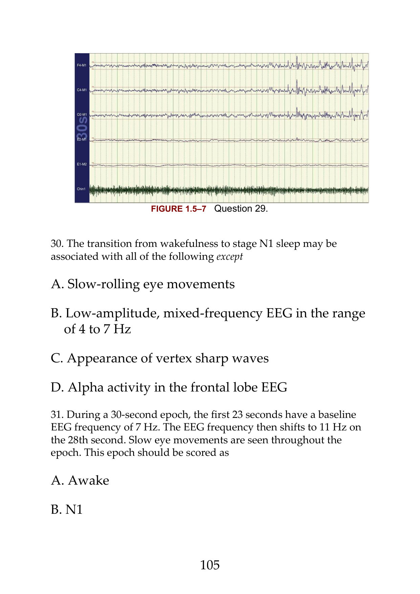

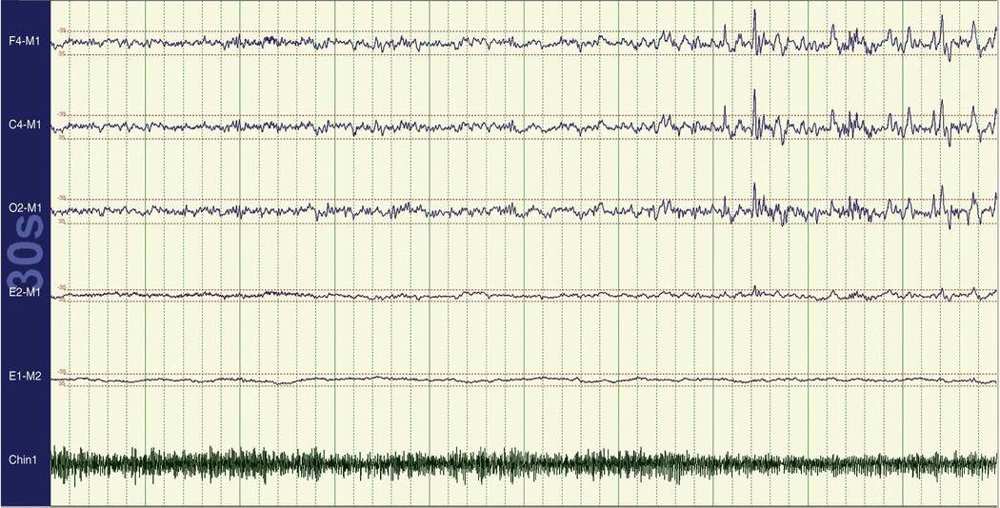

<!-- pdf-page: 106 -->

### C. N2

### D. N3

32. Consider three consecutive epochs of 30 seconds each:

### E. REM

### Epoch 221: EEG frequency 3 Hz covering 22% of the

### Epoch 222: EEG frequency 3 Hz covering 55% of the

### epoch, one K complex

### Epoch 223: EEG frequency 3 Hz covering 75% of the

### epoch, no K complex

### epoch, no K complex

### The remaining percentages of each stage consist of

### 6 Hz activity. No slow or rapid eye movements are

### seen in any of the three epochs. What is the sleep

### stage of epoch 223?

33. In Table 1.5-1, each epoch is 30 seconds. When is sleep onset?

### A. N1

### B. N2

### C. N3

### D. REM

### A. 1 minute

### 106

<!-- pdf-page: 107 -->

### B. 2.5 minutes

### C. 4 minutes

35. Regarding alpha-delta sleep shown in Figure 1.5-8, choose the most correct combination of statements lettered A through D.

### D. 6 minutes

Table 1.5–1

34. In Table 1.5-1, what is the REM onset?

### A. 3.5 minutes

### B. 4.0 minutes

### C. 5.0 minutes

### D. 5.5 minutes

### 1. Consists of 15% to 20% delta activity superimposed

### 2. Alpha portion usually 1 to 2 Hz slower than waking

### upon prominent alpha activity

### 3. Often believed to be a marker for nonrestorative

### alpha

### 4. Often seen in patients with musculoskeletal pain

### sleep

### 107

<!-- pdf-page: 108 -->

### A. 1, 3, and 4 only

### B. 3 and 4 only

36. The transition from a low-voltage awake stage to N1 is characterized by

### C. 2, 3, and 4 only

### D. 1, 2, 3, and 4

FIGURE 1.5–8 Question 35.

### A. Slow eye movements of greater than 500 ms

### D. Rapid eye movements of less than 500 ms

### B. Sleep spindles

### C. Delta waves

### 108

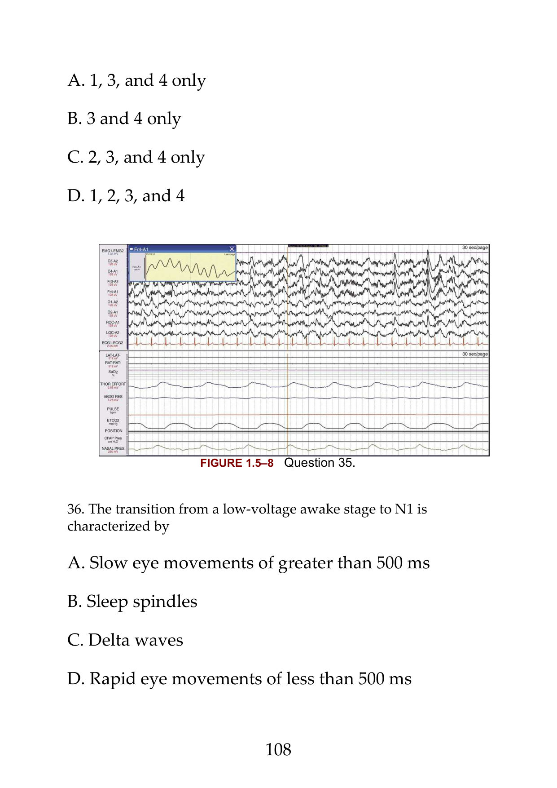

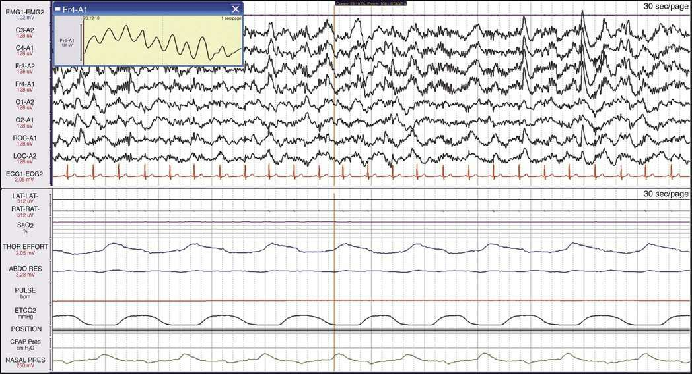

<!-- pdf-page: 109 -->

37. Which of the following is not specifically recommended by the AASM for detecting hypoventilation during a PSG?

### A. Pco2 measured in arterial blood gas

### B. Pco2 measured via an end-tidal CO2 sensor

### C. Pco2 measured via transcutaneous CO2 sensor

### D. Combination of apnea for longer than 30 seconds

### with a concomitant drop of Sao2 greater than 3%

38. What is the sleep stage in Figure 1.5-9?

### A. W

### B. N1

### C. N2

### D. N3

### E. REM

### 109

<!-- pdf-page: 110 -->

39. According to the AASM manual, scoring sinus tachycardia and sinus bradycardia in adults during sleep requires heart rates (beats/min) of, respectively,

FIGURE 1.5–9 Question 38. (From ATLAS2, Fig. 18-7)

40. Epochs 250 to 280 of a PSG are scored as stage R (REM sleep). Any of the following occurring in epoch 281 can be used to mark the end of stage R except

### A. >90, <40

### B. >100, <40

### C. >90, <50

### D. >100, <50

### B. Chin EMG tone increased above that of stage R and

### A. Transition to stage W or N3

### criteria for N1 met

### 110

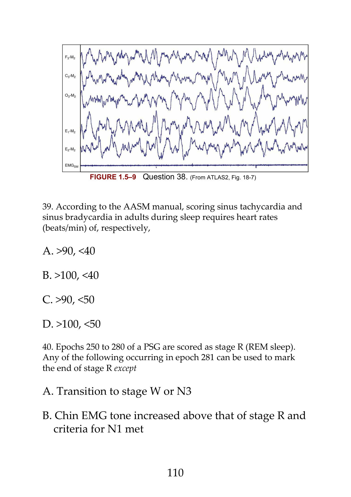

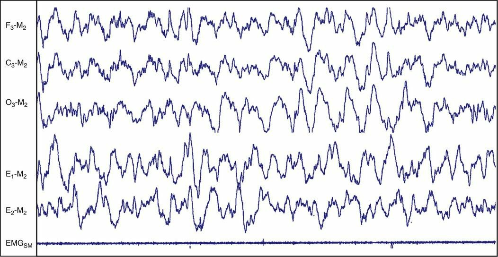

<!-- pdf-page: 111 -->

### C. An EEG arousal followed by low-amplitude,

### mixed-frequency EEG and slow eye movements

### D. A K complex 20 seconds into the epoch

41. A major difference between infants and older children and adults in the sleep EEG is

### A. Infants have no delta wave or spindle activity.

### B. Infants spend about half of their total sleep time in

### C. There is no discernable difference between infants

### REM sleep.

### D. Infant sleep is deemed “uninterpretable” at the

### and the other two groups.

42. The sleep fragment in Figure 1.5-10 is a 5-minute epoch from a patient with congestive heart failure; it shows

### current time.

### A. Obstructive sleep apnea

### B. Complex sleep apnea

### C. Cheyne-Stokes breathing

### D. None of the above

### 111

<!-- pdf-page: 112 -->

43. A new sleep technologist is concerned about PSG abnormalities in the epoch in Figure 1.5-11. What do the EEG channels show?

FIGURE 1.5–10 Question 42. (From ATLAS2, Fig. 19-44)

### B. The patient is in stage 2 NREM sleep (stage N2).

### A. The patient is having a seizure.

### C. The patient is in NREM slow-wave sleep (stage

### D. The patient is in REM sleep (stage R).

### N3).

### 112

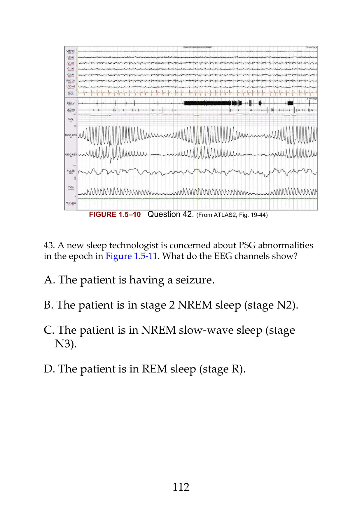

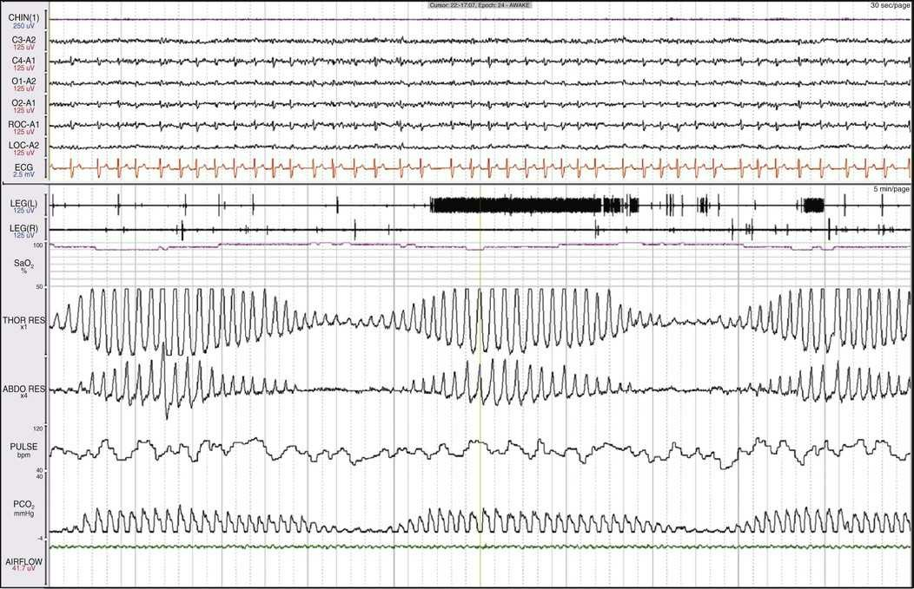

<!-- pdf-page: 113 -->

44. What breathing pattern abnormalities are present in Figure 1.5- 11?

FIGURE 1.5–11 Questions 43 and 44.

### A. The abnormalities are too short to be scored.

### B. The start of the epoch shows a central apnea, and

### C. The start of the epoch shows an obstructive apnea,

### the end shows an obstructive apnea.

45. Figure 1.5-12 is a 10-minute epoch from a PSG. What is shown by the information in the box and oval?

### and the end shows a hypopnea.

### D. Two hypopneas are shown.

### A. RERA

### B. Hypopnea

### C. Obstructive apnea

### 113

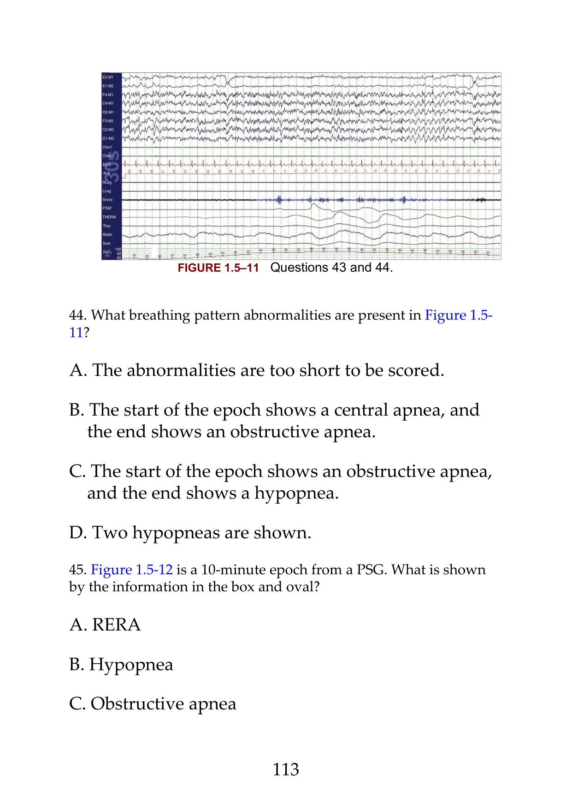

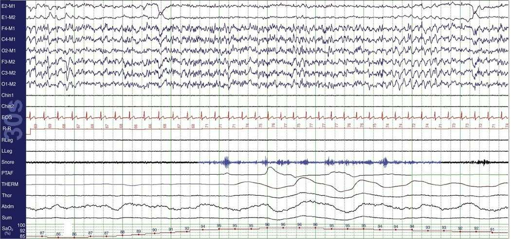

<!-- pdf-page: 114 -->

### D. Central apnea

46. Figure 1.5-13 is a 10-minute epoch from a PSG. What is the most likely abnormality shown?

FIGURE 1.5–12 Question 45.

### Questions 47 and 48 refer to the following five

### epochs numbered 345 through 349.

### A. Mixed apnea

### B. Hypopnea

### C. Obstructive apnea

### D. Central apnea

### 345: Contains a spindle and a K complex

### 346: Major body movements for 20 seconds; the other

### 10 seconds contain alpha rhythm

### 114

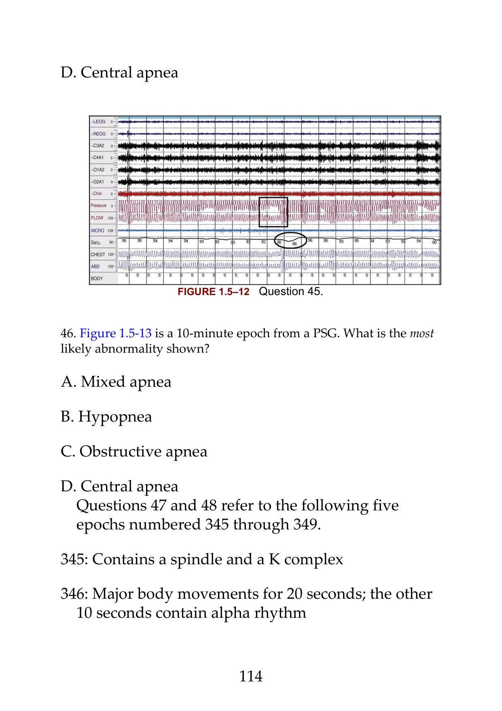

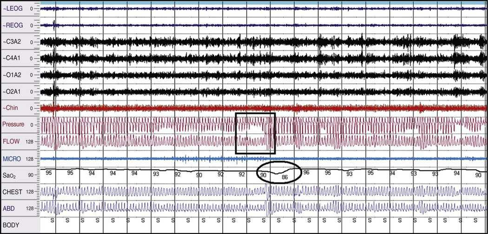

<!-- pdf-page: 115 -->

### 347: Contains a spindle

### 348: Major body movements for 18 seconds; no alpha

### rhythm seen

### 349: Contains a K complex

FIGURE 1.5–13 Question 46.

47. How should you score epoch 346?

### A. W

### B. N1

### C. N2

### D. N3

48. How should you score epoch 348?

### 115

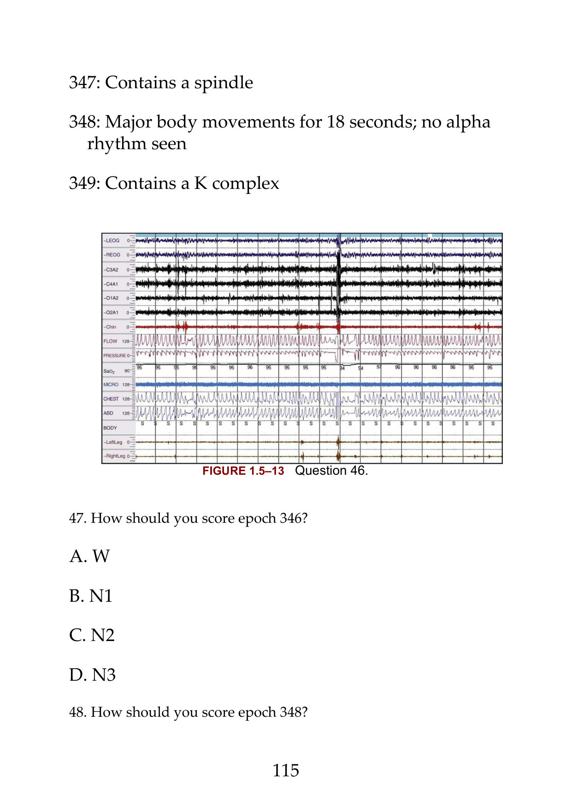

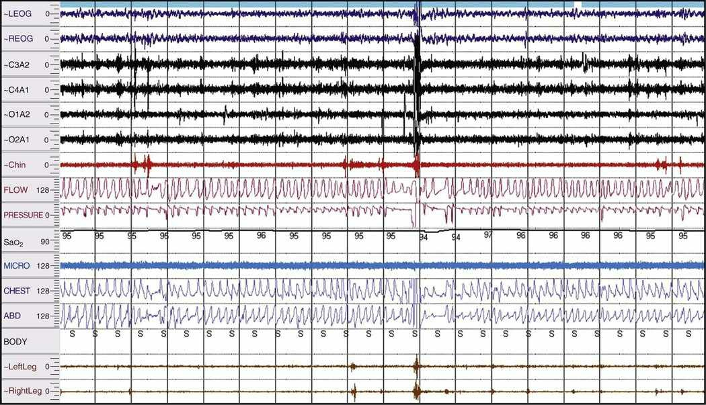

<!-- pdf-page: 116 -->

### A. W

### B. N1

1. B. The 10-20 method of EEG electrode placement was developed in 1958. Percentages are used, rather than absolute distances, to allow for normal variations in head shape and size. Figure 1.5-14 shows the 10-20 placement of electrodes. For example, T3 is placed 10% of the distance from M1 to M2, C3 is placed 20% of the distance from T3, CZ is 50% of the distance from M1 or M2, and C4 is 20% of the distance from CZ. Other electrodes are similarly placed 10% to 20% of the distance from the inion or nasion or points in between. Older nomenclature labeled M1 and M2 (mastoid) as A1 and A2 (auricular), respectively. The new nomenclature is promulgated in MANUAL2.

### C. N2

### D. N3

## Answers

### 116

<!-- pdf-page: 117 -->

FIGURE 1.5–14 Answers 1 and 2. (From ATLAS2, Fig. 18-2)

2. A. The recommended derivations are frontal right (F4)–mastoid left (M1), central right (C4)–mastoid left (M1), and occipital right (O2)–mastoid left (M1; see Fig. 1.5-14). Answers B and C have frontal, central, and occipital electrodes connected to the same-side mastoid electrode, which is not recommended. Answer D has only two derivations; at least three are recommended. When the electrode set in Answer A is used, back-up electrodes (in case of malfunction) are recommended at F3, C3, O1, and M2 to allow display of F3-M2, C3-M2, and O1-M2. (MANUAL2)

3. A. Both eyes are referenced to the right mastoid electrode, M2. (MANUAL2)

4. A. The cornea is electrically positive with respect to the retina. When eye movements occur, the EOG channel tracing shows the

### 117

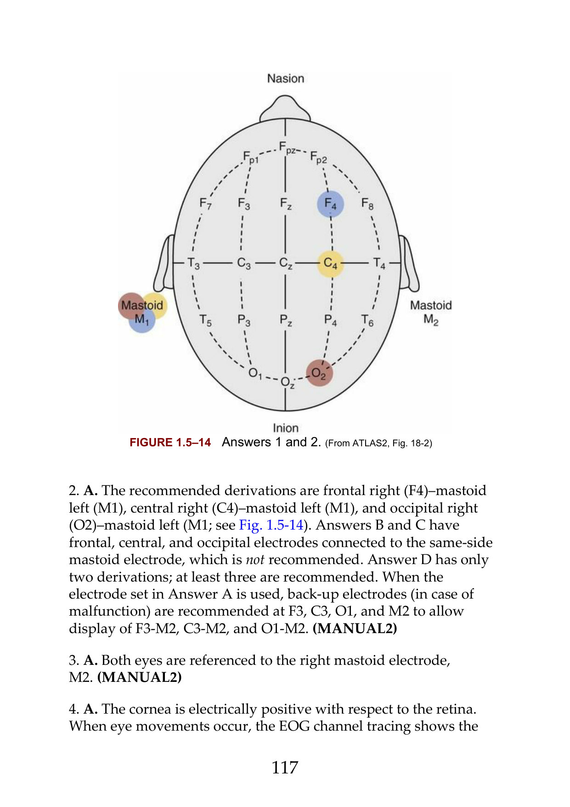

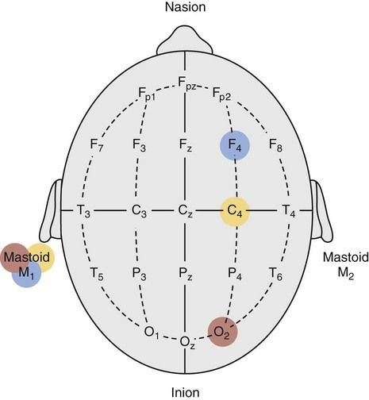

<!-- pdf-page: 118 -->

movements because of this electrical difference. Thus a rightward movement of the right eye causes the cornea of the right eye to move closer to the recording electrode, which is the right outer canthus (ROC); this movement generates a positive voltage (the pen moves downward by convention, as shown in E2-M1 of the PSG epoch in Fig. 1.5-15). At the same time, the cornea of the left eye moves away from the left outer canthus (LOC), and this generates a negative voltage (the digital tracing moves upward by convention; E1-M2 in the epoch). The EOG tracings show two separate instances of rapid eye movement (red boxes). In both instances, the eyes move conjugately toward the ROC electrode.

5. C. The standard EMG derivation for sleep staging requires a chin electrode placed 1 cm above the inferior edge of the mandible. That electrode is referenced to a second electrode placed 2 cm below the inferior edge and either 2 cm to the right or left of midline. (If referenced to the right, a left-side electrode is placed as a backup and vice versa.)

FIGURE 1.5–15 Answer 4.

6. D. EEG patterns are distinguishable by frequency, amplitude, shape, and distribution (e.g., occipital, frontal). A sinusoidal or waxing and waning pattern over 5 seconds or more may be artifact, and in any case, it does not help in interpreting the EEG.

### 118

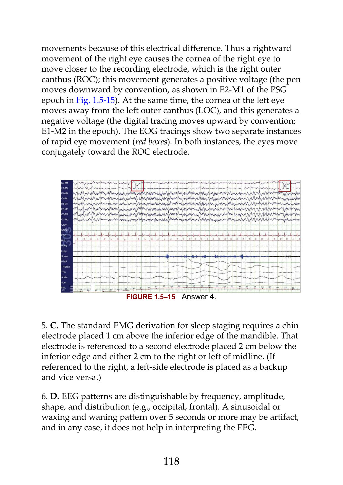

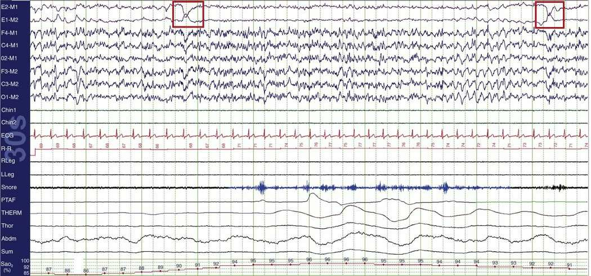

<!-- pdf-page: 119 -->

7. B. Wakefulness, REM sleep, and NREM sleep are considered three distinct states of the CNS, and the normal subject goes through all three in a given 24-hour period.

8. B. EEG, EOG, and EMG activity are essential for sleep staging. In a standard PSG, they require (as minimum) three derivations for EEG activity (six electrodes), one derivation for chin EMG activity (two electrodes), and two derivations for eye movements (four electrodes). Back-up electrodes are in addition to these minimum requirements.

9. B. Beta waves, which have a frequency greater than 13 Hz, are not used in the classification or diagnosis of sleep stages W, N1, N2, N3, or REM.

10. A. Stage N2 sleep is characterized by sleep spindles or K complexes, not by the baseline EEG. Previously defined as stages 3 and 4 NREM sleep, they are now combined into a single N3 stage, characterized by large-amplitude slow waves (<2 Hz) that occupy at least 20% of the epoch. The term “low voltage, mixed frequency” is also characteristic of REM sleep (now called stage R), which must also have rapid eye movements and/or low-voltage EMG on the chin channel. (MANUAL2)

11. B. For scoring stage N3, slow waves must occupy 20% or more of the epoch, meeting the definition as stated. (MANUAL2)

12. D. Since the AASM's 2007 revision of the classic 1968 sleep-stage scoring manual by Allan Rechtschaffen and Anthony Kales, NREM stages 3 and 4 have been combined into a single stage, N3. A PSG epoch is scored as stage N3 if it includes 20% or more of slow-wave activity (6 seconds or more for a 30-second epoch). Slow waves are defined as waves of 0.5 to 2.0 Hz and peak-to-peak amplitude greater than 75 µV, measured over the frontal region. (Note that for purposes of staging N3, slow waves represent a subset of delta activity, defined as EEG waves with a frequency of less than 4 Hz.)

13. A. The AASM manual states that “Score arousal during sleep stages N1, N2, N3, or R if there is an abrupt shift of EEG frequency

### 119

<!-- pdf-page: 120 -->

including alpha, theta, and/or frequencies greater than 16 Hz (but not spindles) that lasts at least 3 seconds, with at least 10 seconds of stable sleep preceding the change. Scoring of arousal during REM requires a concurrent increase in submental EMG lasting at least 1 second.” Both occipital and central derivations are to be incorporated when scoring arousals. The AASM manual also notes that scoring an arousal does not require (and cannot be based on) other information such as body movements or respiratory events. (MANUAL2)

14. C. The background EEG activity for REM is a relatively lowvoltage, mixed-frequency pattern, but alpha bursts routinely appear and do not necessarily indicate arousals or any pathology. The digital sampling rate for both EEG and EMG is the same: 500 Hz is desirable, 200 Hz is minimal. (MANUAL2)

15. A. In this 30-second epoch (see Fig. 1.5-1), the distance between the solid vertical lines is 3 seconds. In the first 13 seconds, alpha rhythm (8 to 13 Hz) is seen, so this part is an awake stage. Then there is an abrupt change to low amplitude and mixed frequency with predominance of theta waves (4 to 7 Hz) plus slow, rolling eye movements (leads E2-M1 and E1-M2), characteristic of stage N1. There are no spindles or K complexes, so you cannot score N2. Finally, the lack of rapid eye movements and the relatively largeamplitude chin EMG rule against REM sleep. Because more than half the epoch is stage N1, the epoch should be scored as N1.

16. A. This fragment (see Fig. 1.5-2) shows 60-Hz interference. The inset shows 1 second of a single EEG channel. The cause in this example is lead A2, because the artifact was found in all channels that included this lead. ECG artifact usually manifests as the ECG in some other channel. Because heart rate is normally 60 to 100 beats/min, it should not be mistaken for an artifact that is 60 cycles per second. Perspiration artifact is a slow, rhythmic waveform that often coincides with breathing. The best way to avoid 60-Hz artifact is to make sure all electrodes are properly applied and that there are no nearby electrical devices that might leak current. Ideally, a 60-Hz filter should not be necessary.

### 120

<!-- pdf-page: 121 -->

17. D. EEG, EOG, ECG, and EMG appear as rapidly fluctuating voltages within a specific frequency bandwidth, and they require the use of both high- and low-frequency filters that are part of AC amplifiers. On the other hand, some signals are slowly fluctuating and can be picked up by DC amplifiers that do not require a lowfrequency filter; examples are pulse oximetry and respiratory rate. Respiratory rate can also be amplified by an AC amplifier whose low-frequency filter is set to 0.1 Hz (the high-frequency filter is set to 15 Hz). (Butkov and Lee-Chiong, 2007; MANUAL2)

18. D. If a K complex appears in any epoch without an accompanying arousal, that epoch is scored as N2. All subsequent epochs with low amplitude and mixed frequency are scored as N2 even if they do not manifest a K complex or spindle, unless they contain an arousal or meet criteria for stage N3 or REM. (MANUAL2)

19. A. The K complex is a well-delineated negative sharp wave (upward deflection) immediately followed by a positive component (downward deflection) standing out from the background, with total duration of at least 0.5 sec. Amplitude is not a criterion. Note that none of the waves in Figure 1.5-3 reaches 75 µV in peak-topeak amplitude, the criterion for slow waves. The four large waves in the first 3 seconds are all K complexes. A vertex sharp wave is a sharply contoured, negative deflection (upward on EEG) that stands out from the background; vertex waves appear most often in central leads placed near the midline and are characteristically seen in stage N1. Slow waves have high amplitude (at least 75 µV) and low frequency (no more than 2 Hz), are a subset of delta (1 to 4 Hz) activity, and are the defining characteristics of stage N3 sleep.

20. B. Slow waves. Note the high peak-to-peak amplitude (≥75 µV) and low frequency (≤2 Hz). Slow waves are a subset of delta (1 to 4 Hz) activity and are the defining characteristics of stage N3 sleep. See the answer to Question 19 for discussion of the K complex. K complexes are at least 0.5 sec, and amplitude is not a criterion.

21. D. Different sensors are recommended for scoring apneas versus hypopneas. For apnea detection, a thermal sensor (thermistor or

### 121

<!-- pdf-page: 122 -->

thermocouple) is recommended. Thermal sensors detect changes in air temperature, which reflect airflow. Cooler air (room temperature) is inhaled, and warmer air (body temperature) is exhaled, and this change is transduced to a deflection in the thermal airflow channel. An apnea is defined as a drop in the peak thermal sensor excursion by at least 90% of baseline. A nasal pressure transducer is more sensitive than a thermistor or thermocouple, and it can better detect hypopneas. (MANUAL2)

22. A. The AASM manual states: “Score a respiratory event as an apnea when BOTH of the following criteria are met:

### a. There is a drop in the peak signal excursion by

### ≥90% of preevent baseline using an oronasal

### thermal sensor (diagnostic study), PAP device flow

### (titration study), or an alternative apnea sensor

### (diagnostic study).

### b. The duration of the ≥90% drop in sensor signal is

Drop in Sao2 is not a criterion for scoring apneas (Fig. 1.5-16).

### ≥10 seconds.

23. B. The AASM manual has two criteria for scoring a hypopnea,

FIGURE 1.5–16 Answer 22. (From AASM Technologist's

Handbook, Fig. 41)

### 122

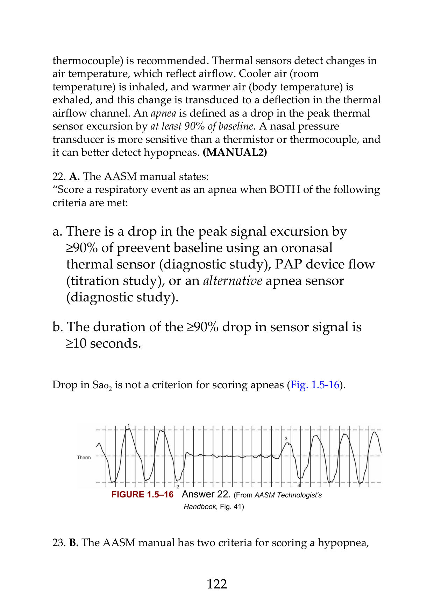

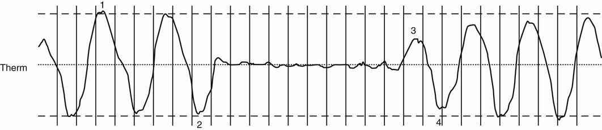

<!-- pdf-page: 123 -->

Rule 1A and Rule 1B. Both require a 30% or more drop of peak signal excursions compared with baseline and a duration of 10 or more seconds. 1A also requires a 3% or more drop in Sao2 from preevent baseline or the event is associated with an arousal. 1B requires a 4% or more drop in Sao2 from preevent baseline and no arousal. The two rules are mutually exclusive when scoring a single study; that is, you can use one or the other, but not both, in the same study. (MANUAL2)

24. B. Panel B also shows a hypopnea by Rule 1B: a 30% drop in peak signal excursion for at least 10 seconds plus an arousal (seen in EEG leads). Note that Sao2 did not drop.

25. E. Not part of the awake stage, a K complex is instead a criterion for stage N2. The AASM manual lists five criteria for scoring the awake stage:

### ❍ Alpha rhythm: Trains of sinusoidal 8- to 13-Hz

### activity recorded over the occipital region with eye

### closure, attenuating with eye opening

### ❍ Eye blinks: Conjugate vertical eye movements at a

### frequency of 0.5 to 2 Hz present in wakefulness

### with the eyes open or closed

### ❍ Reading eye movements: Trains of conjugate eye

### movements consisting of a slow phase followed by

### a rapid phase in the opposite direction as the

### individual reads

### ❍ Rapid eye movements (REMs): Conjugate,

### irregular, sharply peaked eye movements with an

### initial deflection usually lasting less than 500 ms.

### Whereas rapid eye movements are characteristic of

### 123

<!-- pdf-page: 124 -->

### stage R sleep, they may also be seen in wakefulness

### with eyes open when individuals scan the

### environment.

### ❍ Slow eye movements (SEMs): Conjugate,

### reasonably regular, sinusoidal eye movements with

### an initial deflection usually lasting longer than

### 500 ms.

26. D. Adults have less SWS compared with children. Figure 1.5-17 shows a typical hypnogram from a young adult. SWS continues to decrease with age. For people aged 20 to 29 years, SWS occupies about 15.5% of sleep time; for those older than 60 years, about 5% of sleep time is SWS. SWS represents the most dramatic change in sleep stage from childhood to old age. Other changes include a decline in REM and an increase in WASO. These changes are shown graphically in Figure 1.5-18. (Pressman, 2002, Ch 1)

FIGURE 1.5–17 Answer 26. (From ATLAS2, Fig 4.2-25)

### 124

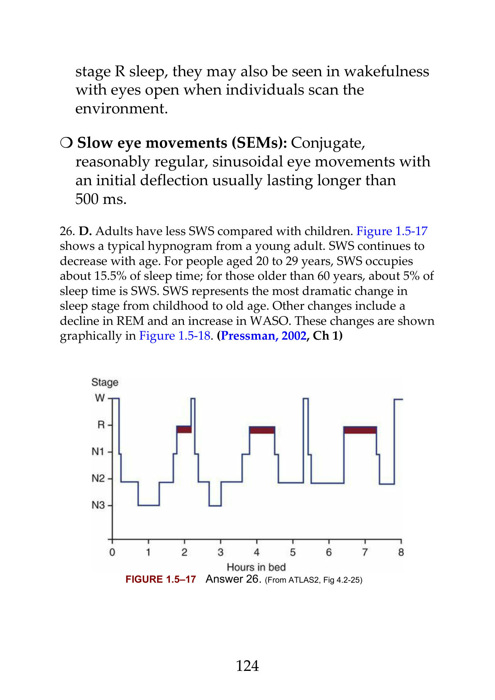

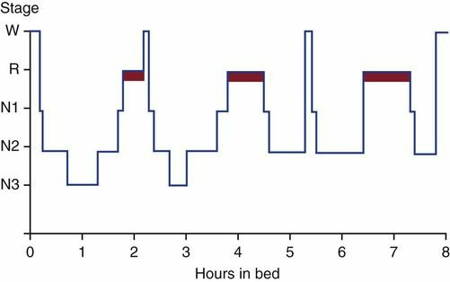

<!-- pdf-page: 125 -->

FIGURE 1.5–18 Answers 26 and 27. (From ATLAS2, Fig. 4.2-

27. A. “Deep sleep” refers to stage N3 because the arousal threshold is highest in this stage of sleep. Stage N3 concentrates in the first part of the sleep cycle. WASO increases with age, ranging from about 3% in young adults to about 11% in the elderly. REM latency is defined as the time from sleep onset to the first epoch of REM; it is normally about 90 to 120 minutes. See Figure 1.5-18. (Pressman,

#### 2002, Ch 1)

28)

28. D. Most people show an EEG of rhythmic alpha activity (in the range of 8 to 13 Hz) when relaxed with the eyes closed. Alpha activity is maximal occipitally but also often occurs centrally. In the first third of the fragment in Figure 1.5-19, O2-M1 shows alpha activity in the first third, followed by low-voltage mixed activity; this is the transition from wakefulness to stage N1. Note also the slow, rolling eye movements in E1-M2.

### 125

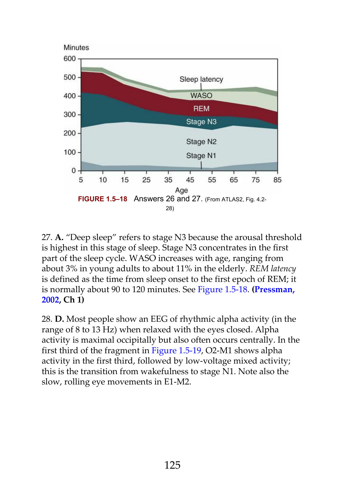

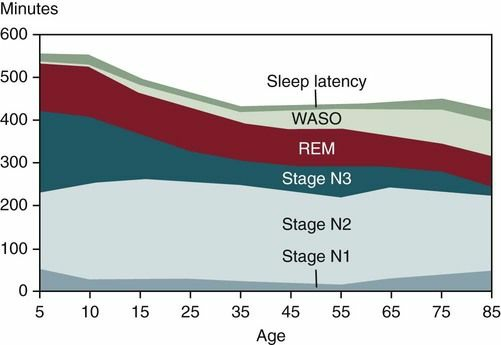

<!-- pdf-page: 126 -->

29. A. The epoch in the Figure 1.5-7 shows several features typical of stage N1. Most prominent are the vertex sharp waves (V waves) in the last third of the epoch of channels F4-M1 and C4-M1. These V waves can be mistaken for K complexes if not measured; they are less than 0.5 sec in duration, whereas K complexes are at least 0.5 sec. Also note the characteristic mixed-voltage, low-frequency EEG (predominantly 4 to 7 Hz) and the large amount of chin EMG activity, both typical of N1.

FIGURE 1.5–19 Answer 28.

30. D. The transition to sleep is associated with attenuation of alpha rhythm that is replaced by low-amplitude, mixed-frequency activity. Alpha rhythm is strongest over the occipital lobes, and it does not change to the frontal lobes when sleep occurs. Slow, rolling eye movements; a 4- to 7-Hz EEG; and vertex sharp waves are often seen in stage N1. (MANUAL2)

31. B. The epoch is scored N1, because the majority of the epoch has a frequency of 7 Hz, which falls into the criteria for N1. (MANUAL2)

32. B. Stage N2 can be scored when one or more K complexes are unassociated with arousals. Stage N2 is concluded when an arousal

### 126

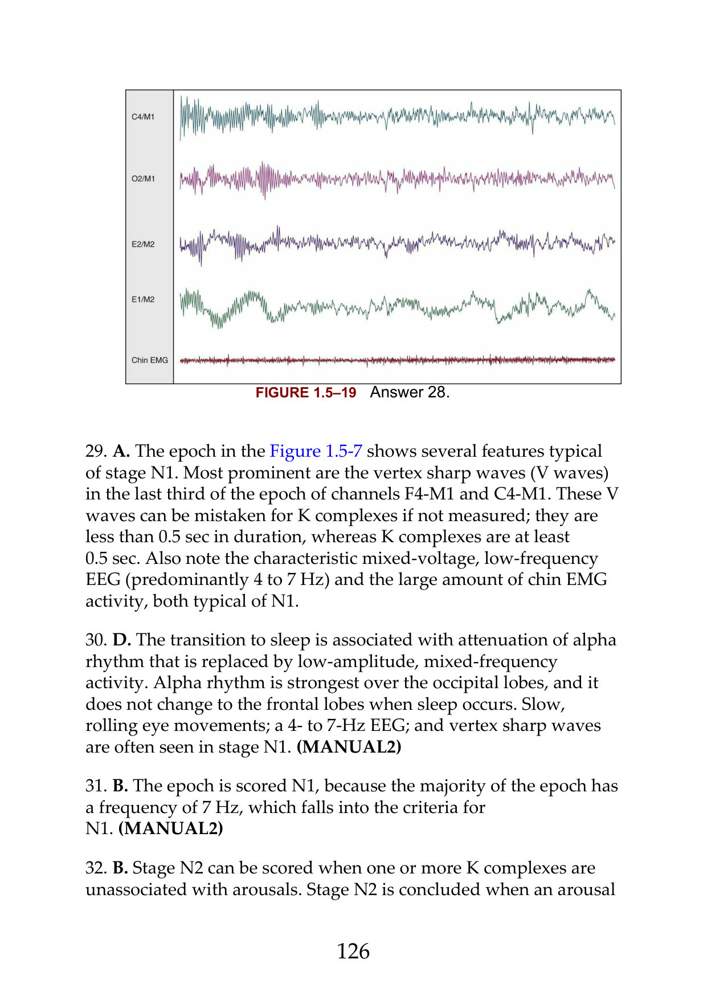

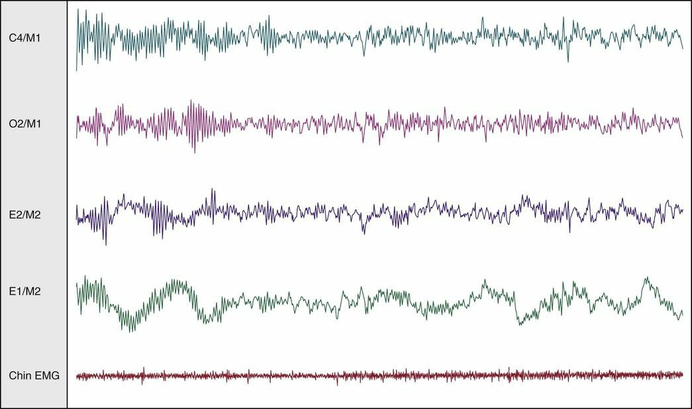

<!-- pdf-page: 127 -->

takes place or a transition to wakefulness, a major body movement, a transition to N3, or a transition to REM occurs. Therefore when the K complex is identified in the first epoch, the second epoch is scored N2 until one of these scenarios takes place. (MANUAL2)

33. A. Sleep onset is defined as the start of the first epoch scored as any stage other than wakefulness. (MANUAL2)

34. B. Onset of REM is measured from the onset of sleep to the beginning of the first REM epoch.

35. D. An EEG pattern of alpha intrusion into NREM sleep was first noted in patients with psychiatric disorders. The pattern was described as a mixture of 5% to 20% delta waves (more than 75 µV, 0.5 to 2 Hz) combined with relatively large amplitude, alphalike rhythms (7 to 10 Hz). The alpha rhythms are usually 1 to 2 Hz slower than waking alpha. A similar pattern has been related to the complaint of nonrestorative sleep in patients with musculoskeletal pain or fibromyalgia. Although epochs with alpha-delta sleep are not scored as such (this epoch is N3), the EEG pattern should be noted in the PSG report.

36. A. Slow eye movements (SEMs) are conjugate, reasonably regular, and sinusoidal with an initial deflection that usually lasts longer than 500 ms. They are characteristic of stage N1. Sleep spindles are characteristic of stage N2. Delta waves are seen in stage N3, and rapid eye movements of less than 500 ms are seen in the REM stage. (MANUAL2)

37. D. For detection of hypoventilation during a diagnostic study, you can use arterial, transcutaneous, or end-tidal PCO2. You cannot use duration of apnea, no matter how long. (MANUAL2)

38. D. Figure 1.5-9 depicts 30 seconds of PSG activity characterizing stage N3 sleep; to score stage N3, at least 20% of the epoch must show slow-wave activity. (MANUAL2)

39. A. Note that these are arbitrary definitions and differ from the awake state, in which tachycardia (in adults) is usually defined as

### 127

<!-- pdf-page: 128 -->

more than 100 beats/min and bradycardia as less than 60 beats/min. (MANUAL2)

40. D. To score epoch 281 as the end of stage R, the K complex would have to occur in the first half of the epoch. In this example, epoch 281 would be scored R, and the next epoch would be N2, unless it met criteria scoring for another stage. (MANUAL2)

41. B. One of the major differences in the sleep EEG of infants compared with older children and adults is that infants spend about twice as much time in REM sleep. (PEDS2, p 20)

42. C. The 5-minute epoch shows the typical waxing and waning (crescendo-decrescendo) of tidal volume seen in Cheyne-Stokes breathing. Note that the green airflow line is flat; this is because the airflow channel is measuring nasal flow, and the patient is mouth breathing. Note also that the Pco2 channel is measuring end-tidal Pco2 both orally and nasally, and thus it nicely displays the waxing and waning breathing pattern.

43. D. The most striking feature in Figure 1.5-11 is the synchronized activity (all the EEG channels change together) toward the end of the epoch (see the red box in Fig. 1.5-20). Close inspection of the waveforms (the green ovals in the figure) shows that some of the waves have notches; these are sawtooth waves (so called because they resemble teeth on a saw). The usual frequency of sawtooth waves is 2 to 6 Hz, so they can appear as theta waves (4 to 7 Hz). Sawtooth waves are characteristic of stage R, but they are not required to identify this stage.

### 128

<!-- pdf-page: 129 -->

44. C. The thermal sensor is used to define apnea (see the therm channel shown by the purple line in Fig. 1.5-20), and the pressure sensor (PTAF, above therm) is used to define a hypopnea. Hypopneas and apneas in adults are scored if the duration is 10 seconds or longer. Inductance plethysmography is used for the effort channels (or esophageal manometry, which is not used in clinical labs). Airflow and effort define the two types of apneas. In an obstructive apnea, there is respiratory effort. In a central apnea, respiratory effort is absent. A mixed event begins with central apnea features (no airflow, no respiratory effort) and ends with obstructive features (no airflow, respiratory effort present). Two sets of rules define hypopnea (see the answer to Question 23). (MANUAL2)

FIGURE 1.5–20 Answers 43 and 44.

45. B. This 10-minute epoch shows the standard features of a hypopnea: reduction in airflow to at least 30% of baseline in the pressure transducer signal and a 4% or greater drop in Sao2 (low Sao2 = 86% in this epoch). Note the difference in the pressure transducer and thermal sensor channels. The former changes significantly (and makes the diagnosis possible); the latter changes very little. Thermal sensors are used to monitor for apneas, whereas pressure transducers are used to monitor for hypopneas. (MANUAL2)

46. B. Note the difference between the pressure channel and the

### 129

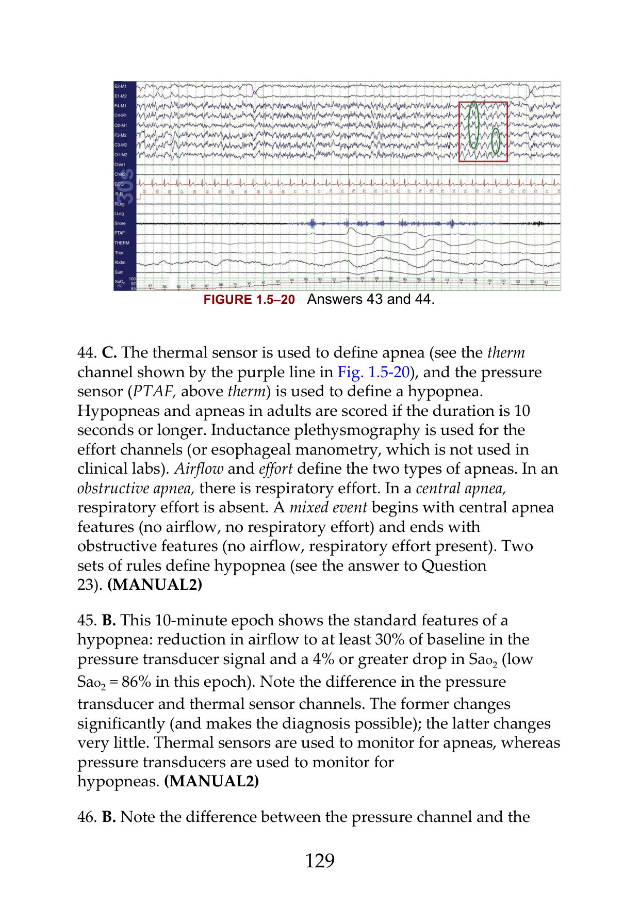

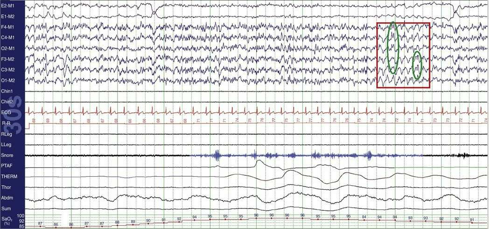

<!-- pdf-page: 130 -->

flow (thermal) channel. The pressure channel shows almost complete flow cessation, but the thermal channel shows only a small decrease in flow. So is it an apnea or hypopnea? It is not an apnea, because the thermal flow channel does not show cessation of airflow. Can this be scored as a hypopnea, because the decrease in Sao2 is only 1%? (It requires at least a 3% drop.) Note that immediately following the decreased waveform in the pressure channel, a spike appears in the EEG channels; this is an arousal. (Also note the leg jerk in the leg channels.) You can score this event as a hypopnea, because an arousal associated with a 30% or more drop in signal excursion meets the MANUAL2 criteria for hypopnea. Under D. Scoring of Hypopneas of the AASM manual, 1A.c states hypopnea can be scored if there is “a ≥3% oxygen desaturation from preevent baseline or the event is associated with an arousal.”

47. A. The rule states that if alpha rhythm is present for any part of the epoch with a “major body movement,” the epoch is scored as stage W. (MANUAL2)

48. C. The rule states that if alpha rhythm is not discernable in an epoch with major body movements, the epoch is scored the same stage as the epoch that follows it. In this case, epoch 349 contains a spindle and a K complex, which indicate stage N2; hence, N2 is also the score for epoch 348 (Boxes 1.5-1 and 1.5-2).

Box 1.5–1

### How to Examine a Polysomnogram on a

### Board Exam

Step 1. Look at the entire image. The most striking finding may be a distractor. In Figure 1.5-21, the most obvious finding is in the snoring channel, with loud snores. These may have nothing to do with the question (e.g., What is the sleep stage?). Always circle back to the question being asked. If at any point you can answer the question confidently without using the most obvious finding, you can ignore that finding.

Step 2. Make sure you have determined (or know from the

### 130

<!-- pdf-page: 131 -->

question) what the epoch length is. A polysomnogram (PSG) can have a split screen with the top and bottom showing different lengths, as shown in Figure 1.5-22. In this fragment, the top is 30 seconds, and the bottom is 2 minutes.

Step 3. Examine the channels recorded in the montage. This will be the first clue about what type of study is being shown. It is clear from examining the montage that this study is being done on continuous positive airway pressure (CPAP) and is therefore not solely a diagnostic study (Fig. 1.5-23).

Step 4. Examine the scales of the quantitative channels. In Figure 1.5-24, we see the patient is on CPAP (pressure is 19 cm H2O) and oxygenation is adequate (Sao2 = 99%).

Step 5. Look for artifacts and distractors. In Figure 1.5-25, the PTAF and THERM are flat, because they are not being recorded (this is a CPAP study, and the pressure level from the CPAP machine is being recorded). At this point you actually know enough to answer the question being asked. There are, of course, artifacts (electrocardiograph [ECG] in the chin and electroencephalograph [EEG] channels) and other interesting findings, but do not waste your time on them, because you have already answered the question.

Step 6. As a final step, you might have to look for a specific finding to answer the question. In this example (Fig. 1.5-26), you see a flattening of the C-Flow (flow measured by the CPAP machine) and snoring noise, both indicating flow limitation, which answers the question.

Step 7. In the real world, when you interpret a PSG, you will go through the history, the tech notes, and steps 1 through 6 and then look at other channels (legs, EEG, ECG) for abnormalities.

### 131

<!-- pdf-page: 132 -->

FIGURE 1.5–21 Step 1.

FIGURE 1.5–22 Step 2.

### 132

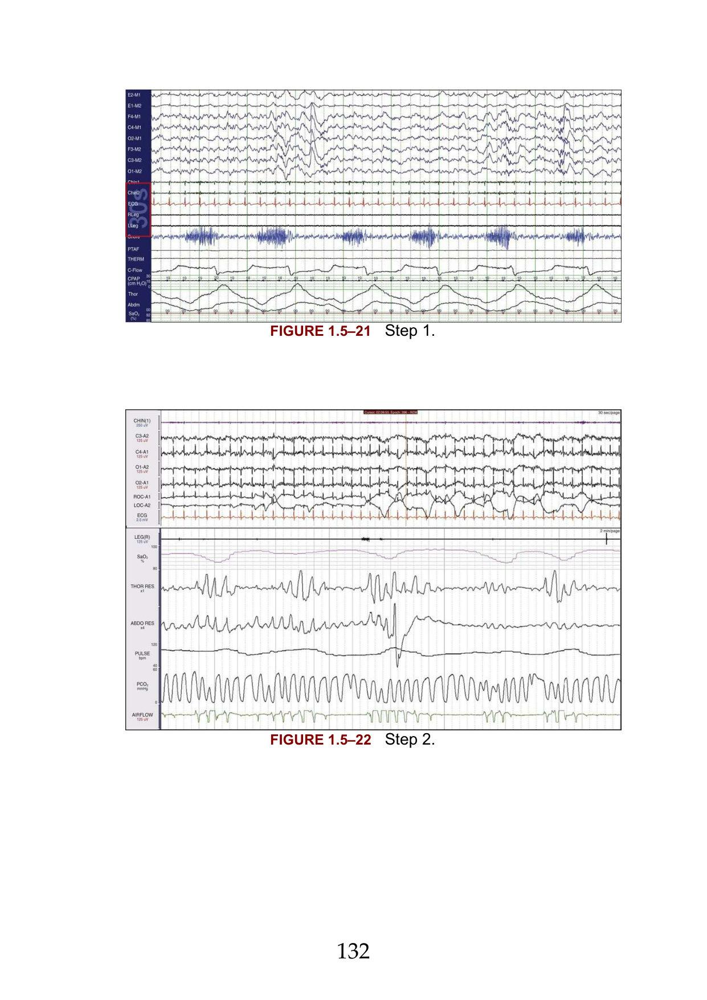

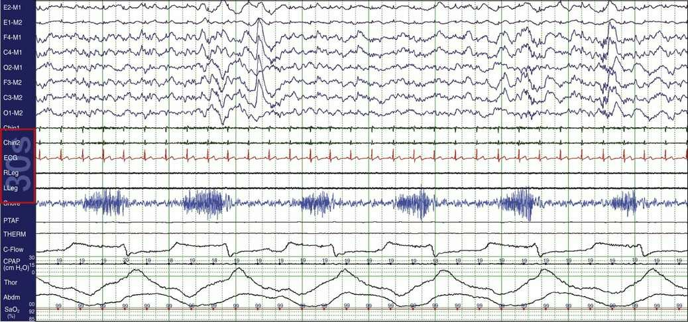

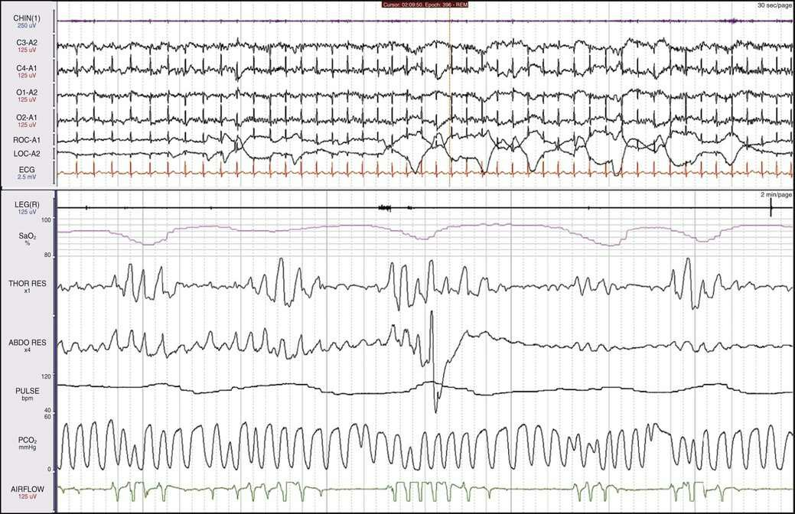

<!-- pdf-page: 133 -->

FIGURE 1.5–23 Step 3.

FIGURE 1.5–24 Step 4.

### 133

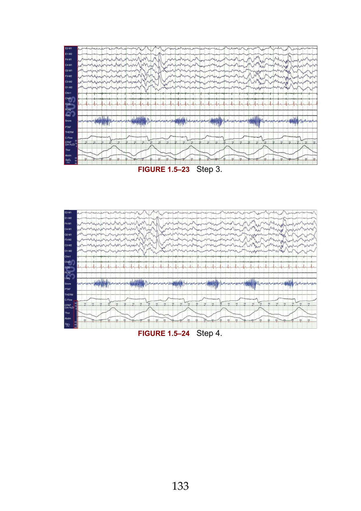

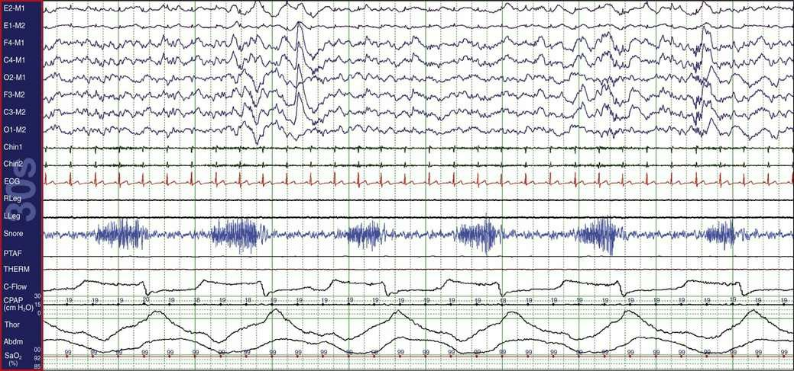

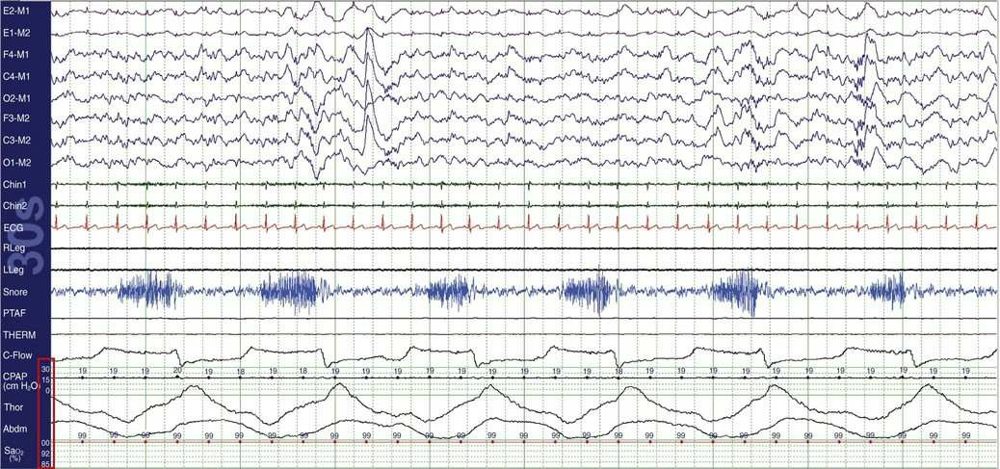

<!-- pdf-page: 134 -->

Box 1.5–2

### Six Steps in Determining the Rapid Eye

### Movement Stage (Stage R)

Step 1. Three features define rapid eye movement (REM) sleep, or stage R. The first is the presence of a low-amplitude, mixedfrequency pattern in the EEG channels (red rectangle, Fig. 1.5-27). This is nonspecific and can also be found in stage N1.

FIGURE 1.5–25 Step 5.

FIGURE 1.5–26 Step 6.

Step 2. Second is low or absent chin electromyography (EMG)

### 134

<!-- pdf-page: 135 -->

tone (red rectangle, Fig. 1.5-28).

Step 3. Third is rapid eye movements. REMs are often sharply peaked, with the initial deflection being less than 0.5 sec (red boxes,

Fig. 1.5-29).

Step 4. Look for other features of REM that are not required for staging. Sawtooth waves are found exclusively in REM; these are notched waves and can be seen in the EEG channels.

• There may also be short (<0.25 sec) twitches or transient muscle

activity noted in the chin and leg EMGs. Breathing may become irregular in normal subjects and in patients with Cheyne-Stokes breathing. Cardiac rhythm may become erratic.

Step 5. Look for continuation of REM. Once REM is scored in an epoch, it continues to be scored in subsequent epochs, even when eye movements are not seen if chin tone remains low, EEG continues to show mixed frequency, and there are no K complexes or sleep spindles.

Step 6. Look for the end of REM. REM is no longer scored if another stage is scored. K complexes or sleep spindles mean stage N2 is present. An arousal followed by slow eye movements means stage N1 is present. (Specific rules for continuing and ending REM scoring are provided in MANUAL2, pp 28-29.)

FIGURE 1.5–27 Step 1.

### 135

<!-- pdf-page: 136 -->

▪ AASM Manual for the Scoring of Sleep and Associated Events: Rules,

FIGURE 1.5–28 Step 2.

FIGURE 1.5–29 Step 3.

## Summary

### Highly Recommended

Terminology and Technical Specifications, Version 2.1 ▪ Atlas of Clinical Sleep Medicine, ed 2, Ch 18 ▪ Technologist's Handbook for Understanding and Implementing the

AASM Manual for the Scoring of Sleep and Associated Events: Rules,

### 136

<!-- pdf-page: 137 -->

Terminology, and Technical Specifications, 2009

Your knowledge of methods, rules, and event scoring will be addressed throughout the exam in a variety of questions. Sleep staging dovetails with event rules, thus some overlap occurs; you cannot stage the PSG unless you can identify common waveforms, such as alpha rhythm, K complexes, and slow-wave sleep. Expect many questions on the examination that require knowledge of sleep staging.

You must know in detail the AASM rules for scoring and staging published in version 2.1 and now updated online.

### ❍ Recommended derivations: F4-M1, C4-M1, and O2-

### Polysomnography Methods

▪ 10-20 EEG electrode placement

### ❍ Alternative derivations: Fz-Cz, Cz-Oz, and C4-M1

### M1

### ❍ Where the electrodes are placed (outer canthi)

▪ EOG placement

### ❍ Source of voltage for recording EOG

### • Both eyes are referenced to M2.

### • Cornea is electrically positive with respect to the

### ❍ When right and left eyes move toward the right

### retina.

### • Positive voltage in right EOG (E2-M2), pen moves

### electrode

### 137

<!-- pdf-page: 138 -->

### downward by convention

### • Negative voltage in left EOG (E1-M2), pen moves

### upward by convention

### • Chin electrode 1 cm above the inferior edge of the

▪ EMG placement

### ❍ Chin EMG for stage scoring

### • Reference electrode 2 cm below the inferior edge

### mandible

### and either 2 cm to the right or left of midline

### • Anterior tibialis muscle, electrodes 2 to 3 cm apart

### ❍ Leg EMG for leg movements

▪ Inductance plethysmography for chest and abdominal movement

(not piezoelectric belts) ▪ Nasal and oral thermistor and nasal pressure sensor

### ❍ Nasal pressure sensor for hypopneas

### ❍ Thermistor for apneas

### ❍ Standard is 30 seconds, but longer epochs are often

### Rules and Event Scoring

▪ Epoch length

### used to display breathing events

### 138

<!-- pdf-page: 139 -->

▪ PSG display

### ❍ To display the raw data for scoring on a screen, the

### AASM recommends a 15-inch screen size, 1600

### pixels horizontal, and 1050 pixels vertical

### ❍ Be aware of channel labeling; always check labeling

### of derivations when looking at the EEG

### ❍ Alpha rhythm is more prominent in occipital

### ❍ Slow waves and K complexes are more prominent

### derivations.

### ❍ Spindles are more prominent with central

### in frontal derivations.

### • Well-delineated negative sharp wave (upward

### derivations.

▪ EEG and EOG waveforms

### ❍ K complex (Fig. 1.5-30)

### deflection by convention) immediately followed by

### a positive component that stands out from the

### background EEG

### • Usually maximal over the frontal regions

### • Total duration 0.5 sec or longer

### 139

<!-- pdf-page: 140 -->

FIGURE 1.5–30 K complex. (From ATLAS2, Table 18-2)

### • High amplitude (≥75 µV) and low frequency (≤2 Hz)

### ❍ Slow waves (Fig. 1.5-31)

### • Thought to be generated by the cortex

### • Subset of delta (1 to 4 Hz) activity

### • Defining characteristics of stage N3

FIGURE 1.5–31 Slow waves. (From ATLAS2, Table 18-2)

### ❍ Alpha activity (Fig. 1.5-32)

### • 8 to 13 Hz rhythm

### • Most prominent in occipital leads

### • Used as marker for relaxed wakefulness and CNS

### arousals

### 140

<!-- pdf-page: 141 -->

### • Typically prominent in central and temporal leads

FIGURE 1.5–32 Alpha activity. (From ATLAS2, Table 18-2)

### ❍ Theta activity (Fig. 1.5-33)

### • 4 to 7 Hz

### • Seen in both stage N1 and REM sleep

### • Conjugate saccades that occur during stage R (REM

### • Sawtooth waves in this range

FIGURE 1.5–33 Theta activity. (From ATLAS2, Table 18-2)

### ❍ Rapid eye movement (Fig. 1.5-34)

### • Sharply peaked with initial deflection usually less

### sleep)

### than 0.5 sec in duration

### 141

<!-- pdf-page: 142 -->

FIGURE 1.5–34 REM (rapid eye movement). (From

### • Conjugate, usually rhythmic, rolling eye

ATLAS2, Table 18-2)

### ❍ Slow eye movements (Fig. 1.5-35)

### movements with initial deflection more than 0.5 sec

### in duration

### • Sharply contoured, negative deflection (upward on

### • Typically in stage N1

FIGURE 1.5–35 SEM (slow eye movements). (From

ATLAS2, Table 18-2)

### ❍ Vertex sharp waves (Fig. 1.5-36)

### EEG) that stands out from the background

### • Most often in central leads placed near the midline

### • Characteristically seen in stage N1

### 142

<!-- pdf-page: 143 -->

FIGURE 1.5–36 Vertex sharp waves. (From ATLAS2, Table

18-2)

### • Scalp representation of thalamocortical discharges

### ❍ Sleep spindle (Fig. 1.5-37)

### • Phasic burst of 11 to 16 Hz activity

### • Prominent in central scalp leads

### • Typically last for 0.5 to 1.0 sec

▪ Sleep staging rules for adults (MANUAL2, section IV, part 1)

FIGURE 1.5–37 Sleep spindle. (From ATLAS2, Table 18-2)

### Rules for Scoring Sleep

### ○ Alpha rhythm (8 to 13 Hz) with eyes closed

### ❍ Stages of sleep

### • Stage W

### ○ Eye blinks

### 143

<!-- pdf-page: 144 -->

### ○ Reading eye movements

### ○ Rapid eye movements on occasion (when scanning

### environment)

### ○ Alpha rhythm is attenuated, replaced by low

### • Stage N1

### ○ Slow eye movements

### ○ K complex: negative sharp wave followed by a

### amplitude, mixed frequency rhythm

### ○ Vertex waves

### • Stage N2

### positive component, total duration 0.5 sec or longer

### ○ Sleep spindles: train of distinct waves 11 to 16 Hz,

### ○ Slow waves (0.5 to 2.0 Hz, peak to peak more than

### duration 0.5 sec or longer

### • Stage N3

### 75 Hz measured over frontal regions) occupy 20%

### or more of epoch

### • Stage R

### ○ Rapid eye movements

### ○ Low chin EMG

### 144

<!-- pdf-page: 145 -->

### ○ Sawtooth waves

### ❍ Artifacts

### • 60 Hz interference (60 Hz filter last resort)

### • ECG artifacts (can appear in any channel)

### • Sweat artifact

### • Abrupt shift in EEG frequency that lasts at least 3

### ❍ Arousals

### seconds, with at least 10 seconds of stable sleep

### preceding

### Rules for Scoring Abnormal Events

### ❍ Sinus tachycardia (in adults): more than

▪ Cardiac rules (MANUAL2)

### ❍ Sinus bradycardia (age 6 years through adult): less

### 90 beats/min

### ❍ Asystole (age 6 years to adult): longer than 3

### than 40 beats/min

### seconds between heartbeats

### ❍ Wide-complex tachycardia

### ❍ Narrow-complex tachycardia

▪ Periodic limb movements

### 145

<!-- pdf-page: 146 -->

### ❍ Minimum number of consecutive movements is

### four.

### ❍ Minimum period length between movements is 5

### ❍ Maximum period length between movements is 90

### seconds.

### ❍ Movements on two different legs separated by less

### seconds.

### than 5 seconds are counted as a single leg

### movement.

▪ Movement and muscle artifact obscuring EEG more than half of

▪ Movement rules (MANUAL2, section VII)

### ❍ Movement time no longer scored

### ❍ Major body movement (MBM)

the epoch to the extent that stage cannot be determined

### ❍ Score epoch with MBM as W, N1, N2, N3, or REM.

### • If alpha rhythm is seen in any part of the epoch with

### • Otherwise, if the epoch before or after is W, score

### MBM, score as W.

### • Otherwise, score the epoch the same stage as the

### the epoch with MBM as W.

### epoch after the MBM.

### 146

<!-- pdf-page: 147 -->

▪ Respiratory rules in adults (MANUAL2, section VIII)

### ❍ Apnea criteria

### • Use the thermistor channel to document.

### • Score when there is at least a 90% decrease in

### thermistor flow for at least 9 seconds of a 10-second

### apnea (see the answer to Question 22).

### ❍ Hypopnea criteria; two different rules: 1A and 1B

### • 1A. Score a respiratory event as a hypopnea if all of

### ○ The peak signal excursions drop by 30% or greater

### the following criteria are met:

### of preevent baseline using nasal pressure

### (diagnostic study), PAP device flow (titration

### study), or an alternative hypopnea sensor

### (diagnostic study).

### ○ The duration of the 30% or greater drop in signal

### ○ A 3% or greater oxygen desaturation from preevent

### excursion is 10 seconds or more.

### baseline occurs, or the event is associated with an

### arousal.

### • 1B. Score a respiratory event as a hypopnea if all of

### ○ The peak signal excursions drop by 30% or greater

### the following criteria are met:

### 147

<!-- pdf-page: 148 -->

### of preevent baseline using nasal pressure

### (diagnostic study), PAP device flow (titration

### study), or an alternative hypopnea sensor

### (diagnostic study).

### ○ The duration of the 30% or greater drop in signal

### ○ A 4% or greater oxygen desaturation from preevent

### excursion is 10 seconds or more.

### ❍ Respiratory effort–related arousal (RERA) criteria

### baseline occurs.

### • If electing to score RERAs, score a respiratory event

### (MANUAL2)

### as a RERA if a sequence of breaths lasts 10 or more

### seconds and is characterized by increasing

### respiratory effort or by flattening of the inspiratory

### portion of the nasal pressure (diagnostic study) or

### PAP device flow (titration study) waveform,

### leading to arousal from sleep; the event is a RERA

### when the sequence of breaths does not meet criteria

### for an apnea or hypopnea.

### • RERAs are an “option” for scoring (i.e., not

### • RERAs are added to the apnea/hypopnea index

### recommended)

### (AHI) to determine respiratory disturbance index

### (RDI)

### ❍ Hypoventilation (MANUAL2)

### 148

<!-- pdf-page: 149 -->

### • Score hypoventilation during sleep if either of the

### following occur:

### ○ Arterial Pco2 (or surrogate) increases to a value

### greater than 55 mm Hg for 10 or more minutes.

### ○ An increase of greater than or equal to 10 mm Hg in

### arterial Pco2 (or surrogate) occurs during sleep (in

### comparison to an awake supine value) to a value

### that exceeds 50 mm Hg for 10 or more minutes.

### • Event lasts for at least two missed breaths.

▪ Respiratory rules in children (MANUAL2)

### ❍ Apnea criteria

### • A 90% fall in signal amplitude occurs for 90% of the

### respiratory cycle compared with baseline.

### • Continued respiratory effort occurs throughout the

### • At least 50% fall in nasal pressure signal and

### period of decreased airflow.

### ❍ Hypopnea criteria

### • Lasts for at least two missed breaths and

### • Fall in nasal pressure must last for at least 90% of

### the hypopnea duration and

### 149

<!-- pdf-page: 150 -->

### • The event is associated with arousal, awakening, or

### at least 3% O2 desaturation.

### ❍ Hypoventilation criteria

### • Properly calibrated and validated end-tidal Pco2 or

### transcutaneous Pco2 monitoring are acceptable

### surrogates for following Paco2.

### • If end-tidal CO2 is used, it is crucial to obtain the

### • Score hypoventilation if Pco2 is less than 50 mm Hg

### plateau in waveform.

### for more than 25% of the sleep time (Box 1.5-3).

• The cornea is electrically positive with respect to the retina. When

Box 1.5–3

### Don't Forget

eye movements occur, the electrooculogram (EOG) channel tracing shows the movements because of this electrical difference.

• The standard electromyogram (EMG) derivation for sleep staging

requires a chin EMG. This is used for scoring REM sleep (low amplitude during REM). In contrast, leg EMGs are used to score leg movements.

• Electroencephalogram (EEG) patterns are distinguishable by

frequency, amplitude, shape, and distribution (e.g., occipital, central, frontal).

• Wakefulness, non-REM (NREM) sleep, and REM sleep are

considered three distinct states of the central nervous system, and the normal subject goes through all three during a sleep study.

### 150

<!-- pdf-page: 151 -->

These states are distinguishable on the PSG by just three sets of derivations: EEG, EOG, and chin EMG.

• In a typical sleep study, EEG uses three derivations (F4-M1, C4-

M1, and O2-M1), EOG uses two derivations (E1-M2 and E2-M2), and chin EMG uses one derivation. Each derivation involves two electrodes: the recording electrode and the reference electrode.

• Staging of sleep is based on a set of well-defined rules outlined in

this section and detailed in the AASM manual (MANUAL2; see References). Full knowledge of this manual is a must for the exam.

• Apnea is scored when there is a ≥90% decrease in thermistor flow

for ≥9 seconds of a 10-second apnea (see answer to Question 22 for clarification of this often-confusing point).

• Hypopnea: There are two sets of definitions (see earlier under

• Apnea-hypopnea index (AHI) includes all apneas plus

Respiratory rules in adults).

hypopneas, with the latter scored by either the recommended or alternative methods; you cannot use both to determine any patient's AHI. The level of AHI is then used to determine the severity of a sleep apnea (could be obstructive and/or central sleep apnea). Medicare criteria for reimbursement of CPAP is based on the AHI and clinical features.

• Scoring of respiratory effort–related arousals (RERAs) is optional.

Some labs include RERAs in the respiratory disturbance index (RDI), which is therefore more inclusive than the AHI. However, sometimes labs use RDI interchangeably with AHI. AHI and RDI should not be reported without defining how they are derived.

• Medicare (CMS) uses the term RDI in its CPAP Decision Memo

but does not define it. Many sleep specialists think that CMS meant RDI to be synonymous with AHI.

• Flattening on a nasal pressure channel or a CPAP flow channel

indicates flow limitation. If there is also amplitude reduction with

### 151

<!-- pdf-page: 152 -->

a requisite drop in Sao2, hypopnea can be scored. Otherwise, it might represent a RERA. If flattening occurs in a CPAP flow channel, it usually indicates a need for an increase in pressure.

• End-tidal or transcutaneous CO2 monitoring is recommended to

diagnose hypoventilation in children but not in adults.

• Two sets of rules are used to define hypopnea: recommended and

alternative. Criteria in either set must be met to score hypopneas in a PSG; they cannot be mixed in a given study. (MANUAL2, p 46)

▪ EEG, EOG, and EMG activity are essential for sleep staging.

### Sleep Staging

### • Three derivations for EEG (six electrodes)

### ❍ Standard PSG

### • One derivation for chin EMG activity (two

### • Two derivations for eye movements (four

### electrodes)

### • Back-up electrodes are in addition to these

### electrodes)

▪ The natural progression from wakefulness to REM

### minimum requirements.

### • About 5% of the sleep period (WASO) in adults;

### ❍ Wakefulness

### increases with age

### 152

<!-- pdf-page: 153 -->

### • Alpha rhythm, eye blinks

### ❍ Stage N1

### • Occupies about 4% to 5% of sleep time in adults

### • Replaced by low-amplitude, mixed-frequency

### • Attenuation of alpha rhythm

### activity in more than 50% of the epoch

### • Occupies about 50% of sleep time in adults

### • Vertex waves

### ❍ Stage N2

### • Either of the following in the first half of the epoch

### or in the last half of the previous epoch:

### • Percentage of N3 declines with age; about 15.5% in

### ○ K complexes

### ○ Sleep spindles

### ❍ Stage N3

### young adults, down to about 5% in persons older

### than 60 years.

### • Slow waves (0.5 to 2.0 Hz peak-to-peak amplitude

### >75 µV) occupy 20% or more of the epoch.

### 153

<!-- pdf-page: 154 -->

### ❍ Stage R

### • Occupies about 25% of sleep time in adults

### • Low voltage, mixed frequency (often with sawtooth

### • Rapid eye movements

### • Low chin EMG

### waves, although not needed for scoring REM)

▪ Changes in sleep stages with aging, childhood to old age

### • This is the most striking change among all sleep

(ATLAS2, Fig. 4.2-23)

### ❍ Increase in WASO

### ❍ Not much change in N1

### ❍ Some decrease in REM sleep

### ❍ Not much change in N2

### ❍ Marked decrease in N3

### • In addition to having more N3 sleep, children have

### stages.

### slow waves with a very high amplitude compared

### with adults.

### • In children, the other stages more closely resemble

### those of adults.

### 154

<!-- pdf-page: 155 -->

▪ Continuation rules

### ❍ N2 continues if subsequent epochs show low

### amplitude, mixed frequency without K complexes

### or sleep spindles.

### ❍ N2 ends with an arousal or with transition to stage

### W, N3, or R or with a major body movement

### followed by slow eye movements. (MANUAL2)

### ❍ R continues if EEG continues to show low-

### amplitude, mixed-frequency activity without K

### complexes or sleep spindles, and chin EMG tone

### remains low.

### ❍ Epochs are at transition between N2 and R.

### ❍ R ends. (MANUAL2)

### ❍ Epochs are scored with MBM based on:

### (MANUAL2)

▪ Major body movement (MBM)

### • Alpha-rhythm part of epoch: score as W.

### • No alpha rhythm: W before or after, score epoch

### • Otherwise, score same stage as epoch that follows.

### with MBM as W.

### ❍ Pediatric scoring has some differences compared

### with adults (MANUAL2).

### 155

<!-- pdf-page: 156 -->

▪ Alpha-delta sleep

### ❍ Alpha portion usually 1 to 2 Hz slower than

### waking alpha

### • Often seen in patients with fibromyalgia or

### • May be associated with nonrestorative sleep (Box

### musculoskeletal pain

• Attenuation of alpha sleep into a low-amplitude, mixed-

### 1.5-4)

Box 1.5–4

### Don't Forget

frequency sleep is a hallmark of transition from W to N1. However, alpha sleep is not always present in humans, and the AASM has specific rules for scoring the transition to sleep in such situations (see MANUAL2).

• Alpha rhythm is present most prominently over the occipital

lobe, delta waves and K complexes are present most prominently over the frontal lobes, and sleep spindles are most prominent over the center of the brain.

• Normally, there is progression of REM throughout the sleep

cycle, manifesting as three or four discrete REM periods, each progressively longer.

• Rapid eye movements help define stage R, where they are

accompanied by a low-amplitude chin EEG. However, they may also be seen in stage W, as patients scan the room or read a book; in this case, chin EMG is very active.

• Slow, rolling eye movements are seen in stage N1, and they help

to define the transition from W to N1.

### 156

<!-- pdf-page: 157 -->

• One of the major differences in the sleep EEG of infants compared

with older children and adults is that newborn infants spend about 50% of total sleep time in REM sleep.

• Sawtooth waves are characteristic of stage R, but they are not

• The thermal sensor is used to define apnea. The nasal pressure

required to identify it.

• If alpha rhythm is present for any part of the epoch with a major

sensor is used to define hypopneas.

American Academy of Sleep Medicine. A technologist's

body movement, score the epoch as stage W.

## References

handbook for understanding and implementing the AASM manual for the scoring of sleep and associated events: rules, terminology and technical specifications. American Academy of Sleep Medicine: Darien, Ill.; 2009. American Academy of Sleep Medicine. International

classification of sleep disorders. ed 3. American Academy of Sleep Medicine: Darien, Ill.; 2014. American Academy of Sleep Medicine. The AASM manual for

the scoring of sleep and associated events: rules terminology and technical specifications, Version 2.1. American Academy of Sleep Medicine: Darien, Ill.; 2014. Butkov N, Lee-Chiong T. Fundamentals of sleep technology.

Lippincott Williams & Wilkins: Philadelphia; 2007. Kryger MH, Avidan A, Berry R. Atlas of clinical sleep medicine.

ed 2. Saunders: Philadelphia; 2014. Pressman MR. Primer of polysomnogram interpretation.

Butterworth Heinemann: Boston; 2002. Rechtschaffen A, Kales A. A manual of standardized terminology,

techniques and scoring system for sleep stages of human subjects. US Dept of Health, Education, and Welfare; National Institutes of Health: Washington, D.C.; 1968.

## Section E1.

### 157

<!-- pdf-page: 158 -->

## Normal Sleep and Its Variants

## E1.1 Sleep-Wake Mechanisms and

## Neurophysiology

1. Where is the main site of rapid eye movement (REM) sleep generation?

### Questions

### ANSWER: B. The pontine tegmentum includes the

### A. Cerebellum

### B. Pons

### C. Spinal cord

### D. Medulla oblongata

### pedunculopontine nucleus and the laterodorsal

### tegmental nucleus. These cholinergic neurons

### (located near the raphe nucleus and the locus

### coeruleus) are involved in the initiation of REM

### sleep. (ATLAS2, p 30)

2. Which statement about REM sleep is true?

### A. It is found only in humans.

### B. It is found in almost all mammals.

### C. It is absent in birds.

### 158

<!-- pdf-page: 159 -->

### D. It is absent in mammals before birth.

### ANSWER: B. Although it was once believed that

### certain species do not have sleep or REM sleep (e.g.,

### sea mammals, the platypus), every mammal that

### has been studied rigorously sleeps and has REM

### sleep. Indeed, sleep may be occurring in localized

### parts of the brain at the same time that parts of the

### brain are awake.

3. Nuclei in what part of the nervous system are involved in the suppression of muscle tone in stage R?

### A. Noradrenergic neurons in the locus coeruleus

### B. Histaminergic neurons of the tuberomammillary

### C. Orexin neurons projecting to the basal forebrain

### nucleus

### ANSWER: D. The first three answers describe

### D. Ventral sublaterodorsal nucleus

### neurons involved in cortical arousal. Remember

### that noradrenergic, histaminergic (antihistamines

### make you sleepy), and orexin (whose deficiency

### causes sleepiness in narcolepsy) are involved in

### arousal. The glycinergic and GABAergic neurons of

### the sublaterodorsal nuclei inhibit the spinal motor

### nuclei, causing the paralysis of stage R. (ATLAS2, p

### 33)

### 159

<!-- pdf-page: 160 -->

4. Sleep is thought to be associated with an increase in basal forebrain and anterior hypothalamic _______________ activity and a decrease in posterior hypothalamic _____________ activity.

### A. Adenosine/GABAergic

### ANSWER: C. The correct answer can be deduced by

### B. GABAergic/adenosine

### C. Adenosine/hypocretin

### D. Adenosine/acetylcholinergic

### knowing that adenosine accumulates during

### wakefulness and is thought to lead to sleepiness

### and that low hypocretin is found in narcolepsy, a

### disease in which the main symptom is

### sleepiness. (ATLAS2, pp 24-25)

5. Arousal, or wakefulness, is associated with a decreased activity in the _____________ and an increased activity in the ___________.

### B. Anterior hypothalamus/basal forebrain

### A. Anterior hypothalamus/thalamus

### C. Basal forebrain/posterior hypothalamus

### D. Anterior hypothalamus/posterior hypothalamus

### ANSWER: D. Because the structures that induce sleep

### are in the anterior hypothalamus (e.g., the

### ventrolateral preoptic nucleus [VLPO]), it seems

### 160

<!-- pdf-page: 161 -->

### reasonable that decreased activity here would be

### associated with arousal. Similarly, knowing that

### mammillary bodies (in the posterior hypothalamus)

### are histaminergic, and antihistamines cause

### sleepiness, would lead to the inference that

### increased activity here would be associated with

### arousal. (ATLAS2, pp 28-30)

6. Arousal is dependent on subcortical activation of cortical pathways and includes all of the following except

### ANSWER: D. The VLPO is part of the sleep switch

### A. Posterior hypothalamus

### B. Suprachiasmatic nucleus

### C. Pedunculopontine nucleus

### D. VLPO

### and thus does not play a role in causing arousal.

### The VLPO inhibits arousal by having projections

### that inhibit the histaminergic (alerting) neurons of

### the mammillary bodies. (ATLAS2, p 28)

7. The reticular activating system (RAS) provides ascending projections to thalamic and cortical areas and includes the following neurotransmitters except

### A. Acetylcholine

### B. Serotonin

### 161

<!-- pdf-page: 162 -->

### C. Norepinephrine

### D. Gamma-aminobutyric acid (GABA)

### ANSWER: D. Because GABA is the main inhibitory

### neurotransmitter in the brain, it is logical that it

### would not be a neurotransmitter involved in

### arousal. (ATLAS2, p 24)

8. REM sleep is associated with mixed-frequency, low-amplitude electroencephalogram (EEG) waveforms and rapid eye movements, which are all generated by _______________ neurons in the ______________.

### C. Acetylcholine/pedunculopontine nucleus

### A. Acetylcholinergic/substantia nigra

### B. Dopaminergic/substantia nigra

### ANSWER: C. The REM-on cells are cholinergic and

### D. Dopamine/laterodorsal nucleus

### are located in the pons. Thus the correct answer will

### have both of these facts embedded in

### them. (ATLAS2, p 30)

9. Accumulation of which of the following results in sleepiness?

### A. Adenosine

### B. Hypocretin

### 162

<!-- pdf-page: 163 -->

### C. Leptin

### D. Histamine

### ANSWER: A. It is believed that adenosine

### accumulation during wakefulness results in

### sleepiness. Adenosine has at least two effects:

### inhibition of wakefulness-promoting systems in the

### basal forebrain and activation of sleep-promoting

### VLPO neurons (Fig. E1.1-1). (ATLAS2, Fig. 3.1-7)

10. The role of caffeine in increasing wakefulness is due to its effect on which of the following?

FIGURE E1.1–1

### A. Hypocretin

### B. Adenosine

### C. Leptin

### 163

<!-- pdf-page: 164 -->

### D. Histamine

### ANSWER: B. Caffeine, a xanthine, is an antagonist of

### adenosine. The basal forebrain, which plays a role

### in wakefulness, contains cholinergic neurons, which

### are inhibited by adenosine that accumulates during

### wakefulness. By antagonizing the effect of

### adenosine, caffeine reduces the inhibition caused by

### adenosine and thus increases

### wakefulness. (ATLAS2, p 116)

11. What is the location of the main sleep switch?

### ANSWER: B. Although all these structures are

### A. Suprachiasmatic nucleus (SCN)

### B. VLPO

### C. Thalamus

### D. Pineal gland

### involved in sleep, the VLPO is the main sleep

### switch. Adenosine activates sleep promotion in

### VLPO neurons by affecting A2A receptors (see Fig.

### E1.1-1).

12. Which structures play a role in promoting wakefulness?

### A. Thalamus

### B. Pineal gland

### 164

<!-- pdf-page: 165 -->

### C. VLPO

### D. Tuberomammillary nucleus (TMN)

### ANSWER: D. The TMN cells are mainly active during

### wakefulness, and they release histamine. One way

### to remember the effect of histamine is to remember

### that antihistamines can cause sleepiness (Fig. E1.1-

### 2). (ATLAS2, Fig. 3.1-1)

### ANSWER: C. This is an example of a question in

FIGURE E1.1–2

13. Orexin-releasing cells are located where?

### A. Pineal gland

### B. Thalamus

### C. Lateral hypothalamus

### D. VLPO

### 165

<!-- pdf-page: 166 -->

### which you may be able to work out the answer by

### deduction based on understanding the function of

### the compound. Orexin is reduced or absent in

### narcolepsy, a disease in which sleepiness is a key

### symptom. Thus it is reasonable to deduce that

### orexin is involved in wakefulness. We should

### remember that the VLPO is the sleep switch;

### therefore VLPO is incorrect. Similarly, we

### remember that the thalamus is involved in sleep

### spindle generation; thus the thalamus is not the

### correct answer. The pineal gland is involved in

### melatonin production, therefore the pineal is not

### the correct answer. (ATLAS2, pp 161-164)

14. Which statement about the dorsal raphe is incorrect?

### B. Cells are active mainly during wakefulness.

### A. It is involved in REM sleep.

### D. It produces cortical activation via a ventral

### C. It releases serotonin.

### ANSWER: A. The dorsal raphe is not involved in REM

### pathway to the hypothalamus.

### sleep generation. It is involved in arousal by

### releasing serotonin. (ATLAS2, p 24)

15. What neurotransmitters are released in the VLPO?

### A. Galanin and GABA

### 166

<!-- pdf-page: 167 -->

### B. Orexin and serotonin

### C. Norepinephrine and histamine

### ANSWER: A. The correct answer can be deduced,

### D. Melatonin and dopamine

### because the VLPO is the sleep switch and therefore

### would not be expected to release neurotransmitters

### that might cause wakefulness. Thus answers B and

### C cannot be correct, because orexin (in answer B)

### and histamine (in answer C) are well known to

### cause wakefulness. Melatonin is of course produced

### by the pineal gland. Thus even if you never heard

### of galanin, you could figure out the

### answer. (ATLAS2, pp 29-30)

16. Which brain area is involved in the REM-on process?

### C. Pedunculopontine tegmental nuclei

### A. VLPO

### B. Thalamus

### ANSWER: C. The pedunculopontine tegmental,

### D. Basal forebrain

### laterodorsal tegmental, sublaterodorsal, and

### precoeruleus/parabrachial nuclei are all involved in

### REM-on processes. This is hard to remember;

### however, REM processes begin in the pons, thus

### 167

<!-- pdf-page: 168 -->

### structures that are “pontine” should be associated

### with REM. It is worth remembering that the REM-

### on neurons of the pedunculopontine tegmental

### nucleus are cholinergic.

17. What structures play a role in muscle atonia in REM sleep?

FIGURE E1.1–3

### ANSWER: D. The correct answer can be deduced,

### A. Lateral hypothalamic cells

### B. Cells in the VLPO

### C. Cells in the pineal gland

### D. Cell groups in the pons

### because none of the first three answers have

### anything to do with REM. Stimulation of cell

### groups in the pons can lead to atonia.

### 168

<!-- pdf-page: 169 -->

## E1.2 Circadian Mechanisms and

## Neurophysiology

### Questions

1. In what age group is sleep unaffected by circadian light/dark cycles?

### ANSWER: A. Neonates sleep in short clusters over the

### A. Neonates

### B. Adolescents

### C. Young adults

### D. Normal older people

### 24 hour light/dark cycle. This is called polyphasic

### sleep and is also found in many mammals. They

### have a huge amount of REM sleep at birth (about

### 50%). Usually by around 3 to 4 months of age, the

### baby develops a regular pattern of ultradian cycling

### between REM and NREM, and there is a change

### from a polyphasic sleep/wakefulness pattern to a

### circadian one. (ATLAS2, Fig. 4.2-38)

2. What is meant by the term polyphasic sleep?

### A. Sleep occurring any time day or night

### B. Sleep occurring only during the daytime

### C. Sleep with early onset of REM

### 169

<!-- pdf-page: 170 -->

### D. Sleep occurring any time it is dark

### ANSWER: A. Polyphasic sleep refers to several sleep

### bouts occurring both during the day and the night.

### This pattern is found in newborns and in some

### animals. In newborns circadian entrainment

### eventually occurs, and most sleep occurs at night.

### This pattern is also seen in older adults in

### institutions who may lack circadian entrainment

### and who may develop irregular sleep-wake

### disorder. (ATLAS2, Fig. 4.2-38)

### ANSWER: A. Pineal gland. (ATLAS2, Ch 3.3)

3. Where is the hormone melatonin secreted?

### A. Pineal gland

### B. Adrenal gland

### C. Posterior pituitary gland

### D. Retinohypothalamic tract

4. A patient who is blind from birth has a severe insomnia. What is the likeliest sleep disorder diagnosis?

### A. Advanced sleep phase syndrome

### B. Non-24 hour sleep-wake disorder

### C. Delayed sleep phase syndrome

### 170

<!-- pdf-page: 171 -->

### D. Depression-related comorbid insomnia

### ANSWER: B. The likeliest diagnosis is non-24 hour

### sleep-wake disorder. Such patients have a free

### running sleep-wake rhythm because they are

### unable to sense light and therefore cannot

### synchronize their circadian system. (ATLAS2, p

### 138; Stahl SM: Mechanism of action of tasimelteon

### in non-24 sleep-wake syndrome: treatment for a

### circadian rhythm disorder in blind patients, CNS

### Spectr 19:475-8, 2014)

5. Melatonin secretion is inhibited by which of the following? Pick the best answer.

### ANSWER: A. Melatonin has been called the hormone

### A. Light

### B. Dark

### C. Food

### D. Non-lipophilic beta blockers

### of darkness and, at times, the Dracula of hormones.

### Its secretion is inhibited by light sensed by

### melanopsin, a photopigment found in the

### photosensitive ganglion cells of the

### retina. (ATLAS2, Ch 3.3)

6. What is the effect of bright light exposure early in the morning (end of the night) on the circadian rhythm of sleep in normal humans?

### 171

<!-- pdf-page: 172 -->

### A. Causes a phase delay

### B. Causes a phase advance

### ANSWER: B. Light exposure (about 2500 lux for two

### C. No effect

### D. Induces sleep right after exposure

### hours) in the morning causes a phase advance.

### Light exposure at night causes a phase

### delay. (ATLAS2, p 92)

7. Melatonin is a hormone produced by the _________________ in response to __________.

### A. suprachiasmatic nucleus (SCN) / dark

### ANSWER: D. The hormone melatonin is secreted by

### B. pineal gland / light

### C. SCN / light

### D. pineal gland / dark

### the pineal gland. Secretion is inhibited by light and

### increased by dark. (ATLAS2, p 26)

8. The fact that many biological rhythms will free run in a constant environment implies that

### A. Biological rhythms are passive responses to

### environmental changes.

### 172

<!-- pdf-page: 173 -->

### B. Biological rhythms are actively produced by

### internal pacemakers.

### C. Biological rhythms are always coupled with

### ANSWER: B. The critical observation supporting the

### environmental changes.

### D. None of the above.

### concept of an internal pacemaker is the fact that

### circadian rhythms will continue to regularly

### oscillate under constant environmental conditions

### (i.e., without time cues). This condition is referred

### to as free running, in which the rhythm assumes its

### natural period (τ), the duration for one complete

### cycle. The free running period is always different

### from the period of the environmental zeitgeber

### (T). (ATLAS2, Ch 3.3)

9. Where is the coordinating pacemaker for the mammalian circadian rhythm system?

### ANSWER: B. Lesions of the SCN in experimental

### A. The pineal gland

### B. The SCN

### C. The ganglion cells in the retina

### D. The raphe nuclei

### animals produce an arrhythmic organism that is

### 173

<!-- pdf-page: 174 -->

### incapable of entraining to a 24-hour environmental

### rhythm of light and darkness and is without an

### obvious free-running period in rest–activity cycles.

### While major rhythms, such as the sleep-wake cycle,

### will become chaotic after the SCN is destroyed,

### other local tissue rhythms, such as liver enzyme

### levels, may retain a free running period, which

### suggests that multiple pacemakers exist within

### various tissues of an intact organism that are

### coordinated by a master mechanism within the

### SCN. (ATLAS2, Ch 3.3)

10. Which of the following is necessary for entrainment of the sleepwake cycle to the light-dark cycle?

### ANSWER: C. The retinohypothalamic tract contains

### A. Normal vision

### B. The geniculohypothalamic tract

### C. The retinohypothalamic tract

### D. The retinal rod receptors

### the axons of melanopsin containing ganglion cells

### within the retina. These specialized ganglion cells

### are the photosensitive receptor elements of the

### environmental illuminance monitoring system that

### feeds information about the light-dark cycle into the

### SCN. Disruption of this information pathway will

### prevent photic entrainment in most diurnal

### mammals. (ATLAS2, Ch 3.3)

### 174

<!-- pdf-page: 175 -->

## E1.3 Sleep at Different Ages and

## Stages of Human Life

### Questions

1. What is the best tool to diagnose restless legs syndrome (RLS) during pregnancy?

### ANSWER: B. The diagnosis of RLS in pregnant

### A. Serum ferritin

### B. Patient history

### C. EMG during sleep

### D. EMG while awake

### women is made the same as in everyone else: by a

### detailed history. RLS is a diagnosis based on

### symptoms, so the following questions are useful:

### ❍ Do you have an urge to move your legs,

### accompanied by uncomfortable or unpleasant

### sensations in the legs?

### ❍ Are the symptoms worse at rest and relieved by

### ❍ Are the symptoms worse at night, or do they only

### movement?

“Yes” answers to all three questions make the diagnosis of RLS.

### occur at that time?

### 175

<!-- pdf-page: 176 -->

Electromyography (EMG) plays no role in diagnosis (except to rule out some other disorder you might be concerned about), and serum ferritin is used only to determine whether iron deficiency might be playing a role in causation. (ATLAS2, Ch 11.2)

2. All of the following are true about sleep during pregnancy except

### A. RLS appearing for the first time during pregnancy

### almost always continues after delivery.

### B. Treatment of RLS in pregnancy should avoid

### dopamine agonists and instead focus on iron and

### folate supplements.

### C. Poor sleep quality, as defined by a Pittsburgh Sleep

### Quality Index (PSQI), becomes significantly more

### common as pregnancy progresses.

### D. The prevalence of RLS increases significantly from

### ANSWER: A. When RLS appears during pregnancy, it

### the first to third trimester.

### often remits after delivery. Treatment with

### dopamine agonists should be avoided, although it

### is acceptable to give iron and folate during

### pregnancy. As for answers C and D, in one study of

### 189 pregnant woman, the percentage of patients

### who met diagnostic criteria for RLS increased from

### 17.5% at recruitment to 31.2% in the third trimester

### (P = .001). Also, overall poor sleep quality, as

### defined by a PSQI score greater than 5, became

### significantly more common as pregnancy

### progressed (39.0% compared with 53.5%, P =

### 176

<!-- pdf-page: 177 -->

### .001). (Facco FL, Kramer J, Ho KH, et al: Sleep

### disturbances in pregnancy, Obstet Gynecol 115:77-

### 83, 2010)

3. Falling asleep by first entering REM is most typical for which of the following groups?

### ANSWER: A. Neonates spend about 50% of their time

### A. Neonates

### B. Postmenopausal women

### C. The elderly

### D. Adolescents

### in sleep and REM sleep, and in this population, it is

### common for sleep to be entered via REM. Entering

### sleep via REM is unusual except in patients with

### narcolepsy and in some individuals with severe

### sleep deprivation. (ATLAS2, p 89)

4. Which statement about quiet sleep in the preterm unborn fetus is incorrect?

### A. It appears at about 36 weeks' gestation.

### B. It comprises low-voltage delta and theta activity.

### C. It is well defined by about 34 weeks' gestation.

### D. There is no breathing activity.

### 177

<!-- pdf-page: 178 -->

### ANSWER: D. In the fetus, the sleep stages are not well

### defined as in children or adults, and sleep is

### characterized into quiet and active sleep states.

### There is a great deal of breathing activity during

### quiet sleep (equivalent to NREM sleep) in the fetus,

### even though no gas exchange actually occurs,

### because the lungs are atelectatic, and the airways

### are filled with amniotic fluid. (PEDS2, p 20)

5. Which statement about active sleep in the preterm fetus is incorrect?

### A. Low-voltage irregular (LVI) activity is present.

### B. REMs are present, and EMG tone is variable.

### C. No movements occur, but the fetus grimaces.

### D. Respiration and heart rate are variable.

### ANSWER: C. Although it might be expected that

### there would be no movements in the fetus during

### what would be equivalent to REM sleep, in fact

### there are movements, grimaces, and

### twitches. (PEDS2, p 20)

6. What best describes sleep architecture as a percent of total sleep time of a term newborn?

### A. 5% stage 1; 50% stage 2; 25% slow-wave sleep; 20%

### B. 5% stage N1; 50% stage N2; 0% stage N3; 50% stage

### REM sleep

### 178

<!-- pdf-page: 179 -->

### R

### C. 50% to 60% active sleep; 10% to 30% quiet sleep;

### 20% to 30% indeterminate sleep

### D. Sleep cannot be scored in a newborn.

### ANSWER: C. There are no formalized scoring rules

### for newborns under the age of 2

### months (MANUAL2). After 2 months of age, the

### designations are the same as in adults except that

### an additional stage is defined, called stage N, and

### the specific criteria to define these stages in children

### are described in the manual. Stage N is used in

### children older than 2 months, when the child is in

### NREM sleep, but there are no recognizable K

### complexes, sleep spindles, or slow waves. In the

### newborn, sleep structure can be scored as quiet sleep

### (equivalent to NREM); active sleep (equivalent to

### stage R); or indeterminate sleep, when neither active

### nor quiet sleep can be scored. An additional

### finding, tracé alternant, is seen in newborns. The

### latter is recognized as bursts of high-voltage

### electrical activity separated by periods of low-

### voltage activity.

### A. An EEG finding seen in sleeping newborns

7. What is tracé alternant?

### B. An EEG finding seen in patients with multiple

### system atrophy

### 179

<!-- pdf-page: 180 -->

### C. The finding of leg movements alternating between

### the right and left leg

### D. An abnormal breathing pattern in which large

### ANSWER: A. Tracé alternant is an EEG finding seen

### breaths alternate with small breaths

### in newborns, recognized as bursts of high-voltage

### electrical activity separated by periods of low-

### voltage activity. (PEDS2, p 20)

8. Which statement about sleep in children is incorrect?

### A. Sleep spindles appear 2 to 3 months after term

### B. K complexes appear by 6 months after term birth.

### birth.

### C. REM-onset sleep continues to 18 months of age.

### D. REM as a percent of TST decreases to about 30% by

### ANSWER: C. Many changes occur in sleep structure

### 1 year.

### during the first year, with the appearance of sleep

### spindles (at 2 to 3 months) and K complexes (by 6

### months) and a reduction in REM sleep. Entering

### sleep via REM, however, generally ceases between

### 3 and 6 months. (PEDS2, p 20)

9. By what age do children generally stop napping during the daytime?

### 180

<!-- pdf-page: 181 -->

### A. 3 years

### B. 6 years

### ANSWER: B. Children have usually stopped napping

### C. 9 years

### D. 12 years

### when they start grade 1, usually at age 6.

10. Adolescents are prone to develop which of the following?

### ANSWER: B. Because of changes in their circadian

### A. Advanced sleep phase syndrome

### B. Delayed sleep phase syndrome

### C. Irregular sleep-wake syndrome

### D. Free-running circadian pattern

### control system, adolescents frequently develop

### delayed sleep phase syndrome. They fall asleep late

### and tend to wake up late if given the opportunity to

### sleep, for example on weekends. Sleep deprivation

### is also common because of early school start times

### and poor sleep hygiene.

11. Which disorder becomes less common between the ages of 50 and 60?

### A. Sleep disturbance caused by hot flashes

### 181

<!-- pdf-page: 182 -->

### B. Restless legs syndrome

### C. Insomnia

### ANSWER: A. In North America, menopause generally

### D. Obstructive sleep apnea

### occurs at age 51 and is defined as 12 months

### without menstrual cycles. Sleep disturbance can be

### quite severe because of hot flashes and night

### sweats. However, these symptoms most often remit

### or become less severe by age 60.

12. When are hot flashes during sleep least common?

### D. There is no relationship to sleep stage.

### A. Stage N2

### B. Stage N3

### C. Stage R

### ANSWER: C. Hot flashes are least common in REM

### sleep. It is likely that hot flashes require activity of

### the thermoregulatory system. It has been

### hypothesized that hot flashes do not occur in REM

### because thermoregulation is suppressed.

13. Older people are prone to develop which of the following?

### A. Advanced sleep phase syndrome

### 182

<!-- pdf-page: 183 -->

### B. Delayed sleep phase syndrome

### C. Irregular sleep-wake syndrome

### ANSWER: A. Older people frequently develop

### D. Free-running circadian pattern

### advanced sleep phase syndrome, going to sleep

### earlier and awakening earlier. (ATLAS2, p 97)

14. Which statement about the effect of aging (between ages 40 and 70 years) on the sleep stages as a percent of total sleep time is incorrect?

### A. Stage N3 decreases substantially in older men.

### B. Stage N3 decreases substantially in women.

### D. Stage R sleep is preserved in women.

### C. Stage R sleep is preserved in men.

### ANSWER: A. REM sleep is relatively preserved in

### both men and women with aging. On the other

### hand, slow-wave sleep, stage N3, is decreased by

### about 50% in men but is well preserved in women.

### Other changes that occur with aging include

### reduction of spindles and K complexes.

15. Which is the most correct statement about arousals in older adults?

### A. The arousal rate in healthy older adults is less than

### 183

<!-- pdf-page: 184 -->

### five per hour.

### B. Arousal index is increased only when periodic limb

### movements or sleep-breathing disorders are

### present.

### C. Arousal index is increased in older adults without

### D. A history of cardiovascular disease is not

### sleep-disordered breathing.

### ANSWER: C. Arousal index is increased in older

### associated with disturbed sleep.

### people, even in those without a sleep-breathing

### disorder. A history of cardiovascular disease (but

### not pulmonary disease) has been associated with

### disturbed sleep.

16. Which statement about circadian rhythm of body temperature in older adults is most correct?

### A. The circadian phase is advanced, and amplitude is

### B. The circadian phase is advanced, and amplitude is

### increased.

### C. The circadian phase is delayed, and amplitude is

### decreased.

### D. The circadian phase is delayed, and amplitude is

### increased.

### decreased.

### 184

<!-- pdf-page: 185 -->

### ANSWER: B. With aging there occurs a phase

### advance but a decreased amplitude of circadian

### rhythm.

1. Which statement about selective REM deprivation is true?

## E1.4 Sleep Deprivation

### Questions

### ANSWER: B. Research done in the 1970s showed that

### A. It leads to psychopathology.

### B. It leads to increased aggression.

### C. It leads to hyposexuality.

### D. It leads to schizophrenia.

### selective REM sleep deprivation results in increased

### aggression and hypersexuality. (Puca FM, Livrea P,

### Genco S, et al: REM sleep deprivation in normal

### humans. Changes in anxiety, depression and

### aggressiveness, and HVA and 5-HIAA levels in

### the lumbar cerebrospinal fluid, Boll Soc Ital Biol

### Sper 52:782-787, 1976)

2. In an acutely sleep deprived individual, what is the effect of a 5- minute walk immediately before multiple sleep latency test (MSLT) evaluations?

### A. There is no effect, because the MSLT is such a

### robust test.

### 185

<!-- pdf-page: 186 -->

### B. The MSLT shows even more sleepiness with a 2- to

### 5-minute reduction in mean sleep latency.

### C. The MSLT shows no change in mean latency but

### shows decreased sleep-onset REM periods

### (SOREMPs).

### D. The MSLT shows a large impact in mean sleep

### ANSWER: D. Exercise can mitigate the effects of acute

### latency (longer by about 6 minutes).

### sleep deprivation on the MSLT. However, the effect

### of exercise on performance measures in sleep-

### deprived individuals is much more modest or

### nonexistent.

3. During a second night of total sleep deprivation, which is expected to have the longest effect in maintaining alertness: modafinil 400 mg, caffeine 600 mg, or dextroamphetamine 20 mg?

### ANSWER: A. Modafinil has been shown to have the

### A. Modafinil

### B. Caffeine

### C. Dextroamphetamine

### D. The three are equivalent.

### longest beneficial effect on maintaining alertness.

### This likely is related to its longer half-life.

4. Which statement about the effect of age on response to sleep

### 186

<!-- pdf-page: 187 -->

deprivation is correct?

### A. Younger adults tolerate sleep deprivation much

### better than older adults.

### B. Older adults tolerate sleep deprivation much better

### C. There is little difference in performance and

### than younger adults.

### alertness decrement related to age, and if anything,

### the decrement may be less in older than younger

### men.

### D. Because circadian amplitude is greater in older

### people, decrement from sleep deprivation is

### greater.

### ANSWER: C. Although it might be expected that

### older people would not tolerate sleep deprivation

### compared with younger adults, in fact, if anything,

### older men might tolerate sleep deprivation better

### than younger adults. The differences however are

### small.

5. Which statement about the effect of the circadian CLOCK gene on tolerance to sleep loss is correct?

### A. There is no evidence of any effect of any gene on

### B. Although variants of the CLOCK gene PER3 predict

### sleep in humans.

### “morningness” and “eveningness,” they have no

### 187

<!-- pdf-page: 188 -->

### effect on tolerance of sleep deprivation.

### C. Because the CLOCK genes only affect circadian

### physiology, there is no expected effect on sleep

### deprivation that affects homeostasis.

### D. Variants of the CLOCK gene PER3 are associated

### with differing effects on tolerance to sleep

### deprivation.

### ANSWER: D. Two groups with variants of the CLOCK

### gene PERIOD3 (PER3) have been studied. They

### have been categorized as PER3(5/5) and PER3(4/4).

### PER3(5/5) groups are more likely to show morning

### preference, whereas PER3(4/4) groups show

### evening preferences. People with the PER3(5/5)

### variant have a greater cognitive decline, and a

### greater reduction of brain responses to an executive

### task, in response to total sleep deprivation. These

### effects are most noticeable during the late night or

### early morning hours. (Dijk DJ, Archer SN:

### PERIOD3, circadian phenotypes, and sleep

### homeostasis, Sleep Med Rev 14:151-160, 2010)

6. In normal young adults, after 40 hours of total sleep deprivation, what does the first recovery sleep not show?

### A. Reduced stage W

### B. Unchanged stage N2

### C. Increased stage N3

### 188

<!-- pdf-page: 189 -->

### D. Increased stage R

### ANSWER: D. In young adults, the main finding in the

### first night of recovery sleep is a substantial increase

### in slow-wave sleep. On the second night, slow-

### wave sleep amounts normalize, and stage R shows

### an increase. By the third night, values are all

### normal.

7. “Core” sleep has been defined as the amount of sleep needed to maintain stable neurocognitive function. In adults this value appears to be which of the following?

### ANSWER: D. Some researchers have defined core sleep

### A. 3 to 4 hours

### B. 4 to 5 hours

### C. 5 to 6 hours

### D. 7 to 8 hours

### and optional sleep, with the former initially defined

### as about 4 hours. With additional research showing

### that even with 6 hours of nightly sleep, there may

### be neurocognitive or performance abnormalities,

### the value of required or “core” sleep has increased

### to about 7 to 8 hours.

8. With chronic sleep restriction, what is the most consistent sleep architecture finding?

### A. Increased stage N2

### 189

<!-- pdf-page: 190 -->

### B. Increased stage N3

### C. Increased stage R

### ANSWER: B. The most consistent finding with

### D. Normal sleep architecture

### chronic sleep restriction is an increase in slow-wave

### sleep at the expense of other sleep stages.

9. Progressive nights of sleep restriction to 5 hours are expected to show which of the following?

### A. No effect on psychomotor vigilance task but

### B. Abnormal psychomotor vigilance task and

### increased sleep propensity

### C. No effect on psychomotor vigilance task or sleep

### increased sleep propensity

### D. Abnormal psychomotor vigilance task but normal

### propensity

### ANSWER: B. Five hours of sleep restriction is

### sleep propensity

### expected to show abnormalities in the psychomotor

### vigilance task (PVT) and an increase in sleep

### propensity as measured by multiple sleep latency

### test (MSLT) or maintenance of wakefulness test

### (MWT).

10. In tests of driving performance on a simulator in subjects

### 190

<!-- pdf-page: 191 -->

restricted to 4 to 6 hours of sleep, which of the following is correct?

### A. There is no effect on accident rate.

### B. There is an increase in accident rate.

### C. There is a decrease in accident rate as subject tries

### D. Accident rate is increased only when testing is

### to compensate.

### ANSWER: B. Accident rate is increased in sleep-

### done at night.

### restricted individuals, and the abnormalities are

### documented both in day and night testing.

11. Chronic sleep restriction to 4 hours is expected to show which effects?

### A. Increased evening cortisol and sympathetic

### B. Increased thyrotropin activity and decreased

### activation

### C. Increased leptin and decreased ghrelin levels

### glucose tolerance

### ANSWER: A. This is an important topic. Sleep

### D. All of the above

### restriction leads to an increase in cortisol, ghrelin

### and sympathetic activity and to a decrease in leptin

### and thyrotropin, and also a decreased glucose

### 191

<!-- pdf-page: 192 -->

### tolerance (insulin resistance).

12. What effect does sleep loss (4 hours sleep for 6 nights) have on response to influenza vaccination?

### A. Sleep deprivation causes a 50% decrease in

### antibody titers to influenza vaccine at 10 days,

### which persists for at least 1 year.

### B. Sleep deprivation causes a 50% decrease in

### antibody titers to influenza vaccine at 10 days,

### which normalizes by 4 weeks.

### C. Sleep deprivation causes a 50% increase in

### antibody titers to influenza vaccine, which persists

### for at least 1 year.

### D. Sleep deprivation has no effect on immune

### ANSWER: B. In addition to the temporary reduction

### function.

### in immune response to influenza vaccination,

### abnormalities in interleukin-6 and tumor necrosis

### factor have been reported.

13. Which statement about the effect of sleep deprivation on the cardiovascular system is incorrect?

### A. Sleep deprivation is associated with increased C-

### reactive protein, a marker of cardiovascular risk.

### B. Sleep deprivation is associated with increased

### cardiovascular morbidity.

### 192

<!-- pdf-page: 193 -->

### C. The Nurses' Health Study did not show that sleep

### deprivation was associated with coronary events.

### D. Shift workers have reduced cardiovascular health.

### ANSWER: C. In fact the Nurses' Health Study showed

### that women sleeping less than 7 hours had

### increased coronary events.

14. The purpose of low and high filters is to isolate specific frequency bandwidths relevant to each recording parameter. Which of the following is not a correct filter range for the parameter shown?

### ANSWER: D. The recommended low-high frequency

### A. EEG: 0.3 Hz to 35 Hz

### B. EOG: 0.3 Hz to 35 Hz

### C. EMG: 10 Hz to 100 Hz

### D. ECG: 20 Hz to100 Hz

### filter for electrocardiogram (ECG) is 0.3 to

### 70 Hz. (MANUAL2)

### A. Movement and muscle artifact obscuring the EEG

15. A major body movement (MBM) is defined as

### for more than half an epoch to the extent that sleep

### stage cannot be determined

### B. Movement artifact that manifests for at least 10

### 193

<!-- pdf-page: 194 -->

### seconds in a standard 30-second epoch

### C. Movement or muscle artifact that obscures the

### entire epoch

### D. Movement artifact that awakens the patient

### ANSWER: A. This statement is the definition of major

16. An epoch can be scored as “movement time” when

### body movement. (MANUAL2)

### A. An MBM occupies more than 50% of any epoch.

### B. An MBM occupies at least one third of any epoch.

### C. An MBM is at least half of a W epoch.

### D. An epoch can never be scored as movement time.

### ANSWER: D. According to the AASM scoring

### manual, movement time is no longer scored.

### Instead, the epoch in which an MBM occurs is

### scored as W, N1, N2, N3, or REM. The rules are as

### follows:

### A) If alpha rhythm is seen in any part of the epoch

### B) If not A, and the epoch before or after is W, score

### that has an MBM, the score is W.

### C) If neither A nor B, score the epoch the same stage

### the epoch with MBM as W.

### 194

<!-- pdf-page: 195 -->

### as the epoch after the MBM.

Match the activity given in Questions 17 through 24 to the waveforms labeled A through H. The time duration represented by each waveform is 1 second. Six tracings are from an EEG, and two are from an electrooculogram (EOG); each figure is used only once (Fig. E1.4-1).

FIGURE E1.4–1

### 195

<!-- pdf-page: 196 -->

17. K complex

18. Slow waves

17. E. The K complex is an EEG event that consists of well-

19. Alpha activity

20. Theta activity

21. REM

22. Slow eye movements (SEMs)

23. Vertex sharp waves

24. Sleep spindles

### A. (3.2 to 14)

### B. (3.2 to 15)

### C. (3.2 to 18)

### D. (3.2 to 19)

### E. (3.2 to 12)

### F. (3.2 to 13)

### G. (3.2 to 16)

### H. (3.2 to 17)

### ANSWERS:

### 196

<!-- pdf-page: 197 -->

delineated negative sharp wave (upward deflection by convention) immediately followed by a positive component that stands out from the background EEG. Total duration is 0.5 sec or more and is usually maximal over the frontal regions.

18. F. Slow waves have high amplitude (≥75 µV) and low frequency (≤2 Hz). Slow waves are a subset of delta (1 to 4 Hz) activity and are the defining characteristics of stage N3 sleep.

19. A. Alpha activity; an 8- to 13-Hz rhythm, usually most prominent in occipital leads and thought to be generated by the cortex, is used as marker for relaxed wakefulness and central nervous system (CNS) arousals.

20. B. Theta activity; 4- to 7-Hz waves, typically prominent in central and temporal leads, seen in both stage N1 and REM sleep.

21. G. Rapid eye movements are conjugate saccades that occur during REM sleep and correlate with dreaming. They are sharply peaked with an initial deflection usually less than 0.5 second in duration.

22. H. Slow eye movements (SEMs) are conjugate, usually rhythmic, rolling eye movements with an initial deflection more than 0.5 sec in duration.

23. C. Vertex sharp waves show a sharply contoured, negative deflection (upward on EEG) that stands out from the background and appears most often in central leads placed near the midline; they are characteristically seen in stage N1.

24. D. Sleep spindle, a phasic burst of 11- to 16-Hz activity prominent in central scalp leads, typically lasts for 0.5 to 1.0 sec. Spindles are a scalp representation of thalamocortical discharges; the name derives from their shape, which is spindlelike. Match one of the following terms, A through Q, to each of the statements numbered 25 through 36. References for the answers are in the AASM scoring manual.

### 197

<!-- pdf-page: 198 -->

### A. Alpha rhythm

### B. Artifact

### C. Beta

### D. Complex

### E. Delta

### F. Delta sleep

### G. Frequency

### H. K complex

### I. Movement time

### J. Theta

### K. Sawtooth waves

### L. Sleep spindle

### M. Stage N1

### N. Stage N2

### O. Stage N3

### P. REM sleep

### Q. Awake

### 198

<!-- pdf-page: 199 -->

25. Used to indicate EEG frequencies higher than 13 Hz. Answer: C

26. Well-delineated negative sharp wave immediately followed by a positive component, duration of 0.5 or more seconds, usually maximal in amplitude when recorded with frontal derivations. Answer: H

27. EEG frequency of 8 to 13 Hz in adults, most prominent in the posterior areas. Characteristic of relaxed wakefulness with the eyes closed. Answer: A

28. Moderate amounts (20% and above) of high amplitude (75 µV or greater), slow wave (2 Hz or slower) EEG activity. Answer: O

29. Sometimes used as a synonym for stage N3 sleep. Answer: F

30. Sleep-scoring epoch during which the record is totally obscured by muscle tone for greater than 15 seconds but less than 1 minute. Answer: I

31. A waveform with a frequency of 12 to 14 cps, most prominent in stage N2 sleep. Answer: L

32. A stage of relatively low-voltage, mixed-frequency EEG without rapid eye movements; SEMs are often present, vertex sharp waves may be seen, and EMG activity is not suppressed. Answer: M

33. A nonbiologic signal that appears in an EEG of sleep recording and interferes with the signals being recorded. Answer: B

34. Notched waveforms in vertex and the frontal regions that sometimes occur in conjunction with bursts of rapid eye movements in REM sleep. Answer: K

35. Indicates an EEG frequency of 4 to 7 cps. Answer: J

36. 12 to 14 cps sleep spindles and K complexes on a background of relatively low-voltage, mixed-frequency EEG activity. Answer: N For questions 37 through 48, match the electrophysiologic characteristics with the sleep stage(s) where it may be found. Use

### 199

<!-- pdf-page: 200 -->

the terminology W, N1, N2, N3, and R. Note that some characteristics help define a sleep stage, whereas other characteristics may simply be in a stage defined by something else. Thus, for example, you would not find rapid eye movements in stage N2, because they are used to define REM sleep, but you could find alpha rhythm in any stage, because it only defines W if it occupies 15 or more seconds of a 30-second epoch.

37. Low-voltage, mixed-frequency activity: Stage ____. ____, or ____

42. Alpha activity (a freebie): Stage ____, ____, ____, ____, or ____

38. Vertex sharp waves: Stage _____ or _____

39. Sleep spindles: Stage _____ or _____

40. K complexes: Stage ______ or _____

41. Beta activity: Stage _____, ____, or _____

43. Theta activity: Stage ____, ____, ____, or ____

44. Slow-wave activity: Stage _____, ____, ____, or _____

47. Atonic electromyogram (EMG) activity: Stage _____

45. Slow eye movements: Stage _____ or _____

46. Rapid eye movements: Stage _____

48. Low voltage, mixed frequency with sawtooth pattern: Stage _____ ANSWERS:

### 37. Low-voltage, mixed-frequency activity. Stage

### 38. Vertex sharp waves: Stage N1 or N2

### N1, N2, or R

### 200

<!-- pdf-page: 201 -->

### 39. Sleep spindles: Stage N2 or N3

### 40. K complexes: Stage N2 or N3

### 42. Alpha activity (a freebie): Stage W (≥15 sec), N1

### 41. Beta activity: Stage W, N1, or R

### (<15 sec), N2 (<15 sec), N3 (<15 sec), or R (<15 sec)

### 43. Theta activity: Stage N1, N2, N3, or R (with

### 44. Slow-wave activity: Stage N1 (<6 sec), N2

### typical sawtooth pattern)

### 45. Slow eye movements: Stage W or N1

### (<6 sec), N3 (≥6 sec), or R (<6 sec)

### 48. Low voltage, mixed frequency with sawtooth

### 46. Rapid eye movements: Stage R

### 47. Atonic EMG activity: Stage R

49. Polysomnographic (PSG) waveforms are defined based on four features: (1) amplitude, (2) frequency, (3) waveform shape, and (4) distribution. Below are descriptions of four waveforms, labeled 1 through 4. From letters A through D, pick the correct sequence of waveforms corresponding to stages W, N1, N2, N3.

### pattern: Stage R

### A. Alpha rhythm, vertex sharp wave, slow wave, K

### complex

### 201

<!-- pdf-page: 202 -->

### B. Alpha rhythm, vertex sharp wave, K complex, slow

### wave

### C. Theta rhythm, eye blink, slow wave, K complex

### D. Sleep spindle, K complex, vertex sharp wave, slow

50. Impedance in PSG is a measure of the contact of the electrode with the skin. All electrode impedances should be below

### wave

### ANSWER: B. (MANUAL2)

51. According to the AASM's 2014 recommendations, in a sleepstaging montage, the F4 electrode should be referred to which other electrode?

### A. 5 Ohms

### B. 500 Ohms

### C. 5000 Ohms

### D. 20,000 Ohms

### ANSWER: C. (MANUAL2)

### A. E1

### B. F3

### C. M2

### D. M1

### 202

<!-- pdf-page: 203 -->

### ANSWER: D. (MANUAL2)

52. When the sensitivity control is set at 10 µV/mm, a 100 µV input signal will produce a pen deflection of

53. In normal adults, what are the approximate percentages for each sleep stage?

### A. 1 mm

### B. 10 mm

### C. 10 cm

### D. 100 mm

### ANSWER: C.

54. In stage R, which of the following findings is most characteristic?

### ANSWER: A. (ATLAS2, p 84)

### A. Increased muscle tone

### B. Sawtooth waves

### C. Sleep spindles

### 203

<!-- pdf-page: 204 -->

### D. K complexes

### ANSWER: B. Sawtooth waves are often seen in the

### EEG during REM sleep but are not essential to its

### staging. They look like the teeth of a saw, as shown

### in the green ovals below in this REM epoch (Fig.

### E1.4-2).

55. Which of the following is a characteristic normal stage N2 sleep?

FIGURE E1.4–2

### A. Absent muscle tone

### B. Delta waves

### C. Sleep spindles

### D. Alpha waves

### ANSWER: C.

### 204

<!-- pdf-page: 205 -->

56. Which of the following statements most closely characterizes changes in sleep with aging?

### A. Sleep latency increases, percent REM sleep

### decreases.

### B. Slow-wave amplitude increases, percent slow-wave

### C. Stages 1 and 2 increase, slow-wave amplitude

### sleep decreases.

### D. Sleep latency decreases, sleep efficiency decreases.

### increases.

57. Which statement best describes the distribution of REM sleep during normal nocturnal sleep?

### ANSWER: A.

### A. REM episodes are evenly distributed throughout

### B. REM episodes last longer later in the night.

### the night.

### C. REM sleep occurs mainly during the first 120

### D. REM sleep occurs mainly in the middle third of the

### minutes of the night.

### ANSWER: B. Whereas the percentage of REM sleep

### night.

### decreases with aging, in all cases the episodes of

### REM sleep tend to be longer later in the sleep cycle.

### 205

<!-- pdf-page: 206 -->

### Figure E1.4-3 (ATLAS2, Fig. 4.2-25, p 86) shows

### REM distribution (horizontal red bars) in three

### different ages: A, child; B, young-to-middle–aged

### adult; C, older adult.

### 206

<!-- pdf-page: 207 -->

58. Most slow-wave sleep typically occurs in what part of the night?

FIGURE E1.4–3

### ANSWER: A. This fact is also appreciated in the three

### A. First third of the night

### B. Middle third of the night

### C. Last third of the night

### D. Equally throughout the night

59. Upper limit of normal sleep latency in adults is approximately

### hypnograms shown in Figure E1.4-3.

### A. Less than 5 minutes

### B. Less than 20 minutes

### C. 20 to 40 minutes

### 207

<!-- pdf-page: 208 -->

### D. Up to 90 minutes

### ANSWER: B.

60. According to the AASM practice parameters for use of actigraphy, only two indications are considered standard, including which one of the following?

### A. To assist in the evaluation of patients suspected of

### advanced sleep phase syndrome (ASPS) and

### delayed sleep phase syndrome (DSPS)

### B. To estimate total sleep time in patients with

### obstructive sleep apnea (OSA) when PSG is not

### available

### C. To determine circadian pattern and estimate

### average daily sleep time in individuals complaining

### of hypersomnia

### D. For evaluating the response to treatment for

### ANSWER: B. (Morgenthaler T, Alessi C, Friedman L,

### patients with insomnia

### et al: Practice parameters for the use of actigraphy

### in the assessment of sleep and sleep disorders: an

### update for 2007, Sleep 30:519-529, 2007)

### ▪ “Actigraphy is a valid way to assist in determining

### sleep patterns in normal, healthy adult

### populations.” (Standard)

### ▪ “When PSG is not available, actigraphy is indicated

### 208

<!-- pdf-page: 209 -->

### as a method to estimate total sleep time in patients

### with obstructive sleep apnea syndrome. Combined

### with a validated way of monitoring respiratory

### events, use of actigraphy may improve accuracy in

### assessing the severity of obstructive sleep apnea

### compared with using time in bed.” (Standard)

61. What stage of sleep is shown on the following PSG fragment in Figure E1.4-4?

### ANSWER: B. This is stage N1. About 10 seconds from

### A. Stage W

### B. Stage N1

### C. Stage N2

### D. Stage N3

### the end of this epoch is a vertex sharp wave, and

### the EEG shows low-amplitude, mixed-frequency

### waves. This stage frequently also demonstrates

### slow eye movements. (MANUAL2)

### 209

<!-- pdf-page: 210 -->

62. What is shown in the red-bordered area in the following PSG (Fig. E1.4-5)?

FIGURE E1.4–4

### ANSWER: A. This is a vertex sharp wave. Three

### A. Vertex sharp wave

### B. Sawtooth wave

### C. Seizure spike

### D. K complex

### characteristics of this wave are that it stands out

### from the background of mixed-frequency, low-

### amplitude activity; it is maximal over the central

### region (C4-M1, in this example); and it is of short

### duration (<0.5 sec). (MANUAL2)

### 210

<!-- pdf-page: 211 -->

63. How much time does the red box in the PSG fragment in Figure E1.4-6 cover?

FIGURE E1.4–5

### ANSWER: B. The entire epoch is 30 seconds; always

### A. 2 seconds

### B. 3 seconds

### C. 4 seconds

### D. 5 seconds

### find the epoch length whenever you examine a PSG

### fragment. The red box occupies exactly one of the

### major time divisions, thus the box occupies 3

### seconds (30 divided by 10).

### 211

<!-- pdf-page: 212 -->

64. How much time does the red box in the PSG fragment in Figure E1.4-7 cover?

FIGURE E1.4–6

### ANSWER: D. The entire epoch is 30 seconds; always

### A. 0.2 sec

### B. 0.3 sec

### C. 0.5 sec

### D. 0.6 sec

### find the epoch length whenever you examine a PSG

### fragment. There are ten major time divisions; thus

### each major time division occupies 30 divided by 10

### or 3 seconds. The red box occupies the minor time

### division, which is one fifth of the major time

### division. Thus the box covers 3 seconds divided by

### 5, or 0.6 sec.

### 212

<!-- pdf-page: 213 -->

65. What is shown on the following PSG fragment (Fig. E1.4-8)?

FIGURE E1.4-7

### ANSWER: B. This is alpha activity (8 to 13 Hz),

### A. Sawtooth waves

### B. Alpha activity

### C. A string of K complexes

### D. Continuous seizure activity

### prominent in all the EEG channels but especially in

### the occipital channel O2-M1. (MANUAL2)

### 213

<!-- pdf-page: 214 -->

66. What is the best interpretation of the data shown on the PSG fragment in Figure E1.4-8?

FIGURE E1.4–8

### C. The patient is about to enter REM sleep.

### A. The patient is awake, eyes closed.

### B. The patient is awake, eyes open.

### ANSWER: A. This is alpha activity (8 to 13 Hz) that is

### D. The patient is reading a book.

### prominent in all the EEG channels, especially in the

### occipital channel (O2-M1). This pattern is maximal

### when the eyes are closed and is attenuated when

### the eyes are open. (MANUAL2)

67. What does the PSG fragment in Figure E1.4-9 show?

### A. Transition from wakefulness to REM is shown.

### 214

<!-- pdf-page: 215 -->

### B. Transition occurs from REM to an awake state.

### C. Sleep onset occurs in the middle of the epoch.

### D. The subject is awake and closed her eyes in the

### ANSWER: C. Because EMG tone remains high the

### middle of the epoch.

### entire epoch, there is no REM sleep; therefore

### answers A and B are incorrect. Answer D is

### incorrect because if this were alpha activity in the

### first half of the epoch, the apparent attenuation of

### the activity would occur if the eyes were opened,

### not closed. (MANUAL2)

68. What stage of sleep is shown in the PSG fragment in Figure E1.4-10?

FIGURE E1.4–9

### A. Stage R

### 215

<!-- pdf-page: 216 -->

### B. Stage N1

### C. Stage N2

### ANSWER: C. This is stage N2 sleep. A well-developed

### D. Stage N3

### K complex is evident just before the middle of the

### epoch. The K complex is a negative sharp wave (in

### the EEG, negative is an upward deflection) with a

### duration exceeding 0.5 sec. The K complex is

### usually maximal in the frontal derivations and

### stands out from the background EEG. Spindles

### (waves usually 12 to 14 Hz) are also characteristic of

### stage N2 sleep. (MANUAL2)

69. What is shown in the highlighted portion of the PSG fragment in Figure E1.4-11?

FIGURE E1.4–10

### 216

<!-- pdf-page: 217 -->

### A. Vertex sharp wave

### B. K complex

### ANSWER: C. This is a K complex. A vertex sharp

### C. Sawtooth wave

### D. Seizure

### wave is shorter than 1 second in duration. Sawtooth

### waves have less amplitude and duration than K

### complexes and in any case are characteristic of REM

### sleep, not stage N2 seen in this epoch. Finally, there

### is nothing in the EEG to indicate seizure

### activity. (MANUAL2)

70. What is the most prominent finding in the PSG epoch in Figure E1.4-12?

FIGURE E1.4–11

### 217

<!-- pdf-page: 218 -->

### A. Sawtooth waves

### B. Theta waves

### ANSWER: D. Several bursts of sleep spindles are

### C. K complexes

### D. Sleep spindles

### seen. In this example, they are most prominent in

### the frontal leads. Although overlap is seen in the

### frequency of spindles (range 11 to 16 Hz) and alpha

### rhythm (8 to 13 Hz), in a subject who has both, the

### spindle frequency is higher and the distribution is

### more central than for alpha activity.

71. The horizontal red dashed lines in Figure E1.4-13 have a vertical distance between them of 70 µV (from +35 to −35). What does the figure show?

FIGURE E1.4–12

### 218

<!-- pdf-page: 219 -->

### A. Status epilepticus

### B. Strings of K complexes

### ANSWER: C. This is slow-wave sleep, stage N3. Slow

### C. Stage N3 sleep

### D. Stage R sleep

### waves are defined as having a frequency of 0.5 to

### 2 Hz. Their peak-to-peak amplitude is greater than

### 75 µV in the frontal region. More than 20% of the

### epoch is made up of slow waves. Note that sleep

### spindles may persist in N3, as seen near the end of

### the epoch. (MANUAL2)

72. What does the fragment in Figure E1.4-14 show?

FIGURE E1.4–13

### A. Rapid eye movements

### 219

<!-- pdf-page: 220 -->

### B. The subject is reading.

### C. Vertex sharp waves

### ANSWER: A. The fragment shows rapid eye

### D. Theta waves

### movements. The eye channels show movements

### that are conjugate (the deflections of the two eye

### channels are mirror images of each other) and

### irregular (eye movements when reading are

### regular), and the initial deflection lasts less than

### 500 ms. (MANUAL2)

73. What is the most likely interpretation of the PSG fragment in Figure E1.4-15?

FIGURE E1.4–14

### A. Stage R sleep in an 8-year-old child

### 220

<!-- pdf-page: 221 -->

### B. Continuous seizure activity

### C. Stage N3 in an 8-year old-child

### D. Indeterminate sleep in a patient with Alzheimer

### ANSWER: C. This is stage N3 in an 8-year-old child.

### disease

### The pair of horizontal red dashed lines for each

### channel indicate ±35 µV. Slow waves in children are

### often more than 100 µV in peak-to-peak amplitude.

### This is seen in all the EEG channels. Stage N3

### requires that slow-wave activity occupy more than

### 20% of the epoch. (MANUAL2)

74. How would you interpret the PSG epoch from an 8-year-old patient, shown in Figure E1.4-16?

FIGURE E1.4–15

### A. The entire epoch should be scored stage R sleep.

### 221

<!-- pdf-page: 222 -->

### B. It shows transition from stage N2 to stage R about

### 17 seconds into the epoch.

### C. The epoch should be scored as stage N1 sleep.

### D. The epoch should be scored as stage N3 sleep.

### ANSWER: B. This epoch should be scored as stage N2

### sleep (notice the spindle at 6 seconds into the

### epoch), because more than half the epoch is stage

### N2; the transition into stage R begins 17 seconds

### into the epoch. At that point, there is an abrupt

### reduction in chin tone, and sawtooth waves appear

### in the EEG channels. Sawtooth waves have a

### frequency of 2 to 6 Hz, and they are triangular or

### serrated in shape. (MANUAL2)

75. What does the PSG fragment in Figure E1.4-17 show?

FIGURE E1.4–16

### A. Seizure activity

### 222

<!-- pdf-page: 223 -->

### B. An artifact arising in the eye channels that spills

### into the EEG

### C. Sawtooth waves in stage R

### ANSWER: D. Theta waves have a frequency of 4 to

### D. A burst of theta waves

### 8 Hz (some sources indicate a range of 4 to 7 Hz).

### The third 3-second segment shows 12 cycles in the

### EEG and EOG channels; thus the frequency is 4 Hz.

### Theta waves are most often seen in stage N1 sleep

### and are not pathologic.

76. Caffeine antagonizes receptors of which sleep-promoting neurotransmitter?

FIGURE E1.4–17

### A. GABA

### B. Galanin

### 223

<!-- pdf-page: 224 -->

### C. Melatonin

### D. Adenosine

### ANSWER: D. Adenosine is a ubiquitous extracellular

### nucleotide, and both theophylline and caffeine

### block adenosine receptors in the brain. Adenosine

### activates the VLPO, part of the anterior

### hypothalamus, which promotes sleep, so these

### drugs tend to keep people awake. Note that

### destruction of the anterior hypothalamus leads to

### insomnia (Von Economo encephalitis or

### encephalitis lethargica arises from lesions in the

### anterior hypothalamus). (ATLAS2, p 23)

77. A 50-year-old woman with severe depression is being treated with multiple medications. An overnight PSG shows the following sleep stage percentages:

Which of the drugs she is taking, listed below, is most likely to cause this distribution?

### N1 5%

### N2 37%

### N3 8%

### REM 50%

### A. Dextroamphetamine

### 224

<!-- pdf-page: 225 -->

### B. Bupropion

### C. Citalopram

### ANSWER: B. Bupropion (Wellbutrin). (Nofzinger EA,

### D. Trazodone

### Reynolds CF 3rd, Thase ME, et al: REM sleep

### enhancement by bupropion in depressed men, Am

### J Psychiatry 152:274-276, 1995; Mayers AG,

### Baldwin DS: Antidepressants and their effect on

### sleep, Hum Psychopharmacol 20:533-559, 2005.)

### Most antidepressants decrease REM sleep,

### including selective serotonin reuptake inhibitors

### (SSRIs; e.g., fluoxetine, paroxetine), selective

### norepinephrine reuptake inhibitors (SNRIs; e.g.,

### venlafaxine, citalopram), tricyclic antidepressants

### (TCAs; e.g., amitriptyline), and trazodone.

### Benzodiazepines and nonbenzodiazepine hypnotics

### (Z drugs) have a mild suppressant effect on REM

### sleep. (Note: benzodiazepines suppress slow-wave

### sleep; Z drugs do not). Two drugs increase REM

### sleep, bupropion and nefazodone, and the latter is

### used infrequently. Also associated with increased

### REM sleep are withdrawal from antidepressants,

### metabolism of alcohol during sleep, and first use of

### CPAP in sleep-deprived patients.

78. The PSG can be affected by many drugs typically prescribed in the treatment of sleep disorders. All of the following statements are true except

### 225

<!-- pdf-page: 226 -->

### A. Benzodiazepines tend to suppress slow-wave sleep

### (SWS) and have no consistent effect on REM sleep.

### B. TCAs tend to suppress REM sleep.

### C. Fluoxetine is associated with rapid eye movements

### D. Acute presleep alcohol intake produces an increase

### across all sleep stages.

### in SWS and REM sleep early in the night, followed

### by REM suppression and arousals later in the night

### as the alcohol is metabolized.

### ANSWER: D. Actually, acute presleep alcohol intake

### can produce an increase in SWS and REM sleep

### suppression (i.e., a decreased amount of REM) early

### in the night. As alcohol is metabolized, there can be

### REM sleep rebound in the latter portion of the

### night.

79. Below are four mechanisms of action, labeled 1 through 4, for drugs used to either promote sleep or promote wakefulness. Pick the correct sequence of mechanisms, labeled A through D, that matches the sequence shown in 1 through 4.

### (1) Blocks 5-hydroxytryptamine (5-HT) and alpha1-

### (3) Binds to several alpha subunits on the GABAA

### adrenergic receptors

### (2) Blocks reuptake of serotonin

### receptor

### 226

<!-- pdf-page: 227 -->

### (4) Enhances dopamine release into the synaptic space

### A. Trazodone, fluoxetine, diazepam, amphetamine

### B. Ramelteon, caffeine, lorazepam, methylphenidate

### C. Zaleplon, paroxetine, trazodone, barbiturates

### D. Modafinil, sodium oxybate, clonazepam,

### ANSWER: A. Trazodone blocks 5-HT (serotonin) and

### amphetamine

### alpha1-adrenergic receptors; fluoxetine is an SSRI;

### diazepam is a benzodiazepine that binds

### nonselectively to the GABAA receptor (in contrast to

### Z drugs, which bind selectively to the GABAA1

### subunit); and amphetamines, which block the

### reuptake of dopamine.

80. In addition to shortening sleep latency, alcohol prior to sleep has all of the following effects except

### A. Decreases slow-wave sleep in the first half of the

### B. Depresses REM sleep in the first half of the night

### night

### C. Causes REM rebound in the second half of the

### D. Causes reduction in airway dilator muscle tone,

### night

### increasing airway resistance

### 227

<!-- pdf-page: 228 -->

### ANSWER: A. Alcohol increases SWS in the first half

### of the night.

81. Antiepileptic drugs have variable effects on sleep. Excessive daytime sleepiness is prominent with all of the following drugs except

### ANSWER: A. Daytime sleepiness is not a side effect of

### A. Lamotrigine

### B. Gabapentin

### C. Tiagabine

### D. Phenobarbital

### lamotrigine (Lamictal), whereas it is seen with most

### antiepileptics, especially gabapentin, tiagabine, and

### phenobarbital. (ATLAS2, Table 11.3-3, p 209)

82. Which statement best characterizes the sleep pattern of newborns?

### A. Newborns enter REM sleep (called active sleep)

### before quiet sleep (NREM sleep) and have a shorter

### sleep cycle than adults (approximately 50 minutes).

### B. Newborns enter quiet sleep first and then cycle

### between REM (active sleep) and quiet sleep about

### every 30 minutes.

### C. About 75% of the sleep cycle is indeterminate sleep;

### the rest is REM (active) sleep.

### 228

<!-- pdf-page: 229 -->

### D. Over 90% of the sleep cycle is classified as

### indeterminate sleep, neither REM nor quiet sleep.

### ANSWER: A. At birth, REM (active sleep) is

### approximately 50% of total sleep; this percentage

### declines over the first 2 years to about 20% to 25%.

### During quiet (NREM) sleep, there are no body

### movements, breathing is regular, EMG activity is

### low, and there are no rapid eye movements.

### Indeterminate sleep is also an EEG classification in

### neonates, when the pattern fits neither active (REM)

### nor quiet (NREM) sleep. Quiet (NREM) sleep in

### neonates does not have slow waves or K complexes;

### slow waves begin to appear at about 3 months, and

### K complexes appear around 6 months of

### age. (ATLAS2)

83. A 7-year-old boy suddenly sits up at night screaming, and during these episodes, he cannot be awakened. These episodes occur at any time during the night. There is no sleepwalking or bedwetting, and during the day the child seems fine. The most likely diagnosis is

### ANSWER: A. Sleep terror, like sleepwalking, typically

### A. Sleep terror

### B. Nightmares

### C. Nocturnal seizures

### D. REM behavior disorder

### begins after an arousal from SWS, most commonly

### 229

<!-- pdf-page: 230 -->

### toward the end of the first or second episode of

### SWS. By contrast, nightmares tend to arise during

### REM sleep. (ATLAS2)

84. Which of the following is not true about sleep terrors in children?

### A. They are parasomnias that occur almost

### C. They indicate a primary psychological disorder.

### exclusively during SWS (stage N3).

### B. They do not involve dreaming.

### D. The child typically has no memory of the event in

### ANSWER: C. Sleep terrors do not indicate a primary

### the morning.

### psychological disorder but rather occur in normal,

### healthy children. They are distinguished from

### nightmares in that they are associated with

### confusion when the child is awakened, and there is

### no memory of the dream, whereas upon arousal

### from a nightmare, the child is alert and can recall

### the dream. (ATLAS2)

American Academy of Sleep Medicine. The AASM manual for

## References

the scoring of sleep and associated events: rules, terminology and technical specifications. Version 2.1. American Academy of Sleep Medicine: Darien, Ill.; 2014. Kryger MH, Avidan A, Berry R. Atlas of clinical sleep medicine.

### 230

<!-- pdf-page: 231 -->

ed 2. Saunders: Philadelphia; 2014. Sheldon SH, Ferber R, Gozal D, Kryger MH. Principles and

practice of pediatric sleep medicine. ed 2. Elsevier: Philadelphia; 2005.

### 231
