# Section 2 Sleep-Wake Timing

<!-- pdf-page: 232 -->

### SECTION 2

## Sleep-Wake Timing

#### A 22-Year-Old Man with Excessive Daytime Sleepiness

## Questions

A 22-year-old man who recently graduated from Georgia Tech in Atlanta with an engineering degree comes to the sleep clinic with severe excessive daytime sleepiness (EDS). He is very concerned about poor work performance and has a history of sleepiness dating back to his early teens that has worsened since he began his engineering job. To combat the sleepiness, he drinks 8 to 10 high-caffeine energy drinks a day, mostly before noon. On weekends he feels “pretty alert” most of the time. When he lived at home, his parents used to think he was lazy, because on weekends he slept until 3 pm. However, he always made good grades in school. Apart from depression, his medical history is unremarkable. He is currently taking fluoxetine 20 mg at bedtime. History does not suggest cataplexy or sleep paralysis.

### B. All night PSG followed by a maintenance of

1. What should the next step be?

### A. All night polysomnography (PSG)

### C. All night PSG followed by a multiple sleep latency

### wakefulness test (MWT)

### test (MSLT)

### 232

<!-- pdf-page: 233 -->

### D. Two-week sleep diary

2. The patient reports that he only sleeps 4 hours per night except on weekends, when he might sleep 10 to 12 hours. Based on the information in the case description, which of the following is the least likely diagnosis?

### B. Delayed sleep-wake phase disorder (DSWPD)

### A. Narcolepsy

3. Concerning dim-light melatonin onset (DLMO), which of the following would be consistent with DSWPD?

### C. Paradoxic insomnia

### D. Psychophysiologic insomnia

4. DSWPD can be caused by all of the following except

### A. DLMO occurs at about noon.

### B. DLMO occurs after 10 pm.

### C. DLMO occurs randomly.

### D. DLMO occurs at about 8 am.

### C. Hypersensitivity to nighttime suppression of

### A. Traumatic brain injury

### B. Behavioral factors alone

### melatonin by light

### 233

<!-- pdf-page: 234 -->

### D. Endogenous circadian system dysfunction

5. The most effective treatment for DSWPD is

### A. Bright light exposure in the evening

### B. Bright light exposure in the morning

### C. 1 mg of melatonin upon awakening

### A. Increased ability to compensate for sleep loss

### D. Chronotherapy

6. Patients with DSWPD have

### B. Decreased ability to compensate for sleep loss

### compared with normal controls

### C. Identical ability to compensate for sleep loss

### compared with normal controls

### D. Sleep loss recovery that is only possible during

### compared with normal controls

7. Which of the following disorders is most often familial?

### daytime hours

### C. Irregular sleep-wake rhythm disorder

### A. DSWPD

### B. Non–24-hour sleep-wake rhythm

### 234

<!-- pdf-page: 235 -->

### D. Advanced sleep-wake phase disorder (ASWPD)

#### A 68-Year-Old Woman with Early Morning Awakening

A 68-year-old woman comes to the sleep clinic with a history of sleep maintenance insomnia and early morning awakenings. This problem began 5 years earlier with the unexpected death of her husband. Her final awakening is usually around 3:30 am; then she often lies in bed, frustrated because she cannot return to sleep. She is 5 feet 3 inches tall and weighs 185 lbs. She is unaware of snoring but does complain of daytime fatigue. Current medications include metoprolol 50 mg a day and three drugs at bedtime: eso​meprazole 20 mg, atorvastatin 10 mg, and trazodone 100 mg. She denies depression but has occasional bouts of intense anxiety, especially in crowds and on airplanes.

8. The most important clinical issue to explore at this point is

9. If you suspect ASWPD, you would conduct a PSG

### A. Snoring and possible apnea

### B. Anxiety disorder

### C. Habitual sleep-wake schedule

### D. Depression history

### A. At the usual in-and-out-of-bed times for the

### B. At the patient's desired sleep and wake times

### laboratory

### C. At the patient's habitual in-and-out-of-bed times

### D. No criteria have been established for using PSG in

### ASWPD.

### 235

<!-- pdf-page: 236 -->

A PSG is conducted from 10 pm to 6:30 am with the following results: Sleep latency = 4 minutes; total sleep time (TST) = 5 hours; sleep efficiency = 72%; apnea-hypopnea index (AHI) = 8 events/hr; periodic limb movement (PLM) arousal index = 3/hr

10. No electrocardiograph (ECG) or electroencephalograph (EEG) abnormalities are seen. Based on these findings, you should

### A. Initiate a continuous positive airway pressure

### C. Reduce trazodone to 50 mg and add 2 mg of

### (CPAP) titration.

### B. Increase trazodone to 150 mg.

### B. Chronotherapy, delaying sleep by 3 hours per day

### eszopiclone at bedtime.

### D. Consider other clinical factors.

11. Treating ASWPD should include

### A. Morning bright light therapy

### A. The DLMO is much later than normal.

### C. Evening melatonin

### D. Morning melatonin

12. In patients with ASWPD

### B. Core body temperature (CBT) variation is

### decreased.

### 236

<!-- pdf-page: 237 -->

### C. The DLMO is significantly earlier than normal.

### D. CBT nadir is 5 hours before sleep offset.

13. The best way to diagnose ASWPD objectively is with

#### The 42-Year-Old Man Who Cannot Keep a Job

### A. Actigraphy

### B. PSG

### C. Core temperature

### D. Sleep diary

A 42-year-old man comes to the sleep clinic with complaint of an irregular sleep schedule. He was recently fired from work for tardiness. To assess his sleep-wake schedule, you ask him to wear an actigraph for 2 weeks. The results are shown in Figure 2-1.

14. This patient demonstrates a sleep-wake schedule consistent with

### D. Irregular sleep-wake rhythm disorder

### A. DSWPD

### B. ASWPD

### C. Free-running disorder

15. Patients with the sleep-wake pattern shown in Figure 2-1 are rarely

### A. Older than 45 years

### 237

<!-- pdf-page: 238 -->

### B. Blind persons with no retinas

### C. Supersensitive to light

16. Factors that can influence a patient's circadian rhythm include all of the following except

### D. Normal sighted

### B. Watching a favorite TV show at the same time daily

### A. Light-dark cycle

17. Bright light therapy for free-running disorder is

### C. Using sedating antidepressants

### D. Morning exercise

### C. Not as effective as a consistent dose of melatonin in

### A. Effective only in sighted persons

### B. Not as good as vitamin B12

### D. Worth considering in persons with no light

### the morning

### perception

### 238

<!-- pdf-page: 239 -->

#### A 12-Year-Old Girl with Insomnia and Daytime

#### Sleepiness

FIGURE 2–1 Questions 14 to 17.

A 12-year-old girl comes to the clinic with difficulty initiating and maintaining sleep. She also has involuntary sleep episodes in school. The problem began about a year ago, after she was involved in a car accident; she suffered head trauma and was hospitalized for 2 weeks. Before the accident, she was a good student with no sleep complaints. She has fully recovered from the accident and has only a small forehead scar from the injury. Her mother thinks the sleep problem is related to hormonal changes associated with puberty. Actigraphy shows a highly variable sleep-wake schedule that is divided into four short blocks throughout the day.

### D. Irregular sleep-wake rhythm disorder

18. The most likely diagnosis is

### A. DSWPD

### B. Shift-work sleep disorder

### C. Free-running disorder

### 239

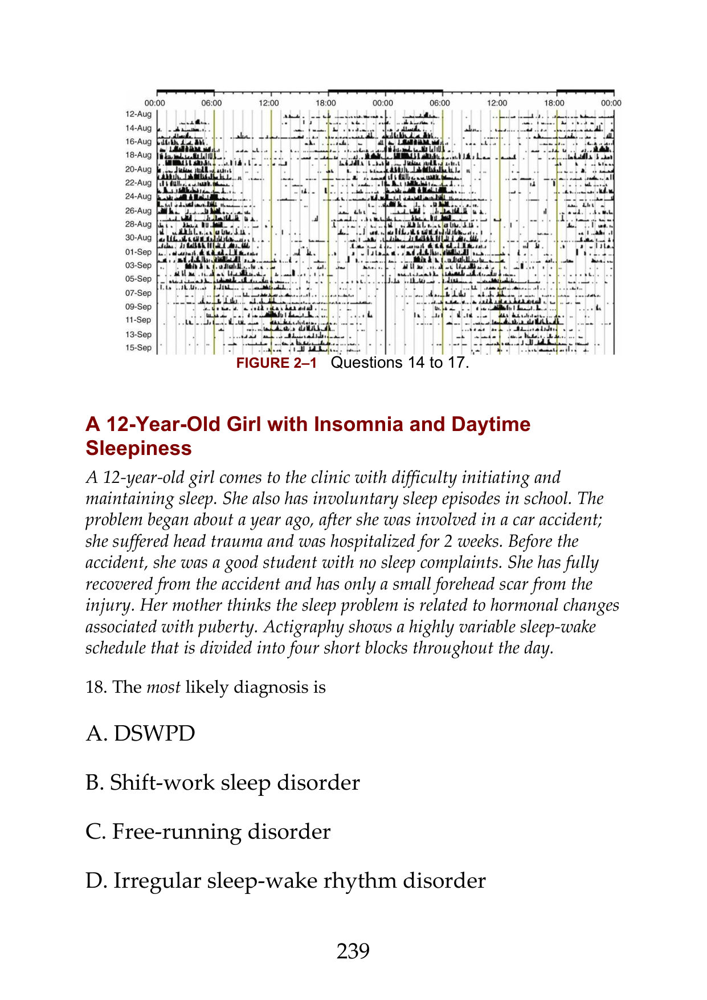

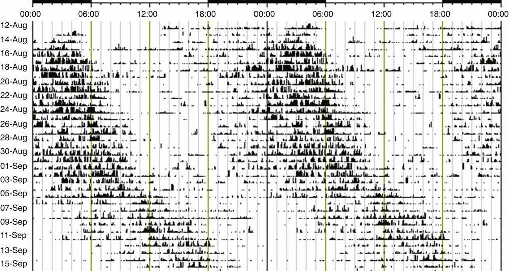

<!-- pdf-page: 240 -->

19. The pathogenesis of this condition includes all of the following except

### A. Reduced exposure to light-dark signals

### B. Suprachiasmatic nucleus (SCN) dysfunction

### D. Low levels of physical activity during the 24-hour

### C. Morning melatonin release

20. One of the most successful treatments for irregular sleep-wake rhythm disorder has been

### cycle

### A. Chronotherapy, bright light therapy, vitamin B12,

### B. Melatonin and bright light therapy

### and hypnotics

### D. Stimulus control, bright light therapy, and

### C. Melatonin alone

21. Circadian rhythm disorders are common in the following medical disorders except

### zolpidem

### A. Hepatic encephalopathy

### B. Parkinson disease

### C. Type 2 diabetes

### 240

<!-- pdf-page: 241 -->

### D. Dementia

#### A Case of Hating the Night Shift

A 27-year-old nurse began working a rotating shift 6 months ago in a community hospital. Her schedule has required working three 12-hour days per week with rotation to the next shift the following week. At first the new schedule worked out well for her family, and she had no trouble adapting to the weekly change in shifts. However, after a few months of rotating, she found it increasingly difficult to stay awake on the night shift. A coworker recently found her asleep in the nurse's station, and now the patient is worried about losing her job.

22. You would expect her condition to remit if she

### A. Discontinued rotating shifts and only worked

### B. Discontinued working the night shift and worked

### nights

### C. Took a hypnotic at home after her shift to increase

### only a regular day or evening shift

### D. Took a wakefulness-promoting drug at 7 pm when

### sleep time

23. She reports that after working the 7 pm to 7 am shift, daytime sleep duration and quality are reasonably good. You should consider treating her with

### she does the night shifts

### A. A short-acting hypnotic to consolidate sleep

### B. A hypnotic with about a 6-hour half-life to increase

### TST

### 241

<!-- pdf-page: 242 -->

### C. Methylphenidate 10 mg at 8 pm

### D. Armodafinil 150 mg at 10 pm

24. Which one of the following actions would be most advisable for a patient with a shift-work type disorder?

### A. Get to sleep soon after the night shift is over.

### B. Go to bed 5 hours after getting off the night shift.

### C. Allow a modest amount of sunlight in the sleeping

### D. Increase the room temperature during the sleep

### room.

#### Grandma and Grandpa Will Not Meet for Dinner

### period by 3° to 5° F.

Robert invites his 68-year-old grandfather, Bill, and 67-year-old grandmother, Susan, for dinner to his favorite restaurant. He suggests they meet at 7:30 pm Friday night, but they ask him to make it at 5 pm, because they typically get ready for bed by 7:30 to 8 pm. Bill usually wakes up at 4 am, and Susan is awake by 5 am. Bill is distressed about the early awakenings and recently asked his primary care physician for a sleeping pill to try and extend his sleep time. This pattern of early to bed and early to rise began for both grandparents in their early 60s. They were expecting to be able to sleep in later after they retired from work at age 65.

25. Given this information, what is the grandparents' most likely diagnosis?

### B. Irregular sleep-wake rhythm disorder

### A. DSWPD

### 242

<!-- pdf-page: 243 -->

### C. Non–24-hour sleep-wake rhythm disorder

### D. ASWPD

26. About what time would you expect Bill's DLMO to occur?

27. About what time would you expect Bill's core body temperature minimum (CBTmin) to occur?

### A. 4:00 am

### B. 2:00 am

### C. 6:00 pm

### D. 7:30 pm

28. You decide to prescribe 3 mg of melatonin for Bill. At what time do you suggest he take it?

### A. 1:00 am

### B. 4:00 am

### C. 12:00 am

### D. 11:00 pm

### A. At bedtime

### B. Midnight

### C. 3:00 pm

### 243

<!-- pdf-page: 244 -->

### D. 6:00 am

29. What is a possible cause of this disorder?

### A. Early morning walks

### D. Intact, overpowering CLOCK genes that promote

### B. Lack of exposure to morning light

### C. No light perception

Charlie, age 37, was in a serious motor vehicle accident 4 years ago that caused loss of the ability to see and perceive light. He was trained as an engineer and has a degree from Georgia Tech. After extensive rehabilitation, he qualified to return to work. However, he found it difficult to get to sleep. His primary care physician thought the problem was due to the psychological trauma of losing sight, so his physician prescribed an antidepressant. Even so, Charlie found it more and more difficult to stick to a regular sleep-wake schedule. Some nights he found it “nearly impossible” to sleep. The sleep problem became so intense, his work began to suffer, and his poor work performance was attributed to depression. His physician increased the antidepressant without improvement in mood or sleep. Charlie decided to take disability because he could not produce quality work owing to poor sleep.

### early awakenings

#### Charlie Cannot Hold Down a Job

### B. Irregular sleep-wake rhythm disorder

30. What is the most likely diagnosis?

### A. Shift-work disorder

### C. Non–24-hour sleep-wake rhythm disorder

### 244

<!-- pdf-page: 245 -->

### D. ASWPD

31. This disorder is characterized by

### A. Sleep-wake rhythms that are progressively longer

### B. Progressive delays in sleep-wake schedules by 1 to

### than 24 hours

### C. A steady drift of the sleep period by 4 to 7 hours

### 2 hours per day

### D. Mostly in-phase rhythms with acute out-of-phase

### each day

### C. Absence of light information to the brain

### periods

32. The pathophysiology is

### A. Almost always head trauma

### B. Tumor in the SCN

### A. Melatonin 10 mg administration upon awakening

### D. Melatonin depletion

33. The best initial treatment strategy is

### B. Melatonin 0.5 mg upon awakening

### C. Melatonin 3 mg 1 hour before desired bedtime

### 245

<!-- pdf-page: 246 -->

### D. Melatonin 0.5 mg every 4 hours while awake

#### Dad Threw a Bucket of Water on His Son

A 17-year-old high school junior is an A student but has been late to school 37 times this year. The student and his parents have had to meet with school officials on several occasions, and there is a risk of expulsion. His parents believe the problem is that their son is oppositional. They sent him to a psychologist, who reported that their son is extremely bright but is not being challenged academically. His parents decided that he would not be able to drive the family car unless he consistently awakened in time for school. This plan failed, leaving his parents at their wit's end. They cajoled and threatened and removed his driving privilege; still, the problem persisted. One morning, the father became so frustrated that he went into his son's room at 7 am and threw a bucket of water on him. The son jumped out of bed and began hitting his father with his fists. This combative behavior upon awakening was uncharacteristic and had never happened before. As a result of the continued tardiness and aggressive behavior, a psychiatric consultation was scheduled.

### B. Irregular sleep-wake rhythm disorder

34. What is the most likely diagnosis?

### A. DSWPD

### C. Non–24-hour sleep-wake rhythm disorder

### D. Rapid eye movement (REM) behavior disorder

35. Which symptom is most common in this disorder?

### A. Difficulty staying alert in the afternoon

### B. Difficulty staying alert in the evening

### C. Difficulty getting to sleep before midnight

### 246

<!-- pdf-page: 247 -->

### D. Sleeping beyond 10 hours most nights

36. Treatment should be

### A. Bright light for 30 minutes upon awakening

### B. Evening bright light for 30 minutes

### C. Bright light for 30 minutes shortly after CBTmin

37. Which of the following would likely make symptoms worse?

### D. Zolpidem 10 mg at 11 pm

39. Which assessment is not useful to make the diagnosis?

### A. 3 mg of melatonin at 6 am

### B. 3 mg of melatonin at 8 pm

### C. Bright light exposure at 7 am

### D. Temazepam 30 mg qhs

38. Tau is approximately

### A. 26.3 hours

### B. 24.2 hours

### C. 21.3 hours

### D. 23.9 hours

### 247

<!-- pdf-page: 248 -->

### A. Actigraphy

### B. Sleep diary

#### Assistant Secretary of State Falls Asleep at an

#### Important Dinner

### C. CBT monitoring

### D. PSG

Assistant Secretary of State John Hilary complains of excessive sleepiness. He recently fell asleep at a fundraising dinner for the president. He was terribly embarrassed by the incident and decided to seek medical help; this was not the first time he had an involuntary sleep episode. Mr. Hilary travels overseas a great deal for his job, and recent trips to China and South Korea were particularly demanding. He often feels sleepy in meetings and has trouble sleeping at night. He can rarely sleep on a plane and also has a history of snoring. He is 5 feet 9 inches tall and weighs 210 lb.

40. Given this information what is the most likely diagnosis?

### C. Non–24-hour sleep-wake rhythm disorder

### A. DSWPD

### B. Jet lag disorder

### B. Impairment of daytime functioning

### D. Shift-work disorder

41. Symptoms of this disorder usually include

### A. Difficulty sleeping on a plane

### 248

<!-- pdf-page: 249 -->

### C. Excessive sleeping on planes

### D. A sleep-wake rhythm of greater than 25.5 hours

42. This disorder only occurs when

### A. Westward travel of four time zones

### A. Crossing four or more time zones

### B. Crossing at least two time zones

### C. Traveling from west to east

### D. Traveling from east to west

43. It is usually easier to tolerate travel that is

### B. Westward travel of eight time zones

44. To adapt to a flight from New York to London, the best strategy is to

### C. Eastward travel of four time zones

### D. Eastward travel of six time zones

### A. Stay up later by 1 hour for four nights prior to the

### B. Take 10 mg of melatonin at 8 pm for four mornings

### trip

### C. Go to bed earlier by 1 hour four nights prior to the

### prior to the trip

### 249

<!-- pdf-page: 250 -->

### trip

### D. Get bright light exposure in the late afternoon and

### evening walking around London

#### CNN Reporter Falls Asleep at the Wheel

A CNN reporter in Atlanta regularly appears on the 5 pm (eastern time) international news. She needs to be at the studio by 3:45 am for makeup and to review stories. She lives about 45 minutes away and has to leave the house by 3:00 am, so she wakes up most mornings at 2 am. She does the show five days a week, on Monday, Tuesday, Thursday, Friday, and Saturday. On her days off, she sleeps in to about 7:30 am. During a recent trip to the studio one morning, she fell asleep at the wheel, went off the road, and hit a telephone pole. The airbag deployed, and she did not sustain any serious injuries.

### B. Irregular sleep-wake rhythm disorder

45. What is the most likely diagnosis?

### A. Jet lag disorder

### D. Advance sleep-wake phase disorder

### C. Shift-work disorder

46. Assuming she has circadian alignment with her work schedule, at what time is her DLMO?

### A. 4:00 am

### B. 2:00 am

### C. 5:00 pm

### 250

<!-- pdf-page: 251 -->

### D. 12:00 am

47. For an individual working the night shift, which treatment strategy is appropriate?

### B. Bright light exposure at the beginning of the shift

### A. Bright light at the end of the shift

### C. Modafinil or armodafinil at 10:00 am

### D. Bright light exposure on the way home from work

48. Individuals working night or rotating shifts have been shown to be at increased risk of all of the following except

1. D. This case of a young man presenting with excessive daytime sleepiness poses an interesting diagnostic challenge. The onset of symptoms suggests narcolepsy or a circadian rhythm disorder. He has poor sleep hygiene, and his sleepiness could be due to chronic insufficient sleep. No sleep-wake schedule data are included, so before ordering a PSG, a 2-week sleep diary is the logical next step. The diary or even 2 weeks of actigraphy could provide very useful information regarding his habitual sleep schedule.

### A. Obesity

### B. Family disturbances

### C. Breast cancer

### D. Dementia

## Answers

### 251

<!-- pdf-page: 252 -->

2. A. The least likely diagnosis is narcolepsy, because he has evidence of a circadian rhythm disorder, including an irregular sleep schedule and history such that with 12 hours of sleep on weekends, he feels fully alert the rest of the day. The patient also denies cataplexy and sleep paralysis, which are symptoms of narcolepsy, and there is no history of sleep attacks. Paradoxic insomnia, also known as sleep state misperception insomnia, and psychophysiologic insomnia are unlikely, but given the history, they are more plausible than narcolepsy. Finally, idiopathic hypersomnolence is a possibility, but that is not an option here. (ICSD3, pp 143-188)

3. B. The phase response curve (PRC) for melatonin is shifted about 180 degrees from that of light. DLMO usually occurs in the late afternoon or early evening for conventional sleepers without a phase delay or an advance. In patients with DSWPD, melatonin onset is usually 10 pm or later.

4. B. Although behavioral factors can play a substantial role in initiating and maintaining a delayed sleep pattern, they are not considered to be the primary cause of the disorder. In most cases, the patient cannot initiate sleep at more conventional hours, even when sleep hygiene is vastly improved. Social interaction and use of caffeine in the evening can perpetuate the delayed sleep phase pattern, making it particularly hard to resolve.

5. B. The PRC indicates that light given after the temperature nadir produces a phase advance, whereas light given before the temperature nadir produces a phase delay. The closer to the switch point on the PRC for bright light exposure, the stronger the effect. Delayed sleep phase patients have a delayed temperature rhythm, so advancing it requires morning light. There are no wellestablished protocols for light duration and timing. However, light presented at an intensity of 2500 to 10,000 lux for 30 to 60 minutes per day at the appropriate time usually produces the desired effect. (Morgenthaler et al, 2007)

6. B. Evidence shows that alterations in the homeostatic regulation of sleep might play a role in DSWPD, and compared with controls,

### 252

<!-- pdf-page: 253 -->

these patients show a decreased ability to compensate for sleep loss during the subjective day and the first hours of subjective night. Alterations in circadian timing and impaired sleep recovery contribute to symptoms of insomnia and excessive sleepiness in DSWPD. Sleep architecture seems to be nearly normal when DSWPD patients sleep during their habitual sleep times. (Uchiyama

#### et al, 1999)

7. D. Some evidence supports a genetic basis to DSWPD. In a few cases, the syndrome is familial and has an autosomal-dominant mode of inheritance. Additional support for a genetic basis for DSWPD comes from reports of polymorphisms in circadian genes such as PER3, the arylalkylamine N-acetyltransferase gene AANAT, human leukocyte antigen (HLA) genes, and CLOCK. However, the strongest support for a familial disorder is for ASWPD, and several cases of familial ASWPD can be found in the literature; these families show a clear autosomal-dominant mode of inheritance of ASWPD, and genetic analysis of these familial cases shows heterogeneity of this disorder between and even within large families. Gene polymorphisms have been identified in the circadian clock gene PER2 in a large family with ASWPD. (Ancoli-Israel

#### et al, 2001; Satoh et al, 2003; Toh et al, 2001)

8. C. We are told of the onset of insomnia related to her husband's death 5 years earlier. We know she does not have acute insomnia, because the duration is longer than 90 days. We need to know her habitual sleep-wake times to discern the pattern before proceeding with additional studies or treatment. (ICSD3, pp 19-48)

9. D. PSG is not required for diagnosing or characterizing insomnia, and no criteria have been established for using the PSG in ASWPD. However, if obstructive sleep apnea (OSA) is also suspected in either condition, a PSG is indicated.

10. D. Not enough clinical information is provided in this scenario. Habitual time in bed is important. Snoring and apnea are potentially important clinical issues, yet without knowing whether chronic sleep deprivation is due to an early morning insomnia, it is not possible to know whether the other PSG results (AHI = 8) are

### 253

<!-- pdf-page: 254 -->

relevant.

11. D. A good way to understand the effects of light and melatonin on sleep phase is to remember that melatonin “pulls” the rhythm and light “pushes” it. In a case of ASWPD, morning melatonin is appropriate if it is taken several hours after the CBT nadir in the morning. (Lewy et al, 1998)

12. C. Dim-light melatonin onset (DLMO) is significantly earlier in ASWPD patients compared with normal subjects.

13. A. Actigraphy is the correct answer, because PSG is neither indicated nor required to make the diagnosis. CBT recording could establish an advanced circadian rhythm, but it is impractical for the majority of sleep clinics or laboratories. Sleep diaries are self-report measures, and although they correlate with objective measures, they are not as reliable. (ICSD3, pp 198-203)

14. C. This image (see Fig. 2-1) is of a double raster plot of a patient's activity level obtained from an actigraph. The double raster plot replicates the last 24 hours on the next line down on the left side of the image. The areas with dark bars represent activity or wakefulness, and the areas without bars represent periods of quiescence or sleep. The pattern of activity is shifting to the right, or phase delaying, on a daily basis. A free-running disorder is characterized by successive delays of the sleep-wake schedule, which is chronic.

15. D. The free-running sleep pattern, characterized by the actigraph plots in Figure 2-1, are similar to those seen in subjects placed in a constant-routine experimental environment where lightdark, social, and other cues—known as zeitgebers, or “time givers”—are controlled or made unavailable. Sighted persons in normal environmental conditions are highly unlikely to have this sleep-wake pattern. (ICSD3, pp 209-214)

16. C. Antidepressants—including selective serotonin reuptake inhibitors (SSRIs), monoamine oxidase inhibitors (MAOIs), and tricyclic antidepressants (TCAs)—are not known to influence

### 254

<!-- pdf-page: 255 -->

circadian rhythms. Other factors that include exposure to light-dark cues, behavioral routines, and exercise have been shown to affect circadian rhythms.

17. D. Light therapy for free-running disorder has been shown to be effective in some persons with no light perception. It remains possible for the melanopsin-containing ganglion cells in the retina to accept and transmit the light signals to the SCN. Light is known to have a more powerful effect on circadian rhythms than exogenous melatonin. (Czeisler et al, 1995)

18. D. The symptoms described in this case are consistent with irregular sleep-wake rhythm disorder. Sleep is usually broken into several shifts without a regular pattern. It is possible that the head trauma caused a dysfunction in the processes that help establish a regular sleep-wake pattern. In DSWPD, the pattern is consistent and fixed, whereas with the free-running type of circadian sleep disorder, the sleep-wake pattern is continually drifting later each day. (ICSD-3, pp 204-208)

19. C. Irregular sleep-wake rhythm disorder is thought to be due to a dysfunction of the central nervous system (CNS) area that regulates circadian rhythms, most likely the suprachiasmatic nucleus (SCN). Because the disorder is rare, melatonin release patterns in this population are not well established, so we have to assume the release pattern is abnormal. Reduced exposure to zeitgebers could also be involved in the etiology.

20. A. Irregular sleep-wake rhythm disorder is very difficult to treat. The most effective strategy described in the literature is a combination approach with chronotherapy, bright light treatments, vitamin B12 supplementation, and hypnotics. (Okawa et al, 1990;

#### Yamadera et al, 1996)

21. C. Circadian rhythm disorders are often comorbid with medical and psychiatric disorders. However, there is no evidence that diabetes affects circadian rhythms.

22. B. Shift-work sleep disorder resolves when the worker

### 255

<!-- pdf-page: 256 -->

discontinues the night shift and establishes a regular day or evening shift. This commonsense approach is rarely accepted by patients, because they have often selected the night shift for social or economic reasons. Patients who are required to work the night shift might seek a medical exemption to work only day or evening shifts.

23. D. She does not complain of poor sleep, so a hypnotic is not a good choice. Also, when patients have severe sleepiness on their shift, improved sleep duration does not usually resolve the sleepiness. The first-line approach is modafinil or armodafinil. Armodafinil has been approved by the Food and Drug Administration (FDA) for treating shift-work sleep disorder. Studies in the sleep laboratory, as well as in simulated work environments, have shown armodafinil to be effective for treating excessive sleepiness associated with working on the night shift or rotating shifts.

24. A. It is advisable to tell patients with shift-work sleep disorder to avoid morning light and to get into a dark, quiet, cool room as soon as possible after their shift ends. Sunlight after the night shift can cause a phase advance, and the light itself can have an alerting effect, making it difficult to fall asleep. Additionally, areas on the PRC known as wake maintenance zones show when the probability of sleeping is considerably reduced owing to circadian wake drive.

25. D. ASWPD is characterized by an inability to stay awake past 8:00 pm, and early morning awakening is often a complaint. ASWPD is more often seen in individuals in the sixth decade and older, rarely before that. The prevalence is not known but is thought to be about 1% of this age group. PSG is required for diagnosis and should be normal, as is the TST. (ICSD3, pp 198-203)

26. C. DMLO is a useful circadian marker that occurs about 2 to 3 hours prior to habitual bedtime.

27. A. Core body temperature minimum (CBTmin) usually occurs 2 to 3 hours before sleep offset. For individuals without a circadian rhythm disorder, this is usually 4 to 5 am. The reduced CBT correlates with melatonin production/suppression. One way to

### 256

<!-- pdf-page: 257 -->

compute CBTmin is to identify DLMO and add 7 hours.

28. D. Melatonin “pulls” the rhythm to the time of administration. This patient's sleep cycle is advanced, so to delay the morning melatonin is appropriate. Some caution for sedation should be taken in giving anyone melatonin during waking hours.

29. A. Light exposure during very early morning hours is likely to cause a phase advance. Phase shifting can occur when light exposure is before or after the CBTmin. To move the sleep-wake schedule later, bright light exposure should be in the evening.

30. C. Non–24-hour sleep-wake disorder occurs in 50% of blind individuals. It is characterized by successive delays of the sleepwake schedule. Entrainment does not occur, and patents often complain of sleep-onset problems as well as daytime sleepiness. Because the circadian rhythm is free running, most complaints occur when the rhythm is out of phase with desired sleep-wake times. (ICSD3, pp 209-214)

31. B. Light exposure causes melatonin suppression. In blind individuals without light perception, this suppression does not occur, which allows an intrinsic phase delay to take place. The internal circadian rhythm is slightly longer than 24 hours, and light is the most powerful zeitgeber. (ICSD3, pp 209-214)

32. C. Without light exposure to the retina, a phase delay can occur.

33. C. To establish entrainment, a dose of melatonin an hour or so before bedtime is appropriate. Melatonin administered at other times may “pull” the circadian rhythm in an undesired direction.

34. A. Patients with DSWPD complain of an inability to get to sleep at a socially desirable time. Their sleep-wake rhythm is out of sync, and they have trouble waking up in time for school or work. Despite their best efforts, sleep before midnight is rare except with significant sleep deprivation. People with DSWPD are often viewed as lazy or oppositional. Drugs and/or alcohol can be a part of the clinical picture, and family discord is common. (ICSD3, pp 191-198)

### 257

<!-- pdf-page: 258 -->

35. C. The late sleep-wake schedule may begin as voluntary, but the delayed sleep phase patient cannot reset earlier without treatment. Sleep is perfectly normal at undesired hours. Sleep-onset difficulties are present, but the most troublesome aspect is difficulty with waking early. A family history is present in about 40% of cases. (ICSD3, pp 191-198)

36. C. Bright light “pushes” the rhythm earlier in cases of DSWPD. The ideal timing is shortly after CBTmin, but this strategy is often impractical unless a family member can assist the patient by waking him at the appropriate time. The light exposure duration is not well established, but 30 minutes has consistently been shown to impact rhythms.

37. A. Melatonin “pulls” the rhythm, so morning administration would be inappropriate. Evening administration of melatonin at a few hours before expected bedtime is the best strategy.

38. B. Tau refers to the normal circadian period, which is 24.2 hours.

39. D. According to the ICSD3, the diagnosis of advanced or delayed sleep phase is appropriately diagnosed using a sleep diary or actigraphy. CBT can also be used but is for the most part impractical in a clinical setting. One night of PSG does not offer enough data to support a circadian rhythm disorder. (ICSD3, pp

#### 101-203)

40. B. Jet lag occurs when eastward or westward travel spans several time zones. The core issue is desynchrony between body time and environmental clock time. The disorder causes problems with excessive sleepiness, alertness, and daytime functioning. (ICSD3, pp 220-224)

41. B. Jet lag does not occur in all individuals who travel across times zones. It is a temporary condition that resolves because of adaptation to the new time zone or a rapid return to the original zone. The severity of symptoms is often influenced by behaviors of the traveler. Daytime function can be significantly impaired.

### 258

<!-- pdf-page: 259 -->

42. B. Jet lag does not occur if there is no transmeridian travel, and ICSD3 criteria require transmeridian travel across two or more time zones. The symptoms and pathophysiology have nothing to do with being on a plane. (ICSD3, pp 220-224)

43. A. Circadian rhythm for normal healthy adults is slightly greater than 24 hours (about 24.2 hours). This rhythm predisposes toward a phase delay of the sleep-wake cycle. When traveling in a westward direction across time zones, adaptation requires a phase delay, whereas traveling in an eastward direction requires a phase advance; it is therefore easier to tolerate westward travel. If travel requires crossing more than eight time zones, the direction of travel has less impact on the ease of adaptation.

44. C. Traveling New York to London involves an eastward flight. Adaptation to the new environmental time for eastward flights requires a phase advance of the sleep-wake rhythm of 5 hours. Although it may be impractical to go to bed early and wake earlier for several nights prior to the trip, it is a phase-advance strategy that could be useful.

45. C. Shift-work disorder can involve rotating shifts, night shifts, or early shifts that result in partial night and day schedules combined.

46. D. DLMO is a useful circadian marker. It occurs about 2 to 3 hours prior to habitual bedtime. In this reporter's case, habitual bedtime is 7:00 pm.

47. B. Bright light at the workplace is a valuable strategy if timed properly. It should be provided at the beginning of the shift. Wakefulness-promoting drugs can be prescribed for increasing alertness at desired times, but taken too late in the day, they may result in sleep difficulties. Bright light exposure at the end of a night shift could also inhibit sleep onset if the sleep attempt is made shortly after arriving home.

48. D. Substantial data indicate that several organ systems may be negatively affected by rotating or night shift work. No data suggest that working night or rotating shifts increases the risk of dementia.

### 259

<!-- pdf-page: 260 -->

## Summary

### Highly Recommended

▪ International Classification of Sleep Disorders, ed 3
▪ Morgenthaler TI, Lee-Chiong T, Alessi C, et al: Practice parameters

for the clinical evaluation and treatment of circadian rhythm sleep disorders: an American Academy of Sleep Medicine report, Sleep 30:1445–1459, 2007. ▪ Sack RL, Auckley D, Auger RR, et al: Circadian rhythm sleep

disorders: part II, advanced sleep phase disorder, delayed sleep phase disorder, free-running disorder, and irregular sleep-wake rhythm. An American Academy of Sleep Medicine review, Sleep 30:1484–1501, 2007.

Circadian rhythm sleep disorders are commonly seen in clinical practice, and you can expect at least 12 questions on this topic. However, content related to this topic may be found in other sections of the examination, for example, in the basic science sections that cover sleep mechanisms and circadian physiology (e.g., the physiology of the SCN) and pharmacology (e.g., ramelteon, melatonin, and modafinil). Thus knowledge of this topic is essential.

### ❍ Reported more often as appearing in adolescence

### Epidemiology

▪ DSWPD

### ❍ Few studies exist with regard to prevalence; may be

### ❍ Considered to be less prevalent than DSWPD

### 7% in adults and adolescents

▪ ASWPD

### ❍ Seen more in older adults

### 260

<!-- pdf-page: 261 -->

### ❍ Estimated prevalence of 1% in middle-aged adults

▪ Free-running disorder

### ❍ This type is considered to be rare in sighted

### ❍ 50% to 70% of blind persons are not well entrained

### persons.

### ❍ Free-running disorder can be diagnosed in 13% to

### to a 24-hour sleep-wake rhythm.

### ❍ More often seen in patients with comorbid

### 18% of blind persons.

▪ Irregular sleep-wake rhythm disorder

### ❍ Unknown prevalence

Behavioral preference may play a role but is not a primary factor. ▪ DSWPD

### neurologic disorders

▪ Shift-work disorder

### ❍ Seen in 2% to 5% of shift workers

### Pathophysiology

### ❍ Inability to phase-advance sleep schedule despite

### ❍ Hypersensitivity to nighttime suppression of

### consequences

### melatonin by bright light

### 261

<!-- pdf-page: 262 -->

### ❍ Genetic basis: polymorphisms in circadian genes

### ❍ Factors of the sleep homeostatic process might play

### a role.

### ❍ Inability to phase-delay sleep schedule despite

▪ ASWPD

### ❍ Gene polymorphisms have been identified in some

### consequences

### ❍ Abnormal phase response curve

### ❍ Rhythm shorter than 24 hours

### families with the disorder.

▪ Free-running disorder

### ❍ Seen in some forms of blindness

### ❍ Absence of light exposure

### ❍ Dampened melatonin rhythm

### ❍ Reduced exposure to social cues

▪ Irregular sleep-wake rhythm disorder

### ❍ Reduced exposure to light

### ❍ Reduced exposure to social cues

▪ Shift-work disorder

### 262

<!-- pdf-page: 263 -->

### ❍ Maladaptation to rotating or night shift

### ❍ No entrainment to night-wake and day-sleep

### schedule

### Diagnostic Methods and Requirements

### • Difficulty getting to sleep before 2 or 3 am

▪ DSWPD

### ❍ Clinical history

### • Difficulty waking up in the morning

### • Distressed by early morning awakening

### ❍ Actigraphy or sleep diary

▪ ASWPD

### ❍ Clinical history

### • Difficulty staying up past 7 or 8 pm

### • Sleep period delays by 2 to 3 hours each cycle

### ❍ Actigraphy or sleep diary

▪ Free-running disorder

### ❍ Clinical history

### • No sleep-wake cycle entrainment

### 263

<!-- pdf-page: 264 -->

### • Misalignment 3 out of 4 weeks per month

### ❍ Actigraphy or sleep diary

▪ Irregular sleep-wake rhythm disorder

### • Unpredictable sleep-wake schedule

### ❍ Clinical history

### • Sleep is usually broken into three to four blocks

### • Occurs in rotating or night shift workers

### around the 24-hour cycle.

### ❍ Actigraphy or sleep diary

▪ Shift-work disorder

### ❍ Clinical history

### • Insomnia during daytime and/or excessive

### ❍ Melatonin 5 to 7 hours before desired sleep-onset

### sleepiness on night shift

### Treatment

▪ DSWPD

### ❍ Sleep hygiene

### ❍ Bright light in the morning

### time

### 264

<!-- pdf-page: 265 -->

### ❍ Chronotherapy is difficult but can be effective.

▪ ASWPD

### ❍ Melatonin in the morning at or near the desired

### ❍ Sleep hygiene

### ❍ Bright light in the evening

### ❍ Chronotherapy is difficult but can be effective.

### waking time

### ❍ Should include multimodal treatment

▪ Free-running disorder

### ❍ Should include multimodal treatment

### • Bright light

### • Vitamin B12

### • Melatonin

### • Sleep hygiene

▪ Irregular sleep-wake rhythm disorder

### • Bright light

### • Vitamin B12

### 265

<!-- pdf-page: 266 -->

### • Melatonin

### • Sleep hygiene

▪ Shift-work disorder

### ❍ Nonbenzodiazepines to promote daytime sleep

### ❍ Sleep hygiene

### ❍ Wakefulness-promoting drugs (modafinil and

### armodafinil) for staying alert on night shifts

### • Be alert for potential adverse effects such as

### increased insomnia during daytime sleep attempts.

### • Be alert for rash or other allergic reactions.

American Academy of Sleep Medicine. International

## References

classification of sleep disorders. ed 3. American Academy of Sleep Medicine: Darien Ill.; 2014. Ancoli-Israel S, Schnierow B, Kelsoe J, Fink R. A pedigree of

one family with delayed sleep phase syndrome. Chronobiol Int. 2001;18:831–840. Czeisler CA, Shanahan TL, Klerman EB, et al. Suppression of

melatonin secretion in some blind patients by exposure to bright light. N Engl J Med. 1995;332:6–11. Lewy AJ, Bauer VK, Ahmed S, et al. The human phase

response curve (PRC) to melatonin is about 12 hours out of phase with the PRC to light. Chronobiol Int. 1998;15:71–83. Morgenthaler TI, Lee-Chiong T, Alessi C, et al. Practice

parameters for the clinical evaluation and treatment of circadian rhythm sleep disorders: an American Academy of

### 266

<!-- pdf-page: 267 -->

Sleep Medicine report. Sleep. 2007;30:1445–1459. Okawa M, Mishima K, Nanami T, et al. Vitamin B12 treatment

for sleep–wake rhythm disorders. Sleep. 1990;13:15–23. Sack RL, Auckley D, Auger RR, et al. Circadian rhythm sleep

disorders: part II, advanced sleep phase disorder, delayed sleep phase disorder, free-running disorder, and irregular sleep–wake rhythm. An American Academy of Sleep Medicine review. Sleep. 2007;30:1484–1501. Satoh K, Mishima K, Inoue Y, et al. Two pedigrees of familial

advanced sleep phase syndrome in Japan. Sleep. 2003;26:416–417. Toh KL, Jones CR, He Y, et al. An hPer2 phosphorylation site

mutation in familial advanced sleep phase syndrome. Science. 2001;291:1040–1043. Uchiyama M, Okawa M, Shibui K, et al. Poor recovery sleep

after sleep deprivation in delayed sleep phase syndrome. Psychiatry Clin Neurosci. 1999;53:195–197. Yamadera H, Takahashi K, Okawa M. A multicenter study of

sleep–wake rhythm disorders: clinical features of sleep– wake rhythm disorders. Psychiatry Clin Neurosci. 1996;50:195–201.

## Section E2 Sleep-Wake Timing

1. A 24-year-old college student has been diagnosed with delayed sleep-wake phase disorder (DSWPD). Which statement about people with this disorder is true?

### A. They fall asleep when they want to.

### C. They seldom have daytime sleepiness.

### B. They sleep in late on weekends.

### D. They perform best in the morning.

### 267

<!-- pdf-page: 268 -->

### ANSWER: B. Patients with DSWPD have difficulty

### falling asleep at normal bedtimes and will not feel

### sleepy until very late into the night. When

### awakened at conventional bedtimes, they are very

### sleepy, and when given the opportunity, they will

### have trouble waking at conventionally early hours,

### say 7 am, and they awaken very late on weekends,

### often past noon. (ATLAS2, p 134; ICSD3, p 191)

2. A 58-year-old retired nurse has been diagnosed by you as having advanced sleep-wake phase disorder (ASWPD). Which statement about this disorder is true?

### A. Patients do not complain of insomnia.

### B. Affected individuals cannot sleep until 7 or 8 am.

### C. People with this disorder have difficulty waking

### D. Affected individuals perform best in the late

### up.

### ANSWER: B. Patients with ASWPD commonly

### evenings.

### complain of early morning awakenings. Thus they

### have no difficulty waking up, but they have a great

### deal of difficulty functioning in the late evening.

### Many individuals with ASWPD self-select careers

### based on their circadian rhythm. Anesthesiologists,

### surgeons, and nurses frequently have an advanced

### sleep phase. (ATLAS2, p 135; ICSD3, p 198)

### 268

<!-- pdf-page: 269 -->

3. A 28-year-old patient has been diagnosed with DSWPD. Which treatment is effective in patients with this disorder?

### A. Bright light exposure in the morning

### C. A tricyclic antidepressant (TCA) in the morning

### B. Ramelteon in the morning

### D. Wearing wraparound sunglasses in the morning

### ANSWER: A. Bright light exposure for about 2 hours

### in the morning has been helpful in phase-advancing

### patients with DSWPD. Melatonin given 5 to 7 hours

### before habitual bedtime may also be

### helpful. (ATLAS2, p 134; ICSD3, p 191)

4. An 84-year-old woman complains of insomnia. After examining her sleep diary, the sleep medicine consultant diagnoses ASWPD. What is typical of people with ASWPD?

### A. They often have periodic movements during sleep.

### B. They have abnormal amounts of REM sleep.

### C. They wake up early in the morning.

### D. They respond to morning bright light therapy.

### ANSWER: C. With ASWPD, patients have difficulty

### staying awake in the evening, and they fall asleep

### early and awaken early. This is found commonly in

### older people, but in some cases, it may be familial.

### 269

<!-- pdf-page: 270 -->

### Bright light therapy in the morning would tend to

### advance their phase even more. (ATLAS2, p 135)

5. A woman who has been blind since birth complains of insomnia. The circadian rhythm of sleep in blind humans is always characterized by

### ANSWER: D. There are many causes of blindness,

### A. Phase delay

### B. Phase advance

### C. Free running sleep-wake cycle

### D. None of the above

### and not all blind people have circadian rhythm

### abnormalities such as a free-running sleep-wake

### cycle or what is known as a non–24-hour sleep-wake

### rhythm disorder. Many blind people maintain

### normally entrained sleep-wake rhythms despite the

### absence of conscious light perception. These

### individuals possess an intact retinal-hypothalamic

### pathway for monitoring environmental

### illumination levels. This allows photic input to the

### circadian timing system to continue to entrain the

### sleep-wake cycle. (ATLAS2, p 136; ICSD3, p 209)

6. A 40-year-old patient complains of insomnia that occurs predictably at about 2-week intervals. This patient may have a circadian pacemaker that is

### A. Phase delayed

### 270

<!-- pdf-page: 271 -->

### B. Phase advanced

### C. Free running

### ANSWER: C. Free-running blind humans will

### D. Internally desynchronized

### alternate between sleeping well at night and

### sleeping poorly at night as their sleep-wake rhythm

### slowly drifts into and out of synchrony with

### socially acceptable times of day. Presumably, this is

### due to a failure of the luminance monitoring system

### to provide information about the light-dark cycle to

### the circadian pacemaker in the SCN. (ATLAS2, p

### 136; ICSD3, p 209)

7. An 18-year-old man is diagnosed with DSWPD. Which of the following is likely to have the greatest impact on his circadian phase?

### A. Full-spectrum light at 750 lux for 24 hours

### B. Full-spectrum light exposure for 2 hours before

### C. Full-spectrum light of 2500 lux 6 hours after

### bedtime

### D. Blue-green light of 2500 lux exposure for 2 hours

### awakening

### ANSWER: D. This question is really asking about the

### after CBTmin

### phase response curve (PRC) to light. The PRC plots

### 271

<!-- pdf-page: 272 -->

### circadian time on the x-axis; plotted on the y-axis is

### whether a stimulus changes (advances or delays)

### the circadian phase. Minus values on such a plot by

### convention indicate a delay in circadian time;

### positive values indicate an advance in circadian

### time. Supposing a stimulus is shown to have no

### effect on circadian time, the PRC would be a

### straight line with a value of zero over the circadian

### day: For example, a sound pulse given at various

### times during the day has no effect on circadian

### time; light, on the other hand, has a profound effect.

### However, the effect of the light varies depending on

### when it is applied. Light exposure before the nadir

### in core body temperature (CBTmin) will delay the

### circadian phase. Light after the CBTmin will

### advance the circadian phase. The greatest advance

### occurs immediately after CBTmin. The melanopsin-

### containing ganglion cells in the retina may be more

### sensitive to blue-green light (480 nm wavelength)

### than full-spectrum light, and 400 lux of blue light

### may have the same phase-shifting effects as 10,000

### lux of full-spectrum light. Thus answer D, although

### correct, represents too large a dosage of light than

### what is needed. (Lack L, Wright HR: Treating

### chronobiological components of chronic

### insomnia, Sleep Med 8:637–644, 2007)

8. Chronotherapy has been shown to be effective for

### A. Primary insomnia

### 272

<!-- pdf-page: 273 -->

### B. ASWPD

### C. Middle of the night insomnia

### ANSWER: B. Although chronotherapy is often

### D. DSWPD

### inconvenient, it has been shown to be effective in

### DSWPD. It has not been shown to be effective in

### primary insomnia. (ATLAS2, p 134; Barton A, Zee

### P: A clinical approach to circadian rhythm sleep

### disorders, Sleep Med 8:566–577, 2007)

9. Evening melatonin administration is indicated for

### ANSWER: C. Melatonin taken 5 to 7 hours before

### A. Primary insomnia

### B. Shift-work disorder

### C. DSWPD

### D. Jet lag disorder

### bedtime has been used to treat DSWPD. (ATLAS2,

### p 138, Fig. 9.1-1)

10. The sleep schedule of a patient with non–24-hour sleep-wake disorder

### A. Shows an absence of a circadian rhythm for sleep

### and wake activity

### 273

<!-- pdf-page: 274 -->

### B. Is usually characterized by a rhythm that is shorter

### than 24 hours

### C. Indicates no entrainment to a 24-hour period

### D. Shows a delay of sleep-wake rhythm that occurs

### ANSWER: D. Free-running rhythms are found mostly

### every day

### in blind people. In the absence of synchronization,

### the period length of the circadian rhythm is just

### over 24 hours. Thus the sleep-wake time delays

### every day by the amount of time that the patient's

### circadian period exceeds 24 hours. (ICSD3, p 209)

11. If bright light exposure is being used to treat DSWPD, the light should be administered

### A. In the morning, soon after the nadir in core body

### B. In the morning, just before the nadir in core body

### temperature

### C. In the evening, right before the desired bedtime

### temperature

### D. In the evening, several hours before the desired

### ANSWER: A. Before the nadir in body temperature,

### bedtime

### light exposure causes a delay in sleep phase, which

### would worsen a delayed sleep phase. (ATLAS2, p

### 274

<!-- pdf-page: 275 -->

### 134; Wyatt JK: Delayed sleep phase syndrome:

### pathophysiology and treatment options, Sleep

### 27:1195–1203, 2004)

12. You are presenting light therapy using a lamp system to a patient with delayed sleep. Which statement about the use of lamps is incorrect?

### A. There is a risk of retinal photoreceptor damage.

### B. There is a risk of accelerating age-related macular

### C. Wavelengths that range from 4500 to 10,000 nm are

### degeneration.

### D. Incandescent lamps are contraindicated.

### the most effective at shifting phase.

### ANSWER: C. Wavelengths between 450 and 500 nm

### have been shown in research studies to be the most

### effective in phase shifting. About 90% of the light

### energy of incandescent lamps is infrared, and thus

### it poses a risk to eyes (e.g., corneal damage).

13. An engineer based in New York City is being sent to Peru to service a computer system. This is his first overseas trip. The flight from New York leaves at noon and arrives in Lima at midnight, and the flight is exactly 12 hours long. The engineer asks what he can do to minimize jet lag. Which do you advise?

### B. Take a 2-hour nap 6 hours into the flight.

### A. Take melatonin on takeoff.

### 275

<!-- pdf-page: 276 -->

### C. There is nothing to be done.

### D. Try bright light exposure on landing.

### ANSWER: C. There is nothing to be done. A clinician

### may not always know what time zone a city is in.

### The patient gave all the information needed to

### determine that New York and Lima are in the same

### time zone. Jet lag can only occur when the

### destination is in a different time zone than the home

### time zone. Generally, a difference of two time zones

### is needed for jet lag to occur. (ATLAS2, p 137)

14. A recently married couple is going to Paris from New York City on their honeymoon. The flight leaves New York at 5 pm and arrives in Paris at 6 am. It is a 7-hour flight. What is the time difference between the departure and destination cities?

### ANSWER: A. Paris is 6 hours ahead. Generally,

### A. Paris is 6 hours ahead.

### B. Paris is 6 hours behind.

### C. Paris is 7 hours ahead.

### D. Paris is 8 hours ahead.

### knowing the flight duration and the times of

### departure and arrival allows a calculation. In this

### example, if the flight leaves New York at 5 pm and

### flight duration is 7 hours, the flight arrives at

### midnight New York time. The time of arrival in

### Paris is 6 am, so the difference between 12 am and 6

### 276

<!-- pdf-page: 277 -->

### am is 6 hours.

15. A software engineer based in New York City is flying to Paris to install a new upgrade to a computer system manufacturing company. He expects to be in France for one month and wants to minimize the effects of jet lag. You assume that the patient's lowest temperature (Tmin) occurs at 4 am. The flight leaves New York at 5

pm and arrives in Paris at 6 am. It is a 7-hour flight. Which of following suggestions will be least helpful?

### A. Minimize light exposure in the 3 hours before

### Tmin by sleeping or wearing eyeshades.

### B. Try bright light exposure in the 3 hours after Tmin.

### C. Take melatonin 10 to 12 hours before Tmin.

### D. Take a 15-minute nap immediately upon arriving.

### ANSWER: D. This patient's Tmin at 4 am New York

### time will occur at 10 am Paris time, or 4 hours after

### arrival in Paris. Light exposure before Tmin leads to

### phase delay, whereas light exposure after Tmin

### would lead to a phase advance. The goal here is to

### hasten phase advance so that the patient's circadian

### system alternately catches up to Paris time. Bright

### light exposure on arrival would tend to phase

### delay, thus the patient should wear sunglasses for

### at least 4 hours after arrival and then have bright

### light exposure. Melatonin taken about 10 to 12

### hours before Tmin would also have the effect of

### hastening phase advance. (ATLAS2, p 137)

### 277

<!-- pdf-page: 278 -->

16. The patient is referred to the sleep disorder center because of insomnia with the principal complaint that she awakens at 4 am and cannot fall back to sleep. Early-morning awakening is present in the following conditions except

### D. After a resident of Paris flies to Chicago

### A. DSWPD

### B. Depression

### C. ASWPD

### ANSWER: A. In DSWPD, patients do not have early-

### morning awakening; instead, they wake up in the

### late morning, or sometimes even in the early

### afternoon, depending on when they finally went to

### sleep. Early-morning awakening is a long-

### recognized symptom of depression. Early-morning

### awakening is also very common in ASWPD and

### after east-west jet travel. (ATLAS2, pp 134-140)

17. Jet lag disorder in persons living in and traveling eastward from the East Coast of the United States to London, England, with a flight arriving in London at 6 am after being in the air for 7 hours is best treated by

### A. Avoiding bright light upon arrival in London

### B. Taking 10 mg of melatonin on the first night of

### C. Taking 50 mg of trazadone for the first two nights

### sleep in London

### after arrival

### 278

<!-- pdf-page: 279 -->

### D. Avoiding jets that go faster than 400 mph

### ANSWER: A. 6 am in London would be 1 am on the

### East Coast of the United States. You would expect

### the core body temperature to not reach its minimal

### value (CBTmin) until about 2 hours after landing in

### London. Light exposure immediately upon landing

### would cause a phase delay based on the

### PRC. (ATLAS2, p 137; Barton A, Zee P: A clinical

### approach to circadian rhythm sleep disorders,

### Sleep Med 8:566–577, 2007; Lack L, Wright HR:

### Treating chronobiological components of chronic

### insomnia, Sleep Med 8:637–644, 2007)

18. A 30-year-old security guard working the 11 pm to 7 am shift in a factory complains that he cannot get used to working nights. He is falling asleep doing his rounds in the factory. During the day, he sleeps about 6 to 7 hours. He feels alert in the 1 to 2 hours before his shift begins, but he becomes very fatigued once the shift starts. He works Monday to Friday night and does not try to switch to days on weekends. He is concerned that he may be fired. Which treatment might improve his clinical status?

### A. Melatonin at 11 pm before his shift begins

### B. Modafinil at 11 pm before his shift begins

### C. Zolpidem at 8 am after his shift ends

### D. Bright light at 8 pm after his shift ends

### ANSWER: B. Modafinil and armodafinil have been

### approved to improve alertness in shift-work sleep

### 279

<!-- pdf-page: 280 -->

### disorder. Preshift caffeine and bright light exposure

### during the work shift may also be

### helpful. (ATLAS2, p 138, Table 9.1-1)

19. A 17-year-old girl came to the sleep disorders center with daytime sleepiness and an irregular sleep-wake schedule. Medical history was significant for a brain tumor that had been diagnosed 4 four years previously and that had been treated with surgical resection followed by radiation therapy. There is no evidence of tumor at the time that the patient is seen in the sleep clinic. The PSG revealed a sleep efficiency of 94%, 1% stage N1, 59% stage N2, 20% stage N3, and 20% stage R. A multiple sleep latency test (MSLT) revealed a mean sleep latency of 2.5 minutes. There were no sleeponset REM periods (SOREMPs). Actigraphy revealed five to seven irregular sleep bouts during each 24-hour period without any regularity of the main sleep period. What is the likeliest diagnosis?

### C. Non–24-hour sleep-wake rhythm disorder

### A. Secondary narcolepsy

### B. Idiopathic hypersomnia

### D. Irregular sleep-wake rhythm disorder

### ANSWER: D. The patient does not have the MSLT

### features of narcolepsy. With idiopathic

### hypersomnia, a major sleep episode starts at

### bedtime. With a free-running sleep disorder,

### actigraphy demonstrates regularity with a period

### slightly longer than 24 hours. With an irregular

### sleep-wake pattern, the possibility of brain

### pathology should be considered. There is a high

### incidence of irregular sleep-wake pattern in patients

### 280

<!-- pdf-page: 281 -->

### who were treated for brain tumors as

### children. (Gapstur R, Gross CR, Ness K: Factors

### associated with sleep-wake disturbances in child

### and adult survivors of pediatric brain tumors: a

### review, Oncol Nurs Forum 36:723–731, 2009;

### ICSD3, p 209)

20. A 22-year-old college senior is referred to the clinic because he is having difficulty getting up for 9 am classes. Actigraphy was performed and is shown in Figure E2-1. What does the actigraphy show?

### D. Irregular sleep-wake rhythm disorder

### A. Normal results

### B. DSWPD

### C. ASWPD

### ANSWER: B. This is an example of DSWPD. When

### examining actigraphy plots, remind yourself to

### make sure you understand the time scale and that

### sleep is inferred from the lack of activity. In this

### example, on most days, sleep begins after 2

### am. (ATLAS2, p 134, Fig. 9.1-1)

### 281

<!-- pdf-page: 282 -->

21. An 84-year-old retired college professor is referred to the clinic because she is having difficulty staying awake at her evening bridge tournaments. Actigraphy was performed and is shown in Figure E2-2. What does the actigraphy show?

FIGURE E2–1

### D. Irregular sleep-wake rhythm disorder

### A. Normal results

### B. DSWPD

### C. ASWPD

### ANSWER: C. The actigraphy shows ASWPD with

### sleep-onset times between 8 and 9 pm and most

### awakenings between 4 and 5 am. (ATLAS2, pp 135-

### 282

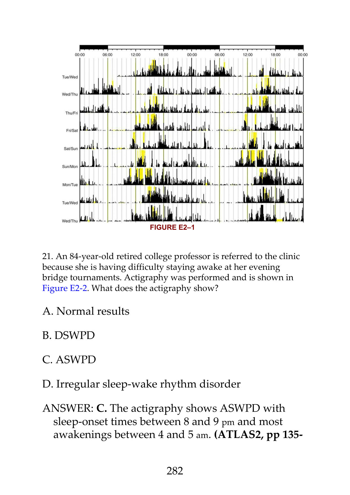

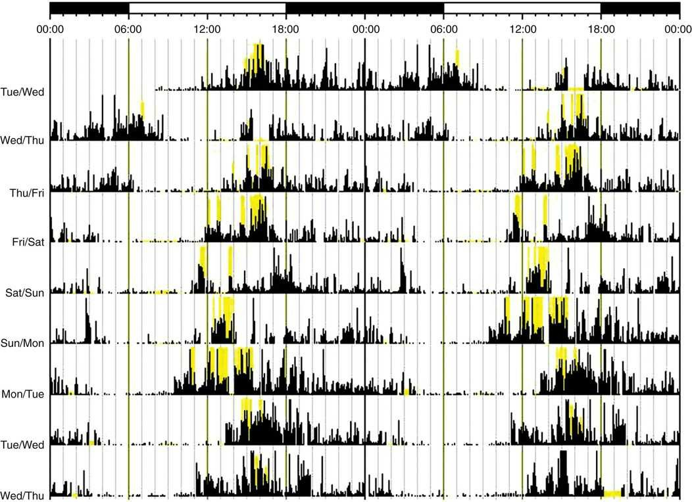

<!-- pdf-page: 283 -->

### 136, Fig. 9.1-4)

22. A 22-year-old blind college senior is referred to the clinic because she is having severe difficulty getting up for 9 am classes. Actigraphy was performed and is shown in Figure E2-3. What does the actigraphy show?

FIGURE E2–2

### D. Irregular sleep-wake rhythm disorder

### A. Free-running sleep disorder

### B. DSWPD

### C. ASWPD

### ANSWER: A. The actigraphy shows that the patient is

### going to sleep a bit later and awakens a bit later

### progressively every day. The circadian rhythm is

### free running (or nonentrained). This pattern is seen

### in blind people who have no light perception. In

### 283

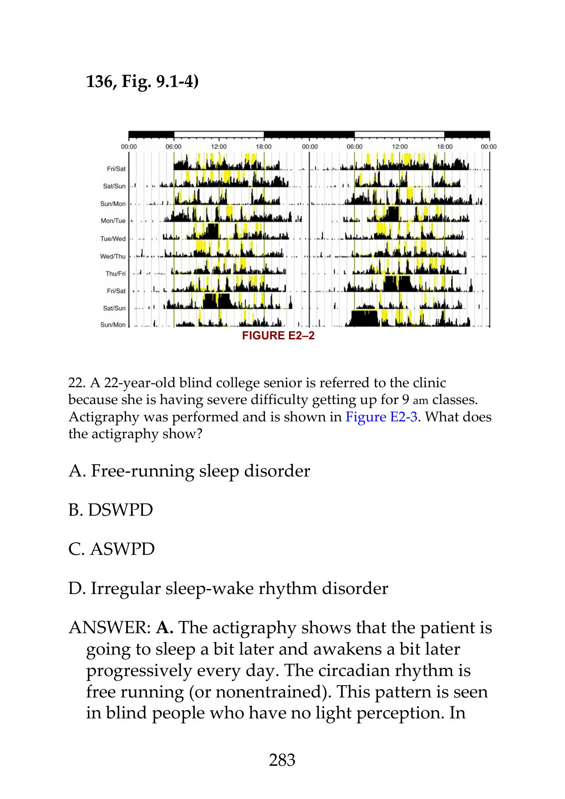

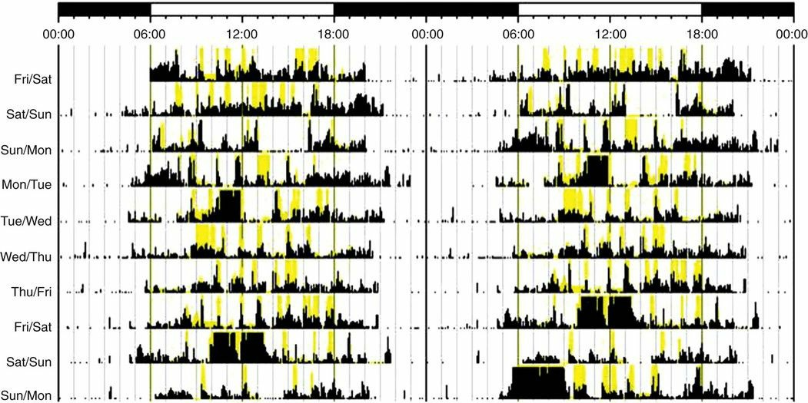

<!-- pdf-page: 284 -->

### this example, there is no single time when she

### awakens at a time appropriate for her to make a 9

### am class. Continuation of this pattern for a few more

### days would have resulted in a few days when she

### would have awakened at a time appropriate for a 9

### am class. (ATLAS2, pp 136-137, Fig. 9.1-6)

23. A 66-year-old resident of a nursing home is referred to the clinic because he frequently wanders at night and he falls asleep during meals. Actigraphy was performed and is shown here (Fig. E2-4). What does the actigraphy show?

FIGURE E2–3

### A. Free-running sleep disorder

### B. DSWPD

### C. ASWPD

### 284

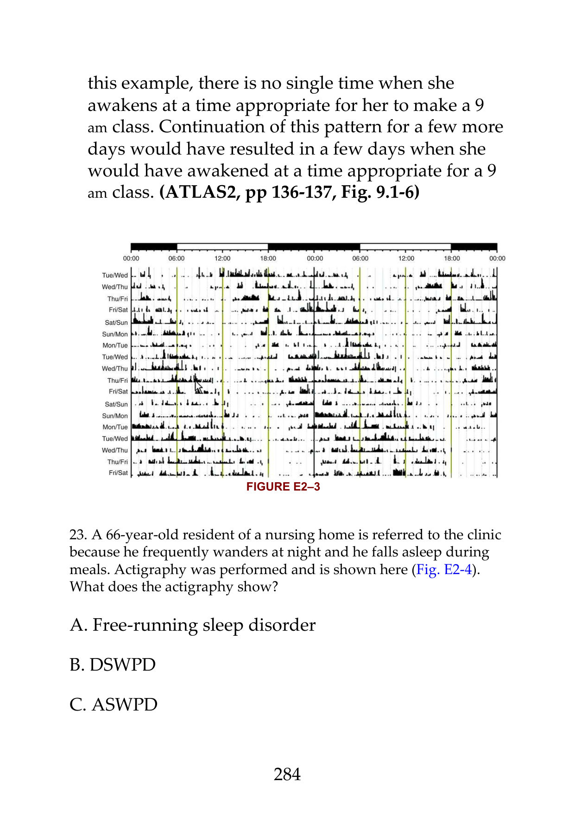

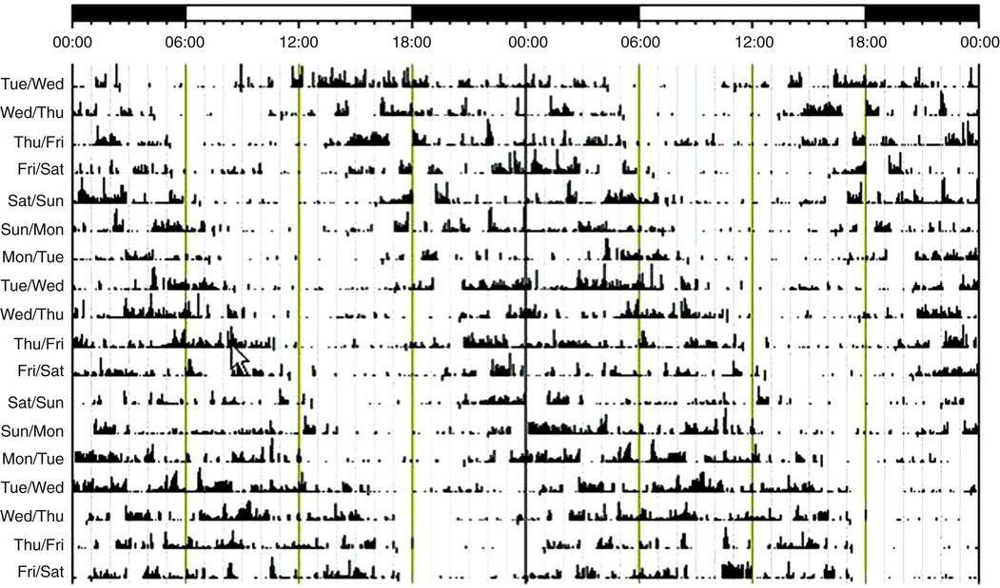

<!-- pdf-page: 285 -->

### D. Irregular sleep-wake rhythm disorder

### ANSWER: D. This is an example of irregular sleep-

### wake rhythm disorder, found in patients with brain

### pathology (e.g., tumors or neurodegenerative

### disorders) and in nursing home

### residents. (ATLAS2, pp 136-137, Fig. 9.1-7)

24. A 24-year-old man is referred to clinic because he is having difficulty getting up for work, which starts at 9 am. He does not become sleepy until 2 am. He is worried that he will lose his job. A 24-hour melatonin profile was obtained. What dim-light melatonin onset (DLMO) time do you expect to find in him?

FIGURE E2–4

### A. Midnight

### B. 2 am

### C. 4 am

### 285

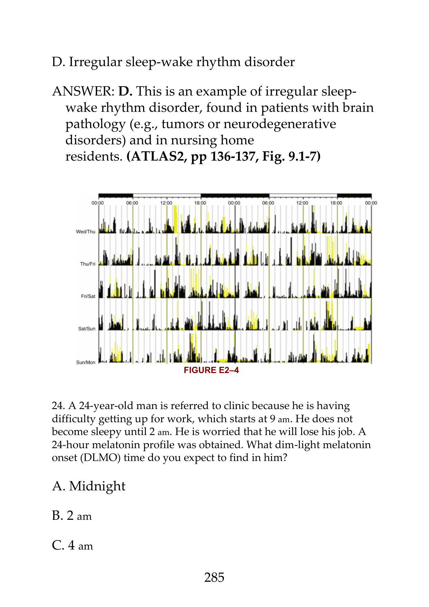

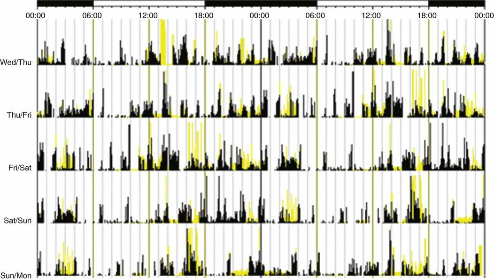

<!-- pdf-page: 286 -->

### D. 6 am

### ANSWER: A. The description is that of DSWPD.

### DLMO usually occurs about 2 hours before sleep

### onset. Thus in him DLMO would be roughly at

### midnight. (ATLAS2, p 135, Fig. 9.1-3)

25. A 24-year-old man complains of fatigue and insomnia. Actigraphy data for a month are shown in Figure E2-5. The diagnosis is most likely

### D. Irregular sleep-wake rhythm disorder

### A. Free-running sleep disorder

### B. Progressive DSWPD

### C. Progressive ASWPD

### ANSWER: A. Free-running sleep disorder is

### characterized by a progressive delay in the

### circadian clock. The resulting sleep-wake cycle

### causes insomnia and sleepiness depending on when

### sleep is attempted in relation to the phase of the

### circadian clock. This actigraph shows a progressive

### delay in sleep onset so that, over an approximate

### 10-day time span, his circadian clock shifts the sleep

### period 12 hours, and then the cycle repeats. Free-

### running sleep disorder is most commonly seen in

### blind individuals but has also been reported after

### brain injury and in normal-sighted individuals. If

### the person with this disorder attempts to sleep at

### 286

<!-- pdf-page: 287 -->

### night, when the circadian propensity for sleep has

### shifted to the daytime, he or she may experience

### insomnia at night and excessive daytime sleepiness.

### Note that the term “progressive” is not used with

### DSWPD and ASWPD. (ATLAS2, p 136)

FIGURE E2–5

### 287

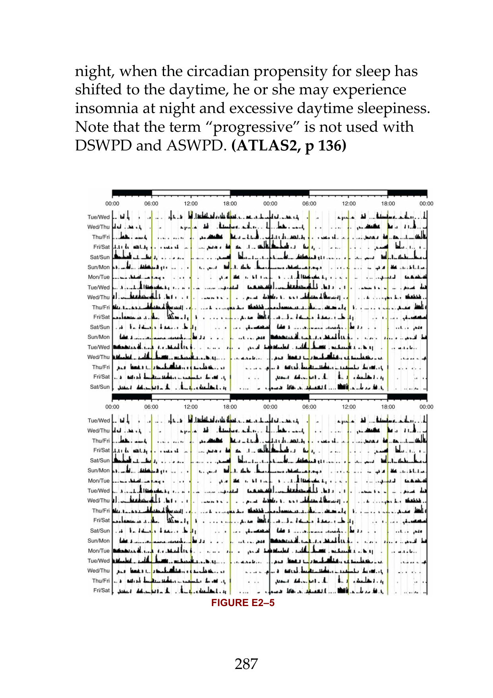

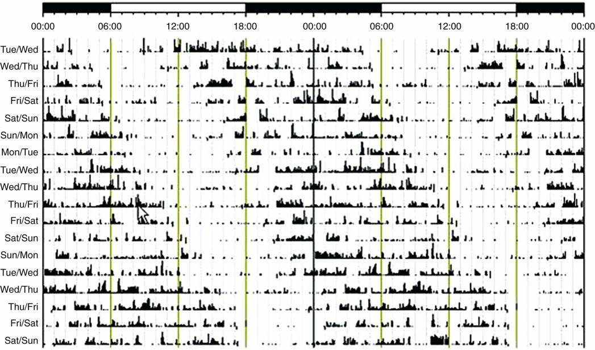

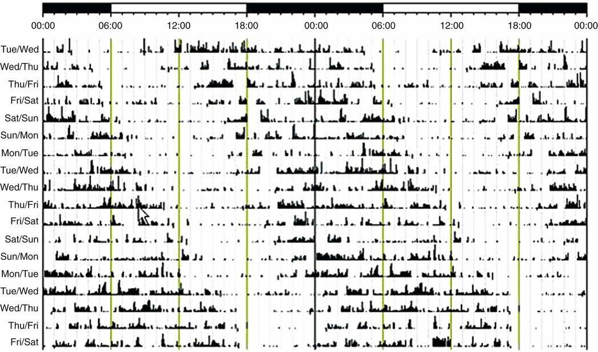

<!-- pdf-page: 288 -->

26. A 75-year-old woman complains of restless sleep. Actigraphy data for a month are shown in Figure E2-6. The diagnosis is most likely

### A. Free-running sleep disorder

### D. Irregular sleep-wake rhythm disorder

### B. DSWPD

### C. ASWPD

### ANSWER: D. Irregular sleep-wake rhythm disorder.

### Patients with irregular sleep-wake rhythm disorder

### have at least three sleep periods across the day and

### night and lack a single consolidated sleep period.

### This disorder is most commonly seen in

### institutionalized older adults and in children with

### intellectual disabilities. This actigraphy download

### from Sunday through Thursday shows no

### consolidated sleep period; instead, multiple short

### naps occur across the 24-hour period. (ATLAS2, pp

### 136-137, Fig. 9.1-7)

### 288

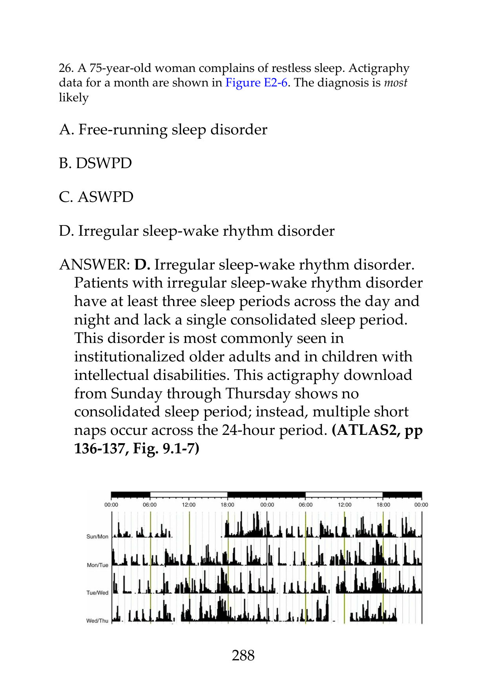

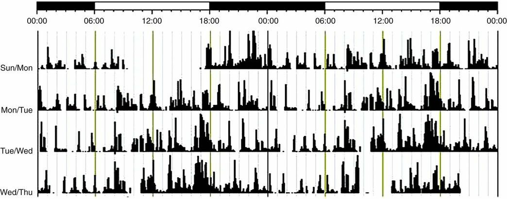

<!-- pdf-page: 289 -->

FIGURE E2–6

27. Figure E2-7 is a 1-week sleep diary kept by a 47-year-old man with a 20-year history of trouble falling asleep. He also complains of not being able to sleep without medication. What is the most likely explanation for this outcome?

### A. Insomnia with hypnotic dependence

### D. Non–24-hour sleep-wake rhythm disorder

### B. Chronic pain syndrome

### C. DSWPD

### ANSWER: A. It is important for any sleep diary to

### include all medications that might affect sleep. This

### case is an extreme example of hypnotic

### dependence. Because of a decades-long inability to

### sleep, the patient has come to rely more and more

### on hypnotics. No pain medications are listed, so it is

### not chronic pain syndrome. He goes to bed at

### appropriate times, so it is not DSWPD. Although he

### may awake early when the medications wear off,

### the real problem is insomnia, and his complaint that

### he “can't sleep without medication” indicates a

### dependence on a sleep drug.

### 289

<!-- pdf-page: 290 -->

FIGURE E2–7

### 290

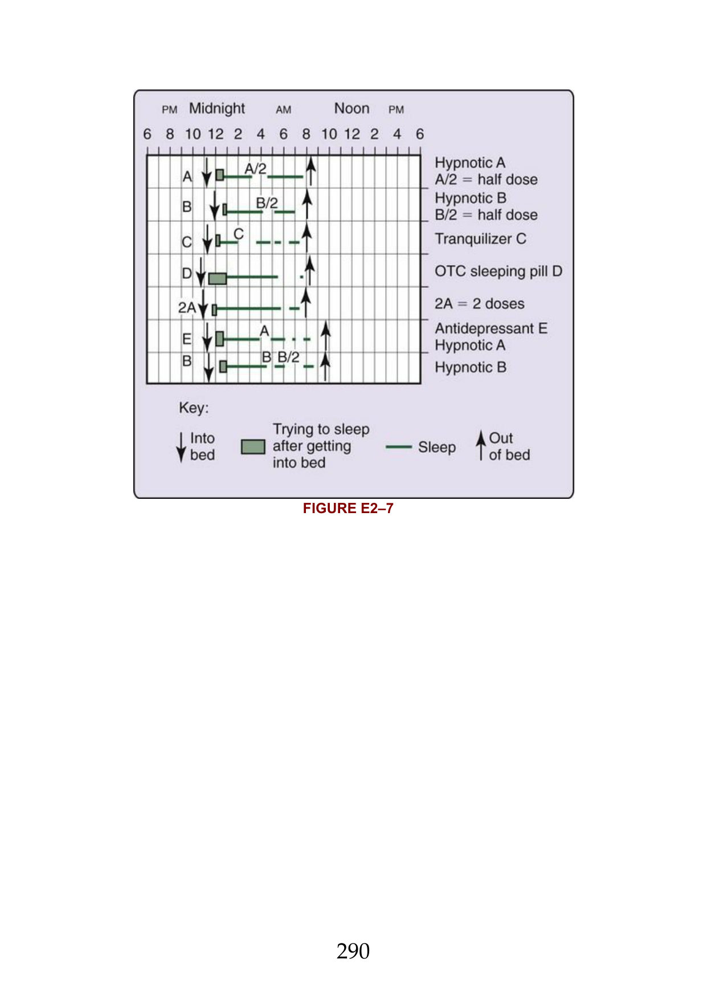

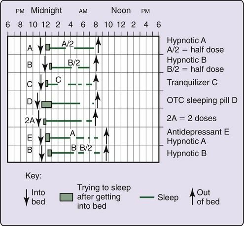
