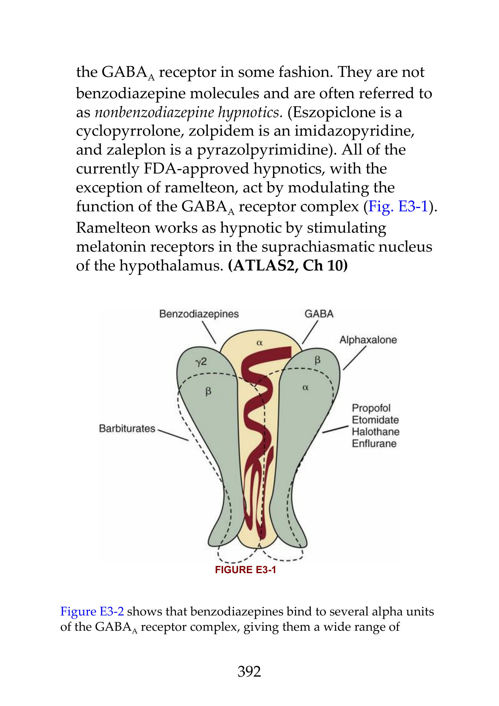
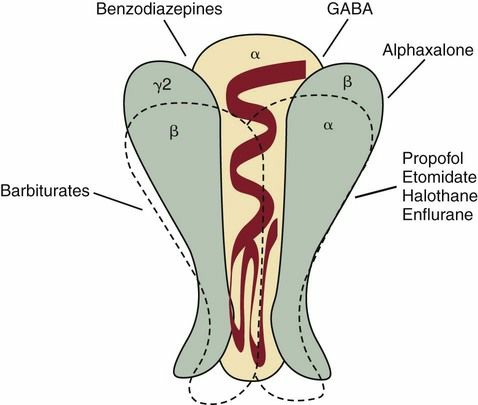
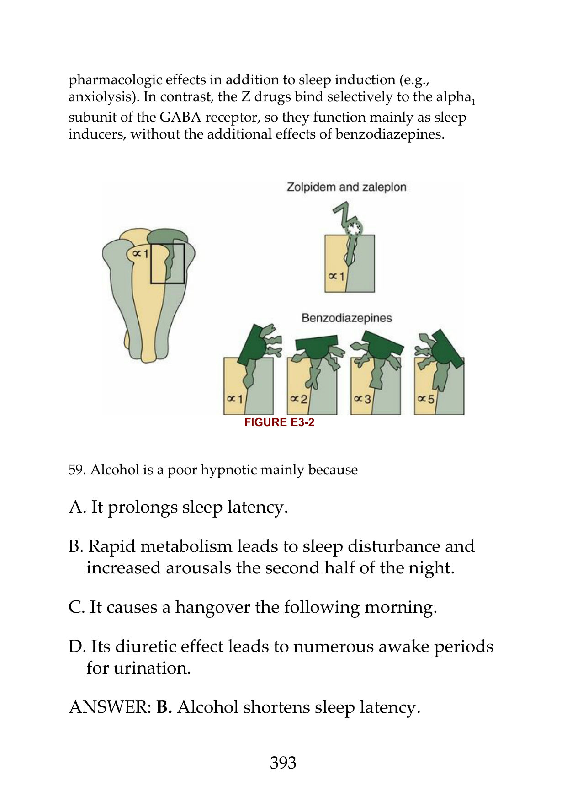
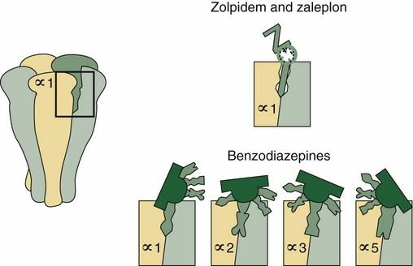
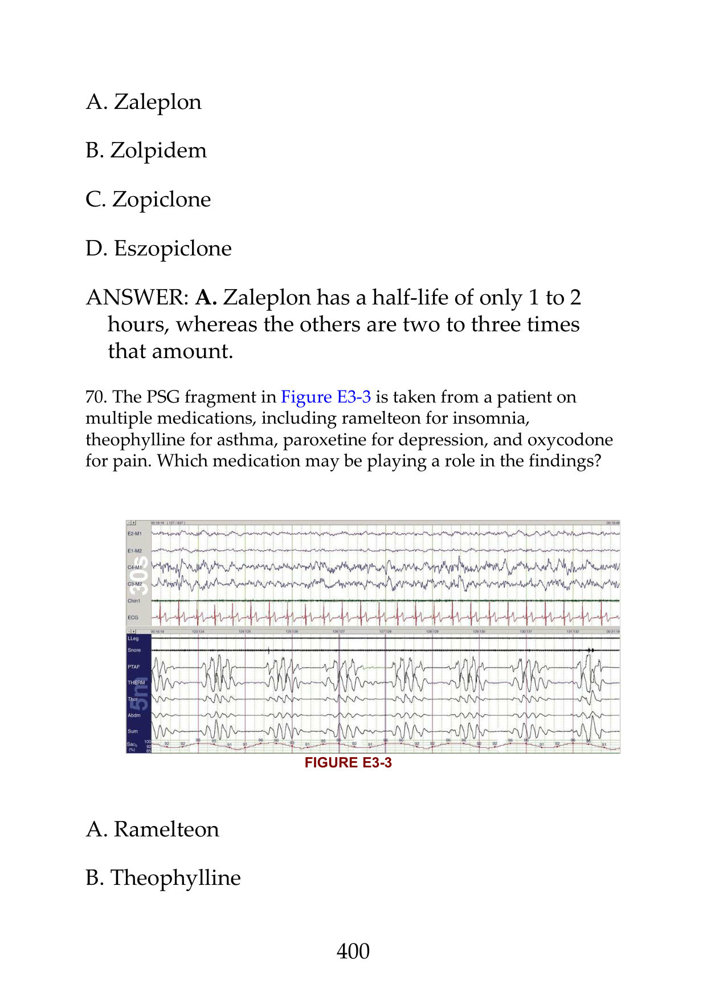
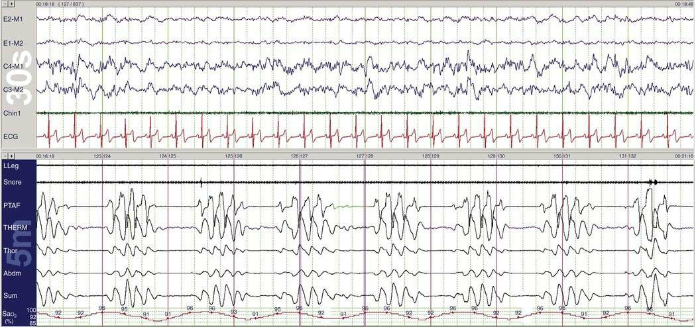
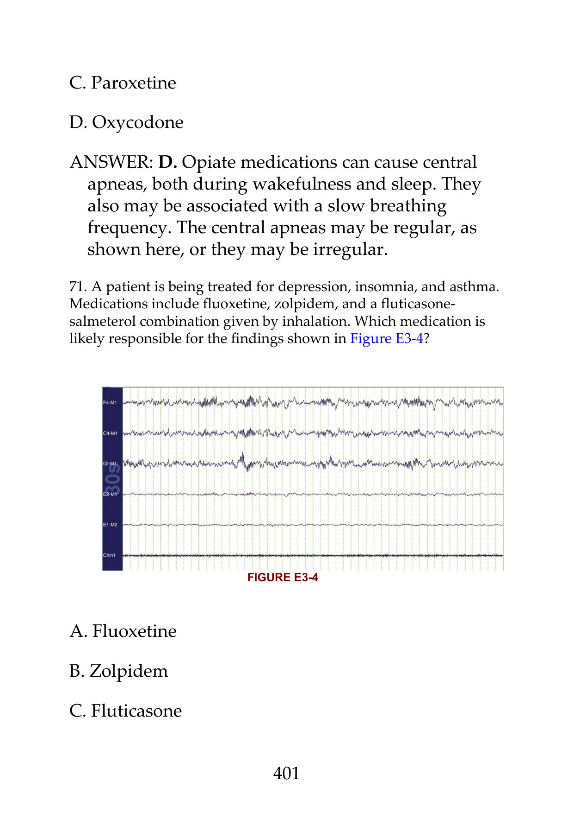
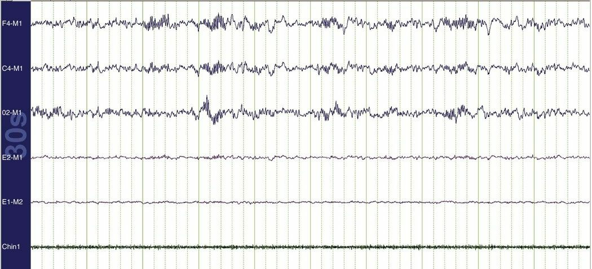
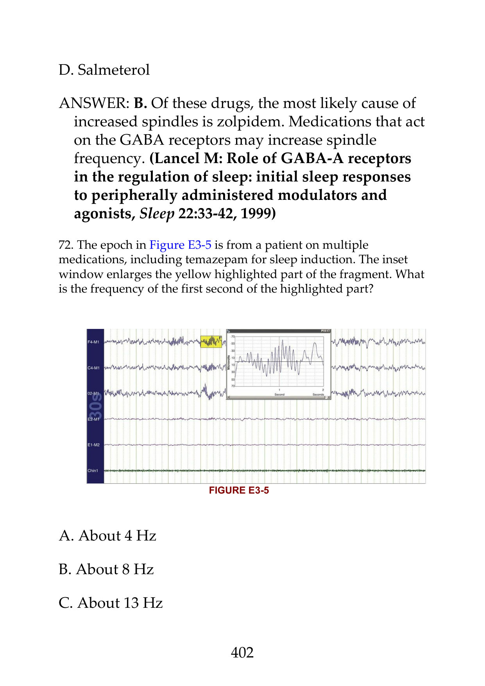
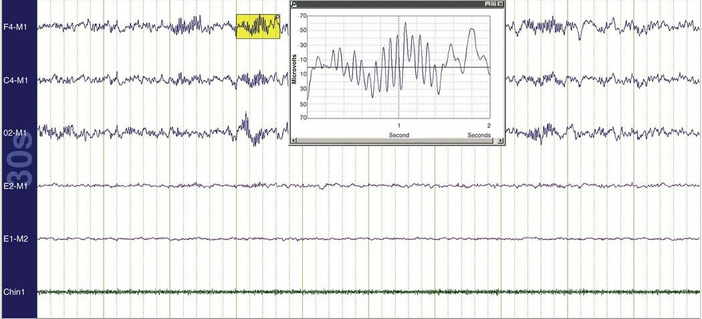

# Section 3 Insomnia

<!-- pdf-page: 291 -->

### SECTION 3

A 50-year-old woman presents with the complaint of “insomnia.” She was always a good sleeper until she had her first child at age 33, and then she developed difficulty initiating and maintaining sleep. At age 35 she started the selective serotonin reuptake inhibitor (SSRI) antidepressant fluoxetine, which she still takes. Her sleep greatly improved when she started the SSRI, but 6 months ago, she again developed trouble staying asleep. She has no trouble falling asleep; in fact, she falls asleep the minute her head hits the pillow. However, she typically, wakes up after 3 to 4 hours and is then “wide awake,” sometimes for hours. She feels very tired during the day but does not nap. Her periods have become irregular, but she denies hot flashes or night sweats. She lives with her husband and two teenage daughters, and her home life seems calm and stable. She works in real estate part time but denies stress or anxiety over the bad real estate market, stating “My husband is a good provider. I've never been happier, never had less stress. Then bang, out of the blue, I start having sleep problems.” She denies racing thoughts but admits that in the middle of the night, she can perseverate on not being able to return to sleep. She is concerned she is “wrecking” her health and worries about this as she lies in bed trying to get back to sleep. Overall she estimates obtaining only 5 hours of sleep a night. Her only surgery has been a tonsillectomy at age 6 years. Her only medication is the SSRI, and she has gained 20 lbs in the past 2 years. She does admit that about 1 year ago, her husband started complaining about her snoring. She saw her physician recently and states, “All my blood work came back normal.” On physical exam, you note she is overweight

## Insomnia

## Questions

#### Where Does One Begin?

### 291

<!-- pdf-page: 292 -->

with a body mass index (BMI) of 30 and a neck circumference of 16 inches. Oropharyngeal exam shows a Mallampati 4 throat opening, and she has no tonsils. The rest of the exam is unremarkable.

1. The most likely type of insomnia is

2. Which aspect of her presentation is the least common feature of chronic insomnia?

### A. Adjustment insomnia

### B. Idiopathic insomnia

### C. Paradoxical insomnia

### D. Psychophysiologic insomnia

### A. In the past, her insomnia improved with the SSRI.

### B. She first had sleep problems when she had

### C. She is having sleep difficulty as she enters

### children.

3. As you review her sleep hygiene, you learn more about her evening habits. Which habit is most likely contributing to her maintenance insomnia?

### menopause.

### D. She does not nap.

### A. She eats cheese and crackers 2 hours before

### B. She often sips wine in bed to help her relax.

### bedtime.

### 292

<!-- pdf-page: 293 -->

### C. She watches the evening news in the living room

### before going to bed and admits that the stories often

### upset her.

### D. She and her husband listen to classical music as

4. What other disorder is likely contributing to her sleepmaintenance insomnia?

### they go to sleep.

### D. Obesity hypoventilation syndrome

### A. Depression

### B. Narcolepsy

### C. Obstructive sleep apnea (OSA)

5. You order a polysomnogram (PSG). Which of the following findings would be least surprising?

### A. Her total sleep time (TST) was 7 hours 45 minutes.

### B. She has central sleep apnea with Cheyne-Stokes

### C. She has an increase in her amount of rapid eye

### respirations.

### D. She has increased electromyography (EMG) tone

### movement (REM) sleep.

6. According to the International Classification of Sleep Disorders (ed. 3 [ICSD3]), which one of the following insomnias would not be

### during REM.

### 293

<!-- pdf-page: 294 -->

classified as a chronic insomnia?

### A. Insomnia due to a mental disorder

### B. Insomnia due to a medical condition

### C. Insomnia due to a drug or substance

### D. Insomnia due to sleep-disruptive environmental

7. The diagnostic criteria for chronic insomnia requires that the symptoms be present for at least

### circumstances

8. Which test has a very high specificity and sensitivity in diagnosing chronic insomnia?

### A. One month

### B. Three months

### C. Six months

### D. Twelve months

### C. Maintenance of wakefulness test (MWT)

### A. PSG

### B. Multiple sleep latency test (MSLT)

### D. Sleep laboratory tests are not indicated for

### insomnia.

### 294

<!-- pdf-page: 295 -->

9. What is the single most useful tool in assessing an insomnia complaint?

### A. Actigraphy

#### Worried about Having an Awful Disease

### B. Sleep diary

### C. Beck Depression Inventory

### D. 8 am serum cortisol

A 30-year-old woman is referred to the sleep center by her psychiatrist for an evaluation of “refractory insomnia.” She has a history of generalized anxiety and attention-deficit/hyperactivity disorder (ADHD). She has taken paroxetine and methylphenidate for years. The patient appears a bit anxious and somewhat tired but not chronically ill or in any distress. Early in the interview, she shares a fear about a disease she read about on the Internet, fatal familial insomnia.

10. Which of the following statements about fatal familial insomnia is false?

### B. Intravenous immunoglobulin (IVIG) can be useful

### A. It is an exceedingly rare disease.

### C. It is a neurodegenerative prion disease.

### in prolonging life.

### D. Loss of sleep spindles is a common

### electroencephalograph (EEG) finding on PSG.

You learn that she is an aspiring actress and works until 3 am as a

### 295

<!-- pdf-page: 296 -->

waitress. In the daytime she often has auditions or rehearsals. During the daytime she says “I feel great and am too busy to worry about being tired as long as I don't have some awful disease.” She then adds, “If I am having a bad day, I just take a little extra Ritalin.”

11. Which feature of her story makes you suspect that she might not have insomnia?

### A. She is not giving herself adequate opportunity to

### B. She does not report daytime impairment.

### sleep.

### C. She has an anxiety disorder for which she sees a

### D. She may be abusing stimulant medication.

### psychiatrist.

12. The prevalence rate of chronic insomnia varies widely depending on the study; for the general population, the rate most commonly quoted in the sleep literature is

### E. A and B

13. Which therapy is often successful in treating insomnia?

### A. 10%

### B. 20%

### C. 30%

### D. 40%

### A. Freudian psychoanalysis

### 296

<!-- pdf-page: 297 -->

### B. Jungian dream interpretation

### C. Cognitive behavioral therapy (CBT)

### D. Eye movement desensitization and reprocessing

14. Which of the following is associated with an increased risk for chronic insomnia?

### (EMDR)

#### The Teenager Who Could Not Fall Asleep

### A. Increasing age

### B. Female gender

### C. Psychiatric disorders

### D. Chronic medical disorders

### E. All of the above

A 17-year-old high school senior is brought to the sleep center by his mother because of “insomnia” and excessive daytime sleepiness (EDS). He goes to bed at midnight but cannot fall asleep until approximately 2 am. He must then wake up at 6:30 am to make his first advanced-placement class at 7:45 am. He is very tired during the day and often falls asleep in class. On weekends or during vacation, he stays up just as late, but because he can sleep as long as he wants (often 9 or 10 hours), he then does not feel tired while he is awake.

15. What is the most likely diagnosis?

### A. Narcolepsy

### B. Adjustment insomnia

### 297

<!-- pdf-page: 298 -->

### C. Short-term insomnia

### D. Delayed sleep phase disorder (DSPD)

#### Always a Lousy Sleeper

A 33-year-old man presents to the sleep center with a long history of “insomnia.” He reports difficulty falling asleep since childhood. He has seen many doctors, including more than one sleep physician, and feels that he has “tried every medication,” including prescription, over-the-counter (OTC), and “herbal” remedies. Some of these drugs helped for a while but then ceased working. You mention CBT as a possible treatment, and he claims to “know all about it.” He proceeds to tell you about his changes in “sleep hygiene” and how it has not helped his sleep at all. His primary care physician (PCP) has recently diagnosed depression.

16. You explain to him that besides sleep hygiene, CBT involves all of the following components except

17. He is interested in CBT but asks if it is better to combine it with medication, especially in cases of severe insomnia. You explain

### A. Stimulus-control therapy

### B. Sleep-restriction therapy

### C. Hypnosis

### D. Cognitive restructuring

### E. Relaxation training

### A. Some studies show that medication is better for

### long-term treatment of insomnia, whereas CBT is

### better for short-term treatment.

### 298

<!-- pdf-page: 299 -->

### B. Most studies show that medication is a far superior

### treatment in the short term, whereas CBT is only

### slightly superior in long-term treatment of

### insomnia.

### C. Most studies show that CBT and hypnotic

### medications are equally efficacious in short-term

### treatment, but CBT produces far superior results

### over the long term.

### D. Studies have been inconsistent. Some show that

### CBT produces better treatment, whereas others

### show medications are better at improving sleep, but

### unlike CBT, they come with the risk of tolerance

### and addiction.

18. What is the purpose of stimulus-control therapy?

### A. To consolidate sleep and increase sleep efficiency

### B. To reassociate the bed and bedroom with sleep

### by curtailing time in bed

### D. To change faulty beliefs and attitudes that

### C. To reduce somatic tension

### perpetuate among patients with insomnia

19. What is the purpose of sleep-restriction therapy?

### A. To consolidate sleep and increase sleep efficiency

### by curtailing time in bed

### 299

<!-- pdf-page: 300 -->

### B. To reassociate the bed and bedroom with sleep

### C. To reduce somatic tension

### D. To change faulty beliefs and attitudes that

### perpetuate among patients with insomnia

20. What is the purpose of cognitive restructuring?

### A. To consolidate sleep and increase sleep efficiency

### B. To reassociate the bed and bedroom with sleep

### by curtailing time in bed

### D. To change faulty beliefs and attitudes that

### C. To reduce somatic tension

### perpetuate among patients with insomnia

21. Recently, his PCP prescribed a medication that would do “double duty”; the patient was told it should help him sleep and treat his depression. Which medication did his physician likely prescribe?

Because it was having no effect on either his insomnia or depression, his

### A. Trazodone

### B. Zaleplon

### C. Clonazepam

### D. Fluoxetine

### 300

<!-- pdf-page: 301 -->

PCP stopped the first drug, started him on a new medication for depression, and also referred him to your sleep clinic. You see him after he has taken the new drug for 5 nights straight. He quotes the PCP (who was quoting a seminar expert), saying that the second antidepressant “should have no effect on sleep.” However, the patient reports the new antidepressant has made his initiation insomnia even worse.

24. He states that he had a “bad reaction” to zolpidem that did not involve rash or anaphylaxis. Which side effect are you most concerned about?

22. Which medication is he most likely taking?

### A. Mirtazapine

### B. Paroxetine

### C. Amitriptyline

### D. Bupropion

23. What type of insomnia does he have?

### A. Psychophysiologic insomnia

### B. Physiologic (organic) insomnia

### C. Insomnia due to a mental disorder

### D. Idiopathic insomnia

### A. Compulsive behaviors

### B. Seizure

### 301

<!-- pdf-page: 302 -->

### C. Anterograde amnesia

### D. Urinary retention

25. Which herb is not touted as a sleep aid?

26. Which OTC medication has proven effective in treating insomnia?

### A. Basil flower

### B. Valerian root

### C. Chamomile

### D. Kava kava

27. Which of the following hypnotics has demonstrated the lowest risk for tolerance and addiction?

### A. Melatonin

### B. l-Tryptophan

### C. Doxylamine

### D. Diphenhydramine

### A. Zaleplon

### B. Ramelteon

### C. Zolpidem

### 302

<!-- pdf-page: 303 -->

### D. Eszopiclone

28. In which disorder is there supportive evidence that melatonin improves sleep?

### C. Circadian rhythm disorder, free-running type

### A. Maintenance insomnia

### B. Shift-work disorder

A 76-year-old woman who is a retired psychiatrist reports to the sleep center with the complaint of “early morning awakening.” She wakes each day at 4 am. This upsets her because she says, “I don't want to start the day in the cold dark.” She seeks your help in figuring out whether she has a “primary sleep disorder or depression.”

### D. All of the above

### E. B and C

#### Waking Too Early

29. What is the most important question to ask to understand the nature of her “early morning awakening”?

### D. Has she lost interest in activities she normally

### A. Does she feel sad?

### B. Does she have suicidal ideations?

### C. What time is she going to bed?

### enjoys?

### 303

<!-- pdf-page: 304 -->

On further questioning, she admits to multiple awakenings during the night with difficulty returning to sleep. She is tired in the daytime and sometimes naps. She is also being treated for hypertension, chronic obstructive pulmonary disorder (COPD), and osteoarthritis.

30. Of the following medications she takes, which one(s) could be causing or exacerbating her sleep problem?

31. Which medication(s) can cause daytime drowsiness and fatigue, with or without an insomnia complaint?

### A. Metoprolol

### B. Prednisone

### C. Ibuprofen

### D. All of the above

She admits using alprazolam for many months, until her PCP became alarmed because of escalating doses and asked her to stop the drug. He told her that because alprazolam is a short-acting benzodiazepine, there should be no risk of withdrawal symptoms.

### A. Beta-blockers

### B. Alpha1-agonists

### C. Alpha2-blockers

### D. Adenosine blockers

32. What most likely happened when she stopped alprazolam abruptly?

### 304

<!-- pdf-page: 305 -->

### A. Her original insomnia symptoms returned at their

### original severity level.

### B. For the first 2 nights, her insomnia symptoms were

### much worse, and then they returned to their

### original level.

### C. She developed new symptoms, such as heart

### palpitations, anxiety, and gastrointestinal (GI)

### distress that lasted for several weeks.

33. Which of the following neurotransmitters promotes wakefulness?

### D. None of the above

### B. Gamma-aminobutyric acid (GABA)

### A. Orexin (hypocretin)

34. Caffeine is a wakefulness-promoting agent because

### C. Dopamine

### D. Acetylcholine

### E. A, C, and D

### B. It increases serum levels of substance P.

### A. It is a histamine agonist.

### C. It is an adenosine-receptor antagonist.

### 305

<!-- pdf-page: 306 -->

### D. It increases the release of glutamate from the

### reticular formation.

35. Which statement is the most correct explanation for the difference between benzodiazepine-receptor agonists (BzRAs) and nonbenzodiazepine BzRAs?

### A. Benzodiazepines act on GABAA, whereas the

### nonbenzodiazepine BzRAs act on GABAB.

### B. Compared with benzodiazepines that act

### nonselectively on the GABAA receptor, the

### nonbenzodiazepine BzRAs have a selective affinity

### for the alpha1 subunit on GABAA receptors.

### C. Benzodiazepines act on GABAA receptors found in

### the thalamus, whereas the nonbenzodiazepine

### BzRAs act on the GABAA receptors located in the

### reticular formation.

### D. Benzodiazepines act on benzodiazepine receptors

### found on the GABA-receptor complex, whereas

### nonbenzodiazepine BzRAs bind to benzodiazepine

### receptors found on the serotonin-receptor complex.

36. Which pharmacologic effect is lost with the nonbenzodiazepine BzRAs compared with the BzRAs?

### A. Anxiolysis

### B. Amnesia

### 306

<!-- pdf-page: 307 -->

### C. Anticonvulsant properties

### D. A, B, and C

#### The Insomnia That Will Not Go Away

A 60-year-old woman presents to the sleep clinic with a 5-year history of difficulty falling asleep. She has always been a light sleeper, just like her mother, but her sleep problems really began when her husband died suddenly 5 years ago. During the acute grief phase, she had trouble going to sleep and found that she was afraid to be alone in the house. She started leaving most of the lights on at night, including several table lamps in the bedroom. She moved the TV into the bedroom “to take my mind off things” and started allowing her 80-lb Labrador to sleep with her “to keep me company.” She often has a highball late at night to help her relax. She claims that she has been “getting by” but that the past 6 months have seen further deterioration in her sleep, and she is only sleeping 4 to 5 hours a night.

37. Which neurocognitive or neurophysiologic model best describes this scenario?

### A. Two-process model (process C and process S) for

### C. The physiologic model of hyperarousal

### the sleep-wake cycle

### B. Spielman's three-P model

She has been using zolpidem 20 mg for the past 2 years in addition to her nighttime highballs. Recently, because the 20 mg was not working anymore, she has increased the dose to 30 mg (without a highball) and now is worried about drug effects.

### D. None of the above

### 307

<!-- pdf-page: 308 -->

38. Which treatment is most effective in discontinuing hypnotics in patients with hypnotic dependence?

### A. CBT combined with hypnotic taper

### B. Psychoanalysis with accelerated hypnotic taper

### C. Slow taper over 10 weeks followed by 6 months of

### disulfiram along with frequent follow-up

### D. Closely supervised medication taper that allows ad

39. Which statement best describes paradoxical intention?

### libitum use of low-dose hypnotic

### A. As part of relaxation training, patients at first

### attempt to become as stressed as possible before

### letting go of all worries.

### B. As the final step in sleep-restriction therapy, the

### patients tell themselves that they are only allowed

### to sleep 4 hours when really they can sleep 7 to 8

### hours.

### C. As part of stimulus-control therapy, patients are

### told to find the least comfortable place in the house,

### such as the bathroom floor, and try to sleep there at

### night.

### D. As part of cognitive restructuring, patients are

### instructed to attempt to stay awake for 30 minutes

### when they get into bed, even if they are very sleepy.

### 308

<!-- pdf-page: 309 -->

40. Which of the following is an essential recommendation given as part of CBT?

### A. Go to bed when sleepy every night and have a

### fixed wake time.

### B. Have a flexible wake time that allows

### D. Keep the bedroom dark and warm.

### approximately 7 hours of sleep.

### C. Keep naps to 30 minutes.

41. What percentage of patients complaining of insomnia also have a psychiatric disorder?

42. In which patient population has hypnotic medication not been shown to be a superior treatment when compared with CBT?

### A. 10% to 20%

### B. 20% to 30%

### C. 40% to 50%

### D. 70% to 80%

### A. Depressed patients with comorbid insomnia

### C. Chronic pain patients with comorbid insomnia

### B. Patients older than 55 years

### D. 12-year-old patients with comorbid insomnia

### 309

<!-- pdf-page: 310 -->

43. Chronic insomnia can increase the risk of all of the following except

### A. Cervical cancer in women

44. Which condition is the greatest predictor for developing insomnia?

### B. Depression

### C. Work-related fatalities

### D. Cognitive errors

45. Which condition will insomnia sufferers most likely develop?

### A. Fibromyalgia

### B. Major depressive disorder

### C. Generalized anxiety disorder

### D. Bipolar disorder

46. What would you likely find on PSG if a patient has both insomnia and depression?

### A. Fibromyalgia

### B. Major depressive disorder

### C. Generalized anxiety disorder

### D. Bipolar disorder

### 310

<!-- pdf-page: 311 -->

### A. Decreased REM, long REM latency, early morning

### awakening

### B. Increased REM, long REM latency, early morning

### C. Increased slow-wave sleep (SWS), short REM

### awakening

### D. Short REM latency, more REM later in the night,

### latency, early morning awakening

47. Which statement is true regarding morbidity and mortality data?

### and early morning awakening

### A. Patients with insomnia report a similar reduction

### in quality of life as that of patients with congestive

### heart failure (CHF).

### B. All studies to date show an association between

### insomnia and increased mortality rates.

### C. Newer data from longitudinal studies show that

### mild insomnia might extend people's lives.

### D. People with chronic insomnia have fewer work-

### related accidents, which is thought to be secondary

### to their hyperarousal and hypervigilance.

48. Which of the following statements is not true?

### A. Insomnia can be caused by a central nervous

### system (CNS) stimulant or depressant.

### 311

<!-- pdf-page: 312 -->

### B. About 15% of insomnia cases have no identifiable

### precipitant or cause.

### C. Because of irregular sleep patterns in infants, the

### earliest age to consider for the diagnosis of chronic

### insomnia disorder in a child is 6 months.

### D. Insomnia patients typically show abnormal

### daytime alertness when tested with the MSLT.

#### A Case of Waking Up Four Times a Night

A 48-year-old woman presents to your clinic with a 10-year history of insomnia. Many years ago she was treated with barbiturates but was concerned about addiction. She has no difficulty going to sleep but awakens frequently at night and has trouble reinitiating sleep. Her overall health is good, although she has been told she snores if she has a glass of wine about an hour before bedtime. Answer the following series of questions.

49. You think about prescribing a hypnotic. Which of the following medications is least likely to be useful in her case?

### A. Eszopiclone

### B. Zolpidem

### C. Ramelteon

### D. Zaleplon

50. Barbiturates affect sleep architecture by

### A. Increasing REM sleep

### 312

<!-- pdf-page: 313 -->

### B. Decreasing N3 sleep

### C. Increasing N3 sleep

51. She undergoes a PSG and is found to have only 3% stage N3 sleep, which you attribute to one of her medications. Which one is the most likely cause?

### D. Decreasing REM

### C. The monoamine oxidase inhibitor (MAOI)

### A. The barbiturate

### B. The benzodiazepine

52. She is also found to have no REM sleep on the PSG, possibly due to one of her medications. Which of the following drug classes is the most powerful REM suppressor?

### D. The SSRI

53. Which of the following is true about zolpidem in the treatment of insomnia?

### A. Tricyclic antidepressants (TCAs)

### B. MAOIs

### C. SSRIs

### D. Serotonin antagonists

### A. The half-life is about 6 hours.

### 313

<!-- pdf-page: 314 -->

### B. The drug has a relative affinity for type 2 GABAA

### receptors.

### C. There is no food effect.

You receive a call from a psychiatrist colleague who is planning to treat a 22-year-old man with schizophrenia. The psychiatrist wants to start an antipsychotic to help him obtain deeper sleep.

### D. Peak plasma is at about 1.5 hours.

#### Call from a Psychiatrist

54. All of the following antipsychotic drugs increase N3 sleep except

55. The psychiatrist also plans to prescribe an anxiolytic but has concerns about its effect on daytime alertness. Which of the following drugs is not known to induce sleepiness?

### A. Olanzapine

### B. Haloperidol

### C. Ziprasidone

### D. Quetiapine

### A. Diazepam

### B. Alprazolam

### C. Buspirone

### D. Mirtazapine

### 314

<!-- pdf-page: 315 -->

#### The Overcaffeinated Waitress

56. A waitress drinks three pots of coffee to stay alert and energized on her shift. The reason caffeine helps her remain alert is

### B. Caffeine is an adenosine antagonist.

### A. Caffeine is an adenosine agonist.

### C. Caffeine is a norepinephrine agonist.

### D. Caffeine blocks reuptake of dopamine.

58. You are at a social gathering. One of the partygoers hears you are a sleep medicine specialist. He brags to you that he can drink four espresso drinks before bed without an effect on subsequent sleep. What should you tell him?

57. Caffeine has an approximate half-life of

### A. 3 to 5 hours

### B. 15 to 30 minutes

### C. 6 to 8 hours

### D. 1 to 2 hours

### A. Caffeine has no effect on some people.

### B. Caffeine consumption will eventually cause

### insomnia.

### C. Caffeine reduces REM sleep.

### 315

<!-- pdf-page: 316 -->

### D. Caffeine reduces N3 sleep.

59. An 82-year-old patient with a 5-year history of insomnia involving onset and maintenance problems tells you he is taking Tylenol PM (acetaminophen and diphenhydramine) at bedtime, which has not improved his condition. The most likely reason for this is

### A. Diphenhydramine has little effect on reducing

### B. Diphenhydramine can reduce objective total sleep

### sleep-onset latency.

### C. Diphenhydramine makes most people feel groggy

### time.

### for up to 30 minutes after sleep offset.

### D. Diphenhydramine does not reduce objective

60. A pediatrician is caring for an 8-year-old boy with a long history of sleep-onset insomnia. Behavioral intervention has been unsuccessful, and the parents are upset because their child is having problems with performance at school. The pediatrician decides to try a low dose of chloral hydrate to treat the insomnia. Chloral hydrate can affect sleep architecture by

### nighttime awakenings.

### D. Chloral hydrate has no impact on N3 or REM

### A. Increasing REM latency

### B. Reducing N3 sleep

### C. Increasing N3 sleep

### 316

<!-- pdf-page: 317 -->

### sleep.

#### Insomnia, the Old and the New

One of your patients has successfully been treated for insomnia with zolpidem 10 mg at bedtime. He takes the drug about 30 minutes before bedtime, 5 nights per week. Two months into treatment, he reports that his sleep is good on nights he takes the drug. He usually reads for about an hour before bed and finds the book on his chest the next morning. While pleased with treatment, he complains of having no recall of what he read the night before.

61. Decrements in memory function are most likely from benzodiazepine receptor agonists that have a strong affinity to

62. Because of the memory problems, you decide to switch him to low-dose doxepin, also approved by the U.S. Food and Drug Administration (FDA) for insomnia. The peak plasma level of lowdose doxepin is at 1.5 to 4 hours after ingestion. Most improvement with this drug is

### A. GABAA alpha1

### B. GABAA alpha2

### C. GABAA alpha3

### D. GABAA alpha5

### C. In the second third of the sleep period

### A. In reducing sleep-onset latency

### B. In the last third of the sleep period

### D. In the first part of the sleep period

### 317

<!-- pdf-page: 318 -->

63. Before switching him to doxepin, you considered trazodone because it is less expensive. Compared with zolpidem, trazodone has

### A. Identical 4- to 6-month efficacy on sleep

### B. No durable efficacy on sleep parameters on PSG

### parameters on PSG

### C. Significantly reduced efficacy beyond 1 week

### measures

### D. Improved sleep-maintenance effect seen only after

64. A patient with a blood pressure of 160/110 mm Hg is started on a beta-blocker. His cardiac symptoms are vastly improved, but he complains of insomnia. Beta-blockers can affect sleep by

### a week of nightly administration

#### Other Medications that Affect Sleep

### C. Inhibiting GABA release at the ventrolateral

### A. Increasing melatonin release

### B. Decreasing melatonin release

### D. Having high affinity for 5-HT receptors

### preoptic nucleus (VLPO)

65. A patient's internist prescribed an H2 antagonist for gastroesophageal reflux disease (GERD) and a benzodiazepine receptor agonist for insomnia. The H2 antagonist drug significantly reduced the reflux episodes. However, the patient complains of an

### 318

<!-- pdf-page: 319 -->

unwanted adverse effect during his follow-up visit. Of the following type 2 histamine receptor antagonists, which one is most likely to cause the significant adverse effects in patients taking a hypnotic?

66. A 55-year-old patient reports that since starting ibuprofen for minor joint pains, her sleep has become fragmented, with awakenings at night and difficulty returning to sleep. Nonsteroidal antiinflammatory drugs (NSAIDs) can cause sleep disruption by

### A. Cimetidine

### B. Ranitidine

### C. Famotidine

### D. Nizatidine

### A. Increasing the synthesis of prostaglandin D2

### C. Enhancing normal decrease in core body

### B. Suppressing melatonin release

### D. Directly acting as a GABA antagonist

### temperature

A 28-year-old woman presents to the clinic with a complaint of poor sleep. She typically gets in bed with lights out at 10 pm, but about twice a week, it takes her hours to fall asleep. It seems to always occur on Sunday nights. Once asleep, she may wake once to go to the bathroom but then is able to reinitiate sleep within minutes. As a result of the insomnia, her mood has been poor, and she has had difficulty getting along with coworkers.

#### A Case of Sunday Night Insomnia

### 319

<!-- pdf-page: 320 -->

67. What is the most likely diagnosis, according to the ICSD3?

### A. Short-term insomnia disorder

### B. Chronic insomnia disorder

68. Which hypnotic and dosage is most appropriate for this pattern of insomnia?

### C. Paradoxical insomnia

### D. Other insomnia disorder

69. You decide to suggest behavioral treatment. Which of the following is unlikely to be of much help compared with drug monotherapy?

### A. Zolpidem 10 mg prn

### B. Zolpidem 5 mg prn

### C. Eszopiclone 3 mg nightly

### D. Temazepam 15 mg prn

70. You give the patient samples of a medication, but she calls the next day stating she woke with a “funny taste in her mouth.”

### A. Stimulus control

### B. Sleep restriction

### C. Sleep hygiene

### D. Relaxation therapy

### 320

<!-- pdf-page: 321 -->

Which medication was it?

### A. Zolpidem

### B. Quetiapine

71. After a few weeks, the patient also develops a problem staying asleep, waking at 2:00 am and again at 4:00 am, and taking about an hour to get back to sleep after each awakening. Which FDAapproved hypnotic would be least likely to help this type of insomnia?

### C. Diazepam

### D. Eszopiclone

John is a 67-year-old man with a 5-year history of sleep-onset insomnia and sleep-maintenance problems. About the same time the sleep disturbance began, he decided to retire from his job at the Centers for Disease Control in Atlanta. He worked for 20 years in the security department. The difficulty with sleep occurs 6 or 7 nights per week. He likes to read the news on his laptop up to bedtime and will check emails at night if he has an awakening, hoping his 29-year-old daughter has sent him a message from her home in Europe.

### A. Doxepin

### B. Eszopiclone

### C. Temazepam

### D. Ramelteon

#### Retirement Ruined His Sleep

72. What is the most likely diagnosis according to the ICSD3?

### 321

<!-- pdf-page: 322 -->

### A. Short-term insomnia disorder

### B. Chronic insomnia disorder

73. What initial behavioral advice are you going to give to John?

### C. Paradoxical insomnia

### D. Other insomnia disorder

### A. Wear blue-colored glasses at night to negate the

### B. Wear amber-colored glasses at night to negate the

### light from the laptop.

### C. Try stimulus-control therapy only after sleep onset.

### light from the laptop.

### D. Wear amber-colored glasses for 1 hour upon

74. During a subsequent office visit, you find out that John tries to make up for lost sleep by staying in bed until 10 am in the morning, thus giving him an 11-hour opportunity for sleep. What advice should you give him about this schedule?

### awakening.

### A. Take afternoon naps rather than staying in bed

### B. Restrict bedtime to no more than 7 to 8 hours.

### longer.

### C. Increase temazepam to 30 mg at bedtime.

### D. As long as weather permits, take an evening walk

### 322

<!-- pdf-page: 323 -->

### in an attempt to enhance sunlight exposure.

75. Which of the following assessments would be best for making the diagnosis of insomnia?

A 49-year-old woman with a one-and-a-half month history of insomnia 5 nights per week has been taking 10 mg of zolpidem at bedtime for 3 weeks. The insomnia began shortly after she found out that her job at Coca-Cola was going to involve public speaking. Anxiety over this task became progressively worse, and she began to engage in compulsive eating at night about an hour after falling asleep. She was seen by a psychiatrist, who prescribed escitalopram 10 mg at bedtime. She continued taking zolpidem for insomnia.

### A. PSG

### B. Sleep diary

### C. Fitbit

### D. Insomnia Severity Index

#### Fear of Standing before a Crowd

76. What is the most likely diagnosis according to the ICSD3?

### A. Short-term insomnia disorder

### B. Chronic insomnia disorder

### C. Paradoxical insomnia

### D. Other insomnia disorder

77. What would you do next?

### 323

<!-- pdf-page: 324 -->

### A. Reduce the dose or eliminate the zolpidem.

### B. Eliminate the escitalopram.

### D. Increase the bedtime dose of zolpidem.

### C. Increase the dose of escitalopram.

78. Which of the following is not usually a side effect of BzRAs?

79. The medication treatment is becoming less effective, so you ask for a CBT consultation. The patient undergoes therapy and continues taking the hypnotic. Which of the following is more correct?

### A. Sleep eating

### B. Anterograde amnesia

### C. Ataxia

### D. Increased anxiety

### A. The combination of treatments is always better

### B. CBT will lose its effectiveness within a week of

### than monotherapy.

### C. The hypnotic withdrawal will cause significant

### discontinuation.

### D. CBT alone continues to show benefits weeks after

### rebound insomnia.

### treatment has been terminated.

### 324

<!-- pdf-page: 325 -->

80. The patient complains of fatigue and lack of energy. There was a hint of OSA in her history, so she undergoes a PSG and an MSLT. What mean sleep latency would you expect from an insomniac on an MSLT, assuming the PSG was not indicative of sleep-disordered breathing?

### D. 6 to 8 minutes with one sleep-onset REM period

### A. Less than 5 minutes

### B. 6 to 8 minutes

### C. 10 to 12 minutes

81. You decide to develop a new drug for treating insomnia. To ensure success, which of the following pharmacologic mechanisms should your drug have?

### (SOREMP)

#### Potpourri

82. A friend likes to drink red wine up to 30 minutes before bed about 5 nights a week. He tells you that the wine does indeed have an effect on his sleep. Which of the following is an expected impact on sleep when adults drink alcoholic beverages close to bedtime?

### A. GABAA receptor antagonism

### B. 5-HT2A receptor agonism

### C. 5-HT2A receptor antagonism

### D. Orexin receptor agonism

### A. Bizarre dreams

### 325

<!-- pdf-page: 326 -->

### B. Increased REM sleep

### C. Reduced wakefulness after sleep onset (WASO)

1. D. This patient has chronic insomnia. General criteria for this diagnosis include difficulty initiating or maintaining sleep for 3 months or longer; some daytime problem associated with the insomnia, such as fatigue, sleepiness, impaired school or work performance, and behavioral problems; and the sleep difficulty occurs despite adequate opportunity for sleep. The ICSD3 discusses many subtypes of chronic insomnia, of which psychophysiologic insomnia is the most common. The essential feature is a state of hyperarousal or hypervigilance and a negative conditioned response whereby the patient's sleep environment is stimulating rather than soothing. Most patients admit to racing thoughts or perseverations; these are often about life stressors, but most commonly the obsessive thoughts center on the sleep difficulty itself, thus further exacerbating the patient's anxiety surrounding sleep. People with psychophysiologic insomnia often characterize themselves as lifelong poor sleepers. It is also common that life stressors or life transitions cause an adjustment insomnia that then develops into a chronic insomnia. This patient clearly does not fit adjustment insomnia because of its 6-month course and lack of an obvious precipitating event. This is not idiopathic insomnia because that diagnosis requires a history of insomnia starting in infancy or childhood. This is not paradoxical insomnia, also known as sleepstate misperception; these patients misperceive how much sleep they actually obtain. She reports averaging 5 hours of sleep per night, whereas patients with paradoxical insomnia will report “no sleep for 2 weeks” or sleeping only “1 to 2 hours a night,” which is inaccurate and also incompatible with their level of functioning. Actigraphy data can help reorient a patient's sleep perception. (ATLAS2, pp 151-155; ICSD3, 19-47)

### D. Decreased limb movements

## Answers

### 326

<!-- pdf-page: 327 -->

2. A. It is unusual for a patient to show improvement with antidepressant use even if the insomnia began at the time of the depression. It used to be commonly assumed that insomnia was simply a symptom of the depression and that if we treated the “underlying cause”—the depression—the insomnia would naturally resolve. Studies have now shown that insomnia is the symptom least likely to remit with treatment of depression, even when all other symptoms have resolved. Standard of care now is to treat the insomnia along with the depression. It should also be noted that SSRIs and most antidepressants can disturb sleep and sleep architecture; for example, they can decrease REM sleep. The other answers are common features of psychophysiologic insomnia. (ATLAS2, pp 155-158)

3. B. Alcohol is a soporific, but as it metabolizes, this effect begins to wane. Often after 3 to 4 hours of sleep, a person who fell asleep from alcohol wakes up and then has difficulty returning to sleep. If she ate a snack with a high glycemic index 1 to 2 hours before bed, then that might contribute to sleep-maintenance problems, but it is unlikely that cheese and crackers play a big role. If either the news stories or the music in the bedroom were to disturb her sleep, they would both likely cause trouble initiating sleep, but they would not cause sleep-maintenance insomnia.

4. C. There should be a strong suspicion for OSA in this patient. She snores, falls asleep immediately, reports weight gain, and is perimenopausal, which greatly increases her risk for OSA. (The prevalence of OSA in menopausal women is equal to that of men of similar age.) On physical exam, she has a large neck and a crowded oropharynx. Women with OSA are much more likely than men to present with a chief complaint of insomnia. OSA can of course be comorbid with insomnia. However, given this history, it is possible that treating sleep apnea and refraining from alcohol near bedtime will solve her sleep-maintenance difficulties. There are no symptoms of depression. Waking up after 3 to 4 hours does not constitute early morning awakening. There is no evidence of narcolepsy, whose sine qua non is excessive daytime sleepiness, often with sleep attacks, and whose pathognomonic symptom is cataplexy. A BMI of 30 is unlikely to lead to obesity hypoventilation

### 327

<!-- pdf-page: 328 -->

syndrome, and if that diagnosis were present, she would likely manifest inadvertent sleep attacks during the day. (ATLAS2, pp

#### 152-154)

5. A. A hallmark of psychophysiologic insomnia is that patients sleep better when not in their own bed; they even sleep better in the sleep lab and often remark on this. This makes sense because it is a conditioned insomnia; the patient's own sleep environment elicits an arousal response. Do not misinterpret this phenomenon as paradoxical insomnia, in which patients report levels of sleep too low for their level of functioning. The most appropriate reason to order a PSG in this patient is the suspicion of OSA, not central sleep apnea (CSA). It would be surprising to find CSA with Cheyne- Stokes breathing without a history of CHF or stroke, and it is also much more common in men. You would expect her REM sleep to be decreased, not increased, in the setting of likely OSA and because she is taking an SSRI. Increased EMG during REM sleep is usually associated with REM sleep behavior disorder (RBD), although it can be an isolated finding; still, it is not a diagnosis you would expect in this case. She reports no dream-enacting behavior, and RBD is most commonly seen in men older than 60 years. (ATLAS2, p 155, Table 10-1)

6. D. According to the ICSD3, “Chronic insomnia should be discriminated from situational sleep difficulties arising from sleepdisruptive environmental circumstances.” The other conditions are considered subtypes of chronic insomnia. (ICSD3, pp 19-47)

7. B. Although a diagnosis of chronic insomnia requires symptoms lasting at least 3 months, be aware that short-term insomnia can last more than 1 month but less than 3 months. Therefore do not use duration as your primary diagnostic criterion. (ICSD3, pp 19-47)

8. D. Insomnia is primarily a clinical diagnosis. PSG is not recommended by the American Academy of Sleep Medicine (AASM), and you should only order it when you suspect another disorder such as sleep-disordered breathing, a parasomnia, periodic limb movement disorder (PLMD), and so on. Two helpful diagnostic tools for insomnia are the sleep diary and

### 328

<!-- pdf-page: 329 -->

actigraphy. (ATLAS2, p 392)

9. B. Actigraphy can be helpful if you suspect paradoxical insomnia, and it can be useful in distinguishing insomnia from delayed sleep phase disorder. However, it is not used routinely, whereas all patients who complain of insomnia should be encouraged to fill out a sleep log or diary for 2 to 4 weeks. Given the high prevalence of comorbid psychiatric disorders, especially depression and anxiety, depression screening with a questionnaire such as the Beck Depression Inventory is often part of a thorough workup but is not recommended for all patients. Cortisol levels are not a routine part of an insomnia workup. (ATLAS2, pp 392-393)

10. B. There is no treatment for fatal familial insomnia (FFI). FFI is usually fatal within 6 to 12 months of presentation. It is a progressive neurodegenerative prion disease that has both familial and sporadic forms. PSG shows loss of sleep spindles. FFI is a rare disorder, but do not be surprised if at least one question about it appears on the board exam. (ATLAS2, p 234)

11. E. General criteria for insomnia require “adequate opportunity and circumstances for sleep” as well as “daytime impairment.” The fact that a patient might have a comorbid psychiatric diagnosis should not dissuade you from diagnosing insomnia. The former notion of insomnia as being secondary to a psychiatric or medical disorder has been replaced by the concept that insomnia is often comorbid with psychiatric and medical disorders. This new way of conceptualizing the relationship between insomnia and other disorders encourages physicians to treat the comorbid insomnia rather than assume that it will resolve with treatment of the psychiatric or medical disorder. The nosology of the ICSD3 includes “insomnia due to drug or substance.” Stimulant abuse is common in teens and young adults even when it is prescribed for an indicated disorder. (ICSD3, pp 19-47)

12. A. Prevalence estimates of insomnia vary widely depending on the definition used. The ICSD3 states that the prevalence of chronic insomnia is about 10%. The prevalence of transient insomnia symptoms is much higher, at 30% to 35%. (ICSD3, p 30)

### 329

<!-- pdf-page: 330 -->

13. C. Cognitive behavioral therapy (CBT) is a well-established treatment modality that consists of many elements, including stimulus control, sleep restriction, relaxation training, cognitive therapy, and sleep hygiene education. Neither Freudian nor Jungian psychoanalysis nor any dream interpretation has been shown to improve insomnia. Eye movement desensitization and reprocessing (EMDR) is a psychotherapy that attempts to integrate past trauma. It is not used by behavioral sleep specialists as treatment for insomnia. (ATLAS2, p 157, Table 10-3)

14. E. Prevalence for chronic insomnia in the general population is about 10%, but it is higher in women, older people, and in those with psychiatric and medical disorders. According to the ICSD3, “[chronic insomnia] may occur at any age but is more commonly diagnosed in older adults, most likely due to age-related deterioration in sleep continuity and increase in medical comorbidities and medication use that increase insomnia risk.” (ATLAS2, p 364; ICSD3, p 30; Ohayon and Roth, 2003)

15. D. Delayed sleep phase disorder (DSPD), one of the circadian rhythm disorders, should be in the differential when patients complain of trouble getting to sleep. There are several clues in this scenario that DSPD is more likely than either adjustment insomnia or short-term insomnia: First, there is no evidence of a conditioned arousal response to his sleep environment. Second is the patient's age; DSPD is most prevalent in teens and young adults. The third clue is that he sleeps well on weekends and vacations, awakens refreshed, and feels alert throughout the day. While in school he is sleep deprived during the week and this, rather than narcolepsy, likely explains his daytime somnolence. (ICSD3, pp 191-198)

16. C. CBT is a multicomponent treatment approach for insomnia that studies have shown is often more effective than medication. Although some psychologists use hypnosis, hypnosis is not a component of CBT and has not been proven to help insomnia. Sleep restriction and stimulus-control therapy, along with relaxation therapy and sleep hygiene education, are components of CBT. (Morin et al, 2006)

### 330

<!-- pdf-page: 331 -->

17. C. Most head-to-head trials show that hypnotics and CBT are equally effective in the short term but that CBT produces better long-term control of insomnia symptoms. One study showed that CBT was associated with a greater benefit than zopiclone. The National Institutes of Health (NIH) State of the Science Conference statement concluded that CBT is as effective as medication for short-term treatment of chronic insomnia and that benefits of CBT, in contrast to medication, may last well beyond the termination of treatment. (Sivertsen et al, 2006; NIH, 2005)

18. B. Stimulus-control therapy involves a set of instructions designed to reassociate the bed and bedroom with drowsiness and sleep rather than hyperarousal and wakefulness. Patients are instructed to only go to bed when they are sleepy; to get out of bed if they lie awake for more than 15 minutes; to use the bedroom only for sleeping (i.e., no TV, computer, or reading); to arise at the same time every morning; and to avoid napping. Answer A describes sleep-restriction therapy. Answer C describes relaxation therapy. Answer D describes cognitive restructuring. (Morin et al, 2006)

19. A. Sleep-restriction therapy is designed to create more consolidated and more efficient sleep by curtailing time in bed. Usually several weeks of a patient's sleep diary are reviewed to ascertain the average amount of sleep per night. If the patient is spending 8 hours in bed but reports sleeping only 6 hours on average, the sleep window (from lights out to final rising) would be restricted to 6 hours until the patient raises the sleep efficiency to 85%. The sleep window is extended by 15 to 30 minutes each time the patient achieves good sleep efficiency, until the optimal sleep duration is achieved. Caution should be used with restricting the sleep window to 5 hours or less with any patient, and such severe restriction should not be recommended to anyone with a history of mania. (Morin et al, 2006)

20. D. Cognitive restructuring aims to challenge and change misconceptions about sleep and faulty beliefs about insomnia. (ATLAS2, p 157, Table 10-3)

21. A. Trazodone, although not a sedative or a hypnotic, is the most

### 331

<!-- pdf-page: 332 -->

widely prescribed sleeping pill in the United States. It is FDA approved as an antidepressant but is rarely used for that purpose because at therapeutic doses (300 to 400 mg/day), it tends to be sedating and may cause orthostatic hypotension. The typical dose for sleep is 50 to 150 mg a night. Zaleplon, along with zolpidem and eszopiclone, is a nonbenzodiazepine BzRA. The BzRAs have no antidepressant effect. Fluoxetine, an SSRI, is not used as a sleep aid; like most antidepressants, it can disturb sleep and sleep architecture (e.g., it decreases total sleep time, slow-wave sleep, and REM sleep). (ATLAS2, pp 105-112)

22. D. Bupropion is an atypical antidepressant that primarily inhibits the reuptake of norepinephrine and dopamine. Compared with other antidepressants, it is least likely to disturb sleep architecture. However, bupropion can have a mild stimulatory effect and therefore should be taken in the morning, not before bed, as in this case. Paroxetine can disturb sleep, and insomnia is a reported side effect, so it would not be the drug with “no effect on sleep.” Both amitriptyline and mirtazapine are antidepressants that, like trazodone, are widely prescribed for sleep because of their side effect of sedation, so it is unlikely either one would worsen sleepinitiation insomnia.

23. D. The essential feature of idiopathic insomnia is onset of the sleep disturbance in childhood or infancy. This case is not insomnia due to a mental disorder, because the insomnia well precedes the depression diagnosis. (ICSD3, pp 19-46)

24. C. Anterograde amnesia, amnesia for events that occur after administration of the drug, is a well-described side effect of zolpidem. Parasomnias and amnesia are known to occur with all the BzRAs. They are worrisome side effects because people can engage in potentially dangerous behavior such as sleepwalking, sleep driving, and sleep eating. Higher doses are associated with a higher prevalence of amnestic events. Most sleep specialists would immediately stop the medication if it caused an amnestic event. Compulsive behaviors are a side effect of dopamine agonists used in the treatment of restless legs syndrome (RLS). Seizures are a concern with bupropion because the drug lowers the seizure

### 332

<!-- pdf-page: 333 -->

threshold. Urinary retention is an anticholinergic side effect seen in patients taking tricyclic antidepressants (TCAs) and antihistamines.

25. A. All of these except basil flower have been promoted as sleep aids. Only valerian has been well studied and found to improve sleep, albeit the effect is small. Kava kava and chamomile are sold as sleep aids, but there is no evidence they are better than placebo. Kava kava can cause serious liver damage and should be used with caution, as should all herbal remedies. (Morgenthaler et al, 2006)

26. A. Melatonin is a naturally occurring hormone synthesized from tryptophan and released from the pineal gland. Its levels are highest at night, and secretion can be suppressed by ordinary room light (100 lux). Melatonin has been shown to improve insomnia when compared with placebo. l-Tryptophan is an essential amino acid and a precursor of serotonin, which in turn is converted to melatonin. No studies have shown l-tryptophan to be effective for insomnia. OTC tryptophan was banned for many years in the United States after a 1989 outbreak of eosinophilia myalgia syndrome was thought to have been caused by contaminated tryptophan. OTC tryptophan is again available (it has always been available by prescription). Diphenhydramine and doxylamine are both sedating antihistamines that are not well studied but are known to cause significant drowsiness. In fact, they tend to be so sedating that many people have residual sedation the next day. Owing to daytime grogginess, along with the anticholinergic side effects (dry mouth and eyes, urinary retention, constipation, and ataxia), these drugs are not usually recommended as sleep aids. There is also concern for a paradoxical effect sometimes reported in the very sick and the very old. (ATLAS2, pp 105-112)

27. B. Ramelteon is a melatonin receptor agonist that seems to have no potential for tolerance or addiction. The other drugs are nonbenzodiazepine BzRAs, which have less addiction potential than benzodiazepines. (ATLAS2, p 109)

28. E. There are few good randomized, controlled trials comparing melatonin to placebo. Studies to date that evaluate its efficacy as a hypnotic show that the most consistent results occur when

### 333

<!-- pdf-page: 334 -->

endogenous melatonin levels are low. A few studies show that it can be effective in treating the circadian misalignment often experienced by totally blind persons. (Kostoglou-Athanassiou,

#### 2013)

29. C. Before exploring whether the patient's “early morning awakening” is secondary to depression or a primary sleep disorder, be sure the symptom is accurate. “Early morning awakening” is meant to describe an awakening after an insufficient amount of sleep and the inability to return to sleep. If she states that she goes to sleep at 11 pm and consistently wakes at 5 am feeling unrefreshed but unable to return to sleep, she has a type of insomnia. You should then explore whether it is comorbid with a psychiatric disorder such as depression and/or anxiety. If, on the other hand, you find out that she is going to bed at 8 pm with the same wake time, then she has advanced sleep phase disorder (ASPD) rather than insomnia. ASPD may also be comorbid with a depressive disorder, but there is not as strong an association between circadian rhythm problems and psychiatric disorders as there is with circadian rhythm disorders and insomnia. (ATLAS2, pp 365-367;

#### Sutton, 2014)

30. D. Beta-antagonists, corticosteroids, and NSAIDs can all have the side effect of insomnia.

31. A. Side effects of beta-blockers include both insomnia and daytime sleepiness and fatigue. Answers B and C are a bit of a trick. Alpha1 (not alpha2) blockers and alpha2 (not alpha1) agonists are associated with somnolence and fatigue. Other classes of medications that are associated with complaints of somnolence and fatigue include antidepressants, especially TCAs; anxiolytics; antiarrhythmics; antiepileptics; first-generation antihistamines; and anti-Parkinson medications.

32. B. This question tests your understanding of the possible discontinuation effects of hypnotics. Answer B describes rebound insomnia, which is a worsening of symptoms relative to the baseline complaint that only lasts for 1 or 2 nights. Answer A describes recrudescence, which is a return of the original symptom

### 334

<!-- pdf-page: 335 -->

at the original severity level. Answer C describes withdrawal syndrome, which by definition involves new symptoms and lasts from several days to several weeks. Rebound insomnia is more likely to occur after high doses of short- and intermediate-acting BzRAs, as in this case with short-acting alprazolam. On the other hand, withdrawal syndrome is more common with long-acting BzRAs.

33. E. All of these neurotransmitters except GABA can promote wakefulness. Additional wakefulness-promoting neurotransmitters are norepinephrine, glutamate, and serotonin. This is not to say that these neurotransmitters are simply “off” or downregulated during sleep. In fact, many of them—such as norepinephrine, acetylcholine, and serotonin—are involved in modulating the REMon, REM-off neurons. The major neurotransmitters that promote sleep are GABA, galanin, melatonin, and adenosine. (ATLAS2, pp

#### 113-166)

34. C. Caffeine is a stimulant because it blocks the adenosine receptor, and adenosine promotes sleep. The other answers are different mechanisms by which a substance could promote wakefulness. (ATLAS2, p 116)

35. B. All the BzRAs bind to the GABAA receptor, but the nonbenzodiazepines have a higher affinity for the alpha1 subunit. There is a GABAB, but neither benzodiazepines nor nonbenzodiazepine BzRAs bind to it. There are GABA receptors on cells in both the thalamus and the reticular formation, but this does not explain the pharmacologic differences of these drugs. Answer D is complete nonsense. (ATLAS2, p 106)

36. A. The anxiolytic and myorelaxant properties are lost because they are not mediated by the alpha1 subunit. Treatment effects such as amnesia and antiepileptic properties are still present. (ATLAS2,

#### p 108, Fig. 6-3)

37. B. The three-P model attempts to account for how acute insomnia becomes chronic by positing predisposing, precipitating,

### 335

<!-- pdf-page: 336 -->

and perpetuating factors. This model has been criticized for failing to address the concept of conditioned arousal, which helps explain why insomnia can persist even when maladaptive perpetuating strategies have been eliminated. (ATLAS2, p 150)

38. A. CBT has been shown to be a very effective treatment in benzodiazepine-dependent patients. (Morin et al, 2004)

39. D. Paradoxical intention aims to defuse performance anxiety and address the conditioned failure to sleep when appropriate by having the patient attempt to stay awake, rather than try to fall asleep, even though it is bedtime and the patient is sleepy. (Morin

#### et al, 2006)

40. A. Stimulus-control therapy (a component of CBT) recommends that patients only go to bed when they are sleepy, not at a set bedtime, and that they keep a firm waking time. It also includes no napping so as to allow the homeostatic drive to sleep to build throughout the day. Sleep hygiene education informs patients that most people sleep better in a dark, cool place. (Morin et al, 2006)

41. C. Anxiety disorders are the most common psychiatric disorder, followed closely by depression. Much of the sleep literature quotes prevalence rates for psychiatric disorders among insomnia sufferers at around 50%. (ATLAS2, pp 154 and 364)

42. D. CBT has been shown to be effective in all these patient groups, and it is standard treatment for insomnia in older adults. Hypnotics are not FDA approved for pediatric populations. (Taylor and Pruiksma, 2014)

43. A. All are associated with insomnia except cervical cancer. There is an association between shift work and breast cancer, but no data link cervical cancer to insomnia.

44. B. Longitudinal data collected at Stanford University show that persons with major depressive disorder have a relative risk of 3.8 of developing insomnia within a 3-year time frame. The relative risk of developing insomnia was 2.6 among those with anxiety

### 336

<!-- pdf-page: 337 -->

disorders and 1.8 among those who had chronic pain. (Ohayon,

#### 2009)

45. B. Data from the Stanford study show that the relationship between insomnia and depression is bidirectional. Subjects who had insomnia but who did not have a major depressive disorder at baseline had a relative risk of 2.1 of developing a major depressive disorder and a relative risk of 1.9 of developing an anxiety disorder. (Ohayon, 2009)

46. D. These PSG findings are common in depression, which is often comorbid with insomnia. Keep in mind that PSG is not indicated for the routine evaluation of insomnia. PSG is only indicated if you suspect a sleep disorder other than, or in addition to, insomnia or if the patient fails to respond to insomnia treatment. (ATLAS2, pp 154 and 365)

47. A. Morbidity data for insomnia consistently show increased medical and psychiatric illness, an increase in work-related and traffic accidents, higher absenteeism, higher health care utilization, and reduced quality of life. Insomnia data have not consistently shown an increase in mortality, and no data show insomnia to confer longevity benefits. (Morin, 2004)

48. D. According to the ICSD3, “results of the Multiple Sleep Latency Test (MSLT) usually show normal daytime alertness. In several studies, patients with insomnia have longer mean MSLT values than control subjects, suggesting hyperalertness or arousal. A minority of insomnia patients, particularly older adults with insomnia, have reduced mean MSLT values indicating increased sleepiness. Such a finding should prompt consideration of other concurrent sleep disorder such as obstructive sleep apnea.” (ICSD3,

#### p 35)

49. C. All of the drugs listed in this question are FDA-approved hypnotic agents. The patient has difficulty with sleep maintenance. Eszopiclone has been shown to improve sleep maintenance and to reduce sleep latency. Zolpidem reduces sleep latency but does not have a substantial effect on maintenance. Zaleplon has an ultrashort

### 337

<!-- pdf-page: 338 -->

half-life and does not improve sleep maintenance. However, these last two drugs are occasionally given off label in the middle of the night, as long as there are at least 4 hours remaining in the sleep period. Ramelteon is only labeled for sleep-onset insomnia and would not be useful or appropriate for use in the middle of the night. (ATLAS2, p 105)

50. D. Barbiturates and ethanol, to some degree, increase sleepspindle activity. With regard to sleep architecture, barbiturates are very potent REM suppressors.

51. B. In contrast to the barbiturates, the benzodiazepines are potent suppressors of N3 sleep. Barbiturates are powerful REM suppressors. Ethanol, benzodiazepines, and barbiturates may increase spindle activity. Benzodiazepines and nonbenzodiazepines mildly suppress REM sleep.

52. B. TCAs and SSRIs do suppress REM sleep but not to the degree that MAOIs do. Some PSG studies show almost complete elimination of REM in patients taking MAOIs, and MAOIs increase concentrations of serotonin, norepinephrine, and dopamine.

53. D. Zolpidem is a rapidly absorbed insomnia drug with a halflife of 1.5 to 2.4 hours. The drug has selectivity for the type 1 GABAA–benzodiazepine receptor. There is a significant decrease in absorption if taken with food in the gut. (ATLAS2, p 106)

54. D. Only a few PSG studies have been done of antipsychotics in healthy controls, and none have been done in schizophrenic patients. Olanzapine, quetiapine, and ziprasidone decrease sleep latency and improve sleep continuity. REM suppression is variable with these drugs and has not been well documented. Increases in N3 sleep are usually seen in patients taking antipsychotics, with the exception of quetiapine. (ATLAS2, p 367)

55. C. Diazepam and alprazolam are benzodiazepines and therefore bind to GABAA receptors. Mirtazapine is an antidepressant with sleep-enhancing qualities because of antagonism of adrenergic (α1 and α2), serotoninergic (5-HT2 and 5-HT3), and histaminergic (H1)

### 338

<!-- pdf-page: 339 -->

receptors. Buspirone is an anxiolytic drug that is a 5-HT1A receptor partial agonist. It does not have sedating properties. (ATLAS2, p

#### 112)

56. B. Adenosine is thought to be a sleep-inducing neurotransmitter that builds with hours of wakefulness. The mechanism of action of caffeine on wakefulness involves nonspecific adenosine receptor antagonism. Caffeine is a xanthine derivative, which is known to be an A1 receptor blocker. (ATLAS2, p 115)

57. A. Caffeine is a rapidly absorbed drug with a half-life of 3.5 to 5 hours. (ATLAS2, p 115)

58. D. Caffeine is known to delay sleep onset and decrease N3 sleep. Caffeine has no known effect on REM sleep, and it can be the source of insomnia, but its effects are acute because the drug does not accumulate on a daily basis.

59. D. Diphenhydramine is an antihistamine; therefore it can cause drowsiness. This OTC drug is not known to reduce total sleep time (TST). Patients report reduced sleep-onset latency; however, diphenhydramine does not reduce objective awakenings as measured by PSG. (ATLAS2, p 111)

60. D. Chloral hydrate is commonly used as a hypnotic in children. It is rapidly converted by alcohol dehydrogenase in the liver to the active compound trichloroethanol, which acts at the barbituraterecognition site on GABAA receptors. The drug has a half-life of approximately 5 to 10 hours. Effects on sleep include reduction in sleep latency and improvement in sleep continuity. There is no significant effect on REM or N3 sleep. Surprisingly little published data support its use.

61. A. In an animal model, studies using knock-in technology in mice indicate that the alpha1 subunit can mediate both sedation and memory effects of benzodiazepine agonists. (ATLAS2, p 108)

62. B. Low-dose doxepin is FDA approved for treatment of insomnia. The studies carried out with doxepin have demonstrated

### 339

<!-- pdf-page: 340 -->

evidence of self-reported and PSG efficacy in reducing sleep-onset latency and improving sleep maintenance, with most of the effects on maintenance of sleep. The therapeutic effects appear to be largest in the last third of the night. (ATLAS2, p 109)

63. C. In subjects with primary insomnia, trazodone was studied using a parallel group, 2-week study design. Trazodone 50 mg, zolpidem 10 mg, and placebo were compared. Several self-report sleep parameters were significantly improved compared with placebo for both trazodone and zolpidem in the first week of treatment; however, by the second week, these differences were not significant. No published study has examined PSG outcomes with trazodone in patients with primary insomnia. (ATLAS2, p 111)

64. B. Beta-blockers can cause CNS adverse effects that include tiredness, fatigue, insomnia, nightmares, depression, mental confusion, and psychomotor impairment. Sleep disturbance appears to be more common with the more lipophilic drugs. Betaantagonists are known to decrease melatonin release, and this could account for the increase in sleep disruption.

65. A. Cimetidine, ranitidine, famotidine, and nizatidine—all H2 antagonists—are not known to impair CNS function because these compounds do not cross the blood-brain barrier easily. Cimetidine can slow the clearance of some benzodiazepine-receptor agonists, which can make carryover effects of hypnotics more of a problem. Ranitidine can produce some of the same adverse effects, although not to the same degree seen with cimetidine.

66. B. NSAIDs can negatively affect sleep because they suppress the normal surge in melatonin release, decrease the synthesis of prostaglandin D2, and attenuate the normal nocturnal decrease in body temperature.

67. D. The ICSD3 criteria for chronic insomnia disorder include the occurrence of the sleep disturbance at least three times per week. Chronic insomnia disorder must have a duration of 3 months or more, whereas short-term insomnia has a duration criterion of less than 3 months with no frequency criterion. This patient's history is

### 340

<!-- pdf-page: 341 -->

consistent with chronic insomnia disorder. (ICSD3, pp 19-47)

68. B. For women, the recommended zolpidem dosage is 5 mg. There is no need for nightly dosing, because the patient is aware of her high-risk nights for insomnia.

69. C. Sleep hygiene refers to a group of behaviors that should be reviewed with the patient and possibly altered as part of a behavioral treatment for insomnia. It is a necessary therapy, yet it is inadequate when used alone.

70. D. Eszopiclone can cause patients to experience a sour or metallic taste upon awakening. However, most patients do not discontinue the treatment because of this adverse effect.

71. D. Doxepin, temazepam, and eszopiclone can increase sleep maintenance or decrease WASO. Ramelteon is a melatonin agonist that has only demonstrated an ability to reduce sleep-onset latency. (ATLAS2, p 109)

72. B. The ICSD3 criteria for chronic insomnia include the occurrence of the sleep disturbance at least three times per week. Chronic insomnia disorder must have a duration of 3 months or more, whereas short-term insomnia has a duration criterion of less than 3 months with no frequency criterion. This patient's history is consistent with chronic insomnia disorder. (ICSD3, pp 19-47)

73. B. Exposure to a light-emitting screen before bedtime is poor sleep hygiene and causes circadian rhythm issues. Computer screens, TVs, and cell phone screens all emit blue light, which is known to suppress melatonin and therefore could delay sleep onset. Amber-colored glasses can be used to block blue light yet still allow the viewer to see the screen.

74. B. Many patients make the mistake of increased time in bed (TIB) in the hope that they will get more sleep. Reducing TIB to 7 hours from 11 is consistent with sleep-restriction therapy, which has a goal of increasing sleep efficiency. (ATLAS2, p 157)

75. B. When used properly, a sleep diary can be very useful for

### 341

<!-- pdf-page: 342 -->

assessment and follow-up. Patients should be encouraged to complete the diary on a daily basis and not a week at a time. PSGs are not recommended for routine evaluation of insomnia. The Insomnia Severity Index (ISI) is a validated self-report measure, but it is not usually used for making a diagnosis in clinical practice. As of this writing, wearable devices that contain accelerometers that can function as actigraphs have not been validated to use in the clinic.

76. B. Despite the parasomnia, this is a case of chronic insomnia disorder. The ICSD3 criteria for chronic insomnia include the occurrence of the sleep disturbance at least three times per week. Chronic insomnia disorder must have a duration of 3 months or more, whereas short-term insomnia has a duration criterion of less than 3 months with no frequency criterion. (ICSD3, pp 19-47)

77. A. Zolpidem is known to have sleepwalking, sleep eating, or sleep driving as adverse effects. Although also a risk, another hypnotic from another drug class should be considered.

78. D. BzRAs are not known to increase anxiety. However, they can cause parasomnias, ataxia, and memory difficulties.

79. D. Withdrawal can cause insomnia intensity to return to baseline. Long periods of rebound are not seen with the most recent hypnotics. CBT is a durable therapy that can be effective long after therapy has concluded.

80. D. Insomniacs typically do not score in the abnormal range on the MSLT. In fact, insomniacs are hyperaroused and often fail to initiate sleep during MSLT naps. Having a mean sleep latency of 10 to 12 minutes is within normal limits and is not indicative of pathologic sleepiness.

81. C. GABAA receptor antagonists, 5-HT2A receptor agonists, and orexin (hypocretin) receptor agonists can all promote wakefulness. 5-HT2A receptor antagonists promote sleepiness and therefore could be developed to treat insomnia. Orexin receptor antagonists have been developed to treat insomnia, and one such agent was

### 342

<!-- pdf-page: 343 -->

approved by the FDA in 2014. (ATLAS2, p 112)

82. A. Many drugs can trigger nightmares and bizarre dreams, including catecholaminergic agents, beta-blockers, antidepressants, barbiturates, and even alcohol. Alcohol is a known sleep disruptor; therefore it does not reduce WASO, nor does it improve sleep consolidation. It is also not known to decrease periodic limb movements.

▪ Atlas of Clinical Sleep Medicine, ed 2, Chapters 6, 10, and 17
▪ International Classification of Sleep Disorders, ed 3, Insomnia section,

## Summary

### Highly Recommended

Insomnia is an important topic, and you can expect about 40 questions (17% of the exam) on this topic on the examination. However, remember that insomnia questions can overlap with questions related to other topics, such as pharmacology, movement disorders, and psychiatric disorders. Expect questions on the topics mentioned in the blueprint: adjustment insomnia, psychophysiologic insomnia, paradoxical insomnia, insomnia due to psychiatric disorders, insomnia due to medical disorders and/or medications and drugs, and insomnia due to poor sleep hygiene. You might encounter the term comorbid insomnia, a designation becoming more commonly used.

pp 19-48

### Topics You Should Know

#### Insomnia

### ❍ Overall prevalence of chronic insomnia for the

### Epidemiology

▪ Age range

### general population: 10% to 15%

### 343

<!-- pdf-page: 344 -->

### ❍ Prevalence in children and adolescents: 10%

### ❍ Prevalence in persons older than 65 years: 35% to

### 50%

### ❍ We need better longitudinal studies, but cross-

▪ Risk factors

### sectional data show that insomnia is more common

### in women, the elderly, the unmarried, the

### unemployed, and those with medical or psychiatric

### conditions.

The ICSD3 lists three subtypes of insomnia: chronic insomnia disorder, short-term insomnia disorder, and other insomnia disorder.

### Classification

### Chronic Insomnia Disorder (ICSD3, p 21)

1. The patient reports, or the patient's parent or caregiver observes, one or more of the following:

Criteria 1 through 6 must be met.

### D. Resistance to going to bed on an appropriate

### A. Difficulty initiating sleep

### B. Difficulty maintaining sleep

### C. Waking up earlier than desired

### schedule

### 344

<!-- pdf-page: 345 -->

### E. Difficulty sleeping without parent or caregiver

### intervention

2. The patient reports, or the patient's parent or caregiver observes, one or more of the following related to the nighttime sleep difficulty:

### B. Attention, concentration, or memory impairment

### A. Fatigue/malaise

### C. Impaired social, family, occupational, or academic

### F. Behavioral problems (e.g., hyperactivity,

### performance

### D. Mood disturbance/irritability

### E. Daytime sleepiness

### G. Reduced motivation/energy/initiative

### impulsivity, aggression)

### I. Concerns about or dissatisfaction with sleep

### H. Proneness for errors/accidents

3. The reported sleep/wake complaints cannot be explained purely by inadequate sleep opportunity (i.e., enough time is allotted for sleep) or inadequate circumstances for sleep (i.e., the environment is safe, dark, quiet, and comfortable).

4. The sleep disturbance and associated daytime symptoms occur at least three times per week.

### 345

<!-- pdf-page: 346 -->

5. The sleep disturbance and associated daytime symptoms have been present for at least three months.

6. The sleep/wake difficulty is not better explained by another sleep disorder.

### Short-Term Insomnia Disorder (ICSD3, p 41)

▪ The primary difference between chronic insomnia disorder and

short-term insomnia disorder is that the sleep disturbance and associated daytime symptoms have been present for less than 3 months.

### Other Insomnia Disorder (ICSD3, p 46)

▪ Other insomnia disorder is for individuals who complain of

difficulty initiating and maintaining sleep and yet do not meet the full criteria for either chronic insomnia disorder or short-term insomnia disorder.

### Insomnia Subtypes (ICSD3, p 26)

▪ The ICSD3 now lists the following as subtypes, but the validity

and reliability of using this nosology has been questioned.

### • Essential feature is lifelong sleeplessness with onset

### ❍ Childhood-onset insomnia

### • Attributed to an abnormality in the neurologic

### in infancy or childhood.

### control of the sleep-wake cycle for many areas of

### the wakefulness-promoting reticular activating

### system as well as in sleep-promoting areas such as

### suprachiasmatic nuclei nuclei, raphe nuclei, and

### medial forebrain areas

### 346

<!-- pdf-page: 347 -->

### ❍ Psychophysiologic insomnia

### • Due to a maladaptive conditioned response in

### which the patient learns to associate the bed

### environment with heightened arousal rather than

### sleep

### • Onset is often associated with an event that causes

### acute insomnia, with the sleep disturbance

### persisting despite resolution of the precipitating

### factor.

### ❍ Paradoxical insomnia (sleep-state misperception)

### • Paradoxical insomnia with reports of severe

### insomnia without supporting objective evidence

### such as daytime sleepiness or correlating PSG

### findings

### • Associated with an identifiable stressor lasting only

### ❍ Adjustment insomnia (acute)

### a few days to several weeks but no more than 3

### months

### • Secondary insomnia refers to what we now call

### ❍ Secondary insomnia

### comorbid insomnia, which accounts for the majority

### of insomnia cases.

### • These are insomnias that are comorbid with medical

### 347

<!-- pdf-page: 348 -->

### and/or psychiatric disease.

### ○ Insomnia due to a mental disorder

### ◆ Mood disorders, most notably depression and

### ○ Insomnia due to a medical disorder

### anxiety (Sutton, 2014)

### ○ Behavioral insomnia of childhood (sleep-onset

### ◆ Pain disorders

### ◆ Heart disease

### ◆ Lung disease

### ○ Insomnia due to drug or substance

### ○ Inadequate sleep hygiene

### Pathophysiology (ATLAS2, p 150)

### association type or limit-setting type)

▪ The etiology and pathophysiology are not well understood.
▪ Insomnia is considered a disorder of hyperarousal or,

alternatively, it is conceptualized as a failure of wakefulness inhibition. ▪ Four models attempt to explain how hyperarousal is responsible

for insomnia: (1) physiologic, (2) cognitive, (3) neurocognitive, and (4) behavioral. ▪ Homeostatic dysregulation and circadian dysrhythmia may also

be important contributing factors.

### 348

<!-- pdf-page: 349 -->

### Clinical Presentation

▪ Sleep complaints

### ❍ “Insomnia” or “trouble falling asleep”

### ❍ Frequent awakenings or early morning awakenings

### ❍ Difficulty functioning in occupational, educational,

### ❍ Nonrestorative or light sleep

### ❍ Patients usually express considerable anxiety and

### or social settings

### ❍ Reduced overall quality of life

### ❍ Either in addition to the sleep complaint or in the

### distress about their sleep problems.

▪ Nonsleep complaints

### absence of a sleep complaint

### ❍ Symptoms can include:

### • Headache

### • GI distress

### • Chronic pain

### • Accidents

### • Fatigue

### 349

<!-- pdf-page: 350 -->

### • Depressed mood

### • Irritability

▪ Primary sleep disorder other than insomnia, for example, sleep-

### • Cognitive impairment

### • Anxiety

### • Obsessive thinking

### • Muscle tension

### • Fibromyalgia symptoms

### Differential Diagnosis

disordered breathing, restless legs syndrome (RLS), periodic limb movement disorder (PLMD), shift-work disorder, circadian rhythm disorder, and parasomnias ▪ Psychiatric disorder (e.g., depression, anxiety) ▪ Medical disorder (e.g., chronic pain, lung disease, heart failure,

▪ Thorough sleep history and detailed medical, substance, and

endocrine disease)

### Diagnostic Workup

psychiatric history along with a thorough physical exam ▪ Psychological testing as indicated ▪ Sleep diary for 1 to 4 weeks ▪ Actigraphy for 1 to 2 weeks

### ❍ Can offer some measure of objective data

### ❍ Very useful when paradoxical insomnia is

### 350

<!-- pdf-page: 351 -->

### suspected

▪ PSG if a sleep disorder other than insomnia is suspected
▪ Consider blood tests if signs and symptoms raise suspicion for a

medical disorder.

### Treatment (ATLAS2, pp 155-158)

### ❍ Cognitive behavioral therapy (CBT) is a

▪ Nonpharmacologic

### multimodal treatment approach that has proven to

### be just as effective as medication in short-term

### follow-up and to be superior to medication in long-

### term follow up. (Sutton, 2014)

### ❍ Relaxation techniques (e.g., progressive muscle

### ❍ Stimulus control

### ❍ Sleep restriction

### relaxation, guided imagery, biofeedback)

### ❍ Cognitive therapy (of which paradoxical intention

### ❍ Sleep hygiene education

▪ Pharmacologic (ATLAS2, pp 105-113; Ioachimescu and El-Sohl,

### is a subset)

### • Know whether a given benzodiazepine is short,

2012)

### ❍ Benzodiazepines

### 351

<!-- pdf-page: 352 -->

### intermediate, or long acting.

### ❍ Nonbenzodiazepine hypnotics

### • Zaleplon (much shorter acting than the other two)

### • Zolpidem

### • Eszopiclone

### ❍ Antidepressants

### • Doxepin

### • Trazodone

### • Amitriptyline

### ❍ Antipsychotics

### • Quetiapine

### • Olanzapine

### ❍ Antihistamines: diphenhydramine

▪ Herbs and supplements

### ❍ Melatonin

### ❍ Valerian root

### ❍ Passion flower

### 352

<!-- pdf-page: 353 -->

### ❍ Chamomile

### Prognosis

▪ Chronic insomnia tends to have a remitting-relapsing course.
▪ Long-term prognosis is best with CBT.

### ❍ Increased risk for depression, anxiety, substance

### Morbidity and Mortality

▪ Morbidity

### use and abuse, work-related and traffic accidents,

### and cognitive decline

### ❍ Unclear whether we can extrapolate from the short-

▪ Mortality

### ❍ Data are more equivocal.

### sleep literature in which numerous studies show

### increased mortality with sleep durations less than 6

### to 6.5 hours.

American Academy of Sleep Medicine. International

## References

classification of sleep disorders. ed 3. American Academy of Sleep Medicine: Darien, Ill.; 2014. Ioachimescu OC, El-Solh AA. Pharmacotherapy of insomnia.

Expert Opin Pharmacother. 2012;13(9):1243–1260. Koffel EA, Koffel JB, Gehrman PR. A meta-analysis of group

cognitive behavioral therapy for insomnia. Sleep Med Rev. 2014 [pii: S1087-0792(14)00048-3]. Kostoglou-Athanassiou I. Therapeutic applications of

melatonin. Ther Adv Endocrinol Metab. 2013;4(1):13–24.

### 353

<!-- pdf-page: 354 -->

Kryger MH, Avidan A, Berry R. Atlas of clinical sleep medicine.

ed 2. Saunders: Philadelphia; 2014. Morgenthaler T, Kramer M, Alessi C, et al. American

Academy of Sleep Medicine. Practice parameters for the psychological and behavioral treatment of insomnia: an update. An American Academy of Sleep Medicine report. Sleep. 2006;29(11):1415–1419. Morin CM. Cognitive-behavioral approaches to the treatment

of insomnia. J Clin Psychiatry. 2004;65(Suppl 16):33–40. Morin CM, Bastien C, Guay B, et al. Randomized clinical trial

of supervised tapering and cognitive behavior therapy to facilitate benzodiazepine discontinuation in older adults with chronic insomnia. Am J Psychiatry. 2004;161(2):332–342. Morin CM, Bootzin RR, Buysse DJ, et al. Psychological and

behavioral treatment of insomnia: update of the recent evidence (1998-2004). Sleep. 2006;29(11):1398–1414. National Institutes of Health. National Institutes of Health

State of the Science Conference statement on manifestations and management of chronic insomnia in adults, June 13-15, 2005. Sleep. 2005;28(9):1049–1057. Ohayon MM. Observation of the natural evolution of

insomnia in the American general population cohort. Sleep Med Clin. 2009;4(1):87–92. Ohayon MM, Roth T. Place of chronic insomnia in the course

of depressive and anxiety disorders. J Psychiatr Res. 2003;37:9–15. Sivertsen B, Omvik S, Pallesen S, et al. Cognitive behavioral

therapy vs zopiclone for treatment of chronic primary insomnia in older adults: a randomized controlled trial. JAMA. 2006;295(24):2851–2858. Sutton EL. Psychiatric disorders and sleep issues. Med Clin

North Am. 2014;98(5):1123–1143. Taylor DJ, Pruiksma KE. Cognitive and behavioural therapy

for insomnia (CBT-I) in psychiatric populations: a systematic review. Int Rev Psychiatry. 2014;26(2):205–213.

## Section E3 Insomnia

### 354

<!-- pdf-page: 355 -->

### Questions

#### A Case without Breaks

A 22-year-old woman reports that she has not slept well over the past 2 months. The problem began 2 days following a motor vehicle accident in which her car was “totaled.” She did not have any head trauma and suffered only a few minor cuts and contusions. Since the accident, it has taken her an hour or more to initiate sleep every night. She has no difficulty maintaining sleep.

### ANSWER: B. Chronic insomnia requires at least 3

1. What is the most likely ICSD3 diagnosis?

### A. Chronic insomnia disorder

### B. Short-term insomnia disorder

### C. Primary insomnia

### D. Psychophysiologic insomnia

### months' duration. Less than 3 months is short-term

### insomnia disorder. (ICSD3, pp 19-48)

2. According to the ICSD3, what is the duration criterion for chronic insomnia disorder?

### A. At least 3 months

### B. At least 1 month

### C. No more than 3 months

### D. At least 6 months

### 355

<!-- pdf-page: 356 -->

### ANSWER: A. The minimum duration criterion for

### chronic insomnia disorder is 3 months. (ICSD3, pp

### 19-48)

3. Assuming her insomnia does not resolve after 90 days, what is the most likely ICSD3 diagnosis?

### ANSWER: A. The minimum duration criterion for

### A. Chronic insomnia disorder

### B. Short-term insomnia disorder

### C. Primary insomnia

### D. Psychophysiologic insomnia

### chronic insomnia disorder is 3 months. (ICSD3, pp

### 19-48)

4. Which of the following assessments is most useful for making the ICSD3 diagnosis of chronic insomnia disorder?

### ANSWER: A. The insomnias can be diagnosed on

### A. Clinical history

### B. Actigraphy

### C. Polysomnography

### D. Beck Depression Inventory

### clinical history alone. (ICSD3, pp 19-48)

5. Which of the following treatments is least likely to be helpful?

### 356

<!-- pdf-page: 357 -->

### A. Stimulus control

### B. Zolpidem

### ANSWER: D. Bupropion is an antidepressant with

### C. Eszopiclone

### D. Bupropion

### activating qualities and therefore would not be

### useful for treating insomnia. Both zolpidem and

### eszopiclone effectively cover sleep-onset problems,

### as does the behavioral treatment of stimulus

### control. (ATLAS2, p 105)

#### Bad Habits May Lead to Insomnia

A 65-year-old African-American man with a body mass index (BMI) of 32 has had sleep-maintenance insomnia for over 4 years. Onset of his sleep disturbance cannot be attributed to any specific medical or psychological events. Reportedly he awakens with worries about his job. He describes mild motor restlessness in his arms before bedtime and, according to his wife, he snores only when he's consumed one or two alcoholic beverages before bedtime. He smokes two packs of cigarettes per day. He takes Tylenol PM, which has not been of much help. He denies significant daytime sleepiness but does feel “run down.”

6. What risk factor(s) does this patient have for insomnia?

### A. Age

### B. Gender

### C. Ethnicity

### 357

<!-- pdf-page: 358 -->

### D. All of the above

### ANSWER: D. Risk factors for insomnia include age

### (older > younger), gender (females > males),

### ethnicity (middle-aged blacks > white counterparts),

### socioeconomic status, and genetics. (ATLAS2, p

### 149)

### ANSWER: B. Chronic insomnia disorder is

7. What is the most likely ICSD3 diagnosis?

### A. OSA

### B. Chronic insomnia disorder

### C. RLS

### D. Paradoxical insomnia

### characterized by the complaint of insomnia lasting

### at least 3 months. There usually is some evidence

### for conditioning of the insomnia. No major medical

### or psychiatric factors play a role. Although this

### patient does have poor sleep hygiene, that is not

### one of the choices. (ICSD3, pp 19-48)

8. You decide sleep hygiene is a problem and provide a handout with the rules for better sleep, with a request that he return in 2 weeks. What should you expect at the next office visit?

### A. Improved sleep hygiene has greatly improved his

### sleep.

### 358

<!-- pdf-page: 359 -->

### B. He has given up smoking and drinking.

### C. His status is for the most part unchanged.

### ANSWER: C. Sleep hygiene treatment alone is not

### D. He no longer snores.

### considered sufficient treatment for insomnia. Sleep

### hygiene is usually integrated into an overall

### treatment plan that includes other behavioral

### interventions as well as hypnotics in some

### cases. (ATLAS2, p 155)

9. His age, BMI, and reports of snoring lead you to recommend an overnight PSG. The results indicate an apnea-hypopnea index (AHI) of 2 events/hr with oxyhemoglobin desaturation to 89% during three of the apneas. What is the logical next step?

### A. Continuous positive airway pressure (CPAP)

### ANSWER: B. There is no rationale for pursuing

### titration

### B. Stimulus-control therapy

### C. Ramelteon 8 mg at bedtime

### D. Ropinirole 1.25 mg at bedtime

### treatment for OSA given the PSG findings. Of the

### choices provided, stimulus control makes the most

### sense, because it is an effective treatment for sleep-

### onset insomnia or sleep-maintenance

### insomnia. (ATLAS2, p 155)

### 359

<!-- pdf-page: 360 -->

#### Wish You Had a Piece of 5-Hour Energy Drink Sales?

A 44-year-old woman with a BMI of 25 comes to see her primary care physician. She has an 8-year history of unrefreshing sleep and early morning awakening. She reports that twice a week, sleep quality and duration are reasonably good, but the other nights are all “horrible.” She is worried that she is going to lose her job because of fatigue and decreased memory. She has three caffeinated energy drinks each morning to help her stay awake, and she consumes four or five more before 8 pm.

### ANSWER: D. The latest ICSD (ed. 3, 2014) insomnia

10. What is the most likely ICSD3 diagnosis?

### A. Depression

### B. Psychophysiologic insomnia

### C. Inadequate sleep hygiene

### D. Chronic insomnia disorder

### diagnoses do not include specific causes. The

### insomnia duration meets the criteria for chronic

### insomnia disorder. (ICSD3, pp 19-48)

11. A 2-week sleep diary shows average total sleep time equals 5.8 hours per night. What would you do next?

### A. Ask the patient to withdraw from any caffeine use

### B. Recommend she discontinue use of the energy

### immediately.

### drinks in a tapered manner over the next few

### weeks.

### 360

<!-- pdf-page: 361 -->

### C. Prescribe eszopiclone 3 mg at bedtime.

### D. Prescribe generic zolpidem 10 mg at bedtime.

### ANSWER: B. She is abusing caffeine to mask daytime

### fatigue. It is likely that the drink is a perpetuating

### factor for insomnia. Asking her to abruptly

### withdraw could be problematic from the standpoint

### of compliance, and she may get headaches from

### high-dose caffeine withdrawal. (ATLAS2, p 116)

12. Which of the following therapies will help with her concerns about job loss and decreased memory?

### ANSWER: D. Cognitive therapy addresses

### A. Stimulus control

### B. Sleep restriction

### C. Thought stopping

### D. Cognitive restructuring

### dysfunctional beliefs and attitudes related to

### insomnia. Often insomniacs catastrophize the

### potential for disaster, raising anxiety and

### perpetuating the sleeplessness. (ATLAS2, p 155)

13. On the assumption that she will stop using caffeine, you decide to prescribe a hypnotic. Which of the following is probably the best choice?

### A. Generic zolpidem

### 361

<!-- pdf-page: 362 -->

### B. Brand-name zolpidem (Ambien-CR)

### C. Zaleplon

### ANSWER: D. Her primary pattern of insomnia is

### D. Eszopiclone

### early morning awakening, so she will need a

### hypnotic that is effective for sleep-maintenance

### insomnia. Zolpidem has a relatively short half-life

### and is not the best choice for treating sleep-

### maintenance problems. Ramelteon is a melatonin

### agonist approved only for sleep-onset insomnia.

### Eszopiclone has been demonstrated to reduce time

### to sleep onset and time awake after sleep onset, and

### it also increases total sleep time. (ATLAS2, p 155)

14. Which of the following is least likely to cause a parasomnia as an adverse effect?

### ANSWER: C. A warning has been issued for the entire

### A. Generic zolpidem

### B. Brand name zolpidem (Ambien)

### C. Ramelteon

### D. Eszopiclone

### class of hypnotics that a parasomnia may emerge as

### an unwanted adverse effect. However, there are

### few reports of sleepwalking, sleep eating, etc. for

### 362

<!-- pdf-page: 363 -->

### drugs that are not in the benzodiazepine-receptor

### agonist (BzRA) class.

#### There Must Be a Medical Reason for This

An 18-year-old woman is brought to the clinic by her mother, who reports her daughter has had “severe insomnia for over 10 years.” They have been to several “specialists,” including a neurologist and a psychiatrist. Her medical history is unremarkable. The patient reports that she sleeps about 5 to 6 hours per night and feels alert throughout the day. There is no history of depression.

### ANSWER: B. Short sleepers are often identified when

15. What is the most likely ICSD3 diagnosis?

### A. Chronic insomnia disorder

### B. Short sleeper

### C. Primary insomnia

### D. Psychophysiologic insomnia

### they present with insomnia complaints. Their

### persistent attempts to get 7 to 8 hours of sleep are

### futile. The key feature is perfectly normal

### functioning with reduced sleep hours. The

### reduction in sleep hours is rarely as low as it is for

### the patients with paradoxical insomnia. (ICSD3, p

### 47)

16. Which of the following assessment tools would be most valuable for this case?

### A. In-lab PSG

### 363

<!-- pdf-page: 364 -->

### B. Home PSG

### C. Actigraphy

### ANSWER: C. Actigraphy is a well-validated

### D. Retrospective sleep diary

### methodology for measuring movement and

### inferring periods of sleep and wakefulness. To

### assist with the diagnosis, an objective measure of

### sleep onset and duration is needed. Actigraphy

### data correlate significantly with PSG total sleep

### time but not with sleep-onset latency. PSG could be

### used as an objective measure of total sleep time but,

### given the expense of the test, it is not as desirable as

### actigraphy. (ATLAS2, p 392)

17. Her mother insists that an in-lab PSG be conducted, and you acquiesce. The results indicate a sleep-onset latency of 10 minutes with a total sleep time of 355 minutes. A periodic limb movement index (PLMI) of 15/hr is the only abnormal finding. What should you consider next?

### A. No treatment is warranted at this time.

### ANSWER: A. This patient has no complaints of

### B. Pramipexole 0.25 mg at bedtime

### C. Zolpidem-CR 12.5 mg at bedtime

### D. Zaleplon 10 mg at bedtime

### daytime symptoms. The PLMI does not include

### 364

<!-- pdf-page: 365 -->

### arousals (that would be the periodic limb

### movement arousal index [PLMAI]), so it adds little

### value to what we know so far. No pharmacologic

### intervention is warranted. Short sleepers need to

### restrict their bedtime to the number of hours of

### habitual sleep.

18. Before you counsel the patient and her mother, what issue do you want to be sure about?

### A. That she has no daytime fatigue or sleepiness

### ANSWER: D. You want to tell them that there is no

### B. An absence of depression

### C. Normal cognitive functioning

### D. All of the above

### sleep disorder and that the patient should

### voluntarily restrict bedtime. However, before that

### advice is given, you want to be absolutely clear that

### there are no daytime symptoms usually associated

### with insomnia (e.g., fatigue, cognitive problems,

### low mood, etc.).

19. You later discover that the patient is often tired and irritable with poor mood on days when she has gotten less than 4 hours' sleep the preceding night. Which treatment approach is likely to produce the best results?

### A. Cognitive behavior therapy (CBT) only

### 365

<!-- pdf-page: 366 -->

### B. Intermittent use of a hypnotic

### C. Combined CBT and a hypnotic

### ANSWER: C. Several studies have attempted to

### D. Bright light therapy

### examine the benefits of a combined behavioral and

### pharmacologic intervention for insomnia. Most

### studies find either treatment alone to be equally

### effective in the short run, with CBT demonstrating

### longer effects. The benefits of combined therapy are

### modestly better than either treatment

### alone. (ATLAS2, p 155)

#### Better Sleep in a Hotel

A 32-year-old businessman presents with a 4-year history of difficulty with sleep initiation and maintenance. He has history of mild depression, diagnosed 2 years earlier, that resolved with 12 weeks of psychotherapy. His only medication is a statin to control cholesterol. There is a family history for depression and cardiovascular disease. His insomnia occurs most nights at home, and the patient sleeps much better on business trips and when staying at his parents' house.

20. What is the most likely ICSD3 diagnosis?

### A. Chronic insomnia disorder

### B. Short-term insomnia disorder

### C. Primary insomnia

### D. Psychophysiologic insomnia

### 366

<!-- pdf-page: 367 -->

### ANSWER: A. The insomnia duration meets the

### criteria for chronic insomnia disorder. (ICSD3, pp

### 19-48)

21. You decide to begin with stimulus-control therapy, and it works well for the patient. The primary goal of this behavioral treatment is to

### A. Take advantage of homeostatic sleep pressure

### ANSWER: B. Classical conditioning is used as a

### B. Associate the bed with sleep

### C. Induce relaxation in bed

### D. Improve general sleep behaviors

### behavioral model for this treatment approach. The

### goal of stimulus-control therapy is to associate the

### bed with falling asleep quickly, as opposed to

### struggling for sleep. The instruction to get out of

### bed when not sleeping inhibits association of the

### bed with frustration, anxiety, and/or

### worry. (ATLAS2, p 149)

22. The sleep of psychophysiologic insomniacs is

### A. Always better away from home

### B. Rarely better away from home

### C. Usually better away from home

### 367

<!-- pdf-page: 368 -->

### D. Best in the patient's own bed

### ANSWER: C. Not all psychophysiologic insomniacs

### sleep better away from home. Asking the question

### about improved sleep in novel environments is

### useful and may lead to the diagnosis, or it may

### suggest that the usual sleep environment is not

### conducive to sleep.

23. Instead of stimulus control, you decide to proceed with a trial of sleep restriction. What mechanism accounts for improved continuity of sleep with this therapy?

### ANSWER: C. Sleep restriction utilizes homeostatic

### A. Circadian sleep tendency

### B. Conditioning factors

### C. Reduction of anticipatory anxiety

### D. Severe sleep deprivation

### sleep pressure and reduced anticipatory anxiety as

### active components. Asking patients to stay out of

### bed and engage in an alternative activity for the

### hours they would usually be trying to sleep helps

### alleviate the anxiety. (ATLAS2, p 155)

24. The patient tells you that if he does not get more sleep soon, he will “go crazy and lose his job.” These ruminative statements and thoughts are considered to be

### A. Precipitating factors

### 368

<!-- pdf-page: 369 -->

### B. Predisposing factors

### C. Perpetuating factors

### ANSWER: C. Spielman's model of the “three P's”

### D. Presumptive factors

### suggests that factors perpetuating insomnia can be

### quite different from precipitating factors. Cognitive

### arousal and rumination can raise anxiety, leading to

### increased difficulty with sleep initiation or

### reinitiation. (ATLAS2, p 149)

#### Just Give the Kid a Good Alarm Clock

An 18-year-old man is referred by his doctor. A senior at the local high school, he is doing quite well with a GPA of 3.7. His parents are concerned that there is “something wrong with his sleep.” They report that he has great difficulty getting to sleep before 3 or 4 am. He is often up late playing video games on his computer with friends. This abnormal sleep pattern began about a year ago. The patient also has a history of heroin abuse and depression, and he currently takes escitalopram.

### ANSWER: C. This young man has a delayed sleep

25. What is the most likely ICSD3 diagnosis?

### A. Insomnia of childhood

### B. Chronic insomnia disorder

### C. Delayed sleep phase disorder

### D. Primary insomnia

### phase disorder (DSPD). The onset of DSPD is

### 369

<!-- pdf-page: 370 -->

### usually during adolescence. DSPD is characterized

### by an inability to initiate sleep at the appropriate

### time needed for school or work, followed by

### difficulty waking up at an appropriate time.

### Students with DSPD are often late to

### school. (ICSD3, p 191)

26. Assuming it is not contraindicated, which treatment has the best chance of success?

### ANSWER: D. Bright light therapy is an effective

### A. Zolpidem

### B. Eszopiclone

### C. Olanzapine

### D. Bright light therapy

### treatment for changing circadian timing. Bright

### light introduced after the nadir of core body

### temperature will cause a phase advance, and light

### given before the nadir will cause a phase delay.

### Hypnotics have not been effective for treating

### DSPD. (ATLAS2, Ch 3.3 and p 134)

27. What secondary factor is common with this disorder?

### A. Family discord

### B. Chronic tardiness at school

### C. Drug abuse

### 370

<!-- pdf-page: 371 -->

### D. All of the above

### ANSWER: D. Diagnosing and treating DSPD can be

### complicated. The patient may be thought of as lazy

### or oppositional by parents. The patient may abuse

### drugs or alcohol in attempts to cope with the social

### impact of the disorder. (ATLAS2, Ch 9)

### ANSWER: C. The timing of bright light is critical. Late

28. What advice would you give?

### A. Avoid morning light after 12 pm.

### B. Institute stimulus control.

### C. Get late morning light exposure.

### D. Institute sleep restriction.

### morning light should be administered no earlier

### than 3 hours after waking up. The other treatments

### listed are not effective for circadian

### disorders. (ATLAS2, p 134)

29. Upon further examination, you find that the patient is clinically depressed. Given his psychiatric state, which therapy is not appropriate?

### A. Stimulus control

### B. Eszopiclone

### C. Cognitive behavioral therapy

### 371

<!-- pdf-page: 372 -->

### D. All are appropriate

### ANSWER: D. Insomnia is often comorbid with mood

### disorders. Treating insomnia with behavioral or

### pharmacologic interventions should be undertaken

### in cases when other medical or psychiatric

### disorders are present. (ATLAS2, p 151)

#### A Case of Lifelong Insomnia

A 28-year-old woman comes to your clinic stating that she only sleeps 1 to 2 hours per night. She can never remember being a good sleeper. She tries to initiate sleep at 11 pm most nights and gets out of bed at 6:30 am. Despite her struggles with sleep, she believes it is important to get rest, so she stays in bed the entire time. She is quite troubled over this problem and believes she suffers memory impairment and is clumsy because of her sleeplessness. A previous neurologic workup, including magnetic resonance imaging (MRI) of her brain, was unrevealing.

### ANSWER: A. The insomnia duration meets the

30. What is the most likely ICSD3 diagnosis?

### A. Chronic insomnia disorder

### B. Short-term insomnia disorder

### C. Primary insomnia

### D. Paradoxical insomnia

### criteria for chronic insomnia disorder. In the

### previous nosology (ICSD2), paradoxical insomnia

### was also known as sleep-state misperception.

### Individuals usually report sleeping only an hour or

### two a night, but their level of daytime function is

### 372

<!-- pdf-page: 373 -->

### far better than you would expect given their

### reported degree of insomnia. They lack a sense of

### perceptual disengagement; that is, they maintain

### some awareness of cognitions at night that lead

### them to perceive little or no sleep. (ICSD3, pp 26-

### 27)

31. To confirm the diagnosis, what should your next step be?

### A. Have the patient undergo full PSG for 3 nights.

### B. Have her keep a sleep diary and wear an actigraph

### C. Treat with a sedating antipsychotic medication.

### for at least 2 weeks.

### D. Have her complete the Insomnia Severity Index.

### ANSWER: B. The best course of action is to have the

### patient keep a sleep diary and wear an actigraph for

### at least 2 weeks. On follow-up, you can determine

### whether a mismatch of objective and subjective data

### is apparent. PSG is neither required nor practical,

### unless you suspect another sleep-fragmenting

### disorder such as periodic limb movement disorder

### (PLMD) or OSA. (ICSD3, pp 26-27)

32. Assuming she undergoes PSG, what would you expect to find?

### B. Perceived sleep-onset latency to be about an hour

### A. Normal sleep staging

### 373

<!-- pdf-page: 374 -->

### longer than the objective amount

### C. Perceived total sleep time to be 50% of the objective

### amount or less

### ANSWER: C. Patients with paradoxical insomnia

### D. An absence of N3 sleep

### usually overestimate their sleep-onset latency by 1.5

### times the objective amount and underestimate their

### total sleep time by 50% or more. (ICSD3, pp 26-27)

33. In patients with this diagnosis, the mean sleep latency from an MSLT is usually

### ANSWER: C. Paradoxical insomnia patients have

### A. Around 3 minutes

### B. Less than 8 minutes

### C. Around 10 minutes

### D. 15 minutes or more

### levels of functioning far greater than you would

### expect from their self-reported hours of sleep. Most

### of these patients score in the mildly sleepy to

### normal range on the MSLT. (ICSD3, pp 26-27)

34. The characteristic feature of short sleepers is

### A. There is no daytime impairment or dysfunction.

### 374

<!-- pdf-page: 375 -->

### B. Sleep times usually are reported to be 2 hours or

### less.

### C. Sleep quality is reported to be poor.

### D. There is lack of a circadian rhythm to sleep.

### ANSWER: A. Short sleepers have no impairment in

### daytime alertness or functioning. (ICSD3, p 47)

#### Hot Woman Cannot Sleep Well and Is Burning for Better

#### Sleep

A 58-year-old woman with a BMI of 34 presents with a complaint of sleepmaintenance insomnia for 6 months. The insomnia occurs about 4 nights per week. She initiates sleep within about 15 minutes, yet she awakens about every hour. Some of the awakenings are due to night sweats, and others are without apparent cause. There is a history of snoring according to her husband; the snoring and weight gain began about a year ago. She describes her mood as usually “pretty good,” although she has had periods of irritability related to the insomnia.

### ANSWER: A. She has symptoms of insomnia related

35. What is the most likely ICSD3 diagnosis?

### A. Chronic insomnia disorder

### B. Short-term insomnia disorder

### C. Primary insomnia

### D. Psychophysiologic insomnia

### to hot flashes, a common clinical condition in

### midlife women. There can be considerable

### 375

<!-- pdf-page: 376 -->

### variability in the intensity and frequency of the hot

### flashes, and not all result in complete

### awakening. (ATLAS2, p 359; ICSD3, pp 19-48)

36. What test should you consider at this point?

### ANSWER: B. Polysomnography would be

### A. Actigraphy

### B. PSG

### C. Sleep diary

### D. Beck Depression Inventory

### appropriate because of the risk factors of high BMI

### and snoring. Women of this age are almost as likely

### as men to have OSA, and the complaint of insomnia

### is more common than in men.

37. If her complaint of insomnia has nothing to do with sleepdisordered breathing, which of the following therapies might be helpful?

### ANSWER: D. All treatments listed in this question are

### A. Hormone replacement therapy

### B. Eszopiclone

### C. Cognitive behavioral therapy

### D. All of the above

### 376

<!-- pdf-page: 377 -->

### effective for insomnia. Chronic use of hormone

### replacement therapy is controversial and may be

### considered inadvisable in many women because of

### the increased risk of breast cancer.

#### A Case of Insomnia Wearing Him Down

A 78-year-old retired man has a complaint of waking too early. He usually goes to bed at about 9 pm and has no trouble getting to sleep but spontaneously awakens at 4 am every morning and cannot return to sleep. He has periods of reflux for which he takes OTC famotidine. The insomnia makes him feel a bit downhearted, and this limits his motivation to be with friends. His primary care physician gave him a prescription for generic zolpidem, but that did not help him sleep through the night.

### A. Insomnia due to a mental disorder

38. What is the most likely ICSD3 diagnosis?

### C. Advanced sleep phase disorder (ASPD)

### B. Psychophysiologic insomnia

### ANSWER: C. This patient has ASPD, an inability to

### D. Chronic insomnia disorder

### stay awake late followed by early morning

### awakening. Elderly patients want to sleep through

### the night and find waking at 3 to 5 am both

### frustrating and unpleasant. They are at risk for

### being overmedicated because they want to sleep

### through the night. (ICSD3, p 198)

39. You are convinced that depression is playing a role and prescribe an antidepressant. What other therapy might be of help to

### 377

<!-- pdf-page: 378 -->

this patient?

### A. 1 mg melatonin in the evening

### B. Bright light therapy in the morning

### ANSWER: C. Light therapy can be useful in some

### C. Bright light therapy in the evening

### D. Ramelteon 8 mg at bedtime

### cases of depression associated with ASPD.

### Melatonin in the evening would reinforce the

### advanced sleep phase, as would ramelteon, a

### melatonin agonist. (ATLAS2, p 35)

40. What pattern of insomnia is the most prevalent?

### B. Combined sleep-onset and sleep-maintenance

### A. Sleep-onset insomnia

### ANSWER: C. Numerous epidemiologic studies have

### insomnia

### C. Sleep-maintenance insomnia

### D. Early morning awakening

### shown sleep-maintenance insomnia to be more

### prevalent than sleep-onset insomnia or mixed

### insomnia. (ATLAS2, p 149)

#### Potpourri

### 378

<!-- pdf-page: 379 -->

41. A 46-year-old woman presents with a lifelong history of sleeponset and sleep-maintenance insomnia. She has used sleeping medications for the past 15 years. She now takes 20 mg zolpidem at bedtime but would like to taper off the drug, because it is no longer helping her fall asleep. How should the zolpidem be tapered?

### ANSWER: B. It is best to taper hypnotics over several

### A. Over a 1-week period

### B. Over several weeks

### C. Over several months

### D. Abrupt withdrawal is preferred.

### weeks because rapid discontinuation may cause

### rebound insomnia. Gradual tapering while good

### sleep habits are put into place (ideally with CBT)

### can help build the patient's confidence in sleeping

### without drugs. A general recommendation is that

### BzRAs be reduced by one clinical dose per week.

42. A patient with insomnia who has been on zolpidem (10 mg) for 10 years is being weaned from the medication. If she cannot sleep while she is tapering off the drug, she should

### A. Lie in bed quietly and wait for sleep to come

### B. After 20 minutes get up and engage in a quiet,

### C. After 10 minutes get up and exercise to encourage

### nonarousing activity

### fatigue

### 379

<!-- pdf-page: 380 -->

### D. After 40 minutes get up and watch television

### ANSWER: B. This is known as stimulus control, and it

### helps to keep the bed associated with sleepiness

### rather than with wakefulness, worry, and

### frustration. The quiet activity encourages a return

### to sleep. (ATLAS2, p 155)

43. A 48-year-old woman has severe sleep-onset insomnia and complains of severe daytime fatigue. She believes she sleeps only 5 hours a night. She goes to bed at 8 pm but does not fall asleep until midnight and awakens at 5 am after a fitful sleep. She stays in bed until 7 am. If it is determined that sleep restriction might be helpful to her, she will be asked to restrict time in bed to

### ANSWER: C. With sleep restriction, the amount of

### A. 10 hours a night

### B. 8 hours a night

### C. 5 hours a night

### D. 4 hours a night

### time in bed is curtailed to the actual time the patient

### sleeps. However, to avoid daytime sleepiness, time

### in bed should not be reduced to less than 5 hours.

### This helps to reassociate the bed with sleep and

### heightens the sleep drive. (ATLAS2, p 155)

44. A 50-year-old man has severe insomnia and excessive daytime sleepiness. He goes to bed at 9 pm, falls asleep at 10 pm, and awakens at 3 am. He is then awake for 2 hours before falling asleep again for an hour before he has to get up to go to work. He is

### 380

<!-- pdf-page: 381 -->

treated with sleep restriction, with the time in bed restricted to 6 hours starting at midnight. After a week, he reports that his sleep has improved, and he is sleeping about 5.5 hours. What do you recommend next?

### A. Advance bedtime by 1 hour, and maintain the time

### B. Advance bedtime by 20 minutes, and maintain the

### he leaves the bed.

### C. Restrict time in bed further to 5.5 hours a night by

### time he leaves the bed.

### D. Restrict time in bed further to 5 hours a night by

### delaying bedtime by 30 minutes.

### ANSWER: B. With sleep restriction, you curtail the

### delaying bedtime by 60 minutes.

### amount of time in bed to the actual time spent

### sleeping in an attempt to achieve a sleep efficiency

### of more than 85%, then titrate the time in bed to

### achieve this goal. If the patient achieves a sleep

### efficiency of 85% or more, you would increase time

### in bed by 15 to 20 minutes and reevaluate after a

### week. (ATLAS2, p 155)

45. A 30-year-old man has been using zolpidem (10 mg at bedtime) for insomnia for 3 years. Before starting treatment, it took him 2 hours to fall asleep. Initially he was satisfied with the medication, but then it slowly lost its effectiveness. He stopped the medication and noted that it took him 4 hours to fall asleep, but he otherwise had no additional symptoms. What is the explanation for this?

### A. Rebound insomnia

### 381

<!-- pdf-page: 382 -->

### B. Augmentation syndrome

### C. Withdrawal syndrome

### ANSWER: A. The main feature of rebound insomnia

### D. Paradoxical response

### is worsening of sleep compared with before

### treatment, without additional symptoms that

### suggest drug withdrawal. The term augmentation is

### usually used in sleep medicine to describe

### worsening of symptoms of RLS with dopamine

### agonists.

46. A 60-year-old woman has been using flurazepam (15 mg at bedtime) for insomnia for 25 years. Before starting treatment, it took her 2 hours to fall asleep. Initially she was satisfied with the medication but has noted loss of effectiveness the past few years. You had recommended that she taper the dose by reducing it by half every week. Instead, she stopped the medication entirely. It then took her 4 hours to fall asleep, and she wakened with a severe headache and sweating. She calls the next morning in a panic, worried that she is having a stroke. What do you tell her?

### A. She has rebound insomnia, and her sleep will likely

### B. She has rebound insomnia, and her sleep will likely

### return to baseline in 1 to 3 nights.

### C. She has a withdrawal syndrome and should restart

### return to baseline in 1 to 3 weeks.

### the medication and follow the tapering schedule.

### D. She has an augmentation syndrome and requires

### 382

<!-- pdf-page: 383 -->

### an antidepressant.

### ANSWER: C. This is not rebound insomnia because

### rebound does not occur with hypnotics with a long

### half-life. Also, with rebound comes worsening of

### the insomnia symptoms compared with before the

### drug but without additional symptoms. Her main

### feature is worsening of sleep compared with before

### treatment with additional symptoms of headaches

### and sweating, which are features of drug

### withdrawal.

47. A 35-year-old woman just started using eszopiclone (3 mg at bedtime) that you have prescribed for insomnia. After the first night, she notices an unpleasant, strong, bitter metallic taste and is concerned that the drug has caused damage to her nervous system. She calls the next morning to report the concern. What do you tell her?

### A. This is a well-known and common side effect of

### eszopiclone and is not clinically dangerous.

### B. This is a well-known but rare side effect of

### eszopiclone from damage to the olfactory bulb. She

### should stop the medication and consult with a

### neurologist.

### C. This new symptom is unrelated to the medication,

### D. This symptom is caused by material in the capsule

### and she should see a neurologist.

### touching the tongue. Removing the powder from

### the capsule and adding it to milk should solve the

### 383

<!-- pdf-page: 384 -->

### problem.

### ANSWER: A. A bitter metallic taste is a commonly

### described side effect of zopiclone and eszopiclone.

### It is dose dependent and occurs in about 17% of

### patients using 2 mg and 34% of patients using 3 mg.

### The symptom is not clinically significant and is not

### related to the capsule making contact with the

### tongue. Other side effects of this medication include

### sleepiness in the morning, dizziness, and dry

### mouth, each occurring in about 5% of

### patients. (Najib J: Eszopiclone, a

### nonbenzodiazepine sedative-hypnotic agent for

### the treatment of transient and chronic insomnia,

### Clin Ther 28:491-516, 2006)

48. Which statement about psychophysiologic insomnia is true?

### A. It does not follow after acute stress.

### B. This diagnosis cannot be made in a patient with a

### C. The condition responds well to electroshock when

### chronic medical condition.

### D. It is also called conditioned insomnia.

### the patient has comorbid depression.

### ANSWER: D. Psychophysiologic insomnia can

### complicate and perpetuate insomnia from any

### cause. The patient has generally adopted (or

### learned) behaviors that perpetuate the insomnia.

### 384

<!-- pdf-page: 385 -->

### The situation becomes conditioned. It is thus also

### called conditioned insomnia or learned

### insomnia. (ICSD3, p 26)

49. A 35-year-old woman can easily fall asleep when visiting friends but cannot fall asleep in her own bed. What is the likeliest cause of her insomnia?

### ANSWER: B. This is a typical finding in patients with

### A. Münchausen syndrome

### B. Psychophysiologic insomnia

### C. Paradoxical insomnia

### D. Depression

### psychophysiologic insomnia: They sleep better in

### beds other than their own. It occurs because they

### have made an association between not sleeping and

### their own bed. In their own bed, they have a

### heightened anxiety of not being able to fall

### asleep. (ICSD3, p 26)

50. A 60-year-old woman is referred with the complaint that she sleeps no more than 1 hour a night yet is perfectly wide awake and alert all day. She would like to be treated with hypnotics. What is the likeliest finding in the sleep laboratory?

### A. About 1 hour of sleep time

### B. Sleep within normal limits

### C. Periodic movements in sleep

### 385

<!-- pdf-page: 386 -->

### D. Sleep latency exceeding 3 hours

### ANSWER: B. This patient most likely has sleep-state

### misperception, called paradoxical insomnia in ICSD2.

### Sleep studies in such patients generally are within

### normal limits. (ICSD3, p 27)

51. A 35-year-old woman has been using eszopiclone (3 mg at bedtime) for insomnia for 3 years. Before starting treatment, it took her 2 hours to fall asleep. Initially she was satisfied with the medication but states it slowly has lost its effectiveness. She stopped the drug and noted that it took her 4 hours to fall asleep, but she otherwise had no additional symptoms. She calls the next morning expressing concern about recurrence of insomnia. What should you tell her?

### A. She has rebound insomnia, and her sleep will likely

### B. She has rebound insomnia, and her sleep will likely

### return to baseline in 1 to 3 nights.

### C. She has a withdrawal syndrome and should restart

### return to baseline in 1 to 3 weeks.

### D. She has an augmentation syndrome, and the

### the medication.

### symptoms will progressively worsen.

### ANSWER: A. This is rebound insomnia with the main

### feature being worsening of sleep compared with

### before treatment. Rebound insomnia usually lasts 1

### to 2 nights. The term augmentation is usually used in

### sleep medicine to describe worsening of symptoms

### 386

<!-- pdf-page: 387 -->

### of RLS with dopaminergic medication use.

52. A patient on hemodialysis has severe insomnia. Which statement about insomnia in renal failure is true?

### C. Insomnia is cured by hemodialysis.

### A. It is often because of RLS.

### B. Insomnia is rare in renal failure.

### D. It is usually the result of central apnea.

### ANSWER: A. At least half of patients on hemodialysis

### have RLS. The pathophysiology appears to be

### related to several factors, including reduced iron

### stores (worse in dialysis patients) and neuropathy

### (common when renal failure is due to diabetes).

### RLS is found in a wide variety of medical

### conditions including heart disease, thyroid disease,

### COPD, neuropathy, and Parkinson disease. It is also

### common during pregnancy and in any condition in

### which there is a reduction in iron stores. (ATLAS2,

### p 179)

53. A patient with moderate COPD complains of severe insomnia. Which hypnotic medication has been shown to be safe in patients with mild to moderate COPD?

### A. Clonazepam

### B. Flurazepam

### 387

<!-- pdf-page: 388 -->

### C. Trazodone

### D. Ramelteon

### ANSWER: D. Ramelteon has been shown to not

### worsen gas exchange in patients with COPD. The

### other medications listed have not been evaluated.

### Using hypnotics in COPD patients is problematic

### because hypnotics can theoretically worsen alveolar

### ventilation. (Roth T: Hypnotic use for insomnia

### management in chronic obstructive pulmonary

### disease, Sleep Med 10:19-25, 2009)

54. A patient with congestive heart failure (CHF) complains of difficulty falling asleep and staying asleep. Which medication has been shown to improve sleep in heart failure?

### ANSWER: D. Astonishingly, even though insomnia is

### A. Amobarbital

### B. Clonazepam

### C. Flurazepam

### D. Temazepam

### common in heart failure, no large, randomized

### clinical trials have examined the effect of hypnotics

### in patients with CHF. Temazepam was shown to

### improve sleep structure but not to improve the

### Cheyne-Stokes breathing pattern in heart failure

### patients. (Biberdorf DJ, Steens R, Millar TW,

### 388

<!-- pdf-page: 389 -->

### Kryger MH: Benzodiazepines in congestive heart

### failure: effects of temazepam on arousability and

### Cheyne-Stokes respiration, Sleep 16:529-538, 1993)

55. A medical student with severe chronic insomnia is concerned about possible long-term effects on her health. Chronic insomnia has been shown to have a very strong association with the development of which condition?

### ANSWER: D. Several important papers have linked

### A. Diabetes

### B. Alcoholism

### C. Central sleep apnea

### D. Depression

### insomnia and subsequent depression. The most

### interesting is the Johns Hopkins precursor study,

### which followed over 1000 Johns Hopkins medical

### students for a median of 34 years. (Chang PP, et al:

### Insomnia in young men and subsequent

### depression. The Johns Hopkins Precursor Study,

### Am J Epidemiol 146:105-114, 1997; Ford DE,

### Kamerow DB: Epidemiologic study of sleep

### disturbance and psychiatric disorders: an

### opportunity for prevention, JAMA 262:1479-1484,

### 1989; and Li SX, et al: Nocturnal sleep

### disturbances as a predictor of suicide attempts

### among psychiatric outpatients: a clinical,

### epidemiologic, prospective study, J Clin

### 389

<!-- pdf-page: 390 -->

### Psychiatry 71:1440-1446, 2010)

56. Use of PSG to evaluate a patient who presents with a complaint of insomnia is indicated when

### B. A primary sleep disorder is suspected.

### A. The insomnia has been chronic.

### C. Use of hypnotic medication is considered.

### D. Multiple causes of insomnia are present.

### E. Total sleep time is less than 5 hours.

### ANSWER: B. In general, a patient with insomnia

### should not require polysomnography for diagnosis.

### However, if another sleep disorder such as OSA or

### periodic limb movements is suspected, a

### polysomnogram should be performed. (Littner M,

### Hirshkowitz M, Kramer M, et al: Practice

### parameters for using polysomnography to

### evaluate insomnia: an update, Sleep 26:754-760,

### 2003)

57. Which of the following drugs is not approved by the FDA for treatment of insomnia?

### A. Eszopiclone

### B. Zolpidem

### C. Zaleplon

### 390

<!-- pdf-page: 391 -->

### D. Trazodone

### ANSWER: D. The so-called Z drugs marketed in the

### United States—eszopiclone, zolpidem, and zaleplon

### —are all FDA-approved hypnotics and are

### therefore indicated for insomnia. However,

### trazodone is a more widely prescribed drug for

### insomnia, even though it is actually approved only

### for depression. FDA approval requires that

### adequate studies have been published to show

### efficacy and safety for a specific indication, and

### those studies are not available for trazodone despite

### its widespread use. The typical dose of trazodone

### prescribed for sleep is 50 to 150 mg at bedtime,

### whereas for depression the typical dose is 400 to

### 600 mg qd. (ATLAS2, Ch 10)

58. Which of the following statements about the Z class of hypnotics is true?

### A. They act by modulating the function of the GABAA

### B. They stimulate hypothalamic melatonin receptors.

### receptor complex.

### C. They are a subclass of benzodiazepines.

### ANSWER: A. The mechanism of action of the Z drugs

### D. They include the drug ramelteon.

### —eszopiclone, zolpidem, and zaleplon—is similar

### to that of the benzodiazepines in that they bind to

### 391

<!-- pdf-page: 392 -->

### the GABAA receptor in some fashion. They are not

### benzodiazepine molecules and are often referred to

### as nonbenzodiazepine hypnotics. (Eszopiclone is a

### cyclopyrrolone, zolpidem is an imidazopyridine,

### and zaleplon is a pyrazolpyrimidine). All of the

### currently FDA-approved hypnotics, with the

### exception of ramelteon, act by modulating the

### function of the GABAA receptor complex (Fig. E3-1).

### Ramelteon works as hypnotic by stimulating

### melatonin receptors in the suprachiasmatic nucleus

### of the hypothalamus. (ATLAS2, Ch 10)

Figure E3-2 shows that benzodiazepines bind to several alpha units of the GABAA receptor complex, giving them a wide range of

FIGURE E3-1

### 392

<!-- pdf-page: 393 -->

pharmacologic effects in addition to sleep induction (e.g., anxiolysis). In contrast, the Z drugs bind selectively to the alpha1 subunit of the GABA receptor, so they function mainly as sleep inducers, without the additional effects of benzodiazepines.

### B. Rapid metabolism leads to sleep disturbance and

FIGURE E3-2

59. Alcohol is a poor hypnotic mainly because

### A. It prolongs sleep latency.

### increased arousals the second half of the night.

### C. It causes a hangover the following morning.

### D. Its diuretic effect leads to numerous awake periods

### ANSWER: B. Alcohol shortens sleep latency.

### for urination.

### 393

<!-- pdf-page: 394 -->

### Although answers C and D describe possible

### effects, alcohol's main drawback as a hypnotic is its

### rapid metabolism, which causes increased arousals

### and sleep disturbance in the latter half of the night.

60. The most commonly used ingredient in OTC sleep aids is

### ANSWER: C. Diphenhydramine, a first-generation

### A. Melatonin

### B. Acetaminophen

### C. Diphenhydramine

### D. Doxylamine

### antihistamine, is commonly used as a sleep aid in

### OTC medications. It is marketed in the United

### States under the trade name Benadryl. Among OTC

### drugs that contain diphenhydramine are Nytol,

### Sleep-Eze, Sominex, Tylenol PM, Simply Sleep, and

### Advil PM. Doxylamine is another first-generation

### antihistamine, and it is the active ingredient in

### Nyquil and Unisom Nighttime. Melatonin is also

### commonly used to induce sleep, at a dose of 0.5 to

### 2 mg/day. The first-generation antihistamines have

### potential anticholinergic side effects (dry mouth,

### tachycardia, urinary retention, and constipation),

### and onset of tolerance is rapid; unlike prescription

### hypnotics, they are not recommended for long-term

### treatment of insomnia.

### 394

<!-- pdf-page: 395 -->

61. Below are four classes of medications commonly prescribed for insomnia, labeled 1 through 4. Pick the correct sequence of specific drugs from answers A through D that matches the sequence 1 through 4.

### 2. Nonbenzodiazepine GABAA agonists

### 1. Benzodiazepines

### A. Trazodone, zaleplon, melatonin, eszopiclone

### 3. Melatonin-receptor agonists

### 4. Antidepressants

### B. Diphenhydramine, zopiclone, ramelteon, melatonin

### C. Flurazepam, eszopiclone, trazodone, ramelteon

### D. Triazolam, zolpidem, ramelteon, amitriptyline

### ANSWER: D. You should be familiar with these four

### classes of prescription hypnotics, including specific

### drugs and general mechanisms of action. (Details

### can be found in ATLAS2, Ch 10)

62. Which of the following drugs used for insomnia has the longest half-life?

### A. Melatonin

### B. Diphenhydramine

### C. Trazodone

### 395

<!-- pdf-page: 396 -->

### D. Mirtazapine

### ANSWER: D. (Table E3-1)

63. Which of the following drugs used for sleep is not considered to be a sedating antidepressant?

#### Table E3–1

#### Drugs and Their Half-Lives (Question 62)

Drug Range of Half-Life Melatonin 40 to 60 minutes Diphenhydramine 4 to 8 hours Trazodone 3 to 14 hours Mirtazapine 13 to 40 hours

### ANSWER: D. Triazolam is a benzodiazepine and is

### A. Doxepin

### B. Mirtazapine

### C. Trazodone

### D. Triazolam

### therefore an anxiolytic. The other drugs are

### antidepressants. Both benzodiazepines and

### antidepressants have been used for years as

### hypnotics to induce sleep. A newer class of drugs

### for this purpose is the nonbenzodiazepine GABAA

### agonists (the so-called Z drugs), of which three are

### currently marketed in the United States; others are

### marketed in other countries. Also relatively new is

### 396

<!-- pdf-page: 397 -->

### the drug ramelteon, a melatonin receptor agonist.

64. All of the following drugs induce sleep by stimulating the GABAA receptor except

### ANSWER: D. Most TCAs act primarily as selective

### A. Barbiturates

### B. Benzodiazepines

### C. The Z drugs

### D. TCAs

### serotonin-norepinephrine reuptake inhibitors

### (SNRIs) by blocking those serotonin and

### norepinephrine transporters. Although TCAs have

### other mechanisms as well (e.g., sodium and calcium

### channel blockade), they do not act by stimulating

### GABAA receptors.

65. An increased number of sleep spindles is associated with which of the following drugs?

### ANSWER: A. Increased spindle activity can be seen

### A. Flurazepam

### B. Zopiclone

### C. Trazodone

### D. Amitriptyline

### 397

<!-- pdf-page: 398 -->

### with any of the benzodiazepines, such as

### flurazepam. Spindles have a frequency of 12 to

### 14 Hz, are 0.5 to 1.5 seconds in duration, and can

### occur in any sleep stage except N1. They are

### generated from the reticular thalamic nucleus, a

### thin “peel” of neurons that wrap around the

### thalamus and modulate sensory activity between

### the environment and the cortex. These neurons are

### GABAergic.

66. All of the following PSG effects are common in people taking benzodiazepines except

### B. Decrease in wake after sleep onset (WASO)

### A. Decrease in sleep latency

### ANSWER: D. The benzodiazepines increase total

### C. Increased spindle activity

### D. Increase in slow-wave sleep

### sleep time and stage N2 sleep, and they also

### increase spindle density. They are potent

### suppressors of slow-wave (N3) sleep. However, the

### clinical significance of suppressing this stage of

### sleep is uncertain.

67. All psychiatric drugs can affect sleep in some fashion. Each of the following is associated with suppression of REM sleep except

### A. Trazodone

### 398

<!-- pdf-page: 399 -->

### B. Paroxetine

### C. Selegeline

### ANSWER: D. Nefazodone, like bupropion, increases

### D. Nefazodone

### REM sleep; the others decrease it. Selegeline is an

### MAOI; all drugs of this class are potent REM

### suppressors. It is important to know the effect of

### drugs on sleep. (ATLAS2, Ch 6)

68. The half-life of benzodiazepines ranges from hours to days. Among the four drugs of this class listed below, which one has the longest half-life?

### ANSWER: D. The half-life of flurazepam is 48 to 120

### A. Temazepam

### B. Lorazepam

### C. Alprazolam

### D. Flurazepam

### hours, whereas the others listed have about the

### same (and a significantly shorter) half-life: 5 to 12

### hours for temazepam, 10 to 20 hours for lorazepam,

### and 9 to 20 hours for alprazolam. (ATLAS2, Ch 6,

Table 6-1)

69. Many hypnotics have a short half-life, such as triazolam. The shortest half-life among the Z drugs is

### 399

<!-- pdf-page: 400 -->

### A. Zaleplon

### B. Zolpidem

### ANSWER: A. Zaleplon has a half-life of only 1 to 2

### C. Zopiclone

### D. Eszopiclone

### hours, whereas the others are two to three times

### that amount.

70. The PSG fragment in Figure E3-3 is taken from a patient on multiple medications, including ramelteon for insomnia, theophylline for asthma, paroxetine for depression, and oxycodone for pain. Which medication may be playing a role in the findings?

FIGURE E3-3

### A. Ramelteon

### B. Theophylline

### 400

<!-- pdf-page: 401 -->

### C. Paroxetine

### D. Oxycodone

### ANSWER: D. Opiate medications can cause central

### apneas, both during wakefulness and sleep. They

### also may be associated with a slow breathing

### frequency. The central apneas may be regular, as

### shown here, or they may be irregular.

71. A patient is being treated for depression, insomnia, and asthma. Medications include fluoxetine, zolpidem, and a fluticasonesalmeterol combination given by inhalation. Which medication is likely responsible for the findings shown in Figure E3-4?

FIGURE E3-4

### A. Fluoxetine

### B. Zolpidem

### C. Fluticasone

### 401

<!-- pdf-page: 402 -->

### D. Salmeterol

### ANSWER: B. Of these drugs, the most likely cause of

### increased spindles is zolpidem. Medications that act

### on the GABA receptors may increase spindle

### frequency. (Lancel M: Role of GABA-A receptors

### in the regulation of sleep: initial sleep responses

### to peripherally administered modulators and

### agonists, Sleep 22:33-42, 1999)

72. The epoch in Figure E3-5 is from a patient on multiple medications, including temazepam for sleep induction. The inset window enlarges the yellow highlighted part of the fragment. What is the frequency of the first second of the highlighted part?

FIGURE E3-5

### A. About 4 Hz

### B. About 8 Hz

### C. About 13 Hz

### 402

<!-- pdf-page: 403 -->

### D. About 18 Hz

### ANSWER: C. The easiest way to answer the question

### is to simply count the number of peaks in the first

### second of the inset window. There are 13 (or

### arguably 14) peaks. This is a sleep spindle (normal

### range 11 to 16 Hz). Benzodiazepines, along with

### other drugs that act on GABA receptors, increase

### spindle density and sometimes increase spindle

### frequency. Although sleep “lore” suggests that

### medications such as GABA agonists increase the

### density of fast or “pseudospindles” (range more

### than 16 Hz), empiric support in the literature for

### this effect is sparse.

73. A charming 4-year-old girl does not want to go to sleep at the appointed bedtime. She sleeps in her own bed, but despite a night light and a sound machine, she makes multiple excuses for why she cannot go to sleep: she needs a drink of water; she needs another hug; the ghosts in her closet need to be swept away. Her mother is very accommodating, and often after several glasses of water, four hugs, two closet sweeps, and other demands, she lets the child come into her own bed. There she may watch television with her mother. As result, the child often does not fall asleep until 1 to 2 hours after she was initially put to bed. The disorder characterized by this scenario is called

### A. Behavioral insomnia of childhood, sleep-onset

### B. Behavioral insomnia of childhood, limit-setting

### association type

### type

### 403

<!-- pdf-page: 404 -->

### C. Delayed sleep phase disorder of childhood

### D. Inadequate sleep hygiene of childhood

### ANSWER: B. The ICSD3 divides behavioral insomnia

### of childhood into two distinct disorders. Sleep-

### onset association type is when the child requires a

### special condition to fall asleep, such as some

### stimulation (rocking, watching television), an object

### (bottle), or a setting (the parents' bed). In the

### absence of these conditions, the child is unable to

### fall asleep within a reasonable time. Limit-setting

### sleep disorder is when the child stalls or refuses to

### go to sleep, and the caregiver does not enforce

### limits; the usual cause, as in this case, is the parent's

### inability to set limits. The child learns what will

### work with the parent and manipulates the parent to

### stay awake. (ICSD3, pp 27-28)

74. A mother brings her 5-year-old son to the doctor's office complaining that he cannot fall asleep without her lying next to him at bedtime. The symptom has been present for 3 years. What is the most likely diagnosis?

### A. Behavioral insomnia of childhood, sleep-onset

### B. Behavioral insomnia of childhood, limit-setting

### association type

### type

### C. Night terrors

### 404

<!-- pdf-page: 405 -->

### D. Nightmares

### ANSWER: A. This is the typical history of a child with

### behavioral insomnia of childhood, sleep-onset

### association type. Falling asleep requires a special

### condition (sleeping next to mother), and the

### associations are problematic (disturbing the

### mother's sleep). (ICSD3, pp 27-28)

75. A mother brings her 5-year-old son to the doctor's office complaining that he does not fall asleep until 11 pm. He complains about monsters in the room, worrying about nightmares and wanting water. He stalls going to bed even though he is sleepy. The symptom has been present for 3 years. What is the most likely diagnosis?

### A. Behavioral insomnia of childhood, sleep-onset

### B. Behavioral insomnia of childhood, limit-setting

### association type

### ANSWER: A. Typical symptoms are stalling

### type

### C. Night terrors

### D. Nightmares

### behaviors at bedtime and refusal to return to bed

### after awakening at night, with the caregiver not

### setting limits appropriately. (ICSD3, pp 27-28)

#### Cannot Go Gently into a Good Night

A 47-year-old woman with a 5-year history of depression and

### 405

<!-- pdf-page: 406 -->

gastroesophageal reflux disease (GERD) presents to the clinic with a complaint of sleep-onset insomnia and maintenance insomnia, which began about a month before the depression. The depression has resolved with pharmacologic intervention, but the insomnia persists. She is not currently taking a hypnotic and is not keen on doing so.

### ANSWER: A. Chronic insomnia disorder requires a

76. What is the most likely ICSD3 diagnosis?

### A. Chronic insomnia disorder

### B. Short-term insomnia disorder

### C. Primary insomnia

### D. Paradoxical insomnia

### duration of 3 months or greater. Insomnia is often

### comorbid with depression and calls for

### independent evaluation and treatment. (ICSD3, pp

### 19-48)

### B. Suggest a referral for GERD evaluation.

77. What should you do next?

### A. Refer for CBT.

### C. Increase the antidepressant medication.

### ANSWER: B. Whereas CBT is highly effective, the

### D. Request a PSG.

### GERD may be the cause of the insomnia. If the

### 406

<!-- pdf-page: 407 -->

### GERD is already resolved, CBT for insomnia would

### be the next step. PSG is not recommended for

### routine evaluation of insomnia.

78. Which component of CBT is most likely to reduce her WASO?

### ANSWER: C. Sleep hygiene alone is a necessary

### A. Cognitive restructuring

### B. Sleep hygiene

### C. Stimulus control

### D. Relation therapy

### component of CBT but is not effective. Stimulus-

### control therapy can reduce sleep-onset latency and

### improve sleep maintenance.

79. The patient reconsiders and asks for a prescription for a hypnotic. Which of the following would you choose?

### ANSWER: B. Of the four drugs listed, eszopiclone is

### A. Zolpidem

### B. Eszopiclone

### C. Trazodone

### D. Ramelteon

### more likely to reduce sleep-onset latency and

### WASO. (ATLAS2, Ch 6, Table 6-1)

### 407

<!-- pdf-page: 408 -->

#### Train, Train

A 22-year-old college student rents an apartment next to railroad tracks. He has trouble initiating sleep almost every night. Sleep onset is usually around 2 am. He has multiple awakenings at night but can usually get back to sleep within minutes. Interestingly, he denies hearing the train going by at night, even though one passes by at least three times while he is asleep.

### D. Sleep disruption from environmental

80. What is the most likely diagnosis?

### A. Chronic insomnia disorder

### B. Advanced sleep phase disorder

### C. Delayed sleep phase disorder

### ANSWER: C. Delayed sleep phase disorder (DSPD) is

### circumstances

### characterized by sleep onset at 2 am or later with an

### inability to sleep at earlier hours. It is a circadian

### rhythm disorder often overlooked as the cause of

### sleep-onset difficulties. (ICDS3, p 191)

### C. Bright light in the evening 9 to 10 pm

81. What initial treatment would you suggest?

### A. Zolpidem 10 mg at bedtime

### B. Improve sleep hygiene

### D. Bright light in the morning 7 to 8 am

### 408

<!-- pdf-page: 409 -->

### ANSWER: D. Bright light treatment after he reaches

### core body temperature minimum will cause a phase

### advance in his sleep schedule, so he can initiate

### sleep earlier. Bright light exposure late in the day

### may cause him to fall asleep even later, which is an

### undesired response. (ATLAS2, Chs 3.3 and 9.1)

82. Which of the following will be least effective for improving his sleep condition?

### ANSWER: C. Behavioral treatments may be helpful

### A. Improving sleep hygiene

### B. Stimulus control

### C. Melatonin 5 mg taken at 2 am

### D. Melatonin 5 mg taken at 8 pm

### but are unlikely to resolve his sleep difficulties.

### Melatonin “pulls” the rhythm, so taking it at 2 am

### will not help. Melatonin at 8 pm will cause a phase

### advance. (ATLAS2, Ch 9.1)

### 409
