# Section 4 Hypersomnolence

<!-- pdf-page: 410 -->

### SECTION 4

## Hypersomnolence

A 22-year-old nursing student is referred to the neurology clinic with an unusual history. She had been lying lengthwise on her couch with her head propped up, watching a TV comedy program, when her husband found her apneic and cyanotic, yet she appeared to be awake with eyes wide open. She did not respond when he called out to her. He immediately called 911 and then rolled her onto the floor to do cardiopulmonary resuscitation (CPR), when she suddenly started to breathe. She was able to speak and was alert and oriented. She stated that she had never lost consciousness. Emergency medical technicians arrived within 5 minutes, quickly examined her, and found normal vital signs. Assuming she had a seizure, they suggested she see a neurologist. The patient's medical history includes severe daytime sleepiness, which started around age 15, and recurrent episodes of knee buckling, especially when arguing. She has otherwise been healthy.

## 4.1.

## Narcolepsy

## Questions

#### Call to 911

1. What is the most likely diagnosis?

### A. Epilepsy

### B. Cardiac arrhythmia

### 410

<!-- pdf-page: 411 -->

### C. Transient ischemic attack

### D. Narcolepsy with cataplexy

2. The woman has a 30-minute nap every day, right after lunch. Which statement about these naps is likely to be true?

### A. She feels refreshed for 1 to 3 hours after the naps.

### B. She dreams infrequently or not at all during naps.

### C. She is likely to stop breathing during these naps.

### D. She has been noted to twitch during naps.

3. Which symptom is the patient least likely to have?

### A. Vivid dream imagery at sleep onset

4. What statement is most correct concerning the sleep of narcolepsy patients?

### B. Cataplexy

### C. Sleep paralysis

### D. Enuresis

### B. Sleep paralysis occurs in more than 90%.

### A. Sleep apnea is common.

### C. Stage R comes late in the sleep period.

### 411

<!-- pdf-page: 412 -->

### D. Sleep disruption is common.

5. Which statement about the patient's disease is true?

### A. Once symptoms manifest, narcolepsy is a lifelong

### B. Narcolepsy often improves with age.

### condition.

### C. It is strongly linked to autoimmune disorders.

### D. Cataplexy is found in fewer than 5% of cases.

6. Which set of findings would most strongly support the diagnosis of narcolepsy in this patient?

### A. Polysomnography (PSG) showing sleep efficiency

### greater than 90%; multiple sleep latency test (MSLT)

### showing a mean latency of 4 minutes; 1 sleep-onset

### rapid eye movement period (SOREMP)

### B. PSG showing rapid eye movement (REM) latency

### of 180 minutes with more than 6 hours of sleep;

### MSLT showing a mean latency of 5 minutes; 1

### SOREMP

### C. PSG showing a REM latency of 45 minutes with

### more than 6 hours of sleep; MSLT showing a mean

### latency of 5 minutes; 2 SOREMPs

### D. PSG showing a REM latency of 90 minutes with

### more than 6 hours of sleep; MSLT showing a mean

### latency of 3 minutes; 0 SOREMPs

### 412

<!-- pdf-page: 413 -->

#### Collapsing at Baseball Games

A 29-year-old man has a 15-year history of severe daytime sleepiness and episodes of “falling spells.” At baseball games, he sometimes falls to the ground when cheering. His family doctor recently diagnosed narcolepsy and started him on fluoxetine 20 mg in the morning to control what he believed to be cataplexy. No response was seen after 4 days, so he was referred to the sleep clinic.

7. Why was the fluoxetine not effective in reducing cataplexy?

### B. Inhibition of adrenergic uptake is an effective

### A. The dose was too small.

### treatment, but fluoxetine is a selective serotonin

### reuptake inhibitor (SSRI) with little effect on

### adrenergic reuptake.

### C. The fluoxetine should have been taken at bedtime.

### D. It takes 2 weeks for fluoxetine to be effective.

8. Which of the following medications is most likely to be effective in treating the cataplexy?

9. The patient is started on modafinil, 200 mg in the morning. After a week, he reports little improvement in the sleepiness and no effect on the cataplexy. What is the next step?

### A. Atomoxetine

### B. Modafinil

### C. Prazosin

### D. Propranolol

### 413

<!-- pdf-page: 414 -->

### A. Increase the dose of modafinil to 400 mg, either as

### one dose in the morning or 200 mg in the morning

### and 200 mg at noon.

### B. Switch to methylphenidate sustained release, 20 mg

### C. Switch to dextroamphetamine sustained release,

### in the morning.

### D. Switch to armodafinil, 100 mg in the morning.

### 15 mg in the morning.

10. With the adjustment of stimulant medication, the patient has some improvement in sleepiness, but the cataplexy is still severe. What is the next step in therapy?

### A. Reassure the patient. Adding any additional

### B. No additional medication is warranted, because no

### medication will offer little benefit.

### medication is approved by the Food and Drug

### Administration (FDA) for cataplexy.

### D. Add sodium oxybate at bedtime and another dose

### C. Add clomipramine at bedtime.

11. What cerebrospinal fluid (CSF) abnormality is likely to be found in this patient?

### 4 hours later.

### A. CSF hypocretin-1 level less than 110 pg/mL

### 414

<!-- pdf-page: 415 -->

### B. CSF orexin level greater than 110 pg/mL

### C. High histamine levels

A 19-year-old woman is referred because of four frightening episodes occurring over the preceding year. In each episode, she awakens unable to move and is aware of a gnomelike creature hovering over her bed. She cannot visualize the creature's face but senses it is about to attack her. Despite the fear, she is unable to verbalize or move for about 5 minutes. These episodes occur about 90 minutes after she falls asleep. When she is finally able to move, there is relief but also concern about going back to sleep. However, the episode has not repeated on the same night. She denies any other symptoms and has no daytime sleepiness. Her aunt has narcolepsy.

### D. Low serotonin levels

#### The Devil Is in the Details

13. The patient's doctor prescribes sodium oxybate, assuming that she has a form of narcolepsy. She takes it for three nights then stops, deciding it is not prudent to take medication for a symptom that occurs so infrequently. Instead, she takes three herbal products from the health food store to help her sleep: valerian, kava, and chamomile. About 2 months later, her 18- year-old brother, a weightlifter, is brought to the emergency department (ED) with low blood pressure and hypercapnic respiratory failure. The ED physician believes that he might have overdosed on some medication, and a

12. What is the likely diagnosis?

### A. Psychogenic state

### B. Psychomotor seizure

### C. Narcolepsy

### D. Isolated sleep paralysis

### 415

<!-- pdf-page: 416 -->

toxic panel is ordered. Which of the medications is a possible cause of her brother's respiratory failure?

### A. Valerian

14. What is the most likely reason her brother would want to take one of these medications?

### B. Sodium oxybate

### C. Chamomile

### D. Kava

1. D. Narcolepsy with cataplexy. An important clue that makes the first three answers unlikely is that she never lost consciousness. Features also suggestive of narcolepsy are the history of severe sleepiness starting in her teens and recurrent episodes of buckling of the knees, a classic description for cataplexy. (It is always important to read the entire question and each possible answer carefully.) In this scenario, she developed cataplexy while watching a comedy program, losing tone of her neck's strap muscles. The ensuing anatomic position of her head and neck led to an obstructed upper airway. Note that narcolepsy with cataplexy (narcolepsy type 1) is distinct from narcolepsy without cataplexy

### A. To get “high”

### B. To sleep

### C. To enhance physical performance

### D. To improve memory

## Answers

### 416

<!-- pdf-page: 417 -->

(narcolepsy type 2). Type 1 (with cataplexy) is a hypocretin deficiency believed to be pathogenetic. (ICSD3, pp 146-155)

2. A. Naps are generally very refreshing in patients with narcolepsy, and prescription of strategically timed naps is an important part of treatment. After a nap, narcolepsy patients often become more alert and energetic for up to several hours. This is in contrast to patients with sleep apnea or idiopathic hypersomnia, in whom the feeling of sleepiness generally does not improve much after napping.

3. D. Enuresis is not a feature of narcolepsy. The classic tetrad of narcolepsy includes sleepiness, cataplexy, sleep paralysis, and hypnagogic hallucinations. Other common symptoms include disrupted nocturnal sleep and automatic behavior.

4. D. Sleep disruption and the complaint of insomnia are common and are often not elicited when taking the history. Sleep paralysis has been reported to occur in 40% to 80% of narcoleptics. REM sleep can occur much earlier than the typical 90 minutes after sleep onset, including within 15 minutes of sleep onset. REM sleep that occurs within 15 minutes of sleep onset is called a sleep-onset REM period (SOREMP). It used to be that two SOREMPS in the MSLT were needed to make a diagnosis of narcolepsy. Revised diagnostic criteria now allow a SOREMP in the PSG preceding the MSLT to substitute for one SOREMP in the MSLT. Thus one SOREMP in the preceding PSG and one SOREMP in the MSLT will satisfy the two- SOREMP criteria for diagnosing narcolepsy. (ICSD3, p 159)

5. A. Once symptoms of narcolepsy manifest, which often begins during the teenage years, the condition is lifelong. Cataplexy is found in at least 60% of cases and is a necessary component to diagnose type 1 narcolepsy. Type 2 narcolepsy is caused by a deficiency of hypothalamic hypocretin (orexin) signaling. Cataplexy is defined as “more than one episode of generally brief (<2 min), usually bilaterally symmetric sudden loss of muscle tone with retained consciousness. The episodes are precipitated by strong emotions, usually positive, with almost all patients reporting some episodes precipitated by emotions associated with

### 417

<!-- pdf-page: 418 -->

laughter. (ICSD3, p 147) Although it is hypothesized that an autoimmune process may be responsible for the loss of hypocretin neurons, there has been no rigorous association with any specific autoimmune disorder. Knowledge of narcolepsy and its symptoms, pathophysiology, and treatment will be tested in several sections of the exam. (ATLAS2, Ch 11.1)

6. C. In the context of a supporting clinical history, the finding during the MSLT of a mean sleep latency ≤8 minutes and two or more SOREMPs is considered diagnostic of narcolepsy. Alternatively, the two-SOREMP requirement can be satisfied with one SOREMP in the PSG preceding the MSLT and just one SOREMP in the MSLT. Low hypocretin (≤110 pg/mL) in the CSF is diagnostic of narcolepsy with cataplexy and may be used instead of the MSLT to confirm the diagnosis. (ICSD3, p 146)

7. B. In both animal models of narcolepsy and in humans with the disease, inhibition of adrenergic uptake improves cataplexy. Dopamine and serotonin reuptake inhibition is not very effective. Fluoxetine is a serotonin reuptake inhibitor.

8. A. Drugs that inhibit adrenergic uptake (protriptyline, desipramine, viloxazine, atomoxetine) are often effective in improving cataplexy. Atomoxetine is a selective norepinephrine reuptake inhibitor (SNRI) approved for use in attentiondeficit/hyperactivity disorder (ADHD). Modafinil has no effect on cataplexy. Prazosin, an alpha1-antagonist, dramatically aggravates canine narcolepsy-cataplexy. This question is an example in which you deduce an answer by knowing which answers are incorrect.

9. A. The dose of modafinil could be increased to 400 mg before treating the patient with either methylphenidate or dextroamphetamine. Armodafinil is the R-isomer of modafinil; a dose of 100 mg would be no more effective than 200 mg modafinil. Medications used to treat narcolepsy are given in ATLAS2, p 173,

Table 11.1-1.

10. D. Sodium oxybate (gamma-hydroxybutyric acid [GHB]) is highly effective in treating cataplexy in narcolepsy and it also

### 418

<!-- pdf-page: 419 -->

improves daytime sleepiness. Before the availability of sodium oxybate, antidepressants such as clomipramine were widely used for this indication.

11. A. Hypocretin, also called orexin, is produced by a small number of cells in the lateral hypothalamus. The hypocretin-producing cells are markedly decreased or absent in patients with narcolepsy with cataplexy, and cells may be damaged as part of an autoimmune process. Hypocretin levels in the CSF are reduced (<110 pg/mL), and low histamine levels have been reported in patients with hypersomnia.

12. D. This is a classic description of isolated sleep paralysis. The episodes are generally uncommon, and treatment is usually reassurance. The episodes do not portend a later diagnosis of narcolepsy.

13. B. Sodium oxybate in high doses can lead to respiratory failure. GHB, the “street” version of the medication, has been linked to deaths from overdose. Abuse of sodium oxybate is actually uncommon, because a large amount of salt (sodium) added to the liquid product gives it a very unpleasant taste.

14. C. Sodium oxybate increases slow-wave sleep, which is associated with increased growth hormone secretion. Some athletes will use illicit GHB as a performance-enhancing product. The kava plant (Piper methysticum) is used to produce a drink with sedative properties, which is consumed to relax without disrupting mental clarity. However, kava can cause liver failure, and its use is regulated in some countries. (Sarris et al, 2011; Van Cauter et al,

#### 2004)

▪ Atlas of Clinical Sleep Medicine, ed 2, Chapter 11.1
▪ De la Herrán-Arita AK, García-García F: Current and emerging

## Summary

### Highly Recommended

options for the drug treatment of narcolepsy, Drugs 73(16):1771–

### 419

<!-- pdf-page: 420 -->

1781, 2013. ▪ International Classification of Sleep Disorders, ed 3, pp 146-161

#### Narcolepsy—Key Points

Although you can expect only about seven specific narcolepsy questions on the exam, you will likely encounter many more questions for which an understanding of this condition is helpful (e.g., about REM sleep, the MSLT, drugs used in treatment, “sleep attacks,” etc.). Thus it is important that you have a solid understanding of narcolepsy and cataplexy.

### ❍ Narcolepsy with cataplexy (associated with

### Forms of Narcolepsy

▪ The three main forms of narcolepsy

### hypocretin deficiency), type 1 narcolepsy

### ❍ Narcolepsy without cataplexy, type 2 narcolepsy

### ❍ Secondary narcolepsy, found in a variety of

### • After central nervous system (CNS) trauma

### conditions

### ○ That cause mainly CNS abnormalities: Niemann-

### • With genetic disorders

### Pick type C, autosomal-dominant cerebellar ataxia,

### Norrie disease (blindness and hearing loss), Coffin-

### Lowry syndrome (mental retardation and

### cardiovascular defects)

### ○ That also cause sleep breathing disorders: myotonic

### 420

<!-- pdf-page: 421 -->

### dystrophy, Prader-Willi syndrome

### • With lesions in the brain: neoplastic, inflammatory,

### neurodegenerative

▪ Narcolepsy with cataplexy prevalence varies geographically,

### Epidemiology

### ❍ 1 of 4000 people in Western Europe and the United

affecting, for example

▪ The prevalence of narcolepsy without cataplexy is not well known.

### States

### ❍ 1 of 600 people in Japan

### ❍ 1 of 500,000 people in Israel

### ❍ Makes up 10% to 50% of narcolepsy cases

▪ Sleepiness
▪ Cataplexy (in the type associated with hypocretin deficiency)

### Core Features

### ❍ Induced by laughter (87%)

### ❍ Induced by joking (73%)

### ❍ Induced by anger (68%)

▪ Hallucinations

### ❍ Hypnagogic (at sleep onset)

### 421

<!-- pdf-page: 422 -->

### ❍ Hypnopompic (on awakening)

▪ Sleep paralysis
▪ Disrupted nocturnal sleep
▪ Onset most often in teenage years

### ❍ Associated with human leukocyte antigen (HLA)

### Pathophysiology and Genetics

▪ Narcolepsy with cataplexy

### • Found in 25% of people without narcolepsy

### DQB1*0602

### ❍ Autoimmune loss of hypocretin (orexin) cells in

### ❍ Deficiency of hypocretin-1 in CNS is causal.

### hypothalamus

### ❍ Low or intermediate hypocretin-1 levels may be

▪ Narcolepsy without cataplexy

### ❍ Pathophysiology is unclear.

▪ Secondary narcolepsy

### seen in many disorders associated with narcolepsy

### • Myotonic dystrophy

### • Multiple sclerosis

### • Prader-Willi syndrome

### 422

<!-- pdf-page: 423 -->

### • Autosomal-dominant cerebellar ataxia

### • Traumatic brain injury

### • Mass lesions involving hypothalamus

### ❍ For at least 3 months, daily periods of irrepressible

### Diagnosis (ICSD3)

▪ Type 1 (narcolepsy with cataplexy)

### ❍ Cataplexy (see answer to Question 5) and a mean

### need to sleep

### sleep latency ≤8 minutes with two or more

### SOREMPs on MSLT or one SOREMP on the

### preceding nocturnal PSG plus one SOREMP on the

### MSLT; or

▪ Type 2 (narcolepsy without cataplexy); must meet all of the

### ❍ CSF hypocretin ≤110 pg/mL

### ❍ For at least 3 months, daily periods of irrepressible

following:

### ❍ A mean sleep latency ≤8 minutes with two or more

### need to sleep

### SOREMPs on MSLT or one SOREMP on the

### preceding nocturnal PSG plus one SOREMP on the

### MSLT

### ❍ If measured, CSF hypocretin is >110 pg/mL or the

### 423

<!-- pdf-page: 424 -->

### hypersomnolence and/or MSLT findings are not

### better explained by other causes.

### ❍ REM latency may be short.

### ❍ Four or five naps in test; performed after preceding

▪ Multiple sleep latency test

### ❍ For proper interpretation, ICSD3 (p 152) lists

### PSG

### specific conditions that precede the MSLT

### ❍ Confirm pathologic sleepiness with mean sleep

### ❍ Two or more SOREMPs or one SOREMP in the PSG

### latency ≤8 minutes.

### preceding the MSLT and one SOREMP in the MSLT

### ❍ May substitute for MSLT in type 1 narcolepsy

▪ Measurement of hypocretin-1 level in CSF

### ❍ Low level (≤110 pg/mL) is diagnostic

### ❍ Found in 25% of people without narcolepsy

▪ HLA-DQB1*0602 determination

### ❍ Of limited diagnostic usefulness

### Treatment

▪ General measures

### 424

<!-- pdf-page: 425 -->

### ❍ Take scheduled naps.

### ❍ Follow a regular sleep schedule.

### ❍ Get an appropriate amount of nighttime sleep.

### ❍ If patient is a student, notify teachers.

### ❍ If patient is a driver, caution patient (or parent) and

### comply with local department of motor vehicle

### (DMV) regulations.

▪ Children's drug dosages vary with age and weight.

### ❍ For sleepiness, prescribed in order based on

### • Modafinil 100 to 400 mg or armodafinil 150 to

### response:

### • Sodium oxybate 4.5 to 9 g at night in divided doses

### 250 mg in the morning

### • Methylphenidate 10 to 30 mg daily, depending on

### whether the sustained-release preparation is used,

### in the morning and during the day as needed

### • Atomoxetine 10 to 25 mg in the morning

### • Sodium oxybate 4.5 to 9 g at night in divided doses

### ❍ For cataplexy

### • Venlafaxine 75 to 150 mg in the morning

### 425

<!-- pdf-page: 426 -->

▪ Adults

### ❍ For sleepiness, prescribed in order based on

### response

### ❍ Many experts start patients on both modafinil and

### • Modafinil 100 to 400 mg or armodafinil 150 to

### sodium oxybate initially.

### ○ May reduce levels of steroidal contraceptives,

### 250 mg in the morning

### • Sodium oxybate 4.5 to 9 g at night in divided doses

### cyclosporine, and triazolam

### • Methylphenidate 10 to 30 mg daily, depending on

### whether a sustained-release preparation is used, in

### the morning and during the day as needed

### • Atomoxetine in teenagers: start at 0.5 mg/kg and

### increase to 1 to 1.2 mg/kg within 1 week.

### ❍ For sleepiness not responsive to the medications

### • Sodium oxybate 4.5 to 9 g at night in divided doses

### above:

### • Dextroamphetamine

### • Dexedrine

### ❍ For cataplexy

### 426

<!-- pdf-page: 427 -->

### • Venlafaxine 75 to 150 mg in the morning

## References

American Academy of Sleep Medicine. International

classification of sleep disorders. ed 3. American Academy of Sleep Medicine: Darien, Ill.; 2014. Kryger MH, Avidan A, Berry R. Atlas of clinical sleep medicine.

ed 2. Saunders: Philadelphia; 2014. Lopez R, Dauvilliers Y. Pharmacotherapy options for

cataplexy. Expert Opin Pharmacother. 2013;14(7):895–903. Sarris J, Laporte E, Schweitzer I. Kava: A comprehensive

review of efficacy, safety, and psychopharmacology. Aust N Z J Psychiatry. 2011;45. Van Cauter E, Latta F, Nedeltcheva A, et al. Reciprocal

interactions between the GH axis and sleep. Growth Horm IGF Res. 2004;14(Suppl A):S10–S17.

## 4.2.

## Other Hypersomnias

A 40-year-old woman with a body mass index (BMI) of 36 kg/m2 is referred to the sleep disorders center. She has a 5-year history of severe daytime sleepiness and snoring. Her Epworth Sleepiness Scale (ESS) score is elevated, at 19/24. For several months, she has been on clonazepam, taken as needed during the daytime, and amitriptyline at night. She also takes medications for major depressive disorder (MDD) and anxiety and denies that the medications worsened her daytime sleepiness. Her overnight sleep study showed these data:

## Questions

#### Female, Forty, and …

Sleep: Latency = 9 min; stage R latency = 240 min; stage N1 = 4% of sleep time; stage N2 = 75%; stage N3 = 1%: stage R = 20%; arousal index = 5/hr; periodic limb movement (PLM) index = 12/hr

### 427

<!-- pdf-page: 428 -->

Breathing: Apnea-hypopnea index (AHI) = 4 events/hr; respiratory disturbance index (RDI) = 6 events/hr; low Sao2 = 93%

1. What is the most likely cause of her daytime sleepiness?

### A. Upper airway resistance syndrome

2. The referring clinician was concerned that her nocturnal leg movements might be clinically significant and wanted to treat them. What should you recommend?

### B. Periodic limb movements

### C. Major depressive disorder

### D. Her medications

### B. Consider switching from amitriptyline to

### A. Clonazepam at bedtime

3. Another 40-year-old-woman, also with a BMI of 36, is referred to the sleep disorders center with a several-year history of severe daytime sleepiness and snoring. For several months, she has taken clonazepam for insomnia and amitriptyline for depression before bedtime. The referral letter indicates that she is being treated for MDD and anxiety, but these medications have had no effect on her sleepiness. The referring physician requests a nocturnal PSG. What do you recommend?

### bupropion

### C. Stopping antidepressant therapy

### D. Adding pramipexole

### 428

<!-- pdf-page: 429 -->

### A. An MSLT to document sleepiness objectively

### B. A clinical trial of autotitrating continuous positive

### airway pressure (CPAP), in a range from 5 to 12 cm

### H2O

### D. A clinical trial of modafinil, and if that is not

### C. An overnight PSG

4. A sleep study is done with the following results:

### helpful, a PSG

Sleep: Latency = 9 min; stage R latency = 240 min; stage N1 = 14% of sleep time; stage N2 = 75%; stage N3 = 1%; stage R = 10%; arousal index = 36/hr; PLM index = 12/hr

Breathing: AHI = 34 events/hr; RDI = 44 events/hr; low Sao2 = 83%

After a CPAP titration study, the patient is started on CPAP. In addition to CPAP, what would you recommend?

### A. Stop the clonazepam at night and reassess the

### patient's need for antidepressants after 2 weeks.

### D. Add modafinil to treat the sleepiness.

### B. Stop the antidepressant therapy.

### C. Continue the clonazepam.

A 12-year-old boy, previously well, had a brief illness for which headache was a prominent symptom. A few days later he developed severe daytime sleepiness, which lasted about 5 days; during this period, he slept for about

#### Sleepiness with Hypersexuality

### 429

<!-- pdf-page: 430 -->

14 hours each day. About 2 months later, the daytime sleepiness suddenly returned, and he began sleeping about 15 hours a day. He also developed a voracious appetite and gained 10 lb in 2 weeks. The sleepiness and increased appetite symptoms resolved after 2 weeks. Then, about 2 months later, the sleepiness returned along with snoring. While awake, he would also sometimes hallucinate, and at other times, he would masturbate in front of family members.

5. What is likely to help confirm the diagnosis?

### C. Magnetic resonance imaging (MRI) of brain

### A. PSG and MSLT

### B. Hypocretin level in CSF

### A. Recurrent hypersomnia; the episodes of sleepiness

### D. Clinical history

6. What is the suspected diagnosis and why?

### are separated by periods of normal sleep and

### behavior.

### B. Obstructive sleep apnea (OSA); the boy snores and

### C. Schizophreniform reaction; he has hallucinations.

### is obese and sleepy.

### D. Narcolepsy; this is suggested by his age, the

7. How would you manage the patient during the phases when his sleep is normal?

### sleepiness, and the hallucinations.

### 430

<!-- pdf-page: 431 -->

### A. Use an antipsychotic agent such as risperidone or

### haloperidol to prevent further episodes.

### B. Use low-dose (100 mg daily) modafinil.

### C. Reassure the patient and the family.

### D. Use low-dose (7.5 mg daily) prednisone, because

8. How would you manage the patient during the phases when he sleeps excessively and has abnormal behavior?

### this is an autoimmune disorder.

### A. Use an antipsychotic agent such as risperidone or

### C. Reassure the patient and the family.

### haloperidol.

### B. Use high-dose (400 mg) modafinil.

### D. Use high-dose (60 mg) prednisone, because this is

A 24-year-old man presents to the sleep clinic with a lifelong history of daytime sleepiness. As a result of the sleepiness and his inability to get to school on time, he did not graduate from high school. He was recently referred for evaluation because of a drowsy-driving automobile crash. He often goes to sleep after coming home from work at 4 pm and does not awaken until 5:30 am. He denies hypnagogic hallucinations, cataplexy, and sleep paralysis, and his family history is entirely negative. He takes no medications. An overnight sleep study showed he spent 8.9 hours in bed, slept 8.2 hours, and during 7.7% of sleep time showed findings similar to those in Figure 4.2-1.

### an autoimmune disorder.

#### Always Sleeping

### 431

<!-- pdf-page: 432 -->

9. What does Figure 4.2-1 show?

### A. Seizure activity

### B. Stage R sleep

10. About this finding, which statement is most correct?

### C. Stage N3 sleep

### D. Spindling

### A. Any time spent with this finding is considered

### B. The percentage is within normal limits.

### abnormal.

### C. The percentage is much greater than one would

### D. The percentage is much less than one would expect

### expect in a 24-year-old.

11. The patient spent 22% of the night with findings similar to those shown in Figure 4.2-2. What does this figure show?

### in a 24-year-old.

### A. Seizure activity

### B. Stage R sleep

### C. Stage N3 sleep

### D. Prozac eyes

### 432

<!-- pdf-page: 433 -->

12. Which statement is most correct about this finding?

### A. Any time spent with this finding is considered

### abnormal.

### B. This finding is within normal limits.

### C. This finding is much greater than one would expect

### D. This finding is much less than one would expect in

### in a 24-year-old.

13. The patient spent 65.6% of the night with findings similar to those in Figure 4.2-3. What does this figure show?

### a 24-year-old.

14. About this finding, which statement is most correct?

### A. Vertex sharp wave

### B. Seizure activity

### C. K complex

### D. Alpha waves

### A. Any time spent with this finding is considered

### B. The percentage is within normal limits.

### abnormal.

### C. The percentage is much greater than one would

### expect in a 24-year-old.

### 433

<!-- pdf-page: 434 -->

### D. The percentage is much less than one would expect

### in a 24-year-old.

FIGURE 4.2–1 Questions 9 and 10.

FIGURE 4.2–2 Questions 11 and 12.

### 434

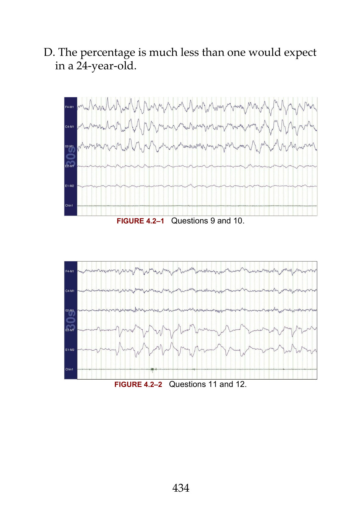

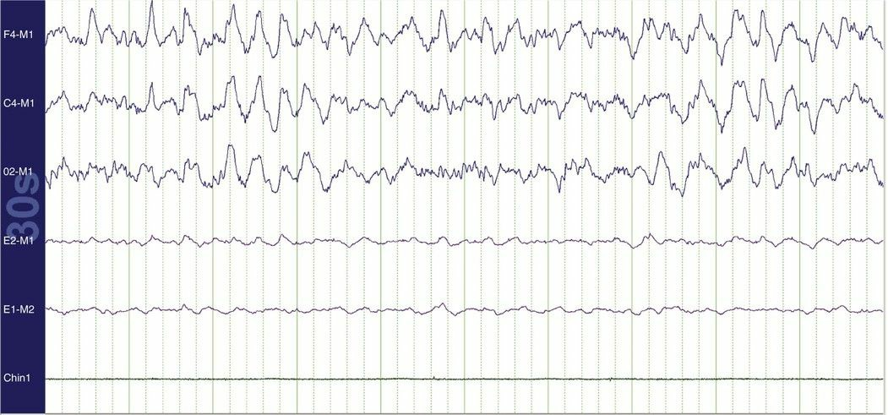

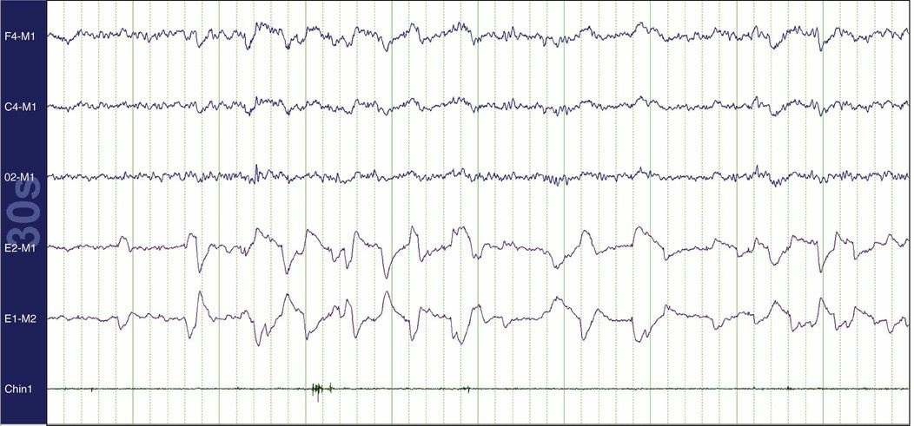

<!-- pdf-page: 435 -->

A 48-year-old Manhattan taxi driver has been “blacking out” at red lights, and after crashing into a parked car, he is referred for a sleep evaluation. He has a BMI of 38 and a neck collar size of 19 inches. His history includes snoring but no witnessed apneas. To stay awake, he drinks 10 cups of coffee a day. He starts his daily shift at 4 am and ends at 7 pm and lives about 40 minutes away from Manhattan. His ESS score is 4/24, pulse 90/min and regular, and blood pressure 150/95 mm Hg.

FIGURE 4.2–3 Questions 13 and 14.

#### Blacking Out at Red Lights

### A. Advise the patient to sleep at least 7 hours per day

15. What would you recommend?

### and to return if his sleepiness remains.

### B. Perform an MSLT to document sleepiness, because

### D. Perform an overnight comprehensive PSG.

### he is a hazard on the road.

### C. Start him on modafinil.

The patient has an overnight PSG, and 40% of the recording is similar to

Figure 4.2-4. The sleep study showed:

### 435

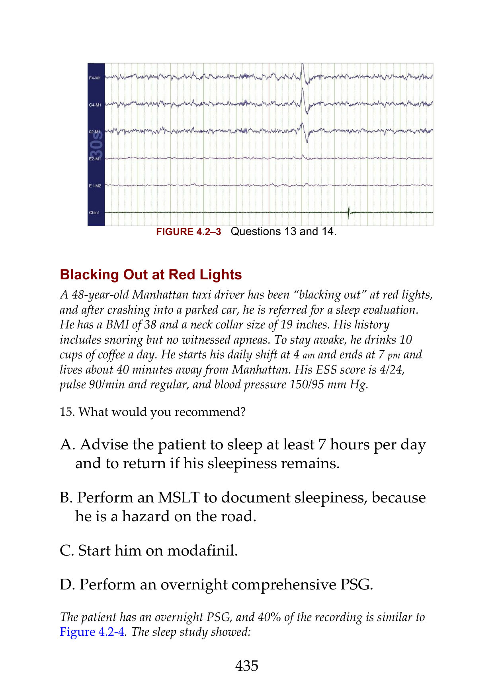

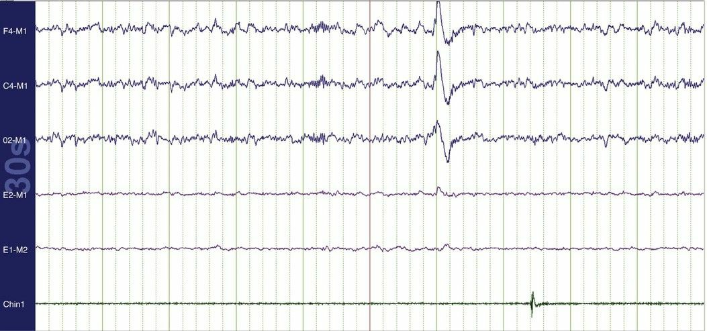

<!-- pdf-page: 436 -->

Sleep: Latency = 2 min; efficiency = 94%; stage R latency = 70 min; non- REM (NREM) sleep = 80% of sleep time; stage R = 20%; arousal index = 7/hr; PLM index = 4/hr

FIGURE 4.2–4 Question 16.

Breathing: AHI = 4 events/hr; RDI = 6 events/hr; low Sao2 = 93%

### A. Order MSLT to rule out narcolepsy, because the

16. What would you do next?

### B. Arrange for a CPAP titration study.

### REM latency was short.

### C. Refer to a neurologist to evaluate for epilepsy.

### D. Reassure the patient that his problem is sleep

### deprivation and strongly suggest that he sleep more

### —or else.

17. The patient returns a month later, requesting a prescription for modafinil. He now sleeps 8 hours a night and has done so for more than 2 weeks yet is still “blacking out” at red lights. He tried a few modafinil pills provided by another taxi driver and thought they

### 436

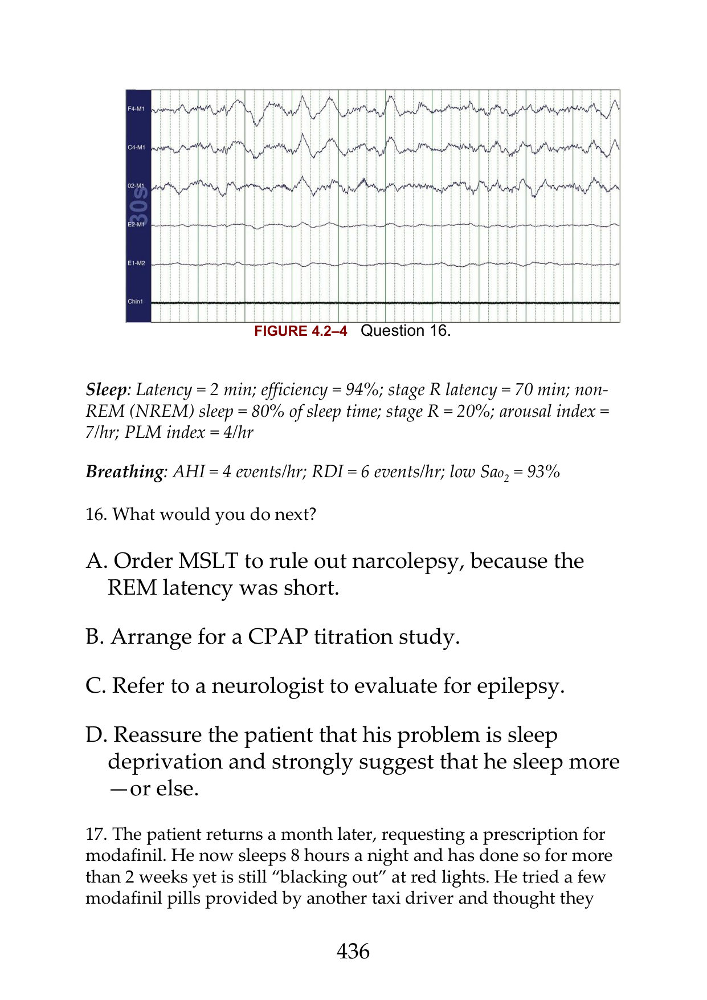

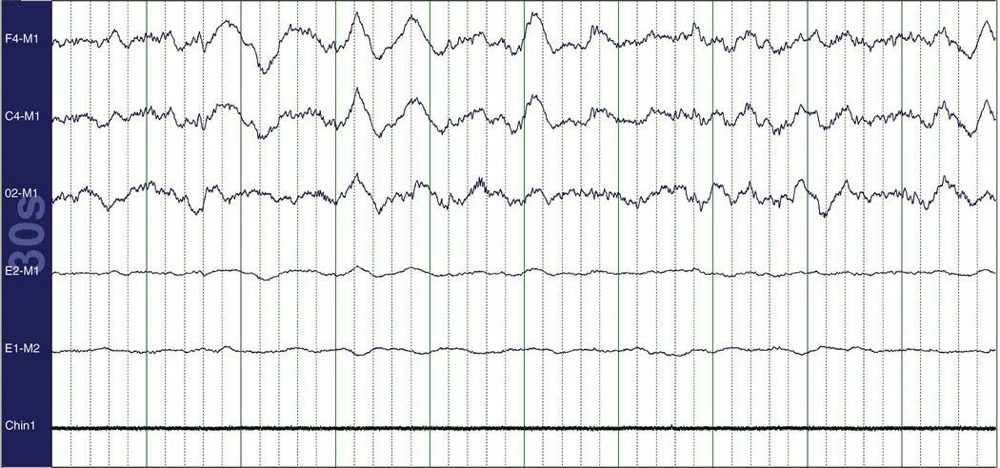

<!-- pdf-page: 437 -->

helped him. What would you do next?

### A. Prescribe modafinil.

### B. Order an MSLT alone.

### C. Order a maintenance of wakefulness test (MWT).

### D. Repeat the PSG followed by an MSLT.

18. What metabolic factors may explain the patient's obesity?

A military veteran is seen in the sleep disorders center because he has severe daytime sleepiness and does not believe he can safely drive a car. The symptoms started several weeks after suffering a concussion in a football game; he thought he had recovered from the concussion. Computed tomography (CT) and MRI of his brain are normal. He has a BMI of 29 and a snoring history but no witnessed apneas. His ESS score is 22/24.

### A. Low levels of ghrelin

### B. Low levels of leptin

### C. High levels of thyroid hormone

### D. Low levels of growth hormone

#### Sleepy after a Football Game

### A. PSG followed by MSLT if the PSG is normal

19. What is your next step?

### B. MSLT alone, because OSA is unlikely here

### C. MWT alone

### 437

<!-- pdf-page: 438 -->

### D. Clinical trial of modafinil

The following results were obtained on testing:

Sleep: Latency = 1 min; stage R latency = 70 min; stage N1 = 1% of sleep time; stage N2 = 49%; stage N3 = 25%; stage R = 25%; arousal index = 5/hr; PLM index = 1.2/hr

Breathing: AHI = 4 events/hr; RDI = 6 events/hr; low Sao2 = 93%

MSLT: Mean sleep latency = 2 min; SOREMPs = 0

20. Given these results, what would you do next?

### A. Tell the patient that no therapy works for his

### C. Repeat high-resolution imaging of the

### problem.

### B. Arrange a psychiatric evaluation.

1. C. The likeliest cause is major depressive disorder (MDD), which is diagnosed when the patient has had two or more major depressive episodes. It is beyond the scope of this volume to review the diagnosis of depression, but symptoms of MDD include depressed mood every day for at least 2 months and loss of interest in almost all activities. Another symptom is hypersomnia or insomnia every day. In this patient, the sleepiness preceded the use of the medication, although both MDD and the medication could cause sleepiness. The AHI, periodic limb movement index (PLMI), and arousal index are not sufficiently abnormal to explain the

### hypothalamic area.

### D. Begin a clinical trial of modafinil.

## Answers

### 438

<!-- pdf-page: 439 -->

daytime sleepiness. (ICSD3, pp 179-181)

2. B. The presence of leg movements per se is not an indication that they should be treated. There is certainly no indication that restless legs syndrome (RLS) is present and therefore no indication to prescribe pramipexole. Because the arousal index is normal, there is no reason to prescribe clonazepam at bedtime. Because virtually all antidepressants except bupropion have been associated with a movement disorder (RLS symptoms, motor restlessness, or PLMs), and because the antidepressant does not appear to be working, a trial of bupropion might be considered.

3. C. Female patients with sleep apnea are very likely to be treated for depression. Some are depressed, but for some it is a misdiagnosis that may deter you from doing a PSG and finding OSA. Insomnia is also a common presenting symptom of women with OSA. A clinical trial of CPAP would not be indicated, because a diagnosis of apnea has not been made, and insurance companies would not pay for the equipment without an objective diagnosis. It would be inappropriate to use modafinil at this point of management.

4. A. Stopping the antidepressant is not indicated, because the patient could be depressed. Clonazepam can worsen apnea and should be stopped. Modafinil should not be used at this point in management.

5. D. None of the tests mentioned will help in diagnosing or managing the patient's problems and therefore should not be done. In particular, the patient is unlikely to cooperate for any of the tests.

6. A. The description is classic for recurrent hypersomnia or Kleine- Levin syndrome (not Klein-Levine; the syndrome is named after early twentieth-century reports by German neurologist Will Kleine and American psychiatrist Max Levin). (ICSD3, pp 166-170)

7. C. No intervention is known to change the course of the illness.

8. C. No intervention is known to change the course of the illness.

### 439

<!-- pdf-page: 440 -->

In most cases, the episodes of sleepiness resolve within 1 to 4 years. The reader should note that lesions in the hypothalamus (tumors, etc.) can cause severe sleepiness, but the sleepiness is generally continuous and without spontaneous resolution.

9. C. This is stage N3, or slow-wave sleep (SWS).

10. D. It would be expected that a 24-year-old would spend more time in stage N3, or SWS. A value of about 20% would be considered normal.

11. B. This is classic REM sleep (stage R) with a mixed frequency electroencephalogram (EEG), eye movements, and absent chin muscle tone. Prozac eyes are pendulous movements that can be seen in patients on SSRIs in all stages of sleep. These were first described with fluoxetine. (Armitage et al, 1995)

12. B. The time is in the normal range for REM sleep.

13. C. To the right of the center of the epoch is a K complex. To the left is a sleep spindle. These are visible in the three EEG channels.

14. C. This is stage N2, and one would expect a 24-year-old to spend only about 50% of the total sleep time (TST) in this stage.

15. D. A comprehensive PSG is the correct answer, because not only is the patient sleep deprived, he is also at high risk of having sleep apnea. MSLT alone is not indicated in patients with sleep deprivation (except at times for medicolegal reasons). Modafinil is not indicated for sleep deprivation. Although answer A appears reasonable, because of the risk of sleep apnea, it is not. Note that the ESS is low, which reflects the fact that a patient whose job depends on alertness might lie to “pass the test” and/or drink large amounts of caffeine.

16. D. This is stage N3, or SWS. A substantial portion of the fragment reveals slow waves (Fig. 4.2-5). Sleep deprivation is the cause of the findings (SWS rebound), and no additional evaluation is required at this time. The official term for this is behaviorally induced insufficient sleep syndrome. The “or else” refers to the fact that

### 440

<!-- pdf-page: 441 -->

to protect the public's and the patient's safety, he could be reported to the authorities.

17. D. This scenario occurs commonly. There is no indication to perform a PSG if only insufficient sleep is suspected. However, if the patient states that he is sleeping an appropriate amount of time and still has severe sleepiness, an evaluation is in order. In this case, the next step would be a PSG followed by an MSLT. There is nightto-night variation, and perhaps a repeat study will show apnea (in which case the MSLT would be canceled). Or, the MSLT might confirm pathologic sleepiness and will perhaps even show SOREMPs. The next step for this patient would be to schedule a PSG followed by an MSLT. (ISCD3, pp 182-186)

FIGURE 4.2–5 Answer 16.

18. B. Leptin, a hormone secreted by adipocytes, acts on centers in the hypothalamus, suppressing food intake and stimulating energy expenditure. Ghrelin is a hormone produced by cells of the gastrointestinal (GI) tract, and it results in hunger (think of a growling stomach). Insufficient sleep has been shown to cause high levels of ghrelin, resulting in increased hunger. Sleep deprivation leads to reduced leptin and increased ghrelin.

19. A. A patient who has had a traumatic brain injury (TBI) and who has sleep complaints requires an evaluation. Of 57 patients

### 441

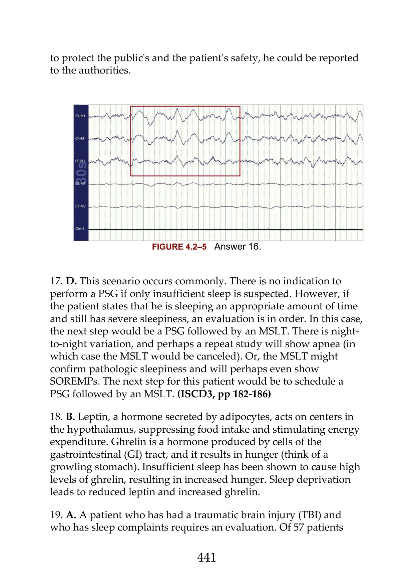

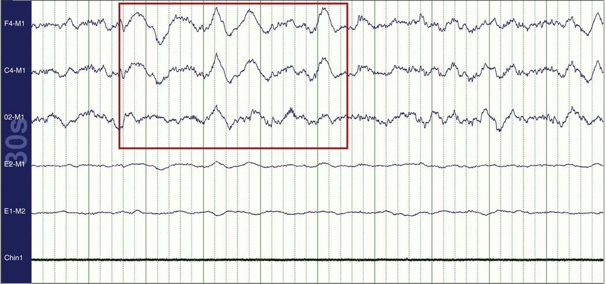

<!-- pdf-page: 442 -->

studied 3 months after TBI, 39% had abnormal sleep studies. Of subjects with abnormal sleep, 23% had sleep apnea, 3% had posttraumatic hypersomnia, 5% had narcolepsy, and 7% had periodic limb movement syndrome (PLMS). Objective excessive daytime sleepiness with sleep latency less than 10 minutes on the MSLT was found in 21% of the patients. (Castriotta et al, 2009)

20. D. Technically, the correct answer is A, because no drug has been shown to work consistently for TBI hypersomnia. However, the only randomized trial published to date shows sporadic but inconsistent improvement with modafinil. Thus a clinical trial is indicated, although it is unlikely to be successful. Interestingly, when apneas, hypopneas, and snoring were eliminated by CPAP in TBI patients found to have OSA, there was no significant change in MSLT scores. (Castriotta et al, 2009; Castriotta et al, 2011; Jha et al,

#### 2008)

A 35-year-old computer programmer has been cited for poor work performance, including falling asleep at his desk. He comes in with his wife, who says the problem has been noticeable the past few months; his first citation was a month ago, and she is concerned he is about to be fired. In your office he manifests flat affect but answers questions appropriately. His wife says he snores and she has not witnessed any apneas. She reports that he sleeps “at least 8 hours every night.” She helps him fill out the ESS form; the score is 16/24. His BMI is 31, and his neck circumference is 16.5 inches. There is a history of depression in college, for which he was briefly prescribed an antidepressant, but he is not currently taking any medications. You send him for an overnight PSG, followed the next morning by an MSLT. The results showed that he slept 7 hours out of 7.5 hours during the study time. The AHI revealed 5.9 events/hour, and low

## 4.3.

## Potpourri of Sleepiness

## Questions

#### Sleepy Computer Programmer

### 442

<!-- pdf-page: 443 -->

Sao2 was 89%. His average sleep latency on the MSLT was 13.5 minutes, and no SOREMPs were recorded.

1. The most likely diagnosis is

### C. Hypersomnia associated with a psychiatric

### A. Narcolepsy

### B. Idiopathic hypersomnolence

2. The definitive test for diagnosing hypersomnolence associated with a psychiatric disorder is

### disorder

### D. OSA

### C. Diagnosis of bipolar disorder or major depression

### A. MSLT

### B. Beck Depression Inventory

### in patient with hypersomnolence, normal PSG, and

### normal MSLT

A 23-year-old graduate student is evaluated for excessive daytime sleepiness (EDS). She has no significant health problems, but her ESS score is 17/24, and she complains of frequently falling asleep in seminars. She reports that her sleep is erratic, because she goes to bed late and sometimes has to get up early for school. On weekends she will often “sleep in until 10 or 11 am.” There is no history of cataplexy. Her father uses CPAP, and the patient thinks she may have OSA. Her BMI is 24. She has

### D. No test is definitive.

#### Sleepy Graduate Student

### 443

<!-- pdf-page: 444 -->

a live-in boyfriend and no history of heavy snoring or witnessed apneas. Because of her concern, you order a PSG followed by an MSLT.

She arrived to the sleep lab late and was not ready to start the study until after midnight. She slept a total of 5 hours and 20 minutes. Her AHI showed 2.4 events/hour, and low Sao2 was 92%. Her PLM index was increased at 27 movements/hour, and her arousal index was 15 arousals/hour. In the MSLT, latency to onset of sleep, averaged over five naps, was 5.4 minutes. She had two SOREMPSs in these five naps.

3. The most likely cause for her excessive daytime sleepiness (EDS) is

4. Which of the following statements is most correct about insufficient sleep syndrome?

### A. Narcolepsy without cataplexy

### B. Periodic limb movement disorder

### C. Idiopathic hypersomnolence

### D. Insufficient sleep syndrome

### A. A familial pattern is discernible in most patients.

### B. It is a subset of delayed sleep phase disorder that is

### C. When present in middle-aged or older people, it is

### common among adolescents.

### D. The diagnosis is made when a trial with longer

### a circadian rhythm disorder.

### sleep periods eliminates the patient's symptoms.

#### A Patient on Many Drugs

### 444

<!-- pdf-page: 445 -->

A 58-year-old woman is referred to you by her primary care physician for EDS, to “rule out sleep apnea.” Her ESS score is increased at 15/24. She is obese with a BMI of 33, but there is no history of witnessed apneas. She thinks her sleep is sufficient, “probably 7 to 8 hours a night.” You learn she has a psychiatric disorder and is taking Xanax, Seroquel, trazodone, and an opiate for chronic pain syndrome. You mention the possibility of medication side effects, but she states she has been on these drugs “for years.”

### D. Have her keep a detailed sleep diary and return in

5. The best next step is to

### A. Order a PSG.

### B. Stop at least two of the drugs.

### C. Prescribe modafinil.

Moderate OSA has been diagnosed in a 54-year-old man after a PSG. He has a BMI of 37 and a neck circumference of 18.5 inches. A second night in the lab reveals an optimal CPAP of 14 cm H2O, which is prescribed. He returns 60 days later, and the download of data from his CPAP machine indicates he is using it an average of 6 hours per night, 6 nights per week. He tells you that his sleepiness has improved since he began CPAP but that on some days, he is still severely sleepy, even when he has used CPAP the night before. To objectively measure his sleepiness, you order an MSLT, which shows a mean sleep latency of 6.5 minutes. His Epworth Sleepiness Scale (ESS) score is 15/24. You then prescribe 200 mg of modafinil.

### 2 weeks.

#### Sleepiness despite CPAP

6. Modafinil for treating residual sleepiness associated with OSA has been found to

### 445

<!-- pdf-page: 446 -->

### A. Increase sleep latency on the MSLT by 1 to 2

### minutes compared with baseline

### B. Increase sleep latency on the MSLT by 5 to 10

### C. Decrease the ESS score on average by 2 points

### minutes compared with baseline

### D. Decrease the ESS score on average by 5 points

7. The patient returns to see you 2 weeks later, and his sleepiness has resolved; however, he complains of side effects from taking the drug. Which one of the following adverse events associated with modafinil is least likely?

8. All of the following are true about the R-enantiomer of modafinil, armodafinil, except

### A. Headache

### B. Chest pain

### C. Rash

### D. Severe depression

### C. It has been approved by the FDA for treating EDS

### A. It has a longer half-life.

### B. It has the same potency.

### associated with narcolepsy, OSA, and shift-work

### disorder.

### 446

<!-- pdf-page: 447 -->

### D. It has a similar side effect profile.

#### Cataplexy Resistant to Treatment

A patient with previously diagnosed narcolepsy continues to have severe bouts of cataplexy. Treatment with an SSRI was marginally effective. You prescribe Xyrem (sodium oxybate), which is very effective for reducing or eliminating cataplexy.

9. The effects of sodium oxybate are not mediated by interaction with

### B. Gamma-aminobutyric acid B (GABAB) receptors

### A. Adenosine receptors

10. Sodium oxybate given to healthy subjects has what impact on sleep architecture?

### C. GHB receptors

### D. Dopamine receptors

A 31-year-old narcoleptic patient has been taking 250 mg of armodafinil, resulting in moderate success in reducing daytime sleepiness. The sleepiness is so severe upon awakening that she has to delay her drive to work until the armodafinil kicks in. You prescribe 10 mg of

### A. Increases N3

### B. Increases N1

### C. Increases REM

### D. Lengthens REM latency

#### A Sleepy Narcoleptic on Treatment

### 447

<!-- pdf-page: 448 -->

dextroamphetamine to be taken immediately upon awakening.

11. The mechanism of action of amphetamines is to directly

### A. Increase activity in histamine neurons

### B. Increase activity in dopamine system

### C. Increase activity in the orexin system

### D. Increase activity in ventrolateral preoptic (VLPO)

12. The patient's previous sleep specialist prescribed clomipramine for treatment of cataplexy. Tricyclic antidepressants (TCAs) interact with all of the following except

### neurons

13. Regarding lab tests for diagnosing narcolepsy, all of the following are true except

### A. Dopamine receptors

### B. Serotonin receptors

### C. Acetylcholine receptors

### D. Histamine receptors

### A. 12% to 38% of the general population is positive for

### HLA-DQB1*06:02, so HLA typing alone is not

### diagnostic for narcolepsy.

### B. 99% of patients with cataplexy are HLA-

### DQB1*06:02 positive, so a negative test essentially

### 448

<!-- pdf-page: 449 -->

### eliminates the possibility of hypocretin deficiency.

### C. 95% of patients with CSF hypocretin deficiency

### have a positive MSLT and cataplexy.

### D. In a majority of patients with narcolepsy with

### cataplexy (type 1 narcolepsy), CSF hypocretin will

### be less than 210 pg/mL.

14. All of the following are true of cataplexy except

### A. It usually is not the first symptom of type 1

### narcolepsy and typically occurs weeks to months

### after the onset of excessive sleepiness.

### B. In the vast majority of attacks, the cataplexy is

### C. The incidence of narcolepsy with cataplexy is 0.02%

### bilateral.

### D. Respiratory muscles are often involved in children

### to 0.18% in the United States.

In comparing narcolepsy with idiopathic hypersomnia, link the features in Questions 15 through 19 with the following:

### with cataplexy.

#### Comparisons

### A. Narcolepsy

### B. Idiopathic hypersomnia

### C. Both conditions

### 449

<!-- pdf-page: 450 -->

### D. Neither condition

15. Excessive daytime sleepiness

16. Presence of cataplexy

17. REM-related phenomenon common (e.g., sleep paralysis, hallucinations)

In comparing two drugs used to treat narcolepsy, choose the correct answer for Questions 20 through 22.

18. Reports of remission

19. Naps are frequently restorative.

22. Recommended to start drug in divided doses

### A. Modafinil

### B. Sodium oxybate

### C. Both

### D. Neither

20. First-line treatment for EDS

21. First-line treatment for cataplexy

1. C. Hypersomnia with a psychiatric disorder can only be

23. Metabolite of GABA

24. Approved for use in children

## Answers

### 450

<!-- pdf-page: 451 -->

diagnosed if the patient has a psychiatric disorder. In this case, there is history of depression, and the initial encounter suggests depression is significant. The other two criteria needed to make this diagnosis are symptoms for at least 3 months and symptoms not better explained by another sleep disorder. He meets all three criteria. The PSG is near normal; an AHI of 5.9 would not explain his daytime sleepiness. His MSLT results do not meet criteria for narcolepsy or idiopathic hypersomnia. (ICSD3, pp 179-181)

2. D. No definitive test exists for this diagnosis. Most important is to rule out other common causes of sleepiness, particularly insufficient sleep and medication side effects. The diagnosis is based on history, ruling out other conditions, and a confirmed psychiatric disorder. The above patient was referred to a psychiatrist for treatment of major depression.

3. D. Technically speaking, an MSLT is not valid if the patient begins the test with insufficient sleep. SOREMPs can appear in the setting of insufficient sleep, and in that situation, they cannot be used to diagnose narcolepsy. A minimum of 6 hours of sleep the night before is the threshold for doing an MSLT. Periodic limb movement disorder (PLMD) may cause EDS if the movements are associated with excessive arousals; in this patient's case, the arousal index was in the normal range (<20/hr). Idiopathic hypersomnolence can only be diagnosed when the sleep latency is ≤8 minutes on MSLT and the patient has had sufficient sleep before the test. In this case, there is abundant evidence for insufficient sleep syndrome: her own history, plus the PSG data. This patient really did not need the PSG and MSLT; a detailed sleep diary (kept by the patient or, if available, via actigraphy) would have confirmed insufficient total sleep over 24 hours.

4. D. No familial pattern is present to diagnose insufficient sleep syndrome. Delayed sleep phase disorder (DSPD) may lead to insufficient sleep, but the two are considered separate diagnoses; the latter is not considered a circadian disorder in any age group. The diagnosis is secure if longer sleep time corrects the problem. Note that “the diagnosis of insufficient sleep syndrome may be especially difficult to make in subjects who have a physiologic need

### 451

<!-- pdf-page: 452 -->

for unusually large amounts of sleep.” (ICSD3, pp 182-185)

5. A. EDS is often multifactorial, particularly in obese psychiatric patients who take medications that may cause hypersomnolence. This patient has at least four potential causes for her EDS: one or more medication side effects, OSA, insufficient sleep, and the psychiatric disorder itself. To sort all this out can sometimes take weeks or longer. Stopping psychiatric or pain medications is always problematic when the sleep physician did not prescribe them. If there is concern that the medications need adjustment or discontinuance, this recommendation is best shared with the patient and then conveyed to the prescribing physician. In this case, because she is obese, it is also important to rule out OSA as a contributing factor in her EDS. You would not want to prescribe modafinil as initial treatment for EDS, irrespective of the medication history. Finally, a sleep diary is always a good idea in cases of hypersomnolence but not as the sole next step when the patient may also have OSA.

6. A. In a double-blind, placebo-controlled study of patients who have OSA and residual excessive sleepiness while compliant with CPAP therapy, modafinil at doses of 400 mg improved objective measures of alertness on the MSLT by 1.2 minutes (sleep latency was 8.6 minutes compared with 7.4 minutes at baseline). Although this improvement on the MSLT is small, it does represent a statistically significant sign that modafinil improves alertness. (Black and Hirshkowitz, 2005)

7. D. The most common adverse event with modafinil is headache, which is not usually a problem if the dose is increased gradually. No significant cardiovascular adverse effects have been reported from treatment in the clinical trials, except with a previous history of cardiovascular sensitivity to activating or stimulant medications. In these cases, palpitations and chest pain have been reported. A few cases of severe allergic reactions resulting in rashes have been documented.

8. B. Compared with modafinil, armodafinil has a longer half-life and is approximately two times more potent once steady state is

### 452

<!-- pdf-page: 453 -->

achieved. (ATLAS2, Table 11.1-1) It has the same FDA indications as modafinil and a similar side effect profile.

9. A. GHB has a major effect on dopamine transmission, reducing firing rate and raising brain content of dopamine. GHB receptors have been identified in the brain, but GHB is also a GABAB agonist, which might account for the sedative-hypnotic effect. There is no known effect on adenosine. (ATLAS2, Table 11.1-1)

10. A. GHB causes subjective sedation in healthy subjects, increases N3 sleep, decreases stage N1, and reduces REM latency.

11. B. Amphetamines target release of catecholamines (both dopamine and norepinephrine) and inhibit reuptake from presynaptic terminals. Increasing activity in the VLPO would cause sleepiness. (ATLAS2, Table 11.1-1)

12. A. TCAs affect several neurotransmitter receptors including serotonin, norepinephrine, acetylcholine, and histamine. There is no known interaction with dopamine receptors.

13. D. In a majority of patients with type 1 narcolepsy, the CSF hypocretin will be ≤110 pg/mL, or less than a third of the mean values obtained in normal subjects. The other statements are all true. (ATLAS2, Fig. 11.1-5; ICSD3, p 146)

14. D. Characteristic of cataplexy is that respiratory muscles are not involved, in children or adults.

15. C. (ATLAS2, p 160)

16. A. (ATLAS2, p 160)

17. A. (ATLAS2, p 160)

18. B. (ATLAS2, p 160)

19. A. (ATLAS2, p 160)

20. A.

### 453

<!-- pdf-page: 454 -->

21. B.

22. B.

23. B.

▪ International Classification of Sleep Disorders, ed 3, pp 143-188

24. D.

## Summary

### Highly Recommended

#### Other Disorders That Cause Hypersomnia

From the blueprint, you can expect about 10 questions covering hypersomnia exclusive of narcolepsy and cataplexy. The topic areas include recurrent hypersomnia (Kleine-Levin syndrome), idiopathic hypersomnia, insufficient sleep, and hypersomnia in psychiatric disease. Of course, hypersomnia is a common symptom of other sleep disorders, such as sleep apnea, and thus the conditions mentioned here would be considered in the differential diagnosis in questions evaluating other areas. In the summary, we use the same sequence as described in the American Board of Internal Medicine (ABIM) blueprint: psychiatric disease, recurrent hypersomnia, idiopathic hypersomnia, insufficient sleep, and posttraumatic hypersomnia.

### Psychiatric Disease (see also Section 8 of

### this volume)

### ❍ Hypersomnia (and/or insomnia) nearly every day

▪ Major depressive disorder (MDD)

### are symptoms that are included in list of diagnostic

### criteria.

### 454

<!-- pdf-page: 455 -->

### ❍ Hypersomnia can be caused by sedating

### medications used for treatment.

### ❍ Hypersomnia can be caused by medications used to

### treat the patient and that cause another sleep

### disorder.

### • Antidepressants (an exception is bupropion) can

### • Antidepressants (e.g., mirtazapine) can cause

### cause a movement disorder.

### weight gain and cause or worsen sleep apnea.

### ○ Mirtazapine has been evaluated as a treatment for

### sleep apnea. It is not effective and can worsen

### apnea. (Marshall et al, 2008)

### ❍ Disturbed sleep is a common (but not defining)

▪ Other psychiatric disorders

### symptom of several psychiatric conditions.

### ❍ Medications used to treat anxiety and psychotic

### • Indirectly by further disturbing sleep

### disorders can cause sleepiness.

### • Directly owing to a sedating effect

### Recurrent Hypersomnia (ICSD3, pp 166-170)

▪ Kleine-Levin syndrome

### 455

<!-- pdf-page: 456 -->

### ❍ Epidemiology

### • Rare

### • Much more common in male patients

### • Starts in teenage years

### • Recurrent episodes of hypersomnia

### ❍ Clinical features

### ○ Occuring between 1 and 10 times a year

### ○ Sleeping up to 18 hours a day

### ○ Lasting a few days to weeks

### ○ Confusion, irritability, aggression, hallucinations

### • Hyperphagia during episodes

### • Hypersexuality during episodes

### • Abnormal behavior

### • Normal sleep and behavior between episodes of

### • Duration of episodes is from 1 to several years

### hypersomnia

### ❍ Course

### (average is about 4 years).

### 456

<!-- pdf-page: 457 -->

### ❍ Treatment

### • There is no effective treatment. (Huang et al, 2010)

### ○ Stimulants can have unwanted psychiatric effects.

### ○ Case reports have described positive outcomes.

### • May be familial (Rocamora et al, 2010)

### ◆ With gabapentin

### ◆ With carbamazepine

▪ Menstrual-related hypersomnia

### ❍ Epidemiology

### • Rare

### • Possibly related to reproductive hormones

### ❍ Pathophysiology

### • Hypersomnia related to menstrual cycle

### ❍ Clinical features

### • Male siblings can have Kleine-Levin syndrome

### • Might respond to oral contraceptives

### ❍ Treatment

### 457

<!-- pdf-page: 458 -->

### Idiopathic Hypersomnia (ICSD3, pp 161-166)

▪ Epidemiology

### ❍ Rare

### • 2 to 3 hours of sleep inertia in the morning

### ❍ 50 per million people

▪ Clinical features

### ❍ Onset ages: 10 to 30 years

### ❍ Sleepiness

### • Constant

### • Naps prolonged

### • Naps not refreshing

### ❍ Sleepiness is present for at least 3 months.

### • May be aggressive after awakening

▪ Diagnosis (ICSD3, pp 161-166)

### ❍ MSLT shows fewer than two SOREMPs.

### ❍ Cataplexy is absent.

### ❍ MSLT mean sleep latency ≤8 minutes, or total 24-

### hour sleep time is ≥660 minutes.

### 458

<!-- pdf-page: 459 -->

### ❍ Insufficient sleep time is ruled out.

### ❍ Findings are not better explained by another

### disorder or use of drugs.

### ❍ No consistently effective treatment is available.

▪ Treatment

### ❍ Modafinil response is less robust than in

### ❍ Works best in patients with long sleep times.

### narcolepsy.

### Insufficient Sleep Syndrome, or Behaviorally

### Induced Insufficient Sleep Syndrome (ICSD3,

### pp 182-186)

### ❍ Sleep duration below population norms

▪ Diagnosis

### ❍ Present at least 3 months

### ❍ PSG (not required for diagnosis)

### • High sleep efficiency

### • Might have SOREMPs

### • Can have increased stage 3 sleep

### ❍ MSLT (not required for diagnosis)

### 459

<!-- pdf-page: 460 -->

### • Mean sleep latency ≤8 minutes

### • One or more SOREMPs can occur.

### ❍ Trauma results in loss of hypocretin (orexin)

### Posttraumatic Hypersomnia

▪ Pathophysiology

### ❍ Sleepiness occurs after head trauma.

### neurons. (Baumann et al, 2009)

▪ Clinical features

### ❍ No established treatment (Jha et al, 2008)

### ❍ Sleepiness may be persistent.

▪ Treatment

American Academy of Sleep Medicine. International

## References

classification of sleep disorders. ed 3. American Academy of Sleep Medicine: Darien, Ill.; 2014. Armitage R, Trivedi M, Rush AJ. Fluoxetine and oculomotor

activity during sleep in depressed patients. Neuropsychopharmacology. 1995;12:159–165. Baumann CR, Bassetti CL, Valko PO, et al. Loss of hypocretin

(orexin) neurons with traumatic brain injury. Ann Neurol. 2009;66:555–559. Black JD, Hirshkowitz M. Modafinil for treatment of residual

excessive sleepiness in nasal continuous positive airway pressure–treated obstructive sleep apnea/hypopnea syndrome. Sleep. 2005;28:464–471.

### 460

<!-- pdf-page: 461 -->

Castriotta RJ, Atanasov S, Wilde MC, et al. Treatment of sleep

disorders after traumatic brain injury. J Clin Sleep Med. 2009;5:137–144. Castriotta RJ, Murthy JN. Sleep disorders in patients with

traumatic brain injury: a review. CNS Drugs. 2011;25:175– 185. Huang YS, Lakkis C, Guilleminault C. Kleine-Levin

syndrome: current status. Med Clin North Am. 2010;94(3):557–562. Jha A, Weintraub A, Allshouse A, et al. A randomized trial of

modafinil for the treatment of fatigue and excessive daytime sleepiness in individuals with chronic traumatic brain injury. J Head Trauma Rehabil. 2008;23(1):52–63. Kryger MH, Avidan A, Berry R. Atlas of clinical sleep medicine.

ed 2. Saunders: Philadelphia; 2014. Marshall NS, Yee BJ, Desai AV, et al. Two randomized

placebo-controlled trials to evaluate the efficacy and tolerability of mirtazapine for the treatment of obstructive sleep apnea. Sleep. 2008;31:824–831. Rocamora R, Gil-Nagel A, Franch O, Vela-Bueno A. Familial

recurrent hypersomnia: two siblings with Kleine-Levin syndrome and menstrual-related hypersomnia. J Child Neurol. 2010;25(11):1408–1410.

## Section E4 Hypersomnolence

1. A 32-year-old Navy helicopter pilot is referred to the sleep clinic with an unusual history. While flying last week, the helicopter's low oil pressure light flashed and an alarm went off. Instantly, the pilot's head slumped, and he lost strength in his right hand. He recovered quickly and landed safely. You learn that since age 15, he's had severe daytime sleepiness; the problem was originally diagnosed as attention-deficit/hyperactivity disorder (ADHD), and he has been on medication for it ever since. He was warned that the pills might increase blood pressure. He never indicated to the Navy he was taking medication, and except for this problem, he has been

### Questions

### 461

<!-- pdf-page: 462 -->

healthy. What is the most likely diagnosis?

### A. Epilepsy

### B. Cardiac arrhythmia

### ANSWER: D. The diagnosis is suggested by severe

### C. Transient ischemic attack

### D. Narcolepsy with cataplexy

### sleepiness that began as a teenager and the

### symptom of instant loss of muscle tone in his neck

### muscles and arm while maintaining consciousness.

### It is important to remember that there are two

### forms of narcolepsy: type 1, with cataplexy (ICSD3,

### pp 146-155) and type 2, without cataplexy. (ICSD3,

### pp 155-161) CSF hypocretin-1 deficiency is

### characteristic of type 1 narcolepsy. (ICSD3, p 146)

2. A 15-year-old high school student is diagnosed with narcolepsy with cataplexy. She is prescribed a nap to be taken right after lunch and before her 1:00 pm class begins. Her school accommodates this request. Which statement about these midday naps is likely to be true?

### A. She feels refreshed for 1 to 3 hours after the naps.

### B. She dreams infrequently or not at all during naps.

### C. She is likely to stop breathing during these naps.

### D. She has been noted to twitch during naps.

### 462

<!-- pdf-page: 463 -->

### ANSWER: A. Naps are very refreshing for narcolepsy

### patients, and strategically timed naps are often

### helpful. (ATLAS2, p 160) Patients become more

### alert and energetic for up to several hours after the

### nap. Students who can take a second nap after

### school will often maintain alertness into the

### evening. For patients with obstructive sleep apnea

### (OSA) or idiopathic hypersomnia, the feeling of

### sleepiness does not improve much with napping.

3. A 16-year-old female student was diagnosed with narcolepsy with cataplexy and started on modafinil, 200 mg in the morning and 200 mg at noon. She responded very well, with relief of daytime sleepiness. Two months after starting treatment, she obtained a learner's permit to drive. Late one night, she violated the permit regulations and drove her friend home. On returning home at 11 pm, her car drifted over to the other lane, and she was hit by an oncoming truck and was killed instantly. She most likely had

### C. A cardiac arrhythmia caused by modafinil

### A. A cataplectic episode

### B. A transient ischemic attack

### D. A blood modafinil level that was too low

### ANSWER: D. Although the half-life of modafinil is in

### the 10- to 15-hour range, clinical experience

### suggests that it is effective for only about 10 hours

### after the last dose. The highest concentration is

### reached 2 to 4 hours after an oral dose. R-modafinil

### has a longer half-life and is about two times more

### 463

<!-- pdf-page: 464 -->

### potent. It is important to know about the

### medications used to treat the symptoms of

### narcolepsy. (ATLAS2, pp 113-116 and 173, Table

### 11.1-1)

4. A 19-year-old student has a 5-month history of severe daytime sleepiness and cataplexy. An overnight PSG would most likely show

### D. An increased amount of REM sleep

### A. Early-onset REM sleep

### B. Late-onset REM sleep

### C. No REM sleep

### ANSWER: A. Typical in patients with narcolepsy is

### early-onset REM sleep. REM sleep normally first

### appears about 90 minutes after sleep onset. In a

### patient symptomatic with daytime sleepiness, REM

### that occurs within 15 minutes of the first EEG sign

### of any sleep strongly suggests narcolepsy. The

### ICSD3 now provides for one SOREMP in the PSG

### (REM within 15 minutes of sleep onset) to be

### combined with one SOREMP in the MSLT to satisfy

### the two-SOREMP criterion for diagnosis of

### narcolepsy. (ICSD3, p 152)

5. What finding on the MSLT would be most confirmatory of narcolepsy?

### A. Mean sleep onset (after lights out) averaging less

### 464

<!-- pdf-page: 465 -->

### than 5 minutes for all naps

### B. Hallucinations and/or sleep paralysis in at least one

### of the naps in association with REM sleep

### C. Two or more naps where REM sleep occurs within

### D. Average sleep onset of less than 5 minutes and at

### the first 15 minutes

### least one nap on the MSLT showing a SOREMP

### ANSWER: C. To help confirm the diagnosis of

### narcolepsy, the MSLT should show an average

### sleep latency ≤8 minutes and two or more naps with

### early-onset REM sleep (SOREMP); this means REM

### sleep that occurs within 15 minutes of lights out. If

### there is only one SOREMP in the first four naps of

### the MSLT, a fifth nap should be done. Also note

### that the ICSD3 now provides for one SOREMP in

### the PSG (REM within 15 minutes of sleep onset) to

### be combined with one SOREMP in the MSLT to

### satisfy the two-SOREMP criterion for diagnosis of

### narcolepsy. (ICSD3, p 152) If there is a short sleep

### latency (≤8 minutes) and fewer than two SOREMPs

### by the new criteria, the diagnosis is consistent with

### idiopathic hypersomnia.

6. A 24-year-old woman was recently diagnosed with narcolepsy. She takes phenytoin for a seizure disorder and oral contraceptives. You are considering starting modafinil. What do you advise her regarding modafinil?

### 465

<!-- pdf-page: 466 -->

### A. Modafinil has no interactions with her two

### medications.

### B. Modafinil may lower the concentration of the

### estrogen component of the contraceptive and may

### increase the level of phenytoin.

### C. Modafinil may increase the concentration of both

### the estrogen component of the contraceptive and

### the level of phenytoin.

### D. Modafinil may lower the concentration of both the

### estrogen component of the contraceptive and the

### level of phenytoin.

### ANSWER: B. Modafinil inhibits the drug-

### metabolizing enzyme CYP2C19 and thus may

### increase the blood level of drugs eliminated by that

### enzyme. Examples of CYP2C19-metabolized drugs

### include diazepam, phenytoin, and propranolol.

### Modafinil may also induce the metabolizing

### enzyme CYP3A4, reducing the levels of

### medications affected by that enzyme system; drugs

### that utilize this metabolic pathway include steroidal

### contraceptives and cyclosporine.

7. A 22-year-old woman complains of daytime sleepiness. Her overnight PSG shows a REM latency of 30 minutes. The MSLT reveals mean sleep latency of 4 minutes, and two of four naps show REM sleep. She is started on modafinil, 100 mg every morning. A week later she complains of palpitations and is referred to a cardiologist. After cardiac evaluation, she is diagnosed with Wolff- Parkinson-White syndrome and hypertension. What is your next

### 466

<!-- pdf-page: 467 -->

step?

### A. Reassure the patient that modafinil has no effect on

### the cardiovascular system.

### B. Discontinue the modafinil and start

### C. Discontinue the modafinil and start pemoline.

### methylphenidate.

### D. Discontinue the modafinil and start sodium

### ANSWER: D. Although modafinil does not cause the

### oxybate.

### severe sympathomimetic effects seen with

### traditional stimulant medications, increases in

### blood pressure (both systolic and diastolic) and

### heart rate have been documented. (Taneja I,

### Diedrich A, Black BK, et al: Modafinil elicits

### sympathomedullary activation, Hypertension

### 45:612-618, 2005)

8. A 28-year-old man is diagnosed with narcolepsy based on a history that includes severe daytime sleepiness and loss of muscle tone during periods of laughter. He is started on modafinil, 200 mg in the morning, and sodium oxybate, 5 g in equally divided doses (2.5 mg at bedtime and 2.5 mg 4 hours later). The patient calls to report that his wife finds him sleepwalking almost every night. He has no recollection of these events. How would you explain his sleepwalking?

### A. It is one of the symptoms of narcolepsy.

### B. Modafinil is causing it.

### 467

<!-- pdf-page: 468 -->

### C. Sodium oxybate is causing it.

### D. The patient has likely developed temporal lobe

### epilepsy.

### ANSWER: C. Sleepwalking has long been recognized

### as a potential side effect of sodium oxybate.

9. A 35-year-old patient has a 6-year history of daytime sleepiness. He has been treated with Coumadin for 7 years following an episode of severe pulmonary embolism. He also has mild bronchial asthma that is well controlled by inhaled steroids. His overnight sleep study shows frequent arousals and periodic limb movements but is otherwise unremarkable. The MSLT shows mean sleep latency of 3 minutes with REM sleep documented on three of four naps. He is started on modafinil 200 mg in the morning and 200 mg at lunchtime. The medication does not improve his daytime sleepiness, and you consider using methylphenidate. What should you advise the patient?

### A. He does not have a disorder that is affected by

### B. Methylphenidate may paradoxically improve his

### methylphenidate.

### C. Methylphenidate may increase coagulability.

### asthma.

### D. Methylphenidate increases the level of Coumadin

### ANSWER: D. Besides the sympathomimetic side

### in the blood and may cause bleeding.

### effects of methylphenidate (hypertension and

### tachyarrhythmias), it may increase blood level of

### 468

<!-- pdf-page: 469 -->

### coumadin and may also cause thrombocytopenia,

### increasing the risk of bleeding. (ATLAS2, p 114)

10. A 27-year-old captain of a fishing vessel has been found asleep at inappropriate times and is referred for a sleep evaluation. His employer asks for a maintenance of wakefulness test (MWT) to indicate that he is fit for duty. The patient gives a history of severe sleepiness and cataplexy for the past 8 years. You order an overnight PSG followed by an MSLT. The decision to order the MSLT instead of the MWT is based on your knowledge of the tests. Regarding these two tests, which of the following statements is not true?

### A. MSLT is used to measure the physiologic tendency

### B. Normal and abnormal ranges of sleep latencies

### to fall asleep in quiet situations.

### have been established for MSLT and MWT, when

### administered between 8 am and 6 pm, and for

### individuals older than 8 years of age.

### C. Results of the MWT and MSLT for the same

### individual correlate well with one another.

### D. The MSLT should be performed after a preceding

### PSG with at least 6 hours of recorded sleep, with

### adequate sleep for the previous 2 weeks

### documented by a sleep diary or actigraphy.

### ANSWER: C. The MSLT and MWT are not equivalent

### evaluations of daytime sleepiness. The MSLT

### measures the propensity to fall asleep, whereas the

### MWT measures the ability to stay awake.

### 469

<!-- pdf-page: 470 -->

### Surprisingly, the two tests are not highly correlated.

### There is much greater clinical experience with the

### MSLT than with the MWT. A mean sleep latency

### under 8 minutes is considered abnormal for both

### tests. The MWT has not been validated in the

### diagnosis of narcolepsy. (ATLAS2, p 392)

11. Which statement about cataplexy is incorrect?

### A. Loss of both muscle tone and deep tendon reflexes

### B. Positive emotional triggers (e.g., laughter, elation)

### can be triggered by emotion.

### more commonly cause cataplexy than negative

### emotional triggers (e.g., anger, agitation).

### C. Affected areas during cataplexy attacks most

### commonly include knees, face, and neck and may

### range from facial sagging to complete collapse.

### D. A loss of consciousness occurs with amnesia.

### ANSWER: D. Patients having a cataplexy episode are

### conscious, and after regaining muscle control, they

### demonstrate no confusion or neurologic

### deficits. (ATLAS2, pp 159-160, 162)

12. Which of the following is not a clinical feature of patients who have narcolepsy with cataplexy?

### A. Daytime sleepiness and possible sleep attacks

### B. Respiratory compromise during cataplexy from

### 470

<!-- pdf-page: 471 -->

### diaphragm weakness

### C. REM-related phenomena such as sleep paralysis

### and automatic behavior

### D. Loss of muscle tone triggered by emotional stimuli

### ANSWER: B. The diaphragm, the main muscle of

### inspiration, is spared during cataplexy episodes,

### and thus there is no respiratory compromise.

13. Which of the following is not a feature of cataplexy attacks?

### D. Duration of less than 5 minutes for most episodes

### A. Maintenance of consciousness

### B. Memory of events

### C. Enuresis during most episodes

### ANSWER: C. Enuresis has not been described as a

### feature of cataplexy. (ATLAS2, pp 159-160, 162)

14. Which statement about sleep paralysis is incorrect?

### A. Patients can cry out during the episodes.

### B. Patients may have vivid visual hallucinations.

### C. Patients may have auditory hallucinations.

### D. Patients may have tactile hallucinations.

### 471

<!-- pdf-page: 472 -->

### ANSWER: A. Patients having an episode of sleep

### paralysis are conscious but are unable to move their

### extremities or speak. They may have the perception

### of impending doom, and even when alone, they

### may have the sensation that someone else is in the

### room. They may have vivid visual, auditory, or

### tactile hallucinations. (ATLAS2, p 119)

15. A patient is brought to the emergency department (ED) by his wife because “lately, he's been sleepy all the time.” His medication list includes trazodone, quetiapine, methadone, and prn alprazolam (as needed). You find him arousable but very sleepy; he is oriented to name and date and shows no evidence of respiratory distress. He came in on nasal O2, and his Sao2 is 95% by pulse oximetry. The best next step is to

### A. Administer naloxone to reverse any sedating effect

### B. Administer flumazenil to reverse any sedating

### of the opiate.

### ANSWER: D. In patients with recent onset of

### effect of the benzodiazepine.

### C. Obtain a stat brain CT scan.

### D. Check arterial blood gas.

### hypersomnia, you should always consider

### hypoventilation. This patient is on several

### potentially sedating drugs, and methadone is also

### known to cause hypoventilation. Appropriate

### treatment would depend on the presence and

### degree of hypoventilation and hypoxemia. Note

### 472

<!-- pdf-page: 473 -->

### that Sao2 can be normal even in profoundly

### hypoventilating patients if they are receiving

### supplemental O2.

16. A 12-year-old boy has recently developed some bizarre behavior, such as severe daytime sleepiness and, when he awakens, hyperphagia and hypersexual behavior, including masturbation in front of his family. Some days he may sleep up to 18 hours. What is the likely diagnosis?

### B. Narcolepsy secondary to a hypothalamic tumor

### A. Paranoid schizophrenia

### D. Idiopathic hypersomnia with long sleep time

### C. Kleine-Levin syndrome (KLS)

### ANSWER: C. Patients with KLS are usually males,

### and they typically have long bouts of sleep. When

### awake they often exhibit hyperphagia,

### hypersexuality, and aggressiveness. This group of

### symptoms may last one to several weeks, followed

### by remission, and it may recur several times a year.

### In between these symptomatic periods, the patient

### is apparently normal. Episodes are typically gone

### by age 20. (ATLAS2, p 161; ICSD3, pp 166-170)

17. The diagnostic criteria for KLS include all of the following except

### A. The patient experiences recurrent episodes of

### excessive sleepiness that can last up to 4 weeks.

### 473

<!-- pdf-page: 474 -->

### B. Episodes recur at least once a year.

### C. The patient has normal alertness, cognitive

### functioning, and behavior between attacks.

### D. An MSLT is required for diagnosis and shows a

### mean sleep latency of less than 8 minutes but no

### SOREMPs.

### ANSWER: D. KLS, also known as recurrent

### hypersomnia, is a clinical diagnosis, and an MSLT is

### not required. In fact, an MSLT is difficult to do

### during a bout of recurrent hypersomnia, because

### the patient will not cooperate. (ICSD3, pp 166-170)

18. All of the following are true about behaviorally induced insufficient sleep syndrome except

### A. The patient persistently fails to obtain the amount

### of sleep needed to maintain normal levels of

### alertness and wakefulness.

### B. The patient engages in voluntary chronic sleep

### C. Clinically significant psychopathology is evident.

### deprivation.

### D. The extent of the sleep deprivation is

### ANSWER: C. The problem in behaviorally induced

### underappreciated by the patient.

### insufficient sleep syndrome is that patients will not

### 474

<!-- pdf-page: 475 -->

### get enough sleep when they could do so with effort.

### Such patients go to sleep too late and/or wake up

### too early, a pattern often related to their work. On

### weekends and during vacation, they typically sleep

### much longer. Treatment is convincing the patient to

### get more sleep; with more sleep, their daytime

### hypersomnolence resolves. (ICSD3, pp 182-186)

19. A 45-year-old man, 186 lb and 5′10″ tall, complains of excessive daytime sleepiness. His ESS score is 17/24. His wife complains that he snores and stops breathing during sleep. On overnight PSG, his AHI was 20.5 events/hr, and low Sao2 was 86%. With 8 cm H2O CPAP, his AHI is 0.7 events/hr with a low Sao2 of 92%. CPAP is prescribed at this pressure, and in follow-up 5 weeks later, he is found to be fully compliant with the mask, wearing it whenever he sleeps. He states that he feels better but still feels sleepy during the day. His ESS score is now 15/24. Compliance data show that he uses CPAP an average of 5 hours per night. When asked why only 5 hours, he states “that's all I sleep; I never get more than 5 or 6 hours a night, and it's been that way since college.” The next step is to

### A. Prescribe modafinil for daytime sleepiness along

### B. Repeat the in-lab CPAP titration to determine

### with continued CPAP.

### whether 8 cm is an adequate pressure.

### C. Order an autotitration CPAP study in his home to

### D. Explain that daytime sleepiness is likely a result of

### better determine his correct pressure.

### insufficient sleep and that he needs more sleep

### time.

### 475

<!-- pdf-page: 476 -->

### ANSWER: D. Three common causes of excessive

### daytime sleepiness (EDS) are insufficient sleep time,

### OSA, and medication side effects. This patient was

### taking no medications. His CPAP was adequately

### titrated while he slept, but his sleep time was

### insufficient. Modafinil is indicated as a stimulant

### for patients treated with CPAP who remain sleepy

### despite adequate sleep and full compliance with the

### mask. That is not the situation here.

20. A 50-year-old woman with a history of depression complains of EDS. Her medications include quetiapine, bupropion XL, fluoxetine, and lamotrigine. Which drug is most likely responsible for her daytime sleepiness?

### ANSWER: A. Quetiapine is a popular second-

### A. Quetiapine

### B. Bupropion XL

### C. Fluoxetine

### D. Lamotrigine

### generation antipsychotic, and a common side effect

### is next-day sedation. (Komossa K, Depping AM,

### Gaudchau A, et al: Second-generation

### antipsychotics for major depressive disorder and

### dysthymia, Cochrane Database Syst Rev

### 12:CD008121, 2010) Among the drugs listed,

### quetiapine is much more likely to cause

### hypersomnia. Medications are a common cause of

### 476

<!-- pdf-page: 477 -->

### EDS and should not be overlooked in the history.

### Drug side effect is often a comorbid cause of

### hypersomnia, along with sleep apnea and/or

### insufficient sleep.

21. A 51-year-old man comes to the sleep clinic with daytime hypersomnolence. His ESS score is 15/24. He does factory work from 7 am to 3 pm 5 days a week. He goes to bed about 9 pm and is up at 5:30 on workdays. He weighs 250 lbs and is 5′9″ tall, and his Mallampati score is II to III. To help him fall asleep, his doctor prescribed 50 mg trazodone at bedtime. The patient also takes a blood pressure pill and a multivitamin. He thinks he snores, but his wife has not commented on apneas during sleep. The next step should be

### A. Have him stop the trazodone, and see if his

### B. Have him keep a 2-week sleep diary to ensure he is

### sleepiness improves.

### C. Start modafinil 200 mg in the morning.

### actually getting enough sleep.

### ANSWER: D. The three most common causes of EDS

### D. Schedule an overnight PSG.

### are insufficient sleep, medication side effects, and

### OSA. Information is sufficient in this case to suspect

### OSA, so it should be ruled out as the cause of his

### hypersomnia. Trazodone is an antidepressant that

### can cause next-day sleepiness, but 50 mg is a low

### dose and in any case does not obviate the need to

### evaluate for OSA.

### 477

<!-- pdf-page: 478 -->

22. A 62-year-old man has been treated for sleep apnea with CPAP at 13 cm H2O. He uses the CPAP at least 7 to 8 hours nightly by compliance data, but after 6 months, he still complains of hypersomnolence. In the interim he has gained 10 lb and now weighs 220 lb (he is 5′8″ tall). The next step should be

### A. Check the patient's detailed sleep diary to see how

### B. Do an autotitration home study to see if he needs a

### much sleep he is getting.

### C. Send him to the lab for a titration with bilevel

### higher pressure.

### D. Start a trial of modafinil 200 mg in the morning.

### pressure.

### ANSWER: D. A 10-lb weight gain is unlikely to

### require a significantly higher pressure, assuming

### the initial study was adequate. He fits into that

### subgroup of adequately treated OSA patients with

### residual hypersomnolence. Modafinil (and

### armodafinil) are FDA approved for treatment of

### this condition as well as for shift-work sleep

### disorder. (ATLAS2, pp 113-115)

23. A common cause of hypersomnia in Africa is

### C. Acquired immune deficiency syndrome (AIDS)

### A. Trypanosomiasis

### B. Ebola virus

### 478

<!-- pdf-page: 479 -->

### D. Malaria

### ANSWER: A. African trypanosomiasis (sleeping

### sickness) is caused by transmission of

### trypanosomes by tsetse flies, and it is a common

### cause of severe hypersomnia in Western Africa

### (Trypanosoma brucei gambiense) and Eastern Africa

### (Trypanosoma brucei rhodesiense). The possibility of

### human African trypanosomiasis needs to be

### assessed in persons with excessive daytime

### sleepiness who have traveled in or migrated from

### Africa.

24. In evaluating daytime sleepiness, which of the following is true about the Epworth Sleepiness Scale (ESS) and the Stanford Sleepiness Scale (SSS)?

### A. Normative data exist for SSS but not for the ESS.

### B. SSS asks how sleepy you are now; ESS asks how

### sleepy you tend to be in certain situations.

### C. Both scales correlate strongly with the MSLT.

### D. Both use a seven-part questionnaire.

### ANSWER: B. Normative data exist for ESS but not for

### SSS. ESS correlates weakly with MSLT, the latter is

### an objective index of sleep drive. The ESS uses an

### eight-part questionnaire, and the SSS uses a

### questionnaire with seven levels of wakefulness,

### from wide awake to “almost in reverie.” (ATLAS2

### 479

<!-- pdf-page: 480 -->

### pp 129, 392)

25. Sleep apnea (SA) in adults is defined as an AHI of 5/hr or greater. Sleep apnea syndrome (SAS) is defined as an AHI of 5/hr or greater with daytime hypersomnolence. Based on a large epidemiologic PSG study of middle-aged subjects, what percent of men and women had SAS?

### ANSWER: A. In one study, 9% of women and 24% of

### A. 2% of women, 4% of men

### B. 9% of women, 24% of men

### C. 6% of both women and men

### D. 5% of both women and men

### men had an AHI of 5 or more without daytime

### somnolence. (Young T, Palta M, Dempsey J, et al:

### The occurrence of sleep-disordered breathing

### among middle-aged adults, N Engl J Med 328:1230-

### 1235, 1993) In other studies that defined sleep apnea

### as an AHI of 10 or higher, SAS was found in 3.9% of

### men and 1.2% of women. (Bixler EO, Vgontzas AN,

### Lin HM, et al: Prevalence of sleep-disordered

### breathing in women: effects of gender, Am J

### Respir Crit Care Med 163:608-613, 2001; and Bixler

### EO, Vgontzas AN, Ten Have T, et al: Effects of age

### on sleep apnea in men: I. Prevalence and severity,

### Am J Respir Crit Care Med 157:144-148, 1998) Sleep

### apnea by AHI criteria alone is much more prevalent

### than SAS.

### 480

<!-- pdf-page: 481 -->

26. Which of the following statements is most correct for idiopathic hypersomnia (IH)?

### A. IH is about twice as common as narcolepsy.

### B. IH is familial in one third to two thirds of cases.

### C. HLA typing is useful to decide for narcolepsy and

### D. Mean sleep latency on MSLT is less than 5 minutes

### against the diagnosis of IH.

### ANSWER: B. Whereas there is nothing diagnostically

### with one or no SOREMPs.

### useful about this aspect of IH (many sleep disorders

### are familial), the other choices are incorrect. IH

### prevalence is about 60% that of narcolepsy, and

### HLA typing plays no role in ruling IH in or out.

### There have been reports of remission. Diagnosis of

### IH requires a mean sleep latency under 8 minutes

### with one or no SOREMPs. (ATLAS2, p 160)

27. The hypnogram and actigram in Figure E4-1 are from a 32-yearold man with a history of EDS, prolonged nonrefreshing sleep ranging from 13 to 18 hours, occasional cataplexy-like episodes triggered by both positive and negative emotions, sleep paralysis with hallucinations, and migraine headaches. His ESS score is increased at 19/24, affirming EDS. His BMI is 27, and he has no family history of EDS. PSG over 16 hours shows a sleep efficiency of 92%, sleep latency to stage N2 sleep of 22 minutes, latency to stage R of 55 minutes, and slow-wave sleep (SWS, stage N3) makes up 6% of the sleep period. No snoring, apnea, or PLMs in sleep were reported. The MSLT shows a mean sleep latency of 4.3 minutes and no SOREMPs. An MWT shows mean sleep latency of

### 481

<!-- pdf-page: 482 -->

4.3 minutes and no SOREMPs. Two-week actigraphy shows mean time “asleep” (rest or sleep) over 48% of the recording time. The hypocretin-1 level in his CSF is normal, HLA DQB1*0602 is negative, and psychiatric assessment is normal. No improvement was noted after modafinil, methylphenidate, or melatonin. The diagnosis is most likely

### D. Early onset of a neurodegenerative disorder

FIGURE E4–1

### A. Narcolepsy without cataplexy

### B. Narcolepsy with cataplexy

### C. Idiopathic hypersomnolence

### ANSWER: C. This scenario is surprisingly common in

### 482

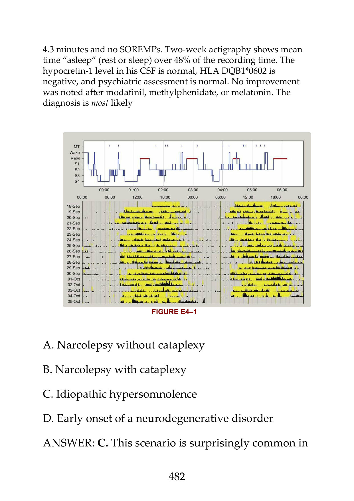

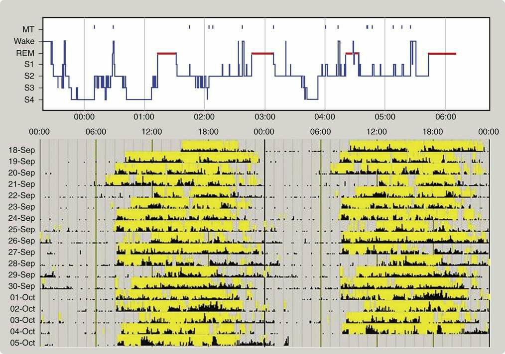

<!-- pdf-page: 483 -->

### clinical practice. By process of exclusion, this is a

### case of idiopathic hypersomnia, which can rarely

### present with cataplexy-like episodes. Narcolepsy is

### not confirmed: MSLT does not show SOREMPs,

### and the spinal fluid shows a normal hypocretin

### level. The R latency on the PSG does not meet the

### threshold for a SOREMP. (ICSD3, p 146)

### Neurodegenerative diseases are a group of

### heterogeneous, idiopathic diseases of the central

### nervous system (e.g., Alzheimer disease, multiple

### sclerosis, Parkinson disease, and Huntington

### chorea). They tend to occur in older individuals and

### may be associated with hypersomnia. (ATLAS2, pp

### 213-216) There is no evidence in this case of a

### neurologic disease.

28. Which statement is correct in comparing the definitions of sleep onset during an MWT nap and an MSLT nap?

### A. MWT requires at least three consecutive epochs of

### any sleep stage, whereas MSLT requires only one

### epoch with more than 15 seconds of any stage sleep.

### B. MSLT requires at least three consecutive epochs of

### any sleep stage, whereas MWT requires only one

### epoch with more than 15 seconds of any stage sleep.

### C. In both, sleep onset requires three consecutive

### D. In both, sleep onset is the first epoch of more than

### epochs of any stage sleep.

### 15 seconds of any stage sleep.

### 483

<!-- pdf-page: 484 -->

### ANSWER: D. Although both tests assess sleepiness,

### only the MSLT is useful in documenting

### narcolepsy. The MWT is often used as an objective

### way to document “fitness for duty.” (ATLAS2, p

### 392; Littner R, Kushida C, Wise M, et al: Practice

### parameters for clinical use of the multiple sleep

### latency test and the maintenance of wakefulness

### test, Sleep 28:113-121, 2005)

29. Which one of the following is not a requirement for the MSLT to be used in the diagnosis of narcolepsy?

### A. The night before the MSLT, a PSG shows at least 6

### B. PSG shows no other cause of hypersomnia.

### hours of sleep.

### C. The patient is not on any stimulants or REM-

### suppressing drugs for 2 weeks before the test.

### D. The patient undergoes a drug screen the day of the

### ANSWER: D. “Stimulants, stimulant-like medications,

### test.

### and REM-suppressing medications should ideally

### be stopped 2 weeks before the MSLT…. Drug

### screening may be indicated to ensure that

### sleepiness on the MSLT is not pharmacologically

### induced.” (Littner MR, Kushida C, Wise M, et al:

### Practice parameters for clinical use of the multiple

### sleep latency test and the maintenance of

### wakefulness test, Sleep 28:119, 2005)

### 484

<!-- pdf-page: 485 -->

30. The hypnogram in Figure E4-2 is from a four-nap MSLT of a patient with hypersomnia, done after an overnight PSG that was normal. Mean sleep latency was 1.5 minutes. It can be interpreted as diagnostic of narcolepsy

### B. Only if serum hypocretin level is below normal

FIGURE E4–2

### A. Without further testing

### C. Only if the patient's drug screen on the day of the

### D. Only if there is a history of cataplexy

### test is negative

### ANSWER: A. Type 2 narcolepsy (without cataplexy)

### can be diagnosed if mean sleep latency is 8 minutes

### or less and two or more SOREMPs are observed in

### the MSLT. The MSLT should follow a PSG with the

### goal of at least 7 hours of sleep. (ICSD3, p 159)

### Although the MSLT can go to five naps, in this case,

### a fifth nap would not have altered the diagnosis.

31. Least specific for the diagnosis of narcolepsy is

### 485

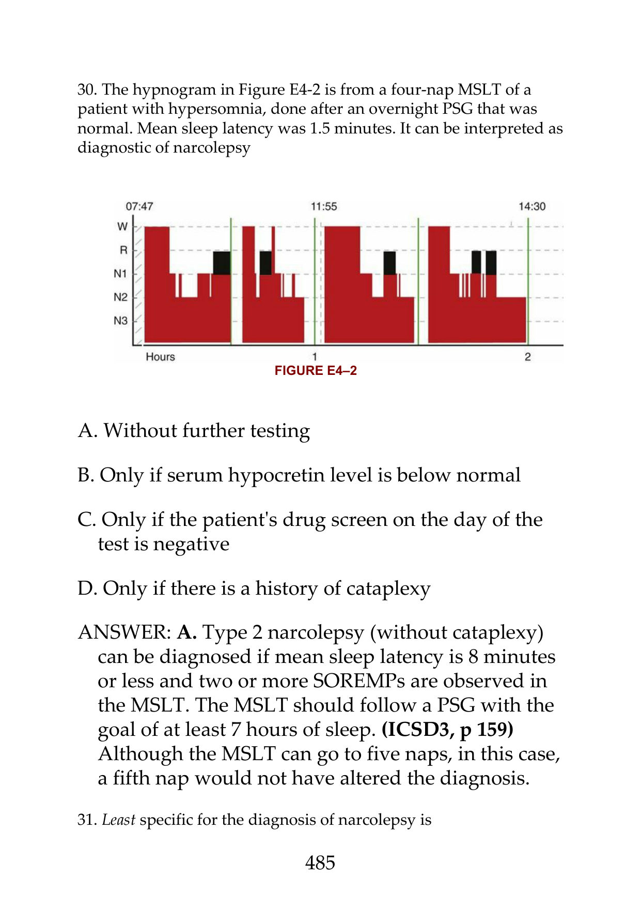

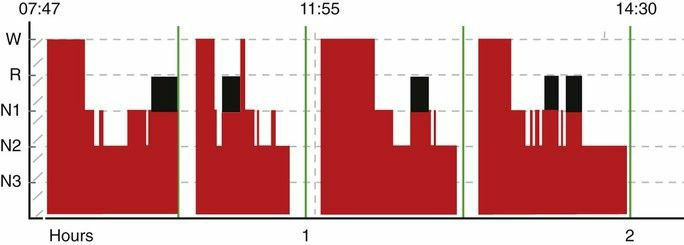

<!-- pdf-page: 486 -->

### A. Two or more SOREMPs on MSLT

### B. Mean sleep latency under 8 minutes on MSLT

### ANSWER: B. In patients with narcolepsy, the MSLT

### C. Low CSF hypocretin level

### D. Presence of cataplexy by history

### shows a mean sleep latency of less than 8 minutes

### and typically less than 5 minutes. However, this

### single criterion is nonspecific and may be seen in

### idiopathic hypersomnia as well as in patients who

### are sleep deprived. The other criteria are much

### more specific for narcolepsy. (ICSD3, pp 152, 159)

32. Patients with major depressive disorder (MDD) may complain of daytime sleepiness. Frequently associated PSG findings in patients with a major depressive episode include all of the following except

### A. Sleep continuity disturbances (e.g., prolonged sleep

### latency, increased wake after sleep onset [WASO],

### early morning awakening)

### ANSWER: C. In untreated major depression, REM

### B. Reduced NREM stages 3 and 4

### C. Increased latency to REM sleep

### D. Increased phasic REM activity

### latency is shortened. (ATLAS2, p 365) Note that

### 486

<!-- pdf-page: 487 -->

### despite complaints of daytime sleepiness, these

### patients generally do not demonstrate severe

### sleepiness on the MSLT. (ICSD3, pp 179-182)

33. Regarding the diagnosis of idiopathic hypersomnia (IH), which of the following is correct?

### A. There is a clear distinction among IH patients

### “with long sleep time” (≥10 hours) and “without

### long sleep time” (<10 hours).

### B. The MSLT shows a mean sleep latency of ≤10

### C. Cataplexy may be present in a small subset of IH

### minutes.

### patients with total sleep time greater than 12 hours.

### D. Naps are unrefreshing in most patients.

### ANSWER: D. The International Classification of Sleep

### Disorders, edition 2 (ICSD2, 2005) distinguished

### between IH with long sleep time and IH without

### long sleep time. The International Classification of

### Sleep Disorders, edition 3 (ICSD3), states that

### subsequent studies invalidate such a distinction,

### and “there are no separate subtypes.” To diagnose

### IH, the MSLT must show a mean sleep latency of ≤8

### minutes. The presence of cataplexy would indicate

### a diagnosis of narcolepsy. In IH, naps are

### “described as unrefreshing by 46% to 78% of

### patients.” (ICSD3, pp, 161-166)

### 487

<!-- pdf-page: 488 -->

34. To diagnose hypersomnia due to a medical disorder by ICSD3 criteria, all of the following must be satisfied except

### A. EDS almost daily for at least 3 months

### B. An underlying medical or neurologic disorder that

### can account for the daytime sleepiness

### C. A mean sleep latency of 8 minutes or less on the

### D. Other possible causes (e.g., sleep apnea, medication

### MSLT

### ANSWER: C. If the MSLT is performed, the mean

### side effects) have been ruled out.

### sleep latency should be 8 minutes or less with no

### more than one SOREMP. However, depending on

### the medical condition, it may not be feasible to do

### an MSLT. Note that up to 30% of the general

### population may have a sleep latency of 8 minutes or

### less on the MSLT, so that finding alone is

### nonspecific; if present, the patient would also have

### to meet the criteria listed in answers A, B, and

### D. (ICSD3, p 171)

35. A 15-year-old high school student has been falling asleep in class. She sleeps about 8 hours each night and reports having vivid hypnagogic hallucinations. Her overnight sleep study (PSG) was normal. The PSG was followed by an MSLT, shown in Figure E4-3. Which statement about the MSLT is correct?

### 488

<!-- pdf-page: 489 -->

### A. The study was nondiagnostic, because the first nap

FIGURE E4–3

### B. The findings strongly support a diagnosis of

### opportunity was too long.

### C. The patient does not have pathologic sleepiness,

### narcolepsy.

### because the sleep latency of the first nap is about 15

### minutes.

### D. The result is explainable by chronic sleep

### ANSWER: B. The findings strongly support

### deprivation.

### narcolepsy, because three of the naps show REM

### sleep. Although the first nap shows a sleep latency

### of 15 minutes, the other naps have a short sleep

### latency, and the mean sleep latency for all five naps

### was 6.4 minutes.

36. Which of the following features is more characteristic of IH than of narcolepsy?

### A. Presence of cataplexy

### 489

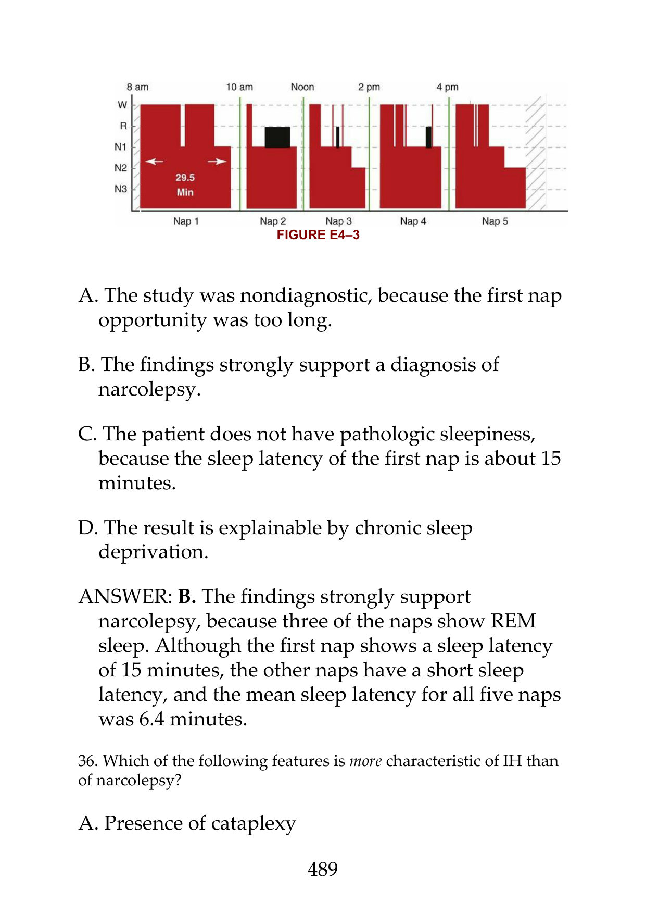

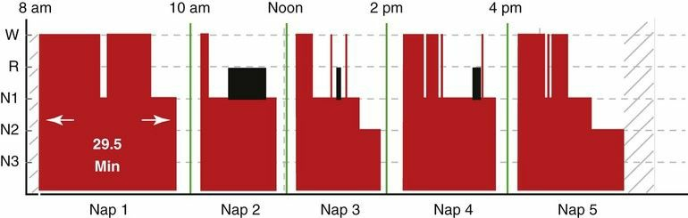

<!-- pdf-page: 490 -->

### B. Naps are often restorative.

### C. The condition may remit.

### D. Presence of hypnagogic hallucinations

### ANSWER: C. Narcolepsy never remits, whereas

### remission of IH has been reported. Features of

### narcolepsy include cataplexy, naps that are often

### restorative, and hypnagogic (preceding sleep)

### hallucinations. (ATLAS2, p 160)

37. A principal difference between the ESS and the SSS is

### A. The ESS assesses sleepiness retrospectively, and the

### SSS assesses it at the moment of the questionnaire.

### B. The ESS correlates much better with the MSLT than

### C. The ESS is filled out by the patient, whereas the SSS

### does the SSS.

### is filled out by someone close to the patient (e.g., a

### spouse or significant other).

### D. The nature of the questions in the SSS (e.g., how

### much sleep do you get in a 24-hour period?)

### provides for a more objective assessment of

### sleepiness than the ESS.

### ANSWER: A. The ESS asks eight questions that rely

### on subjective assessment of sleepiness over the

### recent past. The SSS asks how sleepy you are at the

### 490

<!-- pdf-page: 491 -->

### time of the questionnaire. Both scales are highly

### subjective, and neither one correlates very well with

### the MSLT.

38. Sleep onset during an MWT nap is defined as

### A. First epoch of more than 15 seconds of any stage

### B. Three consecutive epochs of stage 1 sleep

### sleep

### D. Whatever your lab uses for overnight PSG

### C. Single epoch of any other stage

### ANSWER: A. “Sleep onset [for the MWT] is defined as

### the first epoch of greater than 15 sec of cumulative

### sleep….Trials are ended after 40 minutes if no sleep

### occurs, or after unequivocal sleep, defined as three

### consecutive epochs of stage 1 sleep, or one epoch of

### any other stage of sleep.” (Littner MR, Kushida C,

### Wise M, et al: Practice parameters for clinical use

### of the multiple sleep latency test and the

### maintenance of wakefulness test, Sleep 28:113-121,

### 2005)

39. Which one of the following is not a requirement for the MSLT to be valid in the diagnosis of hypersomnia?

### A. MSLT is immediately preceded by overnight PSG

### B. PSG shows no cause to explain the hypersomnia.

### that shows at least 6 hours of sleep.

### 491

<!-- pdf-page: 492 -->

### C. The patient is not on any stimulants or REM-

### suppressing drugs for 2 weeks before the test.

### D. The patient undergoes a drug screen on the day of

### ANSWER: D. Drug screening would be ideal if there

### the test.

### is any concern about medication effects, but it is not

### a requirement. “Stimulants, stimulant-like

### medications, and REM-suppressing medications

### should ideally be stopped 2 weeks before MSLT….

### Drug screening may be indicated to ensure that

### sleepiness on the MSLT is not pharmacologically

### induced.” (Littner MR, Kushida C, Wise M, et al:

### Practice parameters for clinical use of the multiple

### sleep latency test and the maintenance of

### wakefulness test, Sleep 28:113-121, 2005)

40. All of the following are true about the MSLT except

### A. Instructions to the patient at start of each nap are to

### “lie quietly, keep your eyes closed, and try to fall

### asleep.”

### B. Naps are continued for 20 minutes if there is no

### sleep or for 15 minutes following the first episode of

### sleep.

### C. Sleep latency is defined as the time from lights out to

### D. Early onset of sleep (from average sleep latency of

### the first epoch of sleep.

### 492

<!-- pdf-page: 493 -->

### four or five naps) plus early onset of REM sleep in

### at least one of the naps satisfy criteria for diagnosis

### of narcolepsy.

### ANSWER: D. To support a diagnosis of narcolepsy

### from the MSLT, there must be two naps with early-

### onset REM sleep, often called a sleep-onset REM

### period (SOREMP). Note that ICSD3 now allows

### replacement of one SOREMP in the MSLT with one

### in the PSG that preceded the MSLT, thereby

### satisfying the two-SOREMP requirement. (ICSD3, p

### 152)

41. The MSLT is indicated to help diagnose which of the following conditions?

3. OSA after treatment with positive airway pressure therapy

1. Narcolepsy

2. Idiopathic hypersomnia

4. Insomnia

5. Circadian rhythm disorders

### A. 1 only

### B. 1 and 2

### C. 1 and 3

### D. 1, 2, and 4

### E. All of above

### 493

<!-- pdf-page: 494 -->

### ANSWER: B. The MSLT is not indicated for OSA,

### with or without treatment, or for patients with

### insomnia or circadian rhythm disorders. (Littner

### MR, Kushida C, Wise M, et al: Practice parameters

### for clinical use of the multiple sleep latency test

### and the maintenance of wakefulness test, Sleep

### 28:113-121, 2005)

42. What is the most potent stimulus that leads to cataplexy in narcolepsy patients?

### ANSWER: A. Laughter is the most common trigger

### A. Laughter

### B. Anger

### C. Sexual activity

### D. Bright light

### that induces cataplexy. Of patients who have

### narcolepsy with cataplexy, in 87%, cataplexy is

### caused by laughter, in 68% by anger, and in 22%

### during sexual activity. Bright light does not cause

### cataplexy. (ATLAS2, p 161)

43. A 35-year-old woman has EDS, obesity, hair loss, and hoarseness. What is the most likely diagnosis?

### A. Acromegaly

### B. Stein-Leventhal syndrome

### 494

<!-- pdf-page: 495 -->

### C. Cushing disease

### D. Hypothyroidism

### ANSWER: D. Clues to indicate hypothyroidism

### include hair loss and hoarseness in an obese

### woman. Hypothyroidism is a common finding in

### patients with obstructive OSA. Hypothyroidism can

### also cause sleepiness without apnea being present.

### Another common feature of this disease is cold

### intolerance. (ATLAS2, pp 335-336)

44. Which statement is true about sleep paralysis?

### A. It can occur without another diagnosis.

### B. It is the commonest symptom of narcolepsy.

### C. It occurs mainly in non-REM sleep.

### ANSWER: A. Sleep paralysis occurs in many healthy

### D. Breathing stops during paralysis.

### people. It is not the most common symptom in

### narcolepsy patients (excessive sleepiness is). Sleep

### paralysis occurs during REM sleep, and breathing

### does not stop, because the diaphragm is spared the

### paralysis that affects other skeletal

### muscles. (ATLAS2, p 160)

45. A 10-minute epoch from an overnight PSG is shown in Figure E4-4. The patient has severe daytime sleepiness. The most likely cause for hypoxemia is

### 495

<!-- pdf-page: 496 -->

### ANSWER: C. This 10-minute compressed epoch

FIGURE E4–4

### A. OSA

### B. Central sleep apnea

### C. Hypoventilation

### D. Ventilation-perfusion imbalance

### shows Sao2 consistently in the mid 80s despite

### excellent airflow. Thus there is no evidence for

### obstructive or central sleep apnea. Whereas

### hypoventilation (increased Paco2) is a possibility, the

### most common cause of sleep-related hypoxemia is

### ventilation-perfusion (V-Q) imbalance. Hypoxemia

### from V-Q imbalance will show an increased

### alveolar-arterial Po2 difference if blood gas is

### obtained. This patient had chronic obstructive

### pulmonary disease (COPD) and exercise

### hypoxemia.

### 496

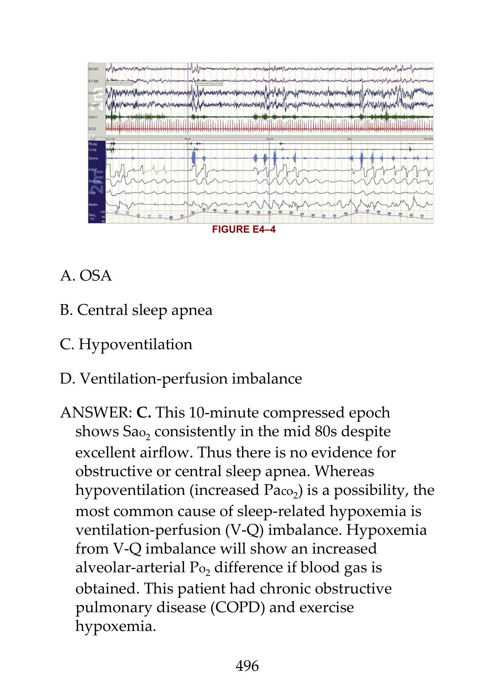

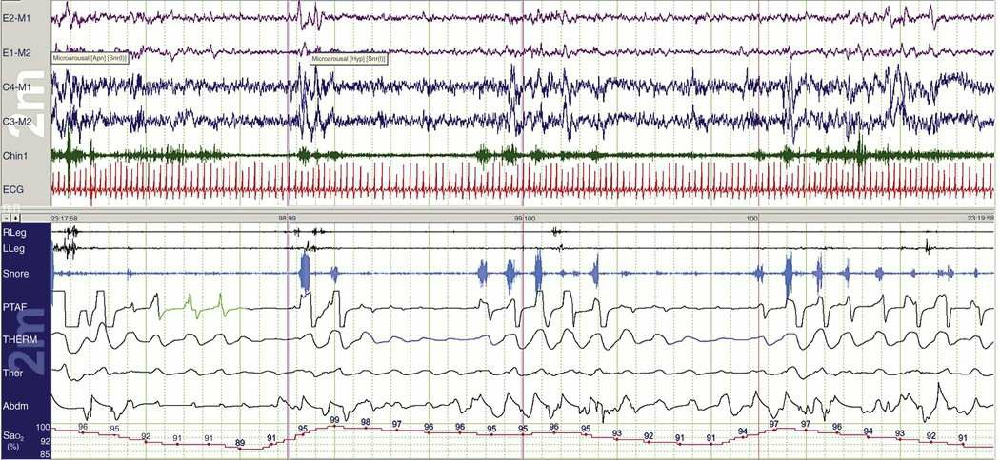

<!-- pdf-page: 497 -->

46. In which group would you most likely find onset of REM during the first 15 minutes of sleep?

### A. People taking barbiturates

### C. Patients with REM sleep behavior disorder

### B. Narcoleptics with cataplexy

### D. People on tricyclic antidepressants (TCAs)

### ANSWER: B. Early REM onset (typically within 15

### minutes of sleep onset) during the PSG occurs in

### about 50% of patients with narcolepsy and

### cataplexy, and it is very rare in control subjects.

47. During an MSLT nap, sleep onset is defined as

### A. First epoch of more than 15 seconds of any stage

### B. Three consecutive epochs of stage 1 sleep

### sleep

### C. Single epoch of any other stage sleep

### D. Whatever your lab uses for overnight PSG

### ANSWER: A. Below are two quotes from “Practice

### parameters for clinical use of the multiple sleep

### latency test and the maintenance of wakefulness

### test.” (Littner MR, Kishida C, Wise M, et al: Sleep

### 28:113-121, 2005)

### 497

<!-- pdf-page: 498 -->

### ❍ “Sleep onset for the clinical MSLT is determined by

### the time from lights out to the first epoch of any

### stage of sleep, including stage 1 sleep. Sleep onset is

### defined as the first epoch of greater than 15 sec of

### cumulative sleep in a 30-sec epoch. The absence of

### sleep on a nap opportunity is recorded as a sleep

### latency of 20 min [and is] included in the

### calculation of mean sleep latency…the test

### continues for 15 min from after the first epoch of

### sleep…duration of 15 min is determined by ‘clock

### time’ and is not determined by a sleep time of

### 15 min.”

### ❍ “REM latency is taken as the time of the first epoch

### of sleep to the beginning of the first epoch of REM

### sleep regardless of the intervening stages of sleep or

### wakefulness.”

48. MSLT results from a young man with EDS are summarized below. Numbers under each nap refer to the sleep epochs since the beginning of the study; each epoch is 30 seconds (Table E4-1).

Which of the following calculations is the correct sleep latency for the four naps?

#### Table E4–1

### 498

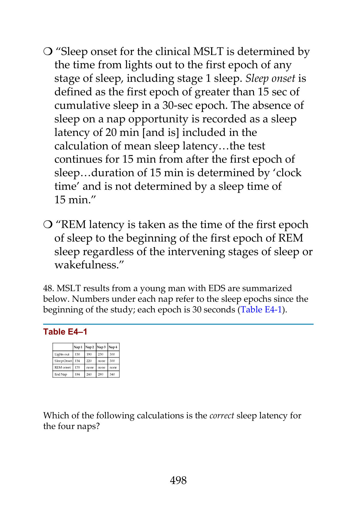

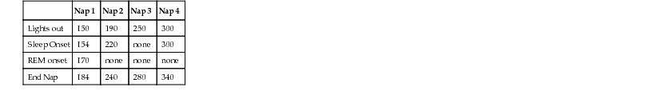

<!-- pdf-page: 499 -->

49. The hypnogram in Figure E4-5 is from a four-nap MSLT of a patient with hypersomnia done after an overnight PSG that was normal. Mean sleep latency was 4.5 minutes. It can be interpreted as diagnostic of narcolepsy

### ANSWER: D.

### B. Only if the patient is also HLA-DQB1*602 positive

FIGURE E4–5

### A. Without further testing

### C. Only if the serum hypocretin level is below normal

### D. Only if the patient's drug screen on the day of the

### E. Only if there is a history of cataplexy

### test is negative

### 499

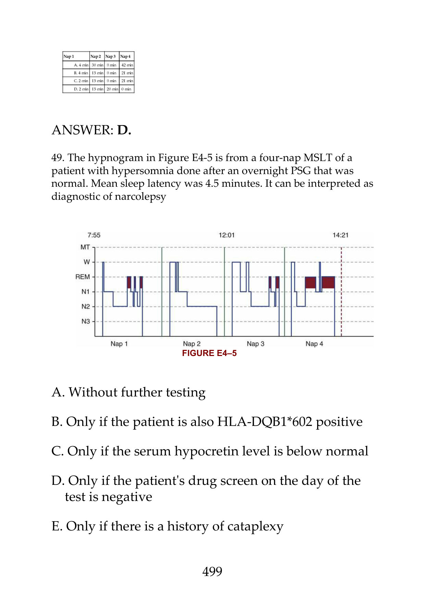

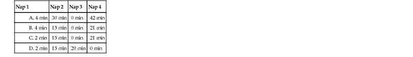

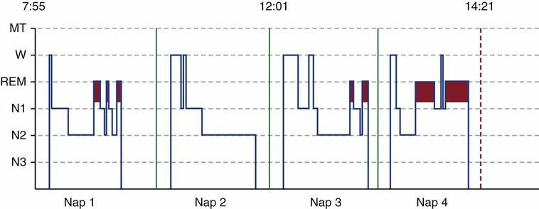

<!-- pdf-page: 500 -->

### ANSWER: A. This histogram shows four naps of an

### MSLT. Early-onset sleep occurs in each of the naps,

### and REM occurs in all but the second nap. This is

### considered diagnostic of narcolepsy. (ICSD3, pp

### 146-161)

50. Which of the following drugs would be least effective in treating cataplexy?

### ANSWER: A. Fluoxetine, venlafaxine, and

### A. Modafinil

### B. Fluoxetine

### C. Venlafaxine

### D. Clomipramine

### clomipramine are all antidepressants and have

### efficacy in treating cataplexy. Modafinil is a

### stimulant used to treat hypersomnia, and it has

### little to no effect on cataplexy. (ATLAS2, p 173)

51. During an MWT nap, sleep onset is defined as

### A. First epoch of more than 15 seconds of any stage

### B. Three consecutive epochs of stage 1 sleep

### sleep

### D. Whatever your lab uses for the overnight PSG

### C. A single epoch of N2 sleep

### 500

<!-- pdf-page: 501 -->

### ANSWER: A. (Littner MR, Kushida C, Wise M, et al:

### Practice parameters for clinical use of the multiple

### sleep latency test and the maintenance of

### wakefulness test, Sleep 28:113-121, 2005)

### ❍ “Sleep onset is defined as the first epoch of greater

### ❍ “Trials are ended after 40 minutes if no sleep

### than 15 sec of cumulative sleep.”

### occurs, or after unequivocal sleep, defined as three

### consecutive epochs of stage 1 sleep, or one epoch of

### any other stage of sleep.”

52. An MSLT is done on a 15-year-old student suspected of having narcolepsy. The results are shown in Figure E4-6. The first nap opportunity occupied about 30 minutes. Which statement about the test is incorrect?

### A. The test is diagnostic of narcolepsy.

FIGURE E4–6

### C. The first nap should have been terminated at 15

### B. The fifth nap was not necessary.

### 501

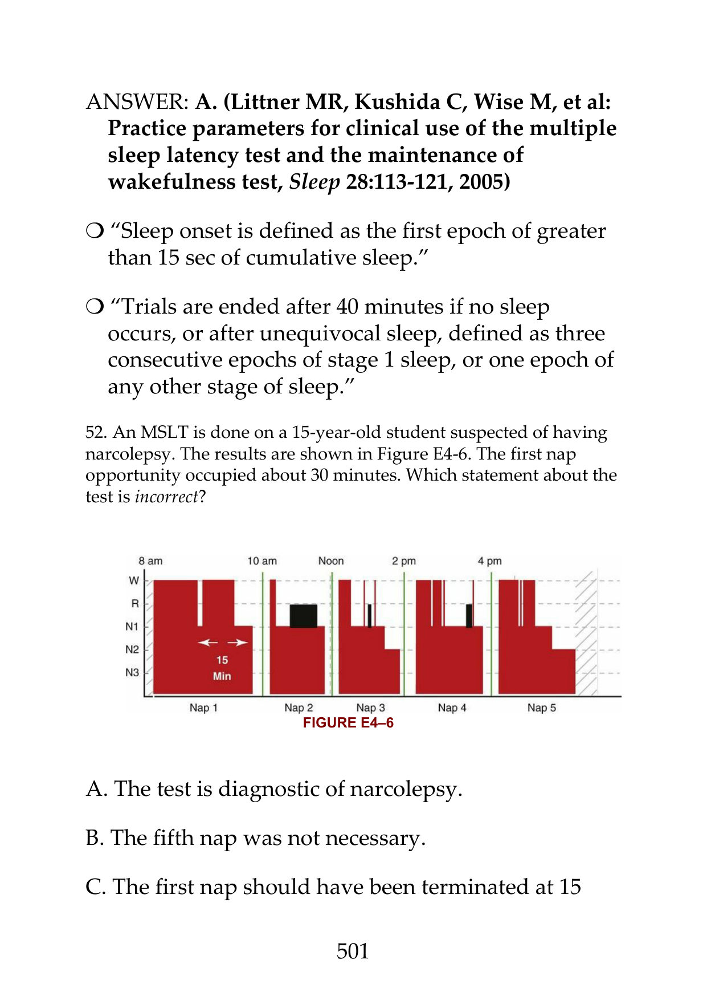

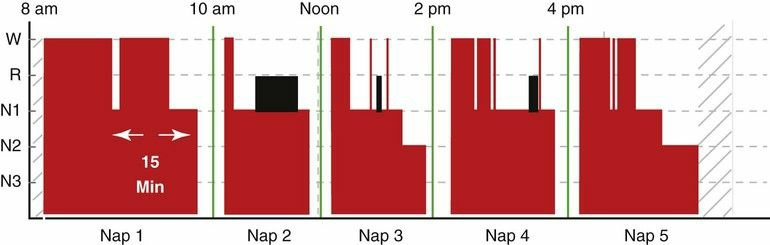

<!-- pdf-page: 502 -->

### minutes.

### D. The mean sleep latency is less than 8 minutes.

### ANSWER: C. In the absence of REM, the clinical

### MSLT is terminated 15 minutes after the first epoch

### of any sleep. Thus it was appropriate for the first

### nap in this case to be 30 minutes. (ATLAS2, p 392)

### The fifth nap was technically not required, because

### the diagnosis of narcolepsy had already been made

### with the first four naps. Except for the first nap,

### which had a latency of 15 minutes, the other naps

### by visual inspection had much shorter latencies.

### The mean latency was 6.4 minutes.

53. All of the following are true about modafinil except

### A. Modafinil is FDA approved for shift-work sleep

### B. It has no appreciable effect on incidence of

### disorder.

### C. Modafinil works through the GABAA receptor.

### cataplexy in narcoleptics.

### D. It is a Schedule IV controlled substance.

### ANSWER: C. The newer medications to foster sleep

### (Z drugs) and wakefulness (modafinil and

### armodafinil) are all Schedule IV controlled

### substances because of the FDA's concern for

### addiction potential; they require a Drug

### 502

<!-- pdf-page: 503 -->

### Enforcement Agency (DEA) number to prescribe.

### Ramelteon (Rozerem) is also a hypnotic but is not a

### scheduled drug, because it does not have addiction

### potential; no DEA number is required for

### prescribing ramelteon.

54. All of the following are true about sodium oxybate treatment of narcolepsy except

### A. It is effective for cataplexy but not for daytime

### B. It can lead to abuse, dependence, and respiratory

### sleepiness.

### C. Because of its short half-life, the drug has to be

### depression.

### given in divided doses with the first dose at

### bedtime and the next dose a few hours later.

### D. It is the sodium salt of gamma-hydroxybutyrate

### (GHB), a rapidly acting sedative-hypnotic

### medication.

### ANSWER: A. Sodium oxybate is indicated for both

### the cataplexy and the daytime sleepiness of

### narcolepsy. (ATLAS2, p 113)

55. Which drug is FDA approved for shift-work sleep disorder?

### A. Methylphenidate

### B. Modafinil

### 503

<!-- pdf-page: 504 -->

### C. Ramelteon

### D. Melatonin

### ANSWER: B. Approval of modafinil for shift-work

### sleep disorder was based in part on the study of

### Czeisler CA, Walsh JK, Roth T, et al: “Modafinil for

### excessive sleepiness associated with shift-work

### sleep disorder.” (N Engl J Med 353:476-486, 2005) In

### this 3-month double-blind trial, 209 patients with

### shift-work sleep disorder were randomized to

### receive either 200 mg of modafinil or placebo before

### the start of each shift. Treatment with modafinil,

### compared with placebo, resulted in a modest

### improvement in mean nighttime sleep latency.

### Also, more modafinil-treated patients had

### improvement in their clinical symptoms (74% vs.

### 36%, respectively; P < .001). Modafinil did not

### adversely affect daytime sleep compared with

### placebo, and headache was the most common

### adverse event. The authors concluded that

### “treatment with 200 mg of modafinil reduced the

### extreme sleepiness [in] shift-work sleep disorder

### and resulted in a small but significant improvement

### in performance as compared with placebo.”

### Armodafinil, an enantiomer of modafinil, is also

### approved for this disorder. (ATLAS2, p 113)

56. Which of the following is not considered a first-line treatment for sleepiness related to narcolepsy?

### A. Modafinil

### 504

<!-- pdf-page: 505 -->

### B. Armodafinil

### C. Sodium oxybate

### ANSWER: D. Modafinil and armodafinil have largely

### D. Methylphenidate

### replaced amphetamines as first-line therapy for the

### sleepiness of narcolepsy. Sodium oxybate is

### effective for cataplexy and excessive sleepiness and

### is used when patients have both symptoms.

### Methylphenidate (Ritalin), long used in this

### condition, is now relegated to second-line

### therapy. (ATLAS2, Table 6-7) The doses for

### narcolepsy are

Modafinil 100 to 400 mg/day in two doses Armodafinil 150 to 250 mg in one morning dose Sodium oxybate 6 to 9 g/night in two doses Methylphenidate 10 to 60 mg/day

### 505
