# Section 5 Parasomnias

<!-- pdf-page: 506 -->

### SECTION 5

## 5.1.

## Non–Rapid Eye Movement Parasomnias

## Parasomnias

A 31-year-old female business executive is referred to the sleep disorders center for the complaint of sleepwalking. She had many sleepwalking episodes as a child, but they stopped at age 12. She was free of any sleeprelated problems until the last 4 months. She has been eating every night after going to bed but has no recollection of getting up to go to the kitchen. Yet in the morning, it is evident that she has cooked and eaten some food, and she even appears to have eaten uncooked meat. She has put on 30 pounds in the past 4 months.

## Questions

#### Eating Raw Meat at Night

1. Which statement about this patient's disorder is true?

### A. It only occurs during stage N3 sleep.

### B. It only occurs in the first third of the night.

### C. Episodes are triggered by alcohol consumption.

### D. It is not an indication of psychopathology.

### 506

<!-- pdf-page: 507 -->

2. Which statement about management is most correct?

### A. A nocturnal polysomnogram (PSG) is indicated.

### B. A nocturnal electroencephalograph (EEG) study

### directed toward capturing seizure activity is

### indicated.

### C. Assessment by a psychiatrist or psychologist is

### D. Further investigations are not needed; clonazepam

### indicated.

### 0.5 mg at bedtime is usually effective.

3. All of the following medications have shown some efficacy except:

4. If the patient is found to have moderate obstructive sleep apnea (OSA) and is treated with continuous positive airway pressure (CPAP), what would you expect about her sleep-eating episodes?

### A. Zolpidem

### B. Dopaminergic agents

### C. Opiates

### D. Topiramate

### A. They will increase in frequency, because the

### B. They will decrease in frequency, even though the

### amount of stage N3 sleep increases.

### amount of stage N3 sleep might increase.

### 507

<!-- pdf-page: 508 -->

### C. There will be no effect on the frequency of the

### episodes.

### D. The patient will continue to sleepwalk, but she will

A 7-year-old boy lets out bloodcurdling screams while in bed at night. His parents rush into his room, and each time they notice that he is standing up, rocking back and forth, eyes open and staring right through them. He is sweating, appears angry, and screams out, “No! No! No!” The boy is otherwise healthy. He sleeps 9 hours a night and plays in a hockey league.

### stop eating at night.

#### The Screamer

### A. The events occur during stage R (rapid eye

5. Which statement about this disorder is false?

### B. Children with this condition generally have no

### movement [REM]) sleep.

### C. Episodes most often occur in the first third of the

### recollection of the nocturnal events.

### D. The disorder might have a genetic basis.

### night.

6. The boy's parents are very concerned about the episodes and ask for your diagnosis. The least likely disorder would be:

### A. Seizure disorder

### B. Psychogenic state

### C. Sleep terrors

### 508

<!-- pdf-page: 509 -->

### D. Rhythmic movement disorder

An overnight sleep study lasting 10 hours is performed. The child spends 45% of the night with findings similar to those shown in Figure 5.1-1. The patient has some abrupt arousals while in this state. No abnormal motor activity is seen on synchronized digital video monitoring.

7. This fragment shows which of the following?

8. Based on the data in Figure 5.1-1, what would you recommend?

### A. Hypersynchronous theta

### B. Continuous seizures

### C. Stage N3 sleep

### D. Sweat artifact

### A. Carbamazepine to treat the seizure

### B. Clonazepam to be used as needed when he sleeps

### away from home

### C. Risperidone nightly

### D. Increase in nocturnal sleep time

### 509

<!-- pdf-page: 510 -->

1. D. The patient has a sleep-related eating disorder, a disorder of partial arousal from non–rapid eye movement (NREM) sleep. Although such episodes are more common in stage N3, and they occur more often in the first third of the night, they can occur out of any NREM stage and at any time during the night. Contrary to popular belief, alcohol does not trigger these episodes.

FIGURE 5.1–1 Questions 7 and 8.

## Answers

2. A. In patients with a sleep-related eating disorder, PSG is indicated, because often OSA or periodic limb movement disorder (PLMD) is present and may be initiating the partial arousal. There is no indication for EEG to look for seizure disorder, nor is there any indication for referral to a psychologist or psychiatrist. A trial of clonazepam is not indicated at this time.

3. A. Zolpidem (and olanzapine) and perhaps other medications can actually cause a sleep-related eating disorder. The other three medications listed can improve this condition. This question is an example of how knowing only one fact can yield the correct answer. Simply knowing that zolpidem can cause a sleep-related eating disorder allows you to choose that answer without actually knowing whether the other three medications are efficacious.

### 510

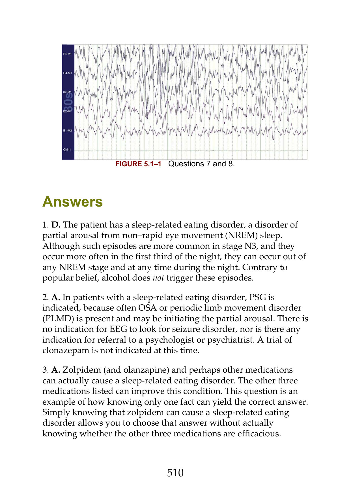

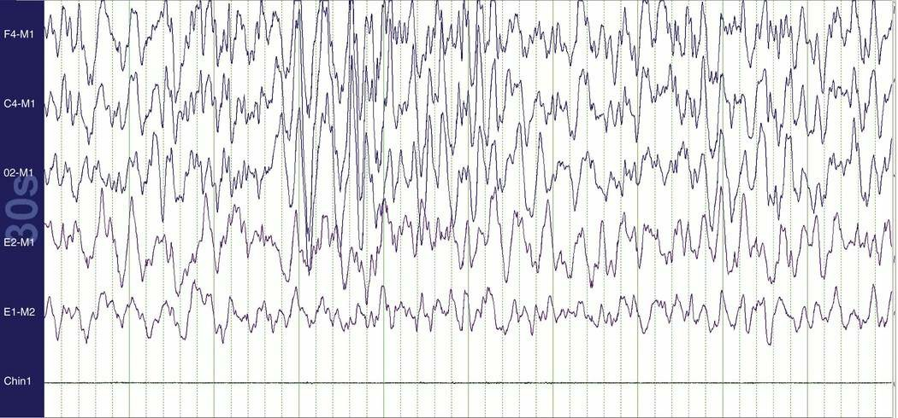

<!-- pdf-page: 511 -->

4. B. Disorders of partial arousal from NREM sleep can be exacerbated by conditions that cause arousal, for example OSA syndrome or periodic limb movements (PLMs). Thus in disorders in which the arousals are common, such as OSA, treatment of that condition should reduce episodes of partial arousal from NREM sleep. On the other hand, when an OSA patient without a history of sleepwalking is started on CPAP, sleepwalking episodes can begin.

5. A. This is a description of classic sleep terrors, an NREM parasomnia. It is a disorder of partial arousal. The patient is asleep, but presumably parts of the nervous system are awake, a type of state overlap. This disorder is not associated with REM sleep. Most of the episodes occur in stage N3 and generally occur in the first third of the night. Parasomnias often run in families, and a specific gene, HLA-DQB1, is thought to play a role in sleepwalking.

6. D. Not in the differential diagnosis of this case is rhythmic movement disorder (RMD), which most often manifests as head banging or body rocking, typically beginning in early childhood and resolving by adulthood. While this child did have body rocking, the crying out and autonomic discharge (the “terror”) are not part of RMD. The head-banging variety of RMD is also known as jactatio capitis nocturna, an imposing name. Both seizures and psychogenic states are in the differential diagnosis of sleep terrors.

7. C. This is stage N3 sleep in a child. As shown, the waveform amplitude can be huge, and the EEG can be misclassified as seizure or artifact. In Figure 5.1-2, the EEG channels are reduced, making stage N3 more obvious. Conversely, in the elderly, EEG amplitude might have to be increased to properly recognize stage N3.

### 511

<!-- pdf-page: 512 -->

FIGURE 5.1–2 Answer 7: Gain is reduced by half in the

8. D. Medications are seldom used to treat sleep terrors in children. Sleep deprivation is a common contributor to NREM parasomnias, and three clues suggest that sleep deprivation is present in this child: first, 9 hours of sleep is not sufficient for a 7-year-old child; second, the very high percentage of stage N3 is typical for rebound in a patient who has been sleep deprived; third, the child plays hockey, and children who play hockey often practice very early in the morning several days a week.

top three channels.

▪ Atlas of Clinical Sleep Medicine, ed 2, Chapter 12; make sure you can

## Summary

### Highly Recommended

identify stage N3 sleep. ▪ International Classification of Sleep Disorders, ed 3, pp 225-280 ▪ See Box 5.1-1

Box 5.1–1

### Parasomnias

#### General Classification

### 512

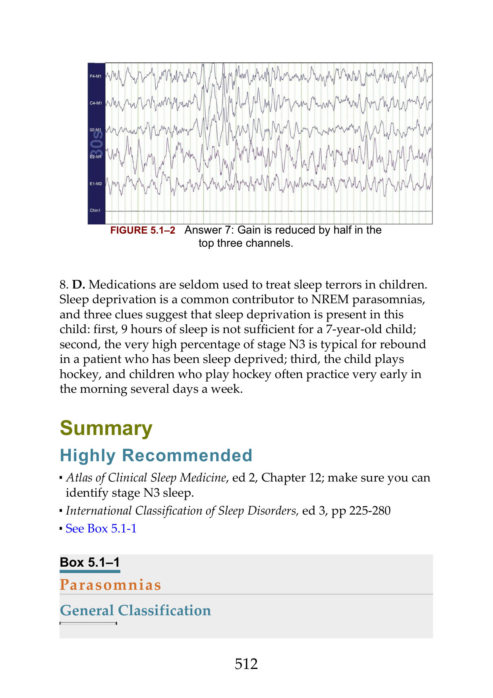

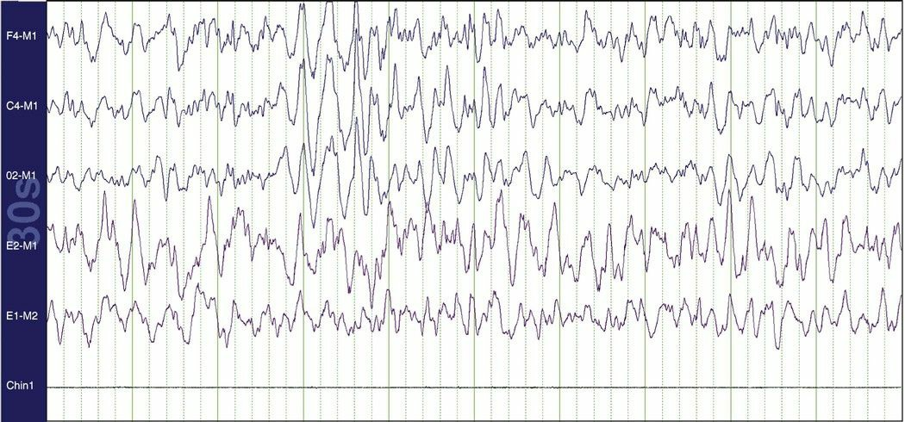

<!-- pdf-page: 513 -->

Parasomnias are disorders in which undesirable behaviors and phenomena occur during sleep. For this entire topic, expect about 10 (out of 240) questions. The ICSD3 classifies parasomnias as follows*:

#### NREM-related Parasomnias

• Parasomnia due to a medication or substance

• Disorders of arousal (from NREM sleep)

• Sleepwalking

• Sleep terrors

• Sleep-related eating disorder

#### REM-related Parasomnias

• REM sleep behavior disorder

• Recurrent isolated sleep paralysis

• Nightmare disorder

#### Other Parasomnias

• Exploding head syndrome

• Sleep-related hallucinations

• Sleep enuresis

• Parasomnia due to a medical disorder

#### Isolated Symptoms and Normal Variants

• Parasomnia, unspecified

• Sleep talking

### 513

<!-- pdf-page: 514 -->

*Appendix A of the ICSD3, “Sleep-related Medical and Neurological

Disorders,” includes conditions that might also be classified as “secondary parasomnias” because they occur during sleep. The conditions listed include sleep-related epilepsy, headache, laryngospasm, gastroesophageal reflux, and myocardial ischemia. Although some authors classify catathrenia as a parasomnia (see ATLAS2, Ch 12), the ICSD3 places it in a section called “Isolated Symptoms and Normal Variants” under the heading “Sleep-Related Breathing Disorders.” Similarly, bruxism has been considered a parasomnia, but the ICSD3 classifies it as a sleep-related movement disorder. Irrespective of how these conditions are classified, they all are fair game for a quiz question.

### Definition of a Non-REM Parasomnia

▪ Undesirable behavior or phenomena that occur during the sleep

▪ Partial arousal from sleep
▪ State instability
▪ The human leukocyte antigen (HLA) gene HLA-DQB1 increases

period related to NREM sleep

### Pathogenesis

### ❍ There is no direct evidence that alcohol impacts

susceptibility

### Risk Factors

▪ Sleep deprivation
▪ Emotional stress
▪ Drugs

### risk, though it may increase slow wave sleep.

### ❍ Sedative-hypnotics (e.g., zolpidem) increase risk.

▪ Sleep disorders that increase arousals

### ❍ Sleep apnea

### 514

<!-- pdf-page: 515 -->

### ❍ Periodic limb movements

▪ Treatment of sleep disorders

### ❍ CPAP treatment can induce sleepwalking.

### • Common in children: peak age 12 years (17% to

### NREM Parasomnia Types

▪ Sleepwalking

### ❍ Epidemiology

### 22%)

### • Less common in adults (about 4%)

### ❍ Genetic influences

### • If neither parent was affected, 22%

### • If one parent was affected, 45%

### • If both parents were affected, 60%

### ❍ Clinical features

### • Behavior may be complex.

### • Patient has no recollection.

### ❍ Variants

### • Confusional arousals

### 515

<!-- pdf-page: 516 -->

### • Sleep-related eating disorder

### ○ Often another sleep pathology is present.

### ○ Prominent, sometimes injurious motor activity

### ◆ OSA

### ◆ Movement disorder

### • Sleepsex

▪ Sleep terrors

### ❍ Epidemiology

### • Up to 6% in children

### • About 2.5% in ages 15 to 64 years

### ❍ Genetic factors

### • Runs in families

### ❍ Clinical features

### • Dramatic

### • Abrupt

### ○ Screaming

### ○ Appears to be in panic

### 516

<!-- pdf-page: 517 -->

### • Events may be initiated by diseases that cause

### arousals.

### ○ Sleep apnea

▪ Reduce sleep deprivation.
▪ Ensure a safe environment.
▪ Offer reassurance.
▪ Pharmacologic therapy is helpful in some circumstances.

### ○ Movement disorders

### Treatment

### ❍ Dopaminergic agents, topiramide, and opiates for

### ❍ Little published data

### ❍ Benzodiazepines

### ❍ Tricyclic antidepressants (TCAs)

American Academy of Sleep Medicine. International

### sleep-related eating disorder

## References

classification of sleep disorders. ed 3. American Academy of Sleep Medicine: Darien, Ill.; 2014. Kryger MH, Avidan A, Berry R. Atlas of clinical sleep medicine.

ed 2. Saunders: Philadelphia; 2014.

## 5.2.

## Rapid Eye Movement Parasomnias

### 517

<!-- pdf-page: 518 -->

## Questions

#### An Old Soldier

An 80-year-old gentleman is referred for evaluation of a possible sleepbreathing disorder. He has been noted to snore and stop breathing during sleep, and his wife is concerned about the symptoms. On several occasions over the past 3 months, while her husband is sleeping, he has struck her with his fists. When she wakes him up, he remembers dreaming that he was fighting off animals or soldiers. You learn that he was a POW for a year after his aircraft was shot down over North Vietnam in 1968. You also learn that before coming to your clinic, because of the patient's flat affect, his family doctor decided he was depressed and started him on mirtazapine.

1. What is the likeliest disorder to explain his abnormal motor activity during sleep?

### B. Posttraumatic stress disorder (PTSD)

### A. Psychomotor epilepsy

2. In which condition does a nocturnal PSG not yield diagnostic or pathophysiologic findings?

### C. Sleep terrors

### D. REM sleep behavior disorder

### A. Psychomotor epilepsy

### B. PTSD

### C. Sleep terrors

### D. REM sleep behavior disorder

### 518

<!-- pdf-page: 519 -->

The patient has an overnight sleep study that shows the following on scoring:

Breathing: Apnea-hypopnea index (AHI) = 4.5 events/hr, respiratory disturbance index (RDI) = 6 events/hr

Sleep: Sleep efficiency = 65%; stages of sleep as a percentage of total study time: stage W = 35%, stage N1 = 15%, stage N2 = 45%, stage N3 = 0%, stage REM = 5%, arousal index = 46/hr

PLMs were not scored, but the recently graduated sleep technologist thought the patient might have restless legs syndrome (RLS); she noted a great deal of leg activity throughout the night. On interpreting the study, you come across the epoch in Figure 5.2-1.

FIGURE 5.2–1 Question 3.

3. What does the epoch in Figure 5.2-1 show?

### A. Stage W

### B. Stage N1

### C. Stage N2

### 519

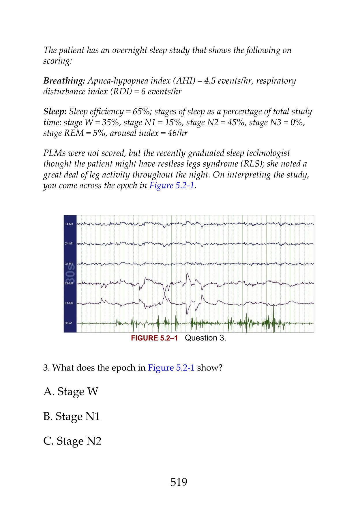

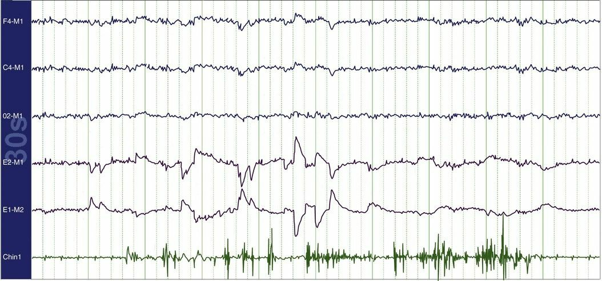

<!-- pdf-page: 520 -->

### D. Stage R

4. At this point, you would do all of the following except

### A. Stop the mirtazapine.

### C. Prescribe prazosin and arrange for imagery-

### B. Start the patient on clonazepam.

5. Which of the following is the most unlikely cause of a chronic form of this disorder?

### rehearsal therapy.

### D. Refer the patient to a neurologist.

6. Which of the following is the most unlikely cause of an acute form of this disorder?

### A. Narcolepsy

### B. Synucleinopathy

### C. Duchenne muscular dystrophy

### D. Spinocerebellar ataxia type 3

### C. Selective serotonin reuptake inhibitors (SSRIs)

### A. Alcohol withdrawal

### B. TCAs

### D. Caffeine withdrawal

### 520

<!-- pdf-page: 521 -->

7. The patient mentions that he can no longer taste food. On testing olfactory function, you find he is indeed anosmic. This finding is consistent with which of the following?

### A. Parkinson disease

8. The patient is started on clonazepam 0.5 mg at bedtime, and this reduces his nocturnal motor activity. However, he complains of severe sleepiness during the daytime. What should you do next?

### B. Cerebrovascular accident

### C. Multiple sclerosis

### D. Polymyalgia rheumatica

### A. Start modafinil 200 mg in the morning.

### B. Have him take clonazepam 2 hours before bedtime.

### C. Perform a PSG to see whether the clonazepam has

### D. Perform a multiple sleep latency test (MSLT) to

### induced obstructive apnea.

### document his sleepiness and see whether he in fact

### has narcolepsy.

1. D. The history is typical for REM sleep behavior disorder (RBD). The other conditions are in the differential diagnosis. With psychomotor epilepsy, the patient would not complain about vivid dream imagery; he would likely have no recollection of the events. In PTSD, he would awaken from a disturbing dream reliving the

## Answers

### 521

<!-- pdf-page: 522 -->

traumatic event. With sleep terrors, there is no vivid dream imagery, and patients usually have no recollection of the event.

2. B. Of the disorders listed, PTSD does not have typical PSG findings. Thus unless you suspect another disorder, PSG is not indicated. The other disorders listed may manifest helpful findings on PSG, which might just be the stage of sleep where the event occurs. (For sleep terrors, however, you would seldom actually order a PSG.)

3. D. Figure 5.2-1 shows typical findings in a patient with RBD. The eye channels show rapid eye movements. The chin EMG has baseline low activity with nonperiodic increases in activity. On examining the corresponding digital video, you would see some motor activity. In the video for this particular epoch, the patient was moving his arm, and in the following epoch, he aggressively punched in the air. Other diagnostic criteria for RBD include REM sleep without atonia, as shown in Figure 5.2-1; a history of sleeprelated behavior that can injure the patient or bed partner; documentation of visible motor activity during a PSG; and absence of epileptiform activity. (ICSD3, pp 246-253)

4. C. Prazosin and imagery-rehearsal therapy are used to treat patients with PTSD, which this patient does not have. Mirtazapine (and other medications) can cause an acute form of RBD. Clonazepam is generally highly effective in RBD. Finally, you would refer such a patient to a neurologist, because in most (if not all) cases, the RBD symptoms are an early manifestation of a neurodegenerative disorder (e.g., Parkinson disease).

5. C. Duchenne muscular dystrophy, primarily a muscle disease, does not cause RBD. Whereas a decade ago most cases of RBD were considered idiopathic, now it is considered an early manifestation of a neurodegenerative disorder; however, RBD symptoms can precede the neurodegenerative disorder by decades. The most common disorders associated with RBD are the synucleinopathies: Parkinson disease, multisystem atrophy (olivopontocerebellar degeneration and Shy-Drager syndrome), and dementia with Lewy bodies.

### 522

<!-- pdf-page: 523 -->

6. D. An acute form of RBD can occur in many situations. Caffeine withdrawal does not cause RBD, but caffeine intoxication can. Even excess chocolate intake has been linked to RBD. The other choices in this question—alcohol withdrawal, TCAs, and SSRIs—have all been linked to the acute form of RBD. In fact, some of these agents can induce RBD symptoms in patients with narcolepsy.

7. A. Impaired olfactory and color discrimination are common in both Parkinson disease and RBD. Note that in synucleinopathies, alpha-synuclein accumulates in the olfactory bulbs (see Box 5.2-1).

Box 5.2–1

### What Is a Synucleinopathy?

Synucleins are soluble proteins found primarily in neural tissue and in some tumors. The function of these proteins is unknown, but the three types of synucleins are called alpha-, beta-, and gammasynucleins.

### • Nuclei of cells throughout the brain

#### Alpha-Synuclein

• Alpha-synuclein is located in

### • Mitochondria of several regions of the brain,

### • Presynaptic termini

• Loss of olfactory function is common in Parkinson disease.

### especially the olfactory bulb

• Normally soluble alpha-synuclein can aggregate to form insoluble

fibrils (possibly leading to amyloid), which are toxic to some neural cells in pathologic conditions characterized by Lewy bodies, which includes:

### • Parkinson disease

### 523

<!-- pdf-page: 524 -->

### • Dementia with Lewy bodies

### • Multiple system atrophy

• May be an inhibitor of alpha-synuclein aggregation

### • Olivopontocerebellar atrophy

### • Some cases of Alzheimer disease

#### Beta-Synuclein

• Might protect the CNS from the neurotoxic effects of alpha-

8. B. The patient should take the clonazepam at a dose of 0.5 to 2 mg 2 hours before bedtime. This medication has a long half-life (up to 30 to 40 hours), so a morning hangover can occur. Other options might be to try melatonin at a dose of up to 12 mg or pramipexole at 0.125 to 1.5 mg).

synuclein

#### Gamma-Synuclein

• Found in breast cancer cells

• Marker for tumor progression

▪ Atlas of Clinical Sleep Medicine, ed 2, Chapter 11.3
▪ International Classification of Sleep Disorders, ed 3, pp 246-263

## Summary

### Highly Recommended

Although you would expect only a few questions related to the REM parasomnias based on the American Board of Internal Medicine (ABIM) blueprint, questions that encompass this topic are covered in other parts of the exam, including pharmacology, basic

### 524

<!-- pdf-page: 525 -->

science, and movement disorders.

### REM Sleep Behavior Disorder

▪ Epidemiology

### • Alpha-synucleinopathies (see Box 5.2-1)

### ❍ Found in 5/1000 adults

### ❍ More common in men

### ❍ Patients tend to be older

▪ Association with neurologic diseases

### ❍ Extrapyramidal diseases

### • Parkinson disease

### • Dementia with Lewy bodies

### • Multiple system atrophy

### • Olivopontocerebellar atrophy

### • Shy-Drager syndrome

### ❍ Narcolepsy

### ❍ Other neurologic conditions

### • Tourette syndrome

### 525

<!-- pdf-page: 526 -->

### • Spinocerebellar ataxia type 3

### • Multiple sclerosis

### • Möbius syndrome (congenital facial paralysis,

### • Cerebrovascular disease

### ❍ Dysfunction of the system that maintains atonia in

### inability to move eyes)

### • Guillain–Barré syndrome

▪ Pathophysiology

### ❍ Usually, patients present with violent activity

### REM

▪ Clinical features

### ❍ Symptoms can precede symptoms of

### during sleep.

### • Harmful to patient

### • Harmful to bed partner

### neurodegenerative disease by decades.

### • Motor activity in response to dream imagery

▪ Diagnosis

### ❍ History

### 526

<!-- pdf-page: 527 -->

### ❍ Polysomnography

### • Shows excessive electromyogram (EMG) activity of

### chin and/or limbs during REM sleep

### • Visual observation can confirm violent or other

### ❍ Clonazepam is the most effective treatment.

### motor activity.

▪ Treatment

### ❍ High-dose melatonin is second-line treatment.

### • Recurrent awakenings from dreams

### (Kunz and Mahlberg, 2010)

### Other REM Parasomnias

▪ Nightmares

### ❍ Features

### • Difficulty falling asleep after awakenings

### • Alert on awakening

### ❍ Differential diagnosis includes awakenings with

### recurrent dreams in PTSD

▪ Sinus arrest

### ❍ Occurs in young men

### 527

<!-- pdf-page: 528 -->

### ❍ Asystole occurs only in REM sleep.

▪ Painful erections

### ❍ Occur in middle-aged and older men

American Academy of Sleep Medicine. International

## References

classification of sleep disorders. ed 3. American Academy of Sleep Medicine: Darien, Ill.; 2014. Kunz D, Mahlberg R. A two-part, double-blind, placebo-

controlled trial of exogenous melatonin in REM sleep behaviour disorder. J Sleep Res. 2010;19(4):591–596.

## 5.3.

## Other Parasomnias

A 55-year-old physician referred himself for evaluation of abnormal behavior. He is accompanied by his wife for the consultation. The history is that for 4 months, he had attacked his wife in the morning by punching her while she was asleep. He has no recollection of the events; he seems unaware during the attacks and confused when he becomes alert. He is ashamed of his behavior and does not know what to do. The patient has a history of daytime sleepiness, snoring, and observed apnea but has not sought medical care for the symptoms. He is an internist who takes overnight calls from his home for the intensive care unit (ICU) one week in four. The violent episodes occurred only during the weeks when he was on call.

## Questions

#### The Violent Doctor

### A. Report the patient to the police and to the hospital's

1. What should be done urgently?

### 528

<!-- pdf-page: 529 -->

### human resources department.

### B. Perform nocturnal PSG.

2. If the PSG shows obstructive sleep apnea with an AHI of 15 events/hr, what other recommendation would you have besides starting him on CPAP?

### C. Start the patient on clonazepam.

### D. Refer the patient to a psychiatrist.

#### Wetting the Bed

A 10-year-old boy is referred to the sleep clinic because of a 4-month history of enuresis. The boy was toilet trained by age 3 years. At age 8, glomerulonephritis left him with a glomerular filtration rate (GFR) 35% of the predicted value. The boy has a body mass index (BMI) of 32, is a restless sleeper, and has recently been noted to snore. He has been wetting his bed nightly and awakens thirsty and with a dry mouth. His parents are going through a messy divorce.

### A. Clonazepam at bedtime

### B. Stop the night calls.

### C. Modafinil on awakening

### D. Melatonin at bedtime

3. What is least likely responsible for his enuresis?

### A. Psychopathology related to his parents' divorce

### B. Diabetes mellitus

### 529

<!-- pdf-page: 530 -->

### C. Sleep apnea

### D. Isosthenuria

A 48-year-old man is admitted to the hospital because of recent onset of two disturbing symptoms. First, he has been awakening in the middle of the night in a state of extreme confusion, and second, his pajamas are entirely soaked with urine. He has a BMI of 37 and a several-year history of daytime sleepiness.

4. The differential diagnosis includes all of the following except

1. B. The correct answer is to perform an urgent PSG. The patient has features of sleep apnea (snoring, observed apneas), which can lead to psychological changes. This is not a primary psychiatric or criminal problem. Clonazepam can worsen the apnea and the morning symptoms.

### A. Seizure

### B. Sleep apnea

### C. Hypothyroidism

### D. Cardiac rhythm abnormality

## Answers

2. B. The physician has confusional arousals. He is technically awake but is deep in the throes of sleep inertia. The fact that these occur only when he is on call suggests that sleep deprivation is playing a role. The best answer is that he should quit night call. How effective would he be if awakened by a call from a resident needing help? A physician on call should not be using sedating medications, especially clonazepam, which has a long half-life and raises the arousal threshold. The violent activity would occur before

### 530

<!-- pdf-page: 531 -->

he had a chance to take modafinil. There is no reason melatonin would be effective.

3. A. This question was chosen not just to test the reader's knowledge about secondary enuresis but also to make the point that you must carefully read the entire question. Questions on the exam are brief, and all information is added for a reason. Thus it always helps to put yourself in the question-writer's head and try to deduce what is being tested. In this example, we are told the boy was toilet trained at age 3 years and that the enuresis began about 7 years later; thus this is secondary enuresis. We are told that he is obese (BMI = 32), thus diabetes and apnea (he also snores) may be present. Diabetes results in increased volume of urine, and therefore enuresis is a possibility. Enuresis is also often found in childhood apnea. We are also told that the boy has a low GFR. In chronic kidney disease (CKD), urine volume is often increased, and as the disease worsens, isosthenuria may be present. Thus the questioner is interested in whether you understand the possible mechanisms of secondary enuresis and gives several clues that point toward possible mechanisms. The divorce information is a distractor because it is not a likely cause of secondary enuresis.

4. C. Two of the answers can be excluded right away. Seizures and sleep apnea have been associated with enuresis. Enuresis is not a recognized symptom of hypothyroidism. Can a cardiac rhythm abnormality possibly cause this symptom? The answer is yes. Asystole, a third-degree heart block, or ventricular tachycardia can result in acute reduction of perfusion to the brain, which can lead to seizure; this in turn can lead to enuresis, as has been described.

## 5.4.

## Name That Stage

## Questions

#### All the World's a Stage

### 531

<!-- pdf-page: 532 -->

For each of the following parasomnias, state if it predominantly occurs in

### A. REM sleep

### D. The transition between wakefulness and sleep

### B. NREM sleep

### C. A and B about equally

1. Sleep paralysis

2. Hypnagogic hallucinations

3. Hypnopompic hallucinations

4. Sleepwalking

5. Sleep terrors

6. Dream-enactment motor behavior

7. Sleep-related eating disorder

8. Nightmare disorder

## Answers

1. A

2. D

3. D

4. B

5. B

### 532

<!-- pdf-page: 533 -->

6. A

7. B

8. A

This series of questions emphasizes that specific parasomnias tend

to occur either in REM sleep or in non-REM sleep but not both. Note that dream-enactment motor behavior is another name for REM sleep behavior disorder (RBD). Note also that hypnagogic and hypnopompic refer, respectively, to the transition between being awake and being asleep and the transition between sleep and becoming awake.

The topic of confusional arousals, although mentioned as a separate entity in the blueprint, is more logically covered as an NREM parasomnia (see Section 5.1). Several other parasomnias are neither REM nor NREM parasomnias, but enuresis is the only one actually mentioned in the blueprint in the parasomnia section. It is covered in the International Classification of Sleep Disorders, ed. 3 under “Other Parasomnias” (see Box 5.1-1).

## Summary

### Highly Recommended

### ❍ Occurs in children older than 5 years

### Sleep Enuresis in Children

▪ Definition

### ❍ Involuntary urinary voiding during sleep

### ❍ Occurs at least two times a week

▪ Epidemiology

### 533

<!-- pdf-page: 534 -->

### ❍ Common

### • More common in boys than in girls

### ❍ Primary: Patient has never been consistently dry

### ❍ Found in

### • 30% of children aged 3 years

### • 10% of children aged 6 years

### • 3% of children aged 12 years

▪ Types

### ◆ Imipramine is no longer recommended.

### during sleep.

### • Management

### ○ Pharmacologic

### ◆ Desmopressin may be useful for temporary relief

### ○ Behavior modification techniques include

### of symptoms.

### ◆ Bells or buzzers to wake patients when they have

### ◆ Urinating before bedtime

### ◆ Reducing liquid intake at bedtime

### 534

<!-- pdf-page: 535 -->

### voided

### ❍ Secondary: Patient has been previously consistently

### dry for at least 6 months.

### • Management requires, at the very least, urinalysis.

### • The patient may need evaluation of kidney, bladder,

### ❍ Involuntary urinary voiding during sleep

### and/or metabolic function.

### Sleep Enuresis in Adults

▪ Definition

### • Patient has never been consistently dry during

### ❍ Occurs at least two times a week

▪ Types

### ❍ Primary

### • Primary enuresis is usually caused by congenital

### sleep.

### abnormalities that involve the nervous system or

### urinary tract

### • Management requires specialized evaluation and

### treatment.

### ❍ Secondary

### 535

<!-- pdf-page: 536 -->

### • Patient has been consistently dry during sleep,

### usually for many years.

### • Usually caused by

### ○ Nervous system disease (e.g., seizure, stroke)

### ○ Anatomic lesion that involves the urinary tract (e.g.,

### ○ Metabolic disease that causes increased nocturnal

### enlarged prostate, bladder cancer)

### ○ Kidney disease (e.g., kidney failure when unable to

### urinary volume (e.g., diabetes)

### • Management involves treating the causative

### concentrate urine)

### ❍ Can emulate apnea in that the periods of groaning

### disorder.

### Catathrenia (ICSD3, p 141)

▪ Features

### ❍ Groaning during sleep

### ❍ Begins in childhood

▪ Sleep study

### ❍ Can show apnea

### may be misclassified as apnea

### 536

<!-- pdf-page: 537 -->

▪ Treatment

### ❍ No satisfactory treatment is available.

Throughout the ICSD3, under the heading “Isolated Symptoms and Normal Variants,” are several conditions that are likely to appear on the board exam in some fashion. One example discussed in this book is catathrenia. Others include snoring, short sleeper, long sleeper, sleep talking, and environmental sleep disorder.

### ❍ Some patients respond to CPAP.

American Academy of Sleep Medicine. International

## Reference

classification of sleep disorders. ed 3. American Academy of Sleep Medicine: Darien, Ill.; 2014.

1. Which one of the following is not considered a parasomnia?

## Section E5 Parasomnias

### Questions

### A. REM sleep behavior disorder (RBD)

### D. Periodic limb movements of sleep (PLMS)

### B. Sleepwalking

### C. Nocturnal seizure

### ANSWER: D. Parasomnias are “undesirable physical,

### autonomic or experiential phenomena arising from

### the sleep period,” and they encompass a large

### 537

<!-- pdf-page: 538 -->

### number of conditions such as the first three listed

### above. (ATLAS2, Ch 12) PLMS is an EMG finding

### observed during PSG and is classified as a sleep-

### related movement disorder. (ICSD3, p 292)

2. A 4-year-old child awakens 2 hours after being put to bed and is speaking incoherently. His mother finds him confused and disoriented. The episode lasts a few minutes, and he returns to sleep. Which stage of sleep most likely occurred just before he awoke?

### D. Either phasic REM or NREM, each with a 50%

### A. Non-REM (NREM)

### B. Tonic REM

### C. Phasic REM

### ANSWER: A. Arousal disorders, as in this case, are

### probability

### very common in children and occur in up to 4% to

### 5% of adults. Disorders of arousal are due to the

### admixture of wakefulness and NREM sleep. NREM

### predominates in the first half of the sleep cycle,

### which explains why confusional arousals are more

### common in the few hours after sleep onset than

### later in the night. (ATLAS2, p 238)

3. Which of the following statements is most accurate about confusional arousals in adults?

### A. They are frequently related to underlying

### 538

<!-- pdf-page: 539 -->

### psychiatric or psychological problems.

### B. Characteristic PSG findings indicate when a person

### is prone to confusional arousals.

### C. People who awake from a confusional arousal

### often report complete amnesia for any dreaming or

### mental activity before the event, in contrast to those

### who awaken from a REM-related nightmare.

### D. A PSG is generally recommended to help guide

### ANSWER: C. The other statements are false.

### treatment.

### Polysomnography for assessment of parasomnias is

### only recommended when behaviors are potentially

### injurious or disruptive to others in the

### household. (ATLAS2, Ch 12)

4. A 21-year-old man referred for evaluation of sleepwalking has a history of intermittent sleepwalking (since age 6); on one occasion, he walked outside in the middle of winter. The episodes now occur about once a month. His parents also have a history of sleepwalking. His girlfriend reports that he sometimes talks and acts violently during sleep, and he also kicks, punches, and thrashes. A drug screen was negative, neurologic exam was normal, and he is asymptomatic while awake. The next step should be

### A. Overnight PSG with full EEG montage

### C. Empiric treatment with clonazepam

### B. Psychiatric evaluation

### 539

<!-- pdf-page: 540 -->

### D. Brain computed tomography (CT) scan

### ANSWER: A. Nocturnal seizures need to be ruled out.

### Disorders of arousal from sleep are not psychiatric

### disorders, and if there is a psychiatric diagnosis, it

### would not shed light on his nocturnal problem.

### Brain CT scan is unlikely to be helpful in a young

### man with a normal neurologic exam and symptoms

### only during sleep. Treatment should only be

### considered after seizures are ruled out. In this case,

### the overnight PSG was normal, and the diagnosis

### was simply “disorder of arousal.” (ATLAS2, Ch 12)

5. The 2-minute PSG fragment in Figure E5-1 is from a patient with sleep terrors. It shows:

FIGURE E5–1

### 540

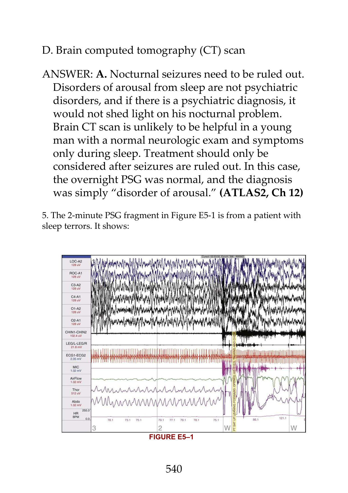

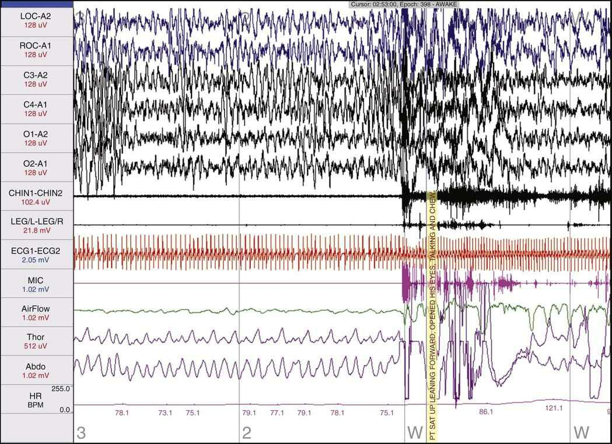

<!-- pdf-page: 541 -->

### A. A gradual shift into heightened autonomic activity

### B. Arousal from obstructive sleep apnea

### C. Instantaneous arousal from NREM sleep

### D. Seizure activity preceding the arousal

### ANSWER: C. This PSG fragment shows a typical

### arousal from NREM sleep in a patient with sleep

### terrors. Although these arousals are most common

### from the deepest stages of NREM sleep (stage N3 or

### slow-wave sleep [SWS]), they may arise from any

### stage of NREM sleep or even from relaxed

### wakefulness. A precipitous and dramatic increase

### in heart rate occurs, from 75 to 121 beats per

### minute. These arousals are instantaneous and

### spontaneous and are not due to the culmination of

### underlying psychologically or psychiatrically

### significant sleep-related mentation. (ATLAS2, pp

### 238-245)

6. The PSG fragment shown in Figure E5-2 is from a 46-year-old obese man with obstructive sleep apnea (OSA). His AHI was 29 events/hr, and low Sao2 was 80%. What other diagnosis is suggested by this fragment?

### 541

<!-- pdf-page: 542 -->

### ANSWER: C. The PSG shows marked chin

FIGURE E5–2

### A. Periodic limb movement of sleep

### B. Nocturnal seizures

### C. Sleep-related eating disorder

### D. REM sleep behavior disorder

### movements, which indicates chewing during

### apparent wakefulness. Although awake by EEG,

### there are periods of sleep seen as well, and the

### patient had no recollection of “eating Gummi

### Bears” during this period. Sleep-related eating

### disorder (SRED) is a specialized form of disorder of

### arousal, like sexsomnia (sleepsex). This disorder is

### more common in women than in men. PSG

### 542

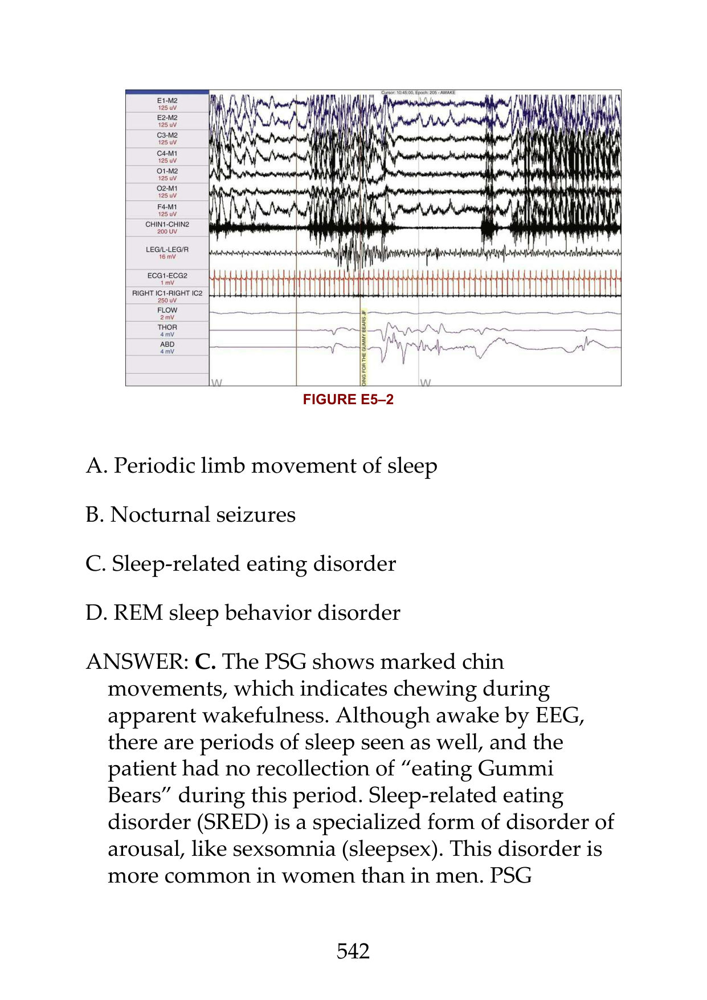

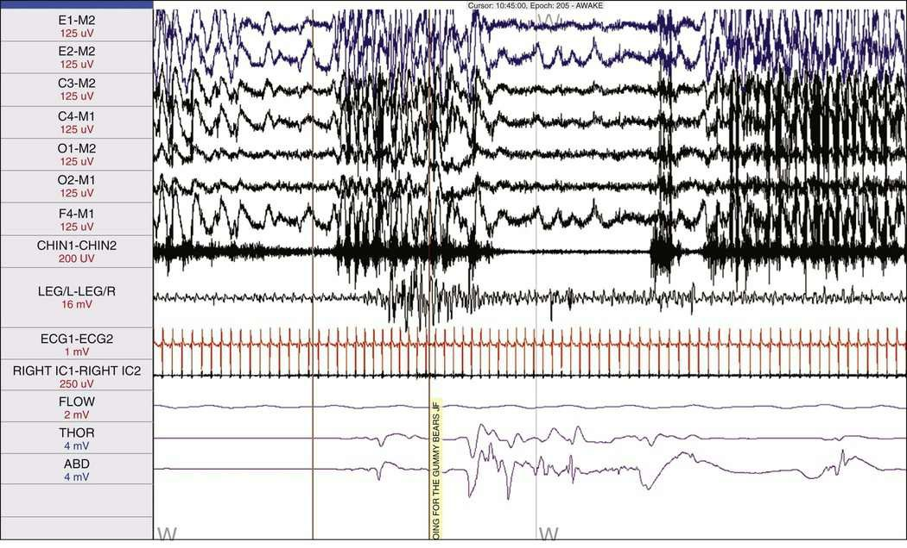

<!-- pdf-page: 543 -->

### evaluations are abnormal in about 80% of cases and

### show arousals that are usually from slow-wave

### sleep. SRED is distinguished from nocturnal eating

### syndrome (NES) in that NES patients eat between

### the evening meal and sleep onset, do not have the

### propensity to eat bizarre foods, and have full recall

### of what they eat. Furthermore, unlike most patients

### with SRED, NES patients do not have a primary

### sleep disorder (i.e., confusional arousals). (ATLAS2,

### p 245; ICSD3, p 240)

7. A 67-year-old man had a dream-enacting episode during hospitalization. He leaped out of bed, fell on the floor, and fractured some ribs. He could recall the dream after each episode. There was a reported history of several years of yelling, swearing, and punching his wife while he was sleeping and no evidence on exam of any cognitive problems, tremors, or abnormal daytime movements. The diagnosis is most likely

### B. Confusional arousal from NREM sleep

### A. REM sleep behavior disorder

### ANSWER: A. The man has REM sleep behavior

### C. Nocturnal seizure disorder

### D. Lewy body dementia

### disorder (RBD). The PSG manifestation is REM

### sleep without atonia, as shown in Figure E5-3. A

### large percentage of patients with RBD later will

### develop a synucleinopathy, such as Parkinson

### disease or Lewy body dementia. Patients with

### 543

<!-- pdf-page: 544 -->

### confusional arousal from NREM sleep typically

### have no recall of the event and cannot relate the

### preceding dream. (ATLAS2, pp 216-221; ICSD3, p

### 246)

8. Which of the following statements is most accurate about RBD?

FIGURE E5–3

### A. Overwhelming male predominance (80% to 90%)

### B. About 20% of patients with RBD eventually

### develop one of the synucleinopathies (Parkinson

### disease, Lewy body dementia, or multiple system

### atrophy).

### C. Once awakened, patients with RBD remain

### confused and disoriented, although the next day,

### they can usually recall the dream.

### 544

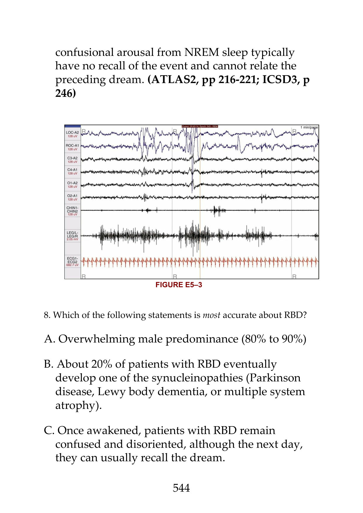

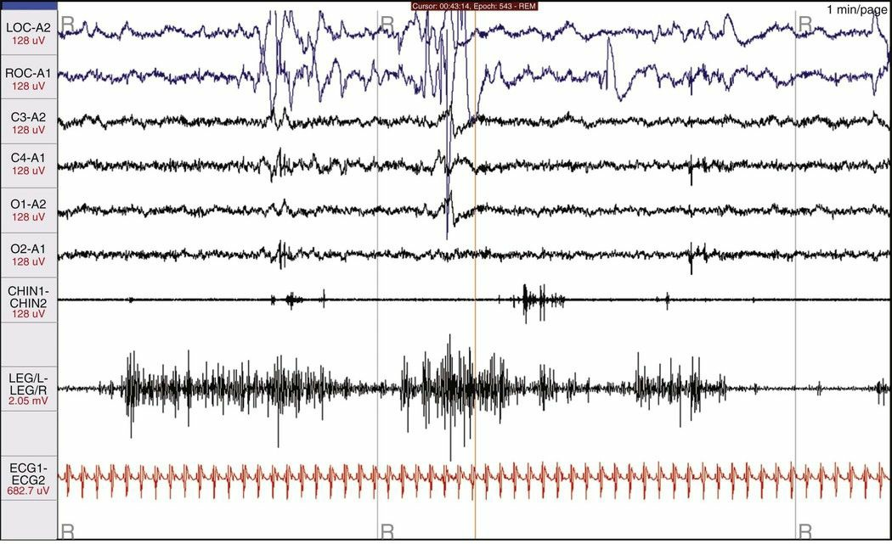

<!-- pdf-page: 545 -->

### D. RBD is rarely drug induced.

### ANSWER: A. When idiopathic, RBD is much more

### prevalent in men than in women. Actually, a much

### larger percentage of patients (up to 75%) with RBD

### will eventually develop a synucleinopathy if

### followed long enough. Once awakened, patients

### with RBD are not confused, and they have good

### recall of the dream. Finally, RBD is frequently drug

### induced. Among the medications that have been

### implicated are tricyclic antidepressants (TCAs),

### selective serotonin reuptake inhibitors (SSRIs), and

### selective serotonin-norepinephrine reuptake

### inhibitors (SNRIs). (ATLAS2, pp 216-221; ICSD3, p

### 246)

9. A 28-year-old patient with narcolepsy was treated with fluoxetine for cataplexy. A PSG fragment is shown in Figure E5-4. The most likely diagnosis is

### 545

<!-- pdf-page: 546 -->

### C. Limb movements associated with hypopneas

FIGURE E5–4

### A. REM sleep without atonia

### B. Periodic limb movements of sleep

### D. Limb movement artifact, because there is no chin

### ANSWER: A. The fragment in Figure E5-4 shows

### activity

### prominent increased phasic EMG activity from the

### anterior tibialis muscles. Sparing of the submental

### muscle is nearly complete. Up to one third of

### patients with narcolepsy also have RBD as a

### manifestation of the underlying neurologic

### disorder. Many drugs prescribed to control

### cataplexy can cause RBD. (ATLAS2, pp 216-221;

### 546

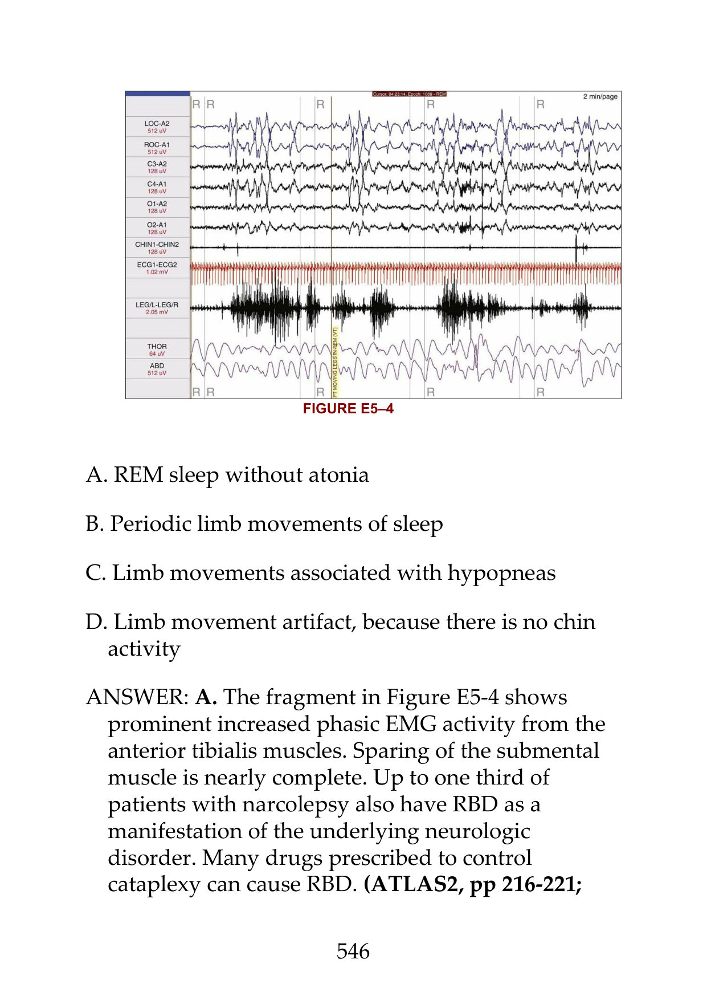

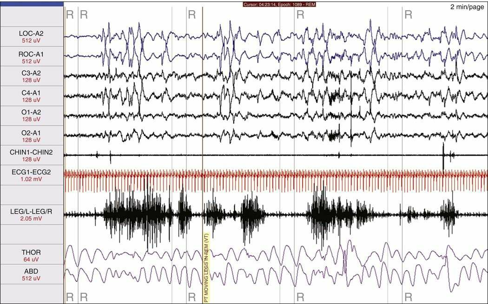

<!-- pdf-page: 547 -->

### ICSD3, p 246)

10. Seizures during sleep are one type of secondary parasomnia, defined as a disease of a specific organ system that mainly manifests during sleep. Of the stages of sleep, what is the most accurate sequence of nocturnal seizure frequency, going from most to least?

### A. NREM, wakefulness after sleep onset (WASO),

### ANSWER: A. This frequency sequence is thought to

### REM

### B. WASO, NREM, REM

### C. REM, NREM, WASO

### D. There is no significant distinction.

### reflect the fact that EEG activity in NREM is highly

### synchronized, as is seizure activity, whereas REM

### has the least synchronized EEG activity. (ATLAS2,

### p 195)

11. A 4-year-old girl has history of nighttime gagging and choking spells for the past 2 years. Because of concern about possible sleep apnea, she has had an adenoidectomy. She also had treatment for esophageal reflux, but the nighttime events continued. Some episodes of tongue biting during the night have also been reported. What should the next step be?

### A. PSG to check for residual sleep apnea

### B. PSG to check for nocturnal seizures (full EEG

### montage)

### 547

<!-- pdf-page: 548 -->

### C. Full night video in the child's home to check for

### seizure activity

### D. Barium swallow

### ANSWER: B. Nocturnal seizures can be present

### without overt generalized tonic-clonic activity.

### When ordering a PSG in which nocturnal seizures

### are a possibility, a full EEG montage should be

### arranged. Such a study was done on this girl, and it

### revealed electrical seizures without accompanying

### motor movement (Fig. E5-5). She was treated with

### carbamazepine with complete relief of the

### nocturnal choking episodes.

12. All of the following are correct about enuresis except

FIGURE E5–5

### 548

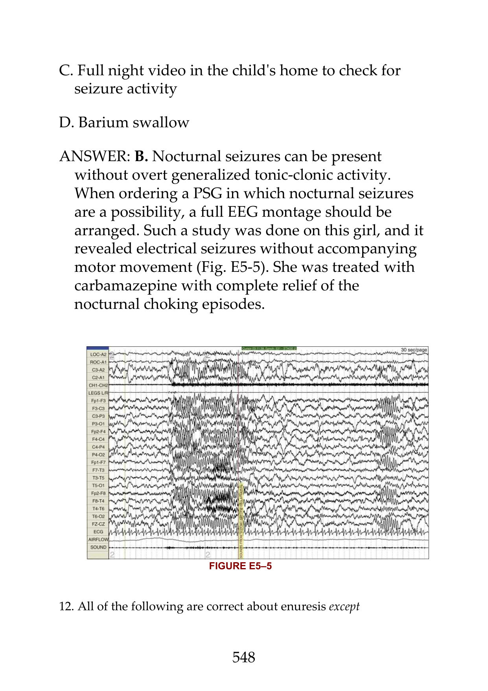

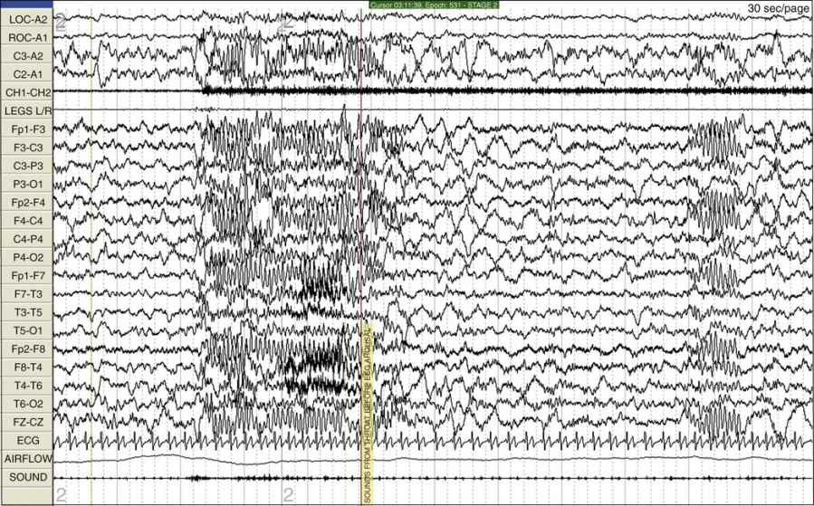

<!-- pdf-page: 549 -->

### A. It can occur during NREM or REM sleep.

### B. The sleep of enuretic children is normal.

### C. It is confined to children and adolescents and

### disappears by age 18 years, unless a specific

### urologic problem exists.

### D. Enuretic children have no more behavioral or

### psychological problems than nonenuretic children.

### ANSWER: C. Enuresis is classified in the category of

### “other parasomnia” and is in fact more prevalent in

### adolescence and adulthood than is generally

### appreciated, occurring in 2.1% of community-

### dwelling older adults. (ICSD3, pp 270-275)

13. Homicidal somnambulism, also called sleep murder, is a

### B. Phenomenon first described as a side effect from

### A. Form of REM behavior disorder

### C. Successful legal defense when zolpidem is the

### certain hypnotic medications

### ANSWER: D. Homicidal somnambulism occurs

### cause

### D. True parasomnia

### during sleepwalking and is thus a parasomnia. The

### first recorded case was in 1864, long before the use

### 549

<!-- pdf-page: 550 -->

### of hypnotics. (Bonkalo A: Impulsive acts and

### confusional states during incomplete arousal from

### sleep: criminological and forensic implications,

### Psychiatr Q 48:400-409, 1974) The defense in court

### against a murder charge has been on the order of

### “The defendant was not in his normal state of mind

### when he committed the act. Sleepwalking is a

### parasomnia manifested by automatism; as such,

### harmful actions committed while in this state

### cannot be blamed on the perpetrator.” This

### argument has been successful at times. At least two

### well-known trials for murder while sleepwalking

### have ended in acquittal. (Martin L: Can

### sleepwalking be a murder defense? Available at

### http://www.lakesidepress.com/pulmonary/Sleep/sl

### murder.htm. Accessed December 15, 2014)

14. A 19-year-old college student consults you because of two episodes about 3 months apart, during which she felt paralyzed during sleep. She described being aware of her surroundings but unable to move even her fingers or to speak. She felt as if she were about to suffocate. Only with great effort, after several minutes, was she “able to break the spell and move.” On one of the two occasions, she thought someone else was in the room. She felt fine after each occasion and was able to fall asleep without another episode the same night. She does not drink alcohol and has no significant medical history. She denies having excessive daytime sleepiness (EDS). At this point you would

### A. Schedule her for an overnight PSG.

### B. Schedule an overnight PSG to be followed by a

### multiple sleep latency test (MSLT).

### 550

<!-- pdf-page: 551 -->

### C. Give a trial of clonazepam, 0.5 mg at bedtime.

### D. Reassure the patient that this is a normal

### phenomenon.

### ANSWER: D. Sleep paralysis is a common REM-

### related parasomnia that may occur in completely

### healthy individuals. Absent a concern about

### narcolepsy or a significant comorbid condition

### (depression, alcoholism), nothing more needs to be

### done. No specific treatment is available, although

### improvement in frequency may be seen with

### improvement in sleep hygiene if warranted.

### Reassurance is a key aspect of

### management. (ICSD3, pp 254-256)

### A. It represents persistence of REM atonia into

15. All are true about sleep paralysis except

### B. It is more common in the setting of excessive sleep

### wakefulness.

### C. It is one of the classic tetrad of narcolepsy

### time.

### symptoms, along with EDS, cataplexy, and

### hypnagogic hallucinations.

### D. In cultural folklore, it was referred to as the “old

### ANSWER: B. Sleep paralysis is actually more

### hag” phenomenon.

### 551

<!-- pdf-page: 552 -->

### common in the setting of sleep deprivation and

### supine positioning. The old hag phenomenon came

### from the belief of sufferers that a witch, or an old

### hag, sits or “rides” the chest of the victims,

### rendering them immobile. Many works of art show

### this phenomenon, the most famous of which is

### Henry Fuseli's Nightmare, in which an incubus sits

### on the chest of a young woman, paralyzing her

### during sleep. (ATLAS2, p 7) Note that the original

### meaning of the word nightmare referred to a

### combination of sleep paralysis and hypnagogic

### hallucinations occurring at sleep onset (Fig. E5-6).

FIGURE E5–6

### 552

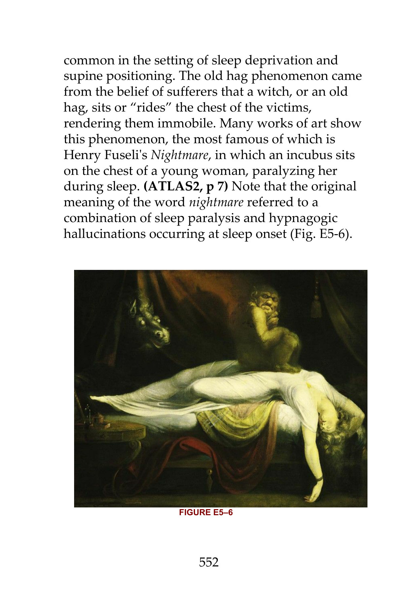

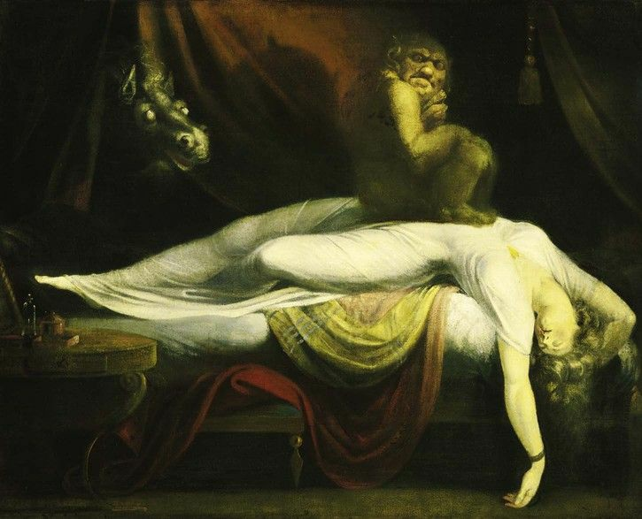

<!-- pdf-page: 553 -->

16. A patient had an overnight PSG with the following finding during an episode of REM sleep (Fig. E5-7). What is the diagnosis?

### ANSWER: B. This patient had complained of severe

FIGURE E5–7

### A. REM sleep without atonia

### B. Bruxism

### C. Seizures

### D. Movement artifact

### insomnia. This 2-minute epoch begins in REM sleep

### (see Fig. E5-7). An abrupt increase in chin EMG

### occurs with transmitted artifact seen in the EEG and

### electrooculogram (EOG). These findings are

### characteristic of sleep bruxism. On digital video, the

### characteristic chattering noise made by the upper

### and lower teeth striking against each other was

### 553

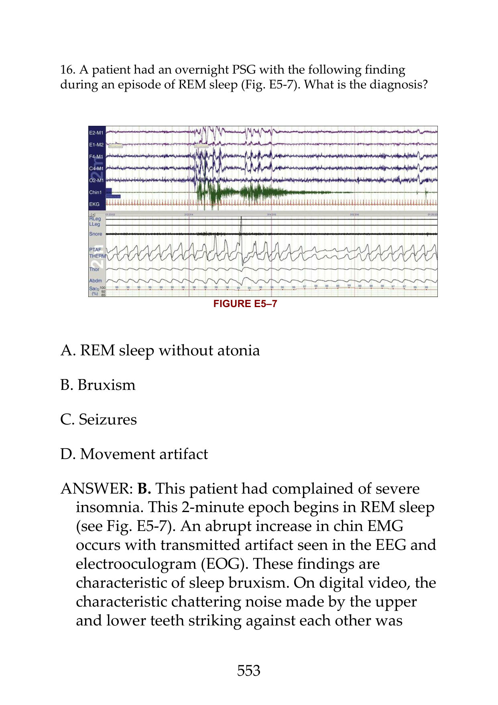

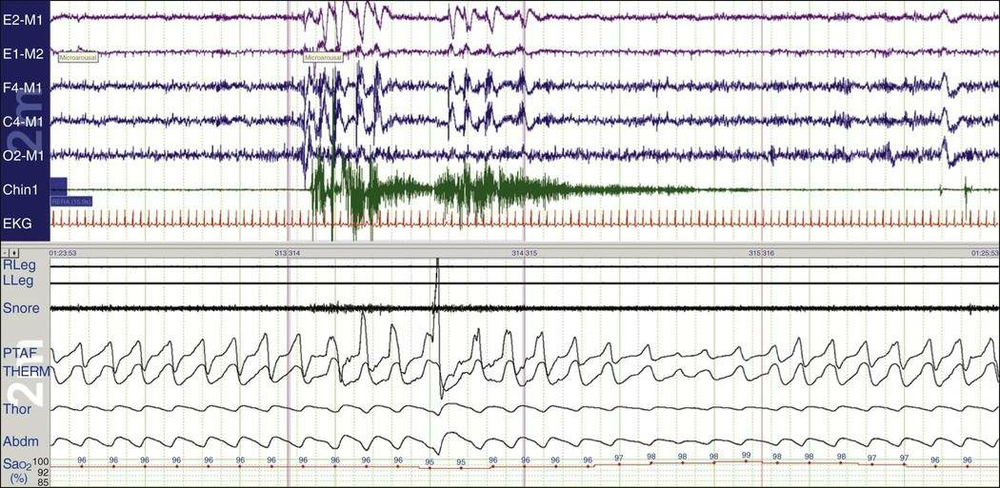

<!-- pdf-page: 554 -->

### audible. Bruxism is classified either as a sleep-

### related movement disorder (ICSD3, p 303) or as a

### parasomnia. (ATLAS2, pp 188-189) If indicated,

### treatment is usually with some type of mouth guard

### worn during sleep.

17. All of the following distinguish nightmares from sleep terrors except

### A. Patients with nightmares typically recall the

### dream, whereas amnesia is more common in

### patients with sleep terrors.

### B. Arousal from sleep terror is associated with

### confusion, whereas arousal from nightmare is not.

### C. Sleep terrors tend to arise from slow-wave sleep,

### whereas nightmares tend to arise from REM sleep.

### D. In contrast to nightmares, sleep terrors are a

### ANSWER: D. Nightmares, a REM parasomnia (but

### common symptom of PTSD.

### not sleep terrors, an NREM parasomnia), are a

### common symptom of PSTD. The nightmares are

### often recurrent, and their content reflects the

### traumatic event in PTSD. The nightmares in PTSD

### are disturbing to the patient. (ICSD3, pp 230, 257)

18. From which of the following do confusional arousals occur?

### A. NREM sleep

### 554

<!-- pdf-page: 555 -->

### B. REM sleep

### C. Transition between wakefulness and sleep

### D. No predominant stage has been identified.

### ANSWER: A. Confusional arousals, including sleep

### terrors and sleepwalking, classically occur in

### NREM sleep. (ICSD3, p 229)

19. From which of the following areas of sleep do nightmares occur?

### C. Transition between wakefulness and sleep

### A. NREM sleep

### B. REM sleep

### D. No predominant stage has been identified.

### ANSWER: B. Nightmares typically arise out of REM

### sleep. Sleep terrors, which are not nightmares,

### occur out of NREM sleep. The ICSD3 notes that

### “nightmares arising either immediately following

### trauma [acute stress disorder] or one month or

### more after a trauma [posttraumatic stress disorder]

### can occur during NREM sleep, especially stage 2, as

### well as during REM sleep and at sleep

### onset.” (ICSD3, p 257)

20. From which of the following areas of sleep do sleep starts (hypnic jerks) occur?

### 555

<!-- pdf-page: 556 -->

### A. NREM sleep

### B. REM sleep

### C. Transition between wakefulness and sleep

### D. No predominant stage has been identified.

### ANSWER: C. Sleep starts, or hypnic jerks, occur in the

### transition between wakefulness and sleep and are a

### normal phenomenon. They are classified as an

### “isolated symptom and normal variant.” (ICSD3, p

### 335)

21. From which of the following areas of sleep do sleep terrors occur?

### C. Transition between wakefulness and sleep

### A. NREM sleep

### B. REM sleep

### D. No predominant stage has been identified.

### ANSWER: A. A sleep terror typically begins after an

### arousal from slow-wave sleep (SWS), most

### commonly toward the end of the first or second

### episode of SWS. (ICSD3, p 230)

22. From which of the following types of sleep does sleepwalking occur?

### 556

<!-- pdf-page: 557 -->

### A. NREM sleep

### B. REM sleep

### C. Transition between wakefulness and sleep

### D. No predominant stage has been identified.

### ANSWER: A. Sleepwalking, like a sleep terror,

### typically begins after an arousal from SWS, most

### commonly toward the end of the first or second

### episode of SWS. (ICSD3, p 229)

23. From which of the following areas of sleep does the paralysis in sleep paralysis originate?

### C. Transition between wakefulness and sleep

### A. NREM sleep

### B. REM sleep

### D. No predominant stage has been identified.

### ANSWER: B. Sleep paralysis is an intrusion of REM

### atonia into the awake stage and can be a normal

### phenomenon. It will often occur during the

### transition from sleep to wakefulness or from

### wakefulness to sleep. It is also common in patients

### with narcolepsy. The five classic symptoms for

### narcolepsy include (1) EDS, (2) cataplexy, (3)

### hypnagogic hallucinations, (4) sleep paralysis, and

### (5) sleep disruption; of the five, only cataplexy is

### 557

<!-- pdf-page: 558 -->

### pathognomonic of narcolepsy with hypocretin

### deficiency. (ATLAS2, p 127, Fig. 8-13 and Ch 11.1,

### pp 159-174; ICSD3, p 254)

24. When do hypnagogic hallucinations typically occur? Pick the best answer.

### C. In the transition between wakefulness and sleep

### A. NREM sleep

### B. REM sleep

### D. No predominant stage has been identified.

### ANSWER: C. Hypnagogic hallucinations occur

### because of the intrusion of REM sleep phenomena

### outside of REM sleep. They generally occur at sleep

### onset or offset, in the transition between

### wakefulness and NREM, and are a classic symptom

### of narcolepsy. (ATLAS2, p 127)

25. A patient with the triad of nocturnal enuresis, somniloquy, and somnambulism most likely

### A. Has some form of narcolepsy.

### B. Has a circadian rhythm disorder.

### C. Has central sleep apnea.

### D. Is between 5 and 15 years of age.

### 558

<!-- pdf-page: 559 -->

### ANSWER: D. This is a question in which the patient

### has three variations of parasomnia. The enuresis

### makes it likely it is a child.

26. Which is/are true regarding sleep-related eating disorder (SRED)?

### A. SRED is often associated with eating peculiar forms

### B. Medication-induced SRED has been reported with

### or combinations of foods.

### zolpidem, triazolam, lithium carbonate, and

### anticholinergic medications.

### C. Various health side effects are associated, including

### weight gain, diabetes mellitus, and situational

### depression.

### D. SRED events are typically associated with

### confusional arousals from NREM sleep but can

### occasionally occur from REM sleep as well.

### ANSWER: F. Answers A to D above describe the

### E. Answers A, B, and C are correct.

### F. All of the above are correct.

### clinical features of SRED. (ICSD3, p 240)

27. A patient is referred because his bed partner was concerned that the patient was having upsetting nightmares. The patient moaned quite loudly at times during sleep. The patient undergoes a PSG, a fragment of which is shown in Figure E5-8. What diagnostic entity

### 559

<!-- pdf-page: 560 -->

is shown in the fragment?

### ANSWER: C. This is catathrenia, although some

FIGURE E5–8

### A. REM sleep behavior disorder

### B. Seizures

### C. Catathrenia

### D. Central sleep apnea

### features suggestive of the other entities are

### apparent. The fragment begins in REM (rapid eye

### movements are seen at the beginning), and the

### characteristic breathing pattern abnormality

### resembles central apnea. However, noises are also

### recorded in the snoring channel during what

### should have been a quiet period, arguing against

### central apneas. Also, there is no hypoxemia during

### the events. Catathrenia is classified as an “isolated

### 560

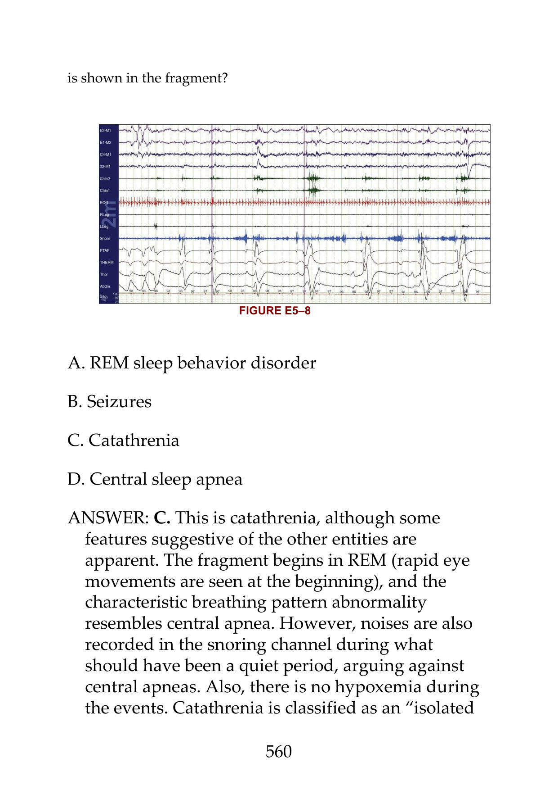

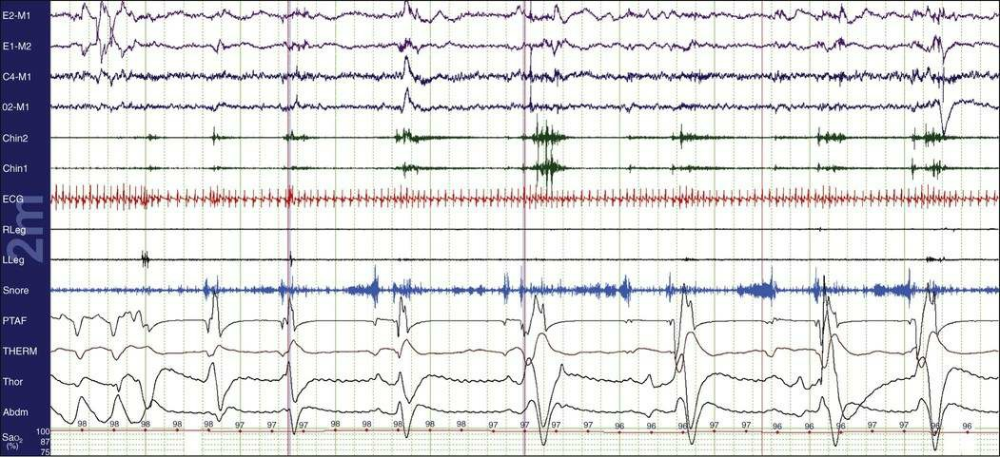

<!-- pdf-page: 561 -->

### symptom and normal variant” of breathing during

### sleep that most often, but not exclusively, occurs

### during REM sleep. (ATLAS2, pp 251-252; ICSD3, p

### 141)

28. A 65-year-old man has just been diagnosed with RBD. The sleep physician told him to stop one of the drugs he is taking, believing it is likely causing the RBD. The drug is most likely

### ANSWER: B. Antidepressants have been implicated

### A. Clonazepam

### B. Fluoxetine

### C. Oxycontin

### D. Eszopiclone

### as a cause of RBD, principally drugs of the SSRI and

### SNRI class. (Parish JM: Violent dreaming and

### antidepressant drugs: or how paroxetine made me

### dream that I was fighting Saddam Hussein, J Clin

### Sleep Med 3:529-531, 2007; and Schenck CH,

### Mahowald MW: REM sleep behavior disorder:

### clinical, developmental, and neuroscience

### perspectives 16 years after its formal identification

### in SLEEP, Sleep 25:120-138, 2002) SSRI medications

### that have caused RBD include fluoxetine (Prozac)

### and paroxetine (Paxil). A commonly used SNRI that

### has also caused RBD is venlafaxine (Effexor).

### Clonazepam is often used to treat RBD. Whereas

### incidents of confusion, hallucinations, and

### 561

<!-- pdf-page: 562 -->

### aggressive behavior may occur with opiates and Z

### drugs, RBD is not a noted problem. (ATLAS2, p

### 221, Fig. 11.3-17)

29. Examine Figure E5-9. What drug is this patient most likely taking?

### ANSWER: C. Prominent eye movements during

FIGURE E5–9

### A. Mirtazepine

### B. Clonazepam

### C. Fluoxetine

### D. Venlafaxine

### NREM sleep are commonly seen in patients taking

### fluoxetine (sometimes called “Prozac eyes”). These

### can be rolling or rapid eye movements. (Schenck

### CH, Mahowald MW, Kim SW, et al: Prominent

### eye movements during REM sleep and REM sleep

### 562

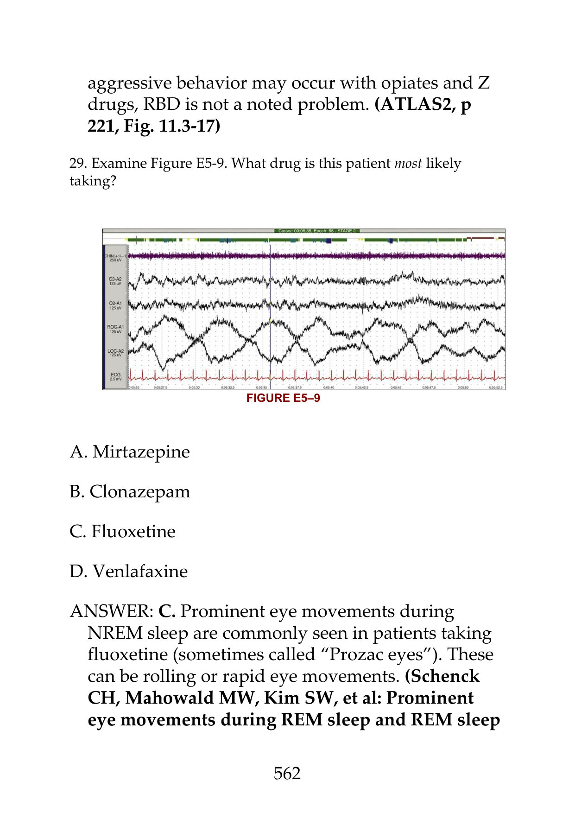

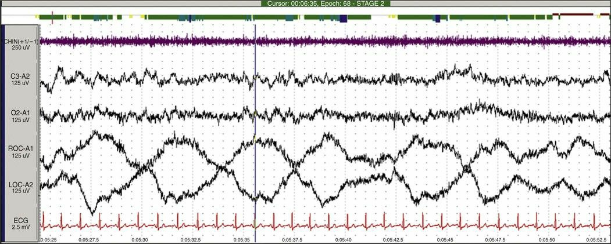

<!-- pdf-page: 563 -->

### behavior disorder associated with fluoxetine

### treatment of depression and obsessive-compulsive

### disorder, Sleep 15:226-235, 1992) Although first

### described with fluoxetine, these NREM eye

### movements are now recognized with other drugs of

### the SSRI class. (Geyer JD, Carney PR, Dillard SC,

### et al: Antidepressant medications, neuroleptics,

### and prominent eye movements during NREM

### sleep, J Clin Neurophysiol 26:39-44, 2009) The

### manifestation may be a mild form of serotonin

### syndrome, which can cause myoclonic jerks, ocular

### oscillations, and other motor and autonomic signs.

30. A 51-year-old woman in a nursing home rehab unit is recovering from hip surgery. She has a diagnosis of schizo-affective disorder. She has difficulty sleeping, with nocturnal agitation and a tendency to wander around the ward, responding to chronic auditory hallucinations. Which of the following drugs would you prescribe?

### ANSWER: D. Sleep disorders in patients with

### A. Trazodone

### B. Gabapentin

### C. Clonazepam

### D. Quetiapine

### psychosis is a common problem. Trazodone can be

### used for simple insomnia, but because psychotic

### features are present in this case, most clinicians

### would choose quetiapine (Seroquel), an

### 563

<!-- pdf-page: 564 -->

### antipsychotic. Clonazepam is sometimes used for

### RBD, and gabapentin is used for periodic limb

### movements of sleep (PLMS) and restless legs

### syndrome (RLS).

31. Although such use is technically considered “off label,” the one prescription drug that has been most used and is reportedly “90% effective” for RBD is

### ANSWER: A. Clonazepam at a dose of 0.25 to 1 mg

### A. Clonazepam

### B. Melatonin

### C. Pramipexole

### D. Clonidine

### before bedtime is effective in 90% of cases.

### Melatonin, an over-the-counter agent, can also be

### considered a low-risk, high-yield option. (ATLAS2,

### p 220)

32. All of the following are true about sleepwalking in children except

### A. The eyes are usually open, but the child may

### B. It is more common in children than in adults, and it

### appear confused or agitated.

### C. Untreated, it may lead to emotional problems in

### peaks between 4 and 8 years.

### 564

<!-- pdf-page: 565 -->

### adolescence.

### D. It usually begins as an arousal from slow-wave

### sleep (stage N3).

### ANSWER: C. Sleepwalking is common and is not a

### sign of psychological problems. It rarely requires

### any treatment (apart from making the environment

### safe for the child), and it does not lead to emotional

### problems in later years.

33. All of the following are true about sleep enuresis except

### A. It is present in about 30% of 4-year-olds and in 1%

### B. In children of all ages, sleep enuresis is more

### to 2% of 18-year-olds.

### common in boys than girls by a 3:2 ratio.

### C. Secondary sleep enuresis is defined when a child

### starts bedwetting after being dry for at least 6

### consecutive weeks.

### D. Sleep enuresis, normal at a certain age, is defined

### as a problem if it persists beyond 5 years of age.

### ANSWER: C. Sleep enuresis is considered secondary

### when the child (over age 5 years) has been dry for

### at least 6 consecutive months and now has had

### enuresis for at least 3 weeks. (ICSD3, p 270)

### 565
