# Section 6 Movement Disorders

<!-- pdf-page: 566 -->

### SECTION 6

## Movement Disorders

A 58-year-old Air Force general is referred for management of insomnia. He complains of difficulty falling asleep at bedtime, especially when flying at night from base to base. He worries about the various military operations around the world involving the Air Force, and he cannot turn his mind off. He has participated in military operations and often thinks about the time when his airplane was hit by antiaircraft fire and he was forced to return to base and make an emergency landing. He also finds that when he tries to fall asleep in the passenger section of an airplane, he feels fidgety; to relieve the sensation, he has to get up and walk around the plane. He sometimes has the same sensation when working as a copilot in the cockpit of an aircraft. He has had difficulty with sleep for about 30 years but is seeking help now because his inability to sit in the cockpit has worsened recently. He is concerned there may be a serious neurologic problem. He snores but has never been observed to have apneas. His Epworth Sleepiness Scale (ESS) score is 2 out of 24, and his body mass index (BMI) is 25. He had a complete physical and screening blood tests 4 months earlier and was told all of his numbers were normal. He takes lowdose aspirin for heart disease prophylaxis.

## 6.1.

## Limb Movement Disorders

## Questions

#### The Fidgety General

1. The differential diagnosis of the insomnia includes each of the

### 566

<!-- pdf-page: 567 -->

following except

### A. Posttraumatic stress disorder (PTSD)

### B. Psychophysiologic insomnia

### C. Primary restless legs syndrome (RLS)

2. Which one of the following is required to document the diagnosis of RLS?

### D. Secondary RLS

### C. Suggested immobilization test (SIT)

### A. Nocturnal polysomnogram (PSG)

### B. Clinical history

3. The patient brought along the results of his prior blood tests. Hemoglobin and hematocrit were 13 g/dL and 39%, respectively. How do you interpret these results, and what would you do next?

### D. Serum ferritin level

### A. Both results are normal. No further blood tests are

### B. The hemoglobin is low, but the hematocrit is

### warranted.

### normal. Vitamin B12 measurement is warranted.

### C. Both hemoglobin and hematocrit are borderline

### low but not abnormal enough to be concerning, and

### no further blood testing is needed.

### 567

<!-- pdf-page: 568 -->

### D. Both hemoglobin and hematocrit are below the

### lower limit of normal. The patient is anemic, thus

### more testing is required.

4. Beyond anemia, other causes of secondary RLS should be evaluated except

5. Because the blood tests were 4 months old, you decide to order additional tests. Which test would be least appropriate at this point?

### A. Renal insufficiency

### B. Neuropathy

### C. Thyroid disease

### D. Hepatic failure

### D. Bilirubin and alkaline phosphatase

### A. Serum ferritin

### B. Vitamin B12 level

### C. Stool for occult blood

6. The results of tests you ordered are as follows:

Test Result Serum ferritin 6 ng/mL Vitamin B12 1200 pg/mL Stool for occult blood Positive Serum bilirubin Normal Serum alkaline phosphatase Normal

### 568

<!-- pdf-page: 569 -->

What is the next step?

### A. Start the patient on a dopaminergic agent.

### B. Start the patient on ferrous sulfate 65 mg daily.

### C. Give intramuscular (IM) injections of B12.

### D. Arrange for a gastroenterology consultation.

#### Extremely Restless in the Magnetic Resonance

#### Imaging Scanner

A 56-year-old woman was referred to the sleep disorders center with a 25- year history of severe insomnia and restlessness at bedtime. The symptoms first began during her last pregnancy, but she has a history of depression. Zolpidem was not effective in treating the insomnia. Her family doctor recalled an article in a family practice journal that suggested starting insomnia patients on the sedating antidepressant mirtazapine. He did so and also prescribed a sustained-release formulation of levodopa for the restlessness. Both medications were taken at bedtime. For the first 8 nights, the medications were effective; the restlessness resolved, and she fell asleep quickly. To that point she described the medications as “miraculous.” However, on the ninth morning, she felt very restless and complained of a headache. She was sent for a magnetic resonance imaging (MRI) scan. In the scanner, she was so restless when asked to keep still that she started to scream. She was referred to the sleep clinic.

7. What is the least likely explanation of the new symptoms?

### A. Disease progression

### B. Augmentation

### C. Effect of mirtazapine

### 569

<!-- pdf-page: 570 -->

### D. Dopamine rebound

8. All of the following are appropriate interventions except:

### A. Checking serum ferritin level.

### C. Increasing the levodopa dose and have her take it 2

### B. Stopping mirtazapine.

### D. Stopping levodopa and initiate pramipexole or

### hours earlier.

9. After the above interventions are made, her morning symptoms disappear and she is partially improved. However, she still has significant nighttime restlessness symptoms and daytime sleepiness that she would like treated. Which of the following is the most appropriate next step?

### ropinirole.

### B. Add an opiate such as codeine at bedtime.

### A. Start her on zolpidem at bedtime.

### C. Start her on modafinil to treat daytime sleepiness.

### D. Stop all dopaminergic medications.

A 62-year-old man with a history of mild RLS is referred to you owing to a recent intensification in symptoms. The leg symptoms begin about 6 pm and can be so uncomfortable that he soaks in a hot tub for about an hour before bedtime. He recently started taking an antidepressant to help him cope with the death of a close relative.

#### Jumpy Legs and Depression

### 570

<!-- pdf-page: 571 -->

10. Which of these antidepressants is least problematic with regard to increasing RLS symptoms and periodic limb movements?

### A. Bupropion

11. The patient's primary care physician originally started him on a dopaminergic agent, but the patient did not tolerate it because of daytime tiredness and nightmares. Given that the RLS symptoms have continued after changing his antidepressant medication, what would the next best treatment for RLS be?

### B. Mirtazapine

### C. Trazodone

### D. Imipramine

12. Which of the following side effects may be seen with dopaminergic agonists?

### A. Gabapentin enacarbil

### B. Phenytoin

### C. Topiramate

### D. Zonegran

#### Restless Legs

### A. Anorexia

### B. Compulsive gambling

### C. Sleep-related eating

### 571

<!-- pdf-page: 572 -->

### D. Periodic limb movements

13. Which of the following is a nonpharmacologic measure that reduces RLS severity?

14. Pregnant women more commonly have RLS. Which of the following is a known predictor of RLS during pregnancy?

### A. Increased chocolate

### B. Reduced caffeine

### C. Increased vitamin C

### D. Decreased simple sugars

### C. Age of the woman during pregnancy

### A. Family history of RLS

### B. Having twins

15. Generally, RLS prevalence increases with age. In which age range does RLS prevalence stabilize or decrease slightly?

### D. Insomnia during early pregnancy

### A. Preteen to teenage years

### B. Teenage to young adult years

### C. Young adult to middle-age years

### D. Older adult to elderly years

### 572

<!-- pdf-page: 573 -->

16. A suggested immobilization test is performed on a patient. Which periodic limb movement of wakefulness (PLMW) frequency suggests RLS?

### A. 5 PLMW/hr

#### Looking for Sleep Apnea, Finding Something Else

### B. 15 PLMW/hr

### C. 20 PLMW/hr

### D. 40 PLMW/hr

A 67-year-old woman presents with symptoms of sleep-onset insomnia, early morning awakenings, and snoring. Her husband states that she moves the entire night and that it is like sleeping with a “twitching fish.” She has a BMI of 34 and an ESS score of 9/24. A sleep study is ordered by her family doctor because of suspected obstructive sleep apnea (OSA). The study revealed a sleep-onset latency of 90 minutes, a duration typical for this patient. Leg electromyography (EMG) did not show excessive activity during the initial waking period. Total sleep time (TST) was 5 hours. A 5- minute fragment of her study is shown in Figure 6.1-1. She had similar findings during other portions of the sleep study.

17. This fragment is consistent with which of the following?

### C. Periodic limb movements of sleep (PLMS)

### A. Obstructive sleep apnea

### B. Restless legs syndrome

### D. Periodic limb movement disorder (PLMD)

18. Extrapolating from this fragment, what is the patient's periodic limb movement index (PLMI)?

### 573

<!-- pdf-page: 574 -->

### A. 5 events/hr

### B. 11 events/hr

19. What is the most appropriate first step in treatment of this patient's nighttime and daytime symptoms?

### C. 55 events/hr

### D. 132 events/hr

### D. Cognitive behavioral therapy (CBT)

### A. Dopaminergic agent at bedtime

### B. Modafinil in the morning

### C. Clonazepam at bedtime

A 45-year-old woman falls asleep quickly then wakes up several times

FIGURE 6.1–1 Questions 17 to 19.

#### The Right Test for the Wrong Reason

### 574

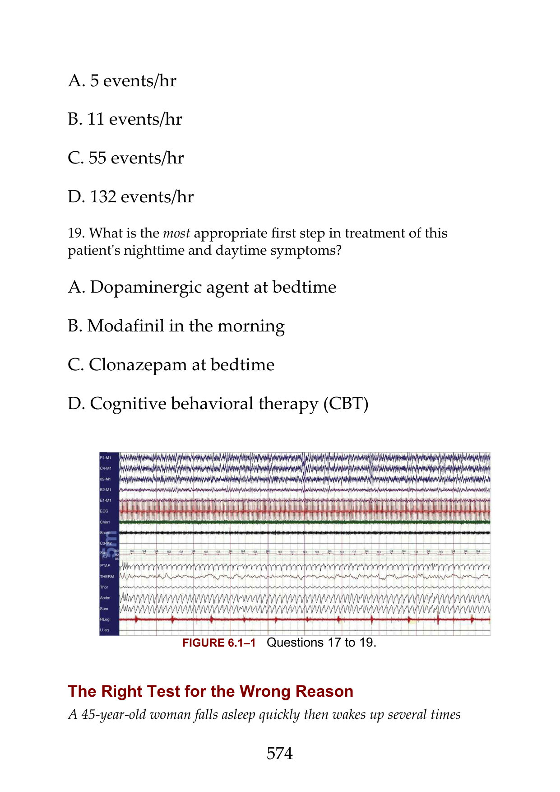

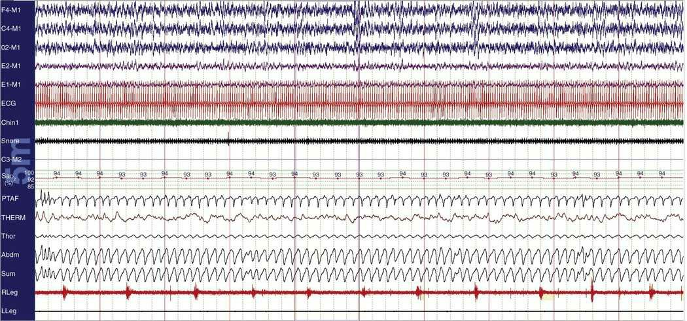

<!-- pdf-page: 575 -->

during the night. She is unhappy about her difficulty maintaining sleep but is otherwise healthy and does not complain of restless arms or legs. However, her husband has noted she frequently twitches and jerks throughout the night; he has not noted snoring. Her ESS score is 8/24. The patient states that her family doctor wanted her to have a sleep study because he thought she had RLS.

20. What should the first step be in your assessment of this patient?

21. The patient has an overnight sleep study; a 2-minute fragment is shown in Figure 6.1-2. What does this fragment show?

### A. In-laboratory PSG

### B. Home sleep testing

### C. Actigraphy

### D. Suggested immobilization testing

### B. Periodic limb movements without arousals

### A. Multiple respiratory events

### C. Periodic limb movements with arousals

### D. Diagnostic features of RLS

### 575

<!-- pdf-page: 576 -->

22. What is the likelihood of a patient with periodic limb movements having RLS symptoms?

FIGURE 6.1–2 Questions 21 and 22.

23. What is the most appropriate first step in the pharmacologic treatment of this patient?

### A. 20%

### B. 40%

### C. 60%

### D. 80%

### A. Pramipexole

### B. Zolpidem

### C. Clonazepam

### D. Oxycodone

### 576

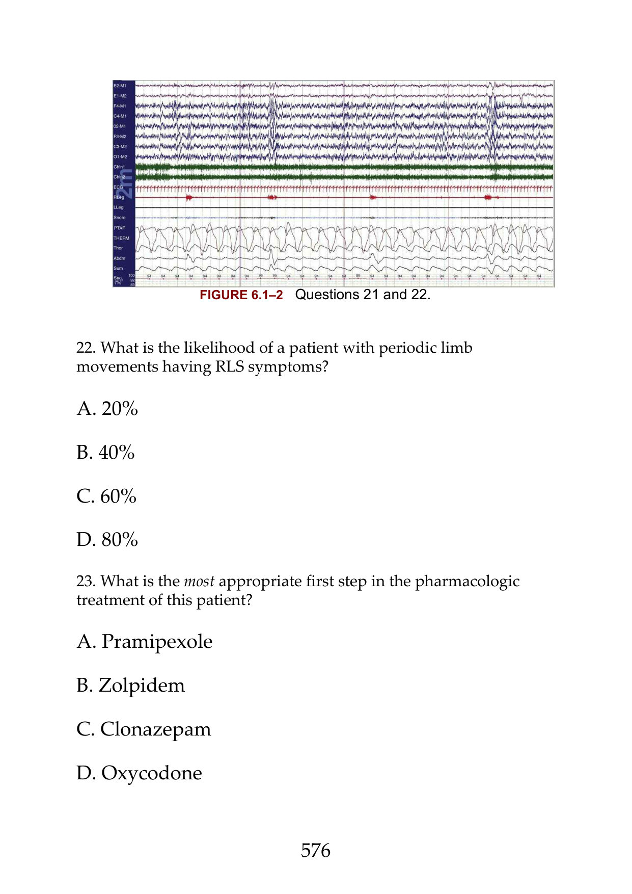

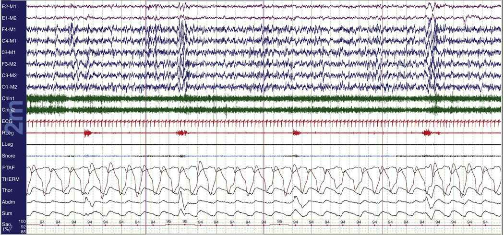

<!-- pdf-page: 577 -->

#### Periodic Limb Movements of Sleep

24. Which of the following genetic factors has been well correlated with PLMS?

25. The minimum amplitude of a periodic leg movement when scoring a PSG is

### A. Arylsulfatase A deficiency

### B. BTBD9

### C. CLCN1

### D. Hexosaminidase A deficiency

26. Which of the following criteria must be included for the diagnosis of PLMD by the International Classification of Sleep Disorders , edition 3 (ICSD3)?

### A. 2 µV

### B. 4 µV

### C. 8 µV

### D. 16 µV

### A. Sleep disturbance or daytime impairment

### B. A mean sleep latency of less than 8 minutes

### C. A PLMI of 12/hr in an adult

### D. A PLMI of 3/hr in a child

### 577

<!-- pdf-page: 578 -->

## Answers

1. A. There is not enough evidence in the history to make a diagnosis of posttraumatic stress disorder (PTSD), although he does mentally revisit a stressful time in his life. Patients with PTSD might complain of insomnia but are troubled by awakenings with recurrent violent dreams. The patient gives a history consistent with RLS, which often is associated with insomnia. Any disorder that causes difficulty falling asleep can also lead to psychophysiologic insomnia. It is worth emphasizing that RLS is a syndrome, and the ICSD3 has a single RLS entry; there is no specific designation for primary and secondary RLS. (ICSD3, pp 282-291)

2. B. The diagnosis of RLS in adults is based on history alone; no sleep test is required. The mnemonic URGE has been used to help remember the four core characteristics for diagnosis: urge to move limbs; rest worsens the sensation; getting up and moving offers temporary relief; sensations worsen in the evening or at night. A PSG should only be done if there is a high probability of an additional sleep disorder, such as OSA. The SIT has been used in research but is not part of routine clinical assessment. (ATLAS2, p

#### 178-185; ICSD3, pp 282-291)

3. D. In men, normal hemoglobin is 14 to 17.5 g/dL and normal hematocrit is 40% to 50%. In terms of the relationship between RLS and anemia, it is important to emphasize that nutritional deficiencies can cause secondary RLS (e.g., leading to a reduction in central nervous system [CNS] iron) before actual anemia is documented. For anemia to be caused by iron deficiency, iron stores in the marrow are zero, not simply reduced. Thus, given these results, an anemia workup would be appropriate.

4. D. The disorders that cause secondary RLS generally do not include hepatic failure. The other conditions mentioned have been associated with RLS. Another secondary cause is medication side effects. For example, many antidepressants may be associated with or may cause RLS symptoms (an exception is bupropion). With respect to liver disease, some patients with hemochromatosis

### 578

<!-- pdf-page: 579 -->

develop RLS because they may have low CNS iron levels. However, using iron to treat hemochromatosis can worsen it. (Haba-Rubio

#### et al, 2005)

5. D. There is no reason to order bilirubin and alkaline phosphatase, abnormalities of which would point to liver disease. Serum ferritin should be ordered because low ferritin levels (typically <50 mg/dL) are consistent with reduced iron stores that are a cause of RLS. Because the patient had anemia in the first blood test, a stool for occult blood is indicated. Vitamin B12 deficiency can cause peripheral neuropathy and RLS. In particular, older patients with pernicious anemia can have RLS. (Mold et al, 2004)

6. D. The patient has reduced iron stores, the cause of which must be ascertained. Given the positive stool for occult blood, the next step would be a gastrointestinal (GI) evaluation. Men and women in the military may be blood donors, and a history of repeat blood donation has been associated with RLS. (Arunthari et al, 2010)

7. A. This is not an example of disease progression but rather a classic description of augmentation and rebound to dopaminergic agents in RLS. There is also likely a contribution from the mirtazapine. With augmentation there is usually an initial therapeutic benefit followed by a worsening of symptoms, and symptoms also occur in other parts of the body not initially affected. Symptoms occur earlier, with rebound movements, and restlessness occurs when the medication wears off (for this patient, in the morning). Inexperienced clinicians sometimes increase the dose of a dopaminergic agent, and the augmentation and rebound simply worsen. Indeed, many family physicians use sedating antidepressants for insomnia based on articles they have read. RLS is a common side effect of second-generation antidepressants; about 25% of patients on mirtazapine develop this symptom. (ATLAS2,

#### pp 185-188; Hartmann, 1999; Rottach et al, 2008)

8. C. Increasing the dose of levodopa would be the wrong thing to do. In fact, RLS patients should not be started on levodopa at all, because the incidence of augmentation is between 30% and 80%, and the rebound in the morning can be quite distressing. Thus the

### 579

<!-- pdf-page: 580 -->

levodopa should simply be stopped, and the patient should be started on either pramipexole or ropinirole. In a patient with unresponsive RLS, always confirm that the serum ferritin level is normal, and advise the patient to stop medications known to worsen restlessness (in this case, mirtazapine).

9. B. Opiates can be highly effective in patients with severe RLS and may be added as treatment. Codeine is generally effective for up to 6 hours. Oxycodone, methadone, and fentanyl patches last longer but are reserved for when symptoms occur for longer times throughout the day. Common opiate side effects include constipation, daytime sedation, and pruritus. Always remember that such agents may cause or worsen sleep-disordered breathing.

10. A. Bupropion inhibits the uptake of dopamine and norepinephrine. Bupropion is not known to increase periodic limb movements or to exacerbate restless legs symptoms, probably because of its effects on dopamine reuptake.

11. A. All of the options are medications that have been associated with treatment of seizures. However, gabapentin enacarbil is the only agent that has been demonstrated to reduce RLS severity. This medication may be a particularly good choice in patients who cannot tolerate dopamine agonists. Pregabalin is also becoming a commonly used first line treatment of RLS. (Allen et al, 2014; Lee et

#### al, 2011)

12. B. Dopaminergic agents have many side effects, including nausea, sleepiness, and fatigue. A less common side effect of these medications is impulse control disorders (ICDs), which may include compulsive gambling. In one cross-sectional study, 17% of patients who have Parkinson disease and are treated with dopaminergic drugs have an ICD, including gambling, compulsive sexual behavior, compulsive buying, and binge-eating disorders. (Weintraub et al, 2010)

13. B. Caffeine may exacerbate RLS symptoms, thus physicians commonly recommend that caffeine be reduced to minimize symptoms. (http://www.ninds.nih.gov/disorders/restless_legs/deta

### 580

<!-- pdf-page: 581 -->

14. A. Although the strongest predictor of RLS during pregnancy is a prior pregnancy with RLS, another important predictor of RLS during pregnancy is family history. Other factors may include RLS in the past and a hemoglobin less than 11 g/dL. (ICSD3, pp 285-286)

15. D. RLS prevalence generally increases with age. However, in the older adult population, RLS prevalence stabilizes or decreases slightly. (ICSD3, p 286)

16. D. The correct answer is 40 PLMW/hr. At that level, the test is approximately 80% specific and sensitive. (ICSD3, p 289;

#### Montplaisir et al, 1998)

17. C. This fragment is consistent with PLMS. There is no evidence for obstructive sleep apnea. RLS is not diagnosed using a PSG but is based on clinical symptoms alone. The term periodic limb movement disorder (PLMD) is present when the periodic limb movements are associated with insomnia or hypersomnia without a more evident cause. Thus, the PSG findings of PLMS must be associated with clinical sleep symptoms in order to make the diagnosis of PLMD.

18. D. This fragment shows 11 PLMS in 5 minutes. The index is calculated per hour of sleep, thus the hour would contain 12 fiveminute epochs. The PLMS index would therefore be 12 × 11, or 132.

19. D. Because the patient did not have increased arousals during sleep, it is unlikely that the sleepiness was caused by the periodic limb movements. Thus there is no indication here to use a dopaminergic agent or a stimulant. The pharmacokinetics of clonazepam, if used as a hypnotic, often result in a hangover the next morning. When used as a hypnotic, it is best that clonazepam be taken 1 to 2 hours before bedtime. Given the history and the findings on PSG, treating the patient's insomnia to increase total sleep time will likely be the most efficacious way to treat her sleepiness.

20. C. The patient should have an overnight sleep study because a movement disorder other than RLS is likely. PLMS can only be diagnosed by in-laboratory PSG. An immobilization test is used for

### 581

<!-- pdf-page: 582 -->

research on RLS but would not necessarily be helpful to make a clinical diagnosis in this case.

21. C. Even in a compressed epoch, changes can be seen in the electroencephalograph (EEG) associated with the second and fourth leg twitch. These are probably arousals, thus the patient has PLMS with arousals.

22. A. About 20% of patients with periodic limb movements have clinical RLS symptoms. However, about 80% of patients with RLS have PLMS with or without arousals. As a side note, by definition, a person with PLMD does not in addition have a diagnosis of RLS.

23. A. Dopaminergic agents are likely the treatment of choice in patients with PLMD.

24. B. BTBD9 is the gene that has been correlated with PLMS in a 2007 New England Journal of Medicine article that looked at patients with RLS and PLMS. The other genes are associated with neurologic disorders but not with periodic limb movements. Arylsulfatase A deficiency causes mucopolysaccharidosis VI which may result in infiltration of the entire upper airway with abnormal soft tissue, resulting in severe obstructive apnea and hypoventilation. Mutations in the CLCN1 gene may cause Becker’s myotonia, which may result in sleep apnea. Hexosaminidase A deficiency causes Tay-Sachs disease. (Stefansson et al, 2007)

25. C. A periodic limb movement should be 8 µV above resting EMG voltage to be a scorable event; it must then return to less than 2 µV above resting EMG within 10 seconds to complete the scoring of the event. (MANUAL2, Section VII, Movement Rules)

26. A. PLMD has the following criteria: PLMS are scored based on the AASM scoring manual (MANUAL2) and occur at 15/hr or more in an adult and 5/hr or more in a child; the PLMS cause clinically significant sleep disturbance or impairment in mental, physical, social, occupational, educational, behavioral, or other important areas of functioning; and the symptoms are not better explained by another sleep, medical, neurologic, or psychiatric disorder. There

### 582

<!-- pdf-page: 583 -->

are no criteria for PLMS with arousal or multiple sleep latency test (MSLT) findings.

## Summary

▪ AASM Manual for the Scoring of Sleep and Associated Events: Rules,

### Highly Recommended

Terminology, and Technical Specifications, Version 2.1, 2014, Section VII, Movement Rules ▪ Atlas of Clinical Sleep Medicine, ed 2, Chapter 11.2 ▪ International Classification of Sleep Disorders, ed 3, pp 282-291

The entire section on movement disorders on the examination, which will also include rhythmic movement disorder and bruxism, only makes up about 19 questions or about 8% of the entire exam. About 70% of the movement disorders questions, about 13 questions, will be specific to RLS and PLMS. Some content related to this topic might also be covered elsewhere, for example under hypersomnolence, and it is possible that questions related to pediatrics may be presented on this topic.

### • Urge to move the limb is unpleasant or

### Restless Legs Syndrome

▪ Features

### ❍ Essential: URGE criteria

### • Rest (inactivity) worsens or precipitates symptoms.

### uncomfortable.

### • Getting up and moving or walking improves

### • Evening (or bedtime) worsens or precipitates

### symptoms.

### 583

<!-- pdf-page: 584 -->

### symptoms.

### ❍ Nonessential

### • Supportive pediatric criteria may include

### • Family history

### • Response to dopaminergic therapy

### • Sleep disturbance

### • PLMS or PLMW

### ❍ In children for diagnosis

### • The four URGE criteria

### deficit/hyperactivity disorder (ADHD)

### ○ Sleep disturbance

### ○ Positive immediate family history

### ○ PLMI greater than 5

### ○ Strong association with attention-

▪ Laboratory testing

### ❍ PSG is not required for diagnosis.

### ❍ About 80% have PLMS.

### 584

<!-- pdf-page: 585 -->

### ❍ Blood tests for secondary phenotype (Table 6.1-1)

Table 6.1–1

#### Tests to Consider in Patients with Restless Legs Syndrome

Iron deficiency is likely when serum iron is low; TIBC/transferrin is high; TIBC is high and percentage transferrin saturation is low; ferritin is low.

### • Some groups (e.g., French Canadians)

▪ Epidemiology

### ❍ 5% to 10% of population

### ❍ More common in:

### • A person whose family member is affected

### • Older people

### ❍ Several genes are implicated in different

▪ Genetics

### ❍ Usually inheritance is autosomal dominant.

### populations.

### 585

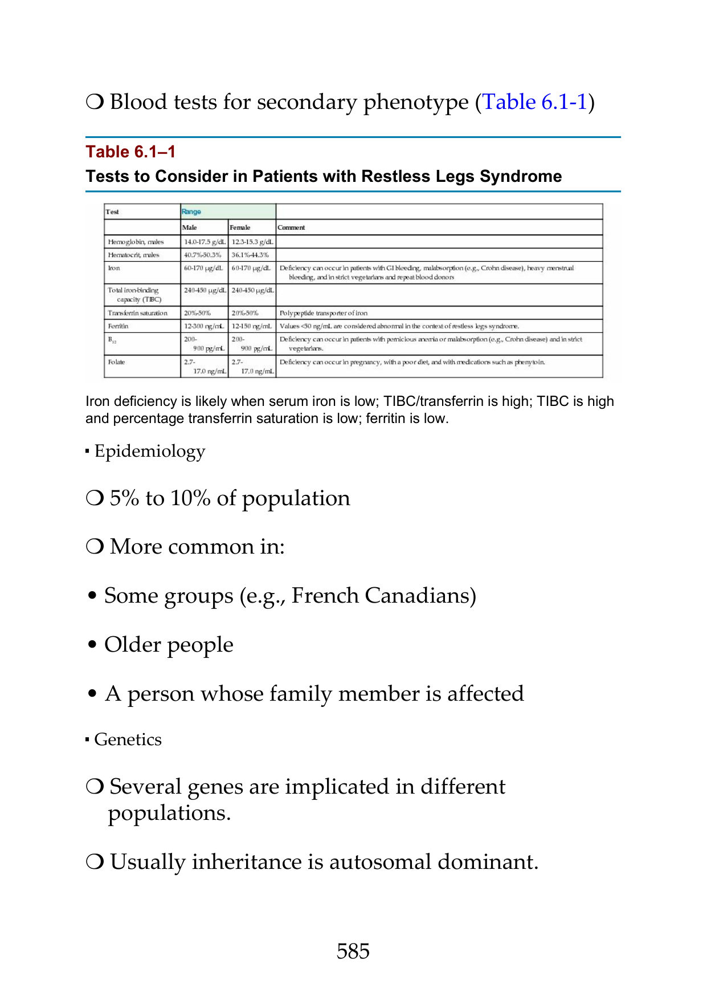

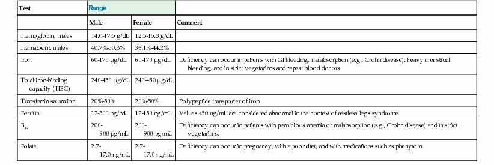

<!-- pdf-page: 586 -->

▪ Phenotypes

### ❍ Primary (often called early onset)

### • Younger than 45 years

### ❍ Secondary (sometimes called late onset, but it can

### • Slowly progressive

### • Positive family history

### • Idiopathic

### occur at any age)

### • Deficiencies

### ○ Vitamin B12

### ○ Iron stores

### ○ Folate

### • Diseases associated with RLS

### ○ Chronic renal failure

### ○ Cardiovascular disease

### ○ Congestive heart failure

### ○ Peripheral vascular disease

### 586

<!-- pdf-page: 587 -->

### ○ Chronic obstructive pulmonary disease (COPD)

### ○ Parkinson disease

### ○ Antidepressants (except bupropion)

### ○ Neuropathies

### ○ Fibromyalgia

### ○ Hypothyroidism

### • Pregnancy

### • Medications

### ○ Centrally acting antihistamines (e.g.,

### ○ Antipsychotics with D2 receptor–blocking

### diphenhydramine)

### ○ Lithium

### properties

### ◆ Olanzapine

### ◆ Risperidone

### ◆ Metoclopramide

### ◆ Promethazine

### ◆ Prochlorperazine

### 587

<!-- pdf-page: 588 -->

▪ Pathophysiology

### ❍ Central dopamine dysfunction; dopamine blockers

### worsen RLS.

### ❍ Reduced CNS iron stores, reduced CNS dopamine

### ❍ Endogenous opiate system dysfunction; opiates

### • Dopaminergic agents are first-line medications.

### improve symptoms.

▪ Treatment

### ❍ First line

### • May have side effects of sleepiness, compulsive

### ○ Pramipexole

### ○ Ropinirole

### • Carbidopa/levodopa is used infrequently because of

### behavior, nausea, vomiting

### • Anticonvulsants (pregabalin, gabapentin)

### augmentation.

### ❍ Second line

### • Resistant cases: in addition to those above, µ-

### • Benzodiazepines (clonazepam)

### 588

<!-- pdf-page: 589 -->

### receptor–type opioids

### ○ Examples

### ○ Side effects include constipation, respiratory

### ◆ Codeine

### ◆ Oxycodone

### ◆ Methadone

### ◆ Levorphanol

### ○ Oral replacement (e.g., ferrous sulfate 325 mg tid)

### depression.

### ❍ Nutritional deficiencies

### • Iron deficiency

### ○ If indicated, parenteral iron (refer to specialist)

### ○ For pernicious anemia, IM injections of B12

### ○ Stop donating blood.

### ○ Investigate cause of iron loss.

### • B12 deficiency

### ○ For dietary deficiency, B12 tablets

### 589

<!-- pdf-page: 590 -->

### ○ For folate deficiency, folic acid tablets

### Periodic Limb Movements of Sleep

▪ Definition

### ❍ Amplitude change 8 µV above baseline

### ❍ Not a disorder without symptoms

### ❍ A laboratory PSG finding

▪ Criteria to score an individual leg movement

### ❍ Duration

### • Minimum 0.5 seconds

### • Maximum 10 second

### ❍ Movements in both legs less than 5 seconds apart

### ❍ Minimum number to define a series is four.

### count as one movement.

▪ Criteria to score a periodic series

### ❍ Minimum time between leg movements is 5

### ❍ Maximum time between leg movements is 90

### seconds.

### seconds.

▪ Found in about 80% of cases of RLS

### 590

<!-- pdf-page: 591 -->

### Periodic Limb Movement Disorder

▪ Definition

### ❍ A disorder (PLMS plus symptoms of clinical sleep

### disturbance or impairment of daytime functioning,

### not otherwise explained)

### • In adults: by PLMS index greater than 15

### ❍ Documented by PSG

### • In children: by PLMS index greater than 5

Allen RP, Chen C, Garcia-Borreguero D, et al. Comparison of

▪ Clinical features

### ❍ Sleep disturbance

### ❍ Daytime sleepiness

▪ Treatment

### ❍ See treatment for PLMS

## References

pregabalin with pramipexole for restless legs syndrome. N Engl J Med. 2014;370(7):621–631. American Academy of Sleep Medicine. International

classification of sleep disorders. ed 3. American Academy of Sleep Medicine: Darien, Ill.; 2014 [pp 281–316]. American Academy of Sleep Medicine. The AASM manual for

the scoring of sleep and associated events: rules, terminology and technical specifications. [Version 2.1] American Academy of Sleep Medicine: Darien, Ill.; 2014.

### 591

<!-- pdf-page: 592 -->

Arunthari V, Kaplan J, Fredrickson PA, et al. Prevalence of

restless legs syndrome in blood donors. Mov Disord. 2010;25(10):1451–1455. Haba-Rubio J, Staner L, Petiau C, et al. Restless legs syndrome

and low brain iron levels in patients with haemochromatosis. J Neurol Neurosurg Psychiatry. 2005;76:1009–1010. Hartmann PM. Mirtazapine: a newer antidepressant. Am Fam

Physician. 1999;59:159–161. Lee DO, Ziman RB, Perkins AT, XP053 Study Group, et al. A

randomized, double-blind, placebo-controlled study to assess the efficacy and tolerability of gabapentin enacarbil in subjects with restless legs syndrome. J Clin Sleep Med. 2011;7(3):282–292; 10.5664/JCSM.1074. Mold JW, Vesely SK, Keyl BA, et al. The prevalence,

predictors, and consequences of peripheral sensory neuropathy in older patients. J Am Board Fam Pract. 2004;17:309–318. Montplaisir J, Boucher S, Nicholas A, et al. Immobilization

tests and periodic leg movements in sleep for the diagnosis of restless legs syndrome. Mov Disord. 1998;13:324–329. Rottach KG, Schaner BM, Kirch MH, et al. Restless legs

syndrome as side effect of second-generation antidepressants. J Psychiatr Res. 2008;43:70–75. Stefansson H, Rye DB, Hicks A, et al. A genetic risk factor for

periodic limb movements in sleep. N Engl J Med. 2007;357(7):639–647. Weintraub D, Koester J, Potenza MN, et al. Impulse control

disorders in Parkinson disease: a cross-sectional study of 3090 patients. Arch Neurol. 2010;67(5):589–595.

## 6.2.

## Other Movement Disorders

## Questions

#### Rock and Roll

### 592

<!-- pdf-page: 593 -->

A 3-year-old boy is brought to a sleep disorder center. His parents relate that for the past 6 months, he has been a restless sleeper. From the time he falls asleep and intermittently during the night, his entire body moves continuously, most often rocking from side to side. The child sleeps 12 hours each night and has a 2-hour nap during the daytime. Snoring and apnea have not been observed. He appears to be developmentally normal, and the physical examination is entirely normal. The parents are concerned that this symptom may represent a serious neurologic condition, and they want their son treated.

1. Which of the following disorders is most likely in this case?

### A. Periodic limb movements in sleep (PLMS)

2. When informed about your clinical diagnosis, the parents insist on a sleep test to confirm the diagnosis. Which is the most appropriate next step?

### B. Alternating leg muscle activation

### C. Excessive fragmentary myoclonus

### D. Rhythmic movement disorder

### A. A PSG is indicated, but treatment with medication

### B. A PSG is indicated, and clonazepam 0.125 mg

### is not.

### C. A PSG is not indicated, but treatment with

### should stop the episodes.

### clonazepam 0.125 mg is recommended.

### D. Neither PSG nor treatment with medication is

### indicated for this diagnosis.

### 593

<!-- pdf-page: 594 -->

3. Approximately 60% of infants are reported to display at least one type of rhythmic movement by the age of 9 months. What percentage show rhythmic movements at the age of 5 years?

### A. 0%

A 45-year-old woman is referred for evaluation of possible sleep apnea. She awakens with headaches, and her husband has told her that she snores and sometimes stops breathing during sleep. What really bothers him is that she often sounds “like a chipmunk” and keeps him awake at night. Her BMI is 22. Physical examination findings are shown in Figure 6.2-1. The patient has an overnight sleep study. A fragment used for scoring sleep stages from the study is shown in Figure 6.2-2.

### B. 5%

### C. 20%

### D. 40%

#### The Chipmunk

4. Which one of the following does this PSG fragment demonstrate?

### A. Increased EMG activity indicating rapid eye

### movement (REM) sleep behavior disorder

### D. No pathologic abnormality is noted.

### B. Seizure causing facial twitching

### C. Bruxism

5. The technologist scoring the study believes that the patient also has sleep apnea and shows you the fragment in Figure 6.2-3. What does it show?

### 594

<!-- pdf-page: 595 -->

### A. Periodic seizure activity

### B. Cheyne-Stokes respiration

6. What is the most appropriate next step in management?

### C. Bruxism

### D. Obstructive sleep apnea

### B. Order a continuous positive airway pressure

### A. Refer the patient to a neurologist.

7. What treatment is likely to worsen the underlying disorder?

### (CPAP) titration study.

### C. Start the patient on clonazepam.

### D. Refer the patient to a dentist.

8. What disease has not been associated with this PSG finding?

### A. Fluoxetine

### B. Clonazepam

### C. Mouth guard

### D. Methocarbamol

### A. Parkinson disease

### B. Diabetes

### 595

<!-- pdf-page: 596 -->

### C. Huntington disease

### D. REM sleep behavior disorder

9. Which medication has not been associated with the PSG finding?

### A. Methylphenidate

### B. Haloperidol

### C. Lithium

### D. Erythromycin

FIGURE 6.2–1 Question 4 (see also Fig. 6.2-2).

### 596

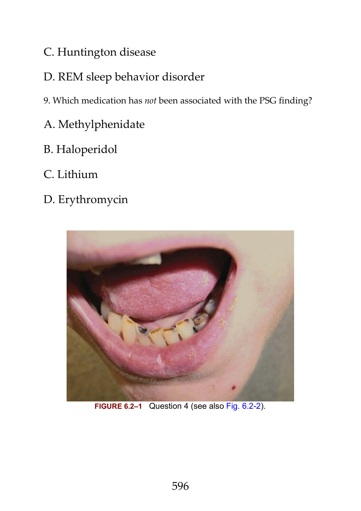

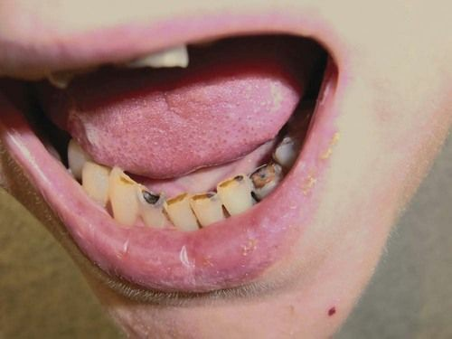

<!-- pdf-page: 597 -->

At her yearly physical, a 68-year-old woman complains to her primary care provider about difficulty sleeping. When asked about it, she states that she is often awoken by a pain in one of her legs during the night. The pain is localized to her very tight-feeling calf, has an abrupt onset, and often requires her to massage it in bed. The area is often sore for a few hours when she awakens.

FIGURE 6.2–2 Question 4 (see also Fig. 6.2-1).

FIGURE 6.2–3 Questions 5 to 9.

#### A Painful Awakening

10. What is the appropriate diagnosis?

### 597

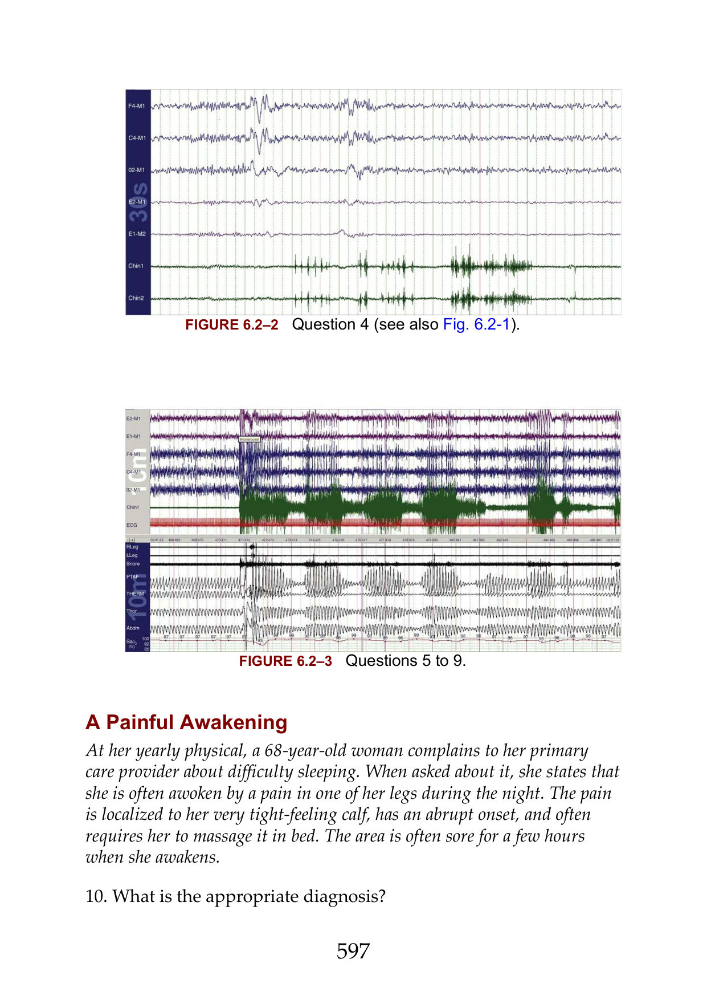

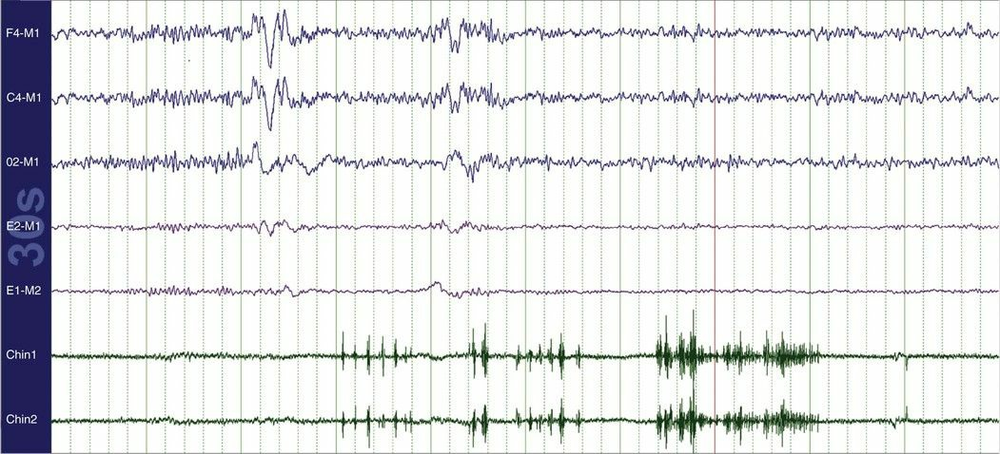

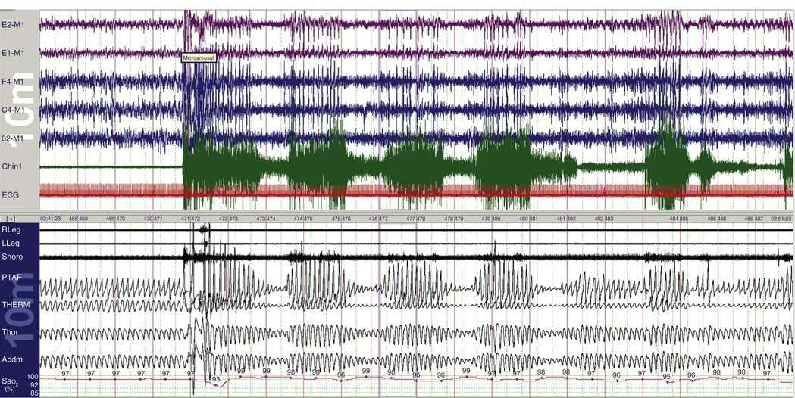

<!-- pdf-page: 598 -->

### A. Hypnagogic foot tremor

### B. Periodic limb movements

11. This diagnosis will occur nightly in what percentage of 60-yearold adults?

### C. Sleep-related leg cramps

### D. Restless legs syndrome

12. Which of the following medication classes has not been commonly associated with leg cramping?

### A. 3%

### B. 6%

### C. 9%

### D. 12%

1. D. The condition described is typical for sleep-related rhythmic movement disorder. There are many names for this disorder that

### A. Diuretics

### B. Hypnotics

### C. Oral contraceptives

### D. Statins

## Answers

### 598

<!-- pdf-page: 599 -->

include body rocking, head banging, body rolling, jactatio corporis nocturna, and jactatio capitis nocturna. The movements are continuous and involve large muscle groups. Limb movements are periodic; that is, they occur at a regular interval, for example every 20 seconds, and they generally only involve the limbs. Alternating leg muscle activation (ALMA) is not a disorder but a PSG finding of unclear clinical significance; it bears some similarity to periodic limb movements but differs in that the duration of the burst is shorter (0.1 to 0.5 sec), the events alternate between the legs, and the period of the movements is much shorter (range 0.5 to 3.0 Hz). Excessive fragmentary myoclonus is also a PSG finding of unclear clinical significance and not a disorder. There are at least five very brief (less than 0.15 sec) muscle bursts per minute, occurring at least for 20 minutes during non-REM (NREM) sleep. (MANUAL2,

#### Section VII, Movement Rules)

2. D. The history is characteristic enough that a PSG is not required for management and is not required by the ICSD3 for diagnosis, unless there is a concern for another disorder. Although disturbing to observers, the phenomenon is generally benign and results in few symptoms. Medication is not generally recommended. In rare cases, when rhythmic movement disorders cause injury, such as in the case of head banging, pharmacologic treatment may be reasonable.

3. B. Whereas rhythmic movements are common in young infants, only 5% of children have reports of rhythmic movements at the age of 5 (Fig. 6.2-4).

### 599

<!-- pdf-page: 600 -->

4. C. Short twitches in the two chin EMGs suggest that bruxism is present. This example (see Fig. 6.2-4) meets two of the criteria used to score bruxism: brief elevations in chin EMG 0.25 to 2.0 seconds in duration with a train of at least three events in a sequence and sustained elevation of chin EMG at least 2 seconds in duration.

FIGURE 6.2–4 Answers 3 and 4.

5. C. This compressed fragment shows a long stretch of bruxism. The clue is when EEG channels are examined, and the characteristic effect of bruxism is seen in these channels. Superficially, the respiratory channels do resemble Cheyne-Stokes breathing, and when the patient had the episodes of bruxism, it appeared as though there were increases in ventilation followed by decreases in ventilation and small changes in Sao2.

6. D. This patient should be referred to a dentist; examination showed severe damage to the lower anterior teeth, with some of the teeth possibly infected. This degree of bruxism can be difficult to treat. Treatment is typically with a mouth guard to minimize further damage.

7. A. Fluoxetine and other selective serotonin reuptake inhibitors (SSRIs) should not be considered as treatment for bruxism because they can actually induce bruxism or increase clenching of the jaw. The treatment of choice for bruxism is an oral appliance such as a mouth guard, ideally fit by the dentist. Short-term use of

### 600

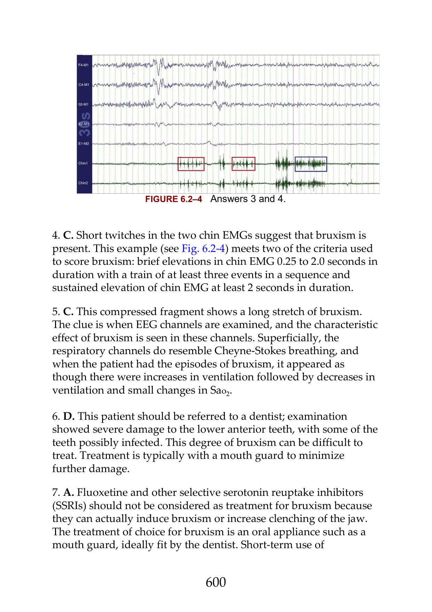

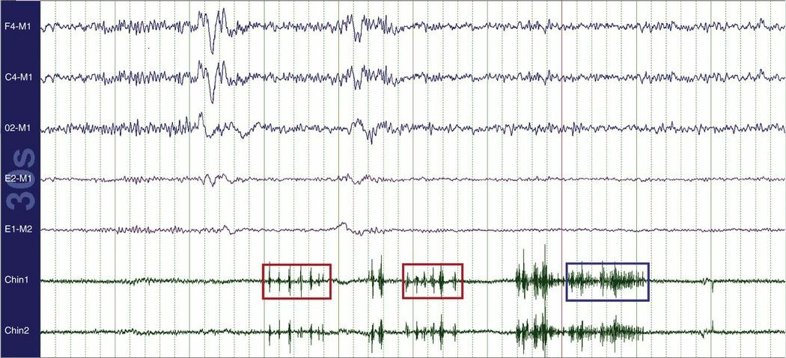

<!-- pdf-page: 601 -->

medications such as clonazepam or methocarbamol (a muscle relaxant) may be helpful.

8. B. Several neurologic conditions have been associated with bruxism or jaw clenching. There are no reports of diabetes being associated with sleep bruxism. See the Summary for examples.

9. D. Several medications have been associated with bruxism or jaw clenching, most of them affecting the CNS; no reports exist of antibiotics being associated with the disorder. The most widely encountered drugs associated with bruxism are the SSRIs. See the Summary for examples.

10. C. This description is of sleep-related leg cramps. It is a nearly universal experience in adults over 50, although it may occur rarely. (ICSD3, p 299-301)

11. B. It has been reported that 6% of adults over 60 years of age will have nightly leg cramps. (ICSD3, p 300)

12. B. Hypnotic medications have not been associated with leg cramping. Diuretics, oral contraceptives, statins, intravenous iron sucrose, and long-acting β-agonists all have been associated with leg cramping. (ICSD3, p 300)

▪ International Classification of Sleep Disorders, ed 3, pp 281-340

## Summary

### Highly Recommended

As noted earlier, the movement disorders as a total will make up 8% of the exam; of that, about 25% (or four to five questions) will be related to bruxism and rhythmic movement disorders. Although rhythmic movement disorder is not uncommon, few patients with this condition are actually referred to a sleep disorders center. Bruxism and the other movement disorders in this section and summary are also not commonly referred but may be found in the course of investigation of other disorders.

### 601

<!-- pdf-page: 602 -->

### Sleep-Related Rhythmic Movement Disorder

▪ Features

### ❍ Repetitive motor behavior during sleep

### • Head banging (jactatio capitis nocturna)

### ❍ Involves large muscle groups

### • Body rocking (jactatio corporis nocturna)

### • Head rolling

### ❍ Adult prevalence: present but unknown

▪ Epidemiology

### ❍ Age 12 months: about 50%

### ❍ Age 18 months: about 33%

### ❍ Age 5 years: 5%

### • Repetitive stereotypic movements in sleep

▪ Diagnosis

### ❍ Made by history

### ❍ Criteria

### • Involves large muscle groups

### 602

<!-- pdf-page: 603 -->

### • Disrupts sleep

### • Impaired in daytime

### • Done only if another sleep disorder is suspected

### • Injury

### ❍ Polysomnography

### • Shows rolling or banging of the head or rolling or

### • Should include video recording

### • Frequency of about once per second

### rocking of the body

### ❍ Benign course typically; is not considered a

### • Absent in REM sleep

▪ Prognosis

### disorder unless there is a clinical consequence

### ❍ Usually improves with age

### ❍ Can persist into late adulthood

▪ Treatment

### ❍ Safety precautions

### Bruxism

### 603

<!-- pdf-page: 604 -->

▪ Features

### ❍ Clenching of jaw or grinding of teeth during sleep

### ❍ Temporomandibular joint (TMJ) pain

### ❍ Types of abnormal motor activity

### • Tonic

### ○ Sustained clenching

### ○ Phasic

### ○ Periodic grinding

▪ Symptoms

### ❍ Jaw pain

### ❍ Wearing down of teeth

### ❍ Headaches

### ❍ Disturbed sleep

### ❍ Noisy during sleep

▪ Epidemiology

### ❍ Children: 15%

### ❍ Teenagers: 12%

### 604

<!-- pdf-page: 605 -->

### ❍ Adults: 8%

### ❍ Older people: 3%

▪ Diagnosis

### • Report of nocturnal grinding or clenching

### ❍ PSG not required

### • Typical findings (see above)

### ❍ History

### • Discomfort or pain on awakening

### ○ Jaw

### ○ Head

### ❍ Examination

### • Worn teeth

### • Hypertrophied masseter muscles

▪ Clinical forms

### ❍ Idiopathic

### ❍ Secondary

### • Associated with diseases

### 605

<!-- pdf-page: 606 -->

### ○ Movement disorders

### ◆ Parkinson disease

### ◆ Associated with drugs or chemicals

### ◆ Huntington disease

### ○ Primary sleep disorders

### ◆ Sleep apnea

### ◆ PLMS

### ◆ REM sleep behavior disorder

### ○ Neurologic diseases

### ◆ Cerebellar disease

### ◆ Shy-Drager syndrome

### ○ Caffeine

### ○ Nicotine

### ○ Methylphenidate

### • Psychiatric medication examples

### ○ Haloperidol

### ○ Chlorpromazine

### 606

<!-- pdf-page: 607 -->

### ○ Lithium

### ○ Fluoxetine

### • Cardiovascular medication example

### ○ Sertraline

### ○ Citalopram

### ❍ Oral appliance, ideally a rigid appliance fit by a

### ○ Flecainide

▪ Treatment

### ❍ Withdraw causative medication (see above)

### dentist

### • None indicated for bruxism by FDA

### ❍ Medications

### • Short-term benzodiazepine (e.g., clonazepam)

▪ Nearly a universal experience in adults over 50 years old

### Sleep-Related Leg Cramps

### • Often requires stretching the muscle or massaging it

### ❍ Painful contraction of the muscle

### • The muscle is often sore afterward.

### 607

<!-- pdf-page: 608 -->

▪ Diagnosis is by history alone; it does not require a PSG.
▪ Treatment

### ❍ No validated treatment options exist for this

### Abnormal Movements or Bursts Seen on

### Polysomnography (Not Disorders)

### disorder.

### • Frequency of the alternating burst is 0.5 to 3 Hz.

▪ Alternating leg muscle activation (ALMA)

### ❍ Bursts

### • Up to 0.5 sec in duration

### • Alternates between legs

### • Four bursts needed for scoring

### • Frequency of the burst is 0.3 to 4 Hz.

▪ Hypnagogic foot tremor

### ❍ Bursts

### • 0.25 to 1 second in duration

### • Four bursts needed for scoring

▪ Excessive fragmentary myoclonus

### ❍ Bursts

### 608

<!-- pdf-page: 609 -->

### • Less than 0.15 sec in duration

### • Five bursts per minute needed for scoring

American Academy of Sleep Medicine. International

### • At least 20 minutes in NREM sleep

### ❍ Twitches may be visible.

## References

classification of sleep disorders: diagnostic and coding manual. ed 3. American Academy of Sleep Medicine: Darien, Ill.; 2014. American Academy of Sleep Medicine. The AASM manual for

the scoring of sleep and associated events: rules, terminology and technical specifications. [Version 2.1] American Academy of Sleep Medicine: Darien, Ill.; 2014.

## SectionE6 Movement Disorders

1. A 45-year-old woman with a medical history of severe depression that required hospitalization earlier this year, with comorbid anxiety and thyroid disease, complains of recent difficulty falling asleep due to uncomfortable crawling sensations in her legs. The sensation improves when she moves her legs around or gets up to walk. The sensations occur 4 to 5 nights per week and only after getting into bed. In the morning, she notes that her sheets and covers are strewn about, and she often finds her pillow on the floor. Physical and neurologic examinations were unremarkable, other than a flat affect. Which of the following is the most likely diagnosis?

### Questions

### A. Psychotic depression

### 609

<!-- pdf-page: 610 -->

### B. Sleep-related leg cramps

### C. Restless legs syndrome

### D. Periodic limb movements during wakefulness

### E. Sleep-related rhythmic movement disorder

### ANSWER: C. The patient presents with the four

### characteristic features of RLS, and the diagnosis is

### made on clinical grounds that include (1)

### uncomfortable/unpleasant sensations often

### described as “an urge” to move; (2) uncomfortable

### sensation/urge to move is relieved to some degree

### by movement; (3) uncomfortable sensation/urge to

### move occurs during periods of rest or inactivity;

### and (4) uncomfortable sensation/urge to move

### occurs more often in the evening or at night. This is

### unlikely to be sleep-related leg cramps, painful

### sensations associated with sudden muscle

### hardness/tightness indicative of a strong

### contraction. Sleep-related leg cramps can occur

### during either wakefulness or sleep. Rhythmic

### movement disorder is characterized by repetitive,

### stereotyped motor behaviors that generally involve

### the large muscle groups and usually occur as the

### patient is transitioning into sleep. Types of

### rhythmic movement disorders include body

### rocking, head banging, and head rolling and are

### more common in children. Periodic limb

### movements during wakefulness are the motor

### 610

<!-- pdf-page: 611 -->

### expression of RLS characterized by periodic limb

### movements that occur during resting wakefulness.

### Finally, nothing is provided in the history to

### suggest psychotic depression. (ICSD3, p 282-291;

### Allen RP, Picchietti D, Hening WA, et al: Restless

### legs syndrome: diagnostic criteria, special

### considerations, and epidemiology. A report from

### the restless legs syndrome diagnosis and

### epidemiology workshop at the National Institutes

### of Health, Sleep Med 4:101-119, 2003)

2. A 39-year-old man with a history of chronic loose bowels and abdominal cramps is referred with a 5-year history of sleep-onset insomnia and sleep-maintenance insomnia and restlessness involving his legs at bedtime. Which of the following should not be considered in helping determine the cause of the sleep symptoms?

### B. Tissue transglutaminase (TTG) immunoglobulin A

### A. Serum ferritin

### ANSWER: D. The PSG will not be of value in

### (IgA) antibody test

### C. Total IgA level

### D. PSG

### E. GI endoscopy

### diagnosing this patient's movement disorder, nor

### will it reveal the etiology. The diagnosis of RLS is a

### clinical one based on history. In terms of etiology,

### inflammatory bowel diseases (notably Crohn

### 611

<!-- pdf-page: 612 -->

### disease and celiac disease) have been associated

### with RLS. Either current or previous iron deficiency

### caused by malabsorption may be responsible.

### Ferritin is elevated in inflammation and in that

### state, it may not be an accurate indicator of iron

### stores. Thus the test is useful only when it is low,

### which confirms iron deficiency. Otherwise,

### examining red cell indices and even bone marrow

### iron may be needed. TTG, an enzyme released by

### inflamed cells in celiac disease, is elevated in celiac

### disease. It can be falsely low in patients with

### genetically reduced IgA levels (who also have an

### increased incidence of RLS), thus total IgA is

### usually measured as well. GI endoscopy is useful in

### confirming inflammatory bowel

### disease. (Weinstock LB, Bosworth BP, Scherl EJ, et

### al: Crohn's disease is associated with restless legs

### syndrome, Inflamm Bowel Dis 16(2):275-279, 2010;

### Weinstock LB, Walters AS, Mullin GE, Duntley

### SP: Celiac disease is associated with restless legs

### syndrome, Dig Dis Sci 55:1667-1673, 2010)

3. A 21-year-old woman with a history of morbid obesity undergoes gastric bypass surgery. In the hospital, she has difficulty falling asleep and staying asleep and complains of an irresistible urge to want to move around prior to falling asleep. What medication used in the hospital may have led to these symptoms?

### A. Morphine

### B. Diazepam

### 612

<!-- pdf-page: 613 -->

### C. Metoclopramide

### D. Gabapentin

### ANSWER: C. Drugs that antagonize dopamine

### E. Trazadone

### function are noted to worsen the symptoms of RLS.

### Metoclopramide, frequently used as an antiemetic

### after abdominopelvic surgery, is a dopamine

### antagonist. Antipsychotic medications often have

### antidopaminergic properties and have also been

### associated with RLS. Nicotine, alcohol, caffeine, and

### diphenhydramine have also been noted to worsen

### RLS symptoms in some patients. Certain

### anticonvulsants, such as gabapentin and

### carbamazepine, have been used as therapeutic

### options for RLS. Carbamazepine has not been

### found to be useful in clinical practice, so it is not

### currently recommended for the treatment of RLS.

### Opioids, more specifically methadone and

### oxycodone, have been studied for use in RLS

### patients and are usually prescribed to patients with

### refractory or painful RLS and as an aid with

### nocturnal symptoms. Once the mainstay of RLS

### therapy, benzodiazepines are now used as an

### adjunct treatment, especially for patients with

### coexisting insomnia or augmentation due to

### dopamine agents. (Oertel WH, Trenkwalder C,

### Zucconi M, et al: State of the art in restless legs

### syndrome therapy: practice recommendations for

### 613

<!-- pdf-page: 614 -->

### treating restless legs syndrome, Mov Disord

### 22[Suppl 18]:S466-S475, 2007)

4. A patient with a history of heavy blood donation has developed RLS and was found to have iron deficiency. She was started on a regimen of therapeutic iron therapy (ferrous sulfate 325 mg tid). At 3-month follow-up, she continues to have these symptoms, they have become more severe, and they occur nightly. Her ferritin level was checked and is 20 ng/mL. What is the next step in therapy?

### B. Instruct the patient to have a drink of wine prior to

### A. Initiate therapy with levodopa.

### C. Instruct the patient to walk a mile prior to going to

### falling asleep.

### D. Recommend intravenous (IV) iron infusion.

### bed.

### E. Initiate therapy with carbamazepine.

### ANSWER: D. Treatment of iron deficiency anemia can

### completely resolve all RLS symptoms for a few

### patients. Studies of iron repletion and RLS

### symptom remission vary in outcome and

### recommendations. One double-blind placebo-

### controlled trial in 2009 demonstrated the benefits of

### oral iron therapy in 18 low-normal ferritin RLS

### sufferers. (Wang et al, 2009) A recent study by

### Ondo (2010) using high-molecular-weight IV iron

### dextran demonstrated that 18 of 23 participants

### with refractory RLS had resolution (2), marked

### 614

<!-- pdf-page: 615 -->

### reduction (11), moderate reduction (2), and mild

### reduction (3) of RLS symptoms with this treatment.

### Low ferritin levels are correlated with higher

### augmentation rates while on levodopa therapy.

### Alcohol and vigorous exercise in the evening have

### been associated with worsening RLS symptoms.

### Carbamazepine has not been found to be clinically

### useful for RLS and is not currently recommended

### for the treatment of RLS. (Frauscher B, Gschliesser

### V, Brandauer E, et al: The severity range of

### restless legs syndrome (RLS) and augmentation in

### a prospective patient cohort: association with

### ferritin levels, Sleep Med 10:611-615, 2009; Ondo

### WG: Intravenous iron dextran for severe refractory

### restless legs syndrome, Sleep Med 11:494-496, 2010;

### Wang J, O'Reilly B, Venkataraman R, et al:

### Efficacy of oral iron in patients with restless legs

### syndrome and a low-normal ferritin: a

### randomized, double-blind, placebo-controlled

### study, Sleep Med 10:973-975, 2009)

5. A patient with RLS starts therapy with carbidopa/levodopa 25/100; he takes 1 tablet at 10 pm and then wakes up at 4 am with RLS symptoms and has been told by his wife that he looks like he is “running a marathon” in his sleep in the early morning hours. What clinical phenomenon does this represent?

### A. Augmentation

### B. Rebound

### C. Withdrawal

### 615

<!-- pdf-page: 616 -->

### D. Tolerance

### E. Dose response

### ANSWER: B. Dopaminergic agents (e.g., pramipexole,

### ropinirole) and carbidopa/levodopa have become

### the preferred treatment for both RLS and PLMS.

### Once-nightly treatments with carbidopa/levodopa

### may result in morning end-of-dose rebound, and

### increases in leg movements are reported to occur in

### about one fourth of the patients. With rebound, the

### reappearance of symptoms is compatible with the

### timing of withdrawal from the medication.

### Augmentation is a worsening of RLS symptoms

### during treatment with a dopaminergic medication

### defined by the persistence/enhancement of

### symptoms related to dopamine therapy and/or the

### shifting of symptoms to a period of 2 to 4 hours

### earlier than is typical. (Garcia-Borreguero D,

### Williams A: Dopaminergic augmentation of

### restless legs syndrome, Sleep Med Rev 14;339-346,

### 2010)

6. A 63-year-old patient is started on ropinirole for RLS. What is the mechanism of action of this medication? (D indicates dopamine receptor.)

### A. D1 receptor agonist

### B. D1 receptor antagonist

### C. D3 receptor agonist

### 616

<!-- pdf-page: 617 -->

### D. D3 receptor antagonist

### E. Dopamine reuptake inhibitor

### ANSWER: C. Dopamine receptor agonists have

### become the treatment of choice for RLS.

### Pramipexole and ropinirole are both non–ergot

### derivative agonists with a high affinity for D3-type

### receptors. An older medication, pergolide, had its

### major affinity for the D2-type receptor. The latter

### had many more unwanted effects than the D3

### agonists. (Clemens S, Rye D, Hochman S: Restless

### legs syndrome: revisiting the dopamine

### hypothesis from the spinal cord perspective,

### Neurology 67:125-130, 2006)

7. A 75-year-old gentleman with RLS volunteers to have a specialized brain MRI that can determine localization of iron in the brain. This demonstrates a reduction of iron content in RLS patients compared with age-matched controls in what region of the brain?

### ANSWER: D. Autopsy analysis of substantia nigra

### A. Caudate

### B. Pons

### C. Substantia nigra, pars reticulata

### D. Substantia nigra, pars compacta

### E. Thalamus

### (SN), pars compacta, tissue from patients with RLS

### 617

<!-- pdf-page: 618 -->

### compared with age-matched control subjects

### without RLS has revealed a complex pattern of

### iron-related abnormalities. Iron, H-ferritin, and two

### primary iron transporters are reduced, and

### transferrin is notably increased. MRI for regional

### brain iron content also shows reduced brain iron in

### the SN of patients with RLS compared with age-

### matched control patients. The SN, pars reticulata, is

### a largely GABAergic subnucleus of the SN. (Allen

### RP, Barker PB, Wehrl F, et al: MRI measurement

### of brain iron in patients with restless legs

### syndrome, Neurology 56:263-265, 2001; Connor JR,

### Boyer PJ, Menzies SL, et al: Neuropathological

### examination suggests impaired brain iron

### acquisition in restless legs syndrome, Neurology

### 61:304-309 2003; ATLAS2, p 180)

8. A 25-year-old man presents with complaints of bilateral temporalis region headaches, difficulty with jaw opening, and snoring. A PSG is performed, a representative fragment of which is presented in Figure E6-1. What is the cause for the rhythmic pattern seen on the tracing?

### 618

<!-- pdf-page: 619 -->

### B. Periodic limb movements during sleep

FIGURE E6–1

### A. Obstructive sleep apnea

### C. Sleep-related rhythmic movement disorder

### ANSWER: E. Figure E6-1 shows rhythmic movement

### D. Muscle artifact

### E. Sleep-related bruxism

### in the chin EMG channel that is also prominent in

### the central EEG and electrooculogram (EOG) leads.

### This is most consistent with the diagnosis of

### bruxism. The rhythmic movement is not snoring

### 619

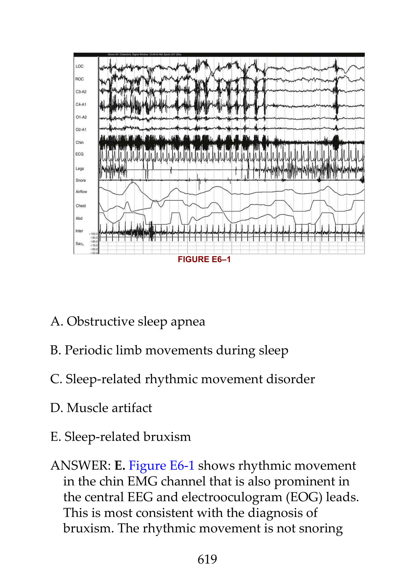

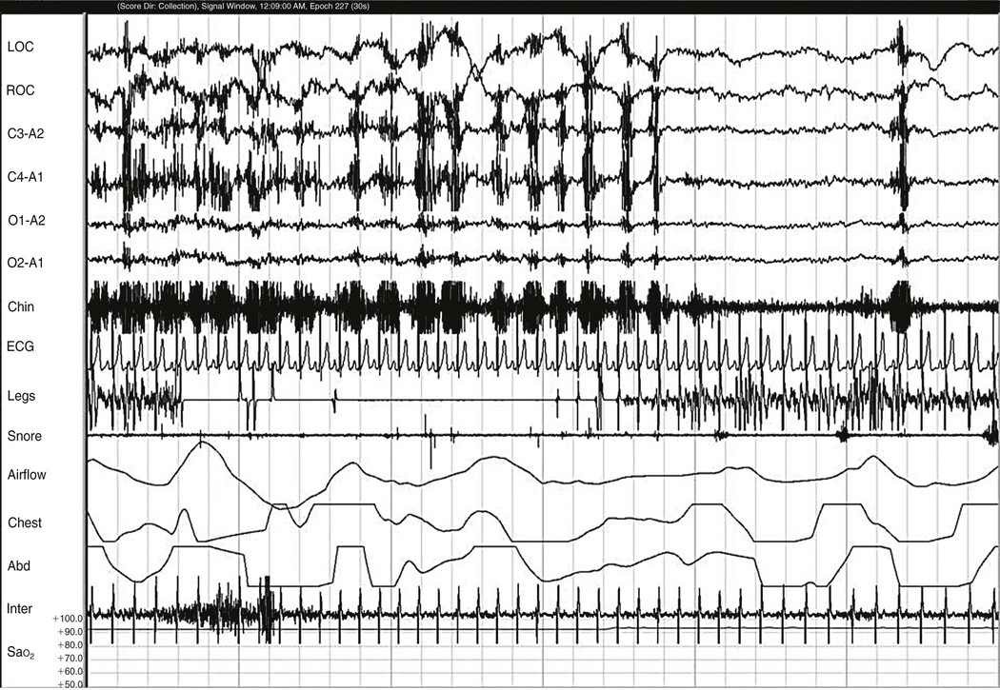

<!-- pdf-page: 620 -->

### artifact because it does not align with the

### respiratory signals. Bruxism is a movement

### disorder characterized by grinding and clenching of

### the teeth during sleep. Bruxism becomes a

### pathologic condition when the patient presents

### with either abnormal wear on the teeth or

### nonrestorative sleep. It is estimated that

### approximately 15% of children and 5% of adults

### exhibit frequent bruxism that leads to a dental or

### sleep disorder. Patients can present with a variety

### of symptoms including oral/facial pain, headache,

### unpleasant oral sensations, limitation of jaw

### movements, and temporomandibular joint (TMJ)

### pain. The grinding can be loud enough to be

### bothersome to bed partners in some cases. Finally,

### some patients are identified only because of dental

### evaluations that show tooth wear. PSG features

### include either typical EMG phasic pattern with a

### frequency of 1 Hz lasting 0.25 to 2 seconds or

### sustained tonic activity, or both. Bruxism can be

### seen in REM sleep but is most common in NREM

### stages 1 and 2. If bruxism is suspected, masseter

### muscle EMGs should be included in the montage

### (not shown in the example). EEG is most often

### reported as continuous and not fragmented in the

### majority of patients, but reports of frequent stage

### shifting to lighter stages has also been

### reported. (ATLAS2, p 188)

9. A patient evaluated in a sleep disorders clinic was diagnosed with sleep-related bruxism and primary snoring by overnight PSG.

### 620

<!-- pdf-page: 621 -->

He tried bite guards on and off over the past few years but stopped using them because of repeated episodes of waking with the device out of his mouth. He asks to try a medication to reduce his nocturnal bruxing because of tooth damage and TMJ symptoms. What therapy listed below may help this patient?

### ANSWER: E. Clonazepam and methocarbamol are

### A. Haloperidol

### B. Lithium

### C. Fluoxetine

### D. Flecainide

### E. Clonazepam

### two medications that have been tested in an open

### study design for pharmacologic management of

### sleep-related bruxism. From clinical practice,

### centrally acting benzodiazepines and muscle

### relaxants have been shown to reduce bruxism-

### related motor activity. It is worth noting that

### selective serotonin reuptake inhibitors (SSRIs),

### antidopaminergic drugs, antipsychotic agents,

### calcium blockers, amphetamines, and

### antiarrhythmic drugs can cause secondary

### bruxism. (ATLAS2, p 189; Saletu A, Parapaticus S,

### Saletu B, et al: On the pharmacology of sleep

### bruxism: placebo-controlled polysomnographic

### studies with clonazepam, Neuropsychobiology

### 51:214-225, 2005)

### 621

<!-- pdf-page: 622 -->

10. A 14-year-old patient is referred to the sleep center by his primary care physician for evaluation of possible RLS. The history includes excessive movements during sleep. Which of the following best explains the findings in the leg EMG channel on the 30-second epoch shown in Figure E6-2?

FIGURE E6–2

### A. Electrocardiogram (ECG) artifact

### B. Limb-lead artifact

### C. Rhythmic movements

### D. Respiratory flow restriction

### E. Respiratory artifact

### 622

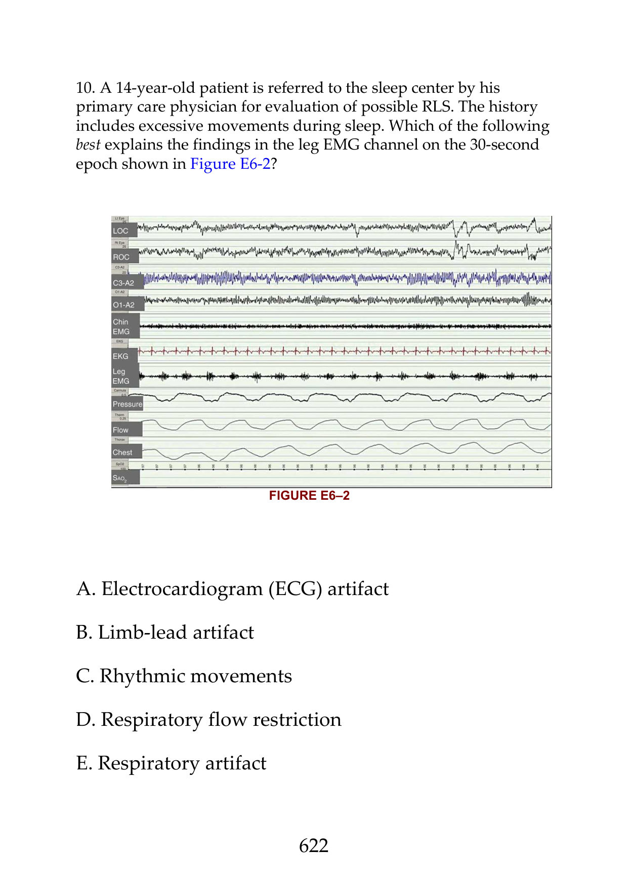

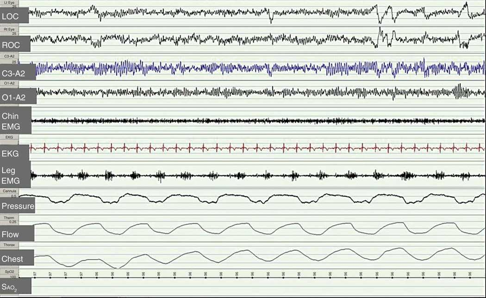

<!-- pdf-page: 623 -->

### ANSWER: C. The findings in the EMG channel are

### best explained as rhythmic movements. The rate of

### these events is 34/minute, which makes periodic

### limb movements unlikely. The movements do not

### align with either the ECG or the respiratory

### channels, making ECG and respiratory artifacts

### unlikely. Because the patient is awake (note the

### alpha rhythm in the C3-A2 channel), rhythmic

### movement of one or both legs is the most likely

### explanation. Rhythmic movement disorder is

### characterized by repetitive, stereotyped, rhythmic

### motor behaviors of major muscle groups that occur

### predominantly during drowsiness or sleep. It is

### most common in infants (up to 59%) and children

### (5% at 5 years) but has been reported in adults

### (usually continued from childhood). In children,

### common behaviors are head banging, body rocking,

### and head rolling. Although disturbing to the

### parents, these movements are generally not

### associated with injury. Movement rates range from

### 0.5 to 2 per second (consistent with the rate in the

### fragment). Most children outgrow the movements.

### There is no specific treatment for adults with the

### disorder. (ICSD3, pp 312-316)

11. A 21-year-old woman with prior methamphetamine abuse, fibroids with heavy menstrual bleeding, and depression with previous suicide attempt presents with worsening insomnia over the past 5 years. She also has a history of restless legs symptoms since she was a child. She feels that her restless legs symptoms have been worsening over the past few years. Her bed partner reports snoring and violent jerking movements in her sleep. She is

### 623

<!-- pdf-page: 624 -->

currently taking duloxetine 60 mg qhs and topiramate. As her sleep physician, what would you do next?

### A. Start the patient on zolpidem.

### C. Switch the patient from duloxetine to bupropion.

### B. Start the patient on pramipexole.

### E. Increase the patient's duloxetine from 60 to 90 mg.

### D. Discontinue topiramate.

### ANSWER: C. Several drugs may induce or exacerbate

### RLS or PLMS. These include tricyclic or other

### antidepressants, lithium carbonate, and D2

### receptor–blocking agents (neuroleptics). In this

### case, the patient's antidepressant may have

### worsened her RLS. Wellbutrin (bupropion) and

### trazodone are the only two antidepressants that

### demonstrate dopaminergic activity, so they do not

### exacerbate RLS and may actually help RLS

### symptoms. (Lee JJ, Erdos J, Wilkosz MF, et al:

### Bupropion as a possible treatment option for

### restless legs syndrome, Ann Pharmacother 43:370-

### 374, 2009)

12. A 21-year-old patient has a 5-year history of severe RLS. She has no other complaints except she has heavy bleeding when she menstruates. Her primary care physician ordered a complete blood count (CBC), which was normal. Hematocrit was 40%. The RLS has not responded to pramipexole therapy. The patient has a family history of diabetes. What test is most likely to help with your

### 624

<!-- pdf-page: 625 -->

management of this patient?

### A. Nerve conduction testing

### B. Suggested immobilization test (SIT)

### ANSWER: D. Markedly reduced iron stores can occur

### C. Serum iron

### D. Serum ferritin

### E. MRI of the brain

### without anemia. The best measure of iron stores is

### ferritin. Ferritin levels below 50 µg/L have been

### associated with increased symptom severity,

### decreased sleep efficiency, and increased PLMS

### associated with arousal in patients with RLS.

### Therefore it has been advocated that a ferritin level

### be drawn in all patients with RLS to identify

### patients with an abnormal ferritin. Patients with

### low ferritin should be considered for iron

### replacement therapy after an appropriate workup

### for the iron loss. Absolute iron levels have not been

### correlated with RLS severity. The SIT is a research

### tool for RLS and is designed to quantify sensory

### and motor manifestations of RLS during

### wakefulness. During this test, the patient is reclined

### in bed with legs outstretched and eyes open and is

### instructed to avoid moving voluntarily for

### approximately 1 hour; surface EMGs are used to

### quantify leg movements, and the patient is asked to

### 625

<!-- pdf-page: 626 -->

### rate their discomfort throughout the test. Although

### this test has shown high sensitivity and specificity,

### it is not yet used clinically to diagnose

### RLS. (ATLAS2, pp 180-181; Sun ER, Chen CA, Ho

### G, et al: Iron and the restless legs syndrome, Sleep

### 21:371-377, 1998)

13. A 39-year-old woman has been diagnosed with RLS. You suggest starting her on pramipexole, and she asks about unwanted effects. Which of the following is an established side effect of pramipexole when used for the treatment of RLS?

### ANSWER: B. In a large, randomized, placebo-

### A. Weight gain

### B. Nausea

### C. Arrhythmias

### D. Tardive dyskinesia

### E. Hypertension

### controlled trial of pramipexole in patients with RLS,

### drug-related adverse effects resulting in withdrawal

### of the study drug occurred in 12.4% of the

### pramipexole-treated group and in 7.0% of the

### placebo group. The two most common adverse

### events in which the frequency was higher in the

### pramipexole groups compared with placebo were

### nausea (19.0% vs. 4.7%) and somnolence (10.1% vs.

### 4.7%). Although somnolence was frequently noted

### 626

<!-- pdf-page: 627 -->

### as a side effect, it should be noted that the Epworth

### Sleepiness Scale (ESS) during the treatment period

### was not significantly higher in the pramipexole

### group compared with the placebo group. The risk

### of sleepiness with pramipexole, especially while

### driving, appears to be lower in patients with RLS

### than in patients with Parkinson disease, possibly

### because of differences in the dose and timing of

### medication. Abnormal behaviors, such as increased

### sexual desire and the urge to gamble, have been

### described as well. (ATLAS2, Table 11-2.4; Comella

### CL: Restless legs syndrome: treatment with

### dopaminergic agents, Neurology 58:87S-92S, 2002;

### Winkelman JW, Sethi KD, Kushida CA, et al:

### Efficacy and safety of pramipexole in restless legs

### syndrome, Neurology 67:1034-1039, 2006)

14. An 11-year-old girl referred for evaluation of insomnia was found to have RLS. Early age of RLS onset is most often associated with which of the following?

### ANSWER: C. The prevalence of RLS among first-

### A. Uremia

### B. Anemia

### C. Family history of RLS

### D. Small-fiber neuropathy

### E. ADHD

### 627

<!-- pdf-page: 628 -->

### degree relatives of people with RLS is about three to

### six times greater than those from the general

### population. In addition, more than 50% of

### idiopathic cases report a family history. In most

### studies, patients with a family history of RLS

### present at a younger age, before the age of 34 to 45

### years, than patients without a family history. In

### most pedigrees, an autosomal-dominant pattern of

### inheritance is noted; however, recent genomic

### studies indicate that multiple genes are likely

### involved, which supports a pseudo-dominant

### pattern of inheritance. Uremia, anemia, and small-

### fiber neuropathy have been associated with

### secondary RLS. ADHD is highly correlated with

### RLS in children and suggests a common

### dopaminergic etiology. (ICSD3, p 284; Konofal E,

### Cortese S, Marchand M, et al: Impact of restless

### legs syndrome and iron deficiency on attention-

### deficit/hyperactivity disorder in children, Sleep

### Med 8:711-715, 2007)

15. An 8-year-old child is referred with a history of body rocking during sleep diagnosed by the pediatrician, and the parents are concerned about the accuracy of the diagnosis. Which of the following is part of the diagnostic criteria for sleep-related rhythmic movement disorder?

### A. Symptoms do not interfere with sleep.

### B. The movements are not stereotyped.

### C. The disorder does not impair daytime function.

### 628

<!-- pdf-page: 629 -->

### D. Behavior must also occur during the day.

### E. The movements involve large muscle groups.

### ANSWER: E. The diagnostic criteria for sleep-related

### movement disorder require the presence of

### repetitive, stereotyped, and rhythmic motor

### behaviors that involve large muscle groups and

### repeat roughly every 1 to 2 seconds during sleep or

### when the patient is drowsy. These movements may

### interfere with normal sleep, impair daytime

### function, or result in injury. (ICSD3, p 312)

16. A patient with OSA is having a titration study. Which of the following is noted in the PSG findings in Figure E6-3?

FIGURE E6–3

### 629

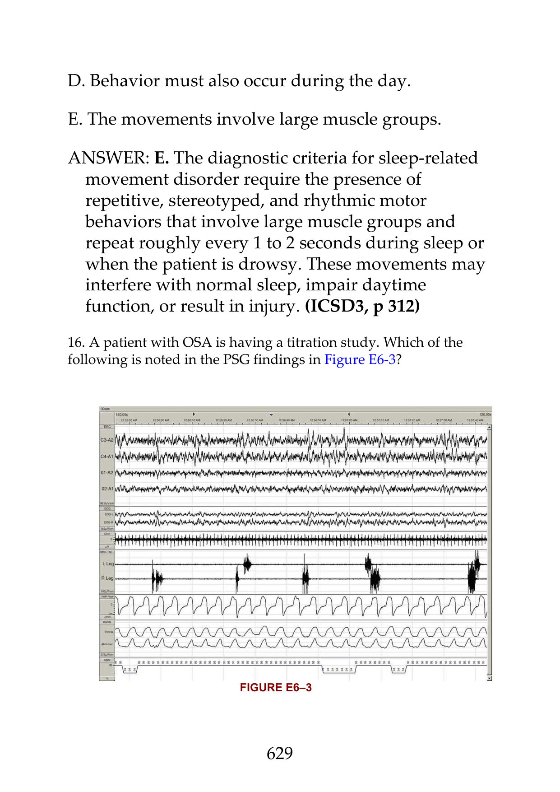

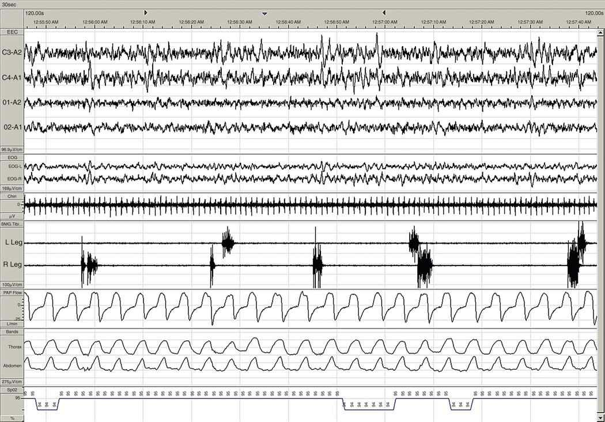

<!-- pdf-page: 630 -->

### A. Sawtooth waves

### B. CPAP overtitration

### C. Periodic limb movements in sleep (PLMS)

### E. Alternating leg movements in sleep (ALMS)

### D. Propriospinal myoclonus

### ANSWER: C. This compressed fragment shows five

### leg movements 0.5 to 5 seconds in length, which

### meets the criteria of periodicity (four or more

### consecutive movements with an intermovement

### interval of 4 to 90 seconds). This is consistent with

### the diagnosis of PLMS, because we can see that the

### patient is asleep from their EEG data. Sawtooth

### waves are theta frequency EEG waveforms with a

### notched morphology that resembles the detailed

### tooth pattern of saw blades. They are usually seen

### during REM sleep, which is not noted in the above

### epoch. CPAP overtitration is unlikely, because the

### positive airway pressure (PAP) flow signal is

### rounded and relatively constant without evidence

### of EEG arousal or oxyhemoglobin desaturation.

### Propriospinal myoclonus is depicted by brief

### myoclonic jerks seen upon relaxed wakefulness and

### drowsiness, and it disappears upon mental

### activation and sleep onset. This is not the case in the

### example above, because the patient is asleep, and

### 630

<!-- pdf-page: 631 -->

### these movements demonstrate periodicity.

### Alternating leg movements in sleep can be counted

### when leg movements seen on two different legs

### occur more than 5 seconds apart with a minimum

### of four discrete and alternating bursts of leg muscle

### activity. (ICSD3, pp 292-299, MANUAL2, Section

### VII, Movement Rules)

17. A 9-year-old girl is brought in with symptoms of “growing pains” that started 2 months ago and have worsened to the point that she has difficulty falling asleep and staying asleep. Her mother reports that she has always been an “active” sleeper and that when anyone sleeps with her, they remark on being kicked throughout the night. There is no history of snoring, parasomnias, or other sleep complaints. She takes a multivitamin and also an antihistamine for seasonal allergies but otherwise, no past medical conditions are reported. During the day, she is described as “high strung,” and she often has difficulty with impulse control. Her pediatrician performed multiple serum tests that were all normal, including a full electrolyte panel; measurement of thyroidstimulating hormone (TSH), B12, and folate; and CBC with differential and platelet count. The child is afraid of spending the night in a laboratory, so you recommend a 3-night home test using ankle accelerometry to record leg movements. Figure E6-4 is representative of the findings from night 1. Figure E6-5 is representative of the findings from night 3. From the data above, what is the most likely cause for the girl's “growing pains”?

### 631

<!-- pdf-page: 632 -->

FIGURE E6–4

FIGURE E6–5

### 632

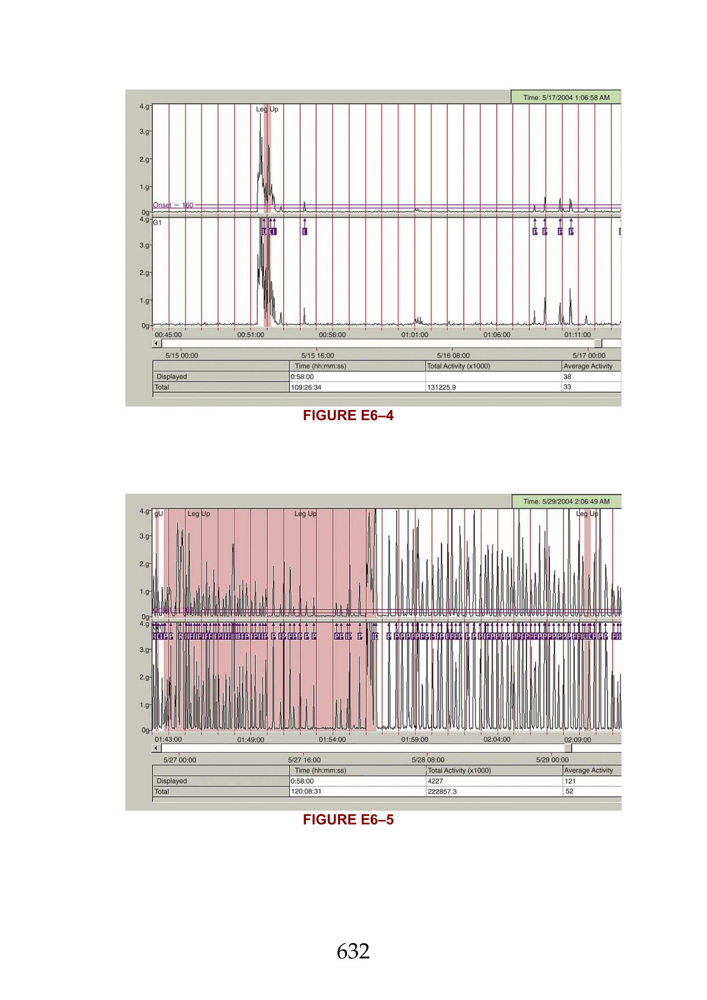

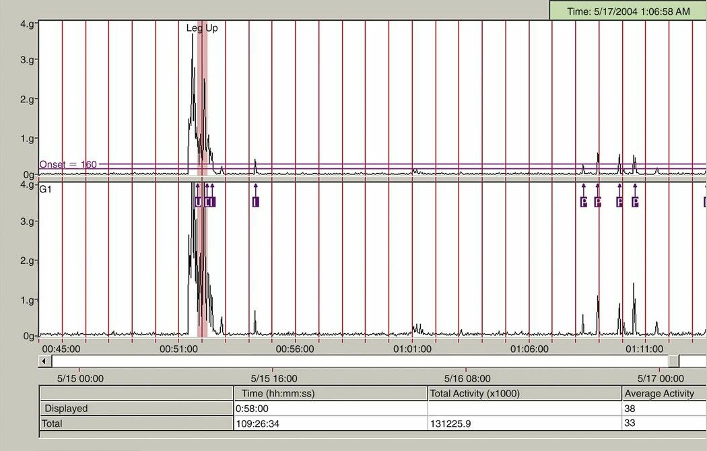

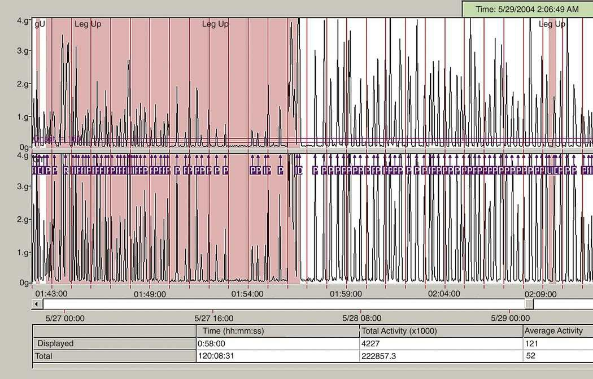

<!-- pdf-page: 633 -->

### A. Rhythmic movement disorder

### B. Periodic limb movement disorder

### ANSWER: C. The patient meets the diagnostic criteria

### C. Restless legs syndrome

### D. ADHD

### E. Antihistamine use

### for pediatric RLS, given her history of disturbed

### sleep and actigraphy that demonstrates an elevated

### PLMI. The symptom of “growing pains” has been

### found to be prevalent in patients with RLS. The

### diagnosis of RLS in children requires the same four

### criteria as in adults; but if the patient is unable to

### verbally express these symptoms, the condition can

### be diagnosed if two of the following are apparent:

### (1) sleep disturbance for age, (2) a biologic parent or

### sibling with RLS, or (3) PSG that demonstrates a

### PLMI of 5 or more per hour. The number of

### periodic limb movements varies from night to night

### but is thought to be pathologic if greater than 5/hr

### in children and greater than 15/hr in adults. It is

### found to vary more in those with less severe sleep

### complaints. The events tend to cluster into episodes

### that may last several minutes to hours and usually

### occur during the first half of the night, but they can

### recur throughout the entire sleep

### period. (MANUAL 2, Section VII, Movement

### 633

<!-- pdf-page: 634 -->

### Rules)

18. A 56-year-old woman has a 20-year history of RLS that has resulted in severe sleep-onset insomnia. Treatment with nonbenzodiazepine hypnotics (zolpidem, eszopiclone, and zaleplon) has been ineffective. She is started on pramipexole at bedtime and initially had an excellent response. After about a week, however, she complains that the insomnia and the RLS have returned, and the latter is more severe than ever. What describes this scenario?

### ANSWER: C. The patient has augmentation, which

### A. Rebound

### B. Tolerance

### C. Augmentation

### D. Paradoxic response

### results in worsening of the RLS symptoms in the

### evening. With rebound, the symptoms worsen in

### the morning as the drug effect wears off. Tolerance

### would refer to the medication losing effectiveness

### and a return of the pretreatment symptoms and

### severity of symptoms. (Garcia-Borreguero D,

### Williams A: Dopaminergic augmentation of

### restless legs syndrome: the scope of the problem,

### Sleep Med 12:425-426, 2011)

19. A 42-year-old woman has a 20-year history of RLS that began during her last pregnancy 6 years ago. She is started on levodopa/benserazide at bedtime and initially has an excellent response. After about a week, however, she complains that the RLS

### 634

<!-- pdf-page: 635 -->

symptoms have returned, but the restlessness now occurs in the morning and during the daytime. Which of the following is the best option at this time?

### A. Add an opiate medication at bedtime.

### C. Combine levodopa with a dopamine agonist or

### B. Increase the nightly dosage of

### levodopa/benserazide.

### D. Discontinue levodopa/benserazide and replace

### benzodiazepine at bedtime.

### ANSWER: D. The patient has rebounded. This results

### with a dopamine agonist.

### in return of the RLS symptoms but at the time

### medication is wearing off or during the daytime.

### Because the patient is having an unwanted effect of

### the medication, it is best to use another

### medication. (ATLAS2, p 190)

20. A 28-year-old man has a 6-year history of RLS, and both his parents have RLS. At the time of initial diagnosis 4 years previously, he was started on pramipexole. He initially had an excellent response, which continued for 4 years. However, the symptoms have slowly returned. Which of the following is the best option at this time?

### A. Add an opiate medication at bedtime.

### B. Increase the nightly dosage of pramipexole.

### C. Stop pramipexole for 2 weeks then restart at a

### 635

<!-- pdf-page: 636 -->

### lower dose.

### D. Add gabapentin.

### ANSWER: C. The patient has developed tolerance to

### the medication. Often a 2-week drug holiday and

### restarting at a lower dose is effective in restoring

### efficacy of treatment. (ATLAS2, p 190)

21. A 48-year-old man, a general in the Air Force, has a 6-year history of severe nightly RLS. At the time of initial diagnosis 4 years previously, he was started on pramipexole. He had an excellent response, and the response has continued for 4 years. However, he states that he frequently has to take long flights as a passenger to air bases around the world, and he develops severe symptoms of motor restlessness when he has to sit. Which of the following is the best option at this time?

### A. Add an opiate medication prior to takeoff.

### B. Add a small dose of pramipexole at takeoff.

### C. Stop pramipexole for 2 weeks then restart at a

### D. Add gabapentin on the morning of the flight.

### lower dose.

### ANSWER: B. Some patients with RLS, especially

### when they are sleep deprived, will have symptoms

### whenever they are resting or sitting still. Being a

### passenger in an automobile or airplane or sitting in

### the audience of an event can result in severe

### symptoms. Taking a small dose of a DA agent

### 636

<!-- pdf-page: 637 -->

### before the onset of expected symptoms can be

### helpful. (ATLAS2, p 190)

22. A 68-year-old woman has a 40-year history of severe nightly RLS. She was started on pramipexole 5 years previously, had an excellent response, and the response has continued. The patient has been scheduled to have an MRI of her abdomen and refuses to have the test, because she had a previous MRI attempt about 10 years before and “freaked out” because she developed distressing motor restlessness while in the machine. She requires the test for evaluation of a possible malignancy. What would you advise?

### A. Take a short-acting nonbenzodiazepine hypnotic so

### B. Add a small dose of pramipexole an hour before

### she can sleep through the test.

### C. Stop pramipexole for the 2 weeks before the test.

### the test.

### D. Add gabapentin on the morning of the test.

### ANSWER: B. Some patients with RLS will have

### symptoms whenever they are resting or sitting still.

### Having to lay still for an hour can be absolute

### torture for them. Taking a small dose of the DA

### agent before the expected symptoms can be helpful.

### Nonbenzodiazepine hypnotics have very little effect

### on RLS symptoms. (ATLAS2, p 190)

23. A 54-year-old man with a history of snoring, observed apnea, severe daytime sleepiness, and a BMI of 40 is found to have sleep apnea. The apnea-hypopnea index (AHI) is 72 events/hr, and the total arousal index is 65 arousals/hr. The sleep study also showed

### 637

<!-- pdf-page: 638 -->

severe PLMS with a PLMI of 85. On CPAP titration, the apnea is well controlled (the AHI is 4, and the total arousal index is 8), but he continues to have PLMS with a PLMI of 70. He is started on CPAP and pramipexole, and his sleepiness resolves entirely. On follow-up 3 months later, he mentions that his sleep symptoms have resolved but that he had a financial setback and could no longer afford the pramipexole. Since he was last seen, with his increased energy, he had been going to a local casino to gamble, and he was so far in debt, he had to sell his home. What do you advise?

### A. Order an equipment download to ensure that the

### C. Switch him to a less expensive treatment such as

### apnea is well controlled.

### B. Stop the pramipexole.

### D. Refer him to a psychiatrist to deal with his

### generic carbidopa/levodopa.

### ANSWER: B. Dopamine agonists can result in

### gambling addiction.

### compulsive or impulsive behaviors that include an

### addiction to gambling. In this case, the patient

### probably did not need treatment of the PLMS

### because the arousal index on CPAP was low. The

### best course of action is to stop the

### pramipexole. (Cornelius JR, Tippmann-Peikert M,

### Slocumb NL, et al: Impulse control disorders with

### the use of dopaminergic agents in restless legs

### syndrome: a case-control study, Sleep 33:81-87,

### 2010)

### 638

<!-- pdf-page: 639 -->

24. A 17-year-old girl has been referred for evaluation of severe RLS. She is quite thin but is otherwise healthy. It takes her hours to fall asleep because of severe motor restlessness at bedtime that is relieved temporarily by walking. She is not interested in using medications. Which of the following is not helpful in her management?

### A. Referral to a psychologist to treat her with

### ANSWER: A. The cause of the probable RLS is not

### cognitive behavioral therapy

### B. Family history

### C. Menstrual history

### D. Dietary history

### E. GI tract review of symptoms

### clear. The dietary history in this young woman may

### confirm that she is a vegetarian, and she may

### therefore be prone to be iron deficient or vitamin B12

### deficient. The menstrual history may point toward

### heavy menstrual bleeding, leading to iron

### deficiency. Family history may point toward a

### familial cause of the RLS. A GI review of symptoms

### may point toward celiac disease or Crohn disease,

### both of which have been associated with

### RLS. (ATLAS2, p 179)

25. Electrodes for recording EMG leg movements should be placed two on each leg. The recommended placement for each leg is

### 639

<!-- pdf-page: 640 -->

### A. Anterior tibialis muscle, 2 to 3 cm apart

### B. Anterior tibialis muscle, 6 to 10 inches apart

### C. Gluteus maxiumus, 5 to 8 inches apart

### D. One each on opposite sides of the kneecap

### ANSWER: A. According to the American Academy of

### Sleep Medicine, separate channels for each leg are

### “strongly preferred” because “combining electrodes

### from the two legs to give one recorded channel may

### work but could reduce the number of detected limb

### movements.”

26. All of the following rules define a PLMS series except

### A. The minimum number of consecutive limb

### B. The minimum period length between limb

### movement events is four.

### movements to include them as part of the PLMS

### series is 5 seconds.

### C. The maximum period length between limb

### movements to include them as part of a PLMS

### series is 60 seconds.

### D. Leg movements on two different legs separated by

### less than 5 seconds between movement onsets are

### counted as a single leg movement.

### 640

<!-- pdf-page: 641 -->

### ANSWER: C. According to the American Academy of

### Sleep Medicine, the maximum period between limb

### movements to include them in a PLMS series is 90

### seconds.

27. The first letters of the four essential criteria for diagnosing RLS spell URGE. Which of the following is not part of these criteria?

### B. Rest or inactivity precipitates or worsens symptoms

### A. Urge to move limbs

### D. Evening or nighttime appearance or worsening of

### C. Gastrocnemius pain or tingling

### ANSWER: C. The G in the URGE acronym stands for

### symptoms

### getting up, because moving improves the sensation.

### Whereas there may be pain or tingling, it is not

### confined to the gastrocnemius, and it can be any

### type of discomfort, including the urge to just move

### the legs. (ATLAS2, p 179)

28. Which of the following statements is not true concerning RLS and PLMS?

### A. RLS is diagnosed by history alone; PLMS is

### B. PLMS is a subset of RLS; almost all patients with

### diagnosed by PSG alone.

### PLMS will also have symptoms suggesting RLS.

### 641

<!-- pdf-page: 642 -->

### C. PLMS and RLS patients may respond to the same

### medications, such as low-dose dopamine agonists

### and benzodiazepines.

### D. Both PLMS and RLS may be associated with

### ANSWER: B. RLS is diagnosed by history alone,

### restless sleep.

### PLMS is diagnosed by PSG alone. About 80% of

### patients with RLS will manifest PLMS, but only

### about 30% of PLMS patients will have RLS. Both

### groups may respond to the same medications, and

### both groups may have restless sleep as a result of

### leg movements: in RLS, at bedtime; in PLMS,

### during sleep. (ATLAS2, pp 178-179)

29. All of the following are true about pramipexole except

### A. It is a non-ergot dopamine agonist.

### B. Dosage adjustment is not necessary in renal

### C. It is FDA approved for treatment of Parkinson

### insufficiency.

### D. It is FDA approved for treatment of RLS.

### disease.

### ANSWER: B. Dosage adjustment of pramipexole is

### necessary in patients with renal insufficiency. The

### other statements are true.

### 642

<!-- pdf-page: 643 -->

30. A 44-year-old man complains of sleepiness and snoring. He is being treated for severe neuropathic pain related to ankle trauma and takes gabapentin, morphine, eszopiclone, clonazepam, omeprazole, and venlafaxine. A fragment of his overnight sleep study is shown in Figure E6-6. What stage of sleep is shown in this epoch?

### ANSWER: A. This 30-second epoch shows high-

FIGURE E6–6

### A. W

### B. NI

### C. N3

### D. R

### frequency EEG and slow eye movements, which are

### characteristic of stage W.

### 643

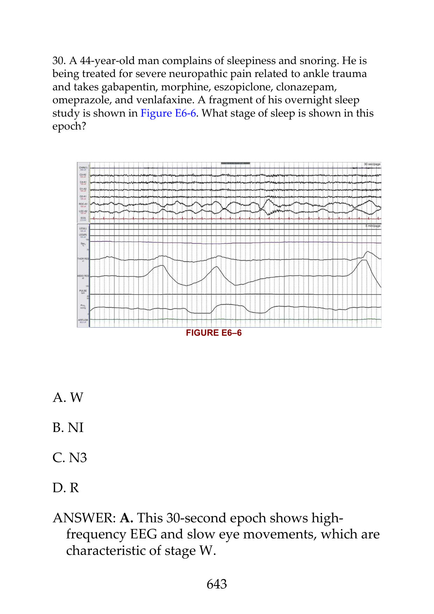

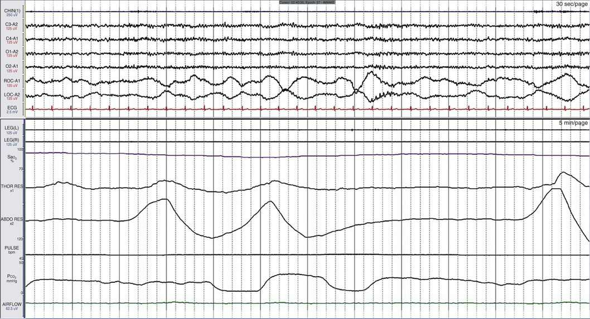

<!-- pdf-page: 644 -->

31. How would you interpret the respiratory abnormality shown in the epoch from Figure E6-6?

### A. It should not be interpreted in this epoch because

### the patient is awake.

### B. It should be scored as central apneas, and it should

### be indicated that these are an abnormal finding.

### C. It should be scored as central apneas, but it is not

### D. The epoch shows what is likely voluntary breath

### clinically significant.

### holding, and the events should not be scored as

### central apneas.

### ANSWER: B. The events should be scored as central

### apneas and should definitely be considered

### abnormal. Central apneas during wakefulness can

### be found in patients with Cheyne-Stokes breathing,

### heart failure, and cerebrovascular disease. They are

### also seen in patients taking medications that

### depress breathing, principally opiates. Of all the

### medications he is taking, the culprit is likely

### morphine. Opiates are well known to cause central

### sleep apnea. They blunt the drive to breathe and

### can actually lead to respiratory acidosis in some

### cases. (Mogri M, Desai H, Webster L, et al:

### Hypoxemia in patients on chronic opiate therapy

### with and without sleep apnea, Sleep Breath 13:49-

### 57, 2009) Note that in 30 seconds, this patient took

### only three breaths. Patients who manifest central

### 644

<!-- pdf-page: 645 -->

### apnea while awake almost always also have central

### apnea during sleep.

32. What drug would likely worsen the EMG finding seen in the fragment in Figure E6-7?

### ANSWER: B. Figure E6-7 shows PLMS.

FIGURE E6–7

### A. Pramipexole

### B. Metoclopramide

### C. Oxycodone

### D. Clonazepam

### 645

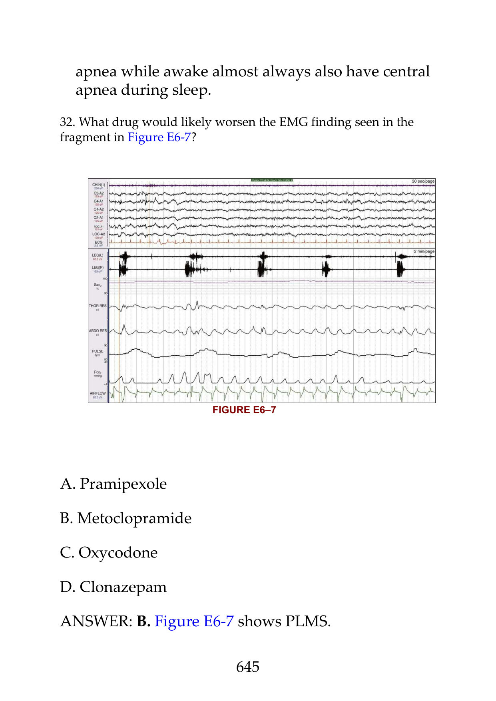

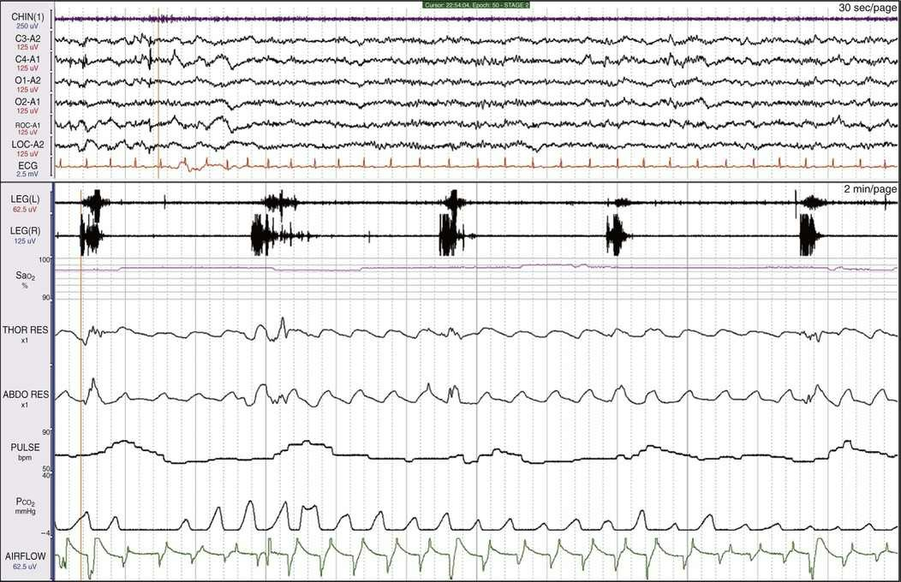

<!-- pdf-page: 646 -->

### Metoclopramide is a dopamine antagonist, and it

### can worsen PLMS. Pramipexole, oxycodone, and

### clonazepam may be used to treat PLMS. Drugs that

### can worsen both PLMS and RLS include

### ❍ SSRI antidepressants (mainly worsen PLMS)

### ❍ Dopamine receptor antagonists (e.g.,

### ❍ Tricyclic antidepressants

### ❍ Lithium

### metoclopramide and prochlorperazine, often used

### as antiemetics)

33. First-line drug treatment of RLS should come from which of the following drug classes?

### ❍ Nicotine

### ❍ Alcohol

### ❍ Caffeine

### ❍ Diphenhydramine

### A. Dopaminergic agents

### B. Opioids

### C. Anticonvulsants

### D. Benzodiazepines

### 646

<!-- pdf-page: 647 -->

### ANSWER: A. These are the four categories of drugs

### commonly prescribed to treat RLS; however, only

### the dopaminergic agents are currently FDA

### approved for this condition, although the other

### classes are widely used as well. The two approved

### dopaminergic drugs are pramipexole and

### ropinirole. Another dopaminergic agent used for

### many years is levodopa, which is usually

### prescribed in combination with carbidopa (as

### Sinemet). Treatment with anticonvulsants has

### focused on gabapentin, considered a good

### alternative for patients who develop adverse effects

### from dopaminergic agents. (ATLAS2, pp 190-191;

### MANUAL2, Section VII, Movement Rules)

34. Augmentation, a common problem with long-term levodopacarbidopa treatment of RLS, refers to

### A. Morning rebound, the presence of RLS symptoms

### that occur de novo as a consequence of evening or

### nighttime treatment

### B. The requirement of an ever-higher dose to provide

### C. Earlier onset of symptoms by at least 4 hours

### the same beneficial effect

### D. The presence of side effects not controlled with the

### carbidopa component (e.g., nausea, vomiting,

### hallucinations, tachycardia, fatigue, and daytime

### sleepiness)

### 647

<!-- pdf-page: 648 -->

### ANSWER: C. Augmentation is very common with

### levodopa-carbidopa treatment and less so with the

### newer dopamine agonists pramipexole and

### ropinirole, although it is still a potential problem.

### Augmentation is present when symptoms occur at

### least 4 hours earlier than normal plus a shorter

### latency to symptom onset when at rest, extension of

### symptoms to other parts of the body, a greater

### intensity of symptoms, and shorter duration of

### relief with treatment.

Your trusted sleep tech who has worked with you for 10 years is moving and therefore has resigned. You begin to look for a “seasoned” replacement and decide to include a few scoring exercises and questions as part of the evaluation and qualification process. You provide the job candidate a PSG record that you know includes periodic limb movements.

#### Your New Sleep Technologist

35. During minutes 200 and 205, there are what appear to be 10 limb movements indicated by an increase in EMG amplitude of 4 µV over baseline, 8 with an increase of 2.5 µV, 12 with an increase of 6 µV, and 16 with an increase of 9 µV. How many limb movements should be scored as “significant”?

### ANSWER: D. The minimum amplitude of a limb

### A. 4

### B. 8

### C. 12

### D. 16

### movement event is an 8 µV increase in EMG

### 648

<!-- pdf-page: 649 -->

### voltage above resting EMG.

36. The minimum duration of a limb movement event is

### A. .05 sec

### ANSWER: C. The minimum duration of a limb

### B. .25 sec

### C. .5 sec

### D. 1 sec

37. The next 5-minute PSG segment has what appears to be 25 limb movements, although 8 of these have a duration of 12 seconds, 5 have a duration of 15 seconds, and the rest have a duration of 8 seconds. By the 2014 AASM scoring criteria, how many limb movements should be counted?

### movement event is 0.5 sec.

### ANSWER: C. The maximum duration of a limb

### A. 0

### B. 8

### C. 13

### D. 18

38. On epochs 100 through 150, a set of 8 periodic limb movements are separated by 4 seconds, a set 2 minutes later of 10 are separated

### movement event is 10 seconds.

### 649

<!-- pdf-page: 650 -->

by 10 seconds, and another set 5 minutes later of 8 are separated by 20 seconds. How many PLMS series should be scored?

### A. None

### ANSWER: C. The minimum number of consecutive

### B. One

### C. Two

### D. Three

### limb-movement events needed to define a PLMS

### series is four limb movements. (MANUAL2,

### Section VII, Movement Rules)

### 650
