# Section 7 Breathing Disorders

<!-- pdf-page: 651 -->

### SECTION 7

## Breathing Disorders

#### A 38-Year-Old Man with a History of Scrotal Edema

## 7.1.

## Obstructive Sleep Apnea

## Questions

A 38-year-old real estate agent presents in mid-January with a 15-year history of snoring, a 2-year history of witnessed apnea, and excessive daytime sleepiness (EDS). He has an Epworth Sleepiness Scale (ESS) score of 17 out of 24. A year ago, he started to notice swelling of his feet and ankles. During the course of the year, he developed severe edema, which peaked on New Year's Eve, when the edema spread to his legs and scrotum. He was admitted to the hospital and was told that he had congestive heart failure (CHF). He was treated for CHF and had lost 60 pounds by the time he was discharged 1 week later. He was then sent for a sleep evaluation; a fragment from his sleep study is shown in Figure 7.1-1. The top window is a 30-second epoch, the bottom is a 2-minute epoch.

1. What is the most striking feature noted on the electroencephalogram (EEG)?

### A. Vertex sharp waves

### B. Rapid eye movements

### 651

<!-- pdf-page: 652 -->

### C. Electrocardiography (ECG) artifact

### D. Sawtooth waves

2. Based on this fragment, what do you expect his bed partner to report?

### B. Snoring noises separated by long periods of silence

### A. Movements every 20 seconds

4. Considering the findings up to this point, what was the likeliest cause of the scrotal edema?

### C. Loud, continuous snoring

### D. Excessive sweating

3. What is the main diagnostic finding?

### A. Hypopneas

### B. Obstructive apneas

### C. Hypoventilation

### D. Cheyne-Stokes breathing (CSB)

### A. Left ventricular cardiac failure

### B. Systemic arterial hypertension

### C. Pulmonary embolism

### 652

<!-- pdf-page: 653 -->

### D. Cor pulmonale

5. Based on this diagnostic finding, what should be the next step?

### A. Continuous positive airway pressure (CPAP)

### D. Referral for fitting of a mandibular advancement

### titration

### B. Adaptive servoventilation (ASV)

### C. Home oxygen therapy

6. He is started on positive pressure after 2 hours of monitoring. A fragment from the PSG is shown in Figure 7.1-2; C-flow is mask flow measured by the CPAP unit. What does it show?

### device

### A. Complete control of the obstructive apnea

### B. No effect of the CPAP on the patient's physiology

### C. Development of complex sleep apnea

### D. Flow limitation, indicating incomplete control of

### the sleep apnea

7. Given this finding, what is the next step?

### A. Increase CPAP.

### B. Decrease CPAP.

### C. Change modality to ASV.

### 653

<!-- pdf-page: 654 -->

### D. Start bilevel pressure with a back-up rate.

A 48-year-old patient whose complaint is snoring and daytime sleepiness is in the sleep lab for overnight polysomnography (PSG). He is on oxycodone for pain. The night tech phones the on-call doctor with concerns that the patient is having a dysrhythmia issue, and the tech does not know

FIGURE 7.1–1 Questions 1 to 5.

FIGURE 7.1–2 Questions 6 and 7.

#### Frantic Call from the Sleep Tech

### 654

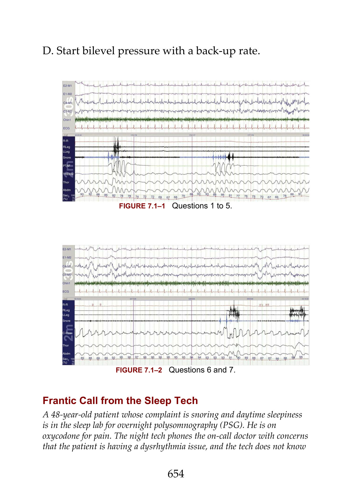

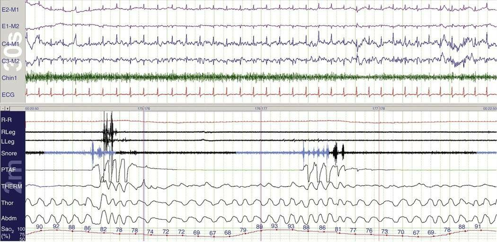

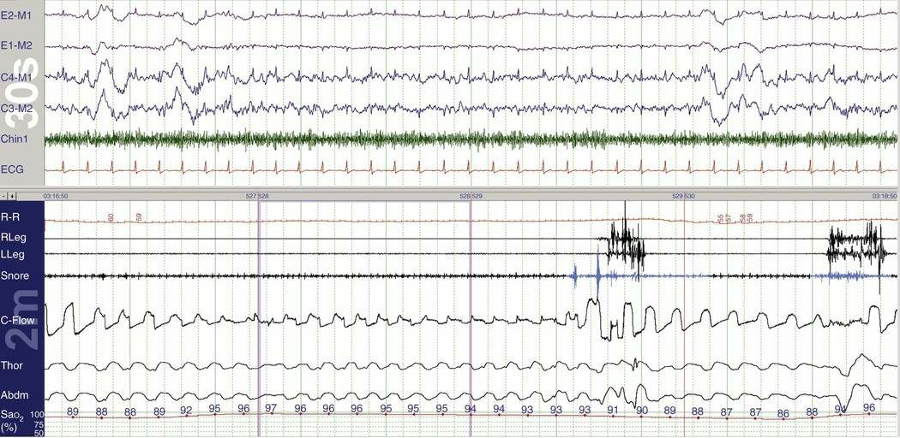

<!-- pdf-page: 655 -->

how to proceed. The tech captures the PSG screen and sends the image file to the on-call doctor by e-mail. The PSG fragment in Figure 7.1-3 shows a 60-second epoch.

8. What is causing the ECG abnormality at the end of the apneic episode?

9. What sleep-breathing abnormality is present in the PSG fragment?

### A. Hypoxemia

### B. Increased sympathetic tone

### C. Increased vagal tone

### D. Histamine

10. What course of action should be taken upon seeing the PSG fragment in this obstructive sleep apnea (OSA) patient?

### A. Hypopnea

### B. Obstructive apnea

### C. Central apnea

### D. Mixed apnea

### A. Terminate the study and send the patient to the

### emergency department (ED).

### B. Insert a cardiac pacemaker.

### C. Begin CPAP titration.

### 655

<!-- pdf-page: 656 -->

### D. Begin oxygen therapy.

A 67-year-old woman with a body-mass index (BMI) of 29 has a history of snoring and insomnia. She is in the hospital for a minor elective orthopedic procedure. In the postanesthesia area, she is noted to snore loudly. The surgeon orders a continuous pulse oximetry to be done while she is sleeping. It is interpreted by the pulmonologist as mild sleep apnea and he prescribes a nasal mask and an autotitrating CPAP machine (pressure range 5 to 10 cm H2O). The patient was sent home with this machine, but over several days, she has become fatigued but cannot fall asleep with the CPAP. She was referred to a sleep clinic by her family doctor for a second opinion and brings with her the pulse oximetry recording shown in Figure 7.1-4.

FIGURE 7.1–3 Questions 8 to 10.

#### Worse on Treatment for Apnea

11. What might explain the change in the pattern of oximetry that occurs at about 2 hours 20 minutes (the vertical red line in the figure)?

### A. The patient turned over onto her side.

### 656

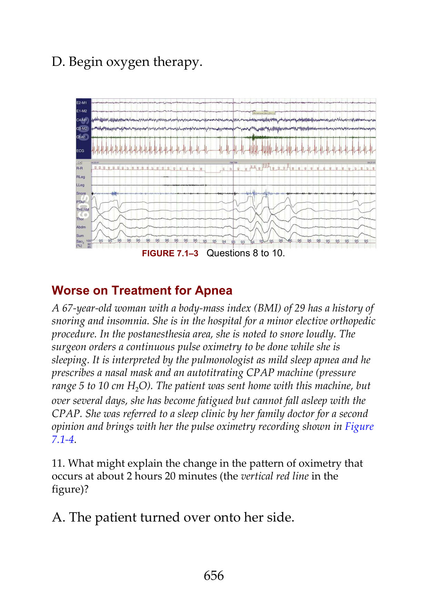

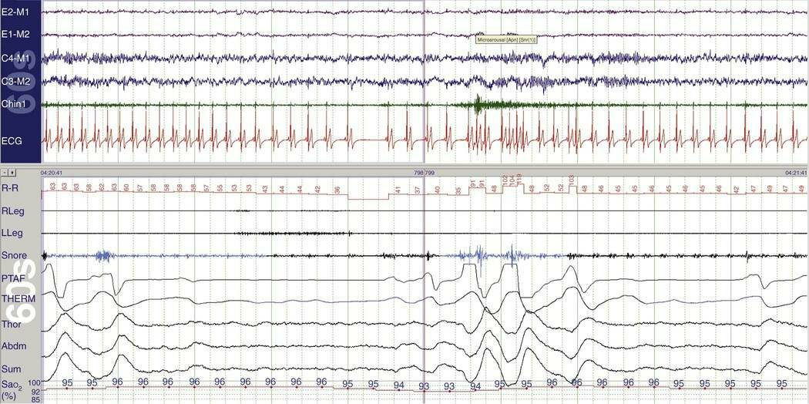

<!-- pdf-page: 657 -->

### B. The patient woke up and was awake the rest of the

### night.

### C. The patient did not have any further episodes of

### A. Increase the range of the autotitrating machine to 5

### rapid eye movement (REM).

### D. All of the above are true.

12. What should be the next step?

### B. Stop the PAP therapy, because the apnea was

### to 15 cm H2O.

A 19-year-old student has been falling asleep repeatedly in class, and his family doctor is concerned he has narcolepsy. The patient has recently started to snore. His BMI is 24. Examination found bilateral enlarged cervical lymph nodes and a large spleen, and chest radiography showed asymmetric hilar soft tissue enlargement.

### obviously mild.

### C. Start the patient on zolpidem.

### D. Order an overnight PSG.

FIGURE 7.1–4 Questions 11 and 12.

#### Falling Asleep in University Class

### 657

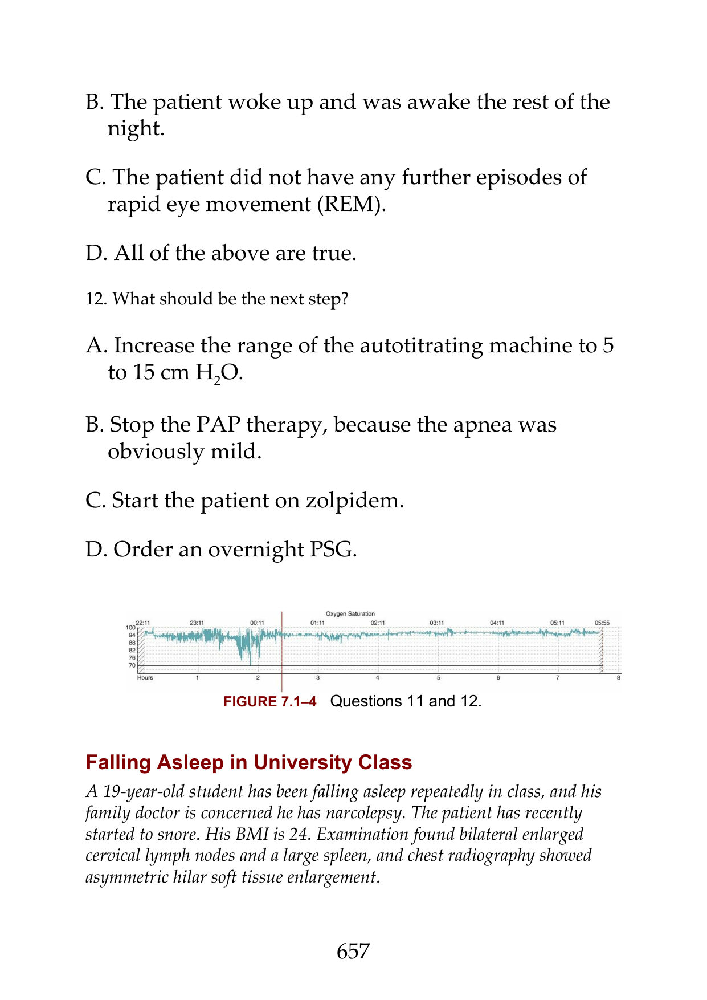

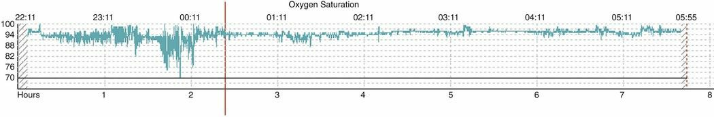

<!-- pdf-page: 658 -->

13. His evaluation by the sleep clinic should include which of the following?

### A. Maintenance of wakefulness test (MWT) without

### preceding PSG

### C. Multiple sleep latency test (MSLT) without

### B. Home monitoring for seizures

### D. Imaging studies of the pharynx and neck

### preceding PSG

A 38-year-old truck driver with a history of snoring and excessive daytime sleepiness is referred for evaluation of OSA. The patient cannot come for an in-lab sleep study for at least a week because he is a long-distance trucker and will be out of town. His ESS score is 24 out of 24.

#### Obstructive Apnea Comorbidities

### A. Because he has a long history of snoring, he can

14. What should you advise this patient?

### delay the test until he is back in town.

### B. He cannot drive until his problem is diagnosed and

### C. He should start on CPAP with an autotitrating

### treated.

### D. He can use modafinil until the test can be done.

### CPAP machine.

15. A 48-year-old woman with fatigue and insomnia presents to her primary care practitioner. He gives her the Berlin Questionnaire,

### 658

<!-- pdf-page: 659 -->

which is used to calculate the risk of what condition?

### A. OSA

### B. Depression

### D. Circadian rhythm disorder (advanced or delayed)

### C. Bipolar disease

### A. Left heart failure caused by a right-to-left cardiac

16. The term cor pulmonale refers to what?

### B. Right heart failure caused by pulmonary

### shunt

### C. Cardiac rhythm abnormality in asthma

### hypertension

### D. Pulmonary hypertension caused by left heart

17. Prior to bariatric surgery, a 40-year-old woman with a BMI of 50 and Paco2 of 52 mm Hg is referred to the sleep disorders center to screen for sleep problems. She is noted to have severe ankle swelling. What abnormality most likely would explain her peripheral edema?

### disease

### B. Upper airway resistance syndrome (UARS)

### A. OSA

### C. Obesity hypoventilation syndrome (OHS)

### 659

<!-- pdf-page: 660 -->

### D. Treatment-emergent apnea

18. A 55-year-old woman with a history of obesity (BMI = 35), hypertension, and snoring was found to have OSA, with an apneahypopnea index (AHI) of 15 events/hr. During her titration study (Fig. 7.1-5), the tech notes an episode of ventricular tachycardia and sends her to the ED. Based on the 2-second zoomed window, what is the patient's cardiac rhythm?

19. A thin 6-year-old patient is referred to the sleep disorders center with a history of restless sleep. The patient's pharynx is pictured in

### A. Ventricular tachycardia

### B. Torsades de pointes

### C. Not discernable

### D. Sinus rhythm

FIGURE 7.1–5 Question 18.

#### Not Just Middle-Aged Obese Men

### 660

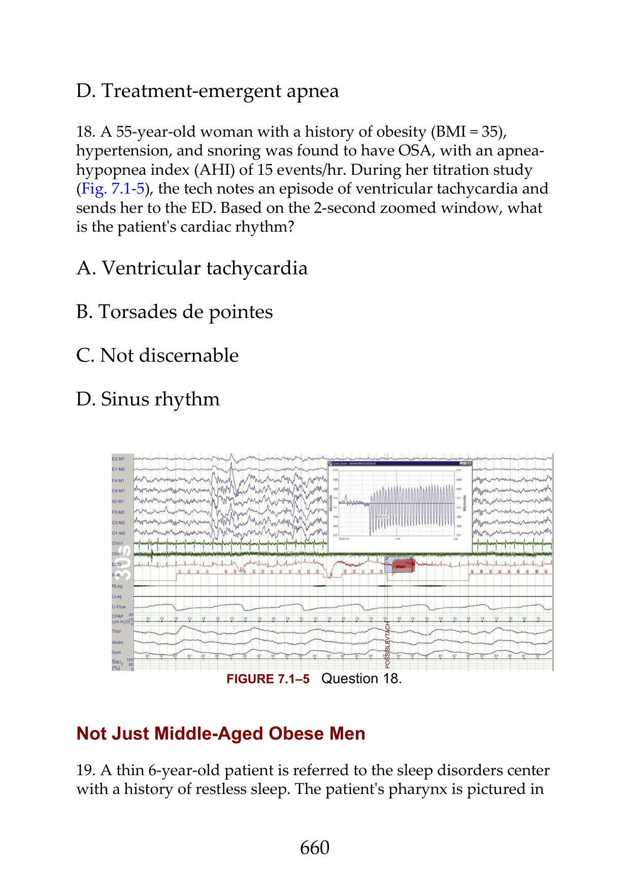

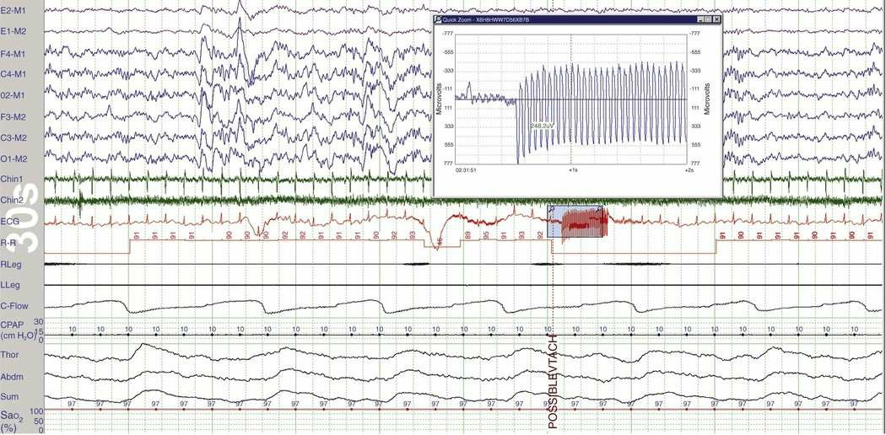

<!-- pdf-page: 661 -->

Figure 7.1-6. What do you note in the chart?

### A. Enlarged tonsils, grade 4

### B. Mallampati class 4

20. Which statement about Prader-Willi syndrome is true?

### C. Hypertrophy of uvula

### D. Normal pharynx

FIGURE 7.1–6 Question 19.

### B. There may be sleep-onset REM periods (SOREMPs)

### A. The main symptom is insomnia.

### C. It usually manifests after 20 years of age.

### on the MSLT.

### 661

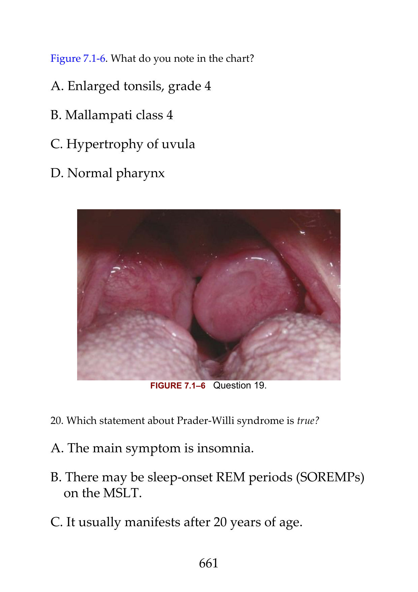

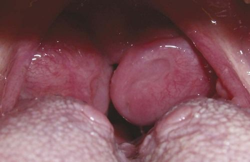

<!-- pdf-page: 662 -->

### D. Few patients have sleep apnea.

21. Which statement is true about the management of Prader-Willi syndrome?

### A. All morbidly obese patients with Prader-Willi

### B. Growth hormone (GH) usually treats sleep-

### syndrome should have a PSG.

### C. The SOREMPs indicate narcolepsy, which should

### disordered breathing.

### D. GH has no role in the therapy of Prader-Will

### be treated with alerting agents.

22. A 48-year-old woman is referred for symptoms of EDS, difficulty in falling asleep and staying asleep, snoring, and witnessed apneas during sleep. She also wakes up quite frequently feeling short of breath. She had a myocardial infarction (MI) at age 44 and has long-standing hypertension and diabetes. Her BMI is 51, BP is 160/110 mm Hg. Physical exam shows peripheral edema, severe facial acne, and excessive facial hair. Severe obstructive apnea with an AHI of 70 events/hr was found on her PSG. What is the most likely diagnosis?

### syndrome.

### A. Cushing disease

### B. Polycystic ovary syndrome

### C. Acromegaly

### D. Hypothyroidism

### 662

<!-- pdf-page: 663 -->

23. A patient with abnormal liver enzymes related to nonalcoholic fatty liver disease is referred for evaluation because of daytime sleepiness. What sleep disorder is likely in this patient?

### A. Secondary narcolepsy

24. Which statement about sleep apnea in menopausal women is true?

### B. Periodic limb movements in sleep

### C. Insomnia

### D. OSA

### B. Prevalence in menopausal women is similar to that

### A. It is due to obesity.

### C. It is more common in women with hot flashes.

### in age-matched men.

25. Which statement about sleep in pregnancy is true?

### D. It seldom responds to CPAP.

### A. The commonest reason for nocturnal awakenings is

### B. Snoring in pregnancy has been associated with

### restless legs syndrome.

### C. Snoring in pregnancy has been associated with

### preeclampsia.

### larger-than-expected babies.

### 663

<!-- pdf-page: 664 -->

### D. Sleep apnea should not be treated with CPAP

### during pregnancy.

26. Compared with men of similar age, apnea severity, and degree of daytime sleepiness, which statement about OSA in women is true?

### C. Women are less likely to be on antidepressant

### A. Insomnia is more common.

### B. Caffeine consumption is greater.

### D. Women are less likely to have a history of thyroid

### medication.

27. Comparing OSA in men and women, the most significant difference is that women

### disease.

### A. Have more slow wave sleep in the first third of the

### B. Tend to have more episodes of central apnea

### night

### C. Tend to have more compliant upper airways

### D. More commonly have apneic episodes clustered in

28. What is the most common cause of sleep-disordered breathing in 10-year-old children?

### REM sleep

### A. Enlarged adenoids and tonsils

### 664

<!-- pdf-page: 665 -->

### B. Obesity

### C. Retrognathia

#### An 8-Year-Old with Attention-Deficit/Hyperactivity

#### Disorder

### D. Congenital malformations

An 8-year-old boy with a 5-month snoring history is referred for evaluation of restless sleep. His pediatrician has diagnosed attentiondeficit/hyperactivity disorder (ADHD), for which he was prescribed methylphenidate. The medication improved his behavior in school but worsened his nighttime sleep.

29. What does his profile photo show (Fig. 7.1-7)?

### A. Maxillary insufficiency

### B. Prognathia

### C. Retrognathia

### D. Normal anatomy

### 665

<!-- pdf-page: 666 -->

30. Figure 7.1-8 is a photo of this child's tonsils. What does it show?

FIGURE 7.1–7 Question 29.

### A. Grade 4 tonsil enlargement

### B. Grade 3 tonsil enlargement

### C. Mallampati class 3

### D. Mallampati class 4

### 666

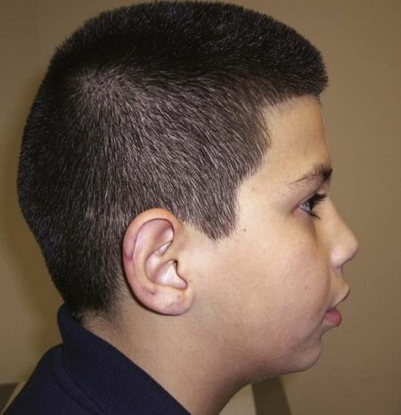

<!-- pdf-page: 667 -->

31. What additional evaluation would be helpful in this patient?

FIGURE 7.1–8 Question 30.

### B. Evaluation of alignment of upper and lower teeth

### A. Nasopharyngoscopy

### B. Magnetic resonance imaging (MRI) of the upper

### C. Neck collar size

### D. BMI

32. What should be done next?

### A. Cephalometrics

### C. Tonsillectomy and adenoidectomy

### airway

### 667

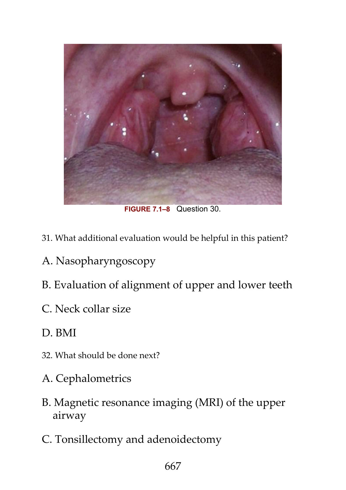

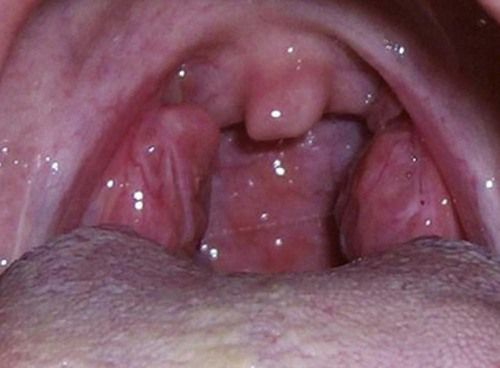

<!-- pdf-page: 668 -->

### D. Diagnostic PSG

33. In addition to the standard montage of adult PSGs, what data might be useful to monitor in this patient?

### D. Additional channels are not needed.

### A. Esophageal pressure

### B. End-tidal Pco2

### C. End-tidal Po2

34. All of the following are true about OSA in children except

### A. Sleep architecture is usually normal.

### B. Cortical EEG arousals are more common than are

### C. Obstructive events occur predominantly during

### movement or autonomic arousals.

### D. Children have a faster respiratory rate and lower

### REM sleep.

### functional residual capacity than adults.

35. The results from his 8-hour overnight PSG are as follows: AHI = 2.1 events/hr (all obstructive); end-tidal Pco2 >50 mm Hg for 11% of sleep time; low Sao2 = 93%; mean Sao2 = 96% What is the best interpretation of these data?

### A. UARS

### 668

<!-- pdf-page: 669 -->

### B. OSA

### C. Sleep hypoventilation syndrome

36. During CPAP titration, the epoch in Figure 7.1-9 is recorded. Which of the following statements is correct?

### D. Normal findings

### A. PAP titration is complete because Sao2 is stable and

### B. PAP titration is complete but oxygen should be

### there are no apneas.

### C. PAP titration is complete because it is acceptable to

### added.

### D. The degree of hypoxemia seen here is not

### have a reduced Sao2 at times.

### acceptable.

### 669

<!-- pdf-page: 670 -->

37. What does the C-flow channel show in Figure 7.1-9?

FIGURE 7.1–9 Questions 36 to 38.

38. What is the sleep stage in this epoch, and what effect is it having on the respiratory system?

### A. Flow limitation

### B. Complete airway occlusions

### C. Normal Pco2 trace

### D. CSB

### A. This is REM sleep and the evident flow limitation

### is likely caused by reduced tone of the pharyngeal

### muscles.

### B. This is stage N3 and the evident flow limitation is

### caused by increased chemical drive to breathe.

### 670

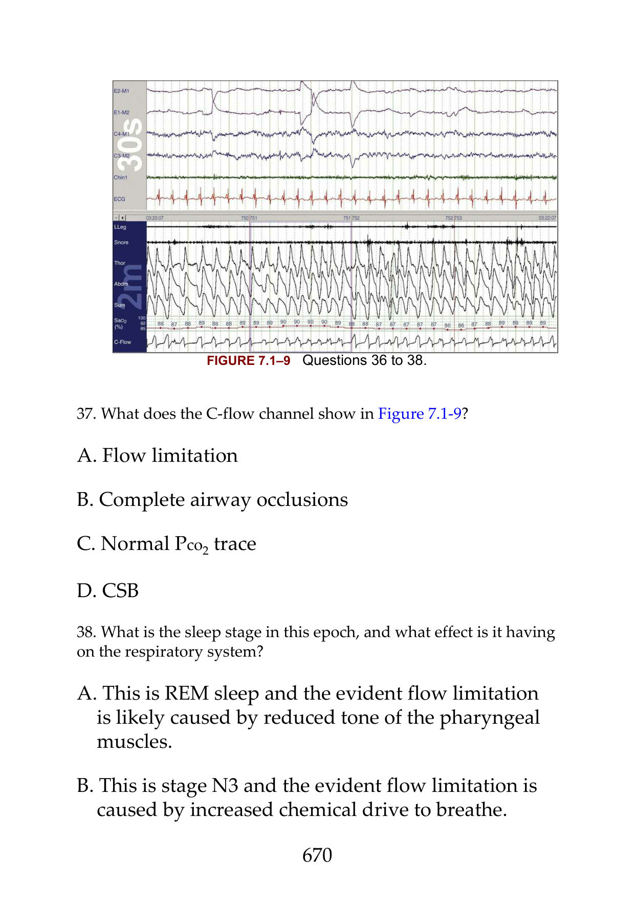

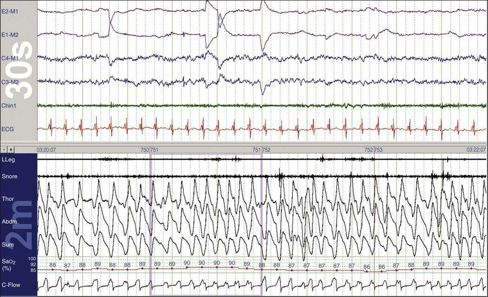

<!-- pdf-page: 671 -->

### C. The K complexes indicate stage N2 and chemical

### drives to breathe are causing tachypnea.

### D. The slow eye movements indicate stage N1 sleep

### and the increased drive to breathe has resulted in a

### wide-open upper airway.

A 56-year-old obese man is in the intensive care unit (ICU) for an MI. The ICU staff has noted episodes of sleep apnea and heavy snoring, and for this reason, his physician ordered a split-night sleep study. When the sleep tech went in to start him on CPAP, she noted frothy fluid on his pillow and that he was coughing. The remainder of the night was uneventful. The patient did beautifully on CPAP. A representative sample of his pretreatment PSG is shown in Figure 7.1-10. Pick the best answer from the next series of questions.

#### Lucky to Be Alive

39. The PSG fragment is divided into two windows, the top with an epoch of 30 seconds and the bottom with an epoch length of 5 minutes. Before he was studied on PAP, his EEG continuously had this pattern. What stage of sleep should be scored based on the top window?

40. Oronasal airflow is being monitored by end-tidal Pco2. What sleep-breathing abnormality does the bottom window show?

### A. Wakefulness

### B. Stage N1

### C. Stage N2

### D. Stage R (REM sleep)

### A. Overlap syndrome

### 671

<!-- pdf-page: 672 -->

### B. Hypoventilation documented by high end-tidal Pco2

### C. Central sleep apnea

41. Figure 7.1-11 shows a PSG fragment while the patient is being treated. The inset is an enlargement from the CPAP channel. With what is he being treated?

### D. Obstructive apnea

### A. The patient had an undiagnosed stroke that caused

### A. Fixed CPAP

### B. Oxygen

### C. Bilevel with a back-up rate

### D. Autotitrating CPAP

42. How do you put this case together?

### B. The patient was in pulmonary edema on a

### the abnormal breathing pattern.

### C. This is sleep apnea in a patient with severe

### background of OSA.

### D. This is a straightforward case of chronic right heart

### insomnia.

### failure.

### 672

<!-- pdf-page: 673 -->

FIGURE 7.1–10 Questions 39 and 40.

FIGURE 7.1–11 Question 41.

#### Short Snappers

### 673

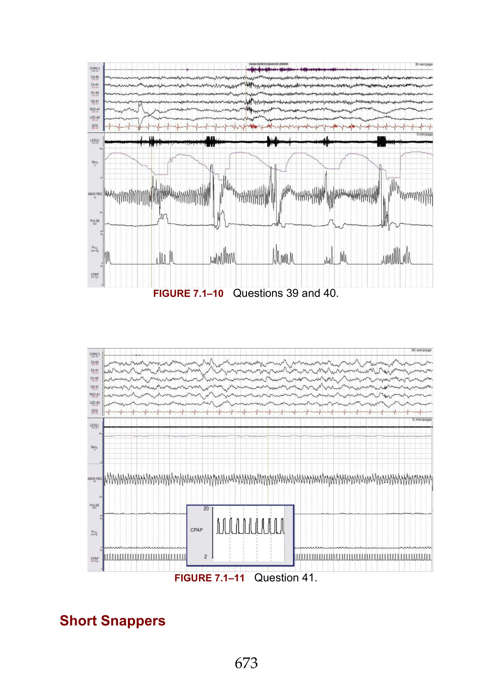

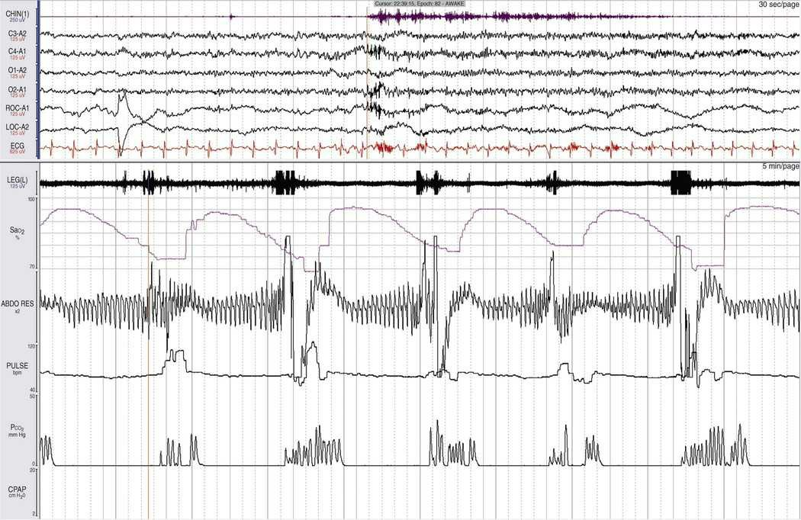

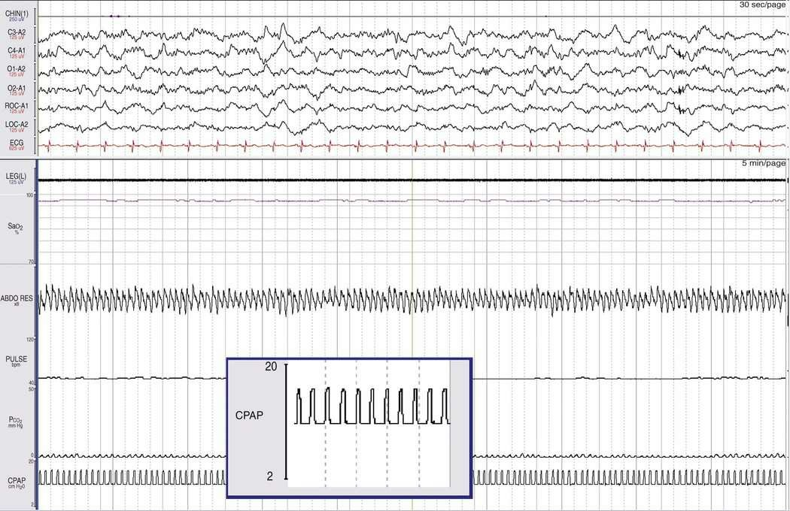

<!-- pdf-page: 674 -->

43. Which statement about mandibular advancement devices for the treatment of sleep apnea is true?

### A. They can be effective in patients with mild to

### moderate OSA.

### B. They have not been evaluated objectively in sleep

### C. They are more effective than CPAP.

### apnea.

### D. They are useful in selected patients with central

44. Which statement about uvulopharyngopalatoplasty (UPPP) is true?

### sleep apnea.

### A. When done with laser, it is much less painful than

### B. The success rate approaches that of CPAP.

### when performed with a scalpel.

### C. After surgery, the patient's snoring can be reduced

### or abolished, while the apnea remains severe.

### D. It is particularly effective in patients with

45. Which statement about bariatric surgery is false?

### retrognathia.

### A. Postoperative complications are common.

### B. If sleep apnea is present, it generally improves.

### 674

<!-- pdf-page: 675 -->

### C. Diabetes control will worsen.

### D. Patients who undergo bariatric surgery should be

### tested for sleep apnea.

46. Which statement is true about bilevel positive airway pressure therapy?

### A. It is the treatment of choice for most new cases of

### C. It is contraindicated when hypercapnia is present.

### OSA.

### B. It can increase alveolar ventilation.

### D. It is effective in reducing rhinitis symptoms in

47. Which statement is true about humidification when using CPAP?

### sleep apnea patients.

### A. Cold and heated humidification have equal

### B. Humidification has never been shown to improve

### efficacy in reducing nasal symptoms.

### C. Humidification may be helpful in treating nasal

### compliance.

### symptoms in patients with OSA syndrome (OSAS).

### D. Instilling saline into the nostrils at night is as

### effective as humidification.

### 675

<!-- pdf-page: 676 -->

48. Which of the following has not been described as a complication of CPAP treatment?

### A. Claustrophobia

1. C. The EEG shows some sharp waves but they are very frequent and correspond perfectly with the ECG tracing. Therefore the EEG channels are contaminated with ECG artifact. EEG vertex sharp waves are much less frequent and are a marker of stage N1 sleep. Sawtooth waves and rapid eye movements are found in stage R (REM sleep) and are not present in this fragment. (ATLAS2, Table

#### 18-2, p 373)

### B. Nasal obstruction

### C. Nasal discharge

### D. Acute tonsillitis

## Answers

2. B. The snoring channel shows increased activity during the resumption of breathing. Between clusters of increased snoring activity, no activity is present and the patient is in a quiet state. The leg movements seen in this fragment toward the beginning of the epoch (RLeg, LLeg) correspond to breathing and are not periodic limb movements; no other leg movements are seen.

3. B. This is classic OSA. Airflow is markedly reduced and respiratory effort is noted in the thoracic and abdominal belts. Note that both the temperature-sensing channel and nasal pressure channels show markedly reduced (and at times zero) flows. American Academy of Sleep Medicine (AASM) guidelines call for using an oronasal thermal airflow sensor (thermistor or thermocouple) to document apneas and a nasal pressure transducer to document hypopneas. (The AASM manual provides for alternatives when these devices are deemed unreliable.) Note that

### 676

<!-- pdf-page: 677 -->

nasal pressure reads zero when the patient is breathing through the mouth, so nasal pressure is often not a reliable indicator of apnea. (ATLAS2, p 395)

4. D. Cor pulmonale, right heart failure from respiratory disease, is the most likely cause of this patient's peripheral edema. Chronic hypoxemia (which can be only nocturnal) causes pulmonary hypertension that eventually can result in right ventricular failure, increased venous pressure, and peripheral edema. If there had been a CSB pattern, left heart failure would likely have been an important contributor. (ATLAS2, p 268)

5. A. The next step is CPAP titration, because OSA was documented. ASV would be used if a CSB pattern or central apnea had been present. Oxygen therapy is not effective in treating OSA, and the patient's apnea and hypoxemia are too severe for treatment with a mandibular advancement device.

6. D. Flattening of the flow trace in the middle of the bottom epoch is evidence for flow limitation, therefore the airway is still obstructed. Toward the right side, notice that the flow trace now demonstrates a rounded top during unobstructed breathing. Evaluating the shape of the flow trace is very valuable. Figure 7.1- 12 is an enlargement of the C-flow trace from the middle of the epoch; it shows flattening of the top of the trace, indicating flow limitation (left), and later in the epoch shows a rounded top, indicating unobstructed breathing (right).

7. A. Because flow limitation has been demonstrated, the next step

FIGURE 7.1–12 Answer 6.

### 677

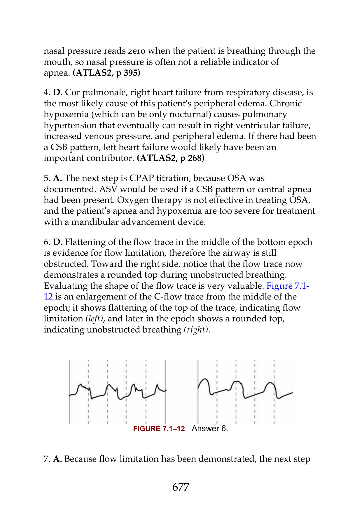

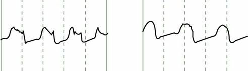

<!-- pdf-page: 678 -->

is to increase the CPAP pressure. Reducing the pressure would increase flow limitation and obstruction. ASV is not indicated at all, and in the absence of central apnea, bilevel pressure with a back-up rate is not indicated.

8. C. Inspiring against an obstructed airway is similar to the Müller maneuver, which increases vagal tone and can cause bradycardia or, as in this example, sinus arrest. (ATLAS2, Fig. 19-65, p 441)

9. C. Central apnea is evident from the lack of airflow (monitored by thermal sensor and nasal pressure); there is no breathing effort. Central apnea episodes can occur in patients with primarily obstructive apnea, especially if they are using opiate medications. Snoring noises were present when breathing resumed.

10. C. Sinus arrest is not a rare finding in OSA patients. Sinus arrhythmias are usually corrected by CPAP treatment. Inexperienced technologists sometimes send such patients to the ED, and pacemakers have been (inappropriately) placed.

11. D. All of the answers are possible. The severity of this patient's problem cannot be diagnosed from oximetry alone. Also, if apnea were present, oximetry could not determine the apnea type.

12. D. Simply changing the pressure range is not going to be helpful, because a firm diagnosis has not been established. Stopping the PAP therapy is also the wrong course of action because the patient does show significant hypoxemia. Prescribing a hypnotic at this point is contraindicated. A subsequent in-lab sleep study showed that the patient had very severe obstructive apnea and very severe periodic limb movement disorder (PLMD); the latter obviously could not have been detected with oximetry. Ultimately, both sleep disorders were treated and the patient has done well.

13. D. The commonest causes of sleepiness in college students are sleep deprivation (often caused by delayed sleep phase), sleep apnea, depression, medication use, and narcolepsy, in that order. The MWT is not used to diagnose any of those conditions. An MSLT without a preceding PSG cannot rule out abnormalities

### 678

<!-- pdf-page: 679 -->

during sleep that might be the cause of sleepiness. Nothing in the question suggests a diagnosis of epilepsy. The clinical history raises the possibility of Hodgkin lymphoma, which enlarges lymphatic tissue in lymph nodes in the neck and tonsils and can narrow the upper airway and lead to obstructive apnea. Imaging studies would be helpful. The correct sleep evaluations in managing this case would be a PSG followed by MSLT but this was not one of the choices. (Espinosa et al, 1996)

14. B. The maximum ESS score suggests this long-distance truck driver is at high risk for falling asleep at the wheel. For this reason, answer A is incorrect. Answers C and D are incorrect because they would treat the patient without a diagnosis. The patient should be advised not to drive until he has been evaluated and treated. (ATLAS2, p 132)

15. A. The Berlin Questionnaire surveys snoring, sleepiness, body weight, and blood pressure to determine a patient's risk for having OSA. (ATLAS2, p 132)

16. B. Cor pulmonale is right heart failure caused by pulmonary hypertension (see also the answer to Question 4). The likeliest patients to have this in a sleep clinic are those with chronic obstructive pulmonary disease (COPD), the overlap syndrome (COPD plus OSA), and OHS. (Weitzenblum and Chaouat, 2009)

17. C. In a patient with morbid obesity, severe ankle swelling, and hypercapnia, it is likely that she has cor pulmonale caused by hypoventilation. When CO2 is elevated during the daytime, the term obesity hypoventilation is used. (Mokhlesi et al, 2008)

18. C. Not a single cardiac cycle is clearly visible in the zoomed window. The cycle rate is 20/second, or 1200/minute, which is faster than any known tachyarrhythmia. Paroxysmal ventricular tachycardia has a rate up to 250/minute, and torsades de pointes and ventricular flutter can be up to 350/minute. In this example, the zoomed window is helpful in determining what the rhythm is not. Obviously, sending the patient to the ED was a mistake.

### 679

<!-- pdf-page: 680 -->

19. A. The tonsils are markedly enlarged and meet in the midline. Tonsils are graded from 0 (not present) to 4 (meeting in the midline). Mallampati score documents relationship of the tongue to the pharyngeal size and ranges from class 1 (all structures visible) to class 4 (soft palate not visible; see Box 7.1-1). Enlarged tonsils are the most common cause of apnea in children. (ATLAS2, pp 262-

#### 265)

Box 7.1–1

### About Mallampati Scores

There is confusion about how to document the Mallampati score. Is it using a class or grade? In 1985, Mallampati and colleagues published classes 1 to 3 to describe the oral findings in an attempt to predict possible difficulty in intubation (Mallampati et al, 1985). What is used currently, and called a Mallampati score, is actually the original score modified by Friedman's group, which described grades 1 through 4 (Friedman et al, 1999).

This section and the Atlas use “class” throughout. Expect inconsistency in whether Roman or Arabic numerals are used for the classes. This section uses Arabic numbers, whereas the Atlas uses Roman numerals.

• Tonsillar hypertrophy documented by grading system

### • Grade 1: Tonsils entirely behind tonsillar pillars

### • Grade 0: Absent tonsils

### • Grade 3: Tonsils extend beyond pillars

### • Grade 2: Tonsils extend to pillars

20. B. Children with Prader-Willi syndrome often become morbidly obese. Their main sleep complaint is hypersomnia, often from sleep

### • Grade 4: Tonsils extend to midline

### 680

<!-- pdf-page: 681 -->

apnea. SOREMPs may be seen on the MSLT. Elevated ghrelin might explain the hyperphagia of these patients. (Williams et al, 2008)

21. A. In one series, all patients with Prader-Willi syndrome had some form of sleep-disordered breathing. GH secretion is usually decreased in Prader-Willi syndrome, and GH therapy has been recommended starting in early childhood; it results in height gain and can improve psychomotor development. Obstructive apnea can occur in cases in which there is a rapid increase in the dose of GH. Data are inconsistent on the effect of GH on sleep-disordered breathing (SDB) in Prader-Willi syndrome. (Castinetti et al, 2008;

#### Goldstone et al, 2008; Miller and Wagner, 2013)

22. B. Although OSA can occur with each of the conditions, the history and findings are classic for polycystic ovary syndrome (PCOS). The ovaries of these patients have multiple cysts that produce excess androgenic hormone, hence the hirsutism and acne. PCOS patients are about seven times more likely than controls to have OSA (20% to 50% of cases have OSA), and those with OSA are more likely to have insulin resistance. The history also includes abnormal or absent menstrual cycle and difficulty in becoming pregnant. (ATLAS2, p 354; Tasali et al, 2008)

23. D. About half of patients with nonalcoholic fatty liver disease (NAFLD; also called nonalcoholic steatohepatitis [NASH]) have features of sleep apnea. Animal research shows that chronic intermittent hypoxia predisposes to liver injury. (Campos et al,

#### 2008; Mishra et al, 2008; Pulixi et al., 2014; Savransky et al, 2007)

24. B. The prevalence of sleep apnea in menopausal women increases compared with premenopausal women and is similar to that of age-matched male controls. Reasons for the increase in sleep apnea prevalence in women during the menopausal transition are not known. There are many theories, including withdrawal of estrogen and progesterone and a redistribution of fat. Significant obesity might not be an important factor because the weight gain with menopause is usually modest. There is no known relationship of sleep apnea with hot flashes. Sleep apnea responds to treatment as well in women as in men.

### 681

<!-- pdf-page: 682 -->

25. B. Snoring in pregnancy has been linked statistically with preeclampsia and with smaller-than-expected babies who have a lower Apgar score than children of nonsnoring women. Sleep apnea in pregnant women should be treated because of the potential negative effect on the fetus. The most common cause of nocturnal awakenings in pregnancy is nocturia. (ATLAS2, p 356)

26. A. Given OSA, insomnia is much more common in women than in men. Women are much more likely to also have a history of depression, antidepressant use, and thyroid disease. In men, caffeine consumption is greater. (Shepertycky et al, 2005)

27. D. In premenopausal women, obstructive events often tend to cluster in REM sleep much more so than in men. The reason for this is not well understood. One possible explanation is that the female upper airway is less compliant. (O'Connor et al, 2000)

28. A. Sleep apnea is found in all the conditions, but the most common cause of sleep apnea in children is enlargement of the tonsils and adenoids. Children with sleep apnea present with snoring and observed apnea at times. The presentation is with restless sleep, falling asleep in the classroom, or even with a diagnosis of ADHD.

29. C. This is an example of retrognathia; the lower jaw is too far back (Figs. 7.1-13 through 7.1-15). On lateral inspection, note the relative position of the nasion, anterior nasal spine, and mental protuberance. Sleep-breathing disorders can occur with both retrognathia (an underdeveloped lower mandible, also called type 2 malocclusion) or prognathia, which usually occurs with an underdeveloped maxilla.

### 682

<!-- pdf-page: 683 -->

FIGURE 7.1–13 Answer 29.

### 683

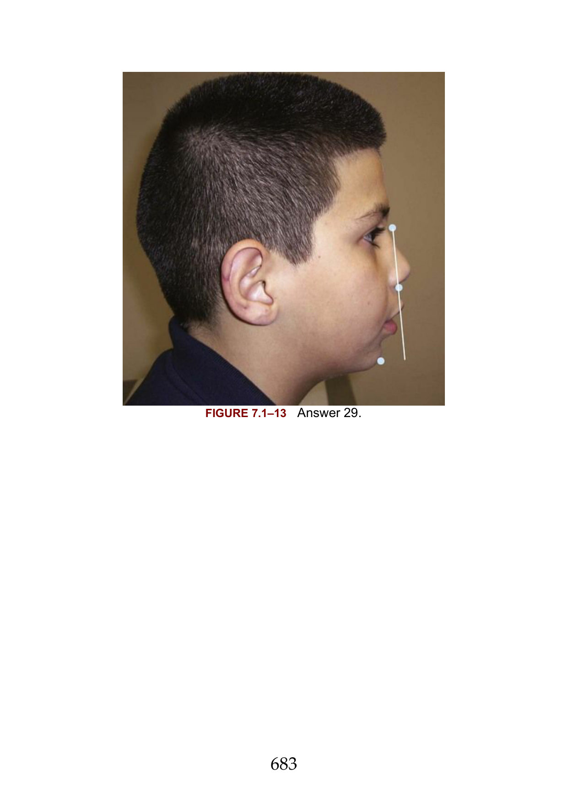

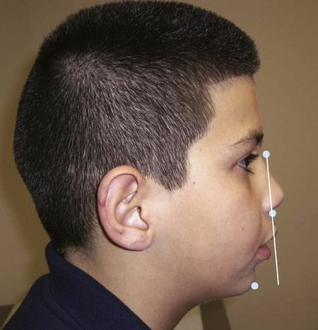

<!-- pdf-page: 684 -->

FIGURE 7.1–14 Answer 29.

### 684

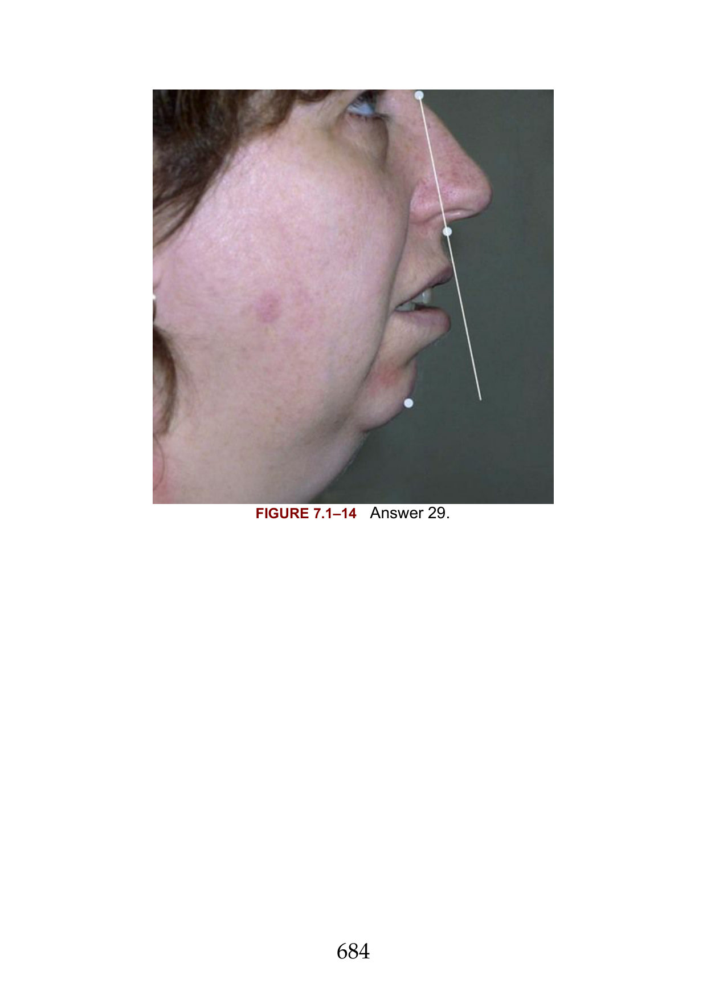

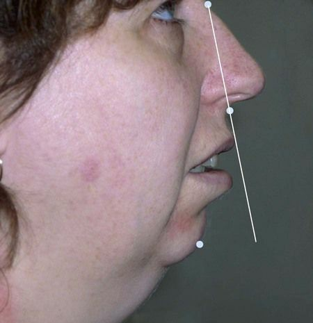

<!-- pdf-page: 685 -->

30. B. This is an example of grade 3 tonsils. In grade 0, tonsils are absent (Fig. 7.1-16). Grade 1 tonsils are hidden behind tonsillar pillars (see the right tonsil in Fig. 7.1-17). Grade 2 tonsils extend to the pillars (see the left tonsil in Fig. 7.1-17). Grade 3 tonsils are visible beyond the pillars (Fig. 7.1-18). Grade 4 tonsils are enlarged to midline (Figs. 7.1-19 through 7.1-21).

FIGURE 7.1–15 Answer 29.

### 685

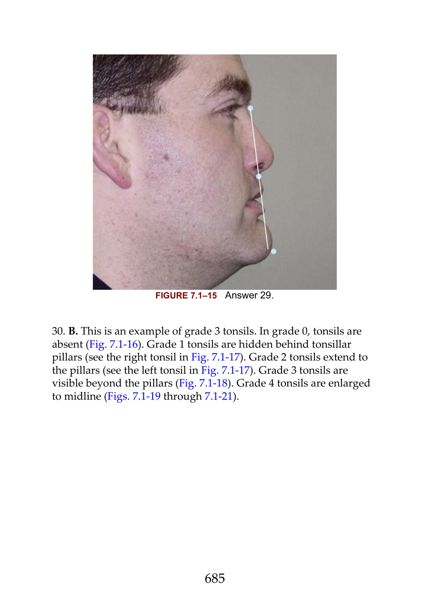

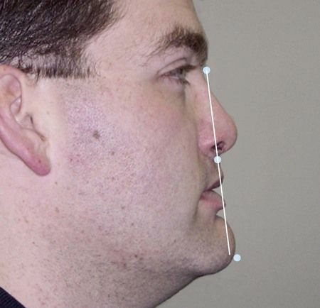

<!-- pdf-page: 686 -->

FIGURE 7.1–16 Answer 30. Grade 0 tonsils.

FIGURE 7.1–17 Answer 30. Right tonsil grade 1; left

tonsil grade 2.

### 686

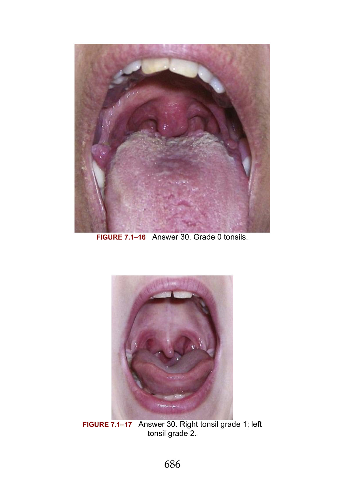

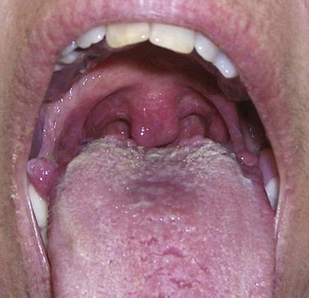

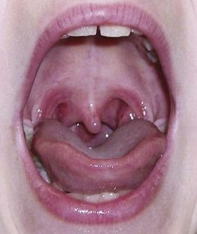

<!-- pdf-page: 687 -->

FIGURE 7.1–18 Answer 30. Grade 3 tonsils.

### 687

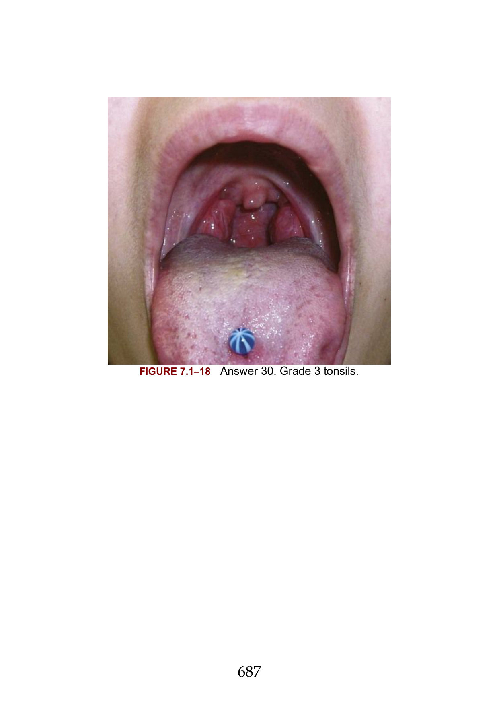

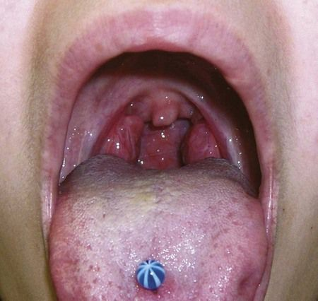

<!-- pdf-page: 688 -->

FIGURE 7.1–19 Answer 30. Grade 4 tonsils.

FIGURE 7.1–20 Answer 30. Grade 4 tonsils.

### 688

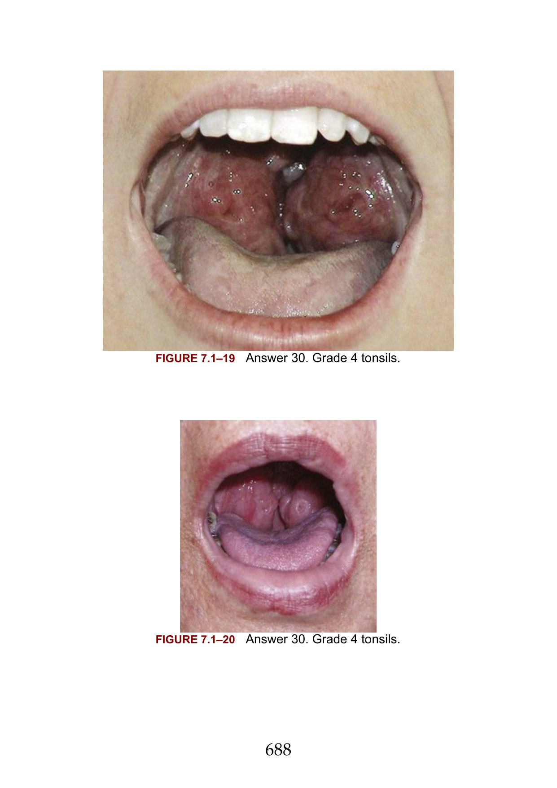

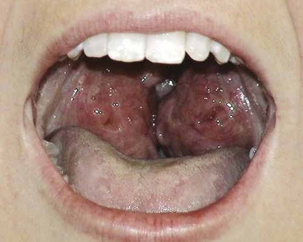

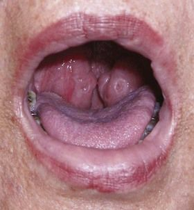

<!-- pdf-page: 689 -->

31. B. Nasopharyngoscopy is not indicated at this stage of evaluation. BMI and neck collar size would not be particularly helpful in this case. Examination of teeth alignment would confirm the suspected anatomic abnormality (Fig. 7.1-22). One would expect to find crowding of the lower teeth and an overbite (or overjet), as shown in Figure 7.1-22. There are three types of malocclusion:

FIGURE 7.1–21 Answer 30. Grade 4 tonsils.

### 689

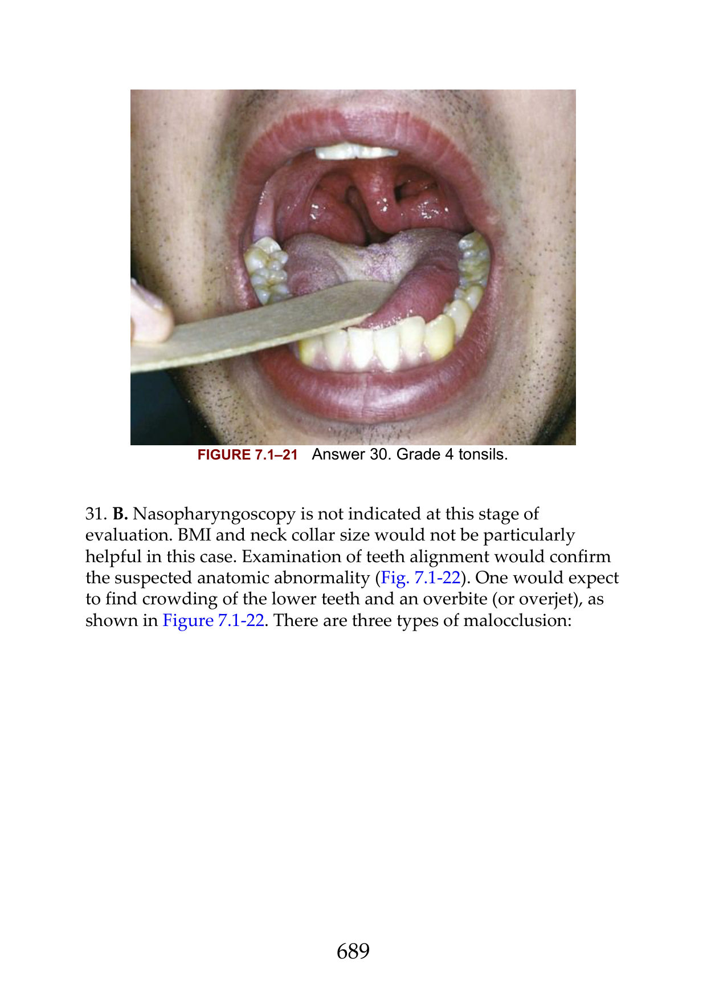

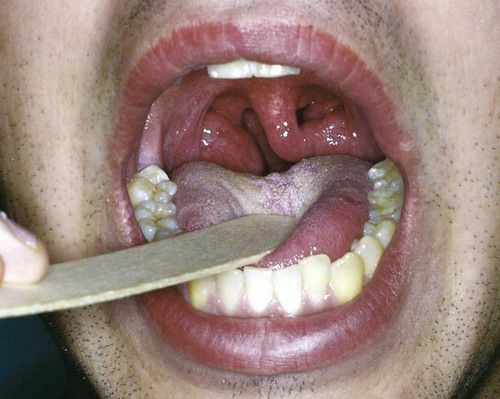

<!-- pdf-page: 690 -->

Type 1: Upper and lower teeth are aligned (bite is normal), but teeth are crowded or malpositioned.

FIGURE 7.1–22 Answer 31. Overjet.

Type 2 (see Fig. 7.1-22): Upper jaw and teeth overlap the lower jaw and teeth. This malocclusion is called retrognathia, overbite, or overjet.

Type 3: The lower jaw protrudes forward, and lower teeth extend over the upper teeth. This is called prognathia or underbite.

32. D. Although he likely has OSA, before tonsillectomy, it should be documented with an overnight PSG.

33. B. In pediatric PSGs, measurement of either end-tidal or transcutaneous Pco2 is recommended. In ICSD3, criteria for diagnosing pediatric apnea are “obstructive hypoventilation, defined as at least 25% of total sleep time with hypercapnia (Pco2 >50 mm Hg) in association with one or more of the following:

### 690

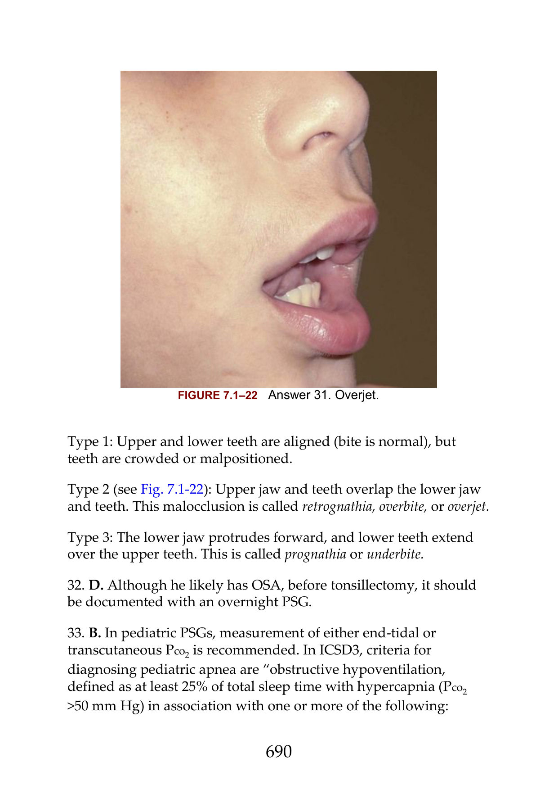

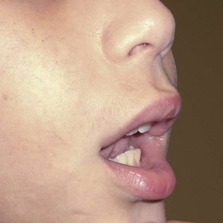

<!-- pdf-page: 691 -->

snoring, flattening of the inspiratory nasal pressure waveform, paradoxical thoracoabdominal motion.” Note that there is no “endtidal PO2” in PSG.

34. B. In children, movement or autonomic arousals are more common than cortical (EEG) arousals. The other statements are true.

35. B. No hard and fast criteria exist for diagnosing OSA in children, in part because the range in size from infant to adolescent is so great. One publication (Lipton and Gozal, 2003) interprets pediatric PSGs as follows:

### “Apnea-hypopnea index (AHI) from less than 1 to 4,

### without a drop in Sao2: mild OSA. Treat if there are

### daytime sequelae, such as excessive daytime

### sleepiness.

### AHI 5 to 10 and/or Sao2 less than 85%: moderate OSA.

### AHI greater than 10 with Sao2 less than 85% and

### Most children should be treated.

### clinical sequelae: severe OSA. Treatment is strongly

### recommended.”

### The ICSD3 criteria for pediatric OSA start at “One or

### more obstructive apneas, mixed apneas, or

### hypopneas per hour of sleep,” but it also notes

### other signs that can allow diagnosis (e.g., snoring;

### labored, paradoxic, or obstructed breathing during

### the child's sleep; sleepiness, hyperactivity,

### behavioral problems, or learning

### problems). (ICSD3, pp 63-68)

### 691

<!-- pdf-page: 692 -->

### Few normative data are available for hypopneas. This

### patient qualifies for treatment (tonsillectomy)

### because his AHI is elevated at 2.1 events/hr and he

### has clinical sequelae: restless sleep, ADHD (likely

### from OSA), and need for medication (which only

### worsened his sleep). Note that he does not meet

### criteria for diagnosing hypoventilation because his

### Pco2 was not elevated more than 25% of the total

### sleep time.

36. D. PAP titration is incomplete because the C-flow channel shows flow limitation and the patient still has hypoxemia. Ignoring this degree of hypoxemia is not acceptable.

37. A. The flattening of the C-flow curve indicates that flow limitation is present (note the shape of the C-flow curve in the 30 seconds before the middle of the epoch). Complete occlusion would show absence of flow. This is not the pattern of CSB.

38. A. The pattern of the eye channels is classic for REM sleep, in which loss of tone of pharyngeal muscles occurs, and it is likely that this is leading to increased upper airway resistance. The flow limitation is seen in the C-flow channel.

39. A. The epoch starts off in REM, and rapid eye movements occur in the eye channels; there is lack of muscle activity in the chin EMG and sawtooth waves may appear in the central EEG leads (about one third of the way into the epoch). However, before the halfway point of this epoch, an arousal occurs with an increase in muscle tone and the patient is awake in the remainder of the epoch. There is the suggestion of alpha activity in the occipital leads and of slow eye movements developing toward the end of the epoch. Thus for more than half the epoch, the patient is awake.

40. D. The fragment shows obstructive apnea because there are repetitive apneas (absent airflow documented by the end-tidal Pco2

### 692

<!-- pdf-page: 693 -->

channel) throughout in the face of continuous respiratory efforts documented in the abdominal channel. The apneas result in severe oxygen desaturation. End-tidal Pco2 is never elevated, thus there is no hypoventilation. Overlap syndrome is OSA plus COPD, the latter of which is a clinical, not a PSG based, diagnosis.

41. C. Notice the very regular deflections in the CPAP channel. Both a high inspiratory positive airway pressure (IPAP) and high expiratory positive airway pressure (EPAP) are being used. The pressure waves generated by the bilevel machine have a clocklike regularity, suggesting that a timed back-up rate is being used and that, in essence, the patient is being ventilated by the system. Note that the apnea is completely resolved, hypoxemia is no longer present, and the patient is in slow-wave sleep.

42. B. Pulmonary edema is suggested by the frothy fluid that was emanating from the patient's mouth when the technologist went into the room to start PAP. The technologist did not appreciate the significance of that finding in this patient with recent MI. Observation of the synchronized digital video confirmed that the stoic patient was wide awake most of the time and struggling to breathe. This bilevel PAP treated both the pulmonary edema and his upper airway obstruction.

43. A. Mandibular advancement devices can be very effective in OSA, especially in patients with mild to moderate apnea. Several studies have documented this improvement. The devices, however, are not more effective than CPAP, and they might be problematic in patients with severe apnea. They are never useful in patients with central sleep apnea. (ATLAS2, p 295)

44. C. UPPP involves removing the tonsils, soft palate, uvula, and redundant pharyngeal wall tissue and is much less effective than treatment with CPAP. The success rate is probably about 50%, compared with 70% for CPAP. Patients who have had the surgery can continue to have significant apnea episodes without audible snoring. When the procedure is done with a laser, patients can have a great deal of pain that lasts for weeks. Laser surgery is generally more painful than scalpel surgery. UPPP should not be done in

### 693

<!-- pdf-page: 694 -->

patients with retrognathia because the upper airway obstruction is likely at the base of the tongue and not at the level of the palate.

45. C. Diabetes control almost always improves after bariatric surgery and significant weight reduction. Postoperative complications are common. Sleep apnea can improve or disappear entirely after surgery and significant weight loss. Patients who are to have bariatric surgery should be assessed for sleep apnea because the risk of sleep apnea is quite high when BMI exceeds 40.

46. B. The difference between inspiratory and expiratory pressures makes a bilevel machine function like a ventilator. Bilevel treatment is also used to noninvasively ventilate patients in various clinical settings. Based on clinical trials, there is no scientific reason to start patients on bilevel, rather than fixed, CPAP pressure. However, in specific patient groups, it might be the treatment of choice, for example, in OSA patients with COPD (the overlap syndrome) or in those with kyphoscoliosis. (ATLAS2, Ch 13.4)

47. C. Patients who use CPAP can develop nasal symptoms, such as nasal obstruction or nasal discharge, as a response to the pressure itself or to dryness. Heated humidification can be effective in relieving such symptoms, much more so than cold humidification. Humidification also improves compliance with using the positivepressure device.

48. D. Claustrophobia, nasal obstruction, and nasal discharge are all common unwanted effects of CPAP in patients being treated for sleep apnea. Acute tonsillitis has not been described as a consequence of this treatment.

▪ AASM Manual for the Scoring of Sleep and Associated Events: Rules,

## Summary

### Highly Recommended

Terminology, and Technical Specifications, Version 2.1. ▪ Atlas of Clinical Sleep Medicine, ed 2, Chapters 13 and 18.

### 694

<!-- pdf-page: 695 -->

▪ International Classification of Sleep Disorders, ed 3.
▪ Principles and Practice of Pediatric Sleep Medicine, ed 2, Chapters 27

and 28

### Topics You Should Know

The section on sleep-disordered breathing will make up about 53 of the 240 questions on the examination (22% of the total questions), so this is an important topic and one that will have a big impact on your overall score. OSA is clearly the most prevalent of these disorders and should be a principal focus when studying sleep medicine. Of the 53 questions in this section on the exam, 23 will cover OSA. In fact, about 10% of the exam will be about OSA.

### ❍ Obstructive sleep apnea syndrome (OSAS) affects

### Epidemiology

▪ Adults

### ❍ The syndrome is present when five or more

### about 4% of men and 2% of women.

### abnormal obstructed breathing events and

### sleepiness occur.

### ❍ OSA without the daytime sleepiness is much higher

### ❍ OSA increases risk of hypertension, coronary artery

### in prevalence.

### ❍ Overall frequency likely similar to that in adults

### disease, stroke, and death.

▪ Children (ATLAS2, Ch 13.3)

### 695

<!-- pdf-page: 696 -->

### ❍ Found in:

### • Enlarged tonsils and adenoids

### • Prader-Willi syndrome (see Chapter 9)

### • Obesity

### • Laryngomalacia

### • Pierre Robin sequence

### • Down syndrome (see Chapter 9)

### • Achondroplasia

### • Spinal muscle atrophy

### • Klippel-Feil syndrome (see Chapter 9)

### • Arnold-Chiari malformation, type II (see Chapter 9)

Upper airway obstruction during sleep leads to the following abnormalities: (ATLAS2, pp 49-52) ▪ Hypoxemia ▪ Slowing of heart beat (vagal effect) ▪ Cardiac arrhythmias (ATLAS2, pp 439-449) ▪ Arterial Hypertension ▪ Arousals ▪ Reduced REM and slow-wave sleep

### Pathophysiology

### 696

<!-- pdf-page: 697 -->

### Central Nervous System Abnormalities

▪ Sleepiness

### ❍ Subjective

### ❍ Poor memory, concentration, and ability to perform

### • ESS (ATLAS2, p 130)

### ❍ Objective

### • MSLT (ATLAS2, p 392)

### • MWT (ATLAS2, p 392)

▪ Abnormal cognitive function

### ❍ Hypothesized to be due to hypercapnia causing

### tasks that require attention

▪ Psychiatric symptoms

### ❍ Depressed mood

### ❍ Irritability

▪ Morning headache

### ❍ May be related to OSA

### cerebral vasodilation

### Cardiorespiratory Symptoms

▪ Snoring

### 697

<!-- pdf-page: 698 -->

### ❍ May be benign

### ❍ May be a symptom of OSA

▪ Gasping, snorting

### Key Findings on Physical Examination in

### Obstructive Sleep Apnea

### ❍ May be a symptom of OSA

▪ Witnessed apnea

### ❍ Feature of any form of apnea

▪ Paroxysmal nocturnal dyspnea

### ❍ Symptom of left ventricular failure

### ❍ Mandibular and maxillary structures

▪ Faces of syndromes associated with OSA

### ❍ Acromegaly

### ❍ Burnt-out Graves disease

### ❍ Down syndrome

### ❍ Achondroplasia

### ❍ Pierre Robin syndrome

▪ Abnormal dental anatomy

### 698

<!-- pdf-page: 699 -->

### • Type 1: Upper and lower teeth are aligned (bite is

### normal), but teeth are crowded or malpositioned

### and the dental arch is small.

### • Type 2: Upper jaw and teeth overlap the lower jaw

### and teeth (retrognathia, overbite, or overjet).

### • Type 3: Lower jaw protrudes forward and lower

### teeth extend over the upper teeth; prognathia or

### underbite are present.

### ❍ Type 1 can demonstrate ataxia findings if

▪ Arnold-Chiari malformation

### herniation of cerebellar tonsils is present.

### ❍ Patients might also have leg weakness if they also

### ❍ Can have abnormalities in oral airway

### have type 2 with meningomyelocele.

▪ Klippel-Feil anomaly

### ❍ Short neck

▪ Crowding of oropharyngeal cavity
▪ Tongue too large for oral cavity

### ❍ Longitudinal fissure

### ❍ Scalloping of tongue edges

### ❍ Syndromes

### 699

<!-- pdf-page: 700 -->

### • Down syndrome

▪ Myxedema
▪ Modified Mallampati score (Figs. 7.1-23 and 7.1-24)

### ❍ Class 1: All structures are visible: posterior

### pharyngeal wall, tonsils, uvula, and soft palate (see

Fig. 7.1-24, A).

### ❍ Class 2: Hard and soft palate, upper portion of

### tonsils, and uvula are visible (see Fig. 7.1-24, B).

### ❍ Class 3: Soft and hard palate and only the base of

### the uvula are visible (see Fig. 7.1-24, C).

### ❍ Class 4: Only the hard palate or tongue are visible

### (see Fig. 7.1-24, D).

### 700

<!-- pdf-page: 701 -->

FIGURE 7.1–23 Normal upper airway anatomy. (Modified

from Netter F: Atlas of human anatomy, ed 5, St Louis, 2011, Saunders.)

FIGURE 7.1–24 Mallampati score.

### Risk Factors

▪ Obesity (ATLAS2, pp 266-267)

### ❍ Documented by BMI

### 701

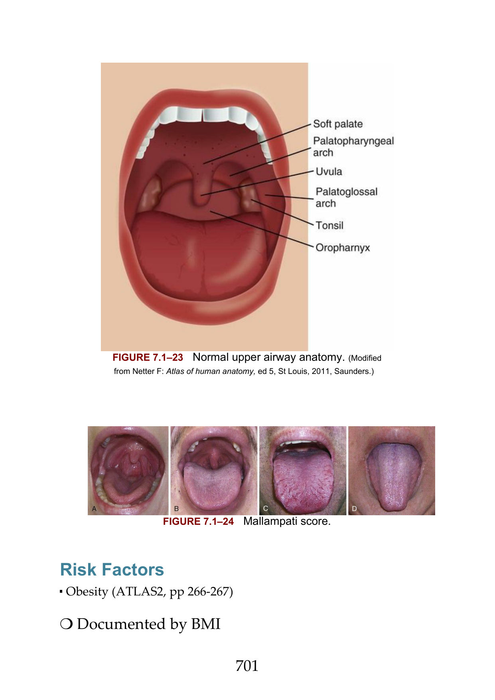

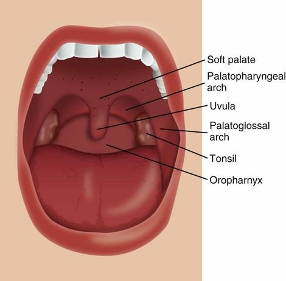

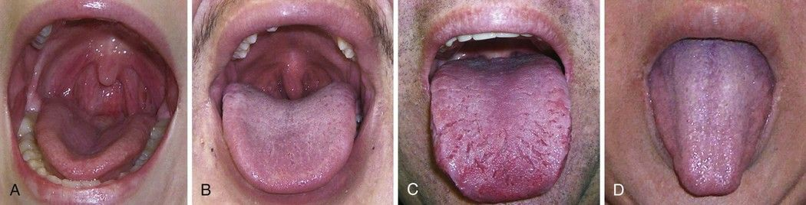

<!-- pdf-page: 702 -->

### • Neck collar size (≥17 inches in men; ≥15 inches in

### women)

### ❍ Much more common in older people

▪ Male gender
▪ Age

### ❍ Prevalence the same in postmenopausal women as

▪ Craniofacial abnormalities that affect jaw size

### in age-matched men

### ❍ Retrognathia and micrognathia (ATLAS2, pp 257-

▪ NAFLD (nonalcoholic steatohepatitis [NASH])
▪ Alcohol use
▪ Drugs that depress drives to breathe (e.g., opiates)

### 269)

▪ Insulin resistance, diabetes
▪ Obesity
▪ More than half of patients with treatment-resistant hypertension

### Comorbidities

▪ Apnea often manifests with insomnia in women.
▪ Women with OSA are much more likely to be treated for

have OSA. ▪ Atrial fibrillation is common in OSA. ▪ Stroke

### Gender Issues

depression than men with OSA. ▪ Women with PCOS have a very high prevalence of OSA.

### 702

<!-- pdf-page: 703 -->

▪ Menopausal women have the same prevalence of apnea as age-

matched men.

### Diagnostic Methods

### ❍ Level I: attended comprehensive PSG

▪ Levels of sleep tests

### ❍ Level II: unattended comprehensive PSG

### ❍ Level III: portable sleep apnea testing, usually four

### ❍ Level IV: continuous recording of one variable,

### channels

▪ PSG for sleep apnea: what is recorded (ATLAS2, p 371)

### usually Sao2

### ❍ Thermal sensor at the nose and mouth to detect

### ❍ Nasal pressure transducer to detect hypopneas

### apneas

### ❍ Chest wall and abdominal movement to detect

### ❍ Pulse oximeter with signal averaging of 3 seconds

### respiratory effort

### ❍ Electrooculogram (EOG), chin EMG, EEG

### or less

### ❍ ECG

### 703

<!-- pdf-page: 704 -->

### • End-tidal or transcutaneous Pco2 is added for young

### children and sometimes if hypoventilation is

### suspected in adults.

### Polysomnography for Sleep-Breathing

### Disorders: Scoring Rules for Adults

### (ATLAS2, pp 377-379; MANUAL2 , Section

### VIII, Respiratory Rules)

### ❍ 90% or more reduction of nasal or oral airflow

▪ Apnea

### ❍ Duration 10 seconds or greater

### ❍ Obstructive type if there is breathing effort during

### using temperature sensors

### ❍ Central type if there is a cessation of breathing

### the apnea

### ❍ Mixed type begins with a central apnea and ends

### effort during the apnea

### ❍ Definition 1 (recommended per MANUAL2)

### with an obstructive apnea.

▪ Hypopnea

### • The peak signal excursions drop by 30% or more of

### preevent baseline using nasal pressure (diagnostic

### study), PAP device flow (titration study), or an

### 704

<!-- pdf-page: 705 -->

### alternative hypopnea sensor (diagnostic study).

### • The duration of the 30% or more drop in signal

### excursion is 10 or more seconds.

### • A 3% or greater oxygen desaturation is observed

### from preevent baseline or the event is associated

### with an arousal.

### ❍ Definition 2 (acceptable per MANUAL2)

### • The peak signal excursions drop by 30% or more of

### preevent baseline using nasal pressure (diagnostic

### study), PAP device flow (titration study), or an

### alternative hypopnea sensor (diagnostic study).

### • The duration of the 30% or more drop in signal

### • There is a 4% or greater oxygen desaturation from

### excursion is 10 or more seconds.

### ❍ Per the AASM manual: “If electing to score

### preevent baseline.

▪ Respiratory effort–related arousal

### respiratory effort–related arousals, score a

### respiratory event as a respiratory effort–related

### arousal (RERA) if there is a sequence of breaths

### lasting ≥10 seconds characterized by increasing

### respiratory effort or by flattening of the inspiratory

### portion of the nasal pressure (diagnostic study) or

### PAP device flow (titration study) waveform leading

### 705

<!-- pdf-page: 706 -->

### to arousal from sleep when the sequence of breaths

### does not meet criteria for an apnea or hypopnea.”

▪ Hypoventilation: may use either of the following (MANUAL2)

### ❍ An increase in the arterial Pco2 (or surrogate) to a

### value greater than 55 mm Hg for 10 or more

### minutes

### ❍ A 10 mm Hg or more increase in arterial Pco2 (or

### surrogate) during sleep (in comparison to an awake

### supine value) to a value exceeding 50 mm Hg for 10

### or more minutes

▪ Score as Cheyne-Stokes breathing if both of the following are

### ❍ Episodes of three or more consecutive central

present:

### apneas and/or central hypopneas separated by a

### crescendo and decrescendo change in breathing

### amplitude with a cycle length of 40 seconds or more

### ❍ Five or more central apneas and/or central

### hypopneas per hour of sleep associated with the

### crescendo/decrescendo breathing pattern recorded

### over 2 or more hours of monitoring

### Polysomnography for Sleep-Breathing

### Disorders: Scoring Rules for Children

### (ATLAS2, pp 300-303; MANUAL2; PEDS2, p

### 227)

### 706

<!-- pdf-page: 707 -->

▪ Obstructive apnea

### ❍ Duration of at least two missed breaths

### ❍ 90% or more reduction of nasal/oral airflow using

### ❍ 90% or more reduction of nasal/oral airflow using

### temperature sensors

### ❍ Breathing effort during the apnea

▪ Central apnea

### ❍ Duration of at least 20 seconds

### temperature sensors if there is a cessation of

### breathing effort during apnea

### ❍ Duration of at least two missed breaths

▪ Mixed apnea

### ❍ 90% or more reduction of nasal/oral airflow using

### ❍ Begins with a central apnea and ends with

### temperature sensors

### ❍ Scoring hypopneas as central or obstructive events

### obstructive features

▪ Hypopnea

### ❍ A respiratory event is scored as a hypopnea if all of

### is optional.

### 707

<!-- pdf-page: 708 -->

### the following criteria are met:

### • The peak signal excursions drop by 30% or more of

### preevent baseline using nasal pressure (diagnostic

### study), PAP device flow (titration study), or an

### alternative hypopnea sensor (diagnostic study).

### • The duration of the 30% or more drop in signal

### excursion lasts for two or more breaths.

### • A 3% or more oxygen desaturation occurs from

### preevent baseline, or the event is associated with an

### arousal.

### ❍ If electing to score obstructive hypopneas, score a

### hypopnea as obstructive if any of the following

### criteria are met.

### • Increased inspiratory flattening of the nasal

### • Snoring occurs during the event.

### pressure occurs or PAP device flow signal is

### evident compared with baseline breathing.

### • An associated thoracoabdominal paradox occurs

### during the event but not during preevent breathing.

### ❍ If electing to score central hypopneas, score a

### hypopnea as central if none of the following criteria

### are met:

### • Snoring occurs during the event.

### 708

<!-- pdf-page: 709 -->

### • Increased inspiratory flattening of the nasal

### pressure or PAP device flow signal is evident

### compared with baseline breathing.

### • An associated thoracoabdominal paradox occurs

### during the event but not during preevent breathing.

### ❍ In children, “If electing to score respiratory effort–

▪ Respiratory effort–related arousal (RERA)

### related arousals, score a respiratory event as a

### RERA if there is a sequence of breaths lasting ≥2

### breaths (or the duration of two breaths during

### baseline breathing) when the breathing sequence is

### characterized by increasing respiratory effort,

### flattening of the inspiratory portion of the nasal

### pressure (diagnostic study) or PAP device flow

### (titration study) waveform, snoring, or an elevation

### in the end-tidal Pco2 leading to arousal from sleep

### when the sequence of breaths does not meet criteria

### for an apnea or hypopnea.” (MANUAL2)

### ❍ Score as hypoventilation during sleep when more

▪ Hypoventilation

### than 25% of the total sleep time as measured by

### either the arterial Pco2 or surrogate is spent with a

### Pco2 above 50 mm Hg.

### ❍ In children, “Score a respiratory event as periodic

▪ Periodic breathing

### 709

<!-- pdf-page: 710 -->

### breathing if there are ≥3 episodes of central pauses

### in respiration (absent airflow and inspiratory effort)

### lasting >3 seconds separated by ≤20 seconds of

### normal breathing.” (MANUAL2)

### ❍ Note that in the rules for children, the term Cheyne-

### Stokes breathing is not used in scoring.

There are many treatments for sleep-breathing disorders, and some of them are controversial and seldom used. It is unlikely that the exam will delve into areas of controversy or newly evolving therapies. It is best to review the standard texts and the published practice parameters mentioned above. ▪ Positive airway pressure (PAP) therapy

### Treatment

### ❍ CPAP (continuous PAP) and variants

### ❍ Fixed pressure

### ❍ Autotitrating

### ❍ Bilevel pressure

### • Spontaneous mode

### • Timed backup

▪ Mandibular advancement device
▪ Expiratory resistance device
▪ Upper airway surgery in selected cases
▪ Bariatric surgery for morbid obesity

### 710

<!-- pdf-page: 711 -->

## References

American Academy of Sleep Medicine. International

classification of sleep disorders. ed 3. American Academy of Sleep Medicine: Darien, Ill.; 2014. American Academy of Sleep Medicine. The AASM manual for

the scoring of sleep and associated events: rules, terminology and technical specifications. [Version 2.1] American Academy of Sleep Medicine: Darien, Ill.; 2014. Campos GM, Bambha K, Vittinghoff E, et al. A clinical scoring

system for predicting nonalcoholic steatohepatitis in morbidly obese patients. Hepatology. 2008;47(6):1916–1923. Castinetti F, Reynaud R, Brue T. Prader-Willi syndrome and

growth hormone treatment. Ann Endocrinol (Paris). 2008;69(Suppl 1):S6–S10. Espinosa G, Alarcón A, Morelló A, et al. [Obstructive apnea

syndrome during sleep secondary to a pharyngeal lymphoma. Improvement with continuous pressure treatment of the upper airway]. Arch Bronconeumol. 1996;32(10):547–549. Goldstone AP, Holland AJ, Hauffa BP, et al.

Recommendations for the diagnosis and management of Prader-Willi syndrome. J Clin Endocrinol Metab. 2008;93(11):4183–4197. Kryger MH, Avidan A, Berry R. Atlas of clinical sleep medicine.

ed 2. Saunders: Philadelphia; 2014. Lipton AJ, Gozal D. Treatment of obstructive sleep apnea in

children: do we really know how? Sleep Med Rev. 2003;7:61– 80. Miller J, Wagner M. Prader-Willi syndrome and sleep-

disordered breathing. Pediatr Ann. 2013;42(10):200–204. Mishra P, Nugent C, Afendy A, et al. Apnoeic–hypopnoeic

episodes during obstructive sleep apnoea are associated with histological nonalcoholic steatohepatitis. Liver Int. 2008;28(8):1080–1086. Mokhlesi B, Kryger MH, Grunstein RR. Assessment and

management of patients with obesity hypoventilation syndrome. Proc Am Thorac Soc. 2008;5(2):218–225.

### 711

<!-- pdf-page: 712 -->

O’Connor C, Thornley KS, Hanly PJ. Gender differences in the

polysomnographic features of obstructive sleep apnea. Am J Respir Crit Care Med. 2000;161(5):1465–1472. Pulixi EA, Tobaldini E, Battezzati PM, et al. Risk of

obstructive sleep apnea with daytime sleepiness is associated with liver damage in non–morbidly obese patients with nonalcoholic fatty liver disease. PLoS One. 2014;9(4):e96349. Savransky V, Nanayakkara A, Vivero A, et al. Chronic

intermittent hypoxia predisposes to liver injury. Hepatology. 2007;45(4):1007–1013. Sheldon SH, Ferber R, Gozal D, Kryger MH. Principles and

practice of pediatric sleep medicine. ed 2. Elsevier: Philadelphia; 2005 [(PEDS2)]. Shepertycky MR, Banno K, Kryger MH. Differences between

men and women in the clinical presentation of patients diagnosed with obstructive sleep apnea syndrome. Sleep. 2005;28(3):309–314. Tasali E, Van Cauter E, Hoffman L, Ehrmann DA. Impact of

obstructive sleep apnea on insulin resistance and glucose tolerance in women with polycystic ovary syndrome. J Clin Endocrinol Metab. 2008;93(10):3878–3884. Weitzenblum E, Chaouat A. Cor pulmonale. Chron Respir Dis.

2009;6(3):177–185. Williams K, Scheimann A, Sutton V, et al. Sleepiness and sleep

disordered breathing in Prader-Willi syndrome: relationship to genotype, growth hormone therapy, and body composition. J Clin Sleep Med. 2008;4(2):111–118.

## 7.2.

## Central Sleep Apnea

#### The Many Faces of Central Sleep Apnea

## Questions

1. Central sleep apnea with a chaotic irregular breathing pattern is

### 712

<!-- pdf-page: 713 -->

found in

### A. Heart failure

### B. Kidney failure

2. Central apnea during wakefulness with a chaotic irregular breathing pattern is found in

### C. Opiate use

### D. Obesity

3. Cheyne-Stokes breathing (CSB) is characterized by

### A. Heart failure

### B. COPD

### C. Opiate use

### D. Obesity

### A. A highly periodic waxing and waning of breathing

### with central apneas or hypopneas between the

### hyperpneic phases

### B. An irregular breathing pattern with a slow

### C. A steady, regular breathing pattern with a

### breathing frequency

### respiratory rate of more than 20 breaths per minute

### D. Continuous obstructed breathing with snorts

### 713

<!-- pdf-page: 714 -->

4. Which statement about CSB is false?

### A. It may be caused by heart failure.

### B. It may be caused by stroke.

A 53-year-old man is referred for a split-night PSG because his physician believes he might have OSA. He has a BMI of 36.2 and complains of snoring and apneic episodes witnessed by his wife. His ESS score is normal at 4 out of 24. He has history of high blood pressure, pulmonary embolism, and heart attack 2 years earlier in addition to remote substance abuse. The sleep technologist observes long periods of hypoxemia during which oscillations in Sao2 occur (see the fragment in Fig. 7.2-1).

### C. It may be caused by renal failure.

### D. It does not respond to oxygen.

#### A Complex Situation

5. What is the most likely breathing abnormality evident from this fragment?

6. The technologist started CPAP titration. The interpreting physician reviewed the technologist's notes, which indicated that the titration was difficult. Figure 7.2-2 summarizes the all-night findings. Significant hypoxemia begins about 1 hour and 15 minutes into the study. What are the associated findings?

### A. Obstructive apneas

### B. Hypopneas

### C. Central apneas

### D. Hypoventilation

### 714

<!-- pdf-page: 715 -->

### A. Episodes of obstructive apnea

### B. Episodes of hypopnea

7. CPAP titration began about 3.5 hours into the study. Was it indicated?

### C. Central apneas

### D. REM sleep

### A. Yes; by that time, the patient had an AHI of 6.1.

### B. Yes; the patient had episodes of hypoxemia.

### C. No; an accurate apnea type had not been

### D. No; there had been insufficient sleep by that time.

### determined.

8. What effect did CPAP have on the patient's sleep breathing?

### B. CPAP worsened his breathing and caused apneas.

### A. CPAP improved it.

### C. CPAP had no effect on his breathing.

9. Figure 7.2-3 shows a fragment of a PSG taken while the patient was on CPAP. What is the main breathing abnormality?

### D. CPAP kept the patient awake.

### A. Obstructive apneas

### 715

<!-- pdf-page: 716 -->

### B. Hypopneas

### C. Central apneas

10. What does the C-flow channel measured by the CPAP machine show?

### D. Hypoventilation

### C. When the patient is breathing, the flow pattern

### A. Episodes of obstruction

### B. Flow limitation

11. The findings in this patient are consistent with which of the following?

### indicates unobstructed flow.

### D. CSB

### B. Complex or treatment-emergent sleep apnea

### A. Typical OSA

12. The interpreting physician believes that one of the patient's medications is responsible for the sleep-breathing abnormality. Which medication would be the most likely cause?

### C. Typical CSB

### D. Biot respiration

### A. Metoprolol

### 716

<!-- pdf-page: 717 -->

### B. Ramipril

### C. Rosuvastatin

### D. Methadone

FIGURE 7.2–1 Question 5.

### 717

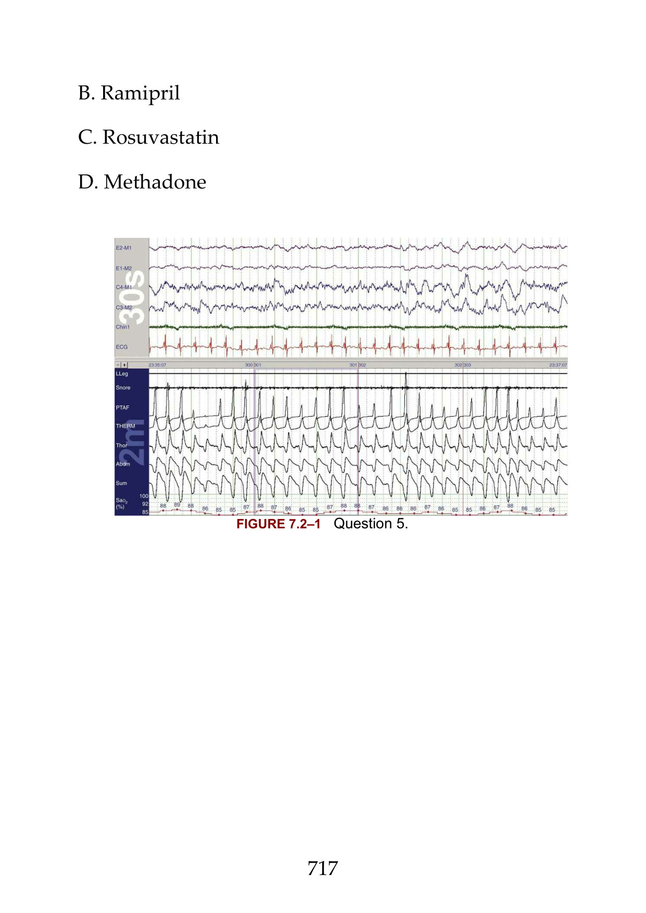

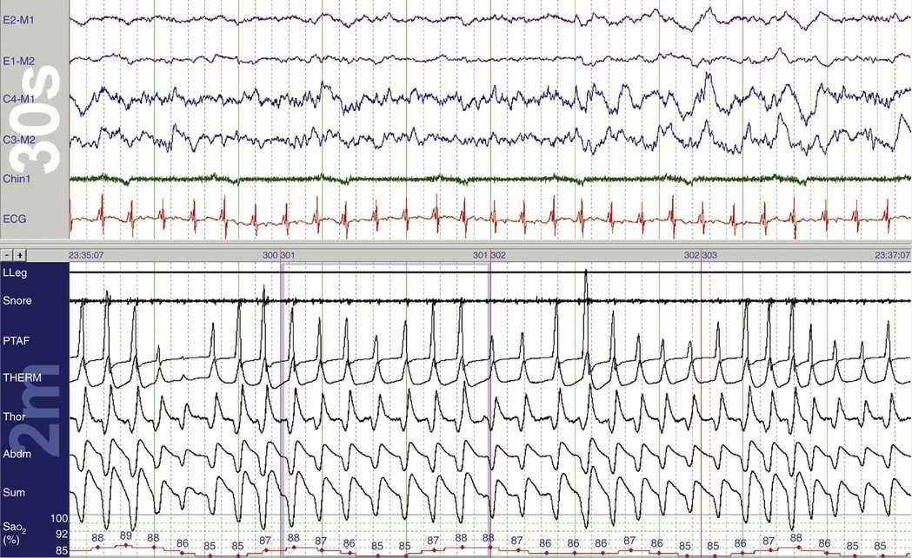

<!-- pdf-page: 718 -->

Mild OSA was diagnosed in a 46-year-old man after portable home testing ordered by his family doctor. He was referred to an ear-nose-throat (ENT)

FIGURE 7.2–2 Questions 6 to 8.

FIGURE 7.2–3 Questions 9 to 12.

#### Saved from the Knife

### 718

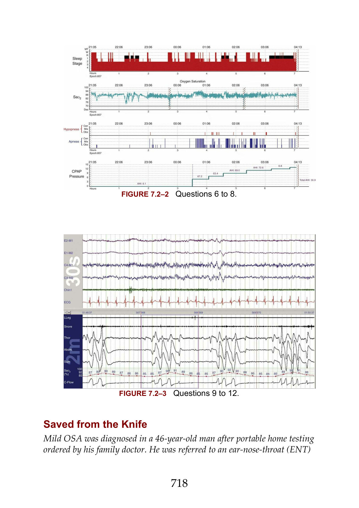

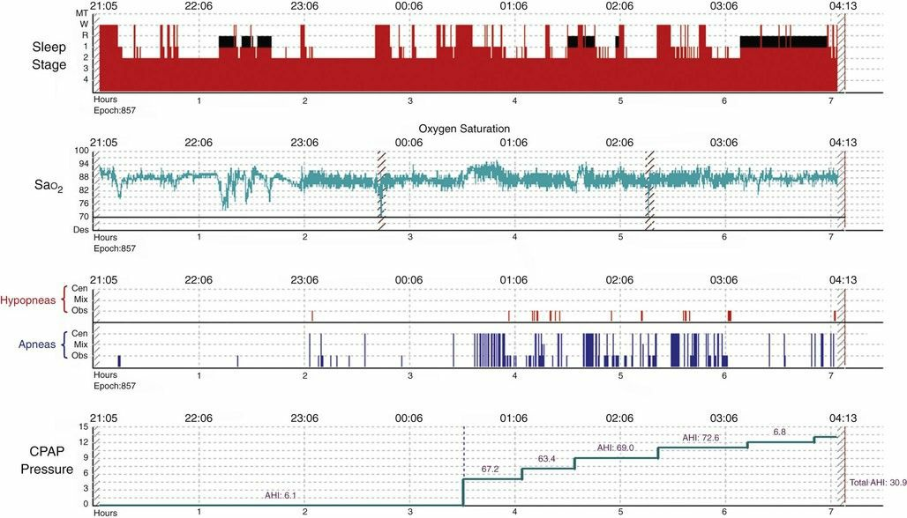

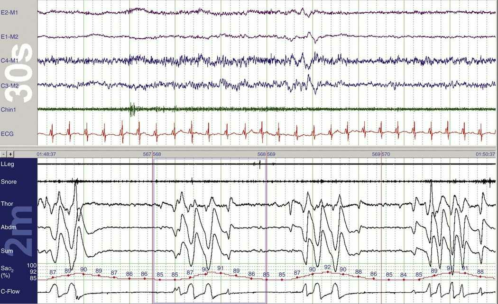

<!-- pdf-page: 719 -->

physician who put him on CPAP without a titration study. The patient was not compliant with CPAP and is now being considered for upper airway surgery. Before surgery, an in-lab PSG was done. The patient's main complaint noted in the presleep questionnaire is “loud humming.” His BMI is 25, and his ESS score is 5/24. A typical 10-minute fragment from the in-lab study is shown in Figure 7.2-4.

13. The sleep technician described the patient “moaning” during sleep. During the night, many clusters were evident, like the one shown in Figure 7.2-4. The events were scored as central apneas terminating with snores. What should the next step be?

### A. Bilevel titration with back-up rate if needed

### B. Titration with ASV

### C. Nocturnal supplemental oxygen

### D. None of the above

14. What does the PSG show?

### A. Obstructive apnea

### B. Central apnea

### C. CSB

### D. Seizure

15. What is the most likely diagnosis?

### A. Rhythmic movement disorder

### B. Central sleep apnea

### 719

<!-- pdf-page: 720 -->

### C. Catathrenia

### D. Epilepsy

A 9-year-old girl is referred for a sleep test by her pediatrician because of insomnia. Her parents describe frequent awakenings, sometimes with shortness of breath. Past medical history is unremarkable except for streptococcal B tonsillitis 9 months previously. This infection was followed within a week by a movement disorder that lasted 3 weeks, characterized by twitches involving some of the muscles of her face and uncoordinated rapid jerking movements affecting all extremities. The fragment shown in

Figure 7.2-5 represents what was seen most of the night. The top window

is 30 seconds, the bottom is 5 minutes.

FIGURE 7.2–4 Questions 13 to 15.

#### Saved by the Knife

16. What is the main and most significant finding?

### A. Central sleep apnea

### B. CSB

### 720

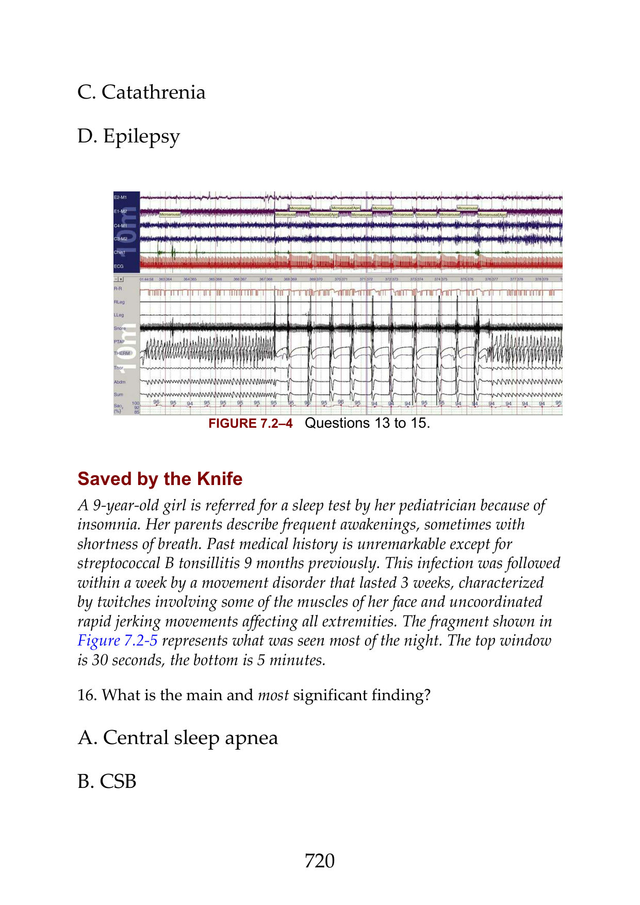

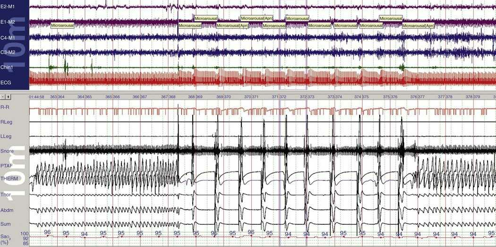

<!-- pdf-page: 721 -->

### C. OSA

### D. Mixed sleep apnea

17. What is the patient's AHI?

### D. AHI is not reported in this type of breathing

### A. About 80 events/hr

### B. About 40 events/hr

### C. About 20 events/hr

### A. Because the apnea episodes are less than 20

### pattern abnormality.

18. How do you put this case together?

### seconds, no diagnosis of central apnea can be made

### using pediatric rules.

### B. The patient has a neurologic disease.

### C. The patient likely has cardiac valve disease.

### D. The patient has idiopathic central apnea.

### 721

<!-- pdf-page: 722 -->

A 59-year-old man with the combination of insomnia and hypersomnia has a diagnostic PSG, a 2-minute epoch of which is shown Figure 7.2-6. Note that airflow is being monitored by end-tidal Pco2; the lowest channel is nasal pressure. The technologist scored the entire segment as an awake state without looking at the respiratory data.

FIGURE 7.2–5 Questions 16 to 18.

#### Awake Apnea

20. Based on the breathing pattern shown, what can you conclude about this fragment?

19. What is the breathing abnormality shown?

### A. Obstructive apnea

### B. Central apnea

### C. Mixed apnea

### D. Artifact from the patient moving

### 722

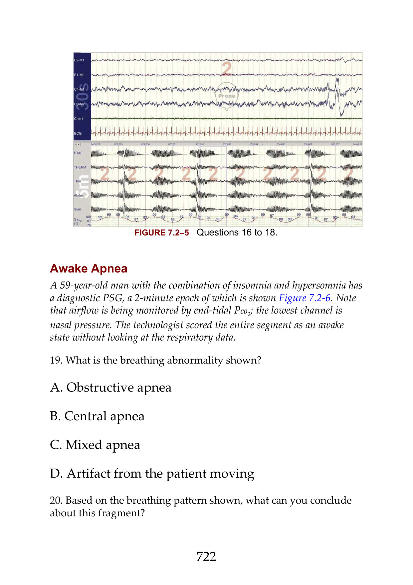

<!-- pdf-page: 723 -->

### A. The stage cannot be scored as awake because the

### patient is having abnormal breathing events.

### B. The patient is oscillating between wakefulness and

### C. This can definitely be scored as an awake stage.

### sleep.

### D. The episode is too long to be called an apnea.

22. Describe the finding in the Pco2 trace beginning at the vertical red line next to the two red asterisks.

21. What condition can lead to this finding?

### A. Stroke

### B. Heart failure

### C. Opiate use

### D. All of the above

### A. 60-Hz artifact

### B. Muscle artifact

### C. Cardiogenic oscillations

### D. Flow limitation

### 723

<!-- pdf-page: 724 -->

A 55-year-old man presents with severe insomnia and indicates that some nights, he does not sleep at all. He has very severe daytime sleepiness and often feels like he is drifting off to sleep but he does not achieve sleep. His insomnia symptoms began during a hospitalization for left-sided paresis. He does not snore but his wife states that his breathing becomes very quiet at night. He tried sleeping pills, but they just left him with a severe hangover.

FIGURE 7.2–6 Questions 19 to 22.

#### Can't Sleep, Can't Stay Awake

### A. Infarction of his suprachiasmatic nucleus (SCN)

23. What is likely the cause of his insomnia?

### B. Infarction of the ventrolateral preoptic nucleus

### C. Decreased chemical drive to breathe, causing

### (VLPO)

### central apnea due to damage of medullary

### breathing centers

### D. Increased drive to breathe, causing instability of

### 724

<!-- pdf-page: 725 -->

### the respiratory control system, leading to central

### apnea

24. What is the appropriate workup and what will it likely show?

### A. CO2 response test; it will be blunted.

### B. MRI; it will show infarction in medulla.

### C. PSG; it will show sleep-disordered breathing.

### D. PSG; it will show alpha-delta sleep but otherwise

The mother of a new baby read Dr. Spock's classic Baby and Child Care before giving birth. One of Dr. Spock's topics was sleep apnea, and the new mother is concerned about whether her baby might have this condition. When the baby is a month old, the mother calls to ask about her child's sleep.

### will be normal.

#### A Nervous New Mother

25. She has heard conflicting information about what position her baby should sleep in. What is your advice?

### A. The baby should sleep on the left or right side to

### lessen the probability of obstructing her upper

### airway.

### B. The baby should sleep on her stomach (face down)

### to lessen the impact of possible aspiration.

### C. The baby should sleep on her back, because this

### has been shown to reduce the prevalence of sudden

### infant death syndrome (SIDS).

### 725

<!-- pdf-page: 726 -->

### D. The position the baby sleeps in does not matter.

26. The mother has noted that her baby sometimes stops breathing for 2 or 3 seconds and the mother is concerned the baby might die from SIDS. During apneas, the baby's chest and abdomen do not move. What should the mother be told about these breathing pauses?

### A. Episodes of apnea as described are statistically a

### risk for SIDS, and home monitoring is indicated.

### B. The key distinction is length of the pauses; any

### duration longer than 10 seconds is critical.

### C. Central apneas longer than 20 seconds are

### abnormal and generally require investigation.

### D. Duration is not as important as whether a Cheyne-

### Stokes variation (waxing and waning respiration) is

### present, which would suggest cardiovascular

### disease. She should check the baby's breathing

### pattern before each pause.

27. The mother is not reassured by this information and requests that her baby be monitored for possible SIDS. What is the current consensus regarding home monitoring to help prevent SIDS?

### A. Monitoring of respiratory movements alone

### C. Monitoring of Sao2 by pulse oximetry

### B. Continuous monitoring of an ECG

### D. Home apnea monitoring does not reduce the risk

### 726

<!-- pdf-page: 727 -->

### of SIDS.

28. The mother asks about disadvantages of the baby sleeping on her back (supine). What should she be told?

### A. There are no negative effects of sleeping supine.

### B. Sleeping supine can result in some negative skeletal

### C. The risk of aspiration is increased with sleeping

### changes.

### D. Sleeping supine increases the risk of asthma.

### supine.

29. During PAP titration, a typical OSA patient develops frequent central apneas as the technologist increases pressure to abolish what he thinks are mild RERAs. What should you advise the technologist?

### C. Immediately start bilevel PAP with backup.

### A. Increase the CPAP pressure.

### B. Reduce the CPAP pressure.

30. During initiation of CPAP titration, a sleep apnea patient develops long episodes of central apnea. The patient's diagnostic AHI was 24 events/hr, and half the events were mixed apneas. The patient is a thin 34-year-old woman with a normal physical examination; her medical history includes hypothyroidism (on treatment), a history of treated iron deficiency, and maintenance methadone for treatment of previous heroin addiction. What

### D. Immediately start ASV.

### 727

<!-- pdf-page: 728 -->

should you advise the technologist?

### A. Continue to increase the PAP pressure.

### B. Reduce the CPAP pressure.

31. A patient's diagnostic AHI was 24 events/hr, and half the events were mixed apneas. The patient is a thin 35-year-old man with a normal physical examination except for hypertension. His medical history includes hypothyroidism (on medication) and he is on maintenance oral morphine for treatment of severe neuropathic pain. His primary care physician asks whether autotitration with CPAP can be done at home. You reply

### C. Start bi-level without backup.

### D. Start ASV.

### A. No. Fixed CPAP pressure of 10 cm H2O is adequate

### for most patients and can be prescribed in this case,

### so an autotitrating CPAP machine is not necessary.

### B. Yes. He should be prescribed an autotitration CPAP

### machine with a wide pressure range (e.g., 5 to

### 20 cm H2O).

### C. No. An in-laboratory CPAP titration study is

### D. It can if the patient uses a full face mask to make

### recommended.

### sure he gets the full effect of positive pressure.

A 29-year-old combat veteran, a man with a BMI of 26, has a 6-month

#### Back from Combat

### 728

<!-- pdf-page: 729 -->

history of witnessed apneas and severe daytime sleepiness. For the past 2 years, shortly after returning from combat in Iraq, he has awakened frequently yelling and screaming. There is no history of snoring. The awakenings occur during repetitive nightmares. He has phantom lower limb pain and is being treated for mild traumatic brain injury, posttraumatic stress disorder (PTSD), and depression. His medications include mirtazapine, bupropion, and alprazolam.

### A. Out-of-center sleep test (home sleep test)

32. What test should be ordered next?

33. The patient has an out-of-center sleep test. A representative fragment is shown in Figure 7.2-7. He has 16 such events per hour of recording time. No other abnormalities were seen. What is the diagnosis?

### B. In-lab PSG

### C. In-lab PSG and MSLT

### D. Hamilton depression scale

### C. Postarousal central apnea related to PTSD

### A. Moderate central sleep apnea

### B. Moderate OSA

### D. Because home sleep tests overestimate apnea

### severity, the finding is of little clinical significance.

### 729

<!-- pdf-page: 730 -->

34. What should be the next step in management?

FIGURE 7.2–7 Question 33.

### A. Autotitrating CPAP (range 4 to 20 cm H2O)

### D. Comprehensive psychiatric evaluation, because the

### B. A clinical trial of prazosin

### C. In-laboratory PAP titration

### respiratory findings were not significant

35. What is a possible cause of the home study findings?

### A. Obstruction of the upper airway caused by obesity

### B. Oxycodone used for phantom limb pain

### D. Alprazolam used to treat anxiety disorder

### C. Bupropion used for depression

36. The patient is sent home on autotitrating PAP (4 to 20 cm H2O)

### 730

<!-- pdf-page: 731 -->

and the following mean data for 30 days are obtained from his device: AHI = 19 events/hr; central apnea index = 12 events/hr; percent of night with large leak = 2%; percent of nights used = 97%; percent of nights with usage greater than 4 hours = 80%. What is the best interpretation of the data?

### A. Adherence is acceptable, efficacy is poor with the

### presence of central apnea, and the leak is

### acceptable.

### B. Adherence is unacceptable, efficacy is acceptable,

### C. Adherence is acceptable, efficacy is acceptable with

### and the mask leak is high.

### the persistence of only mild apnea, and the leak is

### acceptable.

### D. Adherence is acceptable, efficacy is acceptable with

### the presence of central apnea, but the leak is high.

37. Given the above data, what is the best next step from the choices below?

### A. Evaluate for possible new PAP interface.

### B. No change in management is warranted.

### C. In-lab PAP and possible ASV titration should be

### D. A clinical trial of a bilevel PAP device should be

### initiated.

### initiated using an empiric pressure of 24/12 cm H2O

### in spontaneous mode.

### 731

<!-- pdf-page: 732 -->

38. After being sent home on a new PAP device, the patient continues to complain of daytime sleepiness. The download indicates good adherence and efficacy. Which is the best next step?

### A. Clinical trial of methylphenidate

### C. Clinical reassessment to consider alternate causes

### B. Clinical trial of modafinil

### D. No changes in therapy are needed, because

### of sleepiness

### sleepiness is an acceptable complication of treated

### apnea and the medications used to treat his PTSD.

### 732

<!-- pdf-page: 733 -->

## Answers

1. C. Obesity usually leads to obstructive apneas. The central apneas in heart failure and kidney failure are usually CSB, which is highly regular and repetitive. Opiate-induced central apneas typically manifest as a chaotic, often slow breathing pattern.

2. C. Central apneas are common during wakefulness in heart failure and stroke. In heart failure, CSB is usually present that is typically regular and repetitive. Opiate-induced central apneas usually appear as a chaotic, often slow breathing pattern (<10 breaths/min). Obesity usually leads to obstructive apneas that manifest only during sleep. COPD does not lead to awake apneas.

3. A. CSB is a highly periodic waxing and waning pattern with central apneas or hypopneas between hyperpneic phases. This pattern often occurs when an increased chemical drive to breathe is present.

4. D. The first three conditions may be associated with CSB. Oxygen therapy does improve CSB in acute congestive heart failure (CHF). The effect of O2 therapy on CSB in chronic CHF has not been well studied. (Aldabal and Bahammam, 2010)

5. B. By the process of elimination, the best answer is hypopnea. The events do not meet the criteria for apnea, because the thermal signal is never flat. The recommended rules for hypopnea scoring in the AASM manual require a 30% reduction in nasal pressure signal excursion lasting at least 10 seconds and a 3% or more reduction in Sao2 or an associated arousal. There are five episodes during which nasal pressure excursion is reduced by 30% or more. However, only in the first episode does Sao2 drop by 3% or more. There is also continuous hypoxemia and small 2% to 3% oscillations in Sao2. Note that the fragment does not prove hypoventilation; that requires documentation of an elevated Pco2.

### 733

<!-- pdf-page: 734 -->

6. D. The episodes of hypoxemia in the second panel coincide with the occurrence of REM sleep in the top panel. The third panel shows episodes of hypopnea and apnea that have been scored and no such scored events correspond to the hypoxemia. Thus it can be surmised that REM-related hypoventilation is causing the hypoxemia (and not obstructive apneas).

7. C. There really was no indication to start a CPAP titration. The AHI was only 6.1, and the events did not resemble obstructive apnea. Also note that the patient did not have EDS; his ESS score was only 4. Hypoxemia alone is not an indication for CPAP.

8. B. The CPAP actually worsened the patient's breathing and caused apneas. This is apparent in the third panel, which shows a larger number of apneic episodes compared with the pretreatment baseline. Thus CPAP can worsen sleep apnea in some patients.

9. C. This fragment shows classic episodes of central apnea with absent or vastly reduced thoracic and abdominal effort during the events.

10. C. The C-flow channel is a display of airflow calculated by the CPAP machine while the patient is breathing. During central apneas, of course, there is no airflow. While the patient is breathing, the C-flow channel shows rounded tops, a normal pattern. In the presence of flow limitation or snoring, a plateau in the trace might be visible. The channel does not show the waxing and waning pattern of CSB.

11. B. The sequence of events, ending with the patient developing more severe apneas of a central type, is described as treatmentemergent or complex sleep apnea. Complex sleep apnea is most often seen when patients are overtitrated with CPAP. (ATLAS2, pp 277,

#### 417-421)

12. D. Opiates are well-known risk factors for the development of treatment-emergent or complex sleep apnea. Patients who use opiates chronically often manifest hypoventilation, hypoxemia entering sleep, and central apneas during both wakefulness and

### 734

<!-- pdf-page: 735 -->

sleep. During REM sleep, there may be much less periodicity in their breathing and Sao2. It is likely that the heightened periodicity of breathing and Sao2 in NREM sleep is related to opiate depression of a chemical drive to breathe. In REM sleep, nonchemical control of breathing becomes dominant, a response similar to what is seen in CSB. (ATLAS2, pp 415, 416)

13. D. The next course of action is to actually cancel the operation because the findings do not show anything treatable with surgery.

14. B. Technically, the episodes seen are scored as central apneas. However, the events have unusual features. The apneas are actually prolonged expirations and seem to be terminated by what look like very deep breaths. The snoring microphones pick up noises that are not typical of snoring. In the absence of a history, and with technologist's notes describing other findings, the diagnosis would be central apnea with the cause indeterminate.

15. C. Catathrenia is a rare and benign condition that has features of sleep-disordered breathing but it may also be a type of parasomnia. (Guilleminault C et al, 2008) It is more common in men and is primarily a social problem for the affected individual. (ICSD3, p 141) The diagnosis was confirmed by considering the PSG, but much more importantly, by the interpreting physician contacting the patient's wife, who described the sound as a “humming and groaning” during sleep. Her husband did not have any of the other features of sleep apnea. The lesson from this case is that treatment based only on home sleep testing, without an adequate history, can put the patient at risk for unnecessary treatment (in this case, CPAP) and perhaps inappropriate surgery.

16. B. This is an example of classic CSB. Simply reporting this as central sleep apnea does not sufficiently convey the information obtained in the study. The AASM manual states the rules for determining CSB as follows:

### a. There are episodes of three or more consecutive

### central apneas and/or central hypopneas separated

### 735

<!-- pdf-page: 736 -->

### by a crescendo and decrescendo change in

### breathing amplitude with a cycle length of 40 or

### more seconds.

### b. There are five or more central apneas and/or central

### hypopneas per hour of sleep associated with the

### crescendo/decrescendo breathing pattern recorded

### over 2 or more hours of monitoring.

Not mentioned in the manual is the fact that this pattern is monotonously regular and often disappears during REM sleep. In clinical practice, such a breathing pattern is found most often in congestive heart failure and after a stroke. The cycle length of the periodic breathing pattern seems related to circulatory delay, and the more severe the heart failure and the longer the circulation time between the lungs and the carotid body, the longer the periodic breathing cycle. In most patients with heart failure, the cycle length is about a minute. Another situation in which periodic breathing is seen is after acute ascent to high altitude. In this situation, the circulation time between the lungs and the carotid body is much shorter, and the cycle length may be 30 seconds or less. The number of breaths during the hyperpneic phase of the breathing pattern also varies, with a very large number of breaths per cycle with severe heart failure and a small number of breaths in people at high altitude. This type of breathing pattern in heart failure is a predictor of mortality. (ATLAS2, pp 322-327) Note that the AASM manual now gives scoring rules to differentiate hypopneas as central or obstructive. Typically, hypopneas are still not differentiated in most scoring reports, but the fact that there are official AASM criteria makes it fair game for a quiz question. The criteria from the AASM manual are as follows. If electing to score obstructive hypopneas, score a hypopnea as obstructive if any of the following criteria are met:

### a. Snoring occurs during the event.

### 736

<!-- pdf-page: 737 -->

### b. Increased inspiratory flattening of the nasal

### pressure or PAP device flow signal is evident

### compared with baseline breathing.

### c. Associated thoracoabdominal paradox occurs

### during the event but not during preevent breathing.

If electing to score central hypopneas, score a hypopnea as central if none of the following criteria are met:

### b. Increased inspiratory flattening of the nasal

### a. Snoring occurs during the event.

### pressure or PAP device flow signal is evident

### compared with baseline breathing.

### c. Associated thoracoabdominal paradox occurs

### during the event but not during preevent breathing.

17. A. There are seven central apnea events over 5 minutes. Thus the AHI is 7 times 12 (the latter being the number of 5-minute epochs per hour), or 84. The best answer is thus 80. The pediatric scoring rules for central apnea are as follows. (MANUAL2) Score an apnea as central if it meets apnea criteria, is associated with absent inspiratory effort throughout the entire duration of the event, and at least one of the following is met:

### a. The event lasts 20 or more seconds.

### b. The event lasts at least the duration of two breaths

### during baseline breathing and is associated with an

### arousal or a 3% or greater arterial oxygen

### desaturation.

### 737

<!-- pdf-page: 738 -->

### c. The event lasts at least the duration of two breaths

### during baseline breathing and is associated with a

### decrease in heart rate to less than 50 beats per

### minute for at least 5 seconds or less than 60 beats

### per minute for 15 seconds (infants under 1 year of

### age only).

18. C. The CSB pattern is found most often in left ventricular heart failure. The clinical history provides clues to the pathogenesis in this case. The patient had a Streptococcus B tonsillar infection, followed by bizarre neurologic symptoms indicating Sydenham chorea. This chorea is commonly associated with rheumatic fever, which in turn often causes valvular heart disease. Also called St. Vitus dance, this chorea can appear up to several months after the rheumatic fever. The impact of the patient's previous diagnosis of rheumatic fever on the patient's sleep was not appreciated by the pediatrician. Following this PSG evaluation, the patient developed acute pulmonary edema and was hospitalized. Mitral insufficiency was diagnosed. She then had an urgent PSG evaluation on CPAP, and positive pressure resolved the apnea episodes. She was treated at home with nasal CPAP and subsequently had a mitral valve replacement. After recovery, the patient's sleep symptoms resolved entirely.

19. B. This is central apnea because there is no breathing effort noted in the thoracic or abdominal belts at the time of the absent airflow.

20. C. Abnormal breathing patterns can be present during a waking stage. The most common causes are heart failure and stroke causing CSB and, in some people, taking medications (such as opiates) that can suppress breathing. (ATLAS2, pp 456-457)

21. D. See the answer to question 20 above. An additional point is that in the first two causes of awake apnea (CHF and stroke), the breathing pattern can be highly periodic, whereas with opiate use, the pattern is more random, and the baseline breathing frequency

### 738

<!-- pdf-page: 739 -->

can be very low.

22. C. These are cardiogenic oscillations from the beating heart. Each heartbeat causes a small displacement of air that is picked up by a rapidly responding sensor, in this case a CO2 sensor. The oscillations are synchronous with the heartbeats and are proof that the airway is open, thus they are only seen in central apneas. (ATLAS2, p 328)

23. D. A cerebrovascular accident can result in an increased drive to breathe, leading to breathing instability and the development of central apnea. The fact that his breathing becomes quiet at night suggests central apnea.

24. C. Sleep-disordered breathing is very common after a stroke and manifests in 50% to 70% of such patients. Both central and obstructive apneas are common in this setting. All stroke patients should be screened for sleep apnea. Oxygen or ASV may be tried if central apneas are present. CPAP would of course be indicated if the patient has clinically significant obstructive sleep apnea. (Hermann and Bassetti, 2009)

25. C. The baby should sleep on her back. Although the mechanisms that cause SIDS are not understood, epidemiologic studies have shown that having the baby sleep supine reduces the risk of SIDS. One hypothesis is that infants sleeping prone might asphyxiate when the upper airway is obstructed by soft pillows or bedding and that they do not arouse in response, or they might arouse but may be too weak to change their head position. The current recommendations include having the child sleep on a firm sleeping surface and avoid soft objects in the crib, bed sharing, and overheating the infant. (Adams et al, 2009)

26. C. Brief breathing pauses are common in newborns. Central apneas are generally not a problem unless they are longer than 20 seconds or are associated with cyanosis, pallor, bradycardia, or hypotonia. (ICSD3, pp 94-98)

27. D. Studies have not shown that home apnea monitoring reduces

### 739

<!-- pdf-page: 740 -->

SIDS, so it would not be recommended for this infant. (Adams et al,

#### 2009)

28. B. The back sleeping position has increased the incidence of flattening of the back of the head (deformational plagiocephaly). The flattening can be prevented by encouraging supervised “tummy time.” While awake, infants should spend as much time as possible on their stomachs. (Adams et al, 2009)

29. B. The patient has treatment-emergent apnea (or complex apnea). This is often caused by overtitration, thus the first recommendation is to reduce CPAP pressure. In some patients (e.g., those on opiates), ASV or bilevel airway pressure might become necessary. (Morgenthaler et al, 2014)

30. D. The patient has treatment-emergent (complex) apnea. When this is caused by opiates (as is the case in this patient on methadone), ASV is often effective treatment. Bilevel PAP without a back-up rate will not deal with the central apneas in this case. (Javaheri et al, 2014)

31. C. The patient is likely to have complex apnea or develop treatment-emergent apnea with titration. When the apnea is caused by opiate use, as is probable in this patient, ASV is often effective treatment. Unattended autotitrating CPAP is contraindicated in these patients. (Javaheri et al, 2014)

32. B. Sometimes the information given in a clinical scenario is used in the immediate or later question. Here it is worth emphasizing that every statement put into a scenario is there to either inform or distract you. Try to determine why a question is being asked. This patient has sleepiness and witnessed apneas but no snoring. You should be suspecting central sleep apnea. He also has abnormal behaviors during sleep. There is no indication to do home sleep testing for either of these situations. Narcolepsy is not suspected; therefore an MSLT is not indicated.

33. A. The thermal sensor shows almost no airflow; therefore apnea is present. The slight oscillation in the signal of this channel is

### 740

<!-- pdf-page: 741 -->

synchronous with the ECG, suggesting cardiogenic oscillations and central sleep apnea. The lack of respiratory effort (flat line of the thorax and abdominal signals) is diagnostic of central apnea. AHI showing 15 to 30 events/hr indicates that the central sleep apnea is of moderate severity. Home sleep tests generally underestimate apnea severity because sleep time is almost always less than recording time. Thus answer D is incorrect.

34. C. There is no indication to start a patient with central sleep apnea on autotitrating CPAP. In fact the apnea may worsen with an autotitrating CPAP machine (note that the patient is on an opiate medication). Prazosin might be used for the PTSD nightmares but it would not affect the apnea.

35. B. Opiates (oxycodone in this patient) are a common cause of central apneas. The drugs may cause chronic hypoventilation and a low breathing frequency. Bupropion and alprazolam are not described as causing central apneas. Answer A was obviously incorrect, because the patient did not have obstructive apnea. Was the patient even obese with a BMI of 26? If you read the question again, you will note that the patient had a phantom lower limb. Is BMI accurate when a limb or part of a limb is missing? The examtaking lesson is that you must read the question carefully.

36. A. Adherence of more than 4 hours per night for more than 70% of nights is generally considered acceptable CPAP compliance. The AHI is high with more than 50% of the events central, thus the apnea is inadequately treated. Such a low mask leak can be ignored. There is an intentional leak present whenever the patient is using CPAP. This will wash awake CO2 in the mask. If there is a poorly fitting mask or holes in the tubing, there will be an unintentional leak. Generally a leak is considered to be large if the unintentional leak is more than 25 L a minute. This value will vary somewhat from manufacturer to manufacturer and will also be a function of the specific mask type.

37. C. There is no need for a new interface because the leak is not large. A change in treatment is warranted, however, because the patient continues to have central apneas. Simply switching to a

### 741

<!-- pdf-page: 742 -->

bilevel machine with an empiric pressure is an inadequate answer. He might need a timed backup. It is likely that the patient will require an ASV device, and the most prudent approach is an in-lab positive-pressure titration.

38. C. The reason for the patient's sleepiness remains unexplained. If this were straightforward OSA and the patient had residual sleepiness on PAP, a clinical trial of modafinil might be indicated. That is not the situation here: This patient's sleepiness could be related to his medications, his psychiatric condition, or he might have posttraumatic brain injury hypersomnia. The trail to the correct answer is always in the question.

▪ AASM Manual for the Scoring of Sleep and Associated Events: Rules,

## Summary

### Highly Recommended

Terminology, and Technical Specifications, Version 2.1. ▪ International Classification of Sleep Disorders, ed. 3

Although central sleep apnea (CSA) is much less common than obstructive sleep apnea (OSA), it is a very important topic that sleep specialists will encounter. Expect about 20 of the 240 questions to be on central apnea. Be sure to review the new categories of CSA discussed in the ICSD3.

### Topics You Should Know

▪ Idiopathic CSA is mostly found in middle-aged or older adults.
▪ CSB is found in patients with a variety of diseases.

### Epidemiology

### ❍ Congestive heart failure (about 50%) (ATLAS2, pp

### 322-324)

### 742

<!-- pdf-page: 743 -->

### ❍ Stroke (ATLAS2, p 329)

### ❍ Multiple sclerosis (ATLAS2, pp 226-228)

### ❍ Drugs that depress the drive to breathe

### ❍ Neuromuscular disorders

▪ Central apnea episodes are associated with absent or reduced

### Pathophysiology

### ❍ Reduced output from the respiratory centers in the

efforts to breathe caused by various factors.

### ❍ Unstable or oscillating respiratory control system

### central nervous system

### ❍ Increased drive to breathe (high loop gain)

### • Prolonged circulation time

### • Central nervous system (CNS) lesions

### ❍ Decreased drive to breathe

### • Effect of drugs

### ❍ Weakness of the inspiratory muscles

### • Genetic disorders

### • Neuromuscular disorders

### 743

<!-- pdf-page: 744 -->

▪ Physiologic changes include:

### ❍ Hypoxemia

▪ Heart failure
▪ Cerebrovascular accident
▪ Use of opiates and other CNS-sedating agents
▪ Genetic abnormalities
▪ Lesions that affect the brainstem
▪ Findings on physical examination
▪ Central sleep apnea

### ❍ Sleep instability

### ❍ Increased arousals

### Risk Factors

### ❍ Pinpoint pupils (sign of opiate use)

### ❍ Neuromuscular disorder findings

### ❍ May be observed while the patient is awake or

▪ Cheyne-Stokes breathing (CSB)

### asleep

### ❍ A feature of

### • Heart failure

### • Stroke

### • Kidney failure

### 744

<!-- pdf-page: 745 -->

### Diagnostic Methods

See Diagnostic Methods in Obstructive Sleep Apnea located earlier in this section.

### Classification of the Central Sleep Apnea

### Syndromes (ICSD3)

### ❍ Central apnea due to a medical disorder without

▪ Adult

### ❍ Central sleep apnea with CSB

### ❍ Treatment-emergent central sleep apnea

### CSB

### ❍ Central sleep apnea due to high-altitude periodic

### ❍ Primary central sleep apnea

### ❍ Central sleep apnea due to a medication or

### breathing

### ❍ Primary central sleep apnea of infancy

### substance

▪ Pediatric

### ❍ Primary central sleep apnea of prematurity

### Treatment (Aurora et al, 2012; Javaheri et al,

### 2014; Morgenthaler et al, 2014)

▪ For unstable or oscillating respiratory control system

### 745

<!-- pdf-page: 746 -->

### ❍ Oxygen

### ❍ ASV (to reduce minute ventilation or dampen

### oscillations)

### ❍ Bilevel positive airway pressure with backup

▪ For depression of CNS control of breathing

### ❍ Noninvasive mechanical ventilation

▪ For idiopathic cases in which pathophysiology is unclear

Adams SM, Good MW, Defranco GM. Sudden infant death

### ❍ Trial of CPAP or

### ❍ Bilevel with backup or

### ❍ ASV

## References

syndrome. Am Fam Physician. 2009;79(10):870–874. Aldabal L, Bahammam AS. Cheyne-Stokes respiration in

patients with heart failure. Lung. 2010;188(1):5–14. American Academy of Sleep Medicine. International

classification of sleep disorders. ed 3. American Academy of Sleep Medicine: Darien, Ill.; 2014. American Academy of Sleep Medicine. The AASM manual for

the scoring of sleep and associated events: rules, terminology and technical specifications. [Version 2.1] American Academy of Sleep Medicine: Darien, Ill.; 2014. Aurora RN, Chowdhuri S, Ramar K, et al. The treatment of

central sleep apnea syndromes in adults: practice parameters with an evidence-based literature review and meta-analyses. Sleep. 2012;35(1):17–40.

### 746

<!-- pdf-page: 747 -->

Guilleminault C, Hagen CC, Khaja AM. Catathrenia:

parasomnia or uncommon feature of sleep disordered breathing? Sleep. 2008;31(1):132–139. Hermann DM, Bassetti CL. Sleep-related breathing and sleep-

wake disturbances in ischemic stroke. Neurology. 2009;73(16):1313–1322. Javaheri S, Harris N, Howard J, Chung E. Adaptive

servoventilation for treatment of opioid-associated central sleep apnea. J Clin Sleep Med. 2014;10(6):637–643. Kryger MH, Avidan A, Berry R. Atlas of clinical sleep medicine.

ed 2. Saunders: Philadelphia; 2014. Morgenthaler TI, Kuzniar TJ, Wolfe LF, et al. The complex

sleep apnea resolution study: a prospective randomized controlled trial of continuous positive airway pressure versus adaptive servoventilation therapy. Sleep. 2014;37(5):927–934.

## 7.3.

## Sleep-Related Hypoventilation and

## Hypoxemic Syndromes

#### Sleep Hypoventilation Has Many Faces

## Questions

1. A man with a BMI of 50 has severe swelling of the ankles and a hematocrit of 58%. What abnormality would most likely explain these findings?

### B. Upper airway resistance syndrome (UARS)

### A. OSA

### C. Obesity hypoventilation syndrome (OHS)

### 747

<!-- pdf-page: 748 -->

### D. Treatment-emergent apnea

2. A patient is referred with the diagnosis of pulmonary hypertension. What is the most common cause of pulmonary hypertension?

### C. Obesity hypoventilation syndrome

### A. COPD

### B. Idiopathic pulmonary fibrosis

3. Which of the following leads to peripheral edema in hypoventilating (hypercapnic) patients?

### D. Asthma

### A. Polycythemia caused by a right-to-left cardiac

### B. Pulmonary hypertension leading to right heart

### shunt

### C. Cardiac rhythm abnormality in asthma

### failure

### D. Left heart failure causing pulmonary hypertension

4. Which of the following is not true about OHS?

### B. Patients have awake hypoventilation.

### A. It is more common in men.

### C. Patients have sleep hypoventilation.

### 748

<!-- pdf-page: 749 -->

### D. Headache is a common finding.

5. What percentage of OSA patients have OHS?

### A. Fewer than 5%

6. Which is true about sleep-breathing disorders in kyphoscoliosis?

### B. 10% to 20%

### C. 30% to 40%

### D. About 50%

### A. Sleep-breathing disorders are uncommon in

### B. Hyperventilation is present in severe

### kyphoscoliosis.

### C. CPAP is almost always effective in this population.

### kyphoscoliosis.

### D. Nighttime ventilation can improve daytime

7. Which of the following statements about postpolio syndrome is true?

### respiratory failure.

### A. Patients with postpolio syndrome almost always

### develop sleep-breathing disorders within a year of

### the acute episode of poliomyelitis.

### B. Hypoventilation in these patients can be treated

### 749

<!-- pdf-page: 750 -->

### with noninvasive ventilation.

### C. CPAP is effective in most patients who have sleep-

### breathing disorders with postpolio syndrome and

### weakness of the respiratory muscles.

### D. OSA is uncommon in this population.

8. A patient with OSA is titrated with a bilevel pressure mask in the sleep lab. The technician gives him an EPAP of 10 cm H2O and a pressure support of 8 cm H2O, which he tolerates well. What is his IPAP?

9. Shortly after birth, a newborn develops a distended abdomen, lethargy, and cyanosis. What test will not help make the correct diagnosis?

### A. 2 cm H2O

### B. 8 cm H2O

### C. 14 cm H2O

### D. 18 cm H2O

### D. Magnetic resonance imaging (MRI) of the upper

### A. Arterial blood gases

### B. Assay for PHOX2B gene

### C. PSG with Pco2 monitoring

### airway

### 750

<!-- pdf-page: 751 -->

10. A thin man, age 58, has a history of COPD and peripheral edema. A home sleep study shows three prolonged episodes, each about 10 minutes in duration, of hypoxemia (Sao2 dropped into the 70% range). During hypoxemia episodes, his Sao2 remained steady without oscillation. What is the likeliest pathogenesis of the hypoxemia?

### A. The patient developed obstructive apnea during

### B. Hypotonia of the muscles of respiration, except for

### REM sleep.

### the diaphragm, caused hypoventilation in REM

### sleep.

### C. The hypoxemia was probably position dependent

### and caused by ventilation-perfusion mismatching

### when the patient was supine.

11. What does the term overlap syndrome conventionally refer to?

### D. None of the above are true.

### A. The combination of sleep apnea and obesity

### B. Any hypoventilation syndrome and narcolepsy

### hypoventilation

### C. The combination of hypoventilation syndrome,

### insulin resistance, and high blood pressure

### D. Combination of COPD and OSA

#### Panic

### 751

<!-- pdf-page: 752 -->

A father goes to check on his 3-month-old baby boy, who is sleeping in his crib. He notices the child is apparently not breathing and is blue. He screams to his wife to call 911 then lifts the baby. In his arms, the baby feels like a rag doll with no muscle tone. He rocks the baby and yells at him to breathe. Within a minute, the baby awakes and starts crying; muscle tone and normal color return to normal. Within 5 minutes, the ambulance arrives and the emergency squad examines the baby. Their only finding is that his abdomen is slightly distended. The ECG shows no rhythm abnormality.

12. The father, still highly anxious, asks the ambulance staff whether the baby should be taken to the hospital.

### A. The baby should not be taken to the hospital

### because the problem has resolved. No additional

### follow-up is needed.

### B. The baby should be taken to the ED to make sure

### that long QT syndrome is not present. Then, if the

### ECG is normal, the baby can be sent home with an

### apnea monitor.

### C. The baby should be admitted to the hospital and

### D. Because the abdomen is slightly distended, the

### the problem investigated.

### family should make an appointment with the

### pediatrician.

13. The baby is taken to the ED, where the distended abdomen is confirmed and he is admitted for further investigation and Sao2 monitoring. The pediatrician is not concerned with any of the blood tests. Continuous oximetry finds that the Sao2 hovers around 94% ± 2%. Arterial blood gases reveal Pao2 = 82 mm Hg and Pco2 = 51 mm Hg. What should be done next?

### 752

<!-- pdf-page: 753 -->

### A. Discharge the baby and reassure the parents.

### B. Discharge the baby and arrange for 6 months of

### home Sao2 monitoring.

### D. Discharge the baby with treatment for

### C. Schedule comprehensive PSG.

14. There is concern that this child might have congenital central hypoventilation syndrome (CCHS). Which of the following is not characteristic of CCHS?

### gastroesophageal reflux.

### A. CCHS typically manifests after 3 to 4 years of age.

### B. Most cases are due to de novo mutations in the

### C. Late diagnosis can result in cognitive deficits.

### PHOX2B gene.

### D. Affected children have blunted ventilatory

### responses to hypoxia and hypercapnia.

1. C. In a patient with morbid obesity and severe ankle edema, it is likely that cor pulmonale caused by hypoventilation is present. Polycythemia is caused by hypoxemia stimulating the kidneys to produce erythropoietin. When elevated Pco2 is documented in the awake state, the term obesity hypoventilation syndrome (OHS) is used. This condition is also known as Pickwickian syndrome, named after a character in Charles Dickens's novel The Pickwick Papers. (Mokhlesi

#### et al, 2008)

## Answers

### 753

<!-- pdf-page: 754 -->

2. A. COPD is by far the most common cause of pulmonary hypertension. (Weitzenblum et al, 2009, 2013)

3. B. Peripheral edema is a common feature of cor pulmonale and is most often seen in right heart failure caused by pulmonary hypertension. The likeliest conditions to cause cor pulmonale are obesity hypoventilation syndrome and the overlap syndrome (a combination of COPD and OSA). The pulmonary hypertension is caused by pulmonary artery constriction in response to hypoxemia and remodeling of the pulmonary vasculature. (Weitzenblum et al,

#### 2009, 2013)

4. A. Surprisingly, most series of OHS show more women than men. This may be because morbid obesity is more common in women. By definition, patients with obesity hypoventilation syndrome have awake hypoventilation and, when measured, also show increased Pco2 during sleep. Headaches are common symptoms in these patients. (Berg et al, 2001; Masa et al, 2001;

#### Mokhlesi et al, 2008)

5. B. OHS is found in about 10% to 20% of patients with OSA. (Mokhlesi et al, 2008)

6. D. Nighttime noninvasive ventilation can significantly improve sleep and daytime blood gases, daytime pulmonary function, and symptoms of hypoventilation. (Ferris et al, 2000)

7. B. Patients with postpolio syndrome often have a history of respiratory failure at the time of an acute poliomyelitis that sometimes required ventilatory support. These patients, usually with bulbar poliomyelitis, often improved and no longer required mechanical ventilation. Then, three or four decades later, they may manifest sleep-breathing problems or hypoventilation. This type of patient may do very well with noninvasive ventilation. If the chest wall muscles are weak, CPAP will not be effective in treating sleep hypoventilation; it might only be effective if the patient also has OSA. Patients with postpolio syndrome have several types of sleepbreathing abnormalities, including OSA. (Dahan et al, 2006; Steljes

#### et al, 1990)

### 754

<!-- pdf-page: 755 -->

8. D. CPAP gives one pressure above ambient (e.g., 5 cm H2O). Bilevel PAP gives two pressures above ambient, an EPAP (expiratory positive airway pressure) and a higher IPAP (inspiratory positive airway pressure). The difference between IPAP and EPAP is the level of pressure support (PS). Thus EPAP of 10 and PS of 8 = IPAP of 18 cm H2O. (Note that the acronym “BiPAP” is often used for “bi-level” but, strictly speaking, BiPAP is a trademark of the Respironics Corporation.)

9. D. The features are those of congenital central hypoventilation syndrome (CCHS). CCHS often occurs in newborns who are found to have hypercapnic respiratory failure (as documented by elevated Pco2), although in some cases, severe hypoventilation occurs only during sleep. Whereas this was once considered an isolated defect of the chemical control of breathing, with virtually absent ventilatory response to hypoxemia and hypercapnea, it is now believed to be a disease with more widespread autonomic nervous system abnormalities caused by mutation of the PHOX2B gene. The third edition of the International Classification of Sleep Disorders establishes two criteria for CCHS: (1) sleep-related hypoventilation is present and (2) mutation of the PHOX2B gene is evident. Ten to 20% of patients have Hirschsprung disease (caused by an aganglionic colon, leading to bowel distention and constipation) and about 5% ultimately develop neural crest tumors (e.g., neuroblastoma). (ICSD3, pp 113-117)

10. B. COPD patients become dependent on their accessory muscles of respiration. REM sleep leads to hypotonia of these muscles, but diaphragm activity is usually preserved. This scenario leads to hypoventilation, causing discrete prolonged oxygen desaturation without the typical cyclic desaturations seen in OSA. (ATLAS2, p

#### 308)

11. D. The term overlap syndrome was first coined by the late David Flenley to describe the patient who has both COPD and OSA. Overlap syndrome is found in about 1% of the adult population. COPD and OSA share many pathogenic mechanisms involving Creactive protein (CRP), interleukin 6 and interleukin 8, and tumor

### 755

<!-- pdf-page: 756 -->

necrosis factor-α. (McNicholas, 2009)

12. C. The baby should be taken to the hospital for probable admission because the etiology of the event has not been ascertained. This baby had what is called an apparent life-threatening event (ALTE). Some controversy surrounds the acute and long-term management of ALTE; however, all cases should be evaluated in the ED. From there, recommendations are divided between hospital admission if abnormalities are found and releasing the baby on home monitoring if ED evaluation is negative. One series reported the following findings in children presenting to an ED with ALTE: gastroesophageal reflux, 26%; pertussis, 9%; seizures, 9%; urinary tract infection, factitious illness, brain tumor, atrial tachycardia, patent ductus arteriosus, and opioid-related apnea account for smaller percentages. No etiology could be determined in 23%. Sleep-breathing abnormality was actually a rare finding. It is generally recommended that ALTE babies be admitted to the hospital for 1 to 3 days of cardiorespiratory monitoring and that they undergo complete blood count, measurement of CRP and glucose levels, evaluation of arterial blood gases, and urinalysis. If no abnormality is found to explain the ALTE, home apnea monitoring is not recommended, because it has not been shown to reduce sudden infant death. (Davies et al, 2002; Wijers et al, 2009)

13. C. This baby has two features to suggest the diagnosis may be CCHS. The first clue is that gas exchange is not quite normal. In a healthy infant, Sao2 should be higher than 94%, Pao2 should be closer to 90 mm Hg, and Paco2 should be less than 50 mm Hg. The second clue is that the patient has a distended abdomen, suggesting Hirschsprung disease (found in 10% to 20% of CCHS patients). Shallow breathing in CCHS is generally present from birth, but it might not be noticeable until apnea episodes or an ALTE occur. About 90% of patients have PHOX2B gene mutations. Patients with CCHS often require support with mechanical ventilation.

14. A. Children with CCHS generally present shortly after birth or within the first few months of life. The hypoventilation might not be apparent at first and is found only after the child develops cor

### 756

<!-- pdf-page: 757 -->

pulmonale or erythrocytosis. (ICSD3, pp 113-117)

## Summary

### Highly Recommended

▪ AASM Manual for the Scoring of Sleep and Associated Events: Rules,

Terminology, and Technical Specifications, Version 2.1 ▪ Atlas of Clinical Sleep Medicine, ed 2, Chapter 13

The section on sleep-disordered breathing will make up about 41 of the 240 questions on the exam. Although patients with hypoventilation/hypoxemic syndromes are uncommon, expect a few questions on this topic because of the therapeutic challenges presented by these patients.

### Topics You Should Know

#### Sleep-Related Hypoventilation and Hypoxemic

#### Syndromes

### ❍ Obesity hypoventilation syndrome

#### Epidemiology

▪ Found in patients with:

### ❍ Congenital central hypoventilation syndrome

#### Pathophysiology

▪ Hypoventilation is associated with absent or reduced efforts to

### ❍ Overlap syndrome

### ❍ Neuromuscular disorders

breathe. ▪ Hypoventilation is documented by increased Pco2.

### 757

<!-- pdf-page: 758 -->

▪ Hypoventilation is inferred with prolonged hypoxemia without

breathing pattern abnormalities. ▪ Reduced efforts to breathe can be caused by:

### ❍ Reduced output from the respiratory centers in the

### • Depression of CNS control of breathing

### CNS

### ❍ Weakness of the inspiratory muscles

### • Decreased drive to breathe

### ○ Effect of drugs

### ○ CNS lesions

### ○ Genetic disorders

▪ Physiologic changes include hypoxemia, sleep instability,

### • Neuromuscular disorders

### ❍ Respiratory diseases

▪ Morbid obesity
▪ Female gender
▪ Respiratory disease (COPD)
▪ Use of opiates and other CNS-sedating agents
▪ Genetic abnormalities
▪ Lesions affecting the brainstem

increased arousals

#### Risk Factors

### 758

<!-- pdf-page: 759 -->

#### Findings on Examination

▪ Chronic hypoventilation findings

### ❍ Peripheral edema due to right heart failure

### ❍ Plethoric complexion due to polycythemia

### • Neuromuscular disease my lead to hypoventilation.

### ❍ Asterixis due to hypercapnia

### ❍ Feature of:

### • Morbid obesity

### ○ Diffuse muscle atrophy in amyotrophic lateral

### For example, from:

### ○ Progressive weakness or paralysis in postpolio

### sclerosis

See Diagnostic Methods in Obstructive Sleep Apnea located earlier in this section.

### syndrome

### • Kyphoscoliosis

#### Diagnostic Methods

#### Treatment

▪ For COPD with nocturnal hypoxemia but without sleep-breathing

pattern abnormalities: supplemental oxygen ▪ For overlap syndrome: CPAP or bilevel PAP ▪ For depression of CNS control of breathing

### 759

<!-- pdf-page: 760 -->

### ❍ Bilevel with backup

### ❍ Noninvasive mechanical ventilation

▪ For neuromuscular disorders

### ❍ Noninvasive mechanical ventilation

### ❍ Bilevel with backup

▪ For idiopathic cases in which pathophysiology is unclear

American Academy of Sleep Medicine. International

### ❍ Trial of CPAP or

### ❍ Bilevel with backup or

### ❍ ASV

## References

classification of sleep disorders. ed 3. American Academy of Sleep Medicine: Darien, Ill.; 2014. American Academy of Sleep Medicine. The AASM manual for

the scoring of sleep and associated events: rules, terminology and technical specifications. Version 2.1. American Academy of Sleep Medicine: Darien, Ill.; 2014. Berg G, Delaive K, Manfreda J, et al. The use of health-care

resources in obesity-hypoventilation syndrome. Chest. 2001;120(2):377–383. Dahan V, Kimoff RJ, Petrof BJ, et al. Sleep-disordered

breathing in fatigued postpoliomyelitis clinic patients. Arch Phys Med Rehabil. 2006;10:1352–1356. Davies F, Gupta R. Apparent life threatening events in infants

presenting to an emergency department. Emerg Med J. 2002;19(1):11–16.

### 760

<!-- pdf-page: 761 -->

Ferris G, Servera-Pieras E, Vergara P, et al. Kyphoscoliosis

ventilatory insufficiency: noninvasive management outcomes. Am J Phys Med Rehabil. 2000;79(1):24–29. Kryger MH, Avidan A, Berry R. Atlas of clinical sleep medicine.

ed 2. Saunders: Philadelphia; 2014. Masa JF, Celli BR, Riesco JA, et al. The obesity hypoventilation

syndrome can be treated with noninvasive mechanical ventilation. Chest. 2001;119(4):1102–1107. McNicholas WT. Chronic obstructive pulmonary disease and

obstructive sleep apnea: overlaps in pathophysiology, systemic inflammation, and cardiovascular disease. Am J Respir Crit Care Med. 2009;180(8):692–700. Mokhlesi B, Kryger MH, Grunstein RR. Assessment and

management of patients with obesity hypoventilation syndrome. Proc Am Thorac Soc. 2008;5(2):218–225. Steljes DG, Kryger MH, Kirk BW, Millar TW. Sleep in

postpolio syndrome. Chest. 1990;98(1):133–140. Weitzenblum E, Chaouat A. Cor pulmonale. Chron Respir Dis.

2009;6(3):177–185. Weitzenblum E, Chaouat A, Canuet M, Kessler R. Pulmonary

hypertension in chronic obstructive pulmonary disease and interstitial lung diseases. Semin Respir Crit Care Med. 2009;30:458–470. Weitzenblum E, Chaouat A, Kessler R. Pulmonary

hypertension in chronic obstructive pulmonary disease. Pneumonol Alergol Pol. 2013;81:390–398. Wijers MM, Dutch Paediatric Association, Dutch Institute for

Healthcare Improvement (CBO), et al. [Multidisciplinary guidelines for ‘Apparent life threatening event’]. Ned Tijdschr Geneeskd. 2009;153:A590.

## 7.4.

## Other Sleep-Breathing Disorders

## Questions

#### A Sleepy Smoker

### 761

<!-- pdf-page: 762 -->

A 60-year-old man with a 40-pack-year smoking history complains of shortness of breath, daytime sleepiness, and sleep-maintenance insomnia. He often wakes up gasping for air but denies snoring. His BMI is 32, blood pressure (BP) is 110/80 mm Hg, pulse is 90 beats/min, Sao2 is 91% by pulse oximetry, and hematocrit is 55%. His venous bicarbonate is elevated at 36 mEq/L. His breath and clothes smell of cigarette smoke. He has peripheral edema and uses sternocleidomastoid muscles while breathing.

1. His oxyhemoglobin dissociation curve is likely flat above

2. What change in Sao2 would be expected with a 20 mm Hg drop in his Pao2?

### A. Pao2 of 40 mm Hg

### B. Pao2 of 25 mm Hg

### C. Sao2 of 70%

### D. Sao2 of 90%

### A. The drop in Sao2 would be larger than in a subject

### B. There would be no change in Sao2, because his sleep

### with normal oxygenation.

### C. A fall in Sao2 would be less than in a normal

### Sao2 is 91%.

### person, because he is on the flat portion of the O2

### dissociation curve.

### D. His Sao2 would fall the same amount as in a normal

### subject.

### 762

<!-- pdf-page: 763 -->

3. What sleep-breathing abnormality would he most likely manifest?

### A. Hypoventilation causing hypoxemia

### B. OSA

4. Hypoxemia during sleep in this patient would most likely occur in

### C. CSA

### D. Biot respiration

5. A variety of stimuli affect breathing via receptors located throughout the body; these receptors include all of the following except

### A. Stage N2

### B. Stage N3

### C. Tonic REM

### D. Phasic REM

6. The patient is admitted to the hospital in hypercapnic respiratory failure. His wife states that he developed a mild upper respiratory

### A. Central chemoreceptors

### B. Erythropoietin receptors

### C. Carotid bodies

### D. Pulmonary stretch receptors

### 763

<!-- pdf-page: 764 -->

infection for which he took a drug that contained 325 mg acetaminophen and 15 mg codeine. He took the medication at bedtime, appeared to struggle to breathe a few minutes later, and then became unresponsive. She called 911, and he was intubated by emergency medical services (EMS). What is the likeliest cause of his acute respiratory failure?

### C. Codeine causing bronchoconstriction

### A. Pulmonary embolism

### B. Exacerbation of COPD

### D. Suppression of respiration by the pain medication

A 45-year-old obese woman is admitted to a psychiatry ward with acute onset of delirium and hallucinations. After being treated with haloperidol, she became somnolent and could not be aroused. She was transferred to the medical intensive care unit (ICU), where she had a temperature of 34° C and a pulse of 38 beats/min.

#### Frozen

8. The patient is found to have hypercapnia and is intubated and mechanically ventilated. Blood is taken for testing, and while awaiting results, the ICU team administered 0.15 mg of thyroxine and 100 mg of hydrocortisone. The patient aroused in about 6 hours

7. What is the likeliest diagnosis?

### A. Addison disease

### B. Overdosage with haloperidol

### C. Delirium tremens

### D. Hypothyroidism

### 764

<!-- pdf-page: 765 -->

complaining of chest pain and was noted to have a marked increase in heart rate and many premature ventricular contractions. What is the likeliest cause of this clinical course?

### A. Hydrocortisone overdose

1. D. Understanding the oxyhemoglobin dissociation curve is critical in interpreting oximetry data during PSG. The dissociation curve can be thought of as two linear portions, a steep one and a flat one, joined by a shoulder; the latter has an Sao2 of about 90% (Fig. 7.4-1). On the flat portion above 90% Sao2, a relatively large decrement in Po2 is necessary to produce a physiologically significant change in Sao2. Normally, Pao2 has to drop by 20 to 30 mm Hg for a physiologically significant drop in Sao2 to occur. On the steep portion of the curve, which could be the Sao2 for someone who has COPD and/or who is hypoventilating, a relatively small drop in Po2 results in a physiologically significant drop in Sao2. In this situation, a 20 to 30 mm Hg drop in Pao2 results in a much greater drop in Sao2, compared with a normal baseline Pao2 (Fig. 7.4-2). This basic physiology shows that a fixed requirement for scoring hypopneas, a 3% or 4% drop in Sao2, can have very different implications depending on where the subject started from.

### B. Haloperiodal withdrawal

### C. Manifest delirium tremens

### D. Too high a thyroxin dose

## Answers

### 765

<!-- pdf-page: 766 -->

FIGURE 7.4–1 Question 1.

### 766

<!-- pdf-page: 767 -->

2. A. This patient's Sao2 is on the shoulder of the oxyhemoglobin dissociation curve. Therefore compared with a normal individual with Sao2 of 98%, he will manifest a larger drop in Sao2 for a given drop in Pao2. Notice in Figure 7.4-2 that a 30 mm Hg drop in Sao2 in the patient (blue arrows) with baseline Sao2 of 90% results in a dramatically larger drop in Sao2 than in a person with a normal Sao2 (red arrows). Also, an elevated blood carbon monoxide level (from smoking) is not picked up by the standard pulse oximeter; as result, the pulse oximeter–measured Sao2 will always be somewhat higher than the patient's true Sao2.

FIGURE 7.4–2 Questions 1 and 2.

3. A. Although there is an increased risk of OSA because of obesity, the lack of a snoring history makes OSA less likely. There is no information to indicate CHF or opiate use that might lead to central apnea or that might suggest Biot breathing. The elevated

### 767

<!-- pdf-page: 768 -->

bicarbonate is strongly suggestive of hypercapnia with metabolic compensation, so the best answer is hypoventilation.

4. D. There is a loss of tone of the accessory muscles of respiration just as there is in almost all skeletal muscles during both the tonic and phasic components of REM sleep. The loss of muscle tone seems related to the muscles' spindle density. Muscles with a lower spindle density (e.g., the diaphragm) seem resistant to the tonic reduction in muscle tone; thus the diaphragm is not paralyzed during REM. However, during the phasic component of REM sleep, there occurs additional inhibition of the respiratory motor neurons, reducing activity of the diaphragm somewhat and possibly causing hypoventilation. Hypoxemia that occurs in patients with COPD is also related to phasic REM. Thus both hypoxemia and hypoventilation are most likely to occur in phasic REM sleep (Fig. 7.4-3).

FIGURE 7.4–3 Question 4.

### 768

<!-- pdf-page: 769 -->

5. B. Breathing is controlled by at least three factors; (1) the state, either awake or in a stage of sleep; (2) metabolic factors, including blood gas changes, with Pao2 sensed by the carotid bodies and Pco2 sensed by the carotid bodies and medullary central chemoreceptors;
(3) lung function (e.g., vagal inputs from pulmonary stretch receptors as might occur in interstitial lung disease). (ATLAS2, pp

#### 46-53)

6. D. Although answers A, B, and C are possibilities, the best choice is adverse response to the opiate codeine. Patients with respiratory disease may be exquisitely sensitive to respiratory depressants. Many drugs that suppress CNS function or that activate opioid receptors can cause respiratory suppression in patients who are dependent on increased respiratory drive to maintain ventilation. (Note that the patient had prominent sternocleidomastoid muscle activity.)

7. D. The combination of bradycardia and low body temperature should raise suspicion that the patient has hypothyroidism, although hypothermia related to cold exposure is also a possibility. Patients with “myxedema madness” may have sleep apnea. (Neal and Yuhico, 2012) About 10% of OSA patients turn out to have subclinical or clinical hypothyroidism. (Ozcan et al, 2014)

8. D. Treatment of hypothyroidism in this type of patient must be undertaken cautiously; when coexisting sleep apnea is untreated, nocturnal angina and cardiac arrhythmias may occur. Patients should be treated with CPAP and low-dose thyroxine. (Grunstein

#### and Sullivan, 1988)

▪ Atlas of Clinical Sleep Medicine, ed 2, Chapter 3.6

## Summary

### Highly Recommended

The current blueprint for the sleep certification exam has a new

### Topics You Should Know

### 769

<!-- pdf-page: 770 -->

section called Other Sleep-Related Breathing Disorders. However, this topic only makes up roughly four of the 240 questions on the board examination. We recommend that the reader focus on the physiology of sleep that has clinical applications.

▪ Respiratory pacemaker or controller (ATLAS2, p 45)

### Control of Breathing

### ❍ Made up of the dorsal respiratory group

### ❍ Located in the medulla and pons

### (ventrolateral nucleus of tractus solitarius) and

### ventral respiratory group (pre-Botzinger complex,

### nucleus ambiguus, nucleus retroambiguus)

### ❍ Inputs to pacemaker (ATLAS2, p 46) about the state

### ❍ Inputs about the state of the blood to maintain

### of the cerebral cortex

### • Can override homeostatic control

### • Fast-responding peripheral chemoreceptors mainly

### homeostasis (levels of CO2, O2, H+)

### • Slow-responding central chemoreceptors in medulla

### in carotid bodies

### ○ Sense CO2, O2, H+

### ○ Sense CO2, H+

### 770

<!-- pdf-page: 771 -->

### ❍ Inputs about the state of the lungs

### • Stretch receptors in lungs

▪ Outputs from pacemaker (ATLAS2, p 46)

### ❍ To diaphragm, upper airway muscles, and

### • Curvilinear response with little increase in

### accessory muscles of respiration

### ❍ Control hypoxic drive to breathe

### ventilation until Po2 falls below 60 mm Hg

### ❍ Control hypercapnic drive to breathe

### • Decreased with sleep

### • Very blunted in REM

▪ Factors that maintain airway patency (ATLAS2, p 48)

### • Linear response

### • Decreased with sleep

### • Very blunted in REM

### Upper Airway Control

### ❍ Contraction of dilator muscles

### ❍ CNS arousal

### 771

<!-- pdf-page: 772 -->

### ❍ Lung volume

▪ Factors leading to airway collapse

### ❍ Loss of muscle tone (e.g., REM sleep hypotonia,

### • Soft tissue (e.g., fat, enlarged tonsils)

### alcohol effect)

### ❍ Negative pressure in airway

### ❍ Positive pressure outside airway

### ❍ Anatomic abnormalities

### • Skeletal (e.g., retrognathia or micrognathia)

### ❍ Unreliable (might not arouse at Sao2 = 70%)

### Arousal Responses

▪ To hypoxia

### ❍ Fastest in REM sleep in normal subjects

▪ To hypercapnia

### ❍ Brisk

▪ To upper airway resistance or occlusion

### ❍ May be most important arousal mechanism in

▪ To work of breathing

### 772

<!-- pdf-page: 773 -->

### Cheyne-Stokes breathing

## References

Grunstein RR, Sullivan CE. Sleep apnea and hypothyroidism:

mechanisms and management. Am J Med. 1988;85(6):775– 779. Kryger MH, Avidan A, Berry R. Atlas of clinical sleep medicine.

ed 2. Saunders: Philadelphia; 2014. Neal JM, Yuhico RJ. “Myxedema madness” associated with

newly diagnosed hypothyroidism and obstructive sleep apnea. J Clin Sleep Med. 2012;8(6):717–718. Ozcan KM, Selcuk A, Ozcan I, et al. Incidence of

hypothyroidism and its correlation with polysomnography findings in obstructive sleep apnea. Eur Arch Otorhinolaryngol. 2014;271:2937–2941.

## Section E7 Sleep-Related Breathing

## Disorders

Questions 1 through 3 refer to the following scenario:

### Questions

A patient with Prader-Willi syndrome has a long history of snoring, racing thoughts during periods of sleep disruption, unrefreshing sleep, and occasional bedwetting. His BMI is 43. The following two questions are based on the oximetry channel from an overnight PSG (Fig. E7-1).

1. What is the likeliest cause of the drops in Sao2?

FIGURE E7–1

### 773

<!-- pdf-page: 774 -->

### A. Position changes

### B. Entry into slow-wave sleep

### C. Loss of muscle tone that helps maintain upper

### D. Cheyne-Stokes breathing (CSB) when a patient

### airway patency

### with heart failure goes into rapid eye movement

### (REM) sleep

### ANSWER: C. The timing of the drops in Sao2 is highly

### regular, first starting at 90 minutes, and is thus

### likely related to REM sleep. REM-related atonia

### affecting the upper airways is responsible for the

### worsening of upper airway obstruction in this obese

### patient. The pattern is too regular to be explained

### by change in position. Slow-wave sleep does not

### occur the entire night and is clustered in the first

### third of the night. CSB in congestive heart failure

### (CHF) often disappears during REM sleep.

### Immediately below is the sleep stage data (Fig. E7-

### 2) added to the above oximetry data.

FIGURE E7–2

### 774

<!-- pdf-page: 775 -->

2. This sleepy patient also has symptoms of depression, and there is consideration of using an antidepressant with alerting properties. Which antidepressant has these features?

### ANSWER: B. Protriptyline is an antidepressant that

### A. Amitriptyline

### B. Protriptyline

### C. Pemoline

### D. Imipramine

### has alerting properties, and it has been shown to

### improve apnea index in OSA patients by reducing

### REM sleep. Amitriptyline and imipramine are

### highly sedating antidepressants. Pemoline is a

### stimulant that is no longer available because of liver

### toxicity.

3. If this patient were started on protriptyline for depression, what changes would you expect?

### A. Reduction in REM with a change in apnea index

### D. Earlier onset on REM but fewer but longer

### B. Worsening of enuresis

### C. Diarrhea

### ANSWER: A. Protriptyline has been evaluated in the

### episodes of REM

### 775

<!-- pdf-page: 776 -->

### treatment of OSA and was used extensively before

### continuous positive airway pressure (CPAP) was

### introduced. It is a powerful REM-suppressing

### agent, and it was felt that its positive effect on

### sleep-disordered breathing was related to REM

### suppression. It had strong anticholinergic side

### effects that led to constipation and urinary

### retention.

4. A patient with abnormal liver enzymes is referred for evaluation of daytime sleepiness. What sleep disorder is most likely?

### ANSWER: D. About half of patients with nonalcoholic

### A. Secondary narcolepsy

### B. Periodic limb movements in sleep

### C. Insomnia

### D. OSA

### fatty liver disease (NAFLD, also called nonalcoholic

### steatohepatitis [NASH]) have features of sleep apnea.

### (Singh et al, 2005) Research in animals indicates

### that chronic intermittent hypoxia predisposes to

### liver injury. (Savransky et al, 2007) The presence of

### sleep apnea is predictive for the development of

### NAFLD (Campos et al, 2008) and for the presence

### of histologic findings of NAFLD. (Mishra et al,

### 2008)

5. A 15-year-old boy has been noted to fall asleep in class. He was

### 776

<!-- pdf-page: 777 -->

recently diagnosed with type 2 diabetes mellitus. What is the likeliest cause of his sleepiness?

### A. Narcolepsy

### ANSWER: C. Although all the choices may cause

### B. Hypothyroidism

### C. OSA

### D. Delayed sleep phase syndrome

### sleepiness in a teenager, the correct answer is OSA.

### Obesity is the main cause of type 2 diabetes and is

### also the most important risk factor for OSA.

6. A patient with a BMI of 34 has OSA. How useful are predictive equations to determine what CPAP pressure will be needed for treatment?

### C. Useful for males with a BMI greater than 28

### A. Very useful in males

### B. Not useful for individual patients

### D. Useful in males with a BMI less than 28

### ANSWER: A. The level of agreement is poor between

### the 95th percentile pressure obtained by

### autotitrating CPAP machines and the pressure

### obtained through various predictive equations (the

### intraclass correlation coefficient ranged from 0.17 to

### 777

<!-- pdf-page: 778 -->

### 0.32). (Torre-Bouscoulet et al, 2009)

7. Polycystic ovarian syndrome (PCOS) is a cause of which sleep disorder?

### ANSWER: B. PCOS is associated with excess

### A. Insomnia

### B. Sleep apnea

### C. Restless legs syndrome

### D. Delayed sleep phase syndrome

### production of androgen hormone, which can lead

### to hirsutism, acne, insulin resistance, hypertension,

### and anovulation. Sleep apnea is found in 20% to

### 40% of women with PCOS. (ATLAS2, p 354)

8. What is the most common cause of sleep-disordered breathing in children?

### ANSWER: A. The commonest cause of sleep-

### A. Enlarged adenoids and tonsils

### B. Obesity

### C. Retrognathia

### D. Congenital malformations

### disordered breathing in children is enlarged tonsils

### and adenoids. In the past few years, however, there

### 778

<!-- pdf-page: 779 -->

### has been an increase in the number of cases related

### to obesity. (ATLAS2, pp 299-300)

9. In performing sleep studies in children, which procedure is apt to be least helpful?

### ANSWER: C. Actigraphy adds little to the evaluation

### A. Synchronized digital video

### B. End-tidal Pco2 measurement

### C. Actigraphy

### D. Oxygen saturation

### of sleep studies in children. The other choices can

### provide important information in the diagnosis of

### breathing and other sleep disorders.

10. Which statement about the association of systemic hypertension and OSA is true?

### A. OSA has only been associated with hypertension in

### B. OSA has only been associated with hypertension in

### obese people.

### C. OSA is an independent risk factor for hypertension.

### diabetics.

### D. OSA is uncommon in treatment-resistant

### hypertension.

### 779

<!-- pdf-page: 780 -->

### ANSWER: A. OSA is a risk factor for development of

### hypertension independent of BMI. Also, OSA has a

### high prevalence in patients with treatment-resistant

### systemic hypertension. Apnea severity, reduced

### sleep efficiency, and reduced time in REM sleep all

### correlate with treatment-resistant

### hypertension. (Friedman et al, 2010)

11. Which cardiac rhythm abnormality has not been described in OSA syndrome (OSAS)?

### B. Premature ventricular contractions

### A. Atrial fibrillation

### ANSWER: D. The first three arrhythmias are

### C. Premature atrial contractions

### D. Wolff-Parkinson-White syndrome

12. Which statement about nocturnal angina pectoris is true?

### associated with OSAS.

### B. It is a known complication of hypnotic medications.

### A. It has been linked to OSA.

### C. An overnight sleep study is seldom of value in this

### D. It is most often caused by gastroesophageal reflux.

### population.

### 780

<!-- pdf-page: 781 -->

### ANSWER: A. In one study, 90% of patients with

### nocturnal angina pectoris had sleep-disordered

### breathing; therefore an overnight sleep study is

### indicated in all patients with nocturnal angina

### pectoris. (Franklin et al, 1995)

13. REM-predominant OSA is independently associated with

### B. Impaired health-related quality of life

### A. Daytime sleepiness

### ANSWER: D. REM-related OSA is mostly seen in

### C. Self-reported sleep disruption

### D. None of the above

### women and younger patients. Studies suggest that

### REM-related OSA does not need treatment with

### CPAP and that only obstructive events during non-

### REM (NREM) sleep are associated with excessive

### daytime sleepiness (EDS) or impaired quality of life.

### Thus a patient who complains of EDS but whose

### sleep study shows only REM-related OSA likely has

### another cause for the EDS (e.g., insufficient total

### sleep per 24 hours and/or medication side effects).

### However, some caveats apply, especially given that

### a single-night sleep study may not reflect the

### patient's regular at-home sleep pattern. In the final

### analysis, it must be a matter of clinical judgment

### about whom to treat with CPAP. (Chami et al, 2010;

### Ganguly, 2012; Mokhlesi and Punjabi, 2012)

### 781

<!-- pdf-page: 782 -->

Questions 14 through 19 refer to the following case: A 70-year-old obese woman (BMI = 34) with a history of snoring and sleepiness is referred for a split-night study. On arrival to the sleep lab, she is using nasal oxygen at 3 L/min. She has severe emphysema and has been on supplemental oxygen for several years. The sleep technician notes that the patient's Sao2 is 90% on oxygen. Without the O2, her Sao2 falls to 87%.

14. The technician is unsure what to do and phones to ask if the sleep study should proceed. What should you recommend?

### A. Send the patient home until more information is

### B. Start the split-night study but without the

### available.

### C. Start the split-night study with the patient using O2

### supplemental O2.

### D. Perform an all-night diagnostic study without the

### at 3 L/min.

### ANSWER: C. The important information is that her

### supplemental O2.

### Sao2 is only 90% with O2 at 3 L/min, and it drops to

### 87% on room air. For safety, the patient should be

### tested while using oxygen. Thus answers B and D

### are incorrect. Answer A is incorrect because

### additional information is not likely to help in

### decision making.

15. The study commences while she is using O2 at 3 L/min. At 4.5 hours into the study, the patient is started on CPAP therapy with

### 782

<!-- pdf-page: 783 -->

3 L/min O2 added to the circuit. A four-channel summary is shown below (Fig. E7-3). In regard to CPAP initiation in this patient, what is the best answer?

### A. She should have been started on CPAP after 2

FIGURE E7–3

### B. She should not have been started on CPAP.

### hours.

### C. She should have been started on bilevel positive-

### pressure therapy at 4 hours into the study.

### D. Starting her on CPAP at 4.5 hours was correct.

### ANSWER: B. The patient should not have been

### started on CPAP until there had been some REM

### 783

<!-- pdf-page: 784 -->

### sleep. Answer A is incorrect because she was awake

### the first 2 hours. Answer C is incorrect because in a

### patient with obstructive apnea, the first treatment is

### CPAP, not bilevel pressure. Answer D is incorrect

### because no REM had been recorded, and the

### oscillations in Sao2 were small.

16. What positive-pressure airway treatment did the patient receive during the titration portion of the study?

### A. CPAP followed by bilevel pressure

### B. Bilevel pressure followed by CPAP

### ANSWER: A. The patient was on CPAP (a single

### C. CPAP the entire time

### D. Bilevel pressure the entire time

### pressure is indicated) followed by bilevel positive

### pressure (two pressures are indicated).

17. Which statement best describes how the patient did on CPAP?

### A. She fell asleep in seconds after starting CPAP.

### C. Her hypoxemia worsened on the CPAP (compared

### B. Her apneas continued on CPAP.

### D. She did well on CPAP because the apneas were

### with baseline).

### abolished.

### 784

<!-- pdf-page: 785 -->

### ANSWER: C. Clearly, the Sao2 decreased on CPAP,

### even though the apneas were effectively treated.

### Thus apneas were not the cause of her hypoxemia.

18. Which statement best describes the situation during the last 2 hours of the study?

### A. The positive pressure treatment was successful

### C. Her hypoxemia remained at an unacceptable level.

### because REM sleep was obtained.

### B. The patient's apneas continued.

### D. The patient did well because the apneas were

### ANSWER: C. Her Sao2 decreased on bilevel positive

### abolished.

### pressure, even though apneas were eliminated.

### Thus apneas were not the cause of the hypoxemia.

### The patient's continued hypoxemia indicates the

### final settings used in the study were not optimal.

19. What likely explains the changes of Sao2 on positive airway pressure (PAP) treatment?

### A. PAP resolved the sleep-breathing abnormalities.

### B. The hypoxemia on PAP probably results from

### pressure causing hyperinflation in this patient with

### emphysema.

### C. The hypoxemia continuing on PAP is consistent

### 785

<!-- pdf-page: 786 -->

### with comorbid heart failure.

### D. The hypoxemia on PAP is likely related to a stiff

### rib cage caused by the patient's restrictive lung

### disease.

### ANSWER: B. This question assumes some knowledge

### of respiratory physiology and pathophysiology.

### PAP may worsen gas exchange in patients with

### emphysema and pulmonary hyperinflation. High

### end-expiratory pressure can push the patient up the

### pressure-volume curve to a point at which there is

### little change in volume when she attempts to

### breathe in. Too high a level of CPAP can also

### worsen gas exchange in patients with asthma,

### interstitial fibrosis, and extrapulmonary diseases

### such as kyphoscoliosis and neuromuscular

### disorders.

20. Which statement about the effect of alcohol on REM sleep in chronic obstructive pulmonary disease (COPD) is true?

### A. REM sleep increases, thereby worsening sleep

### B. REM sleep decreases, thereby improving

### apnea.

### D. REM sleep decreases, thereby worsening

### hypoxemia.

### C. There is no effect on REM sleep.

### hypoxemia.

### 786

<!-- pdf-page: 787 -->

### ANSWER: D. When alcohol is taken by COPD

### patients, about a 50% reduction occurs in REM

### sleep; although one might expect this to improve

### gas exchange, in fact gas exchange worsens, and

### more profound hypoxemia occurs. In addition, the

### number of premature ventricular contractions

### increases. Thus alcohol has very negative effects on

### sleep in COPD patients. (Easton et al, 1987)

21. Which one of the following classes of drugs has the least effect on the control of breathing?

### D. Melatonin MT1 MT2 receptor agonist (ramelteon)

### A. Cyclopyrrolones (zopiclone)

### B. Imidazopyridines (zolpidem)

### C. Pyrazolopyrimidines (zaleplon)

### ANSWER: D. Melatonin receptor agonists have no

### known effect on the control of breathing. Clinical

### trials have shown that ramelteon (an MT1 MT2

### receptor agonist) has no impact on breathing in

### patients with mild to moderate COPD or mild to

### moderate OSA. (Kryger et al, 2007, 2008, and 2009)

22. What best describes the effect of protriptyline on sleep in patients with OSA?

### A. REM sleep is increased and results in a worsening

### of sleep apnea.

### 787

<!-- pdf-page: 788 -->

### B. REM sleep decreases and sleep apnea is improved.

### C. There is no effect on sleep architecture.

### D. REM sleep decreases and there is worsening of

### ANSWER: B. Before the introduction of CPAP, there

### hypoxemia.

### was interest in compounds that might increase

### upper airway tone. One such compound was the

### nonsedating tricyclic antidepressant protriptyline.

### This drug was found to cause substantial decrease

### in REM sleep and led to an overall reduction in the

### apnea-hypopnea index (AHI). (Brownell et al, 1982)

23. What was a major side effect when using protriptyline in sleepbreathing disorders?

### ANSWER: C. Principal side effects from protriptyline

### A. Hirsutism

### B. Gynecomastia

### C. Urinary retention

### D. Nasal obstruction

### were urinary retention in patients with large

### prostate, sexual impotence, and constipation. These

### anticholinergic side effects led to the medication

### being seldom used. (Brownell et al, 1982)

24. Mirtazapine (Remeron) has been suggested as a medical

### 788

<!-- pdf-page: 789 -->

treatment for OSAS. What is the suggested mechanism of action?

### A. Increased tone of upper airway muscles

### B. Decreased REM

### D. Increased hypercapnic drive to breathe

### C. Increased arousal threshold

### ANSWER: A. Mirtazapine is a tetracyclic

### piperazinoazepine that enhances both central

### noradrenergic and serotonergic activity; the drug

### blocks α2 receptors and selectively antagonizes

### serotonin 5HT2 and 5HT3 receptors. It has been

### suggested that the loss of upper airway tone in

### apnea may be related to reduced serotonin

### activity. (Marshall et al, 2008)

25. What important factor limits usefulness of mirtazapine in treating OSA?

### ANSWER: B. Weight gain is a common side effect of

### A. Cost

### B. Weight gain

### C. Development of polycythemia

### D. Renal failure

### mirtazapine, and it may actually worsen or cause

### sleep apnea. The main reason not to use

### 789

<!-- pdf-page: 790 -->

### mirtazapine, however, is its lack of

### efficacy. (Marshall et al, 2008)

26. A depressed patient is started on mirtazapine to treat her comorbid insomnia. The insomnia worsens substantially within 5 days. What is the likeliest cause?

### ANSWER: C. Mirtazapine is one of several

### A. Central apnea

### B. Obstructive apnea

### C. Restless legs syndrome (RLS)

### D. Rhythmic movement disorder

### antidepressants that can cause RLS. The drug can

### also cause akathisia. Note that bupropion has not

### been associated with RLS. (Hoque et al, 2010)

27. Which statement about progesterone is not true?

### A. It is a centrally acting respiratory stimulant.

### B. The effect appears to be on CO2 response.

### C. It causes hyperventilation in pregnancy.

### D. It may explain a higher prevalence of OSA in

### premenopausal versus postmenopausal women.

### ANSWER: B. Progesterone, a female reproductive

### hormone, is a powerful centrally acting respiratory

### 790

<!-- pdf-page: 791 -->

### stimulant. Progesterone levels go up in pregnancy

### and lead to hyperventilation. Because progesterone

### levels are higher in premenopausal than in

### postmenopausal women, sleep apnea is much less

### common in the former group.

28. Which statement about the use of progesterone in obese patients is true?

### A. It decreases awake Paco2 in obesity hypoventilation

### B. It consistently decreases AHI in obstructive sleep

### syndrome (OHS).

### C. Large clinical trials have shown no efficacy in using

### apnea (OSA).

### progesterone to treat sleep apnea in obese patients.

### D. Progesterone is the treatment of choice in

### postmenopausal sleep apnea patients.

### ANSWER: A. Early clinical trials showed that patients

### with OHS treated with progesterone had a

### reduction in Pco2 during wakefulness. Good clinical

### trials have not been done to evaluate the effect of

### progesterone in OHS during sleep. (Piper, 2010)

29. What statement about alcohol in patients with sleep-breathing disorders is true?

### A. It increases upper airway muscle tone.

### 791

<!-- pdf-page: 792 -->

### B. It has no effect in nonapneic snorers.

### C. It will improve the overall severity of sleep apnea

### because of its effect on reducing REM sleep.

### D. It may result in acute hypercapnic respiratory

### ANSWER: D. Alcohol decreases the tone of upper

### failure.

### airway muscles. Alcohol can definitely worsen

### sleep apnea even to the point of causing acute

### respiratory failure. (Sampol et al, 2010)

30. A STOP-Bang score to identify patients with a high probability of moderate to severe OSA would be

### ANSWER: B. The STOP-Bang questionnaire is a

### A. 0 to 2

### B. 3 to 4

### C. 9 to 12

### D. 13 to 16

### scoring model that consists of eight easily

### administered yes-or-no questions that spell the

### acronym STOP-Bang. A STOP-Bang score of three

### or more has shown a high sensitivity for detecting

### OSA: 93% and 100% for moderate and severe OSA,

### respectively. (ATLAS2, p 132; Chung et al, 2008)

### The maximum score is 8, and the questions are:

### 792

<!-- pdf-page: 793 -->

### 1. Snoring: Do you snore loudly?

### 2. Tired: Do you often feel tired, fatigued, or sleepy

### during the day?

### 3. Observed: Has anyone observed you stop

### 4. Blood Pressure: Do you have or are you being

### breathing during sleep?

### 7. Neck circumference: Is it greater than 40 cm?

### treated for high blood pressure?

### 5. BMI: Is your BMI more than 35?

### 6. Age: Is your age over 50 years?

31. Which statement is true about sildenafil use in patients who have OSA?

### 8. Gender: Is the patient male?

### A. It has no effect on any sleep parameter in patients

### B. Sildenafil worsens OSA and hypoxemia.

### with OSA.

### C. It improves AHI but increases hypoxemia.

### D. Sildenafil causes pulmonary hypertension.

### ANSWER: B. Several studies have shown that

### sildenafil may worsen OSA and nocturnal

### 793

<!-- pdf-page: 794 -->

### hypoxemia. The reason for this is not known but

### may be related to effects on erectile tissue in the

### nose, resulting in more upper airway obstruction.

### Sildenafil, a vasodilator, may also increase

### ventilation-perfusion mismatching and may lower

### Pao2. Sildenafil is used not only for erectile

### dysfunction but also to treat pulmonary

### hypertension. The author has seen cases of patients

### being treated for “primary pulmonary

### hypertension” who actually had OSA, and when

### apnea was finally diagnosed, the sleep hypoxemia

### persisted, even though the patient was on

### CPAP. (Neves et al, 2010)

32. Which of the following medications is most likely to be associated with complex sleep apnea?

### ANSWER: A. Opiates are well known to cause central

### A. Morphine

### B. Zopiclone

### C. Clonazepam

### D. Omeprazole

### sleep apnea and also complex sleep apnea, which is

### the manifestation of central apneas when CPAP or

### bilevel pressure is used to treat OSA. Opiates blunt

### the chemical drive to breathe and can induce

### respiratory failure. Patients with complex sleep

### apnea usually respond to treatment with adaptive

### 794

<!-- pdf-page: 795 -->

### servoventilation. (Mogri et al, 2009)

33. A 14-year-old boy is referred because of heavy snoring at night and disruptive behavior in school. He has a BMI of 35 and grade +1 tonsils. He takes methylphenidate for attentiondeficit/hyperactivity disorder. A fragment is shown below from his overnight sleep study (Fig. E7-4). The top window is 30 seconds, the bottom is 2 minutes. What does this fragment show?

### A. The patient is awake and the fragment shows

FIGURE E7–4

### B. The patient is in stage R (REM sleep) and the

### Cheyne-Stokes breathing.

### C. The patient is in stage R and the abnormal events

### abnormal events are central apneas.

### D. The patient is in stage R and the abnormal

### are hypopneas.

### 795

<!-- pdf-page: 796 -->

### breathing events cannot be distinguished between

### apneas and hypopneas.

### ANSWER: D. Hypopnea is determined from the

### pressure sensor and apnea from the thermal sensor.

### It is unclear from this fragment whether the events

### are apneas because it cannot be accurately

### determined whether a 90% fall in amplitude

### occurred in the thermal sensor. Thus it is best to

### modify the gain of the signals so we can accurately

### evaluate the changes in amplitude of the signals.

### This is shown in Figure E7-5; it is now clear that the

### thermal sensor excursion (in blue) has decreased by

### about 90% or more from peak thermal sensor

### excursion (in red).

34. The above patient's AHI was 4.8 events/hr. What should be the next step in management?

FIGURE E7–5

### A. Tonsillectomy

### 796

<!-- pdf-page: 797 -->

### B. The patient's AHI is too low to confirm a diagnosis

### of sleep apnea for his age, thus the focus should be

### on weight loss.

### C. CPAP titration study; encourage the patient to lose

### D. Fit the patient for an oral appliance.

### weight

### ANSWER: C. By polysomnography, pediatric apnea

### diagnosis requires an AHI of 1 or more with

### respiratory events associated with hypoxemia,

### hypercapnia, arousals, or markedly negative

### esophageal pressure swings. Paradoxic rib cage

### abdominal motion is also an important feature

### when present. Because the child has apnea with

### behavioral and physiologic consequences

### (hypoxemia), treatment should be instituted. The

### tonsils are not enlarged, and the cause is likely

### obesity. It is appropriate to treat this patient with

### CPAP until weight loss is achieved. Oral appliance

### therapy is not a viable alternative in this age group.

### However, if clinically indicated (e.g., a small jaw),

### orthodontic evaluation should be done.

35. A 12-year-old boy is referred to the sleep clinic because of loud snoring. His parents note that he sleeps with his neck hyperextended. He is small for his age and has daytime sleepiness. The boy's BMI is 18, and on exam, he is found to have a retrognathic jaw. An overnight sleep study confirms snoring and sleeping with his neck hyperextended. His AHI is 1.2 events per hour, and the boy has very restless sleep, with 6 arousals per hour. What would you recommend?

### 797

<!-- pdf-page: 798 -->

### A. CPAP titration

### B. Referral to an orthodontist

### C. No further treatment, reassuring the family that the

### D. Referral to a surgeon for mandibular advancement

### problem is minor

### ANSWER: B. The child meets the criteria for pediatric

### surgery

### apnea. (ICSD3, p 63) Some of the clinical features

### (small for age, sleepiness) indicate that treatment is

### warranted. The child has not stopped growing, and

### his retrognathic jaw may benefit from orthodontic

### treatment. Mandibular advancement surgery is not

### indicated, however, because he has not yet stopped

### growing; such a procedure might become necessary

### later, if orthodontic treatment does not solve the

### problem.

36. A 17-year-old boy is referred to the sleep clinic because of loud snoring and daytime sleepiness. He is falling asleep in school and cannot stay awake to study; there is some family anxiety because he has college entrance exams in 3 weeks. He is 5 feet 2 inches tall, his BMI is 18, and he has a very retrognathic jaw. Both parents are tall, and the patient's 15-year-old brother stands at 6 feet. An overnight sleep study confirms snoring and also shows that the boy sleeps with his neck hyperextended. His AHI is 11.2 events/hr, and the arousal index is 16 arousals/hr. What would you recommend?

### A. CPAP titration and referral to both an orthodontist

### and an oral-facial surgeon

### 798

<!-- pdf-page: 799 -->

### B. Referral to an orthodontist to fit the patient for a

### mandibular advancement device

### C. A stimulant drug approved for this age group

### D. Referral for mandibular advancement surgery

### ANSWER: A. The child meets criteria for pediatric

### obstructive sleep apnea. (ICSD3, p 63) The same

### clinical features as in the previous case (small for

### age, sleepiness) indicate that treatment is

### warranted. The extreme sleepiness with the

### possibility that he will fail his entrance exams

### mandates early treatment with CPAP but not a

### stimulant. Because he has probably not stopped

### growing, his retrognathic jaw may benefit from

### orthodontic treatment. Maxillary-mandibular

### surgery may well be indicated, but only after he has

### stopped growing. Thus it is appropriate to get both

### the orthodontist and surgeon involved early in the

### management process.

37. An 18-year-old man with a BMI of 46 has a history of snoring and severe daytime sleepiness. A fragment of his PSG is shown in Figure E7-6. The scoring technologist was not sure whether the ECG finding was an artifact. What does the ECG show?

### 799

<!-- pdf-page: 800 -->

### B. Second-degree atrioventricular (AV) heart block,

FIGURE E7–6

### A. An artifact

### C. Second-degree AV heart block, Mobitz II type

### Mobitz I or Wenckebach types

### ANSWER: C. The first thing to do is make sure that

### D. Third-degree heart block

### the ECG finding is real and not artifact. The circles

### in Figure E7-7 show that the ECG artifact in E1-M2

### tracks the QRS waves in the ECG; when there is a

### missed beat on the ECG, no ECG artifact appears in

### this channel. Thus the finding is real; an AV block is

### present. This is a second-degree AV block of the

### Mobitz II variety. The nomenclature for AV blocks

### can be confusing. A first-degree block is simply a

### lengthening of the PR interval. Second-degree block

### 800

<!-- pdf-page: 801 -->

### has two types: type 1 is also called Mobitz I or

### Wenckebach block, wherein the PR interval prolongs

### in successive beats until a P wave is not conducted;

### type 2 is also called Mobitz II, in which there occur

### intermittently nonconducted P waves without

### preceding progressive prolongation of the PR

### interval. Third-degree heart block occurs when P

### waves are not followed by conducted

### beats. (ATLAS2, pp 444-445) This rhythm is not

### specifically covered in any of the scoring rules

### (asystole is typically scored only if there is a cardiac

### pause that exceeds 3 seconds). This event would not

### have been scored, but it is clearly significant.

Questions 38 and 39 refer to the PSG fragment in Figure E7-7.

38. What breathing pattern abnormality is shown?

FIGURE E7–7

### A. Central apnea

### 801

<!-- pdf-page: 802 -->

### B. Obstructive apnea

### C. Obstructive hypopnea

### ANSWER: A. This is a central apnea. Because of the

### D. Cheyne-Stokes breathing pattern

### snoring history, the scoring technologist actually

### scored it as an obstructive event—a scoring error.

### Note that there is no effort during the event (the

### thoracic belt is flat).

39. What sleep stage is shown in this fragment?

### ANSWER: D. This is stage R, REM sleep. Eye

### A. Wakefulness

### B. Stage N1

### C. Stage N3

### D. Stage R

### movements occur along with a mixed-frequency

### EEG and decreased chin EMG tone. Several

### bradyarrhythmias have been described in REM

### sleep in normal subjects and in patients with

### OSA. (Holty and Guilleminault, 2011)

40. A 36-year-old hospital cafeteria cook complains that he is very sleepy at work, to the point of falling asleep in the kitchen. He has no symptoms to suggest narcolepsy. His BMI is 46, and an overnight split-night study confirms severe sleep apnea with an

### 802

<!-- pdf-page: 803 -->

AHI of 42; on CPAP at 12 cm H2O, his AHI is 2. There were no periodic limb movements. He is prescribed CPAP, and at a 3-month follow-up, a data download indicates he used CPAP every night over the 2-week monitoring period, averaging 7.4 hours a night. The machine-calculated AHI was 3. The patient admits that although he feels improved, there is still some daytime sleepiness and a tendency to nod off. He is concerned that he may be fired. What do you recommend next?

### B. PSG followed by a mean sleep latency test (MSLT)

### A. Repeat overnight PSG

### C. Repeat CPAP machine download over the ensuing

### ANSWER: D. Modafinil (and armodafinil) have Food

### 2 weeks

### D. Clinical trial of modafinil

### and Drug Administration (FDA) approval for the

### improvement of alertness in patients with treated

### sleep apnea. Additional investigation is unlikely to

### be helpful.

41. A 46-year-old radio talk show host with a BMI of 39 is diagnosed with OSA; his AHI is 65 events/hr. During his sleep study, severe hypoxemia was evident with Sao2 repeatedly dipping to 50%. He also showed many premature ventricular contractions (PVCs) and a 30-second run of ventricular tachycardia. On CPAP at 16 cm H2O pressure, his AHI is 2 events/hr. The patient is started on CPAP, and he changes his lifestyle, becoming a vegetarian. After losing 30 pounds, he complains of awakening at night and then feeling short of breath. What is your recommendation?

### A. Increase CPAP pressure by 2 cm H2O.

### 803

<!-- pdf-page: 804 -->

### B. Switch the patient to an autotitrating machine in

### the range of 10 to 16 cm H2O.

### C. Have the patient undergo an overnight CPAP

### D. Use two-channel monitoring of oronasal airflow

### titration study in the lab.

### ANSWER: C. The patient had very severe findings on

### and respiratory pressure.

### the original PSG (hypoxemia and cardiac rhythm

### abnormalities); thus it is important to know the

### status of his apnea and whether the CPAP pressure

### is appropriate. It is likely that he requires less

### pressure. None of the other options mentioned can

### determine the level of Sao2 and whether his cardiac

### rhythm is problematic.

42. A 51-year-old truck driver with a BMI of 43 is diagnosed with OSA; his AHI is 45, and low Sao2 on overnight PSG is 60%. There were also many PVCs in the study. On CPAP of 18 cm H2O pressure, his AHI is 2, and he is started on CPAP at home. Discomfort with the CPAP mask convinces him to have bariatric surgery. After losing 30 pounds, he calls to say that he is no longer using CPAP; he believes his apnea has resolved and asks for a letter to his employer stating that he no longer has sleep apnea and does not need CPAP. What is your next step?

### A. Write the employer a letter indicating that the

### B. Order a maintenance of wakefulness test (MWT).

### patient's apnea has resolved.

### 804

<!-- pdf-page: 805 -->

### C. Repeat an in-lab split-night PSG.

### D. Start the patient on modafinil.

### ANSWER: C. The patient is a truck driver, and left

### untreated, he poses a public health risk. He had

### severe findings on the PSG (hypoxemia and cardiac

### rhythm abnormalities), and it is thus important to

### discern whether his apnea has resolved with

### modest weight loss. You cannot state that his OSA

### has resolved based on his statement alone. Options

### B and D cannot determine whether he still has sleep

### apnea.

43. A 40-year-old woman with a BMI of 60 is referred by a bariatric surgeon prior to a planned gastric bypass operation. She has history of snoring and hypertension but denies excessive daytime sleepiness. She sometimes awakens with headaches. On exam you note pitting edema in her legs going up to her knees. She does not think she needs a sleep test. What do you advise?

### A. In the absence of daytime sleepiness, it is unlikely

### that she has sleep-breathing problems; therefore a

### sleep study is not needed.

### B. The patient is at high risk of having OSA and/or

### hypoventilation; therefore an in-lab test is

### recommended.

### C. Screening oximetry will suffice to rule out a

### D. A 2-week trial of autotitrating CPAP with

### significant sleep-breathing problem.

### 805

<!-- pdf-page: 806 -->

### examination of the download is the best next step.

### ANSWER: B. About 50% of patients with a BMI of 40

### or more have OSA; this patient's BMI is 60. Also,

### her risk of OSA is increased by the presence of

### hypertension. The peripheral edema may be a

### marker of right-sided cardiac failure, possibly

### related to hypoventilation. The nocturnal headaches

### point toward this possibility. The danger for

### patients with undiagnosed and untreated apnea is

### risk in the preoperative period, during which her

### breathing control will be likely compromised by

### anesthetics and analgesics.

44. A 52-year-old woman with a BMI of 20 presents with a history of snoring, excessive sleepiness, and witnessed apneas. She has a history of a Arnold-Chiari malformation. On examination you note severe retrognathia and the findings shown in Figure E7-8. The PSG showed an AHI of 60 with very severe hypoxemia (low Sao2 = 55%); about half the apneas were central in origin. She had previously tried fixed-pressure CPAP but noted no improvement in her sleepiness and refuses to try it again. She wants to be treated with an oral appliance. What do you recommend?

### 806

<!-- pdf-page: 807 -->

### A. The patient is an excellent candidate for an oral

FIGURE E7–8

### appliance because of her retrognathia.

### B. She is not a candidate for an oral appliance but may

### do well with uvulopalatopharyngoplasty (UPPP)

### surgery.

### C. She is not a candidate for an oral appliance, and

### she should be assessed on a bilevel machine with

### timed backup or an adaptive servoventilator (ASV)

### device.

### D. Oral appliances are not efficacious in patients with

### retrognathia.

### 807

<!-- pdf-page: 808 -->

### ANSWER: C. The patient is a very poor candidate for

### an oral appliance for two reasons: (1) she has many

### episodes of central apnea (likely related to her

### Arnold-Chiari malformation) and (2) because of her

### abnormal dentition. She simply does not have a

### sufficient number of healthy teeth with which to

### anchor an appliance. UPPP is not likely to be

### helpful when the problem is retrognathia and the

### obstruction is in the base of the tongue and not the

### soft palate. In any case, the patient needs a positive-

### pressure device that can also treat her central

### apnea.

Questions 45 through 48 are based on Figure E7-9.

45. A 61-year-old man is referred for evaluation of insomnia and nightly episodes of dyspnea. A fragment from his PSG is shown in Figure E7-9. The top window is 30 seconds, and the bottom window

FIGURE E7–9

### 808

<!-- pdf-page: 809 -->

5 minutes. What stage of sleep is shown?

### A. Wakefulness

### B. Stage N2

### ANSWER: A. This fragment shows that the patient is

### C. Stage N3

### D. Stage R

### wide awake. The EEG channels show high

### frequencies throughout and at times show alpha

### activity.

46. What does the ECG channel from the fragment show?

### ANSWER: B. The rhythm is atrial fibrillation (AF);

### A. Sinus rhythm

### B. Atrial fibrillation

### C. First-degree AV heart block

### D. Second-degree AV heart block

### there are no distinct P waves. The pulse rate in the

### lower window is “irregularly irregular,” the

### hallmark of AF.

47. What predominant breathing abnormality does the fragment show?

### 809

<!-- pdf-page: 810 -->

### A. Obstructive apnea

### B. Central apnea

### C. Paradoxic chest wall abdominal movements

### D. Postarousal central apneas that are not scored

### ANSWER: B. These are episodes of central apnea.

### During the apnea episodes, there is little or no

### movement of the chest wall or abdomen.

48. What is the likeliest etiology in this patient, who reports awakening short of breath during the night?

### D. Gastroesophageal reflux with aspiration

### A. Asthma

### B. COPD

### C. Congestive heart failure

### ANSWER: C. The finding of central apnea during

### wakefulness is a classic observation in congestive

### heart failure. This may also be seen in CNS

### pathologies, for example after a stroke. (ATLAS2, p

### 378)

49. What best describes the PSG fragment in Figure E7-10?

### 810

<!-- pdf-page: 811 -->

### B. Obstructive apnea with hypercapnia

FIGURE E7–10

### A. Cheyne-Stokes breathing

### D. Periodic limb movements causing central apnea

### C. Central apnea with hypercapnia

### ANSWER: A. Some breathing occurs throughout the

### fragment as shown by the CO2 trace. The airflow

### sensor is not as sensitive as the CO2 sensor in this

### example; however, the CO2 stays below 40 mm Hg,

### so answers B and C are incorrect. Leg movements

### are not causing the central apneas because they

### occur during the hyperpneic phase of the Cheyne-

### Stokes breathing pattern and distort the typical

### waxing and waning of breathing. These findings are

### 811

<!-- pdf-page: 812 -->

### commonly seen in heart failure (notice the atrial

### fibrillation) as well as in patients with renal failure

### and cerebrovascular disease.

50. A 64-year-old retired college professor is referred for evaluation of EDS. In his early forties, he had an illness for which treatment included radioactive iodine. For the past several years, he has reported “seeing double,” and over the past 2 years, he has gained 40 pounds. His wife says he snores loudly. What is the most likely diagnosis?

Questions 50 through 52 refer to Figure E7-11.

FIGURE E7–11

### ANSWER: D. This is an example of burned-out

### A. Acromegaly

### B. Left orbital tumor

### C. Diabetes mellitus neuropathy

### D. Burned-out Graves disease

### 812

<!-- pdf-page: 813 -->

### Graves disease with development of

### hypothyroidism. Radioactive iodine is used to treat

### hyperthyroidism, and the eye signs (proptosis and

### asymmetry of eye movements) are consistent with

### Graves disease. (ATLAS2, p 338) Diabetics with

### neuropathy may develop ptosis and weak

### extraocular muscles but not proptosis.

51. What sleep-breathing disorder will this patient's PSG likely show?

### ANSWER: A. Patients with untreated hypothyroidism

### A. Obstructive sleep apnea

### B. Central sleep apnea

### C. Continuous hypoventilation

### D. Cheyne-Stokes breathing pattern

### and a history of snoring are most likely to have

### obstructive sleep apnea. (ATLAS2, p 335)

52. What cardiac findings during sleep would you expect in this patient?

### A. Mean heart rate 80 to 100 beats/min, many PVCs

### B. Mean heart rate 100 to 120 beats/min, episodes of

### C. Mean heart rate 50 to 80 beats/min, normal sinus

### paroxysmal AF

### rhythm

### 813

<!-- pdf-page: 814 -->

### D. Mean heart rate less than 50 beats/min, sinus

### rhythm

### ANSWER: D. Sinus bradycardia is a common finding

### in patients with hypothyroidism. (ATLAS2, p 335)

53. A 35-year-old man is referred with a history of daytime sleepiness, insomnia, mild intermittent snoring, and frequent awakenings from sleep feeling short of breath. Medical history is unremarkable, he has a normal body habitus, and the physical exam is normal. What would be the most likely findings on PSG that includes monitoring with end-tidal Pco2?

### ANSWER: A. This patient has the clinical features of

### A. Central apneas, no hypercapnia

### B. Central sleep apnea, hypercapnia

### C. OSA, hypercapnia

### D. OSA, no hypercapnia

### idiopathic central apnea. Such patients are

### nonhypercapnic.

54. Which statement about nonhypercapnic central sleep apnea is incorrect?

### A. Central sleep apnea is characterized by ventilatory

### B. There is often a decreased responsiveness to

### control instability.

### hypercapnia.

### 814

<!-- pdf-page: 815 -->

### C. Ventilation during NREM sleep is driven by

### arterial Pco2.

### D. Central apneas can be precipitated by reduced Pco2.

### ANSWER: B. In nonhypercapnic central sleep apnea,

### responsiveness to hypercapnia is increased not

### decreased. These patients have ventilatory control

### instability, and events that lower Paco2 during sleep

### may initiate central apneas. Patients with

### hypercapnic central apneas have decreased

### responsiveness to hypercapnia.

55. What is the most common location of obstruction in patients with OSA?

### ANSWER: C. The most common site of obstruction is

### A. Nasal airway

### B. Nasopharynx

### C. Oropharynx

### D. Hypopharynx

### the oropharynx, which includes the retropalatal

### region and the retroglossal region. However,

### during sleep, the actual site of obstruction may

### vary.

56. Which of the following does not play a role in cognitive impairment associated with OSA?

### 815

<!-- pdf-page: 816 -->

### A. Arousals

### B. Intermittent hypoxemia and hypercapnia

### ANSWER: D. Sleep disruption related to arousals and

### C. Prefrontal cortex dysfunction

### D. Occipital lobe dysfunction

### also blood gas abnormalities (hypoxemia,

### hypercapnia) disrupt cellular homeostasis and

### result in prefrontal cortical dysfunction. This in turn

### can cause a variety of cognitive impairments that

### include memory problems, disorganization, poor

### judgment, and emotional lability.

57. A 45-year-old man has been diagnosed with OSA (AHI = 24 events/hr). His BMI is 26. On a glucose tolerance test, his fasting blood glucose was slightly elevated. Which statement about the relationship between OSA and glucose metabolism is correct?

### A. Sleep apnea has no independent effect on glucose

### B. Sleep apnea is associated with glucose intolerance

### metabolism.

### C. Sleep apnea does not predispose to the

### and insulin resistance.

### D. Intermittent hypoxemia and arousals have no effect

### development of type 2 diabetes.

### on metabolic function.

### 816

<!-- pdf-page: 817 -->

### ANSWER: B. OSA is associated with insulin

### resistance and glucose intolerance and may lead to

### the development of type 2 diabetes whether the

### patient is obese or not. Sleep fragmentation and

### intermittent hypoxemia cause release of cytokines

### from fat cells, sympathetic activation, and an effect

### on the hypothalamic-pituitary-adrenal axis that

### leads to glucose intolerance and insulin resistance.

58. A 40-year-old woman presents with a history of snoring, obesity, and daytime sleepiness. She has a neck circumference of 43 cm. Which statement about neck circumference (NC) and OSA is correct?

### B. NC over 40 cm is predictive of OSA in males only.

### A. NC bears no relationship to OSA.

### C. NC over 40 cm is predictive of OSA in females

### D. NC over 40 cm is predictive of OSA in both sexes.

### only.

### ANSWER: D. When neck circumference is over 40 cm,

### there is a sensitivity of 61% and a specificity of 93%

### for the presence of OSAS in both sexes.

59. Which statement about OSA in females is incorrect?

### A. Women are much more overweight than men who

### B. Women with an AHI over 15 have snoring and

### have a similar AHI.

### 817

<!-- pdf-page: 818 -->

### daytime symptoms similar to men with a similar

### AHI.

### C. Women with OSA are more likely than men to

### D. Women with OSA are less likely than men to be

### present with symptoms of insomnia.

### ANSWER: D. There are important differences in the

### treated for depression.

### presentation of sleep apnea in men and women.

### Women are much more likely to present with

### insomnia, a history of depression, and previous

### hypothyroidism. At a given AHI, women tend to be

### more overweight than men.

60. A 42-year-old obese man with a history of snoring and daytime sleepiness is referred to the sleep clinic after a home sleep test that monitored Sao2, nasal pressure, and chest wall and abdominal motion. The home study was ordered by his family doctor. The patient states he slept very poorly during the study, which showed a respiratory disturbance index (RDI) of 4 events/hr. Which statement about RDI is incorrect?

### A. The RDI is the number of apneas and hypopneas

### plus respiratory event–related arousals (RERAs) per

### hour of sleep.

### B. The RDI is the number of RERAs per hour of sleep.

### C. A home sleep test that does not monitor EEG

### cannot accurately calculate RDI, so a normal RDI

### cannot be used to exclude OSA.

### 818

<!-- pdf-page: 819 -->

### D. RDI is elevated in patients with upper airway

### resistance syndrome.

### ANSWER: B. In this example, the home sleep test

### resulting in an RDI of 4 cannot be used to exclude

### the presence of sleep apnea. In home portable

### studies, the total recording time, rather than actual

### sleep time, is used as the denominator. If someone

### were awake for a significant part of the night, the

### calculated RDI would be an inaccurate reflection of

### the severity of the patient's sleep-breathing

### abnormality. The RDI is the number of apneas plus

### hypopneas plus RERAs per hour of sleep.

61. Which statement about the relationship between hypothyroidism and sleep apnea is incorrect?

### A. Hypothyroid patients with sleep apnea may have a

### reduction in apnea frequency with thyroid

### hormone replacement.

### B. Thyroid hormone replacement in hypothyroid

### sleep apnea patients does not obviate the use of

### CPAP.

### C. All patients suspected of having sleep apnea

### should be screened for hypothyroidism.

### D. Patients with sleep apnea who continue to be

### sleepy on adequate PAP should be screened for

### hypothyroidism.

### 819

<!-- pdf-page: 820 -->

### ANSWER: C. Routine screening for hypothyroidism

### in OSA patients is not indicated unless there are

### corroborating signs and symptoms. The prevalence

### of hypothyroidism in OSA is the same as in people

### without the condition.

62. A 30-year-old man with OSAS (AHI = 30 events/hr) is refusing to use CPAP, because he finds it too uncomfortable. He asks why supplemental O2 cannot be used instead. Which statement about the use of O2 in OSA is correct?

### A. Apnea duration usually increases with oxygen

### B. Oxygen treatment may cause hypocapnia.

### administration.

### D. There is improvement in daytime sleepiness with

### C. Apnea frequency may increase.

### ANSWER: A. Although supplemental oxygen by

### oxygen treatment.

### nasal cannula is far more comfortable than CPAP,

### O2 may prolong apneic episodes and in some

### patients can lead to hypercapnia. Apnea frequency

### may decrease with oxygen therapy, but this may

### simply be due to longer episodes of each apnea. A

### potentially positive effect of oxygen is the

### elimination of bradycardia during apneic events.

63. A 55-year-old man with a BMI of 36, a history of snoring, and witnessed apneas is found to have sleep apnea; his AHI is 40 events/hr, and about 75% of the events are mixed apneas. What

### 820

<!-- pdf-page: 821 -->

should you recommend?

### A. Titration in a lab with a bilevel machine with a

### back-up rate.

### B. Titration in a lab with a CPAP machine.

### C. Treatment at home with an autotitrating CPAP

### ANSWER: B. CPAP has been documented to be

### machine.

### D. Titration in a lab with ASV.

### effective in treating both mixed and obstructive

### apneas and also the central apneas seen in patients

### with OSA. An unknown proportion of such patients

### may develop complex sleep apnea and may then

### require ASV.

64. A 51-year-old patient with OSAS and an AHI of 46 is titrated on CPAP with an excellent response at 12 cm H2O. He is sent home on a CPAP system identical to what he used in the sleep lab. Two weeks later, he contacts the sleep clinic stating that the positive effects have worn off. In the interval, you learn he was switched from captopril to hydrochlorothiazide. What is the least likely explanation for the loss of CPAP efficacy?

### A. He has developed a nasal obstruction.

### B. He has been using alcohol at home.

### C. He is sleeping in a different position at home than

### he was in the laboratory.

### 821

<!-- pdf-page: 822 -->

### D. His new antihypertensive medication is the

### problem.

### ANSWER: D. There is no reason for the medication

### change to affect CPAP efficacy. You would suspect

### a medication if it reduced upper airway tone or

### control of breathing, so one of the three other

### explanations is more likely. Over a longer interval

### of time, you should also question possible weight

### gain.

65. A 56-year-old female patient with sleep apnea is being treated with nasal CPAP and heated humidification. Initially this setup is very effective. Now she complains of waking up at night with the CPAP mask on the floor, her nose obstructed, and some rhinorrhea. Which treatment approaches for her symptoms would be least useful?

### A. Switch from heated to cold pass-over

### B. Examination for the presence of nasal obstruction

### humidification

### due to a deviated nasal septum or polyps

### D. Antihistamines, topical steroids, or topical nasal

### C. Intranasal ipratropium

### ANSWER: A. The cause of nasal symptoms in patients

### saline sprays

### on CPAP is often dryness. She is already on a

### humidification system that was initially effective,

### and switching to cold pass-over humidification will

### 822

<!-- pdf-page: 823 -->

### likely worsen the situation because such systems

### actually reduce the relative humidity in the circuit.

66. A 51-year-old man with a BMI of 51 has history of snoring, witnessed apneas, and daytime sleepiness. Medical history includes COPD with an FEV1 of 0.9 L. An overnight PSG shows an AHI of 40 events/hr, atrial fibrillation, and several short runs of ventricular tachycardia. He does not want to use CPAP and asks about upper airway surgery. What do you advise?

### A. A trial of CPAP is not necessary before being

### B. Surgery is not advised, because he has several

### considered for surgery.

### C. Surgery will help the atrial fibrillation.

### contraindications.

### D. He will be a good candidate for surgery, but only if

### ANSWER: B. The patient has several relative

### he has failed medical management.

### contraindications for surgery including morbid

### obesity, severe pulmonary disease, and unstable

### cardiovascular status. Most surgeons will not

### perform upper airway surgery unless there is

### failure of medical management.

67. A 56-year-old woman with a BMI of 33 has a history of snoring, witnessed apneas, and daytime sleepiness. She is convinced she has sleep apnea (she says the disorder “runs in her family”) and wants to proceed directly to surgical therapy. She does not want a sleep test or to even try CPAP but instead asks for a surgical referral. What do you advise?

### 823

<!-- pdf-page: 824 -->

### A. Given her history, it is reasonable to refer her

### directly to surgery.

### B. Her BMI is a contraindication for surgery.

### C. The severity of sleep apnea must be documented

### D. Her age is a contraindication for surgery.

### prior to surgical treatment.

### ANSWER: C. The American Academy of Sleep

### Medicine (AASM) standard of care practice on the

### surgical management of OSA requires

### documentation of severity prior to surgical

### treatment.

68. Which of the following is not a predictor of positive outcome when an oral appliance is used for OSA?

### C. AHI that is lower when sleeping supine

### A. Younger age

### B. Lower BMI

### ANSWER: C. Younger age, lower BMI, and smaller

### D. Smaller neck circumference

### neck circumference are all predictors of positive

### treatment outcomes when using oral appliances.

### Patients whose apnea is more severe when supine

### also tend to do better with an oral appliance.

### 824

<!-- pdf-page: 825 -->

69. A 50-year-old man with a BMI of 29 had a PSG that showed an AHI of 60 events/hr and low Sao2 of 55%. He quit using CPAP because it had no effect on his daytime sleepiness. A medical exam by his family doctor showed marked elevation of low-density lipoprotein (LDL) cholesterol and serum triglyceride levels. What can you tell him about the relationship between sleep apnea and these lab results?

### A. Sleep apnea with intermittent hypoxemia increases

### both LDL cholesterol and triglycerides.

### B. CPAP does not change levels of LDL cholesterol or

### C. Sleep apnea has no effect on lipid metabolism.

### triglycerides.

### D. The effect of apnea on lipids is only significant in

### ANSWER: A. OSA increases both LDL cholesterol and

### morbidly obese patients.

### triglycerides. This effect is independent of adiposity

### but seems dependent on the degree of hypoxemia.

### CPAP reduces LDL cholesterol and triglycerides.

70. A 45-year-old woman with a BMI of 33 had a PSG that showed an AHI of 40 and a low Sao2 of 60%. She quit using CPAP because it had no effect on her daytime sleepiness. Screening blood tests by her family doctor showed marked elevation of serum alanine aminotransferase (ALT) and aspartate aminotransferase (AST) levels. She has never had more than one alcoholic drink a month. What do you tell her about the relationship between sleep apnea and these lab results?

### A. Sleep apnea with intermittent hypoxemia is

### 825

<!-- pdf-page: 826 -->

### associated with nonalcoholic steatohepatitis

### (NASH).

### B. CPAP does not change levels of these enzymes.

### C. Sleep apnea has no effect on liver function; the

### D. Sleep apnea has not been associated with liver

### finding is a coincidence.

### ANSWER: A. Several studies have shown a

### fibrosis.

### relationship between NASH and sleep apnea; the

### effect seems to be related to oxygen desaturation.

### Hypoxemia results in the release of cytokines,

### which may initiate the liver injury. Several studies

### have documented the relationship between sleep

### apnea and liver fibrosis.

71. A 26-year-old obese woman with a BMI of 48 is referred by her bariatric surgeon for OSA evaluation. She has a history of snoring but no witnessed apneas. In addition to obesity, she has medication-controlled hypertension. She declines to have an overnight sleep study, claiming she feels fine and has no daytime sleepiness. What do you advise her?

### A. Given her lack of symptoms, it is unlikely she has

### OSA, and a sleep study is unnecessary.

### B. Given her BMI, she has at least a 33% chance of

### C. There are few risks of bariatric surgery, and a sleep

### having OSA.

### 826

<!-- pdf-page: 827 -->

### study will add little to her management.

### D. If she does have sleep apnea, surgery will have no

### lasting effect on the condition.

### ANSWER: B. Several studies have examined the

### relationship between BMI and the presence of OSA.

### In the Sleep Heart Health Study, the prevalence of

### OSA was 32% in individuals with a BMI between 32

### and 59. Bariatric surgery can be very effective in

### improving metabolic effects of obesity and can also

### result in a dramatic reduction of apnea events. Her

### lack of symptoms does not exclude OSA and an

### evaluation is important to reduce risks

### perioperatively.

72. A 45-year-old woman with a BMI of 33 has history of snoring and witnessed apneas. She is referred by her cardiologist for evaluation. She recently had a myocardial infarction (MI), and she has a family history of premature death; her father died at age 50 of an MI. She does not have high blood pressure. An overnight sleep study shows an AHI of 25, with Sao2 dropping intermittently into the 70% range. In a follow-up visit, she asks whether there is a relationship between sleep apnea and cardiovascular disease and, given that she is normotensive, whether she is at increased risk. What do you tell her?

### A. In the absence of arterial hypertension, her risk for

### cardiovascular disease is not increased.

### B. Sleep apnea results in the production of several

### cytokines that have vasoactive and inflammatory

### properties; these can result in endothelial

### 827

<!-- pdf-page: 828 -->

### dysfunction and can lead to cardiovascular disease

### in the absence of hypertension.

### C. Sleep apnea has no effect on mortality.

### D. Treatment of sleep apnea has no effect on

### ANSWER: B. With sleep apnea, many cytokines are

### cardiovascular mortality.

### released that can negatively affect cardiovascular

### morbidity. Sleep apnea has been shown to increase

### cardiovascular mortality, an increase that can be

### reversed with CPAP treatment.

73. A 16-year-old student is referred by her family physician because of possible OSA. For approximately 1 year, she has been snoring and taking 2- to 3-hour naps after coming home from school. Her BMI is 34, and she has a family history of sleep apnea. On physical examination, she has central obesity, facial hair on her chin and upper lip, extensive acne, and male pattern hair growth on her lower abdominal area. Her overnight sleep study revealed an AHI of 12. What other diagnosis should you consider?

### ANSWER: D. This is a classic presentation of

### A. Cushing disease

### B. Acromegaly

### C. Hypothyroidism

### D. Polycystic ovarian syndrome

### polycystic ovarian syndrome (PCOS), a disorder

### that affects about 5% to 10% of women of

### 828

<!-- pdf-page: 829 -->

### reproductive age (approximately 12 to 45 years

### old). Their menstrual cycles are irregular or absent,

### and they have features of androgen excess that

### include acne and hirsutism. Such women are likely

### to have obesity, hypertension, and metabolic

### abnormalities that include glucose tolerance or

### diabetes. Women with PCOS are 30 times more

### likely to have sleep-disordered breathing than

### controls. (ATLAS2, pp 354-355)

74. A 12-year-old student has a long history of snoring and witnessed snorting during sleep. His parents state he is a “restless sleeper,” but he does not have EDS. He takes methylphenidate and risperidone for attention-deficit/hyperactivity disorder (ADHD). Exam shows the patient has a small, retrognathic jaw; several of his lower anterior teeth overlap; and he has +2 tonsillar enlargement. An overnight sleep study confirms sleep apnea with an AHI of 8 events/hr. During the night, he hyperextends his neck frequently and is found to struggle while breathing in. He sleeps with his mouth open. What is the next step in management?

### B. Referral to an ear-nose-throat (ENT) surgeon for

### A. Assessment on CPAP

### consideration of tonsillectomy and adenoidectomy

### ANSWER: D. In this situation, referral to an

### C. Referral to a maxillofacial surgeon

### D. Referral to an orthodontist

### orthodontist can be life changing. Substantial

### changes can be made to the jaw anatomy using

### 829

<!-- pdf-page: 830 -->

### orthodontics if done prior to closure of the

### epiphyseal plates. Orthodontic treatment is much

### less feasible once the child stops growing (in males,

### usually by age 16 to 18). If orthodontia solves the

### child's sleep-breathing problem, there should be a

### reassessment of his need for medications to treat

### ADHD. It is possible that the latter was diagnosed

### when the symptoms actually were from sleep

### apnea. If orthodontic treatment is not feasible or

### effective, referral to a maxillofacial surgeon would

### be the next step. (ATLAS2, pp 299-307)

75. A 16-year-old student is seen in your clinic 3 years after being initially diagnosed with OSA. At that time, she had a BMI of 34, +2 tonsillar enlargement, and an AHI of 11; during REM sleep, her AHI was 50. Tonsillectomy was advised; however, the girl's mother, a nurse, started her on a strict diet, and within several months, the snoring and witnessed apneas ceased. In the ensuing 3 years, her weight increased, and all her symptoms returned. On current evaluation, her BMI is now 37, her tonsils are still +2 enlarged, and the new AHI is 25. The patient's pediatrician advises a tonsillectomy. What do you recommend?

### A. Because the patient has enlarged tonsils, they

### B. Bariatric surgery should be considered.

### should be removed.

### C. The patient should be evaluated on and treated

### D. The patient should be started on a diet, and if that

### with CPAP.

### fails, CPAP titration should be considered.

### 830

<!-- pdf-page: 831 -->

### ANSWER: C. The patient's clinical course actually

### gives the correct answer. The fact that the

### symptoms disappeared when she lost weight

### suggests her enlarged tonsils were not the cause 3

### years ago or at present. She has already failed

### dieting, and although this should again be strongly

### recommended, it would not be definitive enough to

### treat her current sleep apnea. Thus she should have

### CPAP titration and be treated with CPAP. Bariatric

### surgery would be overly aggressive at this time.

76. A 29-year-old woman who is 36 weeks pregnant is referred for evaluation of EDS. She has developed preeclampsia with arterial hypertension, proteinuria, and gestational diabetes. Her BMI was 36 prior to pregnancy. Her obstetrician is concerned that if she does have sleep apnea, CPAP treatment would be “too dangerous” during pregnancy and might harm the developing baby. Overnight PSG shows an AHI of 40 events/hr with frequent drops of Sao2 into the mid 80s. What do you recommend?

### A. Immediate delivery of the baby by cesarean section

### if necessary to treat the preeclampsia.

### B. Immediate bed rest without treatment of the sleep

### C. Antihypertensive medication to treat the high

### apnea until the baby is delivered.

### D. Immediate CPAP titration and CPAP treatment.

### blood pressure and proteinuria.

### ANSWER: D. It is far more dangerous to the

### developing baby to leave the mother's OSA

### 831

<!-- pdf-page: 832 -->

### untreated. The repetitive episodes of hypoxemia are

### likely harmful. After starting CPAP, the mother

### should be followed closely to see if preeclampsia

### improves; if not, early delivery of the baby may be

### necessary.

77. Which statement about sleep-disordered breathing in pregnancy is incorrect?

### A. Pregnant women with sleep apnea will usually

### show improvement in the AHI after the baby is

### delivered.

### B. The incidence of sleep-disordered breathing in

### C. The severity and frequency of snoring increase as

### pregnant women is very low.

### D. CPAP compliance is poor in pregnant women with

### pregnancy progresses.

### ANSWER: D. Surprisingly, CPAP is well tolerated in

### sleep apnea.

### pregnant women, and compliance is generally

### good. Women who have sleep apnea diagnosed

### before pregnancy or early on in pregnancy may

### require CPAP treatment at about 24 weeks of

### gestation.

78. Which statement about management of the morbidly obese sleep apnea patient immediately after bariatric surgery is incorrect?

### A. Extubation should only be performed when the

### 832

<!-- pdf-page: 833 -->

### patient is fully awake and alert and has return of

### neuromuscular function.

### B. Removal of the endotracheal tube should only be

### performed in the operating room, postanesthesia

### recovery area, or special care area where

### monitoring is available.

### C. The patient should be maintained in the supine

### D. The patient should be started on CPAP

### position.

### ANSWER: C. The patient should be maintained in a

### immediately after extubation.

### lateral or semiupright position postoperatively.

### Supine position presents the greatest risk. The

### patient should be followed closely in the first 24

### postoperative hours, when a combination of REM

### rebound sleep and analgesic medications can have

### detrimental effects on sleep breathing.

79. Which statement about the relationship between sleep apnea and cardiovascular disease is incorrect?

### A. Untreated sleep apnea increases the risk of

### recurrent atrial fibrillation after cardioversion.

### B. OSA is uncommon in nocturnal angina pectoris.

### C. Sleep apnea can induce severe bradyarrhythmias

### even in a normal heart.

### 833

<!-- pdf-page: 834 -->

### D. In congestive heart failure, both obstructive and

### central apneas can occur.

### ANSWER: B. The vast majority of patients with

### nocturnal angina pectoris are found to have OSA.

80. A 64-year-old patient is referred by his cardiologist to evaluate severe sleep-onset insomnia and paroxysmal nocturnal dyspnea. His left ventricular ejection fraction is very low, at 18%. An overnight sleep study shows classic Cheyne-Stokes breathing virtually the entire night, with long episodes of central apnea in each cycle. Which statement about the treatment of this patient is incorrect?

### A. CPAP is hardly ever effective in this situation.

### B. ASV seems to be the most effective therapy for

### C. Oxygen inhalation reduces the apnea index by

### these patients.

### D. Theophylline reduces the AHI by about 50% in this

### about half in these patients.

### population but is seldom used because of potential

### arrhythmogenic effects.

### ANSWER: A. The use of CPAP in heart failure OSA

### patients is controversial. The original CanPAP

### publication indicated that there was no benefit from

### CPAP in this population and that overall, there may

### have been harm. (Bradley et al, 2005) However,

### further analysis showed CPAP responders did well,

### whereas nonresponders had mortality greater than

### 834

<!-- pdf-page: 835 -->

### the control subjects. It turns out that about 50% of

### patients with heart failure and central sleep apnea

### will respond to CPAP. Thus it is very important to

### document a positive effect of CPAP before

### committing to long-term therapy.

81. What channels are used in a portable sleep study, level 3?

### A. The same channels as with a PSG performed in the

### B. Oximetry, abdomen or chest movement, airflow,

### sleep lab

### D. The same channels as an in-lab PSG with the

### pulse

### C. Oximetry and pulse or ECG

### ANSWER: B. There are four recognized levels of sleep

### exception of EEG

### Level 4—Unattended by a sleep technician; it records

### monitoring. (Collop et al, 2007)

### one or two channels, usually oximetry and pulse.

### Level 3—Unattended with four to seven channels;

### minimum would be airflow, abdomen or chest

### movement, oximetry, and ECG or pulse. Ventilation

### is measured with respiratory movement and

### airflow. This is the most common level for a home

### or portable sleep study.

### 835

<!-- pdf-page: 836 -->

### Level 2—Full unattended PSG (seven or more

### channels), with the same or similar channels as in a

### regular PSG (i.e., it includes EEG, EOG, and EMG).

### Level 1—Full attended PSG (seven or more channels).

Whereas levels 2, 3, and 4 are “portable,” only level 3 is feasible for diagnosing OSA (4 is insufficient and 2 is impractical). Note that level 3 does not include channels for staging sleep (i.e., there is no EEG, EOG, or EMG). Portable studies are gaining traction now that Medicare has approved them for reimbursement. In most cases, level 3 is sufficient for diagnosing clinically significant OSA.

### This is the standard in-lab PSG.

82. Which sleep-related diagnoses are not recommended for study with unattended portable monitoring?

### 1. OSA in a commercial trucker who is otherwise

### 3. Central sleep apnea in 65-year-old patient with

### healthy

### 2. Narcolepsy in a 15-year-old-girl

### 4. Central sleep apnea in 40-year-old patient on

### congestive heart failure

### opiates

### A. 1 and 2

### B. 3 and 4

### C. 2, 3, and 4

### 836

<!-- pdf-page: 837 -->

### D. All of the above

### ANSWER: C. “Portable Monitoring (PM) may be used

### as an alternative to PSG for the diagnosis of OSA in

### patients with a high pretest probability of moderate

### to severe OSA. PM is not appropriate for the

### diagnosis of OSA in patients with significant

### comorbid medical conditions that may degrade the

### accuracy of PM.” (Collop et al, 2007) PM is not

### appropriate to diagnose central apnea or

### narcolepsy.

83. What is the mean BMI of patients with OSAS?

### ANSWER: B. In one large study of 5163 new patients

### A. 25 to 30

### B. 30 to 35

### C. 35 to 40

### D. >40

### (3679 men and 1484 women) referred to a center for

### sleep-disordered breathing, the mean BMI was 32.2.

### A statistical increase in BMI was also seen over the

### 9-year period of the study (1995 through 2004; an

### increase of 3.4 BMI units for women and 1.7 BMI

### units for men). The authors concluded that “the

### BMI in patients referred to a sleep disorders center

### ... has increased significantly over 9 years. Recent

### obesity trends may contribute to the increase in the

### 837

<!-- pdf-page: 838 -->

### number of patients with SBD.” (Banno et al, 2005)

84. Which of the following is least likely to be associated with OSA?

### A. Nasal obstruction

### ANSWER: D. Each of these conditions can be

### B. Enlarged tonsils

### C. Receding lower jaw

### D. Protruding lower jaw

### associated with OSA, but a protruding jaw is the

### least likely. With nasal obstruction, the patient may

### have to switch to mouth breathing, which makes

### upper airway obstruction more likely. Enlarged

### tonsils are a common cause of sleep apnea,

### especially in children. A receding jaw is most often

### a sign of retrognathia; this condition may be

### associated with scalloping of the tongue, because

### the tongue is too large for the oral cavity.

85. Among patients with sleep-disordered breathing, all of the following tend to be increased in REM sleep over non-REM sleep except

### A. Oxygen desaturation

### B. Heart rate

### C. Central apneas

### 838

<!-- pdf-page: 839 -->

### D. End-tidal Pco2

### ANSWER: C. Figure E7-12 shows an all-night

### hypnogram with REM-related desaturation.

### Profound oxygen desaturation and increased heart

### rate occur during REM sleep (black bars). End-tidal

### Pco2 (not shown) also often increases during REM

### due to atonia of some respiratory muscles

### (excluding the diaphragm). These data are from a

### 35-month-old child with loud snoring, witnessed

### apneas, and restless sleep. The patient had enlarged

### tonsils and a strong family history of apnea. Among

### adults, REM-related hypoxemia appears to be more

### common in women than in men. Central apneas in

### patients with primary central sleep apnea most

### often occur during stages N1 and N2 sleep and are

### rare during stages N3 and R. (ICSD3, pp 89-93).

86. Figure E7-13 shows classic Cheyne-Stokes breathing in a patient with congestive heart failure. Other features suggested in this epoch

FIGURE E7–12

### 839

<!-- pdf-page: 840 -->

include all but which one of the following?

### ANSWER: A. The Pco2 channel actually shows

FIGURE E7–13

### A. Hypoventilation

### B. Mouth breathing

### C. Atrial fibrillation

### D. REM sleep

### hyperventilation because the end-tidal Pco2 is

### significantly less than 40 mm Hg. Mouth breathing

### is suggested by the flat nasal pressure curve

### 840

<!-- pdf-page: 841 -->

### (airflow). REM sleep is suggested by the low-

### voltage, mixed-frequency EEG and flat chin EMG.

### Finally, the patient displays typical atrial fibrillation

### in the ECG channel.

87. Which of the following low-high filter settings is recommended for respiratory channels?

### ANSWER: A. The settings in answer B are

### A. 0.1 Hz to 15 Hz

### B. 0.3 Hz to 35 Hz

### C. 0.3 Hz to 70 Hz

### D. 10 Hz to 100 Hz

### recommended for EEG and EOG; those in answer C

### are for ECG; and those in answer D are for EMG

### and snoring. (MANUAL2)

88. Your sleep technician is confronted with an abnormal ECG rhythm strip that suggests asystole (see Fig. E7-14). What might the tech do to determine if it is an artifact?

### 841

<!-- pdf-page: 842 -->

### B. Go into the patient's room and determine true

FIGURE E7–14

### A. Use a stat 12-lead ECG.

### pulse, blood pressure, and any symptoms.

### C. Review the epoch with increased sensitivity.

### D. Add another ECG lead and monitor two leads for

### ANSWER: C. Flat line ECG is always a concern,

### the duration of the study.

### although it is usually a technical (as opposed to a

### patient) problem. In this case it may be from

### amplifier damping. To be certain the problem is not

### asystole, the technician reviewed the same epoch

### with increased sensitivity to the EEG and eye

### channels. The increased sensitivity nicely shows the

### ECG artifact in both EEG and eye leads. (Although

### it may not have been obvious at the time, we can

### 842

<!-- pdf-page: 843 -->

### also see a tiny ECG artifact in E2-M1 before the

### sensitivity was increased.) The default montage

### shows PTAF and THERM channels, but not C-Flow.

### Because the patient was on CPAP at the time, both

### PTAF and THERM should have been turned off and

### flat lined. It is assumed that the technician did turn

### off the PTAF channel but left the THERM channel

### on and that the THERM lead was somewhere on

### the bed; hence THERM also picked up the ECG

### artifact (Fig. E7-15).*

89. A patient on multiple pain medications has the PSG tracing shown in Figure E7-16. What is the main finding in this fragment?

FIGURE E7–15

### 843

<!-- pdf-page: 844 -->

### A. Post–periodic limb movement (PLM) arousal

FIGURE E7–16

### ANSWER: C. The patient has central events with

### central apneas

### B. Obstructive apnea

### C. Central apnea

### D. The CPAP pressure is too high.

### either no movement or minimal movement seen in

### the two effort belts (Thor and Abdm). This is a

### common finding in patients taking opiates. There is

### no snoring. This is not post-PLM arousal central

### apnea because of the timing of events. It is more

### likely that the leg movements are related to apnea

### termination.

90. A patient on multiple medications for severe hip pain has an

### 844

<!-- pdf-page: 845 -->

overnight sleep study. Below is a fragment of the sleep study (Fig. E7-17). What does the PSG fragment show?

### A. Because the patient is awake, these episodes in the

FIGURE E7–17

### B. The patient should be started on CPAP.

### C-Flow channel can be ignored.

### C. The episodes in the C-Flow channel are obstructive

### D. Abnormalities in the C-Flow channel may be

### apneas.

### related to medications and should not be ignored.

### ANSWER: D. This is the correct answer by a process

### of elimination and careful inspection of all the

### channels. Even though the patient is awake, there is

### hypoxemia with the abnormal breathing events.

### 845

<!-- pdf-page: 846 -->

### The epoch shows 5 minutes of data, and there are

### about 25 breaths. Thus the overall breathing

### frequency is 5 breaths/min, a low frequency most

### often found in patients on opiates. Answer B is

### incorrect because the patient is on CPAP—this is

### indicated by the bottom channel that actually

### displays the values and the C-flow channel. Answer

### C is incorrect because the episodes of apnea are not

### obstructive.

91. A 10-year-old boy with enlarged tonsils is being evaluated for snoring and insomnia. What does his PSG fragment show (Fig. E7- 18)?

### A. All the episodes are obstructive apneas.

FIGURE E7–18

### B. All the episodes are central apneas.

### 846

<!-- pdf-page: 847 -->

### C. There are central and obstructive apnea episodes.

### D. There are central, obstructive, and mixed apnea

### episodes.

### ANSWER: D. There are six apnea episodes in the

### fragment. The first apnea is mixed; the second,

### third, fifth, and sixth are obstructive; the fourth is

### central. It is important to remember that upper

### airway obstruction can result in different apnea

### types. (MANUAL2)

92. A 32-year-old man is referred for PSG to evaluate a suspected sleep disorder. He has symptoms of snoring, unrefreshing sleep, daytime sleepiness, and witnessed apneas. He has also been told he makes loud moaning noises during sleep. Figure E7-19 shows a 5- minute fragment of his PSG. What is the patient's diagnosis?

FIGURE E7–19

### A. OSA

### 847

<!-- pdf-page: 848 -->

### B. Central sleep apnea

### C. Biot respiration

### ANSWER: D. Although superficially these episodes

### D. None of the above

### resembled central apneas (apparent lack of airflow

### and lack of effort), there are three clues that this is

### not a central apnea: there is no change in Sao2; there

### is significant noise in the snore channel (during

### central apnea, there should be little noise except at

### apnea termination); and there is a history of

### moaning during sleep. The diagnosis is catathrenia

### or sleep-related moaning, and the findings in this

### case are typical. Notice the eye movements about a

### quarter of the way into the epoch. The moaning

### typically (but not always) occurs during REM

### sleep. (ICSD3, p 141)

93. What is the most common sleep-breathing abnormality after acute ascent to high altitude?

### ANSWER: C. After acute ascent to high altitude, the

### A. Continuous hypoventilation

### B. Obstructive apnea

### C. Periodic breathing

### D. Biot respiration

### 848

<!-- pdf-page: 849 -->

### most common breathing abnormality is Cheyne-

### Stokes breathing, a periodic breathing pattern. The

### cycle duration is usually short, often 20 to 30

### seconds, and each cycle may contain only 3 or 4

### breaths. Frequently, the breathing pattern

### normalizes during REM sleep.

94. What is the most common awake breathing abnormality in a thin patient taking opiates?

### ANSWER: D. Biot respiration is an abnormal

### A. Continuous hypoventilation

### B. Obstructive apnea

### C. Periodic breathing

### D. Biot respiration

### breathing pattern characterized by clusters of

### several irregular breaths followed by regular or

### irregular periods of apnea. Biot respiration is often

### found, in wakefulness and in sleep, in patients

### taking opiates (Fig. E7-20).

### 849

<!-- pdf-page: 850 -->

95. The hypoxic ventilatory response in sleep is

FIGURE E7–20

### A. Increased in NREM sleep compared to wakefulness

### B. Triggered at 96% oxygen saturation

### C. Reduced more in REM sleep (stage R) than in

### D. A slowing of breathing rate to conserve air

### NREM sleep (stages N1, N2, and N3)

### ANSWER: C. The hypoxic ventilatory response is the

### change in ventilation that occurs when hypoxemia

### is sensed by the carotid bodies. The response

### decreases with sleep and is virtually absent in REM

### sleep. This must be differentiated from the arousal

### response to hypoxemia, which is less predictable;

### 850

<!-- pdf-page: 851 -->

### hypoxemia may not cause arousal even when Sao2

### is about 70% during REM sleep.

96. During wakefulness, the upper airway dilator muscles (e.g., genioglossus and tensor palatini) in OSA patients are

### A. More relaxed than in normal subjects

### B. More active than in normal subjects

### D. Infiltrated by fat and therefore flaccid

### C. As active as in normal subjects

### ANSWER: B. Because apnea patients often have

### upper airway obstruction, in order to maintain

### airflow, the upper airway dilator muscles are more

### active than in normal subjects. (Horner, 2007)

97. Compared with wakefulness, which of the following is true about NREM sleep (stages N1, N2, and N3)?

### A. Functional residual capacity (FRC) is increased.

### B. Residual volume (RV) is increased.

### ANSWER: C. With sleep, the main mechanical

### C. The upper airway is narrowed.

### D. Paco2 is decreased.

### changes are related to upper airway narrowing.

### FRC and RV may be reduced. With sleep, usually a

### 851

<!-- pdf-page: 852 -->

### small but measureable increase in Paco2 occurs from

### withdrawal of the stimulus to breathe.

98. Which of the following might explain the changes in functional residual capacity (FRC) during sleep?

### A. Relaxation of the intercostal muscles

### B. Increased tone of the accessory expiratory muscles

### ANSWER: D. FRC usually decreases during sleep.

### C. Increased sensitivity to CO2

### D. Diaphragmatic muscle hypotonia

### Possible explanations include reductions in the tone

### of the diaphragm leading to a rostral movement of

### the diaphragm and abdominal contents, which thus

### reduces FRC. Other possible mechanisms are

### decreased lung or thoracic compliance. Intercostal

### muscle tone is actually increased in sleep.

99. Which of the following best predicts arousals from sleep due to upper airway narrowing and/or complete airway occlusion?

### A. The Paco2 nadir

### B. The Sao2 rate of decline

### C. The end-tidal CO2 level

### D. The esophageal pressure nadir

### 852

<!-- pdf-page: 853 -->

### ANSWER: D. The final common pathway that occurs

### when arousal is initiated (by hypoxia, hypercapnia,

### and increased resistance) is the level of ventilatory

### effort, which is best measured by esophageal

### pressure.

100. Which statement about arousal and coughing during sleep is incorrect?

### A. In normal subjects, sleep suppresses coughing.

### B. In chronic lung disease, coughing is not suppressed

### C. In humans, there is no difference between REM

### by sleep.

### and NREM sleep in arousal from irritating

### pulmonary stimuli.

### D. Coughing has been shown to only occur after

### arousal or during wakefulness in both healthy

### individuals and in those with lung disease.

### ANSWER: B. Sleep inhibits coughing in both normal

### subjects and in patients with lung disease.

101. A patient with severe COPD has overnight oximetry. What is a likely contributor to the episodes of oxygen desaturation?

### A. Aspiration of gastric fluid into the lung

### B. Ventilation-perfusion mismatching

### C. Loss of muscle tone in the diaphragm

### 853

<!-- pdf-page: 854 -->

### D. OSA

### ANSWER: B. Patients with severe COPD use their

### accessory muscles of respiration to help maintain

### ventilation. During REM sleep, these muscles lose

### tone and ventilation decreases, worsening

### ventilation-perfusion mismatching.

102. Which statement about upper airway physiology is incorrect?

### A. Increased lung volumes increase upper airway

### B. During sleep, the tone of upper airway muscles

### resistance.

### decreases more than the tone of the diaphragm.

### C. The loss of the wakefulness stimulus contributes to

### the loss of upper airway muscle tone with sleep

### onset.

### D. Upper airway resistance increases with sleep onset.

### ANSWER: B. With sleep comes a drop in upper

### airway muscle tone, resulting in increased upper

### airway resistance. The reduction in tone of the

### upper airway muscles is relatively greater than that

### of the diaphragm.

103. Activity of which muscle best correlates with increased airway resistance at sleep onset?

### A. Tensor palatini

### 854

<!-- pdf-page: 855 -->

### B. Genioglossus

### C. Palatoglossus

### ANSWER: A. Because the pharynx is used for speech,

### D. Levator palatini

### breathing, eating, and drinking, the muscles of the

### upper airway serve several functions. The tensor

### palatini has tonic activity, and it tenses the soft

### palate. The levator palatini contracts during

### swallowing. During swallowing, these two muscles

### together elevate the palate and thus occlude the

### passage and prevent entry of food and liquid into

### the nasopharynx. Of the muscles listed, only the

### tensor palatini demonstrates tonic activity; with

### sleep comes a decrease in this activity, leading to an

### increase in upper airway resistance and a

### compensatory rise in genioglossus activity.

104. All of the following are true about congenital central hypoventilation syndrome (CCHS) except

### A. It manifests decreased sensitivity to hypercapnia

### B. Is associated with Hirschsprung disease, tumors of

### and hypoxemia during sleep.

### neural crest origin, and autonomic dysregulation.

### C. It is related to mutations in the human PHOX2B

### gene.

### 855

<!-- pdf-page: 856 -->

### D. In the majority of cases, the disease becomes

### manifest after the first 6 months of life.

### ANSWER: D. CCHS is usually present from birth. Per

### the ICSD3: “Although the condition is termed

### congenital, some patients [but not the majority] with

### a PHOX2B genotype may present phenotypically

### later in life (and even in adulthood), especially in

### the presence of a stressor such as general anesthesia

### or a severe respiratory illness.” (ICSD3, pp 113-117)

105. A 4-month-old child is brought to the emergency department by EMS. A half hour earlier, his mother observed him “stop breathing to the point that he became blue and unresponsive.” By the time the paramedics arrived, he was responsive, and now in the ED, his exam is normal. Medical history to this point has been unremarkable. The most accurate diagnosis is

### A. Either obstructive or central sleep apnea (a PSG is

### B. Acute upper airway obstruction, caused either by

### needed to differentiate these)

### material (e.g., mucus) or by vocal cord adduction

### C. Apparent life-threatening event (ALTE)

### D. Voluntary hypoventilation of childhood

### ANSWER: C. ALTE is a specific diagnosis that

### requires thorough evaluation. It is defined as an

### event of apnea that is frightening to the caregiver,

### usually because the child turns blue and/or

### becomes unresponsive. ALTE does not presage

### 856

<!-- pdf-page: 857 -->

### sudden infant death syndrome (SIDS; years ago,

### ALTE was called near miss SIDS, a term that has

### since been abandoned.) ALTE may be due to a

### variety of causes, including upper airway

### obstruction (from material such as mucus or vomit),

### seizures, or a cardiorespiratory abnormality.

### Obstructive and central sleep apneas occur during

### sleep and are not in the differential, although

### workup may include an overnight PSG. Severe

### cases of ALTE, such as this one, should be admitted

### to hospital for overnight observation and further

### evaluation. (Hall and Zalman, 2005)

106. All of the following are true about SIDS except

### A. The stage of increased risk of SIDS begins at 2

### B. The sleeping surface should be firm, without toys

### months of age.

### C. The infant's head should remain uncovered.

### or pillows or blankets.

### D. The child should be placed in bed in the prone

### ANSWER: D. The child should be placed in the

### position.

### supine (face up) position. Changing from prone to

### supine sleep has led to a decreased incidence of

### SIDS.

### 857

<!-- pdf-page: 858 -->

## References

American Academy of Sleep Medicine. International

classification of sleep disorders. ed 3. American Academy of Sleep Medicine: Darien, Ill.; 2014. American Academy of Sleep Medicine. The AASM manual for

the scoring of sleep and associated events: rules, terminology and technical specifications, Version 2.1. American Academy of Sleep Medicine: Darien, Ill.; 2014. Banno K, Walld R, Kryger MN. Increasing obesity trends in

patients with sleep-disordered breathing referred to a sleep disorders center. J Clin Sleep Med. 2005;1:364–366. Bradley TD, et al. Continuous positive airway pressure for

central sleep apnea and heart failure. N Engl J Med. 2005;353:2025–2033. Brownell LG, West P, Sweatman P, et al. Protriptyline in

obstructive sleep apnea: a double-blind trial. N Engl J Med. 1982;307(17):1037–1042. Campos GM, Bambha K, Vittinghoff E, et al. A clinical scoring

system for predicting nonalcoholic steatohepatitis in morbidly obese patients. Hepatology. 2008;47(6):1916–1923. Chami HA, Baldwin CM, Silverman A, et al. Sleepiness,

quality of life, and sleep maintenance in REM versus non- REM sleep-disordered breathing. Am J Resp Crit Care Med. 2010;181:997–1002. Chung F, Yegneswaran B, Liao P, et al. STOP questionnaire: a

tool to screen patients for obstructive sleep apnea. Anesthesiology. 2008;108:812–821. Easton PA, West P, Meatherall RC, et al. The effect of

excessive ethanol ingestion on sleep in severe chronic obstructive pulmonary disease. Sleep. 1987;10(3):224–233. Franklin KA, Nilsson JB, Sahlin C, Näslund U. Sleep apnoea

and nocturnal angina. Lancet. 1995;345(8957):1085–1087. Friedman O, Bradley TD, Ruttanaumpawan P, Logan AG.

Independent association of drug-resistant hypertension to reduced sleep duration and efficiency. Am J Hypertens. 2010;23(2):174–179. Ganguly G. The clinical dilemma: to treat or not to treat REM-

### 858

<!-- pdf-page: 859 -->

related obstructive sleep apnea? Sleep. 2012;35:755. Hall KL, Zalman B. Evaluation and management of apparent

life-threatening events in children. Am Fam Physician. 2005;71(12):2301–2308. Holty JE, Guilleminault C. REM-related bradyarrhythmia

syndrome. Sleep Med Rev. 2011;15(3):143–151. Hoque R, Chesson AL Jr. Pharmacologically

induced/exacerbated restless legs syndrome, periodic limb movements of sleep, and REM behavior disorder/REM sleep without atonia: literature review, qualitative scoring, and comparative analysis. J Clin Sleep Med. 2010;6(1):79–83. Horner RL. Respiratory motor activity: influence of

neuromodulators and implications for sleep disordered breathing. Can J Physiol Pharmacol. 2007;85:155–165. Kryger MH, Avidan A, Berry R. Atlas of clinical sleep medicine.

ed 2. Saunders: Philadelphia; 2014. Kryger M, Roth T, Wang-Weigand S, Zhang J. The effects of

ramelteon on respiration during sleep in subjects with moderate to severe chronic obstructive pulmonary disease. Sleep Breath. 2009;13(1):79–84. Kryger M, Wang-Weigand S, Roth T. Safety of ramelteon in

individuals with mild to moderate obstructive sleep apnea. Sleep Breath. 2007;11(3):159–164. Kryger M, Wang-Weigand S, Zhang J, Roth T. Effect of

ramelteon, a selective MT(1)/MT (2)-receptor agonist, on respiration during sleep in mild to moderate COPD. Sleep Breath. 2008;12(3):243–250. Marshall NS, Yee BJ, Desai AV, et al. Two randomized

placebo-controlled trials to evaluate the efficacy and tolerability of mirtazapine for the treatment of obstructive sleep apnea. Sleep. 2008;31(6):824–831. Mishra P, Nugent C, Afendy A, et al. Apnoeic-hypopnoeic

episodes during obstructive sleep apnoea are associated with histological nonalcoholic steatohepatitis. Liver Int. 2008;28(8):1080–1086. Mogri M, Desai H, Webster L, et al. Hypoxemia in patients on

chronic opiate therapy with and without sleep apnea. Sleep Breath. 2009;13(1):49–57.

### 859

<!-- pdf-page: 860 -->

Mokhlesi B, Punjabi N. “REM-related” obstructive sleep

apnea: An epiphenomenon or a clinically important entity? Sleep. 2012;35:5–7. Neves C, Tufik S, Monteiro MA, et al. The effect of sildenafil

on sleep respiratory parameters and heart rate variability in obstructive sleep apnea. Sleep Med. 2010;11(6):545–551. Piper A. Obesity hypoventilation syndrome: therapeutic

implications for treatment. Expert Rev Respir Med. 2010;4(1):57–70. Sampol G, Rodés G, Ríos J, et al. Acute hypercapnic

respiratory failure in patients with sleep apneas. Arch Bronconeumol. 2010;46(9):466–472. Savransky V, Nanayakkara A, Vivero A, et al. Chronic

intermittent hypoxia predisposes to liver injury. Hepatology. 2007;45(4):1007–1013. Singh H, Pollock R, Uhanova J, et al. Symptoms of obstructive

sleep apnea in patients with nonalcoholic fatty liver disease. Dig Dis Sci. 2005;50(12):2338–2343. Torre-Bouscoulet L, Castorena-Maldonado A, López-

Escárcega E, et al. Agreement between 95th percentile pressure based on a 7-night auto-adjusting positive airway pressure trial vs. equation-based predictions in sleep apnea. J Clin Sleep Med. 2009;5(4):311–316.

*Thanks to Allen Boone, RPSGT, Associate Clinical Director, Sleep Services, SleepMed, Inc., for assistance with this interpretation.

### 860
