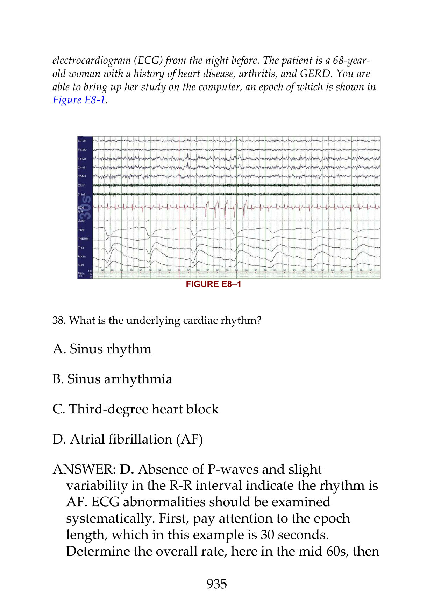
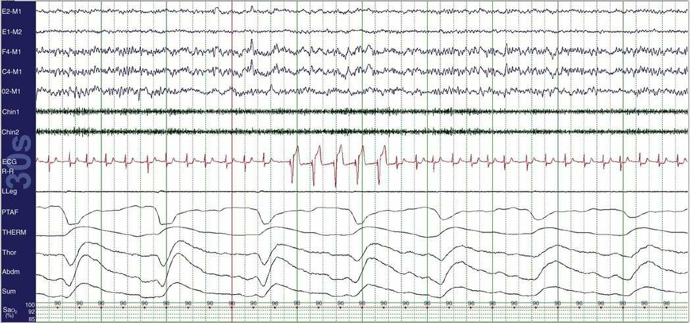
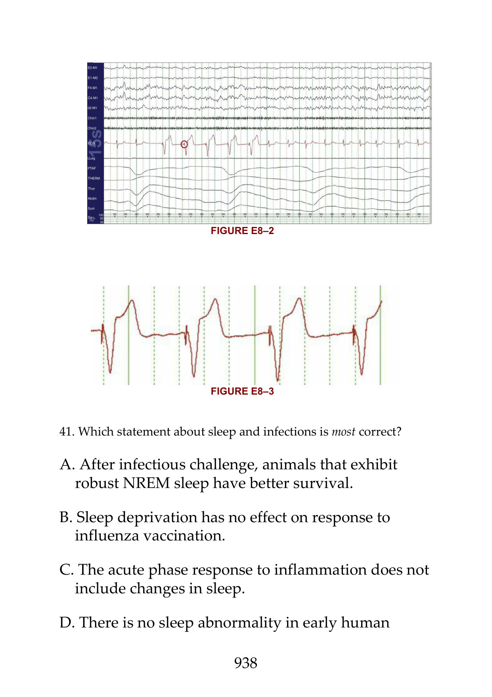
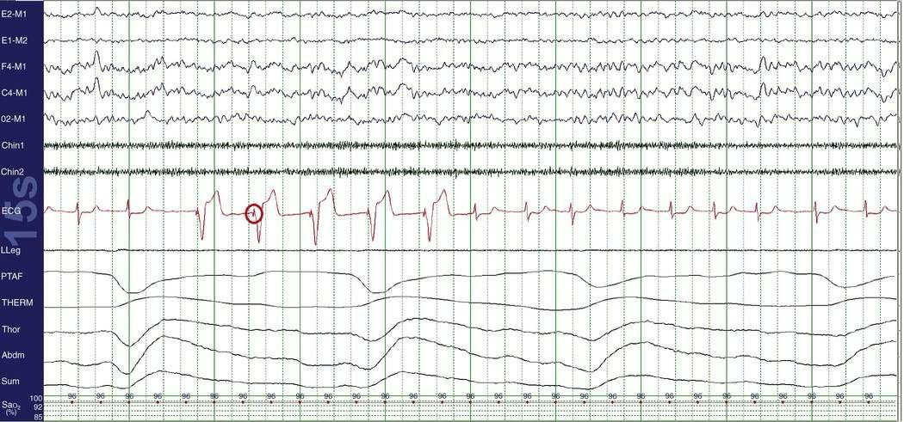
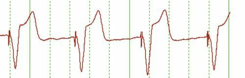
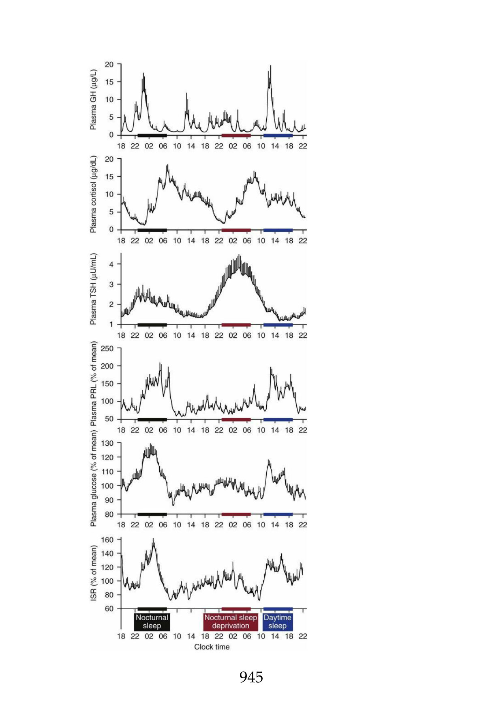
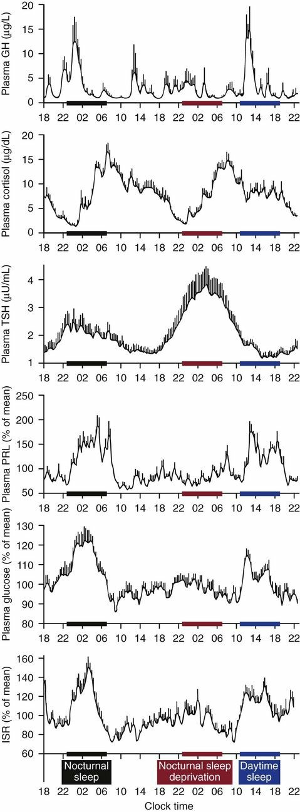

# Section 8 Sleep in Other Disorders

<!-- pdf-page: 861 -->

### SECTION 8

#### Frightening and Disturbing to Observe

## Sleep in Other

## Disorders

## 8.1.

## Neurologic Disorders

## Questions

Over the course of a month, a 34-year-old otherwise healthy man without any daytime symptoms displays dystonic posturing and wide-open eyes during sleep that occurs at various times in the night. As reported by his wife, each episode lasts 40 to 50 seconds. The patient has no recollection of the events.

### B. Rapid eye movement (REM) sleep behavior

1. What is the most likely diagnosis?

### A. Nocturnal seizures

### disorder

### C. Confusional arousals

### 861

<!-- pdf-page: 862 -->

### D. Sleep terrors

2. In the International Classification of Sleep Disorders, edition 3 (ICSD3), his problem is classified as

3. Which medication is used to treat this condition?

### A. REM parasomnia

### B. Non-REM (NREM) parasomnia

### C. Anxiety disorder

### D. Epilepsy disorder

### B. A selective serotonin reuptake inhibitor

### A. Pramipexole

An otherwise healthy 42-year-old patient complains of a single, violent “electric-like” body jerk that occurs at sleep onset. These events, which occur several times a month, have been present as long as he can remember. They tend to be more common when he gets insufficient sleep.

### C. Carbamazepine

### D. Zolpidem

#### Shocking

### B. Persistent benign sleep myoclonus of infancy

4. What is the likeliest diagnosis?

### A. Fragmentary myoclonus

### 862

<!-- pdf-page: 863 -->

### C. Hypnic jerks

### D. Hypnagogic foot tremor

5. How would you manage this patient?

### A. Confirm diagnosis by polysomnography (PSG) and

### B. Reassure the patient about the benign nature of the

### treat with an anticonvulsant.

### C. Start on a dopamine agonist for restless legs

### condition.

### D. Confirm the diagnosis by a home sleep test (HST)

### syndrome.

### and then treat with positive airway pressure (PAP)

### therapy.

6. Which of the following statements regarding excessive daytime sleepiness (EDS) and myotonic dystrophy 1 (MD1) is true?

#### Potpourri

### A. EDS occurs in 10% of patients with MD1.

### B. EDS is exclusively found in MD1 patients with

### C. The severity of EDS does not correlate with the

### sleep-disordered breathing.

### D. The presence of sleep-onset REM periods

### number of nucleotide (CTG) repeats.

### 863

<!-- pdf-page: 864 -->

### (SOREMPs) on the multiple sleep latency test

### (MSLT) excludes diagnosis of MD1.

7. A 9-year-old girl presents with REM sleep behavior disorder. This condition is likely to herald the onset of which of the following disorders?

8. Which of the following neurodegenerative disorders is most commonly associated with nocturnal stridor?

### A. Juvenile Parkinson disease

### B. Narcolepsy

### C. Sleep terrors

### D. Sleepwalking

1. A. This is a classic description of nocturnal frontal lobe epilepsy, also known as nocturnal paroxysmal dystonia. The other three conditions would be in the differential diagnosis.

### A. Parkinson disease

### B. Multiple system atrophy

### C. Adductor spasmodic dysphonia

### D. Pick disease

## Answers

2. D. This is classified as a sleep-related epilepsy disorder. Nocturnal paroxysmal dystonia is one of three diseases in the category of nocturnal frontal lobe epilepsy (NFLE): (1) nocturnal

### 864

<!-- pdf-page: 865 -->

paroxysmal arousal, (2) nocturnal paroxysmal dystonia, and (3) episodic nocturnal wanderings. Generally in these conditions, one parent is affected, and the patient has a mutation in the CHRNA4, CHRNB2, or CHRNA2 gene. (Hirose and Kurahashi, 2012)

3. C. Carbamazepine in small doses leads to remission or improvement in about 70% of patients with nocturnal paroxysmal dystonia. In patients with a specific mutation of the CHRNA4 gene, zonisamide (Zonegran in the United States) has been found to be more effective than carbamazepine. Genetic counseling should also be offered to the patient and his or her family.

4. C. The patient is describing a hypnic jerk, also known as a sleep start. In ICSD3 (p 335), hypnic jerks are described as “sudden, brief, simultaneous contractions of the body or one or more body segments occurring at sleep onset.” Hypnic jerks are often associated with a sensation of falling, and three other conditions have a similar manifestation. Benign sleep myoclonus of infancy is manifested by myoclonic jerks that occur during sleep. It typically begins at birth and resolves spontaneously by 6 months. Hypnagogic foot tremor and alternating leg muscle activation can occur at sleep-wake transitions or during light NREM sleep. PSG shows recurrent electromyography (EMG) potentials in one or both feet that are in the myoclonic range (>250 ms). Propriospinal myoclonus at sleep onset is a disorder of recurrent, sudden muscular jerks in the transition from wakefulness to sleep and is often associated with insomnia.

5. B. Because hypnic jerks are common and benign, reassurance is the goal of management. Such patients often worry they have epilepsy. Diagnosis should be made by the history and does not require a PSG.

6. C. Although the severity of some myotonic dystrophy symptoms directly correlates with the number of abnormal CTG triplet repeats, this is not the case with EDS, which is present in 33% to 39% of patients with MD1. Reduced mean latency and SOREMPs on the MSLT are not uncommon findings in MD1. EDS may be found in MD1 in the absence of either obstructive or central sleep

### 865

<!-- pdf-page: 866 -->

apnea syndromes. (Laberge et al, 2013)

7. B. REM sleep behavior disorder (RBD) can herald the onset of narcolepsy in the pediatric population. Unlike adult RBD, which can herald a synucleinopathy such as Parkinson disease, pediatric RBD is not associated with juvenile Parkinson disease. (Nevsimalova et al, 2007)

8. B. Nocturnal stridor is related to paralysis of the vocal cord abductor muscles. It is seen in some patients with multisystem atrophy and is associated with reduced survival. (Gaig and Iranzo,

#### 2012)

▪ Atlas of Clinical Sleep Medicine, ed 2, Chapters 11.2 through 11.4

## Summary

### Highly Recommended

The sleep medicine certification exam has surprised examinees by an apparent discrepancy between the number of expected and actual neurology questions. The word neurology does not appear on the first page of the blueprint, and the examinee might assume that neurologic disorders are covered in other sections, such as with sleep-breathing disorders, hypersomnia, movement disorders, and parasomnias. However, the blueprint reveals that neurology is covered in the section Sleep in Other Disorders. The 12 questions in that section are divided in the following manner: 40% neurologic, 40% psychiatric, and 20% other medical disorders.

Sleep in Parkinson disease is not mentioned in the section on movement disorders. It is almost as if neurology were an afterthought to the exam committee. As is apparent in this summary, sleep problems are very common in neurologic disorders, and attempting to broadly cover them in four or five questions seems a stretch.

This summary reviews neurologic disorders not covered elsewhere in this volume. It is unclear whether the exam committee will recalibrate future sleep exams to include more neurology. As you go through the summary, remember that all this content will

### 866

<!-- pdf-page: 867 -->

pertain to only four or five questions. Focus on Parkinson disease, Alzheimer disease, stroke, and epilepsy—in that order—and remember the diseases that can cause RBD.

### Narcolepsy and Idiopathic Hypersomnia

### Restless Legs Syndrome and Periodic Limb

### Movements in Sleep

▪ See Section 4 of this volume.

### REM Sleep Behavior Disorder

▪ See Section 5 of this volume.

▪ Defined as bradykinesia with one or more of the following:

▪ See Section 6 of this volume.

### Parkinsonism

### ❍ Muscle rigidity

### ❍ 4- to 6-Hz resting tremor

### ❍ Postural instability

▪ Caused by loss of dopaminergic neurons
▪ Sleep problems include:

### ❍ Insomnia in about 60%

### ❍ Periodic limb movements (PLMs)

### ❍ REM sleep behavior disorder

### 867

<!-- pdf-page: 868 -->

### • In 30% to 90%, when neuronal destruction is caused

### by deposits of alpha-synuclein

### • Rare when neuronal destruction is caused by

### • May be associated with hallucinations

### deposits of tau protein

### • May be related to dopaminergic medications

### ❍ Excessive daytime sleepiness

### • Can have sleep attacks

### Atypical Parkinsonism (Parkinson Plus

### Syndromes)

▪ Lesions in other systems lead to worse prognosis.
▪ Nocturnal stridor can develop and can lead to nocturnal death.
▪ Examples include:

### ❍ Multiple system atrophy (Shy-Drager syndrome)

### ❍ Progressive supranuclear palsy

### ❍ Olivopontocerebellar degeneration

### Stroke (ATLAS2, Chapter 14.2, p 328)

### ❍ Sleep-disordered breathing (SDB) increases risk of

#### Sleep-Disordered Breathing

▪ Epidemiology

### stroke.

### 868

<!-- pdf-page: 869 -->

### • Habitual snoring is an independent risk factor for

### stroke (odds ratio 1.5).

### • Severe obstructive sleep apnea (OSA) is an

### independent risk factor for stroke (hazard ratio 3.3).

### • SDB is present in 50% of patients who have an acute

### ❍ Stroke leads to SDB.

### ❍ With stroke recovery, SDB improves.

### stroke.

### ❍ Central sleep apnea improves more than

### obstructive sleep apnea.

▪ Symptoms

### ❍ Nighttime

### • Sleep-onset insomnia

### • Snoring, stridor

### • Awakening short of breath

### • Orthopnea

### ❍ Daytime

### • Headache

### • Sleepiness

### 869

<!-- pdf-page: 870 -->

### • Cognitive impairment

▪ Findings

### • Combination of OSA (most severe in REM) and CSB

### ❍ Disordered breathing during sleep

### • OSA (most common)

### • Cheyne-Stokes breathing (CSB)

### • Central hypoventilation (when stroke affects the

### (most severe in NREM)

### ❍ Abnormal breathing in wakefulness (most often

### brainstem or spinal cord)

### • Neurogenic hyperventilation (indicates poor

### after stroke affecting the brainstem)

### • Inspiratory breath holding (apneustic breathing)

### prognosis)

### • Irregular rate, rhythm, and tidal volume (Biot

### • Central hypoventilation (Ondine's curse)

### breathing)

### • Respiratory failure

▪ Treatment (see also Section 7 of this volume)

### 870

<!-- pdf-page: 871 -->

### ❍ For OSA: Continuous positive airway pressure

### (CPAP)

### ❍ For CSB and central sleep apnea (CSA)

### ❍ For hypoventilation: mechanical ventilation

### • Oxygen

### • Adaptive servoventilation (ASV)

### • Can improve with modafinil, methylphenidate, and

#### Sleep-Wake Disturbances

▪ Epidemiology

### ❍ Sleepiness

### • Sleep more than 10 hours (25%)

### • Hypersomnia (25%)

### ❍ Insomnia (about 50%)

### ❍ Movement disorder (about 10%)

▪ Symptoms

### ❍ Sleepiness

### dopaminergic drugs

### • Increased sleep time, EDS

### 871

<!-- pdf-page: 872 -->

### • Secondary narcolepsy

### • With hyperphagia (secondary Kleine-Levin

### syndrome)

### • Can improve with zolpidem or zopiclone, but side

### ❍ Insomnia

### ❍ REM sleep behavior disorder (may improve with

### effects are problematic

### • Sleep onset and maintenance

### • Day/night inversion

### • Especially after strokes that affect the pons

### clonazepam)

### ❍ Restless legs syndrome (can improve with

### ❍ Hallucinations and abnormal dreaming

### dopaminergic drugs)

### • Peduncular hallucinosis of Lhermitte (in some

### • Hypnagogic hallucinations

### strokes that affect the pons and midbrain)

### ❍ Reduction or cessation of dreaming

### • Charcot-Wilbrand syndrome (in some strokes that

### affect the cerebral cortex, especially deep frontal)

### 872

<!-- pdf-page: 873 -->

### Neuromuscular Diseases

■ Poliomyelitis

### ❍ Acute poliomyelitis

### ○ Affects motor neurons going to respiratory muscles

### • Bulbar

### ○ Affects respiratory center

### ○ Central hypoventilation and apnea

### • Spinal

### ○ Progressive muscle weakness, development of

### ○ Respiratory muscle weakness

### • Usually improves with time

### ❍ Chronic poliomyelitis

### • Postpolio syndrome

### ○ Sleep-breathing disorders can appear decades after

### hypoventilation, sleep apnea

### ○ Can require nocturnal ventilation or PAP support

### the acute infection.

## Neurodegenerative Diseases

### 873

<!-- pdf-page: 874 -->

▪ Anatomic location of pathology

### ❍ Cerebral cortex

### • Alzheimer disease

### • Amyotrophic lateral sclerosis (ALS)

### • Multiple sclerosis

### • Fatal familial insomnia

### ❍ Basal ganglia

### • Parkinson disease

### • Progressive supranuclear palsy

### ❍ Cerebellum

### • Spinocerebellar ataxia

### ❍ Motor neurons

### • Multiple system atrophy (Shy-Drager syndrome)

### • Primarily autonomic

▪ Sleep disorders

### ❍ Sleep-disordered breathing

### ❍ Hypersomnia

### 874

<!-- pdf-page: 875 -->

### ❍ Circadian rhythm disorders

### ❍ Insomnia

▪ Charcot-Marie-Tooth syndrome (hereditary motor and sensory

### ❍ REM sleep behavior disorder

## Polyneuropathy

### • Pharyngeal muscles: upper airway obstruction

neuropathy)

### ❍ Neuropathy affecting:

### ❍ Sleep-breathing abnormalities are worse in REM

### • Diaphragm: hypoventilation

## Neuromuscular Junction Diseases

### sleep.

### ❍ Sleep apnea occurs in 60% of cases.

▪ Myasthenia gravis

### ❍ Obstructive apnea is the most common finding.

### ❍ Events are most severe in REM sleep.

## Muscular Dystrophies

▪ Myotonic dystrophy

### 875

<!-- pdf-page: 876 -->

### ❍ Autosomal dominant

### ❍ Peripheral component

### • Involves weakness of facial, sternocleidomastoid,

### • Loss of serotonin neurons, dysfunction of

### pharyngeal, and diaphragm muscles

### ❍ Central component

### ❍ Causes lung restriction and chest wall deformity

### hypocretin system

### • Sleepiness, REM onsets

### • Abnormal ventilatory control

### • Sleep apnea, hypoventilation

▪ Duchenne muscular dystrophy

### ○ Older children with hypoventilation should be

### • Sleep apnea, hypoventilation

### ○ Young children might respond to

### adenotonsillectomy.

▪ Rare myopathies that affect control of breathing

### treated with noninvasive ventilation.

### ❍ Sleep apnea and hypoventilation can be seen in:

### 876

<!-- pdf-page: 877 -->

### • Congenital myopathies (e.g., nemaline myopathy)

### • Metabolic myopathies (mitochondrial myopathy,

### acid maltase deficiency)

### • If a sleep-breathing abnormality is found

▪ Treatment

### ❍ Guided by PSG results

### ○ Ventilatory support ranges from CPAP to

### ○ Overall clinical status must be considered.

### noninvasive ventilation.

### • If no sleep-breathing abnormality is found

### ○ A clinical trial of modafinil for daytime sleepiness

### ○ These patients may be very vulnerable to central

### may be useful.

### nervous system (CNS) depressants that worsen

### breathing during sleep.

## Alzheimer Disease (ATLAS2, Ch 11.4)

▪ The APOE4 genotype increases risk for:

### ❍ Alzheimer disease

### ❍ Sleep apnea

### 877

<!-- pdf-page: 878 -->

▪ Accumulation of abnormal tau protein in CNS causes sleep

problems.

### ❍ Suprachiasmatic nucleus

### ❍ Cholinergic neurons in nucleus basalis of Maynert

### • Disrupted circadian rhythm

### ❍ Pedunculopontine tegmental and laterodorsal

### • Reduced REM sleep

▪ Other factors that contribute to poor sleep and “sundowning”

### tegmental nuclei

### • Reduced REM sleep

### • REM behavior disorder

### ❍ Perilocus coeruleus

### • REM behavior disorder

### ❍ Supraspinal autonomic nuclei

### • Autonomic dysfunction

### ❍ Brainstem respiratory centers

### • Sleep-disordered breathing

### ❍ Lack of zeitgebers (e.g., sunlight, clocks)

### 878

<!-- pdf-page: 879 -->

### ❍ Unfamiliar environment

### ❍ Early bedtime

### ❍ Reduced or absent slow-wave sleep (SWS)

### ❍ Cognitive impairment

### ❍ Medical problems

### ❍ Sedatives

### ❍ Naps

▪ PSG findings

### ❍ Increased awakenings

### ❍ Poorly formed or absent spindles and K complexes

### ❍ REM is preserved in early Alzheimer disease.

### ❍ Lewy bodies in parts of the CNS lead to a

## Other Dementias

▪ Dementia with Lewy Bodies

### syndrome that includes:

### • Cognitive decline

### • Parkinsonism

### • Autonomic dysfunction

### 879

<!-- pdf-page: 880 -->

### • Visual hallucinations

### ❍ Sleep problems more common in Lewy body

### disease than in Alzheimer disease

### • Disturbed sleep (arousals, less SWS, less REM)

### • REM behavior disorder

▪ Huntington Disease

### ❍ Sleep problems include:

### • Night/day disruption

### • Development of apnea

▪ Creutzfeldt-Jakob Disease

### ❍ Encephalopathy caused by prions

### • Neural degeneration

### ○ Myoclonic jerks

### ○ Progressive cognitive impairment

### ○ Death

### ❍ Sleep findings

### • Insomnia (common)

### • Reduced SWS

### 880

<!-- pdf-page: 881 -->

### • Few or absent spindles and K complexes

### • Reduced REM

### • Dream reality confusion with aggressive behavior

### • Periodic sharp-wave complexes

## Epilepsy (ATLAS2, Ch 11.3)

▪ Fatal Familial Insomnia

### ❍ Encephalopathy caused by prions

### • Loss of circadian rhythms

### • Neuroendocrine dysregulation

### • Progressive insomnia

### • Death

▪ Sleep state has an effect on propensity for seizures.

### • Enhanced interhemispheric impulse transmission

### ❍ NREM sleep promotes seizures.

### • Cortical synchronization

### ❍ REM sleep protects from seizures.

### • Inhibition of synchronization

### 881

<!-- pdf-page: 882 -->

### • Reduced interhemispheric impulse transmission

## Sleep-Related Epilepsy Syndromes

▪ Nocturnal frontal lobe epilepsy (NFLE)

### ❍ The commonest form is nocturnal paroxysmal

### • Mutation in the CHRNA4, CHRNB2, or CHRNA2

### dystonia.

### ❍ It is a genetic disorder.

### • Zonisamide for the CHRNA4 mutation variant

### genes

### • One parent usually affected

### ❍ Symptoms

### • Nocturnal paroxysmal arousals

### • Nocturnal paroxysmal dystonia

### • Episodic nocturnal wanderings

### ❍ Treatment

### • Carbamazepine

▪ Temporal lobe epilepsy

### ❍ Awake symptoms

### 882

<!-- pdf-page: 883 -->

### • Brief periods of impaired consciousness

### • Staring

### • Patient may demonstrate automatisms.

### • Automatisms

### ❍ Sleep features

### • Seizures can occur during sleep.

▪ Benign childhood epilepsy with central temporal spikes (BECT;

### ❍ Seizures occur exclusively in NREM sleep.

also called benign Rolandic epilepsy)

### • Paresthesias of tongue, lips, gums, and cheek

### • Unilateral

### ❍ Manifestations

Note: There are many other seizure disorders that affect sleep. They are rarely encountered, and it is unlikely that questions about them will appear on the examination. However, you are encouraged to review the PSG features of the more common seizure disorders. (ATLAS2, Ch 11.3)

### • Movement of tongue and lips

### • Drooling during sleep

## Other Neurologic Disorders

### 883

<!-- pdf-page: 884 -->

### Headaches

▪ Migraine headache

### ❍ Onset can occur in either SWS or REM sleep.

### ❍ Sleep can result in amelioration of headache.

### ❍ Most episodes begin during REM sleep.

▪ Cluster headache

### ❍ Chronic paroxysmal hemicrania is a variant.

▪ Hypnic headache

### ❍ Features

### • In older people

### • Occurs only at night

### • One attack per night

### • Lasts 1 to 2 hours

### ❍ Prophylaxis

### • Lithium

### • Flunarizine

### • Indomethacin

### 884

<!-- pdf-page: 885 -->

### • Caffeine

### ❍ Treatment

### • Headaches occur every 60 minutes, day and night.

### • Aspirin

▪ Rare syndromes

### ❍ Hemicrania horologia

### • Headaches last 15 minutes.

### • Flashing lights and noises lasting seconds wake the

### ❍ Exploding head syndrome

### ❍ Specific treatment of headaches is generally

### patient from sleep.

▪ Treatment

### Head Trauma (Traumatic Brain Injury)

### handled by a neurologist.

### • May be related to abnormality in hypocretin system

▪ Sleep features

### ❍ EDS and hypersomnia

### ❍ Insomnia

### 885

<!-- pdf-page: 886 -->

### ❍ Circadian rhythm abnormalities

### ❍ Sleep-breathing disorders can occur if the

### respiratory control system is damaged.

### ❍ Fatigue and daytime sleepiness (might respond to

### Multiple Sclerosis

▪ Sleep features

### ❍ Periodic limb movements common

### modafinil)

### ❍ Insomnia

### ❍ Awakening with leg spasms

### ❍ Snoring

### ❍ Tumors that affect the third ventricle can cause

### Brain Tumors

▪ Sleep symptoms depend on tumor location.

### ❍ Tumors that affect the brainstem can cause

### narcolepsy.

### hypoventilation and respiratory failure.

American Academy of Sleep Medicine. International

## References

Classification of Sleep Disorders. ed 3. American Academy of Sleep Medicine: Darien, Ill.; 2014.

### 886

<!-- pdf-page: 887 -->

Gaig C, Iranzo A. Sleep-disordered breathing in

neurodegenerative diseases. Curr Neurol Neurosci Rep. 2012;12(2):205–217. Hirose S, Kurahashi H: Autosomal dominant nocturnal

frontal lobe epilepsy. Available at: <http://www.ncbi.nlm.nih.gov/books/NBK1169/>. Updated 2012; accessed July 4, 2014. Kryger MH, Avidan A, Berry R. Atlas of clinical sleep medicine.

ed 2. Saunders: Philadelphia; 2014. Laberge L, Gagnon C, Dauvilliers Y. Daytime sleepiness and

myotonic dystrophy. Curr Neurol Neurosci Rep. 2013;13(4):340. Nevsimalova S, Prihodova I, Kemlink D, et al. REM behavior

disorder (RBD) can be one of the first symptoms of childhood narcolepsy. Sleep Med. 2007;8(7–8):784–786.

## 8.2.

## Psychiatric Disorders

A senior United Nations diplomat is referred for severe insomnia. He has trouble falling asleep and staying asleep, and he complains that he is sometimes drenched with sweat during the night. His wife states that he sometimes awakens thrashing his arms. He says, “I can't turn off my mind when I try to fall asleep.” He has served in many places around the world during times of crisis. His insomnia began in 1993, when he was working for the UN during the Rwandan Civil War. Daytime episodes occur during which he appears to be hearing and seeing things that he knows are not there but that nonetheless trouble him a great deal.

## Questions

#### Diplomatic Insomnia

1. What diagnosis should be considered foremost?

### A. Paranoid schizophrenia

### 887

<!-- pdf-page: 888 -->

### B. Psychotic depression

### C. Posttraumatic stress disorder

2. The patient describes significant daytime sleepiness and a 45- pound weight gain in the past 6 months, since starting on a new medication. Which of the following medications most likely explains his symptoms?

### D. REM sleep behavior disorder

3. What medication has the best chance of being effective in this patient?

### A. Modafinil

### B. Propranolol

### C. Methylphenidate

### D. Mirtazapine

A 45-year-old woman with a body mass index (BMI) of 42 presents with a 5-year history of severe depression, daytime fatigue, and lack of energy. During this period, she has been treated only with psychotherapy and has not improved. Her Epworth Sleepiness Scale (ESS) score is 13/24. She

### A. Prazosin

### B. Dilantin

### C. Clonazepam

### D. Risperidone

#### If Only the Insomnia Could Be Cured

### 888

<!-- pdf-page: 889 -->

lives alone and does not know whether she snores. She was referred to the sleep disorders center by her treating psychologist, who suggested that she be started on a new hypnotic medication, although other hypnotics have been ineffective in the past. The patient was convinced that if her insomnia could be cured, the depression would remit. She has a strong family history of depression. The remainder of her medical history and the physical examination are noncontributory.

### A. Formal cognitive behavioral therapy

4. What is the most reasonable next step?

### C. A selective serotonin reuptake inhibitor (SSRI) to

### B. In-lab PSG

### D. Eszopiclone at bedtime to treat her insomnia

### treat her depression

5. The patient undergoes an overnight sleep study, the results of which are given in Table 8.2-1. How would you interpret these findings?

### A. The absence of SWS is the primary reason for her

### B. The delay in both sleep latency and REM latency

### sleep symptoms.

### C. The patient's sleep problem is most likely caused

### are diagnostic of depression.

### D. The findings are within normal limits for her age.

### by sleep apnea syndrome.

Table 8.2–1

### 889

<!-- pdf-page: 890 -->

6. When results of the sleep test are reviewed with the patient, she requests a hypnotic for sleep. What do you recommend as the next step?

Sleep Parameter Result Sleep latency 30 minutes Arousal index 15/hour Percentage slow-wave sleep 0% Percentage REM sleep 15% REM latency 180 minutes Breathing Parameter Result Apnea-hypopnea index 6/hour REM apnea-hypopnea index 25/hour

A 24-year-old overweight woman is referred to the sleep disorders center with a complaint of inability to stay awake during the day. She claims to be awake all night, smoking cigarettes, drinking coffee, and feeling agitated and irritable. Lying in bed awake, she often hears voices that tell her what to do. When falling asleep, she often has dreams that are quite vivid, often to the point where she cannot tell whether she is awake or asleep.

### A. CPAP titration study

### B. Cognitive behavior therapy

### C. A trial of zolpidem

### D. A trial of trazodone

#### Cannot Stay Awake

### A. The next step should be an overnight sleep study

7. What is the most appropriate next step?

### followed by an MSLT to evaluate for narcolepsy.

### B. She should be referred to a psychiatrist for

### treatment of schizophrenia.

### 890

<!-- pdf-page: 891 -->

### C. She should receive cognitive behavioral therapy to

### help with insomnia and poor sleep hygiene.

### D. Urgent treatment with an anxiolytic such as

### clonazepam is indicated for her underlying anxiety

### disorder.

8. What findings would likely be seen on this patient's sleep study?

### A. No specific sleep-related abnormalities

1. C. There are several clues that the patient has posttraumatic stress disorder (PTSD). He had been in a war zone and likely witnessed traumatic events. Such patients often have hallucinations and dissociative flashback episodes. Waking up from a repetitive dream concerning the trauma is also quite common and disturbing. An interesting work on this subject is Shake Hands with the Devil, by Romeo Dallaire. Dallaire, who was head of the United Nations mission in Rwanda, describes his own descent into PTSD.

### B. A marked increase in SWS

### C. A short REM sleep latency

### D. An above-normal sleep efficiency

## Answers

2. D. The patient had been started on mirtazapine, an alpha2A antagonist and mixed 5-HT2/5-HT3 antagonist medication and antidepressant, which is known to cause weight gain. Mirtazapine has been evaluated for the treatment of OSA and was found to be ineffective. It might actually worsen the sleep apnea because of its effect on weight. Sleepiness is also a common side effect of this medication.

### 891

<!-- pdf-page: 892 -->

3. A. Prazosin is a centrally acting alpha1 adrenergic receptor antagonist. In placebo-controlled studies, it has been shown to be effective in reducing nightmares and sleep disturbances in both combat-related and civilian PTSD.

4. B. The next step should be an in-lab PSG, because several features suggest OSA. The patient gives a positive response for two of the categories in the Berlin questionnaire (sleepiness and obesity) and therefore is at high risk for OSA. In addition, among patients with sleep apnea, depressive symptoms are much more common in women than in men, as is a history of hypothyroidism. On the other hand, among patients with sleep apnea, alcohol and caffeine use are greater in men than in women. (ATLAS2, p 154)

5. C. The findings are typical of female patients with sleep apnea. Specifically, although the overall apnea-hypopnea index (AHI) is marginally increased, there is a significant increase in AHI during REM sleep. In depression you would expect to find a reduction in REM latency; when present, the finding is consistent with, but not diagnostic of, depression. Other findings in depression include a reduction in SWS and often an increase in REM sleep as a percentage of total sleep time. (ATLAS2, pp 365-367)

6. A. Because the patient has obstructive sleep apnea syndrome (OSAS), the next steps should be CPAP titration followed by treatment with CPAP, if tolerated. CPAP might improve the depressive symptoms or result in total remission. It is possible she never had depression in the first place; perhaps it was a misdiagnosis based on her sleep-related symptoms. The patient might require a hypnotic or even cognitive behavioral therapy after she has started on CPAP. Although it was once felt that drugs like trazodone might actually improve sleep apnea, research has not confirmed this.

7. B. The history is most consistent with schizophrenia. Hallucinatory perceptions in schizophrenics can seem similar to what is expected in narcolepsy. Patients with schizophrenia might relate more than one type of hallucination—the type typical of schizophrenia (e.g., hearing voices) and hypnagogic hallucinations

### 892

<!-- pdf-page: 893 -->

related to a primary sleep disorder. The schizophrenic hallucinations are considered by the patient to be “real,” and the hypnagogic hallucinations are thought to be some form of a “dream.” An example of a patient with both is shown in Video 20- 21, which can be found in the online version of the Atlas. Occasionally a patient is referred for sleep evaluation by a primary care physician who suspects narcolepsy or some other primary sleep disorder, and the diagnosis ends up being schizophrenia. (Conversely, we have encountered patients in whom a psychiatrist incorrectly diagnosed schizophrenia but whose symptoms are typical of narcolepsy.) Sleep specialists not trained in psychiatry should not be managing schizophrenia.

8. C. Typical findings in schizophrenia include severe insomnia (at times with day/night inversion), reduced sleep efficiency, reduced amount of SWS, and in about half of the patients, a reduction in REM sleep latency. Many patients with schizophrenia are at risk for OSA, especially if they are being treated with antipsychotic agents that increase weight. An important point to remember about schizophrenics in remission is that worsening of insomnia can signal an impending relapse. (Jaffe et al, 2006)

▪ Atlas of Clinical Sleep Medicine, ed 2, Chapter 17

## Summary

### Highly Recommended

The blueprint for the sleep board examination indicates that the entire section incorporating neurology, psychiatry, and other medical conditions totals 12 questions. Thus, expect about four questions out of the 240 on the exam to deal specifically with psychiatry disorders and sleep. Questions may also be about psychiatric medications in the pharmacology section. However, the examiners do not expect you to be a psychiatrist if you are not, but they do expect you to be able to recognize patients with mental disorders and advise about their sleep problems.

### Anxiety Disorders

### 893

<!-- pdf-page: 894 -->

#### Panic Disorder

▪ Sleep symptoms

### ❍ Sleep initiation and maintenance insomnia

### ❍ Sleep deprivation can worsen daytime anxiety

### symptoms and can increase panic episodes.

### ❍ Half of the patients with panic disorder have sleep

### • Awakening in a state of fear that may also manifest

### panic attacks.

### shortness of breath, palpitations, and/or sweating

### ❍ Reexperiencing the traumatic event

▪ Treatment

### ❍ Cognitive behavioral therapy

### ❍ Antianxiety medications

#### Posttraumatic Stress Disorder

▪ Awake symptoms

### ❍ Irritability, outbursts of anger

### ❍ Hypervigilance

### ❍ Exaggerated startle response

▪ Sleep symptoms

### 894

<!-- pdf-page: 895 -->

### ❍ Sleep-onset and sleep-maintenance insomnia

### ❍ Awakening from recurrent nightmare, sometimes

### in a panic-like state

### ❍ Increased fragmentation of REM sleep

▪ PSG findings

### ❍ Increased REM density

### ❍ Comorbid conditions might require specific

### ❍ Shorter episodes of REM sleep

▪ Treatment

### • Cognitive behavioral therapy for sleep and panic

### treatment.

### • Depression and panic disorder

### • OSA

### • Alcohol and/or substance abuse

### ❍ Treatment

### • Psychotherapy

### symptoms

### • Medications

### 895

<!-- pdf-page: 896 -->

### ○ Prazosin is emerging as an important treatment for

### sleep abnormalities.

### Depression (ATLAS2, Ch 17)

### • Increased wake after sleep onset (WASO)

▪ Daytime symptoms

### ❍ Symptoms of depression

### ❍ Daytime fatigue

▪ Sleep-related symptoms: insomnia

### ❍ Difficulty falling asleep

### ❍ Difficulty staying asleep

### ❍ Restless sleep

### ❍ Early-morning awakening

### ❍ Decreased sleep time

### ❍ Nonrefreshing sleep

### ❍ Nightmares

▪ PSG findings

### ❍ Overall sleep

### • Long sleep latency

### 896

<!-- pdf-page: 897 -->

### • Long awakening in early morning

### • Reduced total sleep time

### • Decreased percentage of total sleep time

### ❍ Sleep architecture

### • Slow-wave sleep

### ○ Increased eye density (percentage of REM time in

### • REM sleep

### ○ Short REM latency

### ○ Long first REM episodes

### ○ Increased REM as a percentage of total sleep time

### which eyes are moving)

### • All are sedating except protriptyline.

▪ Pharmacotherapy

### ❍ Tricyclic antidepressants (TCAs)

### • TCAs suppress REM sleep.

### ❍ Monoamine oxidase inhibitors (MAOIs)

### • All MAOIs suppress REM sleep.

### 897

<!-- pdf-page: 898 -->

### • Most can cause insomnia.

### ❍ Selective serotonin reuptake inhibitors (SSRIs)

### • SSRIs can cause slow eye movements in NREM

### • All SSRIs suppress REM sleep.

### • Most can cause insomnia.

### ❍ Selective serotonin-norepinephrine reuptake

### sleep.

### inhibitors (SSNRIs)

### • Most SSNRIs can cause insomnia.

### ❍ Other antidepressants

### • Trazodone

### ○ Decreases REM sleep

### ○ Increases SWS

### ○ Sedative

### • Nefazodone

### ○ Increases SWS

### ○ Sedative

### • Bupropion

### 898

<!-- pdf-page: 899 -->

### ○ Can cause insomnia

### ○ Increases REM sleep

### ○ Weight gain can lead to sleep apnea.

### • Mirtazapine

### ○ Sedative

### ❍ Delusions, hallucinations, disorganized thoughts

### Schizophrenia

▪ Daytime symptoms

### ❍ Daytime sleepiness when sleep deprivation or sleep

### ❍ About half of patients have a reduction in REM

### apnea are present

▪ Nighttime symptoms

### ❍ Severe insomnia or no sleep

▪ PSG findings

### ❍ Sleep efficiency is reduced.

### ❍ The amount of SWS is reduced.

### sleep latency.

### ❍ Many have OSA.

### 899

<!-- pdf-page: 900 -->

▪ Treatment

### ❍ First-generation antipsychotics

### • Reduced sleep latency

### • Inconsistent effects on REM sleep and SWS

### • Improved total sleep time

### • Improved sleep efficiency

### ○ Risperidone and olanzapine increase SWS.

### ❍ Second-generation antipsychotics

### • Reduced sleep latency

### • Improved total sleep time

### • Improved sleep efficiency

### • Inconsistent effects on SWS

### ○ Clozapine reduces SWS.

### Medication and Substance Abuse

#### Alcohol

### ❍ Parasomnias, insomnia, daytime sleepiness

▪ Sleep problems in alcoholics

### ❍ Polyphasic sleep during binge drinking

### 900

<!-- pdf-page: 901 -->

▪ PSG findings

### ❍ Prolonged sleep latency, REM suppression,

### increased SWS

### ❍ With acute abstinence: frequent REM episodes,

### ❍ With recovery and abstinence: increased REM,

### short NREM-REM cycles

### short REM latency, reduced total sleep time

### ❍ Use results in prolonged wakefulness.

#### Stimulants

▪ Cocaine

### ❍ Discontinuation results in a crash with an increase

### in both total sleep and REM sleep time followed by

### insomnia.

### ❍ Increase sleep latency and decrease REM sleep

▪ Amphetamines

### ❍ Discontinuation results in REM rebound and

▪ MDMA (3,4-Methylenedioxymethamphetamine, or ecstasy)

### increase in total sleep time.

### ❍ Decreases total sleep time

### ❍ Does not affect REM sleep

▪ Methylphenidate

### 901

<!-- pdf-page: 902 -->

### ❍ Reduces total sleep time

### ❍ Increases REM latency and time in REM

#### Central Nervous System Depressant Agents

### ❍ All produce an increase in brief arousals and

▪ Opioids

### ❍ With chronic use, tolerance occurs with

### frequent sleep stage shifts.

### suppression of REM sleep and less sleep

### fragmentation.

### ❍ With discontinuation, sleep latency and latency to

### ❍ Opioids can cause hypoventilation or complex

### REM increase.

### ❍ Abuse potential of modern hypnotics is low.

### apnea.

▪ Sedative hypnotics

### ❍ Many patients become dependent on hypnotics and

### ❍ In high doses, THC suppresses REM sleep.

### wish to discontinue them.

▪ Tetrahydrocannabinol

### ❍ REM rebound can occur with discontinuation.

### 902

<!-- pdf-page: 903 -->

## References

Jaffe F, Markov D, Doghramji K. Sleep-disordered breathing:

in depression and schizophrenia. Psychiatry (Edgmont). 2006;3(7):62–68. Kryger MH, Avidan A, Berry R. Atlas of clinical sleep medicine.

#### Rounds on the Internal Medicine Ward

ed 2. Saunders: Philadelphia; 2014.

## 8.3.

## Other Disorders

## Questions

A pulmonary and sleep medicine fellow is making rounds with interns and residents on an internal medicine ward. He is preparing for the sleep medicine boards and has decided to ask sleep-related questions no matter what case is being presented.

1. The first patient on rounds has a 40-pack-year history of cigarette smoking, chronic productive cough, wheezing, and resting dyspnea. Lung exam reveals hyperresonance to percussion, and forced expiratory volume in 1 second (FEV1) is 0.7 L. The patient reports poor quality sleep with sleep-onset insomnia and many awakenings during the night. Which of the following would likely have little or no effect on his sleep quality?

2. The next patient he sees, a 42-year-old man, has been awakening

### A. Oxygen

### B. Theophylline

### C. Nicotine

### D. Nocturnal wheezing

### 903

<!-- pdf-page: 904 -->

every night with pain and then having trouble falling back to sleep. Pain that occurs 1 to 2 hours after sleep onset suggests which of the following conditions?

### A. Bone cancer

3. The third patient on rounds is an obese 57-year-old woman with puffy eyes, somnolence, and a receding hairline. She was admitted to the hospital several days earlier with somnolence. Her thyroidstimulating hormone (TSH) level was 10 times normal, and a diagnosis of hypothyroidism was made. She has a history of snoring and witnessed apneas. Which statement about hypothyroidism and OSA is correct?

### B. Duodenal ulcer disease

### C. Rheumatoid arthritis

### D. Fibromyalgia

### A. Thyroid treatment can worsen heart disease in

### B. Few hypothyroid patients have OSA.

### patients with OSA.

### C. Thyroid therapy increases the apnea-hypopnea

### D. Hypothyroidism in the setting of OSA presents

### index (AHI).

4. The next patient is a 50-year-old man admitted to the hospital with a history of profound weight loss. He has been complaining of night sweats, insomnia, nightmares, and palpitations. Holter monitoring revealed periods of atrial fibrillation (AF) during the

### only with macroglossia.

### 904

<!-- pdf-page: 905 -->

night. What is the most likely diagnosis?

### A. Posttraumatic stress disorder (PTSD)

### B. Tuberculosis

5. The next patient is an elderly gentleman admitted several days earlier with a history of paroxysmal nocturnal dyspnea and coughing and severe sleep-onset insomnia. Chest radiography confirmed pulmonary edema, and he was treated in the intensive care unit (ICU) with intravenous diuretics. After the pulmonary edema resolved, the ICU nurses noted Cheyne-Stokes breathing. He continues to awaken frequently during the night. In patients with heart failure and CSB, when are arousals most likely to occur?

### C. Hyperthyroidism

### D. Panic disorder

6. What treatment has been shown to best improve sleep and lessen CSB severity in patients with heart failure?

### A. During the peak of hyperpnea

### B. At the end of a central apnea

### C. At the onset of a central apnea

### D. During hypopneas

### A. Supplemental oxygen

### B. Temazepam

### C. Medroxyprogesterone acetate

### 905

<!-- pdf-page: 906 -->

### D. Protriptyline

7. The next patient was admitted with the rather embarrassing symptom of nocturnal diarrhea. Upper and lower endoscopy and tests for malabsorption were entirely negative. The patient complains of numbness in his feet. What is the most likely diagnosis?

8. The final patient on rounds is a 49-year-old woman admitted for dialysis. She complains of severe daytime sleepiness and disrupted nocturnal sleep. What is the least likely finding on a sleep study in this patient?

### A. Ulcerative colitis

### B. Crohn disease

### C. Irritable bowel syndrome

### D. Diabetes mellitus

### B. Excessive movements of arms during REM sleep

### A. CSB

### D. Increased motor activity during wakefulness at the

### C. Very high arousal index

1. A. The patient has COPD by history. Although oxygen improves gas exchange, it has little effect on sleep structure or arousal

### beginning of the night

## Answers

### 906

<!-- pdf-page: 907 -->

frequency. The other factors mentioned can worsen sleep. Some hypnotics, such as ramelteon, may be safe in such patients. (Fleetham et al, 1982; Roth, 2009)

2. B. Insomnia is common in all the conditions listed. Patients with duodenal ulcers typically awaken with pain, or sometimes with the sensation of hunger, 1 to 2 hours after sleep onset. Or they might awaken at roughly the same time in the early morning. Pain improves with an antacid. Bone cancer pain can be severe and constant, not necessarily at any recurring time. Patients with rheumatoid arthritis have morning stiffness and pain shortly after they awaken. With fibromyalgia the main sleep-related symptom is nonrefreshing sleep.

3. A. In hypothyroid patients with OSA, the AHI does not decrease significantly when euthyroidism is achieved. Treatment of hypothyroidism with thyroxine in the presence of OSA is potentially hazardous and can lead to cardiovascular complications such as nocturnal angina and cardiac arrhythmias. Management should include CPAP and low-dose thyroxine. (Grunstein and

#### Sullivan, 1988)

4. C. This is a classic description of hyperthyroidism. Patients with hyperthyroidism often have insomnia, nightmares, and night sweats. All the answers listed can cause night sweats and should be in the differential diagnosis. However, the presence of atrial fibrillation tips the diagnosis in favor of hyperthyroidism. (ATLAS2, Ch 15.1)

5. A. Although it seems logical that patients would arouse at the end of a central apnea, that is not the case. The arousals generally occur during the peak of a hyperpnea, which is when Sao2 is at its nadir, and the work of breathing is at its peak. On the other hand, paroxysmal nocturnal dyspnea usually begins at the end of a central apnea. It is worth noting that CSB and heart failure may be present during wakefulness and tend to decrease during REM sleep; the cycle time may be quite long, with many breaths during the hyperpneic phase. Factors that increase sleep instability can trigger CSB. (ATLAS2, pp 322-326)

### 907

<!-- pdf-page: 908 -->

6. A. Oxygen has been shown to both improve CSB and improve sleep quality. Temazepam improves sleep but may have no effect on CSB. (Biberdorf et al, 1993; Hanly et al, 1989)

7. D. Patients with diabetes mellitus have many sleep problems, and about 50% complain of insomnia. This patient likely has severe neuropathy, which affects sleep by causing pain and numbness. When the neuropathy affects the gastrointestinal (GI) tract, the patient can develop nocturnal diarrhea. Patients can also have sleep disorders associated with diabetes-related kidney disease. (ATLAS2, Ch 15.4)

8. B. Patients in kidney failure have very severe sleep disruption, and about 50% complain of insomnia. Restless legs syndrome is extremely common in this group and is often difficult to treat. In addition, kidney failure patients often have CSB. Although they have a very high arousal index related to limb movements, they do not have the features of REM sleep behavior disorder. (ATLAS2,

#### Ch 15.5)

▪ Atlas of Clinical Sleep Medicine, ed 2, Chapter 14

## Summary

### Must Review

The blueprint for the sleep board examination indicates that the entire section on neurology, psychiatry, and other medical disorders totals 12 questions. Thus expect about four questions out of 240 on the exam to deal with the topic of other medical disorders (whatever that means). The examiners know that a sizable minority of test takers are not based in internal medicine but are pediatricians, otolaryngologists, and psychiatrists. In this summary, we focus on the common general medical conditions likely to be seen in a sleep disorders center.

### Hyperthyroidism (ATLAS2, Ch 15.1)

▪ Sleep complaints

### 908

<!-- pdf-page: 909 -->

### ❍ Insomnia

### ❍ Nightmares

### Hypothyroidism (ATLAS2, Ch 15.1)

### ❍ Night sweats

### ❍ Palpitations

### ❍ Atrial arrhythmias

▪ Causes of sleep-wake abnormalities

### ❍ Reduced metabolic rate

### • Can result in coma

### ❍ OSA related to:

### • Obesity

### • Macroglossia

▪ Sleep findings

### ❍ EDS

### ❍ OSA

### ❍ Can develop respiratory failure

### ❍ Bradycardia

### 909

<!-- pdf-page: 910 -->

### Diabetes Mellitus (ATLAS2, Ch 15.4)

▪ Abnormalities causing sleep disturbance

### ❍ Glycosuria

### Heart Failure (ATLAS2, Ch 14.1)

### • Nocturia

### ❍ Peripheral neuropathy

### • Numbness

### • Restless legs syndrome (RLS)

### ❍ Autonomic neuropathy

### • Nocturnal diarrhea

### • Fixed cardiac rate during sleep

### ❍ Hypoxemia related to pulmonary edema

▪ Causes of CSB

### ❍ Long circulation time

### ❍ Increased drive to breathe

▪ Sleep symptoms

### ❍ Sleep-onset insomnia

### ❍ Restless sleep

### 910

<!-- pdf-page: 911 -->

### ❍ RLS

### ❍ Paroxysmal nocturnal dyspnea

▪ Sleep findings

### ❍ CSB (variant of central sleep apnea)

### • Long cycle and many breaths in each cycle of CSB

### • Waxing and waning of ventilation

### ❍ Arousals occur during peak of hyperpnea.

### ❍ Periodic limb movements are common.

### ❍ CSB decreases during REM.

### ❍ Anatomic changes that can lead to obstructive sleep

▪ Treatment

### ❍ Oxygen

### ❍ CPAP (in selected cases)

### ❍ Adaptive servoventilation (ASV)

### Acromegaly (ATLAS2, Ch 15.2)

▪ Hypersecretion of growth hormone

### apnea:

### • Skeletal, involving the face

### 911

<!-- pdf-page: 912 -->

### • Soft tissue, involving the tongue

### • Obesity

### Kidney Failure (ATLAS2, Ch 15.5)

### • Iron deficiency in patients on hemodialysis

▪ Causes of insomnia in kidney failure

### ❍ RLS caused by:

### • Neuropathy from renal disease

### Gastrointestinal Disorders (ATLAS2, Ch 15.3)

### ❍ Periodic movements and sleep

▪ CSB caused by:

### ❍ Acid-base abnormalities

▪ Epigastric pain that awakens the patient can be caused by:

### ❍ Gastroesophageal reflux

### ❍ Peptic ulcer disease

### ❍ Pancreatic cancer

▪ Nocturnal diarrhea can be caused by:

### ❍ Inflammatory bowel disease

### ❍ Diabetic neuropathy

### 912

<!-- pdf-page: 913 -->

### ❍ Neoplasia in the GI tract

▪ Insomnia can be caused by:

### Fibromyalgia and Chronic Fatigue Syndrome

### (ATLAS2, Ch 16.4)

### ❍ Any of the above

### ❍ Insulinoma causing hypoglycemia

### ❍ Can have a reduction in sleep spindles

▪ Sleep-wake complaints are common.

### ❍ Insomnia

### ❍ Nonrestorative sleep

### ❍ Fatigue

▪ PSG findings

### ❍ Long sleep latency

### ❍ Low sleep efficiency

### ❍ Increased nocturnal wakefulness

### ❍ Long REM sleep latency

### ❍ Decreased amount of REM sleep

### ❍ Can have alpha-delta sleep pattern

### 913

<!-- pdf-page: 914 -->

## References

Biberdorf DJ, Steens R, Millar TW, Kryger MH.

Benzodiazepines in congestive heart failure: effects of temazepam on arousability and Cheyne-Stokes respiration. Sleep. 1993;16(6):529–538. Fleetham J, West P, Mezon B, et al. Sleep, arousals, and

oxygen desaturation in chronic obstructive pulmonary disease: the effect of oxygen therapy. Am Rev Respir Dis. 1982;126(3):429–433. Grunstein RR, Sullivan CE. Sleep apnea and hypothyroidism:

mechanisms and management. Am J Med. 1988;85:775–779. Hanly PJ, Millar TW, Steljes DG, et al. The effect of oxygen on

respiration and sleep in patients with congestive heart failure. Ann Intern Med. 1989;111(10):777–782. Kryger MH, Avidan A, Berry R. Atlas of clinical sleep medicine.

ed 2. Saunders: Philadelphia; 2014. Roth T. Hypnotic use for insomnia management in chronic

obstructive pulmonary disease. Sleep Med. 2009;10(1):19–25.

## Section E8 Sleep in Other Disorders

1. A 34-year-old healthy patient without any symptoms in the daytime displays dystonic posturing, open eyes, and rapid pulse every night during sleep, with an episode length of 40 and 50 seconds. The patient has no recollection of these events the next morning. What is the most likely diagnosis?

### Questions

#### Neurologic

### B. Rapid eye movement (REM) sleep behavior

### A. Paroxysmal nocturnal dystonia

### disorder

### 914

<!-- pdf-page: 915 -->

### C. Confusional arousals

### D. Sleep terrors

### ANSWER: A. This history is consistent with

### paroxysmal nocturnal dystonia, in which a patient

### will have periods of odd posturing during the

### night. This disorder is felt to be a disorder of

### nocturnal frontal lobe epilepsy (NFLE), at times

### confirmable via nocturnal video PSG monitoring

### with specialized electroencephalograph (EEG)

### recordings. (ICSD3, p 345, Sleep-Related Epilepsy)

2. The above-mentioned patient's problem is currently classified as which of the following?

### ANSWER: D. As noted in the answer to Question 1

### A. REM parasomnia

### B. NREM parasomnia

### C. Anxiety disorder

### D. Epilepsy disorder

### above, paroxysmal nocturnal dystonia is considered

### a subset of epilepsy with abnormal video PSG and

### EEG findings to support this conclusion.

3. An otherwise healthy patient complains of a lifelong history of a single, violent “electric-like” body jerk that sometimes occurs at sleep onset. What is the diagnosis?

### 915

<!-- pdf-page: 916 -->

### A. Fragmentary myoclonus

### B. Persistent benign sleep myoclonus of infancy

### ANSWER: C. What the patient is describing is a

### C. Hypnic jerk

### D. Hypnagogic foot tremor

### hypnic jerk, also known as a sleep start. In the

### ICSD3, this is classified in the category of “Sleep-

### Related Movements Disorders, Isolated Symptoms,

### and Normal Variants.” These are sudden, brief

### contractions of the body that occur at sleep onset,

### often associated with a sensation of falling. This is

### not persistent benign sleep myoclonus of infancy;

### this disorder, manifested by myoclonic jerks that

### occur during sleep in infants, typically begins at

### birth and resolves spontaneously by 6 months.

### Hypnagogic foot tremor and alternating leg muscle

### activation both can occur at sleep-wake transitions

### or during light NREM sleep. PSG shows recurrent

### EMG potentials in one or both feet that are in the

### myoclonic range of longer than 250 ms.

### Propriospinal myoclonus at sleep onset is a

### disorder of recurrent, sudden muscular jerks in the

### transition from wake to sleep and is often

### associated with insomnia.

### A. Confirm the diagnosis by PSG, and then treat with

4. How would you treat this patient?

### 916

<!-- pdf-page: 917 -->

### anticonvulsants.

### B. Offer reassurance about the benign nature of the

### condition.

### C. Start the patient on pramipexole at night.

### D. Order a PSG to better evaluate the diagnosis.

### ANSWER: B. Because hypnic jerks are common,

### benign, and have no known negative consequences,

### reassurance is the goal of management. Such

### patients often worry they have epilepsy. These

### patients do not require a diagnostic PSG.

5. In humans, epileptic seizures are more common in REM sleep.

### ANSWER: B. False. Epileptic seizures least commonly

### A. True

### B. False

### occur in REM sleep. Stage N3 sleep activates

### interictal discharges, whereas lighter stages of

### NREM sleep promote seizures. (ATLAS2, p 195;

### Minecan D, Natarajan A, Marzec M, Malow B:

### Relationship of epileptic seizures to sleep stage

### and sleep depth, Sleep 25[8]:899-904, 2002)

6. Thalamocortical activity during NREM sleep is associated with a decrease in what activity?

### A. Acetylcholinergic and GABAergic

### 917

<!-- pdf-page: 918 -->

### B. Monoaminergic and acetylcholinergic

### C. Glutaminergic and acetylcholinergic

7. Although scalp electrodes may not demonstrate NFLE, a clinical history of all of the following is consistent with this diagnosis except

### D. Glycinergic and acetylcholinergic

### E. Histaminergic and GABAergic

### ANSWER: B.

### C. Attacks occur several times in one night.

### A. Attacks persist into adulthood.

### B. Attacks are stereotyped.

### D. Attacks occur mostly during REM sleep.

### E. Dystonic posturing may be associated with the

### ANSWER: D. This parasomnia occurs primarily in

### attacks.

### NREM sleep, with 60% of episodes out of N2

### sleep. (ATLAS2, Ch 11.3-1, p 207)

8. REM sleep behavior disorder has not been reported in patients with multiple sclerosis.

### A. True

### B. False

### 918

<!-- pdf-page: 919 -->

### ANSWER: B. False. Patients with MS can have several

### sleep disorders, including REM sleep behavior

### disorder, hypersomnia, sleep paralysis, RLS, and

### REM-related sleep apnea. (ATLAS2, pp 226 and

### 228)

9. Parkinson disease involves degeneration of dopamine neurons in the substantia nigra and may be preceded by years with which of the following?

### C. REM sleep behavior disorder (RBD)

### A. Sleepwalking

### B. Central sleep apnea

### D. Sleep-related rhythmic movement disorder

### ANSWER: C. Symptoms of RBD may precede the

### other symptoms of Parkinson disease; patients with

### Parkinson disease are also prone to insomnia,

### nightmares, RLS, and sleep-disordered

### breathing. (ATLAS2, pp 213-216)

10. Hypersomnolence in Alzheimer disease is associated with loss of which neurons in the basal forebrain?

### A. Melatonin

### B. Dopamine

### C. Acetylcholine

### 919

<!-- pdf-page: 920 -->

### D. Gamma aminobutyric acid (GABA)

### E. Serotonin

### ANSWER: C. Degeneration of the cholinergic neurons

### in the nucleus basalis of Meynert are thought to

### play in important role in the many sleep problems

### of patients with Alzheimer dementia. (ATLAS2, pp

### 223-226)

11. Secondary forms of RBD generally involve neurologic disease that affects which neuroanatomic region?

ANSWER C. The location of the system that leads to muscle atonia in REM is in the pontine tegmentum. (ATLAS2, p 217)

### A. The cortex

### B. The thalamus

### C. The brainstem

### D. The spinal cord

### E. Peripheral nerves

12. Secondary forms of RLS and periodic limb movement disorder (PLMD) occur with a number of neurologic disorders that affect all of the following except

### A. Dopamine neurons

### B. The frontal cortex

### 920

<!-- pdf-page: 921 -->

### C. The motor pathways

### D. The brainstem

13. OSA is thought to precipitate stroke for all of the following reasons except

### E. Peripheral nerves

### ANSWER: B. (ATLAS2, pp 180-183)

### ANSWER: D. OSA is associated with several

### A. Increased atrial fibrillation

### B. Increased diabetes

### C. Increased hypertension

### D. Increased vascular malformations

### E. Increased atherosclerosis

### comorbidities that may lead to stroke. (ATLAS2, pp

### 328-334)

14. Studies demonstrate what percentage of stroke/transient ischemic attack (TIA) patients are noted to have OSA?

### A. 20% to 30%

### B. 30% to 40%

### C. 40% to 50%

### 921

<!-- pdf-page: 922 -->

### D. 50% to 60%

### E. 60% to 70%

ANSWER: E. (Johnson KG, Johnson DC: Frequency of sleep

#### apnea in stroke and TIA patients: a meta-analysis, J Clin Sleep

#### Med 6:131-137, 2010)

15. In what stages of sleep or wakefulness are seizures more likely to occur?

### ANSWER: B. (ATLAS2, p 195; Benbadis SR:

### A. Wake > NREM > REM

### B. NREM > Wake > REM

### C. Wake > REM > NREM

### D. REM > Wake > NREM

### Epileptic seizures and syndromes, Neurol Clin

### 19:251-270, 2001)

16. In what proportion of schizophrenic patients does insomnia occur?

#### Psychiatric

### A. 10%

### B. 20%

### C. 30%

### D. 40%

### 922

<!-- pdf-page: 923 -->

### ANSWER: D. Insomnia is quite common in

### schizophrenia. (Palmese LB, DeGeorge PC, Ratliff

### JC, et al: Insomnia is frequent in schizophrenia

### and associated with night eating and obesity,

### Schizophr Res 133[1-3];238-243, 2011)

17. What EEG sleep changes are found in major depressive disorder?

### ANSWER: A. Reduced REM latency and increased

### A. Short REM latency

### B. Increased slow-wave (N3) sleep

### C. Decreased REM sleep time

### D. Short first REM period

### E. Decreased N2 sleep

### REM during the first half of the night are common

### in depression. (ATLAS2, Table 17-2, p 366; Benca

### RM, Obermeyer WH, Thisted RA, Gillin JC: Sleep

### and psychiatric disorders. A meta-analysis, Arch

### Gen Psychiatry 49:651-668, 1992)

18. Most antidepressant medications have what characteristic effect on sleep?

### A. Increased slow-wave (N3) sleep

### B. Prolonged REM sleep latency

### 923

<!-- pdf-page: 924 -->

### C. Increased proportion of REM sleep

### D. Suppressed dreaming

### ANSWER: B. The most consistent finding is a

### E. Improved RLS symptoms

### reduction of REM sleep. (ATLAS2, Table 17-2, p

### 367; Wilson S, Argyropoulos S: Antidepressants

### and sleep: a qualitative review of the literature,

### Drugs 65[7]:927-947, 2005)

19. The following statements accurately describe the relationship between depression and sleep complaints except

### A. Insomnia is a risk factor for the subsequent

### B. 80% of patients with depression have sleep-related

### development of depression.

### C. The appearance of insomnia precedes the onset of

### complaints.

### depression more often than it occurs following the

### onset of depression.

### D. Early morning awakening is more commonly

### reported than difficulty in falling asleep.

### ANSWER: A. Insomnia and abnormalities in sleep

### architecture are common in depression. (ATLAS2,

### p 365; Perlis ML, Giles DE, Buysse DJ, et al: Which

### depressive symptoms are related to which sleep

### 924

<!-- pdf-page: 925 -->

### electroencephalographic variables? Biol

### Psychiatry 42:904-913, 1997)

20. PSG changes in schizophrenia include the following except

### ANSWER: A. Decreased REM sleep latency and

### A. Increased REM sleep latency

### B. Decreased slow-wave sleep

### C. Increased REM density

### D. Poor sleep efficiency

### increased REM density are found in schizophrenia

### and depression. (ATLAS2, p 368; Monti JM, Monti

### D: Sleep in schizophrenia patients and the effects

### of antipsychotic drugs, Sleep Med Rev 8[2]:133-148,

### 2004)

21. Which of the following sleep “therapies” has demonstrated the longest duration of benefit in depression?

### C. Sleep deprivation for the first half of the night

### A. REM sleep deprivation

### B. Total sleep deprivation

### D. Sleep deprivation for the second half of the night

### ANSWER: A. (ATLAS2, p 366; Reynolds CF 3rd,

### Kupfer DJ: Sleep research in affective illness: state

### 925

<!-- pdf-page: 926 -->

### of the art circa 1987, Sleep 10:199-215, 1987)

22. Which of the following acute changes after trauma are associated with the subsequent development of PTSD?

### ANSWER: B. (ATLAS2, p 368; Mellman TA,

### A. Dream enactment

### B. Fragmented REM sleep

### C. Increased N1 sleep

### D. Decreased N2 sleep

### Bustamante V, Fins AI, et al: REM sleep and the

### early development of posttraumatic stress

### disorder, Am J Psychiatry 159:1696-1701, 2002)

### C. Are more frequent than daytime panic attacks

23. Sleep-related panic attacks

### A. Arise out of REM sleep

### B. Arise out of stage 2 and 3 sleep

### D. Are usually associated with vivid dreams

### E. Usually follow traumatic events during the

### ANSWER: B. (Mellman TA: Sleep and anxiety

### preceding day

### disorders, Psychiatr Clin North Am 29[4]:1047-

### 926

<!-- pdf-page: 927 -->

### 1058, 2006)

24. Insomnia is temporally associated with the appearance of an anxiety disorder predominantly in which way?

### B. Concurrently or after the anxiety disorder

### A. Before the anxiety disorder

### C. There is no dominant temporal relationship.

### ANSWER: B. (Ohayon MM, Roth T: Place of chronic

### insomnia in the course of depressive and anxiety

### disorders, J Psychiatr Res 37[1]:9-15, 2003)

25. Which of the following psychiatric disorders has been most strongly observed in patients with OSA?

### ANSWER: A. Depression symptoms are very common

### A. Depressive disorders

### B. Anxiety disorders

### C. Psychotic disorders

### D. Dementia

### E. Drug abuse

### in OSA, especially in female

### patients. (Sharafkhaneh A, Giray N, Richardson P,

### et al: Association of psychiatric disorders and

### sleep apnea in a large cohort, Sleep 28[11]:1405-

### 927

<!-- pdf-page: 928 -->

### 1411, 2005)

26. Which of the following antidepressant medications is least likely to suppress REM sleep?

### ANSWER: A. (ATLAS2, Table 17-3, p 367; Nofzinger

### A. Bupropion

### B. Fluoxetine

### C. Imipramine

### D. Citalopram

### E. Venlafaxine

### EA, Reynolds CF 3rd, Thase ME, et al: REM sleep

### enhancement by bupropion in depressed men, Am

### J Psychiatry 152[2]:274-276, 1995)

27. Which of the following antidepressant medications is considered most sedating?

### ANSWER: D. (Versiani M, Moreno R, Ramakers-van

### A. Bupropion

### B. Fluoxetine

### C. Protriptyline

### D. Mirtazapine

### E. Venlafaxine

### 928

<!-- pdf-page: 929 -->

### Moorsel CJ, Schutte AJ: Comparative Efficacy

### Antidepressants Study Group. Comparison of the

### effects of mirtazapine and fluoxetine in severely

### depressed patients, CNS Drugs 19[2]:137-146, 2005)

28. Which of the following treatments has little or no effect on sleep quality in patients with COPD?

#### Sleep in Other Disorders

### ANSWER: A. The answer is oxygen. Although oxygen

### A. Oxygen

### B. Theophylline

### C. Nicotine

### D. Alcohol

### improves gas exchange, it has little effect on sleep

### structure or arousal frequency. The other factors

### mentioned can worsen sleep. (Fleetham J, West P,

### Mezon B, et al: Sleep, arousals, and oxygen

### desaturation in chronic obstructive pulmonary

### disease. The effect of oxygen therapy, Am Rev

### Respir Dis 126[3]:429-433, 1982; Roth T: Hypnotic

### use for insomnia management in chronic

### obstructive pulmonary disease, Sleep Med 10[1]:19-

### 25, 2009)

29. In which disorder does pain classically occur 1 to 2 hours after sleep onset?

### 929

<!-- pdf-page: 930 -->

### A. Bone cancer

### B. Duodenal ulcer disease

### ANSWER: B. Patients with duodenal ulcers do not

### C. Rheumatoid arthritis

### D. Fibromyalgia

### inhibit gastric acid secretion in the first 2 hours after

### sleep.

30. Which statement is most correct about the relationship between hypothyroidism and OSA?

### A. Thyroid treatment may worsen heart disease in

### B. Few patients with hypothyroidism have OSA.

### untreated patients with OSA.

### C. Thyroid therapy increases the apnea index in

### D. OSA is present only when microglossia is a side

### untreated patients with OSA.

### ANSWER: A. In hypothyroid patients with OSA, the

### effect of hypothyroidism.

### apnea index does not decrease significantly in all

### when euthyroidism is achieved. Treatment of

### hypothyroidism with thyroxine in the presence of

### sleep apnea is potentially hazardous and may lead

### to cardiovascular complications such as nocturnal

### angina and cardiac arrhythmias. Management

### 930

<!-- pdf-page: 931 -->

### should include CPAP and low-dose

### thyroxine. (Grunstein RR, Sullivan CE: Sleep

### apnea and hypothyroidism: mechanisms and

### management, Am J Med 85:775-779, 1988)

31. In patients with heart failure and resultant Cheyne-Stokes respiration, when do the arousals typically occur?

### ANSWER: A. Arousal occurs during the peak of

### A. During a peak of hyperpnea

### B. At the end of a central apnea

### C. At the onset of apnea

### D. During hypopnea

### hyperpnea (as does maximal oxygen desaturation)

### in heart failure. (ATLAS2, pp 322-324)

32. What treatment has been shown to improve Cheyne-Stokes breathing in heart failure?

### ANSWER: A. Oxygen has been shown to both

### A. Oxygen

### B. Temazepam

### C. Medroxyprogesterone acetate

### D. Protriptyline

### improve CSB and sleep quality. (Hanly PJ, et al:

### 931

<!-- pdf-page: 932 -->

### The effect of oxygen on respiration and sleep in

### patients with congestive heart failure, Ann Intern

### Med 111[10]:777-782, 1989) Temazepam improved

### sleep but had no effect on CSB. (Biberdorf DJ, et al:

### Benzodiazepines in congestive heart failure:

### effects of temazepam on arousability and Cheyne-

### Stokes respiration, Sleep 16[6]:529-538, 1993)

33. Which statement is true about the time of death secondary to cardiovascular causes?

### C. Death rate peaks in the beginning of the night.

### A. Death rate peaks in the morning.

### B. Death rate peaks just after noon.

### D. Death rate peaks in the middle of the night.

### ANSWER: A. Many studies have examined the time

### of death, and it seems to be in the early morning

### hours. And indeed, many cardiovascular

### comorbidities have serious events at this time. The

### exact pathogenesis is unknown but could be related

### to a surge in sympathetic tone, which in turn may

### be initiated by arousal from sleep.

34. Acute nocturnal asthma attacks often occur during which stage of sleep?

### A. N1

### B. N2

### 932

<!-- pdf-page: 933 -->

### C. N3

### D. REM

### ANSWER: C. (Bellia V, Cuttitta G, Insalaco G, et al:

### Relationship of nocturnal bronchoconstriction to

### sleep stages, Am Rev Respir Dis 140[2]:363-367,

### 1989)

35. Possible mechanisms for nocturnal asthma in OSA include all of the following except

### E. Gastroesophageal reflux disease (GERD)

### A. Increased parasympathetic tone

### B. Increased sympathetic tone

### C. Inflammatory effects

### D. Impact of obesity

### ANSWER: B. (Emilsson ÖI, Bengtsson A, Franklin

### KA, et al: Nocturnal gastro-oesophageal reflux,

### asthma and symptoms of OSA: a longitudinal,

### general population study, Eur Respir J 41[6]:1347-

### 1354, 2013)

36. In the overlap syndrome (patients with COPD and OSA), which of the following statements is most correct?

### A. Almost all patients with overlap syndrome have

### severe COPD.

### 933

<!-- pdf-page: 934 -->

### B. Pulmonary hypertension occurs mainly in those

### patients with severe airflow obstruction.

### C. Prevalence of OSA is higher in the COPD

### D. Overlap syndrome patients have higher ICU

### population than in normal controls.

### admission rates than OSA patients without COPD.

### ANSWER: D. (Weitzenblum, et al: Proceedings of

### American Thoracic Society, Feb 15, 2005, pp 237-

### 241)

37. In obesity hypoventilation syndrome (OHS), carbon dioxide retention mechanisms include which of the following?

### A. Blunted hypoxic and hypercapnic drives to breathe

### D. Reduced inspiratory muscle strength

### B. Associated OSA

### C. Mechanical load of obesity

### ANSWER: E. Hypoventilation in this syndrome is

### E. All of the above

### multifactorial. (Mokhlesi B, Tulaimat A: Recent

### advances in obesity hypoventilation syndrome,

### Chest 132;1322-1336, 2007)

#### Call from the Scoring Technologist

At 8 am you receive a call from the scoring tech, who is concerned about an

### 934

<!-- pdf-page: 935 -->

electrocardiogram (ECG) from the night before. The patient is a 68-yearold woman with a history of heart disease, arthritis, and GERD. You are able to bring up her study on the computer, an epoch of which is shown in Figure E8-1.

### ANSWER: D. Absence of P-waves and slight

FIGURE E8–1

38. What is the underlying cardiac rhythm?

### A. Sinus rhythm

### B. Sinus arrhythmia

### C. Third-degree heart block

### D. Atrial fibrillation (AF)

### variability in the R-R interval indicate the rhythm is

### AF. ECG abnormalities should be examined

### systematically. First, pay attention to the epoch

### length, which in this example is 30 seconds.

### Determine the overall rate, here in the mid 60s, then

### 935

<!-- pdf-page: 936 -->

### determine the underlying rhythm. Nowhere do you

### see a P-wave. The width of the underlying QRS is

### narrow, indicating origin in the atria or high up in

### the atrioventricular (AV) node. The rate is

### somewhat slow for AF, but the patient was taking

### digoxin, which slows the rate.

39. What is the five-beat abnormal cardiac rhythm in the middle of this 30-second epoch?

### C. Supraventricular tachycardia with aberrant

### A. Ventricular fibrillation

### B. Ventricular tachycardia

### ANSWER: D. It is difficult to ascertain the rhythm in

### conduction

### D. Indeterminate arrhythmia

### this five-beat run. Answers A, B, and C are incorrect

### because those diagnoses should result in a wider

### QRS and because there really is no tachycardia.

40. What can be done to improve the diagnostic accuracy of the ECG in Figure E8-1?

### A. Examine a 2-minute epoch.

### B. Decrease the high-frequency filter.

### C. Increase the high-frequency filter.

### 936

<!-- pdf-page: 937 -->

### D. Increase amplitude of the ECG.

### ANSWER: C. There are two options to improve ECG

### accuracy on a PSG: (1) examine a shorter epoch

### (thus answer A is incorrect) or (2) examine the same

### data but with an increased high-frequency filter

### setting. This latter option allows a higher resolution

### and assumes that the sampling rate of the ECG was

### the desirable 500 Hz. Increasing the amplitude of

### the ECG will not really help here. Figure E8-2

### shows a shorter epoch (15 seconds) followed by an

### enlargement of the aberrant rhythm sequence (Fig.

### E8-3). It is now apparent that this is a paced

### rhythm, originating from an implanted ventricular

### pacemaker. The pacemaker starts firing when there

### is a longer-than-desired interval after the last

### nonpaced QRS, and it ceases firing when the

### intrinsic fibrillation rate increases. (Note that in the

### 15-second epoch, the distance between the last

### fibrillation QRS and first paced beat is longer than

### the interval between the last paced beat and next

### fibrillation QRS; see Fig. E8-2.)

### 937

<!-- pdf-page: 938 -->

41. Which statement about sleep and infections is most correct?

FIGURE E8–2

FIGURE E8–3

### A. After infectious challenge, animals that exhibit

### robust NREM sleep have better survival.

### B. Sleep deprivation has no effect on response to

### C. The acute phase response to inflammation does not

### influenza vaccination.

### D. There is no sleep abnormality in early human

### include changes in sleep.

### 938

<!-- pdf-page: 939 -->

### immunodeficiency virus (HIV) infection.

### ANSWER: A. Animals that exhibit robust NREM

### sleep have better survival in response to infection.

### Sleep has been shown to be an important

### component of the acute phase response to

### inflammation. Sleep deprivation has been shown to

### affect the rapidity of antibody response after

### influenza vaccination. In early HIV infection, before

### the onset of acquired immune deficiency syndrome

### (AIDS), an increase in stage 4 sleep occurs in the

### latter part of the night, a time usually devoid of

### slow-wave sleep. (ATLAS2, pp 42-43)

42. Which cytokine is not involved in the acute phase response and sleep regulation?

### C. Tumor necrosis factor alpha (TNF-α)

### A. Interleukin-1β

### B. Interleukin-6

### ANSWER: D. Ghrelin is not involved in the acute

### D. Ghrelin

### phase response, nor is it involved in sleep

### regulation. The other entities are involved in both

### sleep regulation and the acute phase

### response. (ATLAS2, Table 3.5-1, p 42)

43. The regulation of hormonal release in most components of the endocrine system is modulated by

### 939

<!-- pdf-page: 940 -->

### A. Mainly circadian processes

### B. Mainly sleep processes

### C. Interacting circadian and sleep processes

### ANSWER: C. The secretion of most endocrine

### D. None of the above

### products is influenced by both circadian and sleep-

### related processes that interact. The relative

### contributions of these regulatory systems vary from

### one endocrine system to another. Growth hormone

### is secreted mostly during sleep (stage N3), so it is

### regulated by state; cortisol is secreted as a function

### of clock time (circadian factor); thyroid-stimulating

### hormone secretion is regulated by both time and

### sleep processes; prolactin secretion increases with

### sleep onset. (ATLAS2, pp 58-64)

44. Which statement about control of circadian oscillation is correct?

### A. The only circadian oscillator that has been

### documented is in the suprachiasmatic nucleus

### (SCN).

### B. Melatonin is the neurotransmitter that sends

### information from the SCN to end organs.

### C. Circadian oscillations can be generated in many

### peripheral organs, such as fat cells and insulin

### secreting pancreatic beta cells.

### 940

<!-- pdf-page: 941 -->

### D. Circadian oscillators in peripheral tissues do not

### appear to be controlled by the central pacemaker in

### the SCN.

### ANSWER: C. It is now clear that almost every cell in

### the body has the ability to demonstrate circadian

### oscillation and function. Circadian oscillations have

### been found in many peripheral tissues, including

### cells that release endocrine signals (e.g., adipocytes

### and pancreatic beta cells). These peripheral tissue

### oscillators appear to be under the control of the

### SCN either directly, via neural or endocrine signals,

### or indirectly, via behavioral rhythms such as the

### sleep-wake cycle or the timing of

### feeding. (ATLAS2, pp 34-37)

45. Which statement about the timing of growth hormone (GH) release is correct?

### A. GH is secreted primarily during physical activity.

### B. The most reproducible pulse of GH secretion

### occurs shortly before awakening in the morning.

### C. In men, the sleep-onset GH pulse is generally the

### D. The GH spike in secretion at night is linked to REM

### largest secretory pulse observed.

### ANSWER: C. The 24-hour plasma GH levels are stable

### sleep.

### and low levels but are abruptly interrupted by

### 941

<!-- pdf-page: 942 -->

### bursts of secretion. The most reproducible pulse is

### shortly after falling asleep. In adult males, the sleep-

### onset pulse is the largest—and often the only—

### burst in secretion. In women, daytime GH pulses

### are more frequent, and the sleep-associated pulse,

### although still present, does not account for most of

### the GH secretion. A burst in GH secretion occurs

### with a sleep onset whether sleep is advanced,

### delayed, or interrupted and then

### resumed. (ATLAS2, p 59)

46. Which statement about the relationship between slow-wave sleep and GH secretion is incorrect?

### A. Peak GH release occurs within minutes of the onset

### B. Gamma-hydroxybutyrate (GHB), which increases

### of slow-wave sleep (SWS).

### slow-wave sleep, results in increases in GH

### secretion.

### C. Sedative hypnotics (benzodiazepines and

### imidazopyridines) that do not increase SWS do not

### increase nocturnal GH release.

### D. The relationship between GH secretion and SWS is

### ANSWER: C. There does appear to be a tight linkage

### stronger in men than in women.

### between the production of GH and slow-wave

### sleep, and compounds that increase the amount of

### slow-wave sleep, for example, GHB, increase the

### 942

<!-- pdf-page: 943 -->

### production of GH. Athletes have been known to use

### GHB as a means of increasing GH production to

### improve their athletic performance. (ATLAS2, p 59)

47. Which statement about cortisol levels and sleep is incorrect?

### A. The plasma levels of cortisol are highest in the

### B. The plasma levels of cortisol are lowest in the late

### early morning.

### evening and early part of the sleep period.

### C. Sleep is normally initiated when corticotropic

### D. Sleep onset is associated with a burst of cortisol

### activity is quiescent.

### ANSWER: D. Cortisol secretion is primarily related to

### secretion.

### the circadian system (clock time) and is not affected

### much by whether sleep occurs. It is believed that

### sleep actually inhibits cortisol secretion, but this

### inhibition may be difficult to demonstrate, because

### cortisol levels are already low at normal sleep time.

### One clinically useful test of adrenal function is to

### measure cortisol levels at midnight and in the

### morning. A very high midnight cortisol level and

### loss of circadian variability (the morning cortisol

### level remains high) is supportive of a diagnosis of

### Cushing syndrome, a disorder in which the

### adrenals produce too much cortisol. This can be due

### to a tumor: an adenoma in the pituitary that

### 943

<!-- pdf-page: 944 -->

### produces too much adrenocorticotropic hormone

### (ACTH); a tumor that produces ectopic ACTH (e.g.,

### small cell lung cancer); or a tumor of adrenal

### tissue. (ATLAS2, p 59)

48. Which statement about sleep and thyroid hormone secretion is incorrect?

### A. Daytime levels of plasma TSH are low and

### B. There is a rapid elevation in TSH level starting in

### relatively stable.

### C. The highest level of TSH occurs at the beginning of

### the early evening.

### D. Sleep deprivation results in a suppression of TSH

### the sleep period.

### ANSWER: D. During sleep deprivation (Fig. E8-4),

### secretion.

### nocturnal TSH secretion is increased by as much as

### 200% over the levels observed during nocturnal

### sleep. Thus sleep inhibits TSH secretion, and sleep

### deprivation relieves this inhibition. (ATLAS2, p 59)

### 944

<!-- pdf-page: 945 -->

### 945

<!-- pdf-page: 946 -->

FIGURE E8–4

49. Which statement about sleep and glucose regulation is incorrect?

### A. During sleep, glucose levels typically increase.

### B. During sleep, there is a drop in glucose use by the

### C. During NREM sleep, a substantial reduction occurs

### brain.

### D. Glucose use during REM sleep exceeds glucose use

### in cerebral glucose metabolism.

### ANSWER: A. In spite of a relative fast during sleep,

### during NREM sleep.

### blood glucose levels remain constant or only

### decrease minimally. In contrast, during a daytime

### fast, blood glucose falls. These findings can be

### explained by a relative decrease in glucose

### tolerance together with a decrease of glucose

### utilization. (ATLAS2, p 59)

50. Which statement about appetite-regulating hormones is incorrect?

### A. Leptin levels increase in response to acute caloric

### C. Orexins have wakefulness-promoting effects and

### shortage.

### B. Leptin is produced by adipocytes.

### 946

<!-- pdf-page: 947 -->

### stimulate intake of food.

### D. Ghrelin levels increase before meal time.

### ANSWER: A. Knowledge about these compounds is

### critical. Leptin, produced by fat cells, is an appetite-

### suppressing hormone. Ghrelin, produced by gastric

### cells, promotes hunger. Orexin stimulates food

### intake and leads to wakefulness (remember that

### narcoleptics are deficient in orexin, also called

### hypocretin). Orexin is inhibited by leptin and

### stimulated by ghrelin. (ATLAS2, pp 56-58)

51. What statement about chronic sleep deprivation on metabolism is incorrect?

### A. Sleep deprivation results in improved glucose

### B. Sleep deprivation results in increased ghrelin

### tolerance.

### C. Sleep deprivation results in reduced leptin levels.

### levels.

### D. Sleep deprivation results in weight loss.

### ANSWER: A. Sleep deprivation results in reduced

### leptin and increased ghrelin, which increases

### appetite. These result in changes that would lead to

### obesity and insulin resistance. This is a very

### important topic and impacts several aspects of sleep

### medicine. (ATLAS2, pp 56-58)

### 947
