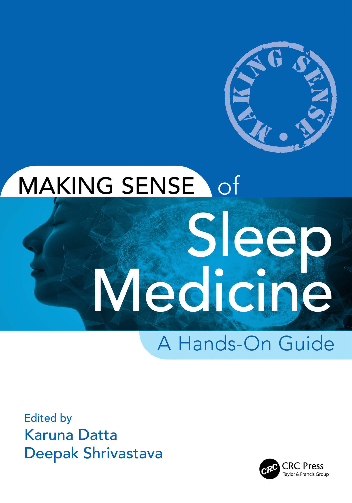
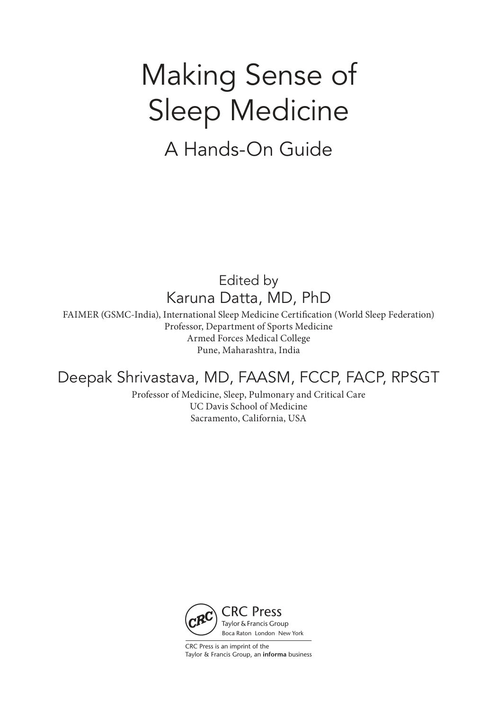
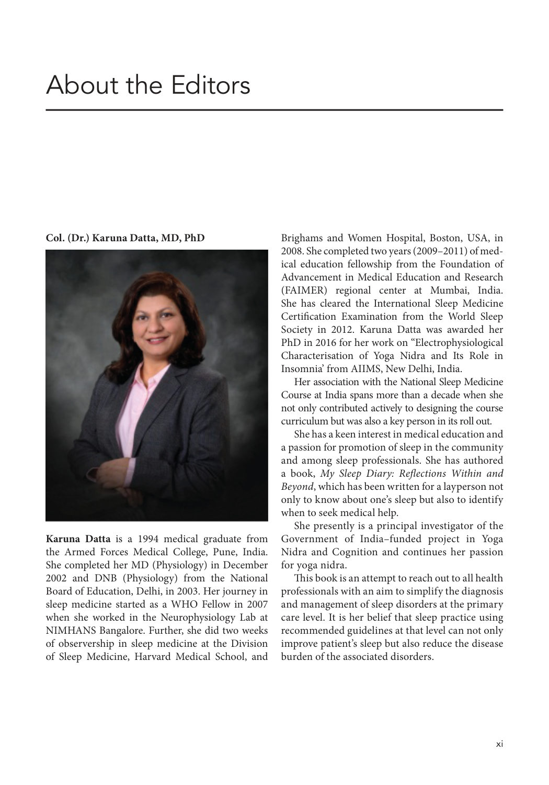
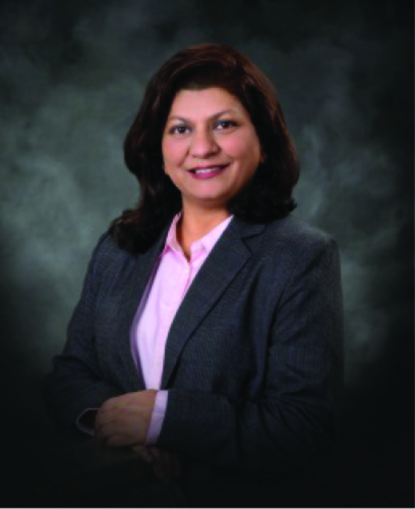
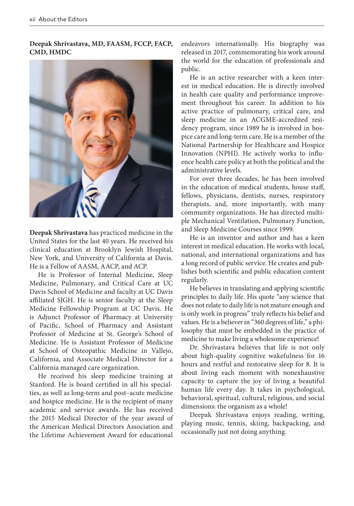
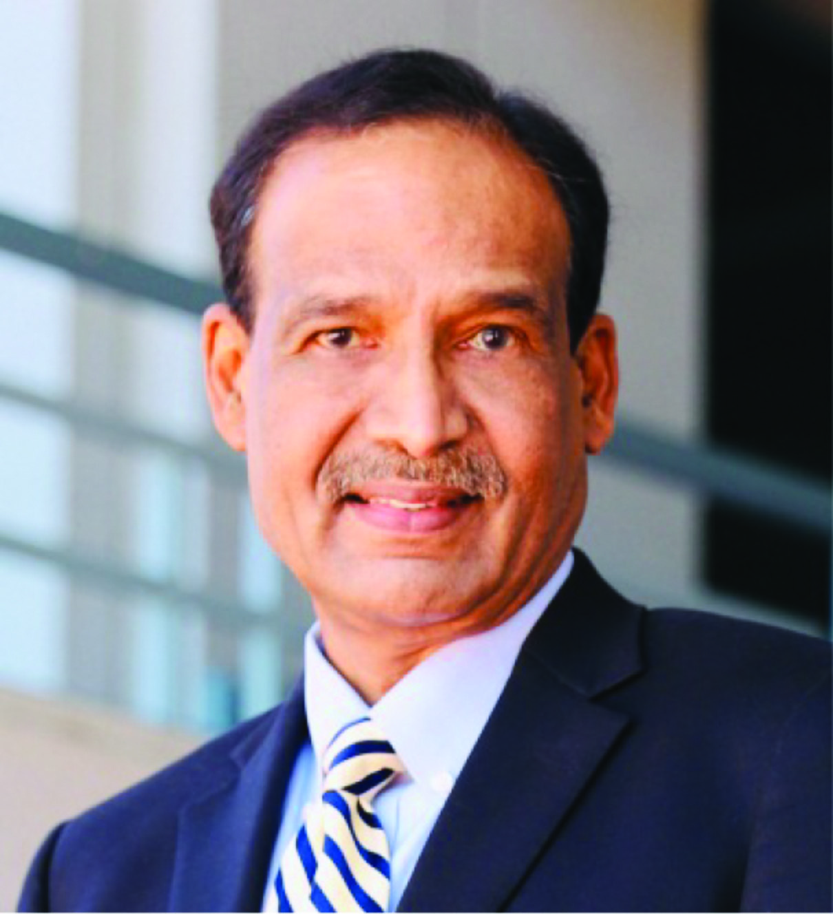

# Front Matter

<!-- pdf-page: 1 -->

<!-- pdf-page: 2 -->

## Making Sense of

## Sleep Medicine

Tis is a practical and patient-complaint-focused handbook, directed to motivate nonsleep experts and beginners in sleep medicine and technology. Tis book provides a basic review of the area of sleep, identifes some common patient presentations, and illustrates the types of investigations that should be requested. With sleep and breathing problems being so common and afecting many other chronic clinical conditions, it is important that primary care and other general physicians, as well as allied health practitioners, have a greater appreciation of this area. Tis text is a valuable go-to handbook for the occasional “sleep” practitioner to refer to.

● Contains specially packaged case scenarios, basic sleep monitoring techniques in detail with sample reports, followed by self-assessment questions.

Key Features:

● Provides direction to health care professionals who encounter patients with sleep and breathing disorders in their practices.

● Uses algorithms and concept maps for dealing with specifc symptoms.

<!-- pdf-page: 3 -->

### Making Sense of

#### About the Series

Te Making Sense of series covers a variety of medical topics and subjects allied to medicine. Some of them are practical and technique-based, some provide professional advice, and some relate to professional development. All titles are easy to navigate for quick reference and include plenty of features such as ‘summary boxes’, ‘pearls of wisdom’, and ‘clinical considerations’. Easy to understand, written in a jargonfree style, and convenient for carrying around, the Making Sense of series provides hands-on guidance to be referred to ofen in both clinical and reference contexts.

#### Making Sense of Fluids and Electrolytes: A Hands-On Guide, 1st Edition

Zoja Milovanovic, Abisola Adeleye

#### Making Sense of the ECG: A Hands-On Guide, 5th Edition

Andrew Houghton

#### Making Sense of Clinical Teaching: A Hands-On Guide to Success, 1st Edition

Edited By Samy A Azer

#### Making Sense of Exercise Testing, 1st Edition

Robert B. Schoene, H. Tomas Robertson

#### Making Sense of Clinical Examination of the Adult Patient: A Hands-On Guide, 1st Edition

By Douglas Model

#### Making Sense of Critical Appraisal, 1st Edition

Olajide Ajetunmobi

#### Making Sense of Sleep Medicine: A Hands-On Guide

Edited by Karuna Datta and Deepak Shrivastava

<!-- pdf-page: 4 -->

## Making Sense of

## Sleep Medicine

### Edited by

### Karuna Datta, MD, PhD

FAIMER (GSMC-India), International Sleep Medicine Certifcation (World Sleep Federation) Professor, Department of Sports Medicine Armed Forces Medical College Pune, Maharashtra, India

## A Hands-On Guide

### Deepak Shrivastava, MD, FAASM, FCCP, FACP, RPSGT

Professor of Medicine, Sleep, Pulmonary and Critical Care UC Davis School of Medicine Sacramento, California, USA

Boca Raton London New York

CRC Press is an imprint of the Taylor & Francis Group, an informa business

<!-- pdf-page: 5 -->

First edition published 2023 by CRC Press 6000 Broken Sound Parkway NW, Suite 300, Boca Raton, FL 33487–2742

and by CRC Press 4 Park Square, Milton Park, Abingdon, Oxon, OX14 4RN

CRC Press is an imprint of Taylor & Francis Group, LLC

Tis book contains information obtained from authentic and highly regarded sources. While all reasonable eforts have been made to publish reliable data and information, neither the author[s] nor the publisher can accept any legal responsibility or liability for any errors or omissions that may be made. Te publishers wish to make clear that any views or opinions expressed in this book by individual editors, authors or contributors are personal to them and do not necessarily refect the views/opinions of the publishers. Te information or guidance contained in this book is intended for use by medical, scientifc or health-care professionals and is provided strictly as a supplement to the medical or other professional’s own judgement, their knowledge of the patient’s medical history, relevant manufacturer’s instructions and the appropriate best practice guidelines. Because of the rapid advances in medical science, any information or advice on dosages, procedures or diagnoses should be independently verifed. Te reader is strongly urged to consult the relevant national drug formulary and the drug companies’ and device or material manufacturers’ printed instructions, and their websites, before administering or utilizing any of the drugs, devices or materials mentioned in this book. Tis book does not indicate whether a particular treatment is appropriate or suitable for a particular individual. Ultimately it is the sole responsibility of the medical professional to make his or her own professional judgements, so as to advise and treat patients appropriately. Te authors and publishers have also attempted to trace the copyright holders of all material reproduced in this publication and apologize to copyright holders if permission to publish in this form has not been obtained. If any copyright material has not been acknowledged please write and let us know so we may rectify in any future reprint.

Views and ideas are those of author/authors and do not represent the views and position of the Indian Army. Except as permitted under U.S. Copyright Law, no part of this book may be reprinted, reproduced, transmitted, or utilized in any form by any electronic, mechanical, or other means, now known or hereafer invented, including photocopying, microflming, and recording, or in any information storage or retrieval system, without written permission from the publishers.

For permission to photocopy or use material electronically from this work, access www.copyright.com or contact the Copyright Clearance Center, Inc. (CCC), 222 Rosewood Drive, Danvers, MA 01923, 978–750–8400. For works that are not available on CCC please contact mpkbookspermissions@tandf.co.uk

Trademark notice: Product or corporate names may be trademarks or registered trademarks and are used only for identifcation and explanation without intent to infringe.

ISBN: 978-0-367-55409-5 (hbk) ISBN: 978-0-367-55408-8 (pbk) ISBN: 978-1-003-09338-1 (ebk)

DOI: 10.1201/9781003093381

Typeset in Minion by Apex CoVantage, LLC

<!-- pdf-page: 6 -->

#### This book is dedicated to the memory of my parents, unstinted support of my

#### dear husband, Rakesh, constant encouragement of my lovely sons, Rohan

#### and Ritvik, and priceless companionship of Ginger.

#### —K.D.

#### To my better half Kavita and beautiful daughters, Dr. Roopa and her husband

#### Aman Sirohi; and Dr. Richa Shrivastava, for being inspirational to me. My lovely

#### grandchildren Aaryan and Ryanna Sirohi, who always waited to spend just a little

#### time with me.

#### —D.S.

<!-- pdf-page: 7 -->

<!-- pdf-page: 8 -->

## Contents

#### Preface

#### ix

#### About the Editors

#### xi

#### Contributors

#### xiii

#### PART 1 BASICS FIRST

#### 1

4 Respiratory Physiology: Simple Science of CPAP and PAP Devices Explained Deepak Shrivastava, and Ajitpal Sethi

1 Basic Physiology of Sleep Karuna Datta

2 Physiology of Circadian Rhythm Karuna Datta

3 Physiological Changes during Sleep Karuna Datta

3

9

15

21

#### PART 2 WHAT DOES ONE DO IF THE PATIENT COMPLAINS OF SLEEP PROBLEMS?

#### 37

5 Drugs That Affect Sleep Deepak Shrivastava

29

6 Does the Patient Go to Bed on Time at Night and Can’t Sleep? Karuna Datta

39

7 Does the Patient Snore? Does the Patient Stop Breathing at Times during Sleep? Deepak Shrivastava, and Richa Shrivastava

45

10 Does the Patient have Pain, Headaches, High Blood Pressure, Diabetes, Stroke, Ventilation or Cardiac Disorders, or Other Problems? Karuna Datta

8 Does the Patient Have Excessive Daytime Sleepiness? Deepak Shrivastava

9 Does the Patient Have Abnormal Movements at Night? Deepak Shrivastava

51

59

65

11 Is There a Complaint of Depression, Anxiety, Stress, etc.? Deepak Shrivastava

71

vii

<!-- pdf-page: 9 -->

viii Contents

12 Is the Patient a Child? Is the Patient Pregnant? Other Special Cases Deepak Shrivastava

13 Is the Patient Not Sleeping on Time? Karuna Datta

81

14 Broad Approach to Common Case Scenarios with Complaints of Sleep Karuna Datta

89

#### PART 3 HOW DO I INVESTIGATE THE PATIENT? (ASSESSMENT AND MONITORING)

#### 95

18 Actigraphy: Indications, Procedural Do’s and Don’ts, Sample Report Karuna Datta, and Thomas Joseph

15 Basic Structure of Sleep Interview Deepak Shrivastava, and Richa Shrivastava

16 Questionnaires Karuna Datta

17 Use of a Sleep Diary Karuna Datta

97

105

109

121

20 Polysomnography I: Detail with Indications, Hookup Procedure, Do’s and Don’ts Karuna Datta

19 Home Sleep Apnea Testing Deepak Shrivastava

127

133

21 Polysomnography II: Sample Reports with Explanation of Various Terminologies Deepak Shrivastava

141

#### PART 4 WHAT SHOULD I DO NOW? (MANAGEMENT)

#### 147

22 Sleep Hygiene Principles and Nonpharmacological Interventions including Light Therapy Karuna Datta

149

26 Titration Protocols, Continuous Positive Airway Pressure (CPAP), and Other PAP Devices Deepak Shrivastava, and Ajitpal Sethi

23 Identifying the Need for Counselling Karuna Datta

24 Pharmacological Agents Used in Various Sleep Disorders Deepak Shrivastava

25 Simple Positional Devices, Dental Appliances Deepak Shrivastava, Ajitpal Sethi, and Richa Shrivastava

155

159

165

171

27 Chapter-Based Assessment 179 Karuna Datta, and Deepak Shrivastava

#### PART 5 SELF-ASSESSMENT

#### 177

#### Index

#### 187

<!-- pdf-page: 10 -->

## Preface

It was April 2019, India, long before the pandemic, when we were planning a session that we were to co-host in a sleep meeting. During the discussions, we pondered on the sleep education programs in progress all over the globe. A glaring gap became evident, and we decided to do something about it. Tis gap was the relative inadequacy of dealing with sleep complaints and its disorders at the frst rung of our health care delivery systems. Yes, at the primary care level! Tis simple observation mustered our resolve to bridge this gap in our health care systems. Te most crucial point we arrived at was the lack of resources specifcally targeting sleep and its disorders for health care’s clientele.

We set out on a journey to develop educational content including clear explanations of basic concepts, of the commonly seen disorders whereby the patient complains of sleep problems, and of bringing together a suitable management plan. We were very clear that we did not want to complicate the

content, but at the same time we sought to ensure that our book would highlight the standards of care and empower practitioners to develop a logical line of reasoning to understand the why and how of comprehensive sleep medicine. Our vision was to bring the concept of sleep medicine under a common umbrella and organize it from the practitioner’s point of view, ensuring better communication, management, and clinical outcomes while attending to patients who are ofen themselves unaware of the detrimental consequences.

And so our journey began . . . We are glad that, despite the testing times, we could give this book the shape we had envisioned. We hope that our health care fraternity benefts from this book and takes on the formidable task of enabling people to sleep better in this challenging time.

#### Karuna Datta

#### Deepak Shrivastava

ix

<!-- pdf-page: 11 -->

<!-- pdf-page: 12 -->

## About the Editors

#### Col. (Dr.) Karuna Datta, MD, PhD

Karuna Datta is a 1994 medical graduate from the Armed Forces Medical College, Pune, India. She completed her MD (Physiology) in December 2002 and DNB (Physiology) from the National Board of Education, Delhi, in 2003. Her journey in sleep medicine started as a WHO Fellow in 2007 when she worked in the Neurophysiology Lab at NIMHANS Bangalore. Further, she did two weeks of observership in sleep medicine at the Division of Sleep Medicine, Harvard Medical School, and

Brighams and Women Hospital, Boston, USA, in 2008. She completed two years (2009–2011) of medical education fellowship from the Foundation of Advancement in Medical Education and Research (FAIMER) regional center at Mumbai, India. She has cleared the International Sleep Medicine Certifcation Examination from the World Sleep Society in 2012. Karuna Datta was awarded her PhD in 2016 for her work on “Electrophysiological Characterisation of Yoga Nidra and Its Role in Insomnia’ from AIIMS, New Delhi, India.

Her association with the National Sleep Medicine Course at India spans more than a decade when she not only contributed actively to designing the course curriculum but was also a key person in its roll out.

She has a keen interest in medical education and a passion for promotion of sleep in the community and among sleep professionals. She has authored a book, My Sleep Diary: Refections Within and Beyond, which has been written for a layperson not only to know about one’s sleep but also to identify when to seek medical help.

She presently is a principal investigator of the Government of India–funded project in Yoga Nidra and Cognition and continues her passion for yoga nidra.

Tis book is an attempt to reach out to all health professionals with an aim to simplify the diagnosis and management of sleep disorders at the primary care level. It is her belief that sleep practice using recommended guidelines at that level can not only improve patient’s sleep but also reduce the disease burden of the associated disorders.

xi

<!-- pdf-page: 13 -->

xii About the Editors

Deepak Shrivastava, MD, FAASM, FCCP, FACP,

#### CMD, HMDC

endeavors internationally. His biography was released in 2017, commemorating his work around the world for the education of professionals and public.

Deepak Shrivastava has practiced medicine in the United States for the last 40 years. He received his clinical education at Brooklyn Jewish Hospital, New York, and University of California at Davis. He is a Fellow of AASM, AACP, and ACP.

He is Professor of Internal Medicine, Sleep Medicine, Pulmonary, and Critical Care at UC Davis School of Medicine and faculty at UC Davis afliated SJGH. He is senior faculty at the Sleep Medicine Fellowship Program at UC Davis. He is Adjunct Professor of Pharmacy at University of Pacifc, School of Pharmacy and Assistant Professor of Medicine at St. George’s School of Medicine. He is Assistant Professor of Medicine at School of Osteopathic Medicine in Vallejo, California, and Associate Medical Director for a California managed care organization.

He received his sleep medicine training at Stanford. He is board certifed in all his specialties, as well as long-term and post–acute medicine and hospice medicine. He is the recipient of many academic and service awards. He has received the 2015 Medical Director of the year award of the American Medical Directors Association and the Lifetime Achievement Award for educational

He is an active researcher with a keen interest in medical education. He is directly involved in health care quality and performance improvement throughout his career. In addition to his active practice of pulmonary, critical care, and sleep medicine in an ACGME-accredited residency program, since 1989 he is involved in hospice care and long-term care. He is a member of the National Partnership for Healthcare and Hospice Innovation (NPHI). He actively works to infuence health care policy at both the political and the administrative levels.

For over three decades, he has been involved in the education of medical students, house staf, fellows, physicians, dentists, nurses, respiratory therapists, and, more importantly, with many community organizations. He has directed multiple Mechanical Ventilation, Pulmonary Function, and Sleep Medicine Courses since 1999.

He is an inventor and author and has a keen interest in medical education. He works with local, national, and international organizations and has a long record of public service. He creates and publishes both scientifc and public education content regularly.

He believes in translating and applying scientifc principles to daily life. His quote “any science that does not relate to daily life is not mature enough and is only work in progress” truly refects his belief and values. He is a believer in “360 degrees of life,” a philosophy that must be embedded in the practice of medicine to make living a wholesome experience!

Dr. Shrivastava believes that life is not only about high-quality cognitive wakefulness for 16 hours and restful and restorative sleep for 8. It is about living each moment with nonexhaustive capacity to capture the joy of living a beautiful human life every day. It takes in psychological, behavioral, spiritual, cultural, religious, and social dimensions: the organism as a whole!

Deepak Shrivastava enjoys reading, writing, playing music, tennis, skiing, backpacking, and occasionally just not doing anything.

<!-- pdf-page: 14 -->

## Contributors

#### EDITORS

#### Deepak Shrivastava, MD, FAASM, FCCP, FACP, RPSGT

Professor of Medicine, Sleep, Pulmonary, and Critical Care UC Davis School of Medicine Sacramento, California, USA

#### Karuna Datta, MD, PhD

FAIMER (GSMC-India), International Sleep Medicine Certifcation (World Sleep Federation-2012) Professor Department of Sports Medicine Armed Forces Medical College Pune, Maharashtra, India

#### CONTRIBUTORS

#### Ajitpal Sethi, MD, FAASM, ABMS

Assistant Professor of Medicine and Sleep Medicine UC Davis School of Medicine Sacramento, California, USA Sleep Specialist, Sutter Gould Medical Foundation Stockton, California, USA

#### Deepak Shrivastava, MD, FAASM, FCCP, FACP, RPSGT

Professor of Medicine, Sleep, Pulmonary, and Critical Care UC Davis School of Medicine Sacramento, California, USA

#### Karuna Datta, MD, PhD

FAIMER (GSMC-India), International Sleep Medicine Certifcation (World Sleep Federation-2012) Professor Department of Sports Medicine Armed Forces Medical College Pune, Maharashtra, India

#### Richa Shrivastava, MD

Department of Internal Medicine San Joaquin General Hospital Stockton, California, USA

#### Thomas Joseph, MD

Department of Sports Medicine Armed Forces Medical College Pune, Maharashtra, India

xiii

<!-- pdf-page: 15 -->

<!-- pdf-page: 16 -->

## PART 1

## Basics First

<!-- pdf-page: 17 -->

