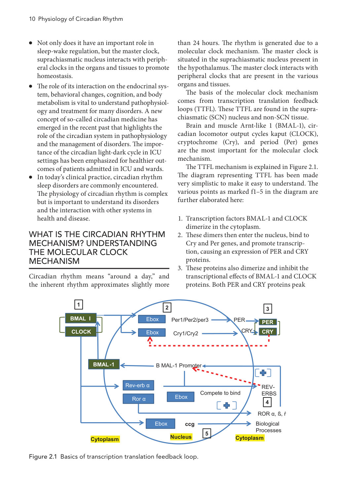

# 2 Physiology of Circadian Rhythm

<!-- pdf-page: 24 -->

## 2 Physiology of Circadian Rhythm

DOI: 10.1201/9781003093381-3 9

#### KARUNA DATTA

9

Introduction Why Is the Circadian Rhythm Physiology Important for Understanding Sleep and Circadian Rhythm Disorders? What Is the Circadian Rhythm Mechanism? Understanding the Molecular Clock Mechanism Interrelationship of SCN Master Clock with the Periphery

9

10

11

#### INTRODUCTION

Te master clock of the circadian rhythm resides in the hypothalamus, and the suprachiasmatic nucleus is the master controller. Tis nucleus has molecular clock mechanisms that can be entrained by various photic and nonphotic stimuli. Peripheral clocks in the body in non-SCN tissues are in alignment with the master clock; however, some stimuli can uncouple the master clock from the peripheral clocks in the non-SCN tissues. In this chapter, the basic concept of the master clock mechanism, as well as its coupling or uncoupling with the peripheral clocks, is explained, and the physiology of the circadian rhythm has been laid out with specifc emphasis on the various physiological mechanisms that can help in the assessment and management of circadian rhythm disorders.

Physiological Variables That Help in

Assessment of Circadian Rhythm 12 Use of Process C and Process S in

Predicting Alertness and Performance 12 Circadian and Physiological Function:

Genes and Disease Correlations and Basis for Therapeutics 12 Conclusion 13 Suggested Reading 13

#### WHY IS THE CIRCADIAN RHYTHM

#### PHYSIOLOGY IMPORTANT FOR

#### UNDERSTANDING SLEEP AND

#### CIRCADIAN RHYTHM DISORDERS?

● Process C and Process S make up a two-pro­

cess sleep-wake model proposed by Alexander Borberly. Process S is a sleep-wake-dependent homeostatic process and circadian process; Process C interacts with Process S. Teir interaction results in the sleep and wake timing and determines the sleep drive.

● Circadian rhythm has a distinct pathway and is primarily entrained by light. Te role of nonphotic stimuli on the circadian rhythm is also emerging, and hence both photic and nonphotic stimuli afect the circadian rhythm in the body.

<!-- pdf-page: 25 -->

10 Physiology of Circadian Rhythm

● Not only does it have an important role in sleep-wake regulation, but the master clock, suprachiasmatic nucleus interacts with peripheral clocks in the organs and tissues to promote homeostasis.

than 24 hours. Te rhythm is generated due to a molecular clock mechanism. Te master clock is situated in the suprachiasmatic nucleus present in the hypothalamus. Te master clock interacts with peripheral clocks that are present in the various organs and tissues.

● Te role of its interaction on the endocrinal sys­

tem, behavioral changes, cognition, and body metabolism is vital to understand pathophysiology and treatment for many disorders. A new concept of so-called circadian medicine has emerged in the recent past that highlights the role of the circadian system in pathophysiology and the management of disorders. Te importance of the circadian light-dark cycle in ICU settings has been emphasized for healthier outcomes of patients admitted in ICU and wards.

● In today’s clinical practice, circadian rhythm sleep disorders are commonly encountered. Te physiology of circadian rhythm is complex but is important to understand its disorders and the interaction with other systems in health and disease.

#### WHAT IS THE CIRCADIAN RHYTHM

#### MECHANISM? UNDERSTANDING

#### THE MOLECULAR CLOCK

#### MECHANISM

Circadian rhythm means “around a day,” and the inherent rhythm approximates slightly more

1

BMAL I

Ebox

CLOCK

Ebox

BMAL -1

Rev-erb ˜

Ror ˜

Ebox

Figure 2.1 Basics of transcription translation feedback loop.

Te basis of the molecular clock mechanism comes from transcription translation feedback loops (TTFL). Tese TTFL are found in the suprachiasmatic (SCN) nucleus and non-SCN tissue.

Brain and muscle Arnt-like 1 (BMAL-1), circadian locomotor output cycles kaput (CLOCK), cryptochrome (Cry), and period (Per) genes are the most important for the molecular clock mechanism.

Te TTFL mechanism is explained in Figure 2.1. Te diagram representing TTFL has been made very simplistic to make it easy to understand. Te various points as marked f1–5 in the diagram are further elaborated here:

1. Transcription factors BMAL-1 and CLOCK dimerize in the cytoplasm.
2. Tese dimers then enter the nucleus, bind to Cry and Per genes, and promote transcription, causing an expression of PER and CRY proteins.
3. Tese proteins also dimerize and inhibit the transcriptional efects of BMAL-1 and CLOCK proteins. Both PER and CRY proteins peak

2 3

Per1/Per2/per3

PER

PER

CRY

CRY

Cry1/Cry2

B MAL-1 Promoter

REV- ERBS Compete to bind

Ebox

4

ROR ˜, ß, °

Biological Processes

ccg

5

Cytoplasm Cytoplasm Nucleus

<!-- pdf-page: 26 -->

Interrelationship of SCN Master Clock with the Periphery 11

at dusk and activate clock-controlled genes and inhibit BMAL-1 and CLOCK proteins. Casein kinase 1 epsilon (CK1ε) inhibits posttranslational nuclear translocation of PER and CRY proteins, and they also tag them for degradation by phosphorylating these proteins. Terefore, CK1 regulates PER stability. 4. RAR- related orphan receptors (ROR) play an important role in circadian rhythm. RORα positively regulates expression of BMAL-1 thus maintaining the circadian rhythm. BMAL-1 is made available by the positive feedback (TTFL) loops. Along with RORs, which activate transcription, another set of nuclear receptors called REV-ERBS inhibit transcription. Te REV-ERBα expression is regulated by BMAL-1. RORs and REV-ERBs are expressed in an oscillatory manner, leading to the alternating activation and repression of BMAL-1 expression. 5. Also seen in the diagram is the efect of CLOCK protein on clock-controlled genes (CCG) in the transcription of various proteins.

SCN receives aferents from the limbic system and from areas of the thalamus and hypothalamus, apart from the retina, and hence has both photic and nonphotic inputs. Some of the areas like the dorsomedial nucleus of hypothalamus (DMH) and intergeniculate lamina (IGL) of the thalamus also receive nonphotic stimuli directly or indirectly and communicate with SCN where SCN sends its aferents and receives eferent from these areas. Studies show that IGL plays an important role in the regulation of nonphotic regulation of circadian rhythm by stimulating arousal inputs. Serotonergic pathways via the Raphe nuclei are known to modulate SCN efects and to mediate nonphotic efects too. DMH neurons activate areas in lateral hypothalamus promoting arousal. DMH is known to inhibit areas in the ventrolateral preoptic areas that inhibit the ascending arousal system, thus promoting arousal. Te circadian rhythm of activity states, meal timings, and cortisol are found to be eliminated following lesions of the DMH.

#### INTERRELATIONSHIP OF SCN

#### MASTER CLOCK WITH THE

#### PERIPHERY

Te master clock is primarily entrained by light. Photic inputs fall on the retina, and via the

retino-hypothalamic tract, these inputs reach the master clock situated in the suprachiasmatic nucleus. Tis pathway has melanopsin-containing ganglion cells, distinctly diferent from the optic pathway. Studies show that disruption of both rods and cones keeps the circadian inputs intact via this pathway. Light causes glutamate secretion in the SCN. Retino-hypothalamic-tract-mediated glutamate signaling in the SCN causes CREB-mediated transcription of Per genes. Per gene expression is inhibited by arousal. Te role of PER proteins in molecular clocks has been explained earlier.

Photic input also reaches the IGL, which has an indirect pathway to SCN. Te role of light can be further understood by the fact that it is associated with melatonin suppression. Photic suppression of melatonin can be caused by 460 nm light. Te blue light range of the light spectrum is extremely sensitive. Tis is the spectrum also commonly seen at nighttime in modern households. Delayed work timings or delayed sleep times with exposure to light at night is enough to cause changes in the rhythm. Under normal circumstances, there is a dim light melatonin onset (DLMO). Melatonin hormone secretion fuctuates with seasonal variations depending on the duration of day-night pattern. It is released from the pineal gland and acts on its receptors to promote sleepiness and reduction in sleep onset latency. It reinforces the synchronization of the circadian clock and acts as a time giver. Exogenous melatonin, if given before the endogenous secretion, causes an advance phase, promoting sleepiness. Melatonin administration in the evening thus induces sleepiness in insomniacs and can be prescribed in patients with jet lag syndrome to help normalize their deranged circadian rhythm. Melatonin receptor agonists have also been tried for similar efects. Te American Association of Sleep Medicine guidelines for melatonin use in inducing sleep are described in individual chapters regarding the management of various sleep disorders later in the book.

Te master clock is required for the peripheral clock to be kept in phase synchrony. Synchronization of the central and peripheral clocks is also responsible for the modulating function of other systems like the neurohormonal system, cardiovascular system, reproduction, immunity, etc. On the other hand, it can also be modifed by inputs of blood glucose, feeding, temperature, etc. Certain inputs

<!-- pdf-page: 27 -->

12 Physiology of Circadian Rhythm

of feeding, social cues, activity states can uncouple the peripheral clock from the master clock

● Melatonin estimation may be used to deter­

mine dim light melatonin onset (DLMO). Understanding physiology and actions of melatonin helps in exogenous melatonin administration in disorders. For further details on melatonin and its prescription for disorders, please refer to Chapter 13.

Te circadian cues and its integration with physiological processes prepare the system in anticipation, e.g., for a human, of the availability of food more during daytime, and there is an understanding that neuroendocrinal responses enhance this environmental infuence. Endogenous rhythms in adipose tissue and the liver can be synchronized by SCN, keeping it aligned to the day and night cycle. Studies show that lipoprotein kinase regulation by the adipose tissue and blood glucose regulation in the liver may be altered. In cases where untimely feeding at night happens, the peripheral clock may uncouple to the SCN coupling of the day-night pattern due to its modulation by the blood levels of blood glucose and other nutrients. Light entrains SCN. Hence prolonged lighting at night, decreased light time in the winter, or a phase shif of lightdark cycles as in transmeridian travel may appear innocuous but might lead to subtle negative efects that are within our control. Avoiding them and being able to correct them may help in promoting better health and lifestyle.

#### PHYSIOLOGICAL VARIABLES

#### THAT HELP IN ASSESSMENT OF

#### CIRCADIAN RHYTHM

● Experimental studies can be done using constant routine protocols and free running protocols. Depending on the requirements of the study, various other indicators of sleep habit, and feeding time, activity monitors using videography, actigraphy, etc. may be used. Actigraphy and a minimum of 2 weeks of sleep logs/diary are recommended to study circadian rhythm.

● Core body temperature and plasma cortisol and melatonin levels may indicate circadian rhythm.

● Determination of the core body temperature minimum (CBTmin) is important for planning therapeutic modalities using light and exercise. Stimulus just afer the CBTmin causes phase advance, and stimulus just before CBTmin causes phase delay. CBTmin happens usually 3 hours before the habitual wake period. Its determination is extremely vital in diagnosing and treating circadian rhythm disorders discussed in Chapter 13.

#### USE OF PROCESS C AND PROCESS

#### S IN PREDICTING ALERTNESS AND

#### PERFORMANCE

Prediction of alertness and performance is done by the use of inputs regarding sleep-wake. Te inputs required to predict alertness are the timing of work hours with or without sleep hours, amount of prior sleep, and duration of prior wake (i.e., both circadian and homeostatic), summed. Tese can then predict:

● Alertness and psychomotor performance.

● Level at which risk of alertness/performance impairment starts.

● Sleep onset latency.

● Time of awakening from sleep.

#### CIRCADIAN AND PHYSIOLOGICAL

#### FUNCTION: GENES AND DISEASE

#### CORRELATIONS AND BASIS FOR

#### THERAPEUTICS

A disrupted gene of the molecular clock mechanism is associated with varied physiological efects. Abnormal gluconeogenesis is associated with gene disruption of BMAL-1 and CLOCK, abnormal lipogenesis with the BMAL-1 gene and with metabolic syndrome with disruption of the CLOCK gene, altered sleep pattern with BMAL-1, Cry1, Cry2, and Clock genes. Abnormal apoptosis is found with disruption of Per1 and Per2 genes. Progressive arthropathy and infertility are also seen with disruption of the BMAL-1 gene. Similarly, abnormal bone metabolism and cerebellar ataxia are associated with disruption of the Rorα gene, and locomotor difculties, retinal degeneration, and male reproductive abnormality during the frst six months of age are seen with disruption of Rorβ gene. Sleep phase syndromes may be found to be advanced or delayed as seen with disruption of the Per genes.

The circadian rhythm has a potential to induce physiological changes and vice versa. In the coming era,

<!-- pdf-page: 28 -->

Suggested Reading 13

this role may be substantially explored. Emerging results show promising value of the role of light as therapy in psychiatric disorders and in circadian rhythm disorders like delayed sleep-wake phase disorder, jet lag, shif work, etc. Te role of circadian rhythm disruption in predisposing for psychiatric disorder is also documented. Physical exercise in the morning has been known to advance sleep, and exercise very near bedtime delays sleep. Circadian prescriptions modulating feeding time, activity schedules, and light exposure have been tried to overcome jet-lag-related dips in alertness and cognitive performance. Similarly, the prevention of disorders or further aggravation of disorders, e.g., metabolic disorders, may be prevented by timely sleep and feeding habits and a healthy exercise schedule at the right time of the day.

A regular sleep time, a healthy feeding time, and avoidance of social activity or media time near bedtime have shown to be promising adjuncts in therapy for the delayed sleep phase syndromes seen in adolescents. Parents, if aware about the need of sleep-wake discipline, may be able to prevent circadian rhythm disorders in their children at a subclinical level itself, thus preventing its emergence as a disorder.

Te circadian system and sleep-wake regulation converge to promote a milieu conducive for growth and better well-being. Tyroid-stimulating hormone, which stimulates the secretion of thyroid hormones, is regulated by the circadian rhythm. Sleep opposes this rhythm and inhibits the release of TSH. Sleep is known to increase the release of growth hormone, parathyroid hormone, and prolactin. Tis efect of circadian rhythm on sleep and the efects of sleep on the circadian rhythm highlight the importance in its synchrony. Te

desynchronization of the peripheral clocks from the master clock with cues related to metabolism, behavior, attention, and arousal state poses a challenge for homeostasis. Tese may be indicators of the progression of disease, and physiological interventions using bright light exposure, avoidance of light exposure, feed time alterations, and social activity ofer a potent recipe for a nonpharmacological prescription approach for the prevention of disease and treatment as well.

#### CONCLUSION

Te suprachiasmatic nucleus is the master circadian clock and regulates various peripheral clocks in the tissues. Light is the most important factor that can entrain this rhythm via the distinct retino-hypothalamic thalamic pathway. Nonphotic stimuli, like food intake and social rhythm, can uncouple the regulation of the peripheral clock from the master clock. Te change in rhythm may predispose the individual to various disorders. Assessing circadian rhythm markers helps in planning circadian prescriptions, and using circadian prescriptions to help restore circadian rhythm can promote patient well-being.

#### SUGGESTED READING

1. Datta K. Biological rhythm and neu­

ropsychiatric disorders. In Sleep and Neuropsychiatric Disorders [Internet], edited by R Gupta, DN Neubauer, SR Pandi-Perumal. Singapore: Springer Nature Singapore; 2022 [cited 2022 May 18]. pp. 53–63. https://link.springer. com/10.1007/978-981-16-0123-1_3.
