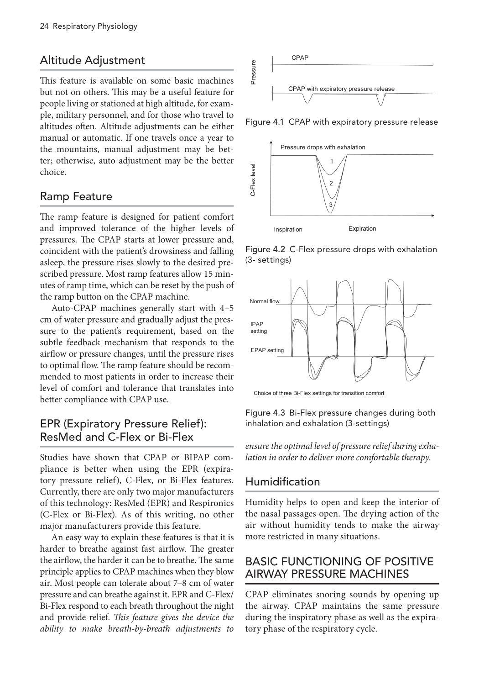

# 4 Respiratory Physiology: Simple Science of CPAP and PAP Devices Explained

<!-- pdf-page: 36 -->

## 4 Respiratory Physiology:

## Simple Science of CPAP

## and PAP Devices Explained

DOI: 10.1201/9781003093381-5 21

#### DEEPAK SHRIVASTAVA, AND AJITPAL SETHI

Respiratory Changes during Sleep Breathing Pattern during Non-REM

Sleep Breathing Pattern during REM Sleep Response of the Upper Airway Muscles

to Sleep Effect of the Positional Changes during Sleep Respiratory Physiology in Sleep Disordered Breathing Science of Continuous Positive Airway Pressure in Sleep Disordered Breathing Effectiveness of CPAP Data Card (Smart Card or SD Card) Positive Airway Pressure Delivery:

Types of Positive Airway Pressure Machines and Their Unique Features Altitude Adjustment Ramp Feature EPR (Expiratory Pressure Relief): ResMed

and C-Flex or Bi-Flex Humidifcation

22 Basic Functioning of Positive Airway

Pressure Machines 24 22 Continuous Positive Airway Pressure 22 (CPAP) 25 Automatic CPAP (APAP) 25 22 Bilevel Positive Pressure Therapy

(BiPAP) 25 22 AVAPS (Average Volume Assured

Pressure Support) 26 22 BiPAP S/T with AVAPS: Titration 26 Recommended Starting Points 26 S/T AVAPS Indications 26 23 BiPAP AVAPS (Average Volume 23 Assured Pressure Support) 27 23 Indications 27 Settings for BiPAP AVAPS 27 AVAPS Is Not Recommended for

Periodic Breathing Such as 23 Cheyne–Stokes 27 24 AutoSV: Not Recommended for 24 Neuromuscular Disease 27 Primary Care Management of Positive 24 Airway Pressure Therapy 27 24 Suggested Reading 28

<!-- pdf-page: 37 -->

22 Respiratory Physiology

#### RESPIRATORY CHANGES

#### Response of the Upper Airway

#### DURING SLEEP

#### Muscles to Sleep

● Upper airway muscles maintain the patency of the upper airways during inspiration and prevent collapse.

Respiratory changes that occur during sleep are dependent on the staging of the sleep, take place during rapid eye movement sleep versus non rapid eye movement sleep. During sleep, the wakeful drive to breathe goes away and only the metabolic drive initiates ventilation. Central sleep apneas are commonly observed at sleep onset. Upper airway muscle tone is decreased, and there is increased resistance to the airfow. From wakefulness to non-REM sleep, resistance increases and then further increases to the highest level during REM sleep. Because of the reduced tidal volumes, the minute ventilation decreases, as does alveolar ventilation. In sleep, the functional residual capacity declines. Breathing is observed to be regular during non-REM sleep, but it becomes irregular during REM sleep. In wakefulness, both high CO2 and low PO2 increase the ventilation. Tese responses are dampened during sleep. Oxygen concentration in the blood, as well as the oxygen saturation, decreases slightly; however, total oxygen consumption and the production of carbon dioxide are decreased accordingly. In non-REM sleep as well as in REM sleep, cough refexes are diminished.

#### Breathing Pattern during

#### Non-REM Sleep

● More regular respiratory pattern than in wake­

ful breathing

● Reduction in the tidal volume

● Slight rise in CO2 by 1–2 mmHg

#### Breathing Pattern during REM Sleep

● Irregular and variable respiratory pattern

● Increased frequency of breathing and reduced tidal volume compared to non-REM sleep

● Further CO2 increase by 1–2 mmHg

● Oxygen saturation drop at the onset of REM sleep

● Ventilatory responses to high CO2 and low O2 differences between REM and non-REM sleep; also variable between men and women

● Possible arousal from sleep triggered by both low oxygen and high CO2

● Te genioglossus muscle (tongue) responds to the increase in high CO2 during wakefulness.

● Tis response is decreased during sleep.

● In normal individuals, the negative pressure refex during inspiration activates the pharyngeal dilator muscles to keep the airway open. However, at sleep onset and non-REM sleep, this response is signifcantly reduced. (It can precipitate episodes of apnea or hypopnea by decreasing the efective lumen of the upper airway.)

#### Effect of the Positional Changes

#### during Sleep

● Te supine position can cause narrowing of the upper airway behind the tongue and can predispose to upper airway collapse.

● In the supine position, the functional residual capacity is reduced as increased abdominal distention and viscera push the diaphragm up.

● REM sleep is associated with relative hypoven­

tilation from both reduced ventilatory mechanical capacities and decrease sensitivity of the respiratory drive to high CO2 and low oxygenation.

#### RESPIRATORY PHYSIOLOGY IN

#### SLEEP DISORDERED BREATHING

● Narrowing of the upper airway and excess body weight increase the mechanical load on the respiratory system and therefore increase the work of breathing.

● Sleep can perpetuate repetitive events of apneas or hypopneas due to oxygen desaturation.

● Hypopneas are more common during REM sleep.

● Oxygen desaturation is frequent and sustained during REM sleep.

● High CO2 levels can occur especially in the supine sleep position.

<!-- pdf-page: 38 -->

Positive Airway Pressure Delivery 23 23

#### SCIENCE OF CONTINUOUS

#### POSITIVE AIRWAY PRESSURE IN

#### SLEEP DISORDERED BREATHING

#### DATA CARD (SMART CARD

#### OR SD CARD)

Continuous positive airway therapy and its advanced modifcations are considered the frst-line and most efcacious treatment for sleep disordered breathing. Te continuous positive airway pressure increases the oropharyngeal volume and reduces the collapsibility of the pharynx by providing a pneumatic splint. CPAP therapy is titrated to alleviate all apneas, hypopneas, and respiratory-efortrelated arousals and reestablishes oxygen saturation to its normal range.

#### EFFECTIVENESS OF CPAP

A properly titrated continuous positive airway pressure (CPAP) eliminates sleep disordered breathing in most patients. As previously noted, it eliminates snoring, apneas, and hypopneas, as well as reestablishes oxygen saturation to the normal range. CPAP improves the symptoms of daytime sleepiness, as well as cognitive function and mood in patients with mild to moderate sleep disordered breathing. Patients who have concomitant hypertension tend to beneft from CPAP. Although the effect size is limited to a 2–3 mmHg reduction in blood pressure, it has been shown to be more efcacious in lowering blood pressure in patients with severe sleep apnea. For patients who sufer with congestive heart failure with low ejection fraction, CPAP tends to improve the ejection fraction in the subset of the population. CPAP works synergistically with antihypertensive therapy, improves quality of life, and reduces cardiovascular, neurocognitive, and metabolic complications.

Positive airway pressure is a mode of respiratory ventilation that is considered the mainstay treatment of obstructive sleep apnea. CPAP provides a pneumatic splint to maintain upper airway patency during sleep. It prevents the sof tissue from collapsing and prevents partial or complete obstruction of the airway. Tis results in a decreased number of arousals from sleep and stabilizes oxygen desaturation. In addition, CPAP lowers transmural pressure within the chest cavity, thereby favorably afecting cardiac function.

Basic CPAP machines blow air to create a pneumatic splint to keep the collapsible part of the airway patent. Some features record CPAP usage by means of a digital smart card. Te only things that distinguish all the models are the features that may be available. Of the diferent manufacturers, some provide unique features than others.

Either CPAP machines are equipped with the SD data card, or a data card can be attached as a separate piece of equipment. Te SD data card records the functioning of the machine, indirectly refecting the usage time, and produces a report over time range to refect compliance with the treatment. It also reports the residual AHI, the leak percentage, and a range of pressures applied throughout the duration of therapy. Data card information is also very helpful in troubleshooting as it highlights the issues related to the noncompliance of CPAP use due to intolerance and side efects. Certain insurance companies and third-party payers, as well as the department of transportation, uses data card information to establish compliance with the requirements of CPAP use in patients with sensitive occupations like truck drivers or pilots.

#### POSITIVE AIRWAY PRESSURE

#### DELIVERY: TYPES OF POSITIVE

#### AIRWAY PRESSURE MACHINES

#### AND THEIR UNIQUE FEATURES

A variety of positive airway pressure systems, including continuous positive airway pressure (CPAP), bilevel positive airway pressure (BiPAP), automatic positive airway pressure (APAP), have diferent user-friendly pressure settings to deliver the positive pressure to the narrowed or obstructed airway in order to increase its patency for normal breathing. Providers may start by utilizing the more common features that patients may or may not need to make usage precise and increase compliance with CPAP use.

PAP therapy increases positive intrathoracic pressure, resulting in decreased venous return, increased lung volume, decreased aferload, and possible increase in cardiac output. Since the pressure is maintained during exhalation, it increases end-expiratory lung volume. Such a traction efect can further assist in the splinting open of the upper airway

<!-- pdf-page: 39 -->

24 Respiratory Physiology

#### Altitude Adjustment

CPAP

Pressure

Tis feature is available on some basic machines

CPAP with expiratory pressure release

Figure 4.1 CPAP with expiratory pressure release

but not on others. Tis may be a useful feature for people living or stationed at high altitude, for example, military personnel, and for those who travel to altitudes ofen. Altitude adjustments can be either manual or automatic. If one travels once a year to the mountains, manual adjustment may be better; otherwise, auto adjustment may be the better choice.

#### Ramp Feature

Te ramp feature is designed for patient comfort

and improved tolerance of the higher levels of pressures. Te CPAP starts at lower pressure and, coincident with the patient’s drowsiness and falling asleep, the pressure rises slowly to the desired prescribed pressure. Most ramp features allow 15 minutes of ramp time, which can be reset by the push of the ramp button on the CPAP machine.

Auto-CPAP machines generally start with 4–5 cm of water pressure and gradually adjust the pressure to the patient’s requirement, based on the subtle feedback mechanism that responds to the airfow or pressure changes, until the pressure rises to optimal fow. Te ramp feature should be recommended to most patients in order to increase their level of comfort and tolerance that translates into better compliance with CPAP use.

#### EPR (Expiratory Pressure Relief):

#### ResMed and C-Flex or Bi-Flex

Studies have shown that CPAP or BIPAP compliance is better when using the EPR (expiratory pressure relief), C-Flex, or Bi-Flex features. Currently, there are only two major manufacturers of this technology: ResMed (EPR) and Respironics (C-Flex or Bi-Flex). As of this writing, no other major manufacturers provide this feature.

An easy way to explain these features is that it is harder to breathe against fast airfow. Te greater the airfow, the harder it can be to breathe. Te same principle applies to CPAP machines when they blow air. Most people can tolerate about 7–8 cm of water pressure and can breathe against it. EPR and C-Flex/ Bi-Flex respond to each breath throughout the night and provide relief. Tis feature gives the device the ability to make breath-by-breath adjustments to

Pressure drops with exhalation

1

C-Flex level

2

3

Inspiration Expiration

Figure 4.2 C-Flex pressure drops with exhalation

(3- settings)

Normal flow

IPAP setting

EPAP setting

Choice of three Bi-Flex settings for transition comfort

Figure 4.3 Bi-Flex pressure changes during both

inhalation and exhalation (3-settings)

ensure the optimal level of pressure relief during exhalation in order to deliver more comfortable therapy.

#### Humidifcation

Humidity helps to open and keep the interior of the nasal passages open. Te drying action of the air without humidity tends to make the airway more restricted in many situations.

#### BASIC FUNCTIONING OF POSITIVE

#### AIRWAY PRESSURE MACHINES

CPAP eliminates snoring sounds by opening up the airway. CPAP maintains the same pressure during the inspiratory phase as well as the expiratory phase of the respiratory cycle.

<!-- pdf-page: 40 -->

Bilevel Positive Pressure Therapy (BiPAP) 25

Bilevel pressure devices (BiPAP) are diferent from CPAP only in that they deliver higher inspiratory positive pressure and lower expiratory positive pressure for easier exhalation. BiPAP pressure can be delivered in diferent modes:

S (spontaneous) mode: Te device triggers inspiratory pressure when fow sensors detect spontaneous respiratory efort. T (timed) mode: Te inspiratory-to-expiratory cycling is machine triggered at a set rate and timed to a certain number of breaths per minute. S/T (spontaneous/timed): A BiPAP machine triggers the inspiratory pressure response in response to the patient’s inspiratory efort. However, the S/T mode provides a backup rate to provide a minimum number of breaths if a patient is unable to take spontaneous breaths.

#### CONTINUOUS POSITIVE AIRWAY

#### PRESSURE (CPAP)

CPAP remains the mainstay of therapy for obstructive sleep apnea syndrome (OSAS). CPAP therapy has been demonstrated to resolve sleep disordered breathing events and improve several clinical outcomes. CPAP is conventionally delivered via a nasal mask at a fxed pressure that remains constant throughout the respiratory cycle. CPAP therapy exerts its benefcial efects by acting as a pneumatic splint to prevent the upper airway sof tissue from collapsing.

Indications for CPAP therapy include:

● Treatment of moderate to severe OSAS.

● Treatment of mild OSAS and associated symptoms and/or underlying cardiovascular disease.

#### AUTOMATIC CPAP (APAP)

Automatic CPAP (APAP) is also known as auto-, automated, auto adjusting, or auto titrating continuous positive airway pressure.

APAP further advances CPAP therapy with the ability to detect and respond to changes in upper airway resistance in real time. APAP noninvasively

detects variations of upper airway obstruction and airfow limitation, including snoring, hypopneas, and apneas. Te sensors used to detect the spectrum of an upper airway obstruction, such as detecting snoring via a mask, vary among APAP models. Once upper airway fow limitation has been detected, the APAP device automatically increases the pressure until the fow limitation has been resolved. Once a therapeutic pressure has been achieved, the APAP device reduces pressure until fow limitation resumes.

#### BILEVEL POSITIVE PRESSURE

#### THERAPY (BIPAP)

As opposed to CPAP therapy, which allows a fxed pressure throughout the respiratory cycle, bilevel therapy allows the independent adjustment of the expiratory and inspiratory positive airway pressures (PAP). Bilevel therapy remains a viable option for CPAP-intolerant patients who have OSAS, OSAS with concurrent respiratory disease, and/or obesity hypoventilation syndrome. BiPAP or VPAP machines are, in many cases, prescribed by the physician if patients cannot tolerate CPAP during the sleep study or have trouble tolerating higher pressures.

In a nutshell, a BiPAP machine basically has two pressures: an inspiratory pressure, which is the pressure of the blowing air during inhalation, and an expiratory pressure, which is typically reduced during exhalation. It is designed to provide relief if the patient is unable to tolerate higher pressures.

Normal breathing, without the use of any equipment, is negative pressure breathing (breathing at atmospheric pressure). Equipment like CPAP is used to splint the airway with positive pressure or PAP (positive airway pressure), which is higher than atmospheric pressure:

IPAP: Inspiratory positive airway pressure—

measured in cmH2O EPAP: Expiratory positive airway pressure—

measured in cmH2O

● BiPAP alternates between IPAP and EPAP and synchronizes with the patient’s breathing.

● Normal respiration has two phases, inspi­

ration and expiration, plus a pause between them.

<!-- pdf-page: 41 -->

26 Respiratory Physiology

● BiPAP aids during the inspiratory phase and prevents airway closure during the expiratory phase.

#### BIPAP S/T WITH AVAPS: TITRATION

● Settings for S/T with AVAPS:

● Te normal inspiratory-to-expiratory ratio

(I:E ratio) is 1:2.

● As the patient inspires, the BiPAP delivers IPAP, which stops as the patient expires, but pressure within the airway remains positive because of EPAP.

● BiPAP delivers CPAP but also senses when inspiratory effort is being made and delivers a higher pressure during inspiration.

● When inspiration plus IPAP stop, pressure returns to the EPAP level.

#### AVAPS (AVERAGE VOLUME

#### ASSURED PRESSURE SUPPORT)

● AVAPS is a mode that is added to S mode, S/T mode, or T mode.

● AVAPS can be used with or without the backup rate.

● AVAPS takes away the need to titrate IPAP but still needs to titrate EPAP.

● BiPAP S/T with AVAPS is designed to deliver a set tidal volume (VT) to patients with respiratory insufciency.

● Te S/T with AVAPS feature provides three types of support to patients:

● Pressure to the airway to prevent airway collapse

● Backup rate for patients who encounter central apneas

● Automatically adjusting pressure support that ensures the set tidal volume

● AVAPS is designed to maintain a target VT the entire night.

● AVAPS maintains VT for long-term use as the disease progresses.

● AVAPS uses pressure to maintain the set VT.

● Te pressure that ensures the VT is dependent on:

● Patient efort.

● Lung compliance.

● Airway resistance.

● If the set VT is not delivered, the pressure is gradually increased to deliver the set VT.

● If the VT exceeds the set VT, the pressure is gradually decreased.

Rate Rise time EPAP I time IPAP min = minimum inspiratory pressure IPAP max = maximum inspiratory pressure Tidal volume

Te set tidal volume is based on:

● Patient breathing on the system for 4 minutes: 110% of the average displayed or the patient’s ideal body weight (8 mg/kg of ideal) for height and gender.

● Don’t forget patient comfort: adjust the VT for patient comfort and tolerance.

#### Recommended Starting Points

● Starting in S/T mode with AVAPS on

● EPAP at 4 cmH2O

● IPAP min 8 cmH2O (adjusted up or down based on patient comfort)

● Set tidal volume (per the preceding recommendations)

● IPAP max (initially not “wide open”—you can always adjust upward)

● Rate of 8–10 BPM or 2 BPM below the patient’s spontaneous rate

● I-time of 1.2 (adjust based on patient comfort and preceding recommendations)

● Rise time at 2–3

S/T with AVAPS maintains the tidal volume by slowly increasing or decreasing the pressure. AVAPS uses pressure to maintain the set tidal volume throughout the night.

#### S/T AVAPS Indications

Patients with:

● Neuromuscular disease

● Chronic obstructive pulmonary disease

● Obesity hypoventilation syndrome

<!-- pdf-page: 42 -->

Primary Care Management of Positive Airway Pressure Therapy 27

#### Note

#### AVAPS IS NOT RECOMMENDED

#### FOR PERIODIC BREATHING SUCH

#### AS CHEYNE–STOKES

● Te automatic algorithm changes based on patient needs.

● Slow adjustment over time takes 1 minute for each increase.

#### BIPAP AVAPS (AVERAGE VOLUME

#### ASSURED PRESSURE SUPPORT)

BiPAP AVAPS (average volume assured pressure support) is designed to maintain tidal volumes for patients who have respiratory insufciency and who need noninvasive ventilator support.

BiPAP AVAPS provides three types of support:

● A backup rate to assist patients who have difficulty maintaining a consistent respiratory rate.

● Pressure support to assist patients who have difculty maintaining tidal volume.

● Expiratory pressure to assist patients who need to increase their FRC (functional residual capacity) or maintain airway stability.

#### Indications

● Restrictive disorders—kyphosis, fbrosis

● Neuromuscular disorders

● OSAS

● Obesity hypoventilation syndrome

● COPD

● Periodic breathing—rarely used

● Complex sleep apnea—rarely used

Te indications are the same as for BiPAP Auto SV. While one can technically use Auto SV in NMD patients, S/T with AVAPS is preferred.

#### Settings for BiPAP AVAPS

● Rate

● Rise time

● EPAP pressure

● Inspiratory time

● Tidal volume

● IPAP minimum

● IPAP maximum

AVAPS does not respond fast enough. The event would be over before the needed pressure is reached, i.e., the length of the event vs. the time of response are mismatched. The solution for such patient would be AutoSV (see the next module).

#### AUTOSV: NOT RECOMMENDED

#### FOR NEUROMUSCULAR DISEASE

● AutoSV would continually reset its baseline and increase hypoventilation.

● Te normal target would continue to decrease and continue to under ventilate the patient as the night progresses.

The solution for this NMD patient or a patient with obesity hypoventilation syndrome is AVAPS.

● AVAPS maintains the set VT.

● AVAPS has a slow reaction (0.5–1.0 cmH2O increase over 1 minute).

Te BMI is the parameter that is not considered when determining the target VT with AVAPS.

#### PRIMARY CARE MANAGEMENT

#### OF POSITIVE AIRWAY PRESSURE

#### THERAPY

Te understanding of the function of the airway, as well as the pathophysiology of the narrowing of the airway by collapse, is further confounded by factors like obesity, craniofacial abnormalities, sof tissue abnormalities, bony abnormalities, and functional abnormalities of the upper airway. Te primary care provider can, however, explain the mechanism of airway obstruction to patients and prepare them for what to expect afer the diagnosis is made and how treatment will help their condition.

Once the patient begins to use CPAP, the primary care provider is generally the frst resource

<!-- pdf-page: 43 -->

28 Respiratory Physiology

for troubleshooting. A working knowledge of the respiratory physiology of positive airway pressure is useful in understanding how the patient’s reported problems may cause intolerance and noncompliance with CPAP use.

#### SUGGESTED READING

Tis knowledge empowers the primary care physician to make a clinical decision for referral to the sleep specialist for providing intervention and assistance.

1. Antonescu-Turcu A, Parthasarathy S. CPAP and bi-level PAP therapy: new and established roles. Respir Care. 2010;55(9):1216–1229.
2. Bakker J, Marshall N. Chest. 2011;139:1322–1330.
3. Ballard D, et al. J Clin Sleep Med. 2007;3:706–712.
4. Murphy P, et al. Thorax. 2012;67:727–734.
