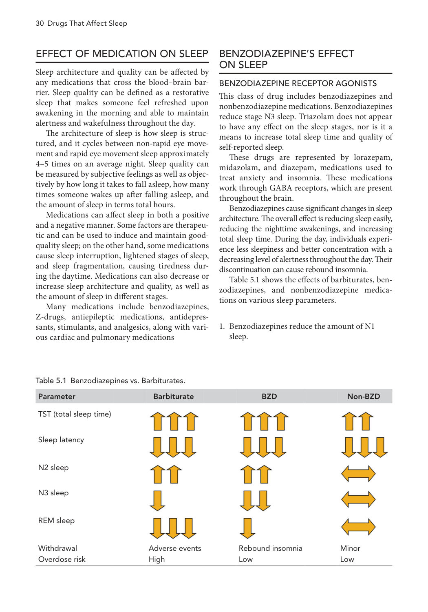
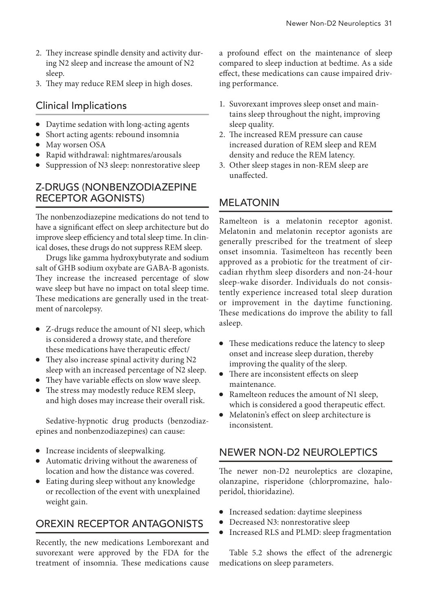
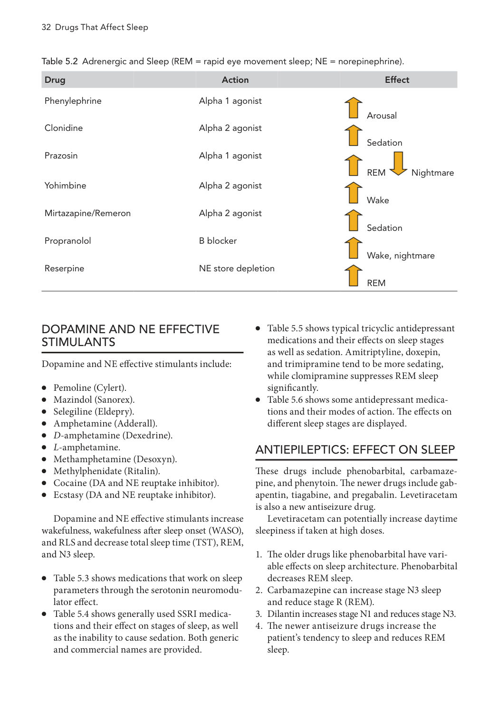
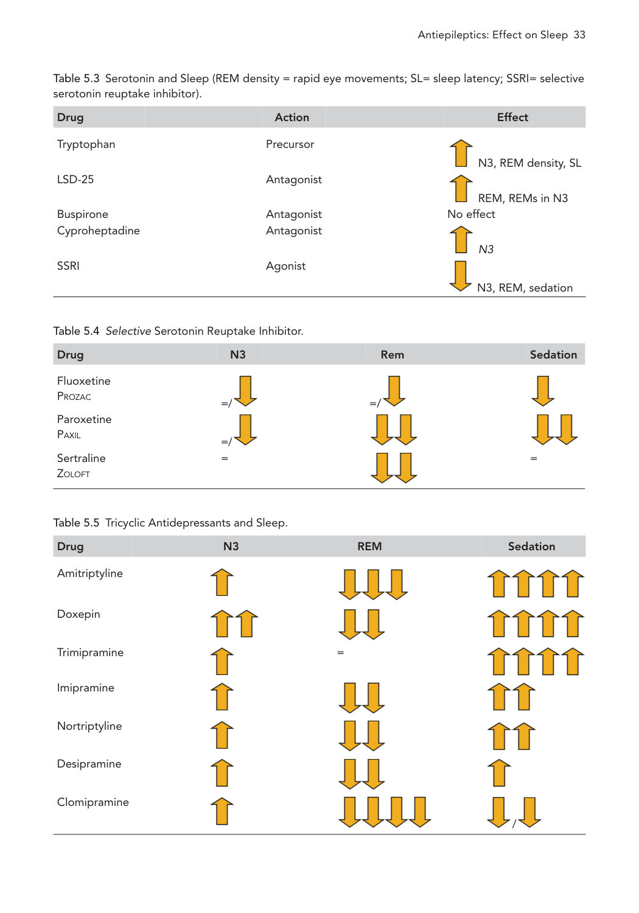
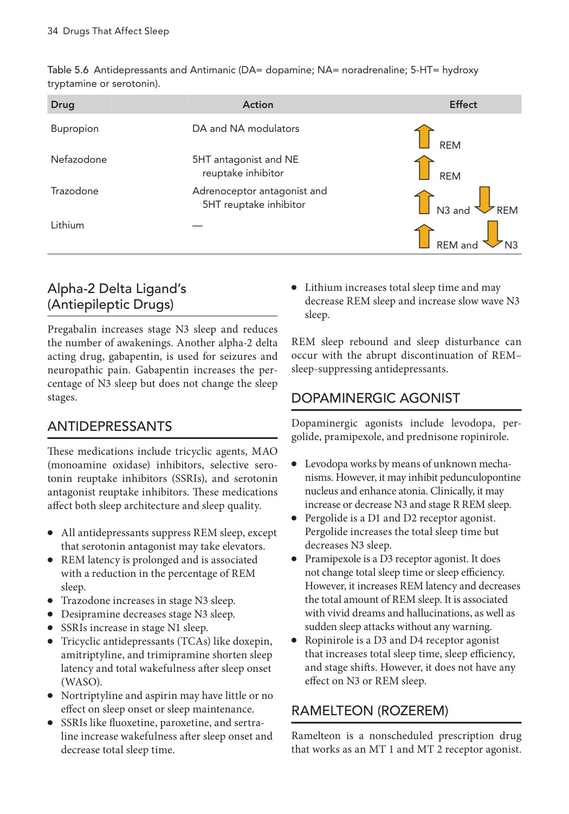

# 5 Drugs That Affect Sleep

<!-- pdf-page: 44 -->

## 5

DOI: 10.1201/9781003093381-6 29

## Drugs That Affect Sleep

#### DEEPAK SHRIVASTAVA

Serotonergic Antagonist 29 Effect of Medication on Sleep 30 Benzodiazepine’s Effect on Sleep 30 BENZODIAZEPINE RECEPTOR AGONISTS 30 Clinical Implications 31 Z-Drugs (Nonbenzodiazepine Receptor

Agonists) 31 Orexin Receptor Antagonists 31 Melatonin 31 Newer Non-D2 Neuroleptics 31 Dopamine and NE Effective Stimulants 32 Antiepileptics: Effect on Sleep 32

Sleep is organized into two stages known as non-rapid eye movement (NREM) sleep and rapid eye movement (REM) sleep. These stages are identifiable by specific parameters and have characteristic patterns. Sleep stages are affected by pharmaceuticals in nearly every drug category. This chapter reviews the effect of medications on sleep architecture and their clinical significance.

In the wakeful state of the brain, the EEG shows low voltage and fast frequency of 10–30 µV and 16–26 Hz, respectively. In stage N1 non- REM sleep, the EEG slows down to 3–7 Hz and decreases in amplitude. Stage N2 non-REM sleep is characterized by the appearance of sleep spindles (12–14 Hz) and K-complexes. Stage N3 non-REM sleep is also known as slow wave sleep or delta sleep; the EEG shows 0.5–2 Hz waves of 75 µV or greater. In REM sleep, the EEG shows a low-voltage, mixed-frequency pattern similar

Alpha-2 Delta Ligand’s (Antiepileptic Drugs) 34 Antidepressants 34 Dopaminergic Agonist 34 Ramelteon (Rozerem) 34 Opiates and Sleep 35 Hypolipidemia and Antiarrhythmics 35 Antihistamines and Sleep 35 Modafnil 35 Over-the-Counter Medications 35 Recreational Drugs and Sleep 35 Herbal Medications 36 Suggested Reading 36

to stage 1 non-REM sleep. However, the electrooculogram of REM sleep shows bursts of rapid eye movements, and the electromyogram (EMG) shows a complete atonia of the muscles.

While adults enter sleep through stage I, non- REM and REM sleep cycle 4–5 times per night, and each cycle is approximately 90 minutes. Te percentage of non-REM vs. REM sleep changes over the night, and REM sleep is longer during the second half of the night. In general, total sleep time is divided into 5% of N1, 50% N2, 20% N3, and 25% REM sleep, also known as stage R.

#### SEROTONERGIC ANTAGONIST

Drugs like ritanserin increase stage N3 but generally do not improve sleep time or insomnia-related symptoms. Another related drug, ketanserin, reduces the number of awakenings and wake afer sleep onset time compared to ritanserin.

<!-- pdf-page: 45 -->

30 Drugs That Affect Sleep

#### EFFECT OF MEDICATION ON SLEEP

#### BENZODIAZEPINE’S EFFECT

#### ON SLEEP

#### Parameter

#### Barbiturate

#### BZD

#### Non-BZD

Sleep architecture and quality can be afected by any medications that cross the blood–brain barrier. Sleep quality can be defned as a restorative sleep that makes someone feel refreshed upon awakening in the morning and able to maintain alertness and wakefulness throughout the day.

Te architecture of sleep is how sleep is structured, and it cycles between non-rapid eye movement and rapid eye movement sleep approximately 4–5 times on an average night. Sleep quality can be measured by subjective feelings as well as objectively by how long it takes to fall asleep, how many times someone wakes up afer falling asleep, and the amount of sleep in terms total hours.

Medications can afect sleep in both a positive and a negative manner. Some factors are therapeutic and can be used to induce and maintain goodquality sleep; on the other hand, some medications cause sleep interruption, lightened stages of sleep, and sleep fragmentation, causing tiredness during the daytime. Medications can also decrease or increase sleep architecture and quality, as well as the amount of sleep in diferent stages.

Many medications include benzodiazepines, Z-drugs, antiepileptic medications, antidepressants, stimulants, and analgesics, along with various cardiac and pulmonary medications

Table 5.1 Benzodiazepines vs. Barbiturates.

BENZODIAZEPINE RECEPTOR AGONISTS Tis class of drug includes benzodiazepines and nonbenzodiazepine medications. Benzodiazepines reduce stage N3 sleep. Triazolam does not appear to have any efect on the sleep stages, nor is it a means to increase total sleep time and quality of self-reported sleep.

Tese drugs are represented by lorazepam, midazolam, and diazepam, medications used to treat anxiety and insomnia. Tese medications work through GABA receptors, which are present throughout the brain.

Benzodiazepines cause signifcant changes in sleep architecture. Te overall efect is reducing sleep easily, reducing the nighttime awakenings, and increasing total sleep time. During the day, individuals experience less sleepiness and better concentration with a decreasing level of alertness throughout the day. Teir discontinuation can cause rebound insomnia.

Table 5.1 shows the efects of barbiturates, ben­

zodiazepines, and nonbenzodiazepine medications on various sleep parameters.

1. Benzodiazepines reduce the amount of N1 sleep.

Withdrawal Adverse events Rebound insomnia Minor Overdose risk High Low Low

TST (total sleep time)

Sleep latency

N2 sleep

N3 sleep

REM sleep

<!-- pdf-page: 46 -->

Newer Non-D2 Neuroleptics 31

2. Tey increase spindle density and activity dur­

a profound efect on the maintenance of sleep compared to sleep induction at bedtime. As a side efect, these medications can cause impaired driving performance.

ing N2 sleep and increase the amount of N2 sleep. 3. Tey may reduce REM sleep in high doses.

1. Suvorexant improves sleep onset and main­

#### Clinical Implications

● Daytime sedation with long-acting agents

● Short acting agents: rebound insomnia

● May worsen OSA

● Rapid withdrawal: nightmares/arousals

● Suppression of N3 sleep: nonrestorative sleep

#### Z-DRUGS (NONBENZODIAZEPINE

#### RECEPTOR AGONISTS)

Te nonbenzodiazepine medications do not tend to have a signifcant efect on sleep architecture but do improve sleep efciency and total sleep time. In clinical doses, these drugs do not suppress REM sleep.

Drugs like gamma hydroxybutyrate and sodium salt of GHB sodium oxybate are GABA-B agonists. Tey increase the increased percentage of slow wave sleep but have no impact on total sleep time. Tese medications are generally used in the treatment of narcolepsy.

● Z-drugs reduce the amount of N1 sleep, which is considered a drowsy state, and therefore these medications have therapeutic efect/

● Tey also increase spinal activity during N2 sleep with an increased percentage of N2 sleep.

● Tey have variable efects on slow wave sleep.

● Te stress may modestly reduce REM sleep, and high doses may increase their overall risk.

Sedative-hypnotic drug products (benzodiazepines and nonbenzodiazepines) can cause:

● Increase incidents of sleepwalking.

● Automatic driving without the awareness of location and how the distance was covered.

● Eating during sleep without any knowledge or recollection of the event with unexplained weight gain.

#### OREXIN RECEPTOR ANTAGONISTS

Recently, the new medications Lemborexant and suvorexant were approved by the FDA for the treatment of insomnia. Tese medications cause

tains sleep throughout the night, improving sleep quality. 2. Te increased REM pressure can cause increased duration of REM sleep and REM density and reduce the REM latency. 3. Other sleep stages in non-REM sleep are unafected.

#### MELATONIN

Ramelteon is a melatonin receptor agonist. Melatonin and melatonin receptor agonists are generally prescribed for the treatment of sleep onset insomnia. Tasimelteon has recently been approved as a probiotic for the treatment of circadian rhythm sleep disorders and non-24-hour sleep-wake disorder. Individuals do not consistently experience increased total sleep duration or improvement in the daytime functioning. Tese medications do improve the ability to fall asleep.

● Tese medications reduce the latency to sleep onset and increase sleep duration, thereby improving the quality of the sleep.

● Tere are inconsistent efects on sleep maintenance.

● Ramelteon reduces the amount of N1 sleep, which is considered a good therapeutic efect.

● Melatonin’s efect on sleep architecture is inconsistent.

#### NEWER NON-D2 NEUROLEPTICS

Te newer non-D2 neuroleptics are clozapine, olanzapine, risperidone (chlorpromazine, haloperidol, thioridazine).

● Increased sedation: daytime sleepiness

● Decreased N3: nonrestorative sleep

● Increased RLS and PLMD: sleep fragmentation

Table 5.2 shows the efect of the adrenergic

medications on sleep parameters.

<!-- pdf-page: 47 -->

32 Drugs That Affect Sleep

Table 5.2 Adrenergic and Sleep (REM = rapid eye movement sleep; NE = norepinephrine).

#### Drug

#### Action

#### Effect

Phenylephrine Alpha 1 agonist

Arousal Clonidine Alpha 2 agonist

Sedation Prazosin Alpha 1 agonist

Nightmare Yohimbine Alpha 2 agonist

REM

Wake Mirtazapine/Remeron Alpha 2 agonist

Sedation Propranolol B blocker

Wake, nightmare Reserpine NE store depletion

#### DOPAMINE AND NE EFFECTIVE

#### STIMULANTS

Dopamine and NE efective stimulants include:

● Pemoline (Cylert).

● Mazindol (Sanorex).

● Selegiline (Eldepry).

● Amphetamine (Adderall).

● D-amphetamine (Dexedrine).

● L-amphetamine.

● Methamphetamine (Desoxyn).

● Methylphenidate (Ritalin).

● Cocaine (DA and NE reuptake inhibitor).

● Ecstasy (DA and NE reuptake inhibitor).

Dopamine and NE efective stimulants increase wakefulness, wakefulness afer sleep onset (WASO), and RLS and decrease total sleep time (TST), REM, and N3 sleep.

● Table 5.3 shows medications that work on sleep parameters through the serotonin neuromodulator efect.

● Table 5.4 shows generally used SSRI medica­

tions and their efect on stages of sleep, as well as the inability to cause sedation. Both generic and commercial names are provided.

REM

● Table 5.5 shows typical tricyclic antidepressant medications and their efects on sleep stages as well as sedation. Amitriptyline, doxepin, and trimipramine tend to be more sedating, while clomipramine suppresses REM sleep signifcantly.

● Table 5.6 shows some antidepressant medica­

tions and their modes of action. Te efects on diferent sleep stages are displayed.

#### ANTIEPILEPTICS: EFFECT ON SLEEP

Tese drugs include phenobarbital, carbamazepine, and phenytoin. Te newer drugs include gabapentin, tiagabine, and pregabalin. Levetiracetam is also a new antiseizure drug.

Levetiracetam can potentially increase daytime sleepiness if taken at high doses.

1. Te older drugs like phenobarbital have vari­

able efects on sleep architecture. Phenobarbital decreases REM sleep. 2. Carbamazepine can increase stage N3 sleep and reduce stage R (REM). 3. Dilantin increases stage N1 and reduces stage N3. 4. Te newer antiseizure drugs increase the patient’s tendency to sleep and reduces REM sleep.

<!-- pdf-page: 48 -->

Antiepileptics: Effect on Sleep 33

Table 5.3 Serotonin and Sleep (REM density = rapid eye movements; SL= sleep latency; SSRI= selective

serotonin reuptake inhibitor).

#### Drug

#### Action

#### Effect

Tryptophan Precursor

N3, REM density, SL LSD-25 Antagonist

REM, REMs in N3 Buspirone Antagonist No effect Cyproheptadine Antagonist

N3 SSRI Agonist

#### Drug

#### N3

#### Rem

#### Sedation

Table 5.4 Selective Serotonin Reuptake Inhibitor.

N3, REM, sedation

= ZOLOFT

Fluoxetine PROZAC =/

=/ Paroxetine

PAXIL =/ Sertraline =

#### Drug

#### N3

#### REM

#### Sedation

Table 5.5 Tricyclic Antidepressants and Sleep.

Amitriptyline

Doxepin

Trimipramine

Imipramine

Nortriptyline

Desipramine

Clomipramine

=

/

<!-- pdf-page: 49 -->

34 Drugs That Affect Sleep

Table 5.6 Antidepressants and Antimanic (DA= dopamine; NA= noradrenaline; 5-HT= hydroxy

tryptamine or serotonin).

#### Drug

#### Action

#### Effect

Bupropion DA and NA modulators

REM Nefazodone 5HT antagonist and NE reuptake inhibitor

REM Trazodone Adrenoceptor antagonist and 5HT reuptake inhibitor N3 and

REM Lithium —

efect on sleep onset or sleep maintenance.

#### RAMELTEON (ROZEREM)

● SSRIs like fuoxetine, paroxetine, and sertra­

#### Alpha-2 Delta Ligand’s

#### (Antiepileptic Drugs)

Pregabalin increases stage N3 sleep and reduces the number of awakenings. Another alpha-2 delta acting drug, gabapentin, is used for seizures and neuropathic pain. Gabapentin increases the percentage of N3 sleep but does not change the sleep stages.

#### ANTIDEPRESSANTS

Tese medications include tricyclic agents, MAO (monoamine oxidase) inhibitors, selective serotonin reuptake inhibitors (SSRIs), and serotonin antagonist reuptake inhibitors. Tese medications afect both sleep architecture and sleep quality.

● All antidepressants suppress REM sleep, except that serotonin antagonist may take elevators.

● REM latency is prolonged and is associated with a reduction in the percentage of REM sleep.

● Trazodone increases in stage N3 sleep.

● Desipramine decreases stage N3 sleep.

● SSRIs increase in stage N1 sleep.

● Tricyclic antidepressants (TCAs) like doxepin, amitriptyline, and trimipramine shorten sleep latency and total wakefulness afer sleep onset (WASO).

● Nortriptyline and aspirin may have little or no

N3

REM and

● Lithium increases total sleep time and may decrease REM sleep and increase slow wave N3 sleep.

REM sleep rebound and sleep disturbance can occur with the abrupt discontinuation of REM– sleep-suppressing antidepressants.

#### DOPAMINERGIC AGONIST

Dopaminergic agonists include levodopa, pergolide, pramipexole, and prednisone ropinirole.

● Levodopa works by means of unknown mecha­

nisms. However, it may inhibit pedunculopontine nucleus and enhance atonia. Clinically, it may increase or decrease N3 and stage R REM sleep.

● Pergolide is a D1 and D2 receptor agonist. Pergolide increases the total sleep time but decreases N3 sleep.

● Pramipexole is a D3 receptor agonist. It does not change total sleep time or sleep efciency. However, it increases REM latency and decreases the total amount of REM sleep. It is associated with vivid dreams and hallucinations, as well as sudden sleep attacks without any warning.

● Ropinirole is a D3 and D4 receptor agonist that increases total sleep time, sleep efciency, and stage shifs. However, it does not have any efect on N3 or REM sleep.

line increase wakefulness afer sleep onset and Ramelteon is a nonscheduled prescription drug decrease total sleep time. that works as an MT 1 and MT 2 receptor agonist.

<!-- pdf-page: 50 -->

Recreational Drugs and Sleep 35

It does not afect N3 sleep, REM sleep, or sleep continuity. It is nonsedating and a relatively safe drug.

diphenhydramine, hydroxyzine, promethazine, and trifuridine.

#### OPIATES AND SLEEP

#### MODAFINIL

Opiates have a signifcant efect on sleep. Opiates can increase wakefulness and the number of stage shifs in the sleep and waking states. Opiates decrease total sleep time (TST), decrease sleep efciency (SE), decrease N3, and rapid eye movement sleep. Opiates cause daytime sedation and central sleep apneas. Te sudden withdrawal of opiates can lead to insomnia and nightmares. In patients with obstructive sleep apnea, opiates can worsen the clinical syndrome of apneas and hypopneas.

#### HYPOLIPIDEMIA AND

#### ANTIARRHYTHMICS

Drugs in this category include simvastatin and lovastatin, which can cause insomnia in susceptible individuals. A few case reports support this fnding.

● Cholestyramine causes insomnia in a small subset of the population up to 1.3%.

● Gemfbrozil can cause drowsiness according to case reports.

● Disopyramide or quinidine causes fatigue in approximately 3–10% of subjects.

● Mexiletine can cause drowsiness and fatigue in 5–10% of patients.

● Amiodarone causes fatigue and insomnia in 5–10% of patients.

● Diltiazem causes fatigue in 10% of patients.

#### ANTIHISTAMINES AND SLEEP

Drugs in this group include cimetidine and ranitidine (H2 antagonist), diphenhydramine, brompheniramine, and triprolidine (all H1 antagonists).

● Cimetidine increases N3 sleep.

● Ranitidine has no efect on sleep.

● Diphenhydramine increases sedation.

● Triprolidine and brompheniramine reduce stage R or REM sleep.

Nonsedating antihistamines include fexofenadine and loratadine, and sedating antihistamines include sertraline, chlorpheniramine, clemastine,

Modafnil is a selective GABA inhibitor in the sleep promoting regions of the brain. It increases histaminergic activity in the posterior hypothalamus and inhibits sleep inducing area activity in the anterior hypothalamus. Modafnil in clinical doses does not cause any change in sleep architecture. While it is used for reducing sleepiness in narcolepsy patients, it has greater activity on cataplexy.

#### OVER-THE-COUNTER

#### MEDICATIONS

An estimated three out of four people routinely self-medicate with over-the-counter medications. At this time, more than 300,000 over-the-counter products are available in the market. Over-thecounter medications have an important role in the quality and amount of sleep.

As previously noted, antihistamines cause sleepiness, while decongestants reduce sleep continuously and reduce insomnia. Common decongestants are oxymetazoline (Afrin, Claritin, and Dristan), pseudoephedrine (Sudafed, Actifed), phenylephrine (Sudafed PE), tetrahydrozoline (Visine), and naphazoline (Clear Eyes). Some decongestants can cause sleepiness.

Cough medications and expectorants may cause sleepiness or insomnia depending on individual sensitivity. Dextromethorphan is a cough suppressant (Benylin DM, Delsym, Robitussin DM, Sucrets, TeraFlu, Triaminic, and Formula 44). Guaifenesin is an expectorant (Mucinex, Duratuss, Altarussin, and Robitussin). Both insomnia and sleepiness are possible with antitussives and expectorants. Insomnia can also be induced with nicotine withdrawal.

#### RECREATIONAL DRUGS AND SLEEP

Alcohol, nicotine, and cafeine can alter sleep both separately and in combination. Cocaine, methamphetamine, ecstasy, and marijuana have a pronounced efect on sleep. Tese drugs interfere with the neurotransmission of an increasing number of impulses.

<!-- pdf-page: 51 -->

36 Drugs That Affect Sleep

kava kava, and poppy seeds. Tese products can induce sedation.

● Valerian inhibits GABA receptors and increases REM and N3 sleep. Several small studies are available on the sleep-inducing properties of valerian root.

Methamphetamine alters dopamine transmission and causes neurons to fre more, resulting in a euphoric feeling. Afer the drug wears of, dopamine levels drop, and the user “crashes.” Cocaine works in a similar manner. Nicotine increases dopamine release and works similarly to methamphetamine and cocaine. Nicotine efects are concentration dependent and cause mild sedation and relaxation in low nicotine concentration and arousal and agitation with high necrotic concentration due to cholinergic efect on the cholinergic receptors.

Cafeine exerts its efect within 15–30 minutes and has a half-life of 3–7 hours. By blocking the adenosine receptors, it causes the temporary relief of sleepiness. However, cafeine disrupts subsequent sleep with more arousals and reduced periods of REM sleep. Cafeine also exerts a diuretic efect.

Alcohol binds to GABA receptors and amplifes its hyperpolarization efect, causing sedation. Te major efects of alcohol include acute transient sedation, hyperarousal afer sedation, suppression of upper airway muscles leading to increased snoring and sleep apnea, gastritis and GERD, and polyuria. Te efects of alcohol can be documented by many months of poor sleep afer abstinence.

#### HERBAL MEDICATIONS

Many herbal medications are available, like valerian root, chamomile, St. John’s wort, rosemary,

● Kava can cause hepatotoxicity and dermopathy.

● Chamomile causes only a slight decrease in sleep latency.

#### SUGGESTED READING

1. Gardenhire DS. Sleep and sleep pharmacol­

ogy. In Rau’s Respiratory Care Pharmacology. 8th ed. Louis, MO: Mosby; 2011. pp. 399–416. 2. Proctor A, Bianchi MT. Clinical pharmacology in sleep medicine. ISRN Pharmacol. 2012;2012:914168. http://doi.org/10.5402/ 2012/914168 3. Kanji S, Mera A, Hutton B, et al. Pharmacological interventions to improve sleep in hospitalized adults: a systematic review. BMJ Open. 2016;6:e012108. http:// doi.org/10.1136/bmjopen-2016-012108 4. Carter G. The pharmacology of parasom­

nias and movement disorders of sleep. In Sleep Medicine and the Evolution of Contemporary Sleep Pharmacotherapy, edited by Denis Larrivee. London: Intech Open; 2021. http://doi.org/10.5772/ intechopen.100472.

<!-- pdf-page: 52 -->

## PART 2

## What Does One Do If the Patient

## Complains of Sleep Problems?
