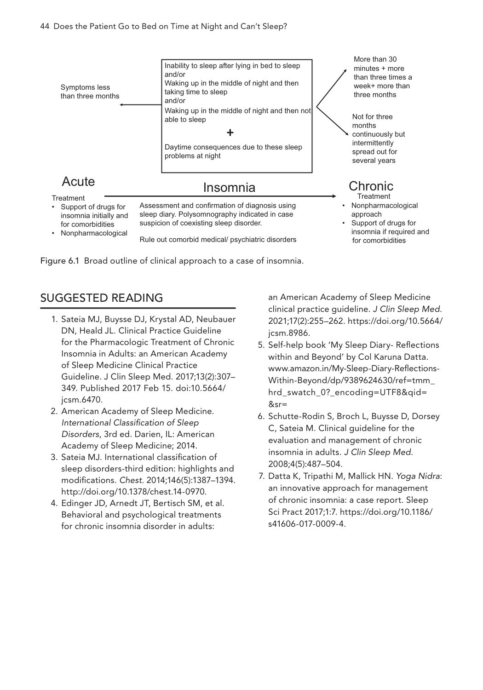

# 6 Does the Patient Go to Bed on Time at Night and Can’t Sleep?

<!-- pdf-page: 54 -->

## 6 Does the Patient Go to Bed on Time

## at Night and Can’t Sleep?

DOI: 10.1201/9781003093381-8 39

#### KARUNA DATTA

39 39 40

Introduction Defning Insomnia Models of Insomnia

#### INTRODUCTION

Insomnia is widely prevalent and a common symptom among outpatients and hospitalized patients. Tese patients complain of the inability to sleep afer going to bed to sleep. Te symptoms may occur transiently associated with some specifc reason. Tis reason may be related to a recent event that acts as a stressor. Te stressor in these cases is identifable, may be at any location such as at home or at the workplace, or may be due to a loss of a near and dear one, spouse, or children. It may also be due to the tension of deadlines that are to be kept at work. A detailed history taking reveals the presence of intermittent insomnia-like symptom that, if unattended, manifests as insomnia disorder. In some patients, it may not show as an intermittent pattern but might just transcend gradually to a full-blown chronic insomnia afer a specifc identifable stressor. Te presentations may vary, reasons may difer, and hence the approach toward treatment is more individualized. Treatment also is gradual and requires regular follow-ups before fnally being fully treated. Tere may be relapses with a stressor later, but the patient who learns the individualized approach can prevent it from further precipitating into a disorder.

Managing Insomnia 41 Review of Insomnia Patients 43 Suggested Reading 44

#### DEFINING INSOMNIA

As per International Classifcation of Sleep Disorders, 3rd edition (ICSD-3), a persistent difculty with the initiation of sleep duration, consolidation, or quality that occurs despite adequate opportunity to sleep and results in daytime impairment is defned as insomnia.

In the case that a daytime impairment or a daytime dysfunction is not present, then it limits itself to being an insomnia symptom but not a disorder. Tis spectrum of an intermittent symptomatology to an established insomnia disorder may at times take years. A detailed history taking with timeline is necessary to establish this diagnosis.

Daytime symptoms are of signifcance in the diagnosis of insomnia. Daytime complaints in adults may be prominently physical in nature like headache, palpitations, muscle pain, and fatigue, or they may be psychological in nature like mood alterations, irritability, aggressiveness, and reduced motivation with or without cognitive impairment. Tese symptoms reduce the quality of life of the patient.

Insomnia may coexist with other comorbid disorders, and in such cases, it should be diagnosed as per the criteria of ICSD-3. In cases where

<!-- pdf-page: 55 -->

40 Does the Patient Go to Bed on Time at Night and Can’t Sleep?

insomnia symptoms are found concomitantly with other medical, psychiatric, and/or other sleep disorders, the diagnosis of insomnia is given only when there is an independence in its onset or progression from other disorders and the insomnia persists even afer treatment of the concomitant disorder. In case the symptom of insomnia is resolved with the treatment of the concomitant disorder, then the diagnosis of insomnia is not made.

Depending on the duration of the disease, it may be categorized as acute or short-term and chronic insomnia. Usually, in adults, symptoms of difculty in the onset of sleep, maintaining sleep, or waking up earlier than the desired time are seen. In children and elderly, resistance to go to bed at bedtime and difculty sleeping without a parent or caregiver is noticed. If the symptoms last for more than 3 times a week and for more than 3 months, it is called chronic insomnia.

At times, episodes of insomnia complaints are less than 3 months each but are spread out over several years. Tough intermittent in nature but due to the long duration of symptoms, the diagnosis of chronic insomnia is recommended as per ICSD-3 guidelines.

Patients on hypnotic medications may have symptoms when they stop the medication. If the symptoms last for more than 3 months, then a diagnosis of chronic insomnia can be given. Te criteria for diagnosis of acute insomnia or short-term insomnia disorder are similar to those of chronic insomnia in the sense that there is difculty initiating sleep, maintaining sleep, or waking up too early with daytime complaints despite having adequate opportunity to sleep and no explanation by another sleep disorder, but the symptoms are present for less than 3 months.

#### MODELS OF INSOMNIA

The pathophysiology of insomnia is explained using various models. Some of the models with implications from the point of treatment modality for insomnia patients are briefly explained next.

1. Stimulus control model: According to this model, a stimulus is paired with a behavior. Once paired with the stimulus, the paired behavior is seen. Tus using this model,

therapy can target using a stimulus that can control the onset of sleep due to its pairing with sleep onset. For example, a particular music, if presented with sleep, will produce sleep when presented with the same music. Te model is utilized in treatment in the case of insomnia where it is proposed that physically altering the sleep environment may induce sleep. 2. Spielman 3P model: Te 3P model brings out predisposing, perpetuating, and precipitating factors as factors implicated in the pathogenesis of insomnia.

● Predisposing factors are the biological, psychological, and social factors, e.g., the personality of the individual, age, alcohol consumption, history of smoking can predispose an individual.

● Perpetuating factors are those factors that are habits or beliefs of the patients followed by them in a hope to better their sleep. For example, lying in bed for a long time to completely recover the lack of sleep. Tis sleep extension is a perpetuating factor for insomnia, and treatment hence would focus on restriction of time in bed.

● Precipitating factors are acute occurrences that can trigger insomnia. Tese are the events or circumstances that may precipitate the chance of insomnia, e.g., life stressors, divorce, death of a near or dear one, illness in family, etc. 3. Neurocognitive model: Tis model discusses the role of cortical arousal and altered sensory processing responsible for a sleep state misperception that might occur. Te model holds that insomniacs develop mesograde amnesia of sleep, which can be treated with hypnotics and might help patients especially in cases of sleep state perception. 4. Psychobiological inhibition model: Te fail­

ure to inhibit wakefulness leads to insomnia probably due to the hypersecretion of orexin. Orexin antagonists have been tried as a treatment strategy based on this model. 5. Cage exchange model: In a stress response in more of a social context, the sleep pattern becomes a sleep-wake intermediate state. 6. Drosophila model: Tis model holds that there is a genetic component to insomnia

<!-- pdf-page: 56 -->

Managing Insomnia 41

in providing sleep opportunity and may be important for diagnostics and the genetic basis of treatment in future.

#### MANAGING INSOMNIA

1. Ascertaining the diagnosis:

a. Detailed sleep history taking:

● Presleep routine

● Sleep-wake pattern

● Any sleep-related symptoms

● Daytime symptoms

● Identifcation of comorbid medical or psychiatric disorders b. Questionnaires and sleep logs and diaries:

● Evaluation of daytime sleepiness: Epworth Sleepiness Scale

● Psychological scales: Depression, anxiety, and stress scale

● Dysfunctional beliefs and attitudes scale

● Role of sleep diary: A sleep diary plays an important role in the diagnosis of insomnia. A sleep diary ideally is written prospectively; that is, it is written two times a day, and the notes are endorsed as early as possible, so the patient is advised to write about the daytime just before sleeping and about the nighttime immediately upon getting up.

A retrospective recall of sleep and daytime habits leads to recall bias, and a generalization of the reporting might occur. Also, recall bias might cause underreporting or overreporting; hence it is important to make the sleep diary a prospective method rather than retrospective record.

A 2-week sleep diary can be studied for:

● Frequency of insomnia symptoms

● Type of symptom, i.e., the problem in sleep onset or maintenance of sleep, or a problem of waking up too early

● Duration of symptoms

For more details on a sleep diary, refer to Chapter 17, and for questionnaires and sleep interviews, refer to Chapters 15 and 16.

c. Role of overnight polysomnography: In a case of insomnia alone, polysomnography is not necessary for diagnosis, but in patients where other disorders of sleep are suspected, polysomnography is indicated. PSG may be done if the patient remains refractory to insomnia therapy, gives a history of arousals associated with unexplained behavior, history of snoring, dryness in mouth, or witnessed apnea suggestive of obstructive sleep apnea, etc.

Paradoxical insomnia is diagnosed using polysomnography. d. Role of actigraphy: Actigraphy is indicated only if there is suspicion of depression with insomnia. In cases where the circadian rhythm pattern is suspected to be afected along with insomnia, actigraphy may be preferable for 2 weeks. 2. Treatment of insomnia: Te goals of therapy are to reduce the daytime consequences and improve sleep quality and quantity. Improvement in wake afer sleep onset, sleep onset latency, sleep quality, sleep efciency, total sleep time, or reduction in daytime distress and number of awakenings at night are considered specifc goals of therapy in these patients. A better association formation of bed and sleep and better sleep-related psychological distress are also considered specifc goals of therapy.

Tere are two types of treatment approaches in these patients: pharmacological and nonpharmacological.

a. Pharmacological approach to insomnia: Pharmacological treatment for insomnia is an important approach in a case of acute insomnia, initially as a support in chronic insomnia, acute painful conditions, or medical and psychiatric conditions requiring sleep treatment. A list of drugs depending on the results of the clinical trials can be found in the American Academy of Sleep Medicine (AASM) guidelines. Tese guidelines are based on the GRADE approach (Grades of Recommendation, Assessment, Development and Evaluation), where in the task force assessed the quality of evidence, balance of benefts and harms, patient’s values, and preferences. For the assessment of quality of evidence, objective

<!-- pdf-page: 57 -->

42 Does the Patient Go to Bed on Time at Night and Can’t Sleep?

data were used. Meta-analysis data were used for determining benefts and harms. Te patient’s values and preferences were formulated by using published data and clinical expertise.

*Drugs NOT Recommended for Sleep Onset or Sleep Maintenance

Drugs recommended for sleep onset insomnia were found to reduce sleep latency in clinical trials. Recommended doses and side efects of each of them are given in the AASM guideline paper by Sateia et al. Sleep quality increased as compared to a placebo with eszopiclone, temazepam, triazolam, or zolpidem.

Te task force listed drugs recommended as per AASM guidelines for sleep onset and sleep maintenance insomnia, along with drugs not recommended for insomnia, as shown here:

*Drugs Recommended for Sleep Onset Insomnia

Eszopiclone Ramelteon Temazepam Triazolam Zaleplon Zolpidem

Dosage and duration should be carefully monitored by the physician. In case daytime sleepiness is afecting the patient’s day-to-day activity, the clinician may conduct a review, and the drug may be changed. Te pharmacological approach is of value in acute insomnia and in chronic insomnia while transitioning to CBTI. Sometimes long-term pharmacological support is required in chronic comorbid illnesses with insomnia.

b. Nonpharmacological approach for treat­

ment of insomnia: As per the AASM guidelines, multicomponent cognitive behavioral therapy for chronic insomnia is strongly recommended. Depending on the clinical condition of the patient and solely at the discretion of the clinician only or due to the patient’s preference, multicomponent

*Drugs Recommended for Sleep Maintenance Insomnia

Doxepin Eszopiclone Suvorexant Zolpidem Temazepam

*AASM Guidelines Sateia et al., 2017

Diphenhydramine Melatonin Tiagabine Trazodone L-tryptophan Valerian

Insomnia

*AASM Guidelines Sateia et al., 2017

<!-- pdf-page: 58 -->

Review of Insomnia Patients 43

brief behavioral therapies, stimulus control or relaxation therapy, or sleep restriction as a single therapy may be advised.

● Te physician also needs to understand the cost involved, feasibility in terms of distance of travel to reach a trained person, and time required while prescribing CBTI.

Te nonpharmacological approach to insomnia includes multicomponent cognitive behavioral therapy for insomnia (CBTI). It is strongly recommended even as a standalone therapy for chronic insomnia in adults. A typical multicomponent CBTI lasts approximately 4–8 sessions, during which the therapist identifes the maladaptive beliefs that are hampering patient’s sleep. Various multicomponent are used like sleep restriction, sleep education, sleep hygiene, stimulus control, relaxation training, and cognitive restructuring in the various sessions. It is a goal-directed approach where the therapist builds a strategy to improve sleep using various components. Te entire therapeutic intervention is monitored using a sleep diary or thought diary, and hence a supervision of the progress of the patient is maintained throughout the intervention.

Te therapy usually is tolerated well. In some circumstances, however, fatigue, tiredness, daytime sleepiness, or attention problems might be precipitated because of sleep deprivation from sleep restriction. In such cases, sleep restriction should be best avoided. Sleep restriction is also contraindicated in patients with seizure disorder or bipolar disorder, which may precipitate due to efects of sleep deprivation. Suitability for CBTI should be judged by the therapist. Here are a few points to consider:

● Te patient should be motivated to attend these sessions. It is important to check in the initial session whether the patient is willing to change the maladaptive behaviors that may be afecting sleep.

● In cases where specifc problems may be identi­

fed, the therapy works better since specifc treatment goals can be formulated and targeted during the therapy sessions.

● Patience is necessary by both the therapist and the patient as the progress of improvement is gradual and slow.

● In case the primary care physician feels that the patient just needs to talk, a counsellor may be suggested before CBTI.

● In case the multicomponent therapy is not feasible due to the lack of a trained therapist, patients’ availability, feasibility, etc., a brief therapy of 1–4 sessions can be taken, or stimulus control, relaxation therapy, or cognitive therapy as a single component may be taken with sleep education and sleep hygiene. Sleep hygiene alone, however, is not recommended in chronic insomnia patients.

Details of each component is laid out in Chapter 22 on nonpharmacological approach to sleep disorders.

In cases where insomnia remains a symptom and is clearly a disorder, multicomponent CBTI may be ofered if the patient can aford it. Otherwise, brief multicomponent therapy or even single component therapies may be tried. Counselling may also help in identifying the problem and might help the individual to formulate a plan for future. Self-help books can also empower the patients to identify their own problems and fnd solutions such that the insomnia symptom can be resolved. One such book by the author is enclosed as further reading, which may be recommended by clinicians to enable their patients. Relaxation training using progressive muscular relaxation, meditation, or yoga nidra, may be tried under supervision.

Treatment of comorbidities, whether medical or psychiatric, or chronic painful conditions should be attended to. Other commonly seen coexisting sleep disorders like restless leg syndrome, obstructive sleep apnea, etc. should be ruled out.

#### REVIEW OF INSOMNIA PATIENTS

Tese patients should be reviewed weekly initially during the start of stabilization, then may be seen once every few weeks or monthly until they stabilize or resolve, afer which the review can be done every 6 months, which is advocated since relapses are very common.

Te broad outline of the clinical approach to a case of insomnia is shown in Figure 6.1.

<!-- pdf-page: 59 -->

44 Does the Patient Go to Bed on Time at Night and Can’t Sleep?

More than 30 minutes + more than three times a week+ more than three months

Inability to sleep after lying in bed to sleep and/or Waking up in the middle of night and then taking time to sleep and/or Waking up in the middle of night and then not able to sleep

Symptoms less than three months

### +

Figure 6.1 Broad outline of clinical approach to a case of insomnia.

Daytime consequences due to these sleep problems at night

### Acute

### Insomnia

Treatment • Support of drugs for insomnia initially and for comorbidities • Nonpharmacological

Assessment and confirmation of diagnosis using sleep diary. Polysomnography indicated in case suspicion of coexisting sleep disorder.

Rule out comorbid medical/ psychiatric disorders

Not for three months continuously but intermittently spread out for several years

### Chronic

Treatment • Nonpharmacological approach • Support of drugs for insomnia if required and for comorbidities

#### SUGGESTED READING

1. Sateia MJ, Buysse DJ, Krystal AD, Neubauer DN, Heald JL. Clinical Practice Guideline for the Pharmacologic Treatment of Chronic Insomnia in Adults: an American Academy of Sleep Medicine Clinical Practice Guideline. J Clin Sleep Med. 2017;13(2):307– 349. Published 2017 Feb 15. doi:10.5664/ jcsm.6470.
2. American Academy of Sleep Medicine. International Classifcation of Sleep Disorders, 3rd ed. Darien, IL: American Academy of Sleep Medicine; 2014.
3. Sateia MJ. International classifcation of sleep disorders-third edition: highlights and modifcations. Chest. 2014;146(5):1387–1394. http://doi.org/10.1378/chest.14-0970.
4. Edinger JD, Arnedt JT, Bertisch SM, et al. Behavioral and psychological treatments for chronic insomnia disorder in adults:

an American Academy of Sleep Medicine clinical practice guideline. J Clin Sleep Med. 2021;17(2):255–262. https://doi.org/10.5664/ jcsm.8986. 5. Self-help book ‘My Sleep Diary- Refections within and Beyond’ by Col Karuna Datta. www.amazon.in/My-Sleep-Diary-RefectionsWithin-Beyond/dp/9389624630/ref=tmm_ hrd_swatch_0?_encoding=UTF8&qid= &sr= 6. Schutte-Rodin S, Broch L, Buysse D, Dorsey C, Sateia M. Clinical guideline for the evaluation and management of chronic insomnia in adults. J Clin Sleep Med. 2008;4(5):487–504. 7. Datta K, Tripathi M, Mallick HN. Yoga Nidra: an innovative approach for management of chronic insomnia: a case report. Sleep Sci Pract 2017;1:7. https://doi.org/10.1186/ s41606-017-0009-4.

