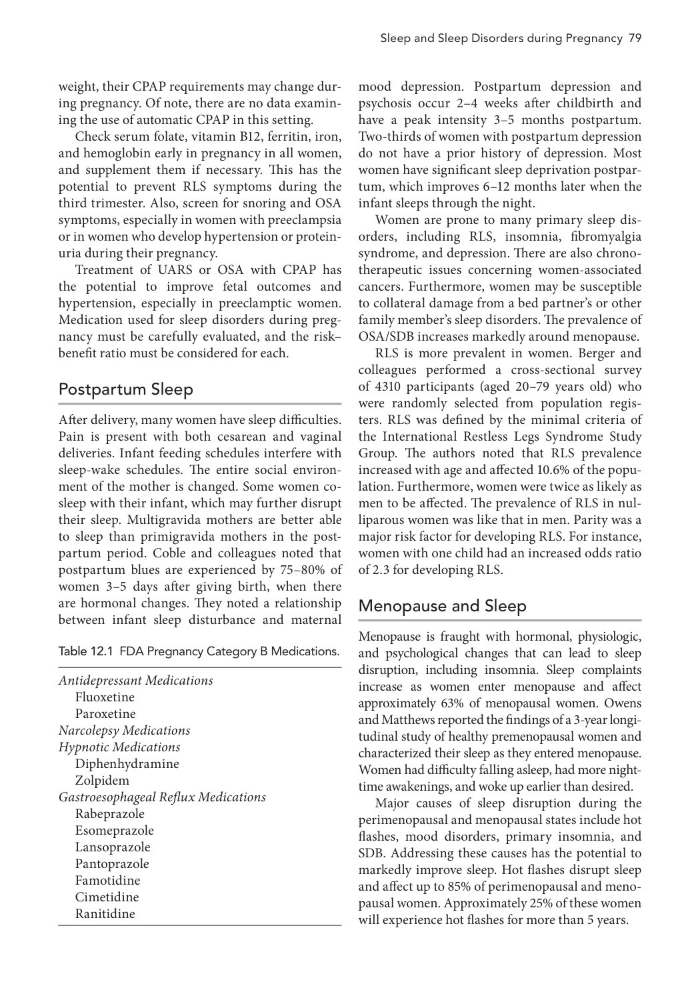

# 12 Is the Patient a Child? Is the Patient Pregnant? Other Special Cases

<!-- pdf-page: 90 -->

## 12 Is the Patient a Child? Is the Patient

## Pregnant? Other Special Cases

DOI: 10.1201/9781003093381-14 75

#### DEEPAK SHRIVASTAVA

The Child as a Sleep Patient 75 OSA and Narcolepsy 75 Insomnia in Children 75 Behavioral Insomnia of Childhood 75 Childhood Parasomnias 76 Confusional Arousals 76 Sleepwalking (Somnambulism) 76 Sleep-Related Eating Disorders 77

#### THE CHILD AS A SLEEP PATIENT

#### OSA and Narcolepsy

Te major disorders of excessive somnolence in children are obstructive sleep apnea and narcolepsy.

Narcolepsy patients report that their symptoms began before age 15. Cataplexy is reported in only 50–70% of children. Cataplexy may be as subtle as twitching or weakness in the knees in response to emotional or other stimuli.

#### Insomnia in Children

Children sometimes won’t sleep. At 3 years of age, 13% of children have problems settling, and 14% remain awake at night. Te most important step in the evaluation of the sleepless child is obtaining a good-quality history. Although the parents ofen report the worst night experience, it is important to get an accurate description of the usual patterns. What does the child do in the evening before

Sleep Terrors (Pavor Nocturnus Incubus) 77 Rhythmic Movement Disorders 77 Head Banging 78 Nightmares 78 Somniloquy (Sleep Talking) 78 Sleep and Sleep Disorders during Pregnancy 78 Postpartum Sleep 79 Menopause and Sleep 79

bed, at bedtime, and during any night awakenings? What are the interactions with parents and other household members? What conditions must be present under which the child falls asleep or back to sleep? Te sleeping environment should be explored. Who sleeps where, in a bed or crib, nighttime lighting, open or closed door, music, bottles, pacifers, transitional objects?

#### Behavioral Insomnia of Childhood

Insomnia in children can generally be characterized as sleep onset association disorders and limitsetting sleep disorders. Brief awakenings at night are normal in children. Children who are used to falling asleep while they are being held, rocked, or patted may be unable to fall asleep unless those associations are repeated. When children who are usually rocked to sleep have a normal nighttime awakening, they fnd themselves in unfamiliar circumstances and are unable to get back to sleep. Tis results in crying or other undesirable

<!-- pdf-page: 91 -->

76 Is the Patient a Child? Is the Patient Pregnant? Other Special Cases

behaviors until the parent recreates the setting wherein the children fell asleep.

Treatment of sleep onset association disorders involves educating the parent that night awakenings are normal, that sleep onset associations are simple habits, and that new sleep onset associations can be taught. Children must learn to fall asleep under the conditions they will fnd themselves in when they experience the normal nighttime awakenings, that is, alone and in their own bed or crib. Te family is taught to maintain a constant, non-stressful bedtime ritual. A child is placed in his or her own bed or crib while awake, and the parent leaves the room. If the child is upset, the parent may return to the room afer a few minutes and verbally comfort the child briefy, gradually increasing the time out of the room until the child falls asleep. Te specifcs can vary based on the individual family’s circumstances. Children are very inventive. If one request does not work, they abandon it for another, but once they fnd one that is successful, they are sure to repeat it.

Parents must be educated that limit setting is a part of good parenting and not cruelty. Tey must decide in advance on the bedtime ritual and stick to it (e.g., one book, one glass of water). Te child must consistently be returned to bed if he or she leaves the room; a gate may be necessary. Children usually respond well to positive reinforcement such as a star chart.

#### Childhood Parasomnias

Parasomnias are episodic disorders in sleep, rather than a disorder of wakefulness or sleep, per se. Tey usually do not produce a primary complaint of insomnia or excessive sleepiness.

#### Confusional Arousals

Tese events usually take place following arousals from sleep, most typically deep sleep in the frst part of the night. Episodes may last several minutes. Tere is ofen absence of recollection of mental activity. Tey represent an admixture of wakefulness into non-REM sleep. Patients partially awaken and exhibit marked confusion, slow mentation, disorientation, perceptual impairment. Te memory of the event is ofen absent. Tis type of arousal is commonly reported in children.

Predisposing factors to confusional arousals include any factors that induce deep sleep and impair the awakening threshold. Populations at risk are individuals who are sleep deprived, those who are recovering from sleep deprivation, and patients who are exposed to fever and CNS depressants. Confusional arousals are common under age 5 years and with increasing age become less common. Te sex ratio is equal.

Te diferential diagnosis of confusional arousals includes sleep terrors, sleepwalking, REM behavior disorder and nocturnal epileptic seizures. Tere is a strong familial tendency for confusional arousals, and formal genetic studies are still pending.

Polysomnographic studies reveal abnormalities during the frst one-third of the night and appear to be very rare during REM sleep. Confusional arousals are common during transition periods from non- REM to REM sleep. Te EEG during confusions may show a brief episode of delta activity (SWS), stage 1 theta pattern, and repeated microsleeps.

#### Sleepwalking (Somnambulism)

Sleepwalking is a complex behavior that occurs during N3 sleep. It results in walking while asleep. Communication with the patient is ofen difcult. Te behaviors may be of a wide range of a repetitive nature and have a symbolic meaning.

Te risk of injury is a major concern in sleepwalking. Sleepwalking ofen lasts from 1 to 5 minutes, but, rarely, episodes may last more than an hour if behavioral spells are complex. Hybrid attacks may occur, during which time sleep terrors precede the sleepwalking and evolve into it.

Homicidal somnambulism is a parasomnia with considerable medicolegal implications. Predisposing factors may include several medications that can exacerbate or induce sleepwalking. Some of these include chloralhydrate, lithium, fuphenazine, perphenazine, and desipramine. Fevers can generally produce and increase the frequency of sleepwalking episodes. Other precipitants include CNS suppression, untreated obstructive sleep apnea, stress, and a distended bladder.

Te prevalence of sleepwalking is 1–15% percent of the general population. Te peak incidence is usually between the ages of 4 and 8, and sleepwalking incidents usually disappear spontaneously later in life.

<!-- pdf-page: 92 -->

The Child as a Sleep Patient 77

heart and respiratory rate, sweating, fushed skin, and muscle tone changes. Many times incoherent phonation or urinary incontinence can occur.

Te diferential diagnosis includes nocturnal eating. Tese are episodes of awakening with the inability to return to sleep without eating or drinking. Other nocturnal spells on the diferential diagnosis of sleepwalking include sleep-related partial complex seizures, RBD, confusional arousals, and episodic nocturnal wandering. Te sex ratio is equal. Familial patterns are reported. Te incidence of sleepwalking is 22% if neither parent sufers from a history of sleepwalking, 45% if only one parent is afected, and 60% if both parents are afected.

Polysomnographic features show that sleepwalking begins in N3 and appears more commonly at the end of the frst or second episode of N3. EEG results demonstrate “lightning” from N3 into lighter sleep stages (N1 and N2). Tere is ofen a lack of autonomic activation. Delta bursts and an increase in microarousals may be observed. Polysomnographic monitoring is routinely done with video recording using a long cable.

Treatment is based on avoidance of precipitating factors and securing a safe home environment. Tis is accomplished by removing sharp, dangerous items from the bedroom, locking doors, using alarms, hiding car keys, and use of a bedroom downstairs. Tricyclic antidepressants and benzodiazepines have been used in refractory cases. Psychological and psychiatric treatment, together with reassurance, is needed when patients have a history of a psychological factor that prompts the appearance of these spells.

#### Sleep-Related Eating Disorders

Sleep-related eating disorders are recurrent episodes of eating during sleep without being aware of the activity. Tey ofen are associated with signifcant weight gain and are common in young women.

#### Sleep Terrors (Pavor Nocturnus

#### Incubus)

Sleep terrors are a syndrome that consists of a sudden arousal associated with screaming or behavior related to being afraid and crying. Te child cannot be woken up and does not have memory of the event in the morning.

Sleep terror is ofen an extreme autonomic arousal. Sleep terrors are associated with increased

Tere may be a variable motor activity such as extreme agitation or escape behavior. Tese are states of cerebral hyperresponsiveness. Te spells may be dangerous, as patients may hurt themselves during the escape behavior. Tere may be a sense of “oppression”; therefore, the name incubus (in = upon, cubare = to press upon). Tere were medieval beliefs that the attacks were prompted by a “devil” sitting or pressing on the chest of the sleeper.

Sleep terrors usually last between half a minute to 3 minutes. Predisposing factors include forced awakening from N3, febrile illness, sleep deprivation, emotional stress, and CNS depressants, such as alcohol. Sleep terrors are prevalent in approximately 3% of children and 1% of adults, and men are more commonly afected than women. Psychopathology is rare in afected children but may have a stronger role in adult patients. Familial patterns show occurrence in several members of a single family.

Te diferential diagnosis of sleep terrors includes nightmares, anxiety attacks related to sleep disordered breathing, cardiac ischemia, and sleep-related epileptiform seizure activity.

Polysomnographic features demonstrate that the spells usually begin in SWS in the frst third of the major sleep cycle. Te events are accompanied by autonomic hyperarousal, as noted previously.

Treatment is ofen not required if episodes of sleep terrors are rare. For frequent episodes, shortacting benzodiazepines are recommended.

#### Rhythmic Movement Disorders

Rhythmic movement disorders (RMD) are manifested by repetitive, stereotyped rhythmic movements that involve the head and entire body. Tey may take the form of nocturnal head banging and body rocking or body rolling. Te onset typically occurs within the frst 2 years of life and may afect up to 20% of healthy children. Persistence into adulthood is rare and may be associated with signifcant psychopathological disorders, such as autism. Te male-to-female ratio is approximately 3:1. Rare complications resulting from these movements, when very severe, may include skull callus, retinal petechiae, and subdural hemorrhage.

<!-- pdf-page: 93 -->

78 Is the Patient a Child? Is the Patient Pregnant? Other Special Cases

Te diagnostic criteria for RMD include spells that occur during drowsiness or sleep and are accompanied by least one of the following:

REM sleep. Non-REM nightmares are associated with pure fear without visual imagery, while REM nightmares are ofen vivid and frightening. Tere is an equal sex ratio in children.

#### Somniloquy (Sleep Talking)

● Head banging: Te head forcibly moves in the anterior to posterior direction. Te patient lies prone and repetitively lifs the head or the entire body, then “bangs” the head down into the pillow/mattress.

● Head rolling: Te head moves sideways when the child is lying face up.

● Body rocking: Te whole-body rocks when the child is in the knee-chest position. Te entire body may roll forward and backward from a sitting position.

● Body rolling: Te whole body is moved later­

ally (side to side) while in the supine position.

Video monitoring may reveal typical movements comprising rhythmic oscillation of the head and limbs. Te rhythm frequency is between 0.5 to 2 Hz in long clusters with rhythmic “chanting” and other vocalization.

#### Head Banging

Tis is more likely to be present during REM sleep, while body rocking is more likely to be present during light sleep (stages N1 and N2). In the diagnostic workup of these episodes, one should assess for any underlying neurologic or psychiatric disorder that may cause the symptoms (i.e., nocturnal epilepsy).

Te diferential diagnosis includes bruxism, thumb sucking, PLMS, and infantile spasms. When adults manifest RMD, consideration should be given to neurologic or psychiatric causes.

Treatment is ofen not necessary. Parents may consider the use of bed padding and a protective helmet if the episodes lead to excessive noise or bodily injury. Behavioral modifcation may be used, and, if the episodes are severe, short-acting benzodiazepines or TCAs may be used. Te parents also need to be reassured.

#### Nightmares

Ten to 50% of children aged 3–5 years, in general sufer with nightmares that disturb the parents. Te polysomnogram may demonstrate increased blood pressure and sweating during the attack. Nightmares may occur during both non-REM and

Sleep talking is very common in children and usually of little concern to parents. It may be related to other parasomnias, such as sleepwalking, sleep terrors, and confusional arousals. It can occur in any stage of sleep.

#### SLEEP AND SLEEP DISORDERS

#### DURING PREGNANCY

In women with preexisting sleep disorders, if taking medications, it is optimal to stop these medications prior to pregnancy and discontinue them once pregnancy begins.

If a woman has narcolepsy or idiopathic hypersomnolence, she should discontinue modafnil, methylphenidate, amphetamines, and other stimulants prior to becoming pregnant, if possible. Patients should be informed that once they stop taking their alerting medication, they should stop driving because of their increased risk of falling asleep while driving. Furthermore, they should assess their ability to stay alert for other important activities, including childcare and their job. Certain medications, like selective serotonin reuptake inhibitors and tricyclic antidepressants, do not cause major organ malformations; however, their use should be individualized. In women with depression, the decision to discontinue antidepressants should be made carefully by the physician and patient by examining the risk–beneft ratio.

In women who become pregnant with preexisting RLS, monitor iron, ferritin, vitamin B12, and folate levels, and supplement as tests indicate. Unfortunately, benzodiazepines, dopaminergic agents, and antiepileptic medications used to treat RLS are contraindicated in pregnancy. If severe symptoms are present, some professionals use opioids in this situation. However, opioids should be discontinued prior to delivery because of fetal respiratory depression.

In women with known sleep apnea, consider performing overnight pulse oximetry at intervals throughout the pregnancy, verifying adequate oxygenation during sleep. Because many women gain

<!-- pdf-page: 94 -->

Sleep and Sleep Disorders during Pregnancy 79

weight, their CPAP requirements may change during pregnancy. Of note, there are no data examining the use of automatic CPAP in this setting.

Check serum folate, vitamin B12, ferritin, iron, and hemoglobin early in pregnancy in all women, and supplement them if necessary. Tis has the potential to prevent RLS symptoms during the third trimester. Also, screen for snoring and OSA symptoms, especially in women with preeclampsia or in women who develop hypertension or proteinuria during their pregnancy.

Treatment of UARS or OSA with CPAP has the potential to improve fetal outcomes and hypertension, especially in preeclamptic women. Medication used for sleep disorders during pregnancy must be carefully evaluated, and the risk– beneft ratio must be considered for each.

#### Postpartum Sleep

Afer delivery, many women have sleep difculties. Pain is present with both cesarean and vaginal deliveries. Infant feeding schedules interfere with sleep-wake schedules. Te entire social environment of the mother is changed. Some women cosleep with their infant, which may further disrupt their sleep. Multigravida mothers are better able to sleep than primigravida mothers in the postpartum period. Coble and colleagues noted that postpartum blues are experienced by 75–80% of women 3–5 days afer giving birth, when there are hormonal changes. Tey noted a relationship between infant sleep disturbance and maternal

Table 12.1 FDA Pregnancy Category B Medications.

Antidepressant Medications

Fluoxetine Paroxetine Narcolepsy Medications Hypnotic Medications

Diphenhydramine Zolpidem Gastroesophageal Refux Medications Rabeprazole Esomeprazole Lansoprazole Pantoprazole Famotidine Cimetidine Ranitidine

mood depression. Postpartum depression and psychosis occur 2–4 weeks afer childbirth and have a peak intensity 3–5 months postpartum. Two-thirds of women with postpartum depression do not have a prior history of depression. Most women have signifcant sleep deprivation postpartum, which improves 6–12 months later when the infant sleeps through the night.

Women are prone to many primary sleep disorders, including RLS, insomnia, fbromyalgia syndrome, and depression. Tere are also chronotherapeutic issues concerning women-associated cancers. Furthermore, women may be susceptible to collateral damage from a bed partner’s or other family member’s sleep disorders. Te prevalence of OSA/SDB increases markedly around menopause.

RLS is more prevalent in women. Berger and colleagues performed a cross-sectional survey of 4310 participants (aged 20–79 years old) who were randomly selected from population registers. RLS was defned by the minimal criteria of the International Restless Legs Syndrome Study Group. Te authors noted that RLS prevalence increased with age and afected 10.6% of the population. Furthermore, women were twice as likely as men to be afected. Te prevalence of RLS in nulliparous women was like that in men. Parity was a major risk factor for developing RLS. For instance, women with one child had an increased odds ratio of 2.3 for developing RLS.

#### Menopause and Sleep

Menopause is fraught with hormonal, physiologic, and psychological changes that can lead to sleep disruption, including insomnia. Sleep complaints increase as women enter menopause and afect approximately 63% of menopausal women. Owens and Matthews reported the fndings of a 3-year longitudinal study of healthy premenopausal women and characterized their sleep as they entered menopause. Women had difculty falling asleep, had more nighttime awakenings, and woke up earlier than desired.

Major causes of sleep disruption during the perimenopausal and menopausal states include hot fashes, mood disorders, primary insomnia, and SDB. Addressing these causes has the potential to markedly improve sleep. Hot fashes disrupt sleep and afect up to 85% of perimenopausal and menopausal women. Approximately 25% of these women will experience hot fashes for more than 5 years.

<!-- pdf-page: 95 -->

80 Is the Patient a Child? Is the Patient Pregnant? Other Special Cases

Menopausal status also afects the likelihood of Sleep architecture changes in menopause. Tere developing OSA/SDB, and menopause is an indeis a nonsignifcant overall reduction in total sleep pendent risk factor for SDB. Sleep apnea incidence time with increased fragmentation of the sleep was also infuenced by the waist:hip ratio, which period. Tere are more arousals and more time changes with female hormonal status. awake with arousals.
