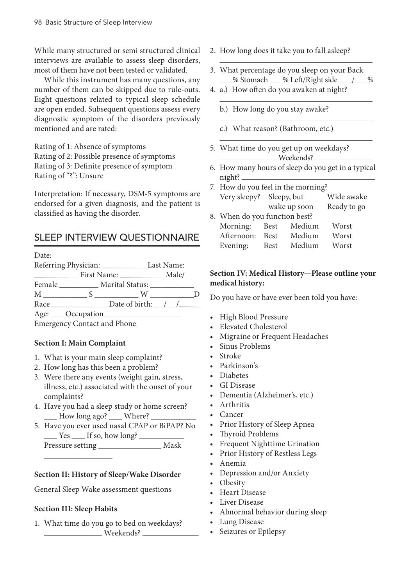
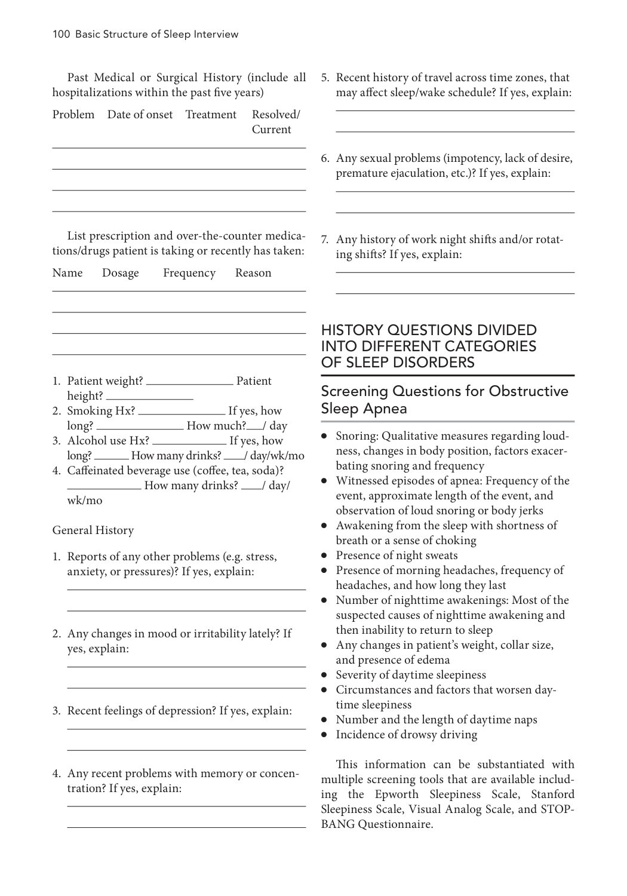

# 15 Basic Structure of Sleep Interview

<!-- pdf-page: 112 -->

## 15 Basic Structure of Sleep Interview

#### DEEPAK SHRIVASTAVA, AND RICHA SHRIVASTAVA

DOI: 10.1201/9781003093381-18 97

The Structured Clinical Interview 97 Sleep Interview Questionnaire 98 History Questions Divided into Different

Categories of Sleep Disorders 100 Screening Questions for Obstructive Sleep

Apnea 100 Screening Questions for Narcolepsy 101 Screening Questions for Periodic Limb

Movements of Sleep 101 Screening Questions for Parasomnia 101 Screening Questions for Insomnia 101 Sleep Apnea Assessment Questionnaires 101 Sleep Quality Assessment Questionnaires 101 Restless Leg Syndrome Questionnaires 101 Circadian Rhythm Questionnaires 101

#### THE STRUCTURED CLINICAL

#### INTERVIEW

One of the most important components of patient evaluation with sleep complaints is the initial interview, which should be specifc, goal directed, and comprehensive. A thorough sleep history outlining the nature of the complaint and screening for primary sleep disorders, as well as other medical and neurologic disorders, are crucial in creating the basic database that pervades the patient evaluation, clinical decision making, and establishing pretest probability and the appropriate selection of the diagnostic tests.

Te Structured Clinical Interview for Sleep Disorders (SCISD-R) for DSM-5 sleep disorders, is a tool for the initial assessment of the most common sleep disorders. It was developed at the University of North Texas, USA. Although it has not been

Insomnia Assessment Questionnaires 101 Excessive Daytime Sleepiness

Assessment 102 NARCOLEPSY 102 CATAPLEXY QUESTIONNAIRE 102 Allergies 102 Review of Systems 102 Sleep Hygiene 102 Nocturnal Awakenings 102 Work Schedule 103 Circadian Rhythm 103 Family History 103 Habits 103 Physical Examination 103 Suggested Reading 103

completely validated, it still provides a thorough framework that is designed to systematically document a patient’s symptoms and the probability of the underlying disorders in an outpatient setting. Tis tool is easy for health practitioners to learn and use.

Te clinical interview form includes multiple questions and takes about 10–20 minutes to administer. It covers nine major sleep disorders. Six of them have a high prevalence rate. Te interrater reliability for these disorders, including insomnia, excessive sleepiness, obstructive sleep apnea, circadian rhythm sleep disorders, nightmares, and RLS disorder, is excellent.

Te clinical interview is essential for the diagnosis of many sleep-wake disorders. In many of these disorders, the role of polysomnography is limited. A structured clinical interview is reliable and accurate to support the clinical decision making and proceed with evidence-based treatment selection.

<!-- pdf-page: 113 -->

98 Basic Structure of Sleep Interview

While many structured or semi structured clinical interviews are available to assess sleep disorders, most of them have not been tested or validated.

2. How long does it take you to fall asleep?

3. What percentage do you sleep on your Back % Stomach % Lef/Right side / %
4. a.) How ofen do you awaken at night?

b.) How long do you stay awake?

While this instrument has many questions, any number of them can be skipped due to rule-outs. Eight questions related to typical sleep schedule are open ended. Subsequent questions assess every diagnostic symptom of the disorders previously mentioned and are rated:

Rating of 1: Absence of symptoms Rating of 2: Possible presence of symptoms Rating of 3: Defnite presence of symptom Rating of “?”: Unsure

Interpretation: If necessary, DSM-5 symptoms are endorsed for a given diagnosis, and the patient is classifed as having the disorder.

#### SLEEP INTERVIEW QUESTIONNAIRE

Date: Referring Physician: Last Name: First Name: Male/ Female Marital Status: M S W D Race Date of birth: / / Age: Occupation Emergency Contact and Phone

#### Section I: Main Complaint

1. What is your main sleep complaint?
2. How long has this been a problem?
3. Were there any events (weight gain, stress, illness, etc.) associated with the onset of your complaints?
4. Have you had a sleep study or home screen? How long ago? Where?
5. Have you ever used nasal CPAP or BiPAP? No

Yes If so, how long? Pressure setting Mask

#### Section II: History of Sleep/Wake Disorder

General Sleep Wake assessment questions

#### Section III: Sleep Habits

1. What time do you go to bed on weekdays? Weekends?

c.) What reason? (Bathroom, etc.)

5. What time do you get up on weekdays? Weekends?
6. How many hours of sleep do you get in a typical night?
7. How do you feel in the morning?

Very sleepy? Sleepy, but Wide awake wake up soon Ready to go 8. When do you function best? Morning: Best Medium Worst Afernoon: Best Medium Worst Evening: Best Medium Worst

#### Section IV: Medical History—Please outline your

medical history:

Do you have or have ever been told you have:

• High Blood Pressure
• Elevated Cholesterol
• Migraine or Frequent Headaches
• Sinus Problems
• Stroke
• Parkinson’s
• Diabetes
• GI Disease
• Dementia (Alzheimer’s, etc.)
• Arthritis
• Cancer
• Prior History of Sleep Apnea
• Tyroid Problems
• Frequent Nighttime Urination
• Prior History of Restless Legs
• Anemia
• Depression and/or Anxiety
• Obesity
• Heart Disease
• Liver Disease
• Abnormal behavior during sleep
• Lung Disease
• Seizures or Epilepsy

<!-- pdf-page: 114 -->

Sleep Interview Questionnaire 99

Do you fall asleep or become sleepy when:

#### Never

#### Sometimes

#### Often

#### Always

1. Driving? 0 1 2 3

2 At work? 0 1 2 3

3 Do you take intentional naps? 0 1 2 3

4 Do you feel unable to move

(paralyzed) when falling asleep? 0 1 2 3

5 Suddenly awaken choking for breath? 0 1 2 3

6 Grind your teeth? 0 1 2 3

7 Hold your breath? Or have you been told you stop 0 1 2 3 breathing?

8 How would you rate your overall sleepiness? 0 1 2 3

9 Do you experience short periods of muscle 0 1 2 3 weakness or loss of muscle control (especially with laughter or excitement)?

11 Do you think you need a sleeping pill, either 0 1 2 3 prescription drug or over-the-counter sleeping aids in order to fall asleep?

11 Have nightmares? 0 1 2 3

12 Do you ever experience an uncomfortable or 0 1 2 3 restless sensation in your legs when you relax or are frst going to sleep that is relieved by moving or getting out of bed and walking?

13 Toss and turn or have restless sleep? 0 1 2 3

14 Walk or talk in your sleep? (Circle appropriate 0 1 2 3 event.)

15 Snore? 0 1 2 3

16 Do you experience vivid dreamlike episodes when 0 1 2 3 falling asleep?

17 Awaken with heartburn or acid refux? (acid taste 0 1 2 3 in mouth)

18 Wake up with a dry mouth? 0 1 2 3

19 Wake up with headaches? 0 1 2 3

20 Move about or engage in aggressive behaviors 0 1 2 3 while asleep or awakening from sleep?

21 Do you consume wine or another alcoholic 0 1 2 3 beverage in order to fall asleep?

22 Have you been taking sleeping pills or 0 1 2 3 nonprescription sleeping aids on a nightly basis for more than three weeks?

23 Do you lay in bed for more than thirty minutes 0 1 2 3 unable to go to sleep or return to sleep?

24 Do you dread getting into bed because you think 0 1 2 3 you will “never” fall asleep?

25 How would you rate your overall sleepiness? 0 1 2 3

<!-- pdf-page: 115 -->

100 Basic Structure of Sleep Interview

Past Medical or Surgical History (include all hospitalizations within the past fve years)

5. Recent history of travel across time zones, that may afect sleep/wake schedule? If yes, explain:

Problem Date of onset Treatment Resolved/ Current

6. Any sexual problems (impotency, lack of desire, premature ejaculation, etc.)? If yes, explain:

List prescription and over-the-counter medications/drugs patient is taking or recently has taken:

Name Dosage Frequency Reason

1. Patient weight? Patient height?
2. Smoking Hx? If yes, how long? How much? / day
3. Alcohol use Hx? If yes, how long? How many drinks? / day/wk/mo
4. Cafeinated beverage use (cofee, tea, soda)?

How many drinks? / day/ wk/mo

General History

1. Reports of any other problems (e.g. stress, anxiety, or pressures)? If yes, explain:

2. Any changes in mood or irritability lately? If yes, explain:

3. Recent feelings of depression? If yes, explain:

4. Any recent problems with memory or concen­

tration? If yes, explain:

7. Any history of work night shifs and/or rotat­

ing shifs? If yes, explain:

#### HISTORY QUESTIONS DIVIDED

#### INTO DIFFERENT CATEGORIES

#### OF SLEEP DISORDERS

#### Screening Questions for Obstructive

#### Sleep Apnea

● Snoring: Qualitative measures regarding loud­

ness, changes in body position, factors exacerbating snoring and frequency

● Witnessed episodes of apnea: Frequency of the event, approximate length of the event, and observation of loud snoring or body jerks

● Awakening from the sleep with shortness of breath or a sense of choking

● Presence of night sweats

● Presence of morning headaches, frequency of headaches, and how long they last

● Number of nighttime awakenings: Most of the suspected causes of nighttime awakening and then inability to return to sleep

● Any changes in patient’s weight, collar size, and presence of edema

● Severity of daytime sleepiness

● Circumstances and factors that worsen day­

time sleepiness

● Number and the length of daytime naps

● Incidence of drowsy driving

Tis information can be substantiated with multiple screening tools that are available including the Epworth Sleepiness Scale, Stanford Sleepiness Scale, Visual Analog Scale, and STOPBANG Questionnaire.

<!-- pdf-page: 116 -->

History Questions Divided into Different Categories of Sleep Disorders 101

Episodes of waking up afer falling asleep Early morning awakening with shortening of the

#### Screening Questions for Narcolepsy

Presence of excessive daytime sleepiness Episodes of cataplexy manifested by muscle weak­

total sleep time Inability to control racing thoughts and staying awake Worry over time by watching the clock and inabil­

ness, buckling of the knees, weakness in the arms, or jaw drop with intense emotional surge or excitement Presence of hallucinations upon trying to fall asleep (In typical narcoleptic patients the sensations can be scary.) Presence of sleep paralysis or inability to move while awakening from sleep Presence of automatic behavior like driving a cer­

tain distance without the cognitive engagement or fnding oneself at the place and not knowing how you get there

#### Screening Questions for Periodic

#### Limb Movements of Sleep

Presence of leg cramps at bedtime Experiencing crawling and an achy feeling in the legs during the latter part of the day or night with a feeling to get up and walk Worsening of the leg discomfort during nighttime Movement of the legs during the sleep observed

by bed partner or others Finding the bed covers in disarray Sudden awakening with a jerk immediately afer

falling asleep

#### Screening Questions for Parasomnia

Recall of the dream of the event Presence of nightmares Episodes of acting out dreams with swinging

arms, legs, moving, or yelling. Approximate time of such activity during the night Episodes of any injuries caused by these events

and activity at night History of sleepwalking Approximate timing of sleepwalking during the night History of sleep talking Approximate timing of sleep talking during the night Episodes of waking up from sleep in a state of

confusion and disorientation

#### Screening Questions for Insomnia

Inability to fall asleep in 30 minutes or less afer the lights are out

ity to fall asleep Any preoccupying thoughts causing anxiety and keeping wakefulness Presence of chronic pain during the day or night

In addition, International Classifcation of Sleep Disorders, 3rd edition, further helps in providing guidelines for making the diagnosis of certain disorders. Once the diagnosis is suspected through the initial interview, the practitioner can follow the diagnostic criteria and get more information from the patient and the family.

#### Sleep Apnea Assessment

#### Questionnaires

Sleep diary Epworth Sleepiness Questionnaire STOP-BANG Questionnaire Berlin Questionnaire

#### Sleep Quality Assessment

#### Questionnaires

Functional outcomes of sleep questionnaire (FOSQ) Pittsburgh Sleep Quality Index (PHQ-9)

#### Restless Leg Syndrome

#### Questionnaires

International Restless Legs Scale (IRLS) Augmentation Severity Rating Scale (ASR S) Restless Leg Syndrome Quality of Life

Questionnaire (RLS Q OL)

#### Circadian Rhythm Questionnaires

Morningness-Eveningness Questionnaire (MEQ) Munich Chronotype Questionnaire (MCT Q) Te Sleep Timing Questionnaire (ST Q)

#### Insomnia Assessment Questionnaires

Insomnia Severity Index (ISI)

<!-- pdf-page: 117 -->

102 Basic Structure of Sleep Interview

● Allergies can cause insomnia, trouble falling asleep, and staying asleep.

#### Excessive Daytime Sleepiness

#### Assessment

● Allergies can cause increased snoring and a high risk of sleep apnea.

NARCOLEPSY

● Allergies lead to poor sleep efciency and shortened total sleep time.

#### Stanford Sleepiness Scale (SSS)

Circle the ONE number that best describes your level of alertness or sleepiness RIGHT NOW.

1. Wide awake, fully awake, functioning at high level; head clear.
2. Functioning at a high level, but not at peak; able to concentrate.
3. Relaxed; awake; not at full alertness; responsive.
4. A little groggy; clearly not at peak; let down.
5. Fogginess; beginning to lose interest in remaining awake; slowed down.
6. Sleepiness; prefer to be lying down; fghting sleep, woozy.
7. Almost in reverie; sleep onset soon; lost struggle to remain awake.

CATAPLEXY QUESTIONNAIRE Tis questionnaire determined that cataplexy was best diferentiated from other types of muscle weakness when triggered by only three typical situations: “when hearing and telling a joke,” “while laughing,” or “when angry.” Te face or neck, rather than the limbs, were also more specifcally involved in clear-cut cataplexy. Tis detailed questionnaire is available freely on the Internet.

#### ALLERGIES

Allergies have a signifcant impact on sleep and can worsen multiple sleep conditions. A detailed history of allergies is important, for both diagnostic and therapeutic purposes.

● Allergic rhinitis is a common complaint in approximately 40% of individuals.

● Insomnia is twice as likely in patients who have concomitant allergies.

● Nasal congestion, sneezing, and watery eyes tend to worsen at night and cause difculty in breathing and poor-quality sleep.

● Interrupted sleep causes daytime tiredness and impairs performance.

#### REVIEW OF SYSTEMS

Constitutional: Excessive daytime sleepiness tiredness and fatigue, no night sweats, no weight changes Sleep: No insomnia, no early awakening, no interrupted sleep, refreshing normal sleep, no morning headaches Eyes: No visual problems, no glaucoma, no eye pain HENT: No deformities, no surgeries, no sneezing,

congestion, runny nose, or sore throat, snoring. Cardiovascular: No palpitations or edema Respiratory: No shortness of breath, cough,

wheezing Gastrointestinal: No GERD, abdominal bloating, no nocturnal eating Neurological: No morning headache, no sleep paralysis, no muscle weakness (cataplexy) Musculoskeletal: No nighttime muscle activity/

cramps, back pain, joint pain or stifness Hematologic: No anemia, bleeding, or bruising. Lymphatic: No enlarged nodes Endocrinologic: No reports of sweating, cold or

heat intolerance, no polyuria or polydipsia Psychiatric: No anxiety, no depression, no confu­

sion or hallucinations Skin: No rash, no masses Allergies: No history of hives, eczema, or

rhinitis

#### SLEEP HYGIENE

What time does the patient go to bed and what time does he or she usually awaken during the weekends, as well as on weekdays. See if the time remains constant or not.

#### NOCTURNAL AWAKENINGS

How many times does the patient wake up during sleep, and if so, what part of the night is it, and what are the usual causes—to urinate, shortness of breath, heartburn, body jerking, or not sure?

<!-- pdf-page: 118 -->

Suggested Reading 103

● Head and neck exam of nasopharynx for naso­

#### WORK SCHEDULE

pharyngeal edema, turbinate hypertrophy, or deviated nasal septum

Is the patient a shif worker? Does he or she work swing shifs (shif changes from one week to the next)? Recent travel history, especially resulting in jet lag and especially afer traveling eastward

● Examination of the teeth and dentition

● Anatomy of maxilla and mandible

● Retrognathia?

● Tick tongue?

#### CIRCADIAN RHYTHM

Any trouble waking up in the morning? Does the patient stay up later (i.e., 2–3 a.m.) and sleep in until noon? (Delayed sleep phase— more common in adolescents) Does the patient go to bed at 8 p.m. and wake up at 3 a.m.? (Advanced phase syndrome—more common in the elderly)

#### FAMILY HISTORY

Family history is important as many disorders like narcolepsy run in families.

#### HABITS

Cafeine use in terms of quantity, frequency, and the time day Alcohol use in terms of amount and relationship to bedtime Smoking in terms of packs per day and for how many years

#### PHYSICAL EXAMINATION

A good-quality patient interview leads to a focused and specifc examination of the patient, increasing the odds of capturing all the abnormalities. It also helps to design a proper diagnostic test that will support the initial diagnostic hypothesis.

In general, a sleep-related physical examination includes:

● Weight, height, and body mass index (BMI), and neck collar size (circumference) in centimeters.

● Anterior and posterior tonsillar pillars, sof palate, and uvula to assess for signifcant retropalatal obstruction with a narrow airway

● Systemic cardiac, pulmonary, and neurological examination

Te review of sleep history and the interview of the patient and the assessment of the sleep complaint is one of the best tools available to establish a hypothesis and high pretest probability of the prospective diagnosis. It incorporates the predisposing and precipitating factors, other factors that exacerbate the symptoms, and the perceived impact of the symptoms on a patient’s daytime functioning. As previously described, multiple diagnostic and screening instruments are available to assist in obtaining a reasonably reliable and comprehensive history.

#### SUGGESTED READING

1. Maurice M, Ohayon MD. Epidemiological overview of sleep disorders in the general population. Sleep Med Res (SMR). 2011;2(1):1–9.
2. Dinges D. Recognizing problem sleepi­

ness in your patients. Am Fam Physician. 1999;59(4):937–944. 3. Klingman KJ, Jungquist CR, Perlis ML. Questionnaires that screen for multiple sleep disorders. Sleep Med Rev. 2017;32:37–44. http://doi.org/10.1016/j. smrv.2016.02.004 4. El-Sayed IH. Comparison of four sleep questionnaires for screening obstructive sleep apnea. Egypt J Chest Dis Tuberc. 2012;61(4):433–441. https://doi. org/10.1016/j.ejcdt.2012.07.003.
