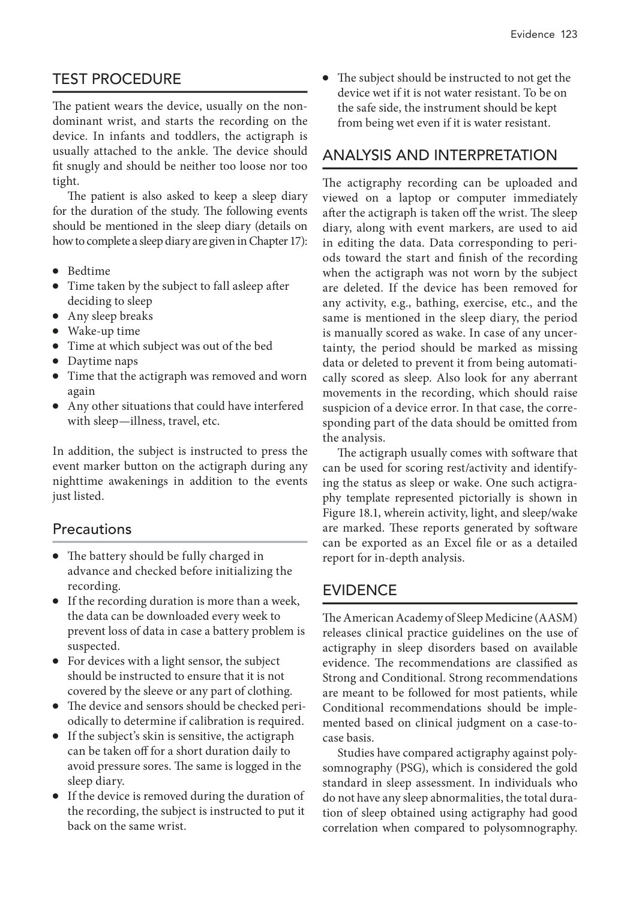
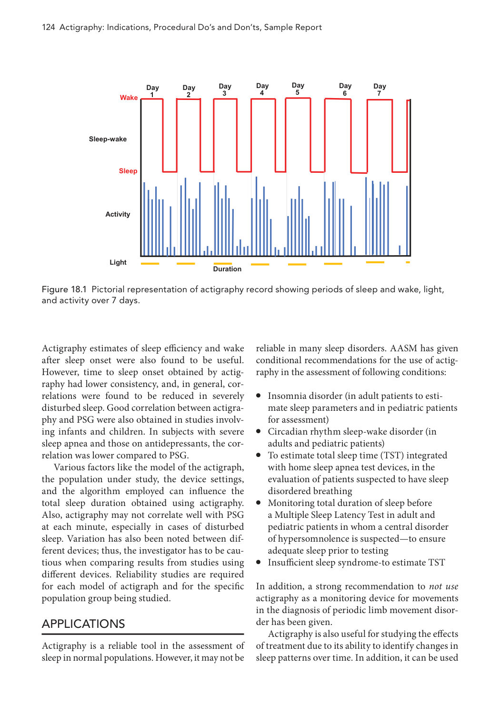

# 18 Actigraphy: Indications, Procedural Do’s and Don’ts, Sample Report

<!-- pdf-page: 136 -->

## 18 Actigraphy: Indications, Procedural

## Do’s and Don’ts, Sample Report

DOI: 10.1201/9781003093381-21 121

#### KARUNA DATTA, AND THOMAS JOSEPH

Introduction Actigraph Principle Procedure Before the Test Test Procedure Precautions Analysis and Interpretation

#### INTRODUCTION

Actigraphy uses a portable monitoring device to record an individual’s limb movement over time. Both the occurrence as well as the degree of movement are recorded. Tis data can then be used in the study of normal sleep as well in the assessment of various sleep problems.

Actigraphy was used in the early 1970s to estimate sleep and wake, and the term “actigraphy” was frst coined in a 1978 study by Kripke et al., who also used piezoelectric transducers in the device, which have now become the standard for movement-based measurement. In the 1980s, the frst automated scoring algorithm for actigraphy was developed, which demonstrated validity against PSG. Since then, more reliable algorithms and technological advancements have been incorporated into actigraphy.

121 Evidence 123 121 Applications 124 122 Comparison with Smartwatches and 122 Smartphone-Based Sleep Applications 125 122 Advantages 125 123 Limitations 125 123 Conclusion 126 123 Suggested Reading 126

#### ACTIGRAPH

Modern actigraphs are small devices that contain a movement detector (accelerometer) and digital memory to store the recorded data. Te data are then transferred to a PC, which then analyzes the data using sofware provided by the manufacturer. Earlier devices used mechanical sensors to detect movement. Presently actigraphs use piezoelectric sensors. Tey also contain lithium batteries and built-in data storage. Modern actigraphs are small and lightweight and don’t cause much patient discomfort. Tey can be placed on the wrist, ankle, or waist. For sleep studies, the subject usually wears the actigraph on the wrist of the non-dominant hand.

Some actigraphs have the capability to record additional parameters like temperature of skin, room noise, and light levels. Another feature that

<!-- pdf-page: 137 -->

122 Actigraphy: Indications, Procedural Do’s and Don’ts, Sample Report

is commonly found in actigraphs is a button that can be pressed by the individual to note various events like lights on/of, bedtime, and other events. Here are some considerations when choosing an actigraphy:

● The accelerometer should be validated to assess sleep. It should have capability for data collection in either time above threshold, digital integration mode, or any such software.

● Product dimensions need to be considered for weight, especially when infants and children are to be assessed.

● Event marker button

● Built-in light sensor

● Te battery should be able to record data con­

tinuously, preferably for 14 days.

● Data storage should be protected against loss of data even if the battery fails

● Availability of customer support for the device and sofware is important.

#### PRINCIPLE

Actigraphy involves the direct measurement of movement and indirect assessment of sleep using specific algorithms. During sleep, there is little movement, whereas a periodic increase in movement occurs during wake. Movement is sampled many times each second, and this is usually stored in epochs of 1 minute duration. The data thus obtained are viewed in the software, checked for errors, and then analyzed to determine whether the subject is in sleep or wake. The data is digitized by the software and scored as wake/sleep by automated computer algorithms that can vary depending on the manufacturer/ software.

Digitization of data can be done by three methods: (1) time above threshold (TAT), which uses the duration that the activity crosses a defned threshold in each epoch; (2) zero crossing mode (ZCM), which measures the number of times the signal crosses zero in each epoch; and (3) digital integration mode (DIM), which computes the area under the curve. Some actigraphs can use more than one of these methods.

Sleep estimation algorithms, also called sleep scoring functions, use the movement data

collected by the actigraph (activity counts) during each 1 minute epoch and transforms it into a sleep score, which can have a binary value of 0 (wake) or 1 (sleep). Various validated sleep estimation algorithms depend on factors like the make of the device, age of study population, epoch length, etc. The Cole–Kripke algorithm and the University of California, San Diego (UCSD) scoring algorithm are commonly used algorithms.

Te following are the common parameters obtained from the data:

● Total duration of sleep

● Proportion of time in “sleep”

● Total duration of wake

● Proportion of time in “wake”

● Number of wake episodes

● Duration between wake episodes

● Time taken for onset of sleep

#### PROCEDURE

#### Before the Test

Before the test, a complete history should be taken, and a physical examination of the patient should be carried out. Te history should include sleep history, medication history, and history of any past or present injury/illness. In addition, sleep questionnaires can be used to aid in the assessment of sleep.

Te test procedure should be explained to the patient, and an informed consent should be taken. Te patient should also be educated about the do’s and don’ts and precautions in advance.

Te Actigraph battery should be kept fully charged in advance. Following this, the actigraph must be set up to initialize data collection. For this, the device is connected to a computer usually via USB or Bluetooth. In the sofware provided by the manufacturer, the various study parameters and patient particulars are entered. Tis includes the start and end times for the data collection. Recording is usually carried out for a duration of 7–14 days as both weekday and weekend sleep patterns can be obtained. Te data collection can be started immediately or at a specifed time in the future. Tis helps in conserving battery life and storage of the device.

<!-- pdf-page: 138 -->

Evidence 123

● Te subject should be instructed to not get the device wet if it is not water resistant. To be on the safe side, the instrument should be kept from being wet even if it is water resistant.

#### TEST PROCEDURE

#### ANALYSIS AND INTERPRETATION

Te patient wears the device, usually on the nondominant wrist, and starts the recording on the device. In infants and toddlers, the actigraph is usually attached to the ankle. Te device should ft snugly and should be neither too loose nor too tight.

Te patient is also asked to keep a sleep diary for the duration of the study. Te following events should be mentioned in the sleep diary (details on how to complete a sleep diary are given in Chapter 17):

● Bedtime

● Time taken by the subject to fall asleep afer deciding to sleep

● Any sleep breaks

● Wake-up time

● Time at which subject was out of the bed

● Daytime naps

● Time that the actigraph was removed and worn again

● Any other situations that could have interfered with sleep—illness, travel, etc.

In addition, the subject is instructed to press the event marker button on the actigraph during any nighttime awakenings in addition to the events just listed.

#### Precautions

● Te battery should be fully charged in advance and checked before initializing the recording.

● If the recording duration is more than a week, the data can be downloaded every week to prevent loss of data in case a battery problem is suspected.

● For devices with a light sensor, the subject should be instructed to ensure that it is not covered by the sleeve or any part of clothing.

● Te device and sensors should be checked peri­

odically to determine if calibration is required.

● If the subject’s skin is sensitive, the actigraph can be taken of for a short duration daily to avoid pressure sores. Te same is logged in the sleep diary.

● If the device is removed during the duration of the recording, the subject is instructed to put it back on the same wrist.

Te actigraphy recording can be uploaded and viewed on a laptop or computer immediately afer the actigraph is taken of the wrist. Te sleep diary, along with event markers, are used to aid in editing the data. Data corresponding to periods toward the start and fnish of the recording when the actigraph was not worn by the subject are deleted. If the device has been removed for any activity, e.g., bathing, exercise, etc., and the same is mentioned in the sleep diary, the period is manually scored as wake. In case of any uncertainty, the period should be marked as missing data or deleted to prevent it from being automatically scored as sleep. Also look for any aberrant movements in the recording, which should raise suspicion of a device error. In that case, the corresponding part of the data should be omitted from the analysis.

Te actigraph usually comes with sofware that can be used for scoring rest/activity and identifying the status as sleep or wake. One such actigraphy template represented pictorially is shown in

Figure 18.1, wherein activity, light, and sleep/wake

are marked. Tese reports generated by sofware can be exported as an Excel fle or as a detailed report for in-depth analysis.

#### EVIDENCE

Te American Academy of Sleep Medicine (AASM) releases clinical practice guidelines on the use of actigraphy in sleep disorders based on available evidence. Te recommendations are classifed as Strong and Conditional. Strong recommendations are meant to be followed for most patients, while Conditional recommendations should be implemented based on clinical judgment on a case-tocase basis.

Studies have compared actigraphy against polysomnography (PSG), which is considered the gold standard in sleep assessment. In individuals who do not have any sleep abnormalities, the total duration of sleep obtained using actigraphy had good correlation when compared to polysomnography.

<!-- pdf-page: 139 -->

124 Actigraphy: Indications, Procedural Do’s and Don’ts, Sample Report

Day 5

Day 4

Day 6

Day 7

Day 3

Day 2

Day 1

Wake

Sleep-wake

Figure 18.1 Pictorial representation of actigraphy record showing periods of sleep and wake, light,

Sleep

Activity

Light

Duration

and activity over 7 days.

Actigraphy estimates of sleep efciency and wake afer sleep onset were also found to be useful. However, time to sleep onset obtained by actigraphy had lower consistency, and, in general, correlations were found to be reduced in severely disturbed sleep. Good correlation between actigraphy and PSG were also obtained in studies involving infants and children. In subjects with severe sleep apnea and those on antidepressants, the correlation was lower compared to PSG.

Various factors like the model of the actigraph, the population under study, the device settings, and the algorithm employed can infuence the total sleep duration obtained using actigraphy. Also, actigraphy may not correlate well with PSG at each minute, especially in cases of disturbed sleep. Variation has also been noted between different devices; thus, the investigator has to be cautious when comparing results from studies using diferent devices. Reliability studies are required for each model of actigraph and for the specifc population group being studied.

#### APPLICATIONS

Actigraphy is a reliable tool in the assessment of sleep in normal populations. However, it may not be

reliable in many sleep disorders. AASM has given conditional recommendations for the use of actigraphy in the assessment of following conditions:

● Insomnia disorder (in adult patients to esti­

mate sleep parameters and in pediatric patients for assessment)

● Circadian rhythm sleep-wake disorder (in adults and pediatric patients)

● To estimate total sleep time (TST) integrated with home sleep apnea test devices, in the evaluation of patients suspected to have sleep disordered breathing

● Monitoring total duration of sleep before a Multiple Sleep Latency Test in adult and pediatric patients in whom a central disorder of hypersomnolence is suspected—to ensure adequate sleep prior to testing

● Insufcient sleep syndrome-to estimate TST

In addition, a strong recommendation to not use actigraphy as a monitoring device for movements in the diagnosis of periodic limb movement disorder has been given.

Actigraphy is also useful for studying the efects of treatment due to its ability to identify changes in sleep patterns over time. In addition, it can be used

<!-- pdf-page: 140 -->

Limitations 125

during follow-up assessments during the course of treatment and also to screen patients for sleep problems.

Te additional parameters recorded by the actigraph can be useful in specifc conditions. Ambient light measurements comprising the amount and duration of light exposure are useful in studying advanced and delayed sleep-wake phase disorders. Tis can also aid in the development of a treatment plan. Some actigraphs have a built-in microphone to detect snoring, and some can measure skin temperature, which is useful in the study of circadian rhythm. Actigraphy with extended EEG, EMG, and EOG capability, such that objective scoring of stages is possible, is also available for commercial use. Actigraphy is also available with extended ECG recording capability.

Actigraphy can be used in research and has been used in many cohort studies of the relation between sleep and various health parameters. Te relatively low cost, better subject compliance, and ease of use make actigraphy a useful tool in large population studies. Study areas have included the relationship of sleep with outcomes such as impaired cognition, propensity for falls, reduced exercise performance, risk of obesity, and serum cholesterol levels. One such study done in an elite archer using actigraphy with EEG module is placed in suggested reading for those interested.

#### COMPARISON WITH SMARTWATCHES

#### AND SMARTPHONE-BASED SLEEP

#### APPLICATIONS

Various commercially available devices are marketed as having the capability to assess sleep. Tese include smartphone applications that make use of the accelerometer in the device and smartwatches such as Fitbit and Apple watch worn on the wrist. Some smartwatches use accelerometers similar to the ones used in actigraphy. In addition, they are more widely available, cheaper, and the results are easy to interpret. While smartphones may not accurately depict sleep, few smartwatches have given results comparable to actigraphy. Some of these devices may be a good start for monitoring sleep in otherwise healthy people, but there is a need to check the validation of the device before use. For research, most of these devices don’t provide access to the raw data for more in-depth analysis.

Sleep applications can draw from multiple modalities that include both built-in and external sensors and questionnaires. Hence, they can provide more detailed analysis, including sleep stages. However, most of such applications are not scientifcally validated and give results in formats that are difcult to convert to standard sleep parameters. Some studies have shown that they have comparable accuracy to actigraphy in sleep-wake discrimination. In addition, there are apps specifcally designed to detect snoring/OSA, which have specifc algorithms.

Such devices and applications would require more validation studies before they can be used for the clinical assessment of sleep.

#### ADVANTAGES

While actigraphy cannot be a substitute for PSG, it has many advantages, thus making it a useful tool in a sleep medicine physician’s arsenal. Tey include:

● Convenient and low patient burden, less inva­

sive than PSG.

● Relatively low cost.

● Data that are continuous and objective in con­

trast to a sleep diary, which gives discrete and subjective data.

● Elimination of laboratory efects as the subjects can sleep in their own homes.

● Longitudinal assessment capability as the device can be worn 24 hours/day for extended durations.

● Ability to be used to assess treatment response and in follow-up.

● More reliable estimates of sleep as data are col­

lected over multiple nights.

● In pediatric populations, reduction of the care­

giver’s burden and minimization of issues of compliance to sleep logs by the child/caregiver, who can ofen be unreliable.

#### LIMITATIONS

● Although cheaper than PSG, actigraphy is still costlier when compared to sleep diaries or sleep questionnaires.

● Actigraphy is currently not reliable enough to be recommended as a stand-alone method for the diagnosis of a sleep disorder.

<!-- pdf-page: 141 -->

126 Actigraphy: Indications, Procedural Do’s and Don’ts, Sample Report

● While actigraphy in its usual form can distin­

polysomnography and should be used where recommended. However, relying on it totally where an overnight polysomnography is indicated might mislead the physician. Actigraphy devices with built-in features may be an option to explore. Actigraphy remains an important tool in outlying areas where overnight polysomnography is not available.

guish between wake and sleep, it has not been validated for measuring sleep stages.

● Validity is limited in the estimation of sleep onset latency and daytime sleeping.

● Since it can incorrectly classify a subject who is awake but lying motionless as asleep, actigraphy can overestimate TST and thus underestimate the sleep disturbance. Tis is especially important in hospitalized and bed-bound individuals as they may not have much activity while awake.

● Although no major adverse efects are associ­

ated with the use of actigraphy, some patients may develop a minor skin irritation, and few may have difculty sleeping because of wearing the actigraphy watch.

#### CONCLUSION

Actigraphy is an easy-to-use technique for assessment and evaluation in the management of sleep disorders. It has many advantages over an overnight

#### SUGGESTED READING

1. Smith MT, McCrae CS, Cheung J, Martin JL, Harrod CG, Heald JL, Carden KA. Use of actigraphy for the evaluation of sleep disorders and circadian rhythm sleep-wake disorders: an American Academy of Sleep Medicine clinical practice guideline. J Clin Sleep Med. 2018;14(7):1231–1237.
2. Datta K, Kumar A, Sekar C. Enhancement of performance in an elite archer after nonpharmacological intervention to improve sleep. Med J Armed Forces India. 2020;76(3):338–341. http://doi.org/10.1016/j. mjaf.2018.06.010.
