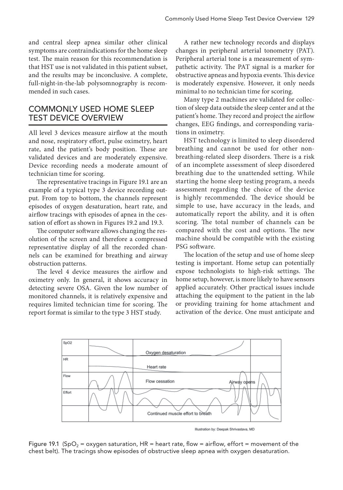
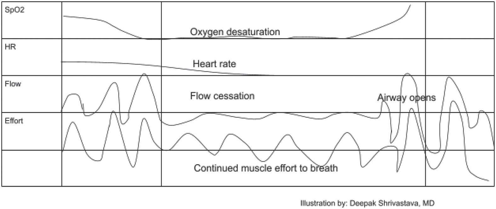
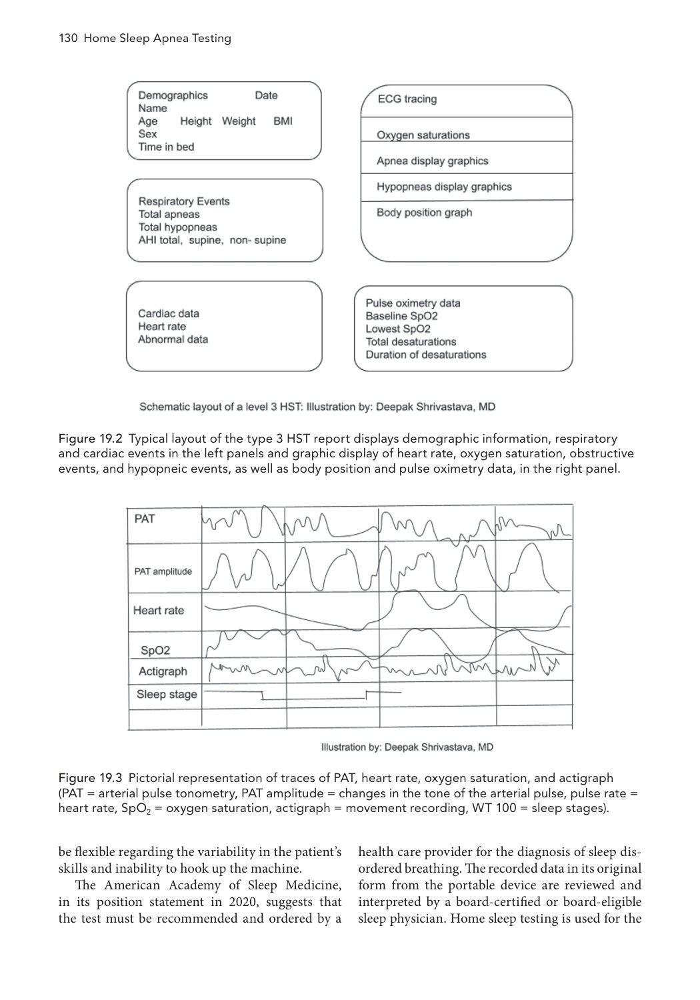
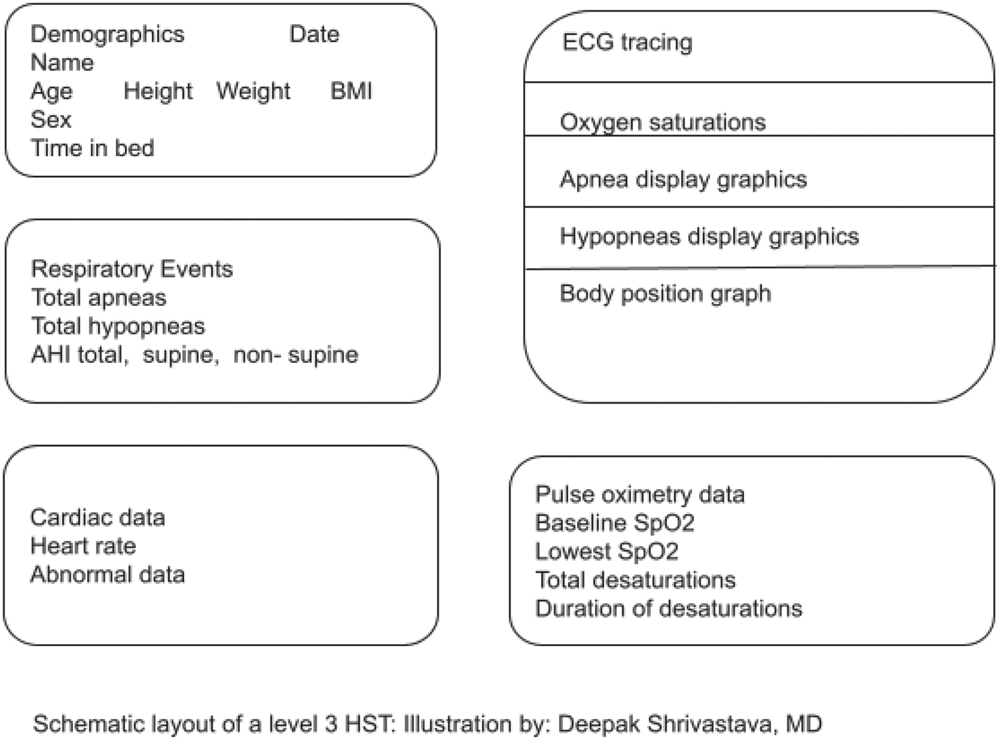
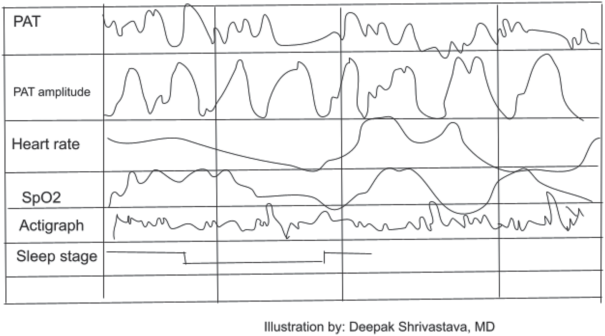

# 19 Home Sleep Apnea Testing

<!-- pdf-page: 142 -->

## 19 Home Sleep Apnea Testing

DOI: 10.1201/9781003093381-22 127

#### DEEPAK SHRIVASTAVA

Approval of Home Sleep Testing by CMS Types of HSAT Monitors Type 2 Monitors Type 3 Monitors Type 4 monitors

127 127 128 128 128

#### APPROVAL OF HOME SLEEP

#### TESTING BY CMS

In 2007, the Agency for Healthcare Research and Quality published a landmark article reassessing the state of the art in our understanding of homebased diagnostics for sleep apnea. Tis analysis was an evidence-based prelude to the 2007 Centers for Medicare & Medicaid Services (CMS) reexamination of the evidence for home sleep apnea testing, which led to its decision in 2008 to allow home sleep apnea testing results to be used for the provision of CPAP therapy for sleep apnea.

With regard to home sleep apnea testing (HSAT), when combined with clinical history, for many forms of home sleep apnea technology currently in existence, there was no conclusive evidence that it was substantially better or substantially worse than traditional PSG for making a diagnosis of OSA. Teir decision has allowed for type 3, type 2, and type 1 monitors to be more or less equivalent for allowing a diagnosis of sleep apnea in order to provide CPAP therapy. Level 4 monitors were excluded from this approval. However, the fnal national coverage determination (NCD) developed a category called level 4 with three channels that are covered by CMS.

When Home Sleep Testing Is Not Recommended Commonly Used Home Sleep Test Device Overview Disclaimer Suggested Reading

128

129 131 131

#### TYPES OF HSAT MONITORS

Home sleep apnea monitors are classifed based on the number and complexity of the signal that can be recorded.

Type 1: Tis is the standard in-lab polysomnogra­

phy testing. Type 2: Tis is a miniature, portable, but compre­

hensive polysomnographic testing unit with the similar setup to the type 1 in-lab test that can be performed in other settings than the sleep laboratory. Type 3: Cardiopulmonary symptoms are recorded by a minimum of 4 signals that include monitoring of the airfow at the nose and mouth, respiratory efort by the basal attributes, measurements of the heart rate, and pulse oximetry. Tis is the most common type of the HSAT in current use. Type 4: Tis type of device records one or two sleep parameters like a pulse oximetry or airfow. Type 4 with three channels is a new addition to the accepted classifcation because it was used in the CMS National Coverage Determination (NCD) to distinguish diferent type 4 monitors. Recently according to the CMS guidance, 3 channels

<!-- pdf-page: 143 -->

128 Home Sleep Apnea Testing

#### Type 4 monitors

#### Advantages

● As portable as type 3 equipment

● Much cheaper than types 1, 2, and 3 studies

● Easy for patients and their caregivers to use

● Records only core signals

are included: pulse oximetry, respiratory efort monitoring, and measurement of airfow. WatchPAT: Tis monitoring device is based on physiologic signal change recordings of peripheral arterial tonometry that has proven to be an accurate surrogate measure for airfow and respiratory-efort-defned sleep disordered breathing devices. Te national CMS decision includes the WatchPAT (Itamar Medical, Framingham, MA) as an approved device for the home diagnosis of OSA. At present, Medicare contractors are not including durable medical equipment (DME) on the list of approved methods for diagnosing OSA for the provision of continuous positive airway pressure (CPAP) therapy.

#### Type 2 Monitors

#### Advantages

● Ability to record full montage of multiple channels

● Flexibility of selecting signal type

● Equally comprehensive as type 1 study

● Standard sleep analysis sofware of a type 1 polysomnography used

● Movable to patient location

● Good experience and track record

#### Disadvantages

● Technician hookup

● Expensive

● Inability of correcting loss of signal at night in case of malfunction

#### Type 3 Monitors

#### Advantages

● Easy for patients and their caregivers to use

● Much cheaper than Type 1 and 2 studies

● Movable or mailable to patient location

● Limited to only four recording channels

#### Disadvantages

● Only few parameters are recorded with the risk of missed information

● Inability of correcting loss of signal at night in case of malfunction

● Many machines can autoscore; a trained techni­

cian is needed for evaluation of the information.

#### Disadvantages

● Probably a screening tool as it does not capture all the information needed to make a good diagnosis

● Inability of correcting loss of signal at night in case of malfunction

#### WHEN HOME SLEEP TESTING IS

#### NOT RECOMMENDED

Congestive heart failure COPD Hypoventilation Prior surgery for sleep apnea Other severe systemic illnesses

While home sleep testing is not recommended for mild pretest probability of obstructive sleep apnea, it is a reasonable choice for moderate to severe pretest probability of OSA. In order to establish pretest probability, the STOP-BANG Questionnaire can be used:

● Snoring

● Tiredness, fatigue, or sleepiness during daytime

● Observation by others witnessing breathing cessation

● Pressure (hypertension)

● BMI over 35

● Age more than 50

● Neck circumference 17 inches (40 cm)

● Gender (more prevalent in males)

A total score of 5 or higher indicates high probability of moderate to severe obstructive sleep apnea. In that case, home sleep testing may be appropriate.

In addition, many comorbid conditions including chronic pulmonary disease, CHF, hypoventilation, movement disorders of sleep, parasomnias,

<!-- pdf-page: 144 -->

Commonly Used Home Sleep Test Device Overview 129

and central sleep apnea similar other clinical symptoms are contraindications for the home sleep test. Te main reason for this recommendation is that HST use is not validated in this patient subset, and the results may be inconclusive. A complete, full-night-in-the-lab polysomnography is recommended in such cases.

A rather new technology records and displays changes in peripheral arterial tonometry (PAT). Peripheral arterial tone is a measurement of sympathetic activity. Te PAT signal is a marker for obstructive apneas and hypoxia events. Tis device is moderately expensive. However, it only needs minimal to no technician time for scoring.

Figure 19.1 (SpO2 = oxygen saturation, HR = heart rate, fow = airfow, effort = movement of the

chest belt). The tracings show episodes of obstructive sleep apnea with oxygen desaturation.

#### COMMONLY USED HOME SLEEP

#### TEST DEVICE OVERVIEW

All level 3 devices measure airfow at the mouth and nose, respiratory efort, pulse oximetry, heart rate, and the patient’s body position. Tese are validated devices and are moderately expensive. Device recording needs a moderate amount of technician time for scoring.

Te representative tracings in Figure 19.1 are an example of a typical type 3 device recording output. From top to bottom, the channels represent episodes of oxygen desaturation, heart rate, and airfow tracings with episodes of apnea in the cessation of efort as shown in Figures 19.2 and 19.3.

Te computer sofware allows changing the resolution of the screen and therefore a compressed representative display of all the recorded channels can be examined for breathing and airway obstruction patterns.

Te level 4 device measures the airfow and oximetry only. In general, it shows accuracy in detecting severe OSA. Given the low number of monitored channels, it is relatively expensive and requires limited technician time for scoring. Te report format is similar to the type 3 HST study.

Many type 2 machines are validated for collection of sleep data outside the sleep center and at the patient’s home. Tey record and project the airfow changes, EEG fndings, and corresponding variations in oximetry.

HST technology is limited to sleep disordered breathing and cannot be used for other nonbreathing-related sleep disorders. Tere is a risk of an incomplete assessment of sleep disordered breathing due to the unattended setting. While starting the home sleep testing program, a needs assessment regarding the choice of the device is highly recommended. Te device should be simple to use, have accuracy in the leads, and automatically report the ability, and it is ofen scoring. Te total number of channels can be compared with the cost and options. Te new machine should be compatible with the existing PSG sofware.

Te location of the setup and use of home sleep testing is important. Home setup can potentially expose technologists to high-risk settings. Te home setup, however, is more likely to have sensors applied accurately. Other practical issues include attaching the equipment to the patient in the lab or providing training for home attachment and activation of the device. One must anticipate and

<!-- pdf-page: 145 -->

130 Home Sleep Apnea Testing

Figure 19.2 Typical layout of the type 3 HST report displays demographic information, respiratory

and cardiac events in the left panels and graphic display of heart rate, oxygen saturation, obstructive events, and hypopneic events, as well as body position and pulse oximetry data, in the right panel.

Figure 19.3 Pictorial representation of traces of PAT, heart rate, oxygen saturation, and actigraph

(PAT = arterial pulse tonometry, PAT amplitude = changes in the tone of the arterial pulse, pulse rate = heart rate, SpO2 = oxygen saturation, actigraph = movement recording, WT 100 = sleep stages).

be fexible regarding the variability in the patient’s skills and inability to hook up the machine.

Te American Academy of Sleep Medicine, in its position statement in 2020, suggests that the test must be recommended and ordered by a

health care provider for the diagnosis of sleep disordered breathing. Te recorded data in its original form from the portable device are reviewed and interpreted by a board-certifed or board-eligible sleep physician. Home sleep testing is used for the

<!-- pdf-page: 146 -->

Suggested Reading 131

diagnosis of OSA in adult patients who do not have signifcant cardiovascular or neuromuscular disease. Home sleep study is usually cost-efective and cheaper compared to a complete polysomnography.

Sleep Medicine Board of Directors. Clinical use of a home sleep apnea test: an American Academy of Sleep Medicine position statement. J Clin Sleep Med. 2017;13(10):1205–1207. 2. Zou D, et al. Validation of a portable moni­

#### DISCLAIMER

Tis chapter does not review all the products that may be available in a certain geographic area. Te reader is encouraged to explore the local availability of approved products and review their features. Te author does not have any product preferences or commercial interest in any of the available products.

#### SUGGESTED READING

1. Rosen IM, Kirsch DB, Chervin RD, Carden KA, Ramar K, Aurora RN, Kristo DA, Malhotra RK, Martin JL, Olson EJ, Rosen CL, Rowley JA. American Academy of

toring device for sleep apnea diagnosis in a population based cohort using synchronized home polysomnography. SLEEP. 2006;29(3):367–374. 3. Yalamanchali S, Farajian V, Hamilton C, Pott TR, Samuelson CG, Friedman M. Diagnosis of obstructive sleep apnea by peripheral arterial tonometry: meta-analysis. JAMA Otolaryngol Head Neck Surg. 2013;139(12):1343–1350. 4. Hedner J, et al. A novel adaptive wrist actigraphy algorithm for sleep-wake assessment in sleep apnea patients. SLEEP. 2004;27(8):1560–1566.
