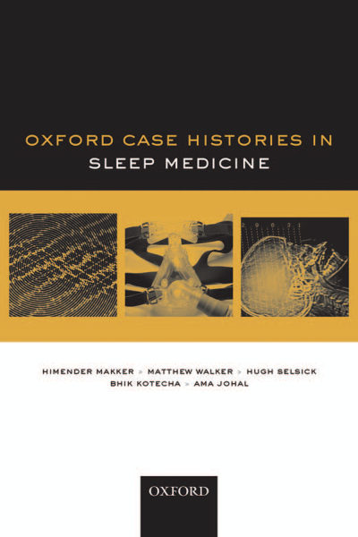
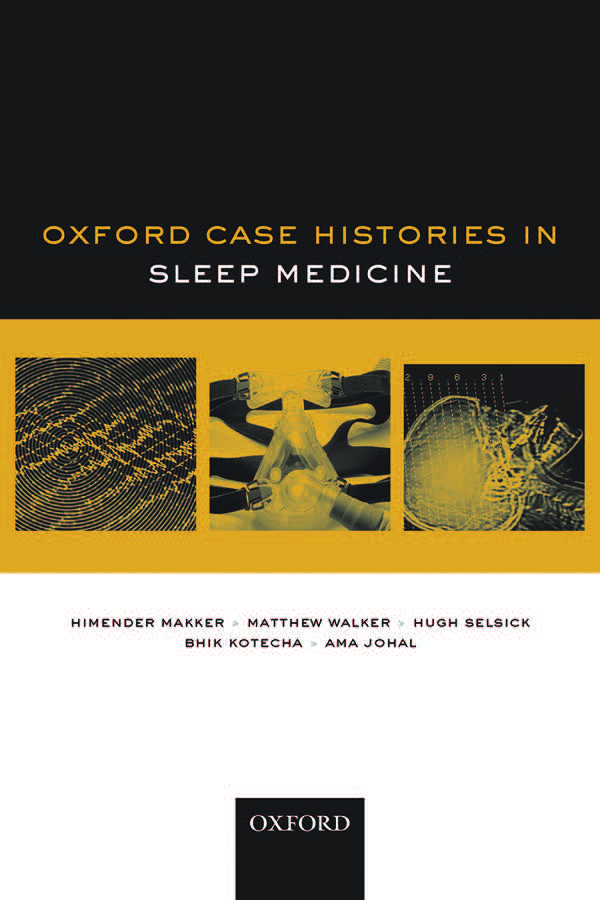
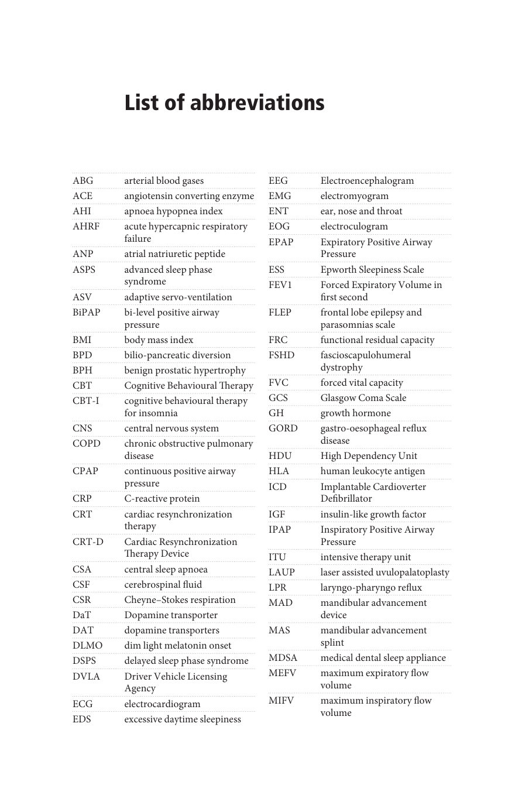
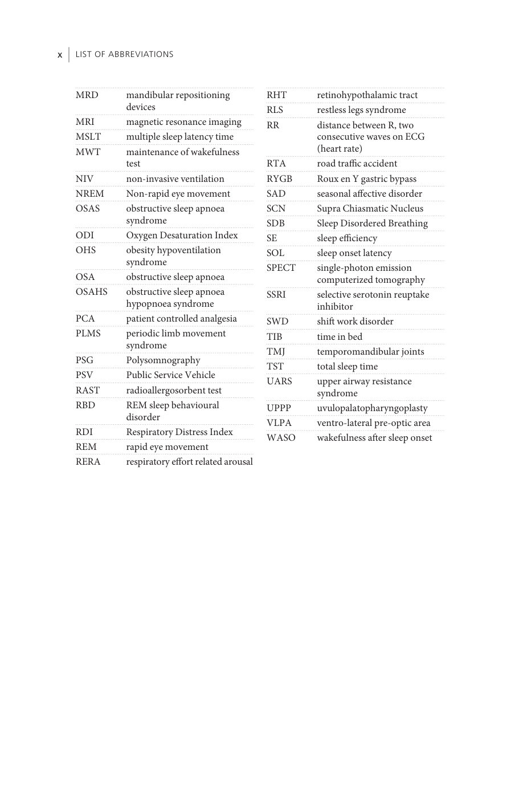

# Front Matter

<!-- pdf-page: 1 -->

<!-- pdf-page: 2 -->

### Oxford Case Histories

### in Sleep Medicine

<!-- pdf-page: 3 -->

#### Oxford Case Histories

#### Series Editors

Sarah Pendlebury and Peter Rothwell

Oxford Case Histories in Neurosurgery (Harutomo Hasegawa, Matthew Crocker, and Pawan Singh Minhas)

Oxford Case Histories in TIA and Stroke (Sarah T. Pendlebury, Ursula G. Schulz, Aneil Malhotra, and Peter M. Rothwell)

Oxford Case Histories in Rheumatology (Joel David, Anne Miller, Anushka Soni, and Lyn Williamson)

Oxford Case Histories in Cardiology (Rajkumar Rajendram, Javed Ehtisham, and Colin Forfar)

Oxford Case Histories in Respiratory Medicine (John Stradling, Andrew Stanton, Najib M. Rahman, Annabel H. Nickol, and Helen E. Davies)

Oxford Case Histories in Gastroenterology and Hepatology (Alissa J. Walsh, Otto C. Buchel, Jane Collier, and Simon P. L. Travis)

Neurological Case Histories (Sarah T. Pendlebury, Philip Anslow, and Peter M. Rothwell)

<!-- pdf-page: 4 -->

Psychiatrist, Camden and Islington NHS Trust London and the Royal London Hospital for Integrated Medicine, London, UK

### Himender Makker

### Matthew Walker

### Hugh Selsick

## Oxford Case

## Histories in Sleep

## Medicine

Consultant Physician in Respiratory Medicine, North Middlesex University and University College London (UCL) Hospital, London, UK

Professor of Neurology, UCL Institute of Neurology, Queen Square, London, UK

Consultant ENT Surgeon and Lead Clinician for Snoring and Sleep Service, The Royal National Throat Nose and Ear Hospital, UCL, London, and Barking, Havering and Redbridge University Hospital, London, UK

### Bhik Kotecha

Senior Clinical Lecturer/Hon. Consultant Orthodontist Academic and Clinical Lead Orthodontics Institute of Dentistry Bart’s, and The London School of Medicine and Dentistry, Queen Mary College, London, UK

### Ama Johal

## 1

<!-- pdf-page: 5 -->

## 1

Great Clarendon Street, Oxford, OX2 6DP, United Kingdom

Oxford University Press is a department of the University of Oxford. It furthers the University’s objective of excellence in research, scholarship, and education by publishing worldwide. Oxford is a registered trade mark of Oxford University Press in the UK and in certain other countries

All rights reserved. No part of this publication may be reproduced, stored in a retrieval system, or transmitted, in any form or by any means, without the prior permission in writing of Oxford University Press, or as expressly permitted by law, by licence or under terms agreed with the appropriate reprographics rights organization. Enquiries concerning reproduction outside the scope of the above should be sent to the Rights Department, Oxford University Press, at the address above

© Oxford University Press 2015

The moral rights of the authors have been asserted

First Edition published in 2015 Impression: 1

Oxford University Press makes no representation, express or implied, that the drug dosages in this book are correct. Readers must therefore always check the product information and clinical procedures with the most up-to-date published product information and data sheets provided by the manufacturers and the most recent codes of conduct and safety regulations. The authors and the publishers do not accept responsibility or legal liability for any errors in the text or for the misuse or misapplication of material in this work. Except where otherwise stated, drug dosages and recommendations are for the non-pregnant adult who is not breast-feeding

You must not circulate this work in any other form and you must impose this same condition on any acquirer

Published in the United States of America by Oxford University Press 198 Madison Avenue, New York, NY 10016, United States of America

British Library Cataloguing in Publication Data Data available

Library of Congress Control Number: 2014955874

ISBN 978–0–19–968395–6

Printed in Great Britain by Clays Ltd, St Ives plc

Links to third party websites are provided by Oxford in good faith and for information only. Oxford disclaims any responsibility for the materials contained in any third party website referenced in this work.

<!-- pdf-page: 6 -->

### Preface

Our interest in sleep disorders is relatively new in the history of medicine. The ability to measure physiological events during sleep has led to the recognition of previously unknown sleep disorders. Basic understanding of structure and function of normal sleep has made us realise the importance of sleep on quality of life, health, and survival. A better understanding of sleep disorders has helped us to develop new treatments.

Despite immense advances in the understanding and management of sleep disorders over the last 50 years, many sleep disorders remain under-diagnosed and under-treated. Opportunities for teaching and training in sleep medicine remain limited. Available learning resources for sleep medicine are primarily aimed at sleep specialists, leaving a gap for non-sleep specialists.

This book provides a case-based illustrative approach to the understanding and management of common and important sleep ­disorders—­snoring, sleep disordered breathing, insomnia, circadianrhythm disorders, and primary neurological sleep disorders. Case histories have been written by sleep medicine experts with clinical experience of providing a multi-disciplinary sleep service. Case examples have been selected direct from sleep clinics and focus on the recognition of presenting features of sleep disorders and their clinical importance. Each case report provides a detailed clinical description followed by a clear explanation of the salient points. The text is supported by photographs, diagrams, and line drawings, and concludes with a list of key learning points. An attempt has been made to write the cases in an easy-­flowing prose to simulate the experience of seeing and discussing a real-life patient in a clinic. The book will be of interest to all clinicians who wish to improve their understanding and knowledge of sleep disorders.

<!-- pdf-page: 7 -->

vi PREFACE

I wish to thank my following colleagues for their contribution to Obstructive sleep apnoea and ENT sections of the book: Dr Fionnuala Crummy, Consultant Respiratory Physician, University College London Hospital, London and Mr Rob Nash, Specialist ENT Registrar, Royal National Throat, Nose and Ear Hospital, London.

I also wish to thank Peter Stevenson and Lauren Dunn at the Oxford University Press for their constant support and encouragement, my coauthors for providing excellent case histories, and my secretary, Donna Basire, for checking the manuscript tirelessly.

Himender Makker

<!-- pdf-page: 8 -->

### Contents

Section 1 Snoring and sleep-disordered breathing

List of abbreviations ix

Normal ranges xi

Section 4 Insomnia and circadian rhythm disorders

Cases 1–24 3

Section 2 Snoring and OSA: role of dental

#### and ENT surgeons

Cases 25–34 167

Section 3 Neurological sleep disorders

Cases 35–45 223

List of cases by principal clinical features at diagnosis 359

Cases 46–55 271

List of cases by diagnosis 355

List of cases by aetiological mechanisms 363

Index 367

<!-- pdf-page: 9 -->

<!-- pdf-page: 10 -->

### List of abbreviations

ABG arterial blood gases ACE angiotensin converting enzyme AHI apnoea hypopnea index AHRF acute hypercapnic respiratory failure ANP atrial natriuretic peptide ASPS advanced sleep phase syndrome ASV adaptive servo-ventilation BiPAP bi-level positive airway pressure BMI body mass index BPD bilio-pancreatic diversion BPH benign prostatic hypertrophy CBT Cognitive Behavioural Therapy CBT-I cognitive behavioural therapy for insomnia CNS central nervous system COPD chronic obstructive pulmonary disease CPAP continuous positive airway pressure CRP C-reactive protein CRT cardiac resynchronization therapy CRT-D Cardiac Resynchronization Therapy Device CSA central sleep apnoea CSF cerebrospinal fluid CSR Cheyne–Stokes respiration DaT Dopamine transporter DAT dopamine transporters DLMO dim light melatonin onset DSPS delayed sleep phase syndrome DVLA Driver Vehicle Licensing Agency ECG electrocardiogram EDS excessive daytime sleepiness

EEG Electroencephalogram EMG electromyogram ENT ear, nose and throat EOG electroculogram EPAP Expiratory Positive Airway Pressure ESS Epworth Sleepiness Scale FEV1 Forced Expiratory Volume in first second FLEP frontal lobe epilepsy and parasomnias scale FRC functional residual capacity FSHD fascioscapulohumeral dystrophy FVC forced vital capacity GCS Glasgow Coma Scale GH growth hormone GORD gastro-oesophageal reflux disease HDU High Dependency Unit HLA human leukocyte antigen ICD Implantable Cardioverter Defibrillator IGF insulin-like growth factor IPAP Inspiratory Positive Airway Pressure ITU intensive therapy unit LAUP laser assisted uvulopalatoplasty LPR laryngo-pharyngo reflux MAD mandibular advancement device MAS mandibular advancement splint MDSA medical dental sleep appliance MEFV maximum expiratory flow volume MIFV maximum inspiratory flow volume

<!-- pdf-page: 11 -->

x LIST OF ABBREVIATIONS

MRD mandibular repositioning devices MRI magnetic resonance imaging MSLT multiple sleep latency time MWT maintenance of wakefulness test NIV non-invasive ventilation NREM Non-rapid eye movement OSAS obstructive sleep apnoea syndrome ODI Oxygen Desaturation Index OHS obesity hypoventilation syndrome OSA obstructive sleep apnoea OSAHS obstructive sleep apnoea hypopnoea syndrome PCA patient controlled analgesia PLMS periodic limb movement syndrome PSG Polysomnography PSV Public Service Vehicle RAST radioallergosorbent test RBD REM sleep behavioural disorder RDI Respiratory Distress Index REM rapid eye movement RERA respiratory effort related arousal

RHT retinohypothalamic tract RLS restless legs syndrome RR distance between R, two consecutive waves on ECG (heart rate) RTA road traffic accident RYGB Roux en Y gastric bypass SAD seasonal affective disorder SCN Supra Chiasmatic Nucleus SDB Sleep Disordered Breathing SE sleep efficiency SOL sleep onset latency SPECT single-photon emission computerized tomography SSRI selective serotonin reuptake inhibitor SWD shift work disorder TIB time in bed TMJ temporomandibular joints TST total sleep time UARS upper airway resistance syndrome UPPP uvulopalatopharyngoplasty VLPA ventro-lateral pre-optic area WASO wakefulness after sleep onset

<!-- pdf-page: 12 -->

### Normal ranges

Hb 13–18g/dL (men) 11.5–16g/dL (women) MCV 76–96fL WCC 4–11 × 109/L Plt 150–400 × 109/L Na 135–145mmol/L K 3.5–5mmol/L Urea 2.5–6.7mmol/L Cr 70–150µmol/L Ca 2.12–2.65mmol/L CK 25–195IU/L CRP <10mg/L Glc (fasting) 3.5–5.5mmol/L Bili 3–17µmol/L AST 3–35IU/L Alk phosp 30–300IU/L GGT 11–51IU/L (men), 7–33IU/L (women)

#### Blood gases

PH 7.35–7.45 PaO2 >10.6kPa PaCO2 4.7–6kPa Bicarbonate 24–30mmol/L

#### CSF

Protein 0.15–0.45g/L glc 2.8–4.2mmol/L WCC <5 lymphocytes/mm3

Opening pressure 7–18cm H2O

<!-- pdf-page: 13 -->

<!-- pdf-page: 14 -->

## Snoring and sleep-

## disordered breathing

### Section 1

<!-- pdf-page: 15 -->
