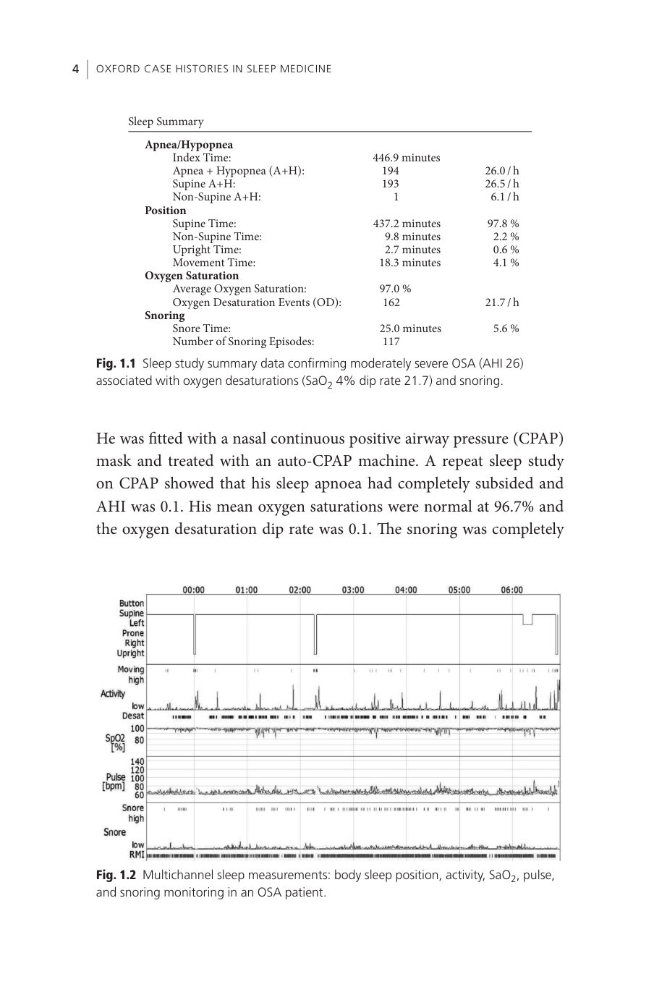
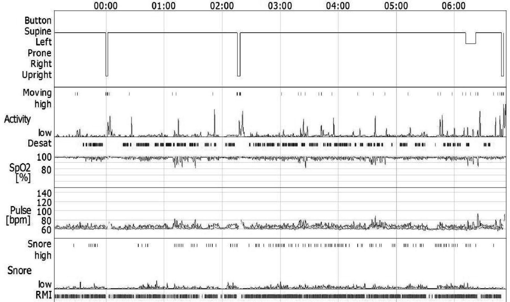
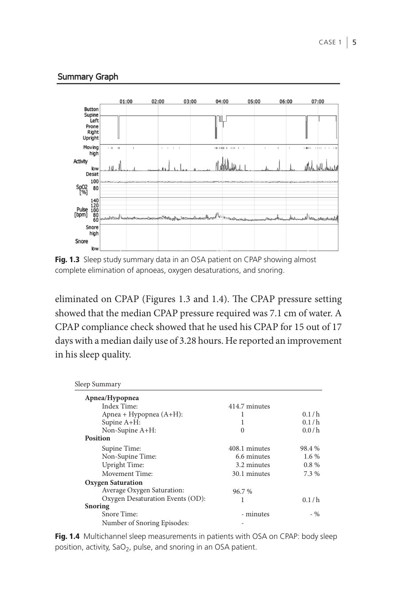
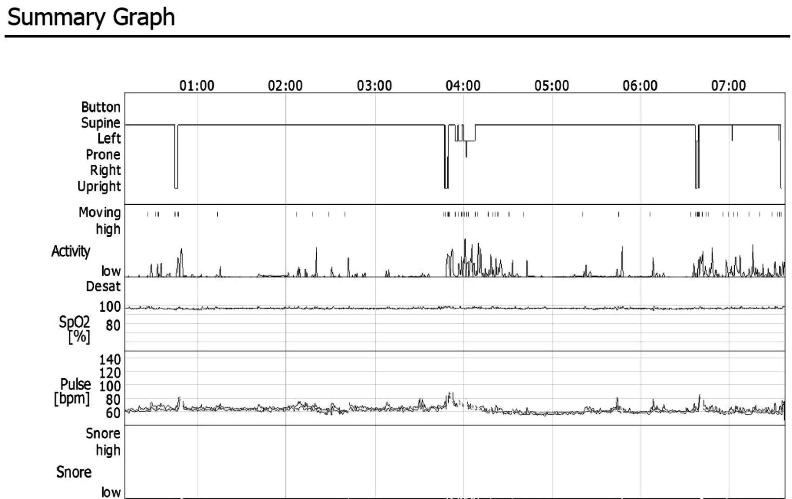

# Case 1 Snoring and witnessed apnoea in a 70-year-old thin man

<!-- pdf-page: 16 -->

### Case 1

### Snoring and witnessed apnoea

### in a 70-year-old thin man

A 70-year-old Chinese man was referred to the sleep clinic because his friends were worried about his loud snoring and the fact that he stopped breathing during sleep when he stayed with them for a week after his wife’s death. He slept alone and well, and had no breathing difficulties during sleep. He woke up fresh from his sleep and did not experience any daytime sleepiness or tiredness. He reported no reduction in his concentration or impairment of his memory. He did not have any headaches or any recent change in weight. He had a blocked nose and woke up with a dry throat in the morning. He had a myocardial infarction in the past for which he had an angioplasty. His hyperlipidaemia and hypertension were controlled on treatment. There was no family history of sleep apnoea or snoring. He was a retired caterer and non-smoker, and did not drink alcohol. He was of normal body weight with a body mass index (BMI) of 19.9 and his neck size was 35 centimetres. However, his oral cavity was narrow—Mallampati score 3 out of 4. His blood pressure was 140/95 mmHg, his resting oxygen saturations were 97% on air, and, on the Epworth Sleepiness Scale (ESS), he scored 0 out of 24.

A multichannel home sleep study confirmed the diagnosis of obstructive sleep apnoea (OSA). His apnoea hypopnea index (AHI) was 26 with an oxygen desaturation dip rate of 21.7, and mean oxygen saturations were normal at 97%. A total of 117 snoring episodes were recorded and he snored for a total of 25 minutes. He slept in the supine position during most of the night. His AHI consisted of 62% of obstructive apnoeas and 37% hypopnoeas. The longest apnoea was of 64 seconds duration with a mean duration of apnoea at 32 seconds (Figures 1.1–1.4).

<!-- pdf-page: 17 -->

Sleep Summary

Apnea/Hypopnea

Index Time: 446.9 minutes Apnea + Hypopnea (A+H): 194 26.0 /h Supine A+H: 26.5 /h 193 Non-Supine A+H: 6.1 /h 1

Supine Time: 437.2 minutes 97.8 % Non-Supine Time: 9.8 minutes 2.2 % Upright Time: 2.7 minutes 0.6 % Movement Time: 4.1 % 18.3 minutes

Position

Oxygen Saturation

Average Oxygen Saturation: 97.0 % Oxygen Desaturation Events (OD): 21.7 /h 162

Snoring

Number of Snoring Episodes: 117 Snore Time: 25.0 minutes 5.6 %

Fig. 1.1 Sleep study summary data confirming moderately severe OSA (AHI 26)

associated with oxygen desaturations (SaO2 4% dip rate 21.7) and snoring.

He was fitted with a nasal continuous positive airway pressure (CPAP) mask and treated with an auto-CPAP machine. A repeat sleep study on CPAP showed that his sleep apnoea had completely subsided and AHI was 0.1. His mean oxygen saturations were normal at 96.7% and the oxygen desaturation dip rate was 0.1. The snoring was completely

Fig. 1.2 Multichannel sleep measurements: body sleep position, activity, SaO2, pulse,

and snoring monitoring in an OSA patient.

<!-- pdf-page: 18 -->

Case 1 5

Fig. 1.3 Sleep study summary data in an OSA patient on CPAP showing almost

complete elimination of apnoeas, oxygen desaturations, and snoring.

eliminated on CPAP (Figures 1.3 and 1.4). The CPAP pressure setting showed that the median CPAP pressure required was 7.1 cm of water. A CPAP compliance check showed that he used his CPAP for 15 out of 17 days with a median daily use of 3.28 hours. He reported an improvement in his sleep quality.

Index Time: 414.7 minutes Apnea + Hypopnea (A+H): 1 0.1 /h 0.1 /h 0.0 /h Supine A+H: Non-Supine A+H: 1 0

Sleep Summary

Apnea/Hypopnea

Position

Supine Time: 408.1 minutes 98.4 % Non-Supine Time: 6.6 minutes 1.6 % Upright Time: 3.2 minutes 0.8 % Movement Time: 7.3 % 30.1 minutes

Oxygen Saturation

Average Oxygen Saturation: 96.7 % Oxygen Desaturation Events (OD): 0.1 /h 1

Snoring

Number of Snoring Episodes: Snore Time: - minutes - - %

Fig. 1.4 Multichannel sleep measurements in patients with OSA on CPAP: body sleep

position, activity, SaO2, pulse, and snoring in an OSA patient.

<!-- pdf-page: 19 -->

However, despite good initial compliance, he returned the CPAP machine a year later because of symptoms of nasal itching, dryness of throat and bringing up blood from his throat in the morning. ENT examination and CT scan of his head and neck showed no cause of the nasal symptoms and apparent epistaxis/haemoptysis. He was provided with a custom-made mono-block mandibular advancement splint. He used his splint every night, throughout the night, with no side effects and reported an improvement in his dryness of throat and no further bringing up of blood from the back of the throat. A sleep study with a mandibular advancement splint in situ showed no sleep apnoea.

<!-- pdf-page: 20 -->

Case 1 7

#### Questions

1 How common is OSA?

2 What are the main risk factors for OSA?

6 Is there a correlation between symptoms of OSA and the severity

3 What are the main presenting features of OSA?

4 What are good clinical predictors of OSA?

5 How do you confirm the diagnosis of OSA?

measured on a sleep study?

<!-- pdf-page: 21 -->

#### Answers

#### 1. How common is OSA?

OSA is a common condition and affects 1–4% of the population. It is estimated there are 200,000 patients with OSA in the United Kingdom and 80% are undiagnosed and untreated. These patients often present to primary care with relatively trivial symptoms of snoring, disturbed sleep and feeling tired. A lack of awareness among primary care providers and non-sleep specialists may account for a high proportion of undiagnosed sleep apnoea in the population. Primary care providers have a key role in the identification of these patients. Screening patients at the GP pre-registration health check surgery with a sleep questionnaire (ESS, Berlin Questionnaire) was found to be feasible in identifying patients at high risk of OSA at a primary care practice in Hammersmith, West London. A similar study from 40 primary care clinics in the USA, Spain and Germany using the Berlin Questionnaire was able to identify patients at high risk of OSA (33% of surveyed population). A high index of suspicion among primary care providers and inclusion of snoring and daytime sleepiness assessment in routine consultation can help to identify these patients.

A middle-aged white obese man is the stereotypical person thought to be at risk of OSA. However, severe OSA in the case described here highlights that OSA can be seen in the older non-white and nonobese person.

#### 2. What are the main risk factors for OSA?

The prevalence of OSA increases with age, but plateaus after the age of 65 years. Obese men are much more likely to develop sleep apnoea than premenopausal women, because of the difference in fat distribution between two genders. However, prevalence is similar among men and postmenopausal women. The effect of obesity on OSA is through neck obesity—a collar size of more than 17 increases the risk of OSA. Until recently, most epidemiological studies showed a high prevalence of OSA among the obese white population. More recent studies from the Far East and Asia found

<!-- pdf-page: 22 -->

Case 1 9

an equally high prevalence of OSA among a relatively less obese population—racial craniofacial features were a main risk rather than obesity.

#### 3. What are the main presenting features of OSA?

The main presenting features of OSA are snoring, witnessed apnoea and excessive daytime sleepiness (EDS).

Snoring: It is estimated that 40% of the UK population snore or have snored at some time. However, habitual snoring—loud, disruptive snoring every night—is perhaps less common. Snoring is an extremely loud non-musical sound which can reach up to 100 decibels in intensity. Most snorers are unaware of their own snoring except for a few who can wake themselves up from their own snoring. However, loud snoring can be extremely disruptive for their partners, particularly during quiet periods in the night. This could cause relationship problems and marital disruption. A few snore extremely loudly, and their snoring is audible outside the bedroom and disturbs other family members sleeping in other rooms or even neighbours next door. It can be extremely embarrassing for snorers when they are travelling and start to snore as soon as they put their head back and nod off on a bus, train, or plane. Since most snorers are unaware of their snoring, it is brought to their attention by their bed partner, more often by a wife/girlfriend than a husband/ boyfriend.

Snoring by itself, i.e. without associated OSA, is not a disease and has no adverse health consequences. However, it can be a first or warning sign of OSA. OSA is mainly seen in patients who snore. However, not all snorers suffer from OSA, but they remain at risk if they gain weight, sleep on their back, or drink alcohol. Some studies have linked snoring with strokes and other health problems; however, it is not clear if these snorers were simple snorers or snorers with OSA.

Many snorers are embarrassed about seeking professional help, they attempt various over-the-counter remedies. Some of these remedies are based on assumption that snoring comes from a blocked/

<!-- pdf-page: 23 -->

narrow nose and use devices such as nasal dilator strips or a nasal valve, which rarely work. Snoring, like sleep apnoea, comes from the back of the throat, the back of the tongue and the soft palate. Many snorers snore louder when they sleep on their back due to the tongue and palate falling back, and treatment is based on preventing snorers sleeping on their back—positional treatments such as fixing a tennis ball to the back of pyjamas have been attempted, but are rarely successful in the long term. They are unable to comply with these treatments because of the discomfort and inconvenience associated with sleeping in one particular position. Surgical treatment for snoring such as laser assisted uvulopalatoplasty (LAUP), which is thought to work by stiffening the soft palate, may work for some patients in the short term. However, a mandibular advancement splint (dental splint, mouth guard) which works by keeping the lower jaw forward during sleep (the lower jaw often drops back during sleep due to muscle relaxation and narrows the upper airway further) is an effective and non-invasive treatment. Finally, lifestyle changes—weight loss, improved fitness and avoidance of alcohol before sleep—can significantly improve snoring.

Witnessed apnoea: this is a common presenting feature of OSA. The episodes of witnessed apnoea can be fairly prolonged, lasting up to a minute, and can worry their bed partner who often shake/wake them to start breathing. Snorers with a history of witnessed apnoeas are much more likely to have OSA than a simple snorer. However, the apnoeas may not be witnessed if the patient sleeps alone or if their partner fails to notice. A few patients report disturbed sleep due to choking or gasping for breath.

EDS: this is a common symptom among the general population— surveys have found that 50% of people have some degree of daytime sleepiness. True daytime sleepiness should be distinguished from fatigue, tiredness, or lethargy. EDS can be due to either lack of sleep (duration–quantity) or poor quality sleep. OSA patients often report sleeping for long hours, but still wake up unrefreshed and feel sleepy during the daytime due to recurrent arousals during sleep affecting their quality of sleep (reduced slow wave and REM sleep). The ESS

<!-- pdf-page: 24 -->

Case 1 11

questionnaire is one of the most commonly used in the assessment of EDS. EDS is a common presentation of OSA, but it can be due to a variety of other causes.

Patients with a combination of symptoms—snoring associated with witnessed apnoeas and daytime sleepiness—are much more likely to have OSA than patients with only one of these symptoms.

#### 4. What are good clinical predictors of OSA?

OSA is due to the narrowing and increased collapsibility of the upper airway. Obesity (BMI >30) and an increase in neck size (collar >17) are easily visible risk factors for OSA. Subtle craniofacial skeletal abnormalities may be difficult to recognize on inspection—but a small and receded jaw (retrognathia and micrognathia) is an obvious risk factor for OSA. It reduces the space for the tongue, pushing it back and narrowing the upper airways. Simple visual inspection of the oral cavity and an assessment of the oral cavity size using a Mallampati score is a good tool for assessing the risk of OSA—patients with a grade 3 or 4 size oral cavity are at a high risk of OSA. Imaging techniques such as CT and MRI scans can clearly demonstrate narrow upper airways, but their use should be restricted for complex patients with a suspected anatomical obstructing lesion of the upper airway.

In summary, obese people with a big neck or people of normal body weight with a small jaw and narrow oral cavity presenting with loud disruptive snoring associated with witnessed apnoeas and EDS should be suspected to have sleep apnoea and referred for a sleep study.

Different sleep questionnaires use combination of the clinical features described here to predict or determine the risk of OSA.

#### 5. How do you confirm the diagnosis of OSA?

Clinical features are useful to determine the increased risk of OSA in patients, but none is sensitive enough to confirm nor specific enough to rule out the diagnosis of OSA. A sleep study is required to confirm the diagnosis. A polysomnography (PSG) sleep study was thought to be gold standard. However, it is complex and expensive, and is not

<!-- pdf-page: 25 -->

needed for most patients with suspected sleep apnoea. A multichannel sleep studies that include respiratory monitoring with oro-nasal airflow, chest wall and abdominal movement and oximetry are more useful and reliable for the diagnosis of OSA. Use of PSGs should be limited to complex sleep problems.

#### 6. Is there a correlation between symptoms of OSA and the

#### severity measured on a sleep study?

There is relatively poor correlation between the severity of sleep apnoea as judged by the measurement of AHI and symptoms, particularly disturbance of sleep and daytime sleepiness, which can be caused by many other conditions. This may be related to their age, gender, lifestyle, ethnicity, work, etc. A retired man may be less likely to perceive/report disturbed sleep and daytime sleepiness than a younger person in an active job with long hours of work. However, objective evaluation of these patients has shown that they are equally susceptible to the adverse consequences of OSA, such as neuropsychological impairment, hypertension, and cardiovascular and metabolic conditions.

OSA is a common condition affecting at least 1% of the general

#### Learning points

Though middle-aged obese white men with a big neck and narrow oral

population.

cavity are well known to be at risk of OSA, non-obese population of other ethnicity are also at high risk of OSA.

Snoring and EDS are main presenting features of OSA but also com­

Management of obstructive sleep apnoea/hypopnoea syndrome in adults. Scottish

mon among the general population without OSA.

#### Further reading

Intercollegiate Guidelines. Royal College of Physicians 2003. Schlosshan D, Elliott MW. Clinical presentation and diagnosis of the obstructive sleep

apnoea–hypopnoea syndrome. Thorax 2004;59:347–52.
