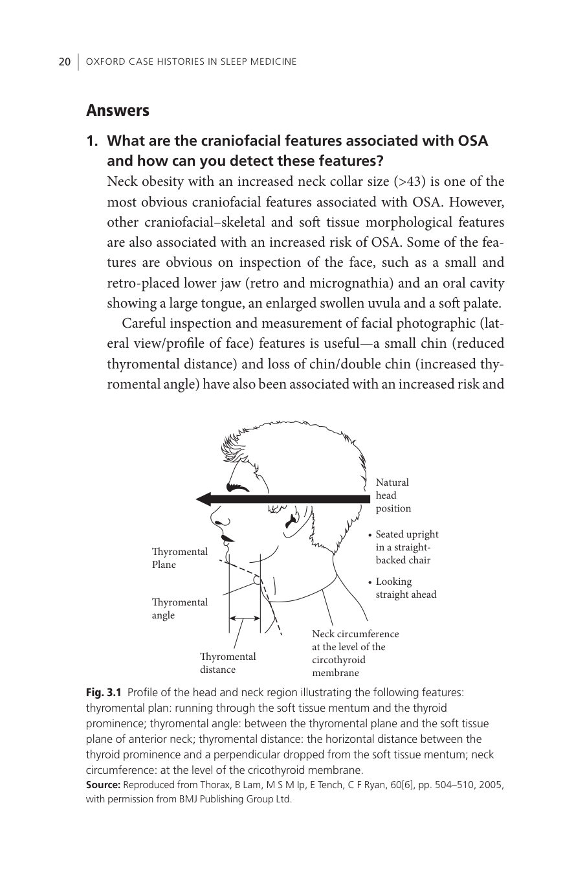
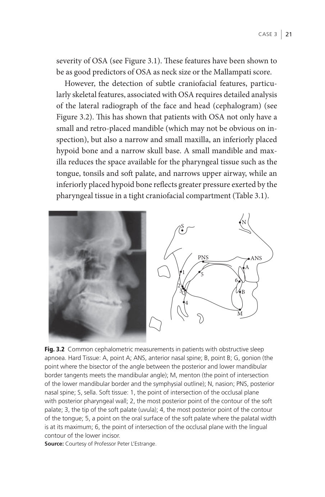
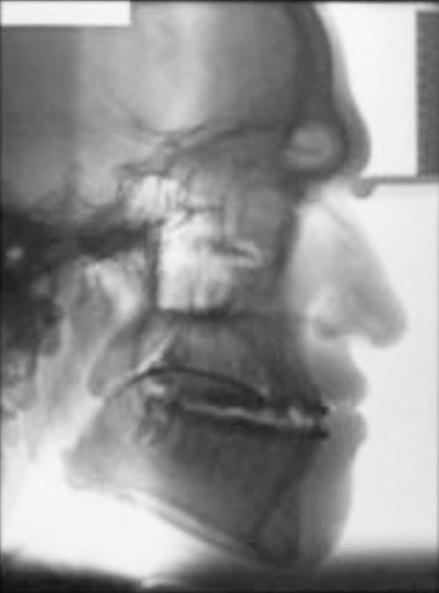
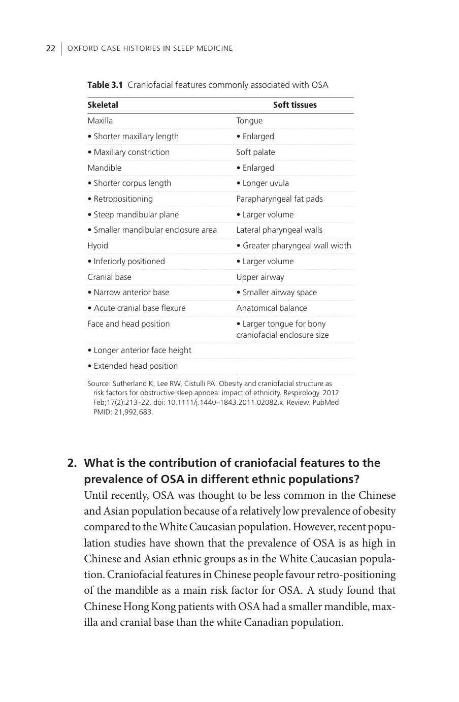

# Case 3 Severe OSA in an overweight Chinese man—craniofacial features

<!-- pdf-page: 32 -->

### Case 3

### Severe OSA in an overweight

### Chinese man—craniofacial

### features

Mr KK, a 35-year-old Chinese man, was diagnosed to have severe OSA in Hong Kong. His sleep study showed a Respiratory Distress Index (RDI) of 73.7. The longest duration of apnoea was 97 seconds and the lowest SaO2 was 53%. He was treated with CPAP at a fixed pressure of 12 cm of water. He lived in the UK and was referred to a sleep clinic for follow-up. He had micrognathia and retrognathia, and a long, floppy uvula. He was overweight, weighing 80.8 kg for a height of 175.2 cm (BMI 26) and his collar size was 17 (43 cm). He reported an improvement in symptoms of OSA with CPAP, but had difficulty in tolerating CPAP because of high CPAP pressure.

His baseline sleep study off CPAP (three days) confirmed severe OSA with a SaO2 dip rate of 74/hour and nocturnal hypoxia—the mean SaO2 was 90.84% and the lowest SaO2 65%, and Total Sleep Time <SaO2 of 90% (TST <90) was 2.45 hours (48%). His CPAP pressure was reduced to 10 cm of water, with an improvement in CPAP tolerance. Repeat sleep study on CPAP showed a dip rate of 0.78/hour and a mean SaO2 of 97.25%. He has been using CPAP for the last ten years.

1 What are the craniofacial features associated with OSA and how

#### Questions

2 What is the contribution of craniofacial features to the prevalence

can you detect these features?

3 What are the clinical implications of craniofacial abnormalities in

of OSA in different ethnic populations?

OSA?

<!-- pdf-page: 33 -->

#### Answers

#### 1. What are the craniofacial features associated with OSA

#### and how can you detect these features?

Neck obesity with an increased neck collar size (>43) is one of the most obvious craniofacial features associated with OSA. However, other craniofacial–skeletal and soft tissue morphological features are also associated with an increased risk of OSA. Some of the features are obvious on inspection of the face, such as a small and retro-placed lower jaw (retro and micrognathia) and an oral cavity showing a large tongue, an enlarged swollen uvula and a soft palate.

Careful inspection and measurement of facial photographic (lateral view/profile of face) features is useful—a small chin (reduced thyromental distance) and loss of chin/double chin (increased thyromental angle) have also been associated with an increased risk and

Fig. 3.1 Profile of the head and neck region illustrating the following features:

thyromental plan: running through the soft tissue mentum and the thyroid prominence; thyromental angle: between the thyromental plane and the soft tissue plane of anterior neck; thyromental distance: the horizontal distance between the thyroid prominence and a perpendicular dropped from the soft tissue mentum; neck circumference: at the level of the cricothyroid membrane. Source: Reproduced from Thorax, B Lam, M S M Ip, E Tench, C F Ryan, 60[6], pp. 504–510, 2005, with permission from BMJ Publishing Group Ltd.

Tyromental Plane

Tyromental angle

Tyromental distance

Natural head position

• Seated upright in a straightbacked chair

• Looking straight ahead

Neck circumference at the level of the circothyroid membrane

<!-- pdf-page: 34 -->

Case 3 21

severity of OSA (see Figure 3.1). These features have been shown to be as good predictors of OSA as neck size or the Mallampati score.

However, the detection of subtle craniofacial features, particularly skeletal features, associated with OSA requires detailed analysis of the lateral radiograph of the face and head (cephalogram) (see

Figure 3.2). This has shown that patients with OSA not only have a

small and retro-placed mandible (which may not be obvious on inspection), but also a narrow and small maxilla, an inferiorly placed hypoid bone and a narrow skull base. A small mandible and maxilla reduces the space available for the pharyngeal tissue such as the tongue, tonsils and soft palate, and narrows upper airway, while an inferiorly placed hypoid bone reflects greater pressure exerted by the pharyngeal tissue in a tight craniofacial compartment (Table 3.1).

Fig. 3.2 Common cephalometric measurements in patients with obstructive sleep

apnoea. Hard Tissue: A, point A; ANS, anterior nasal spine; B, point B; G, gonion (the point where the bisector of the angle between the posterior and lower mandibular border tangents meets the mandibular angle); M, menton (the point of intersection of the lower mandibular border and the symphysial outline); N, nasion; PNS, posterior nasal spine; S, sella. Soft tissue: 1, the point of intersection of the occlusal plane with posterior pharyngeal wall; 2, the most posterior point of the contour of the soft palate; 3, the tip of the soft palate (uvula); 4, the most posterior point of the contour of the tongue; 5, a point on the oral surface of the soft palate where the palatal width is at its maximum; 6, the point of intersection of the occlusal plane with the lingual contour of the lower incisor. Source: Courtesy of Professor Peter L’Estrange.

N

S

PNS

ANS

A

1

5

6

2 3

B

Q

4

M

<!-- pdf-page: 35 -->

Table 3.1 Craniofacial features commonly associated with OSA

Skeletal Soft tissues

Maxilla Tongue

• Shorter maxillary length
• Enlarged

Hyoid • Greater pharyngeal wall width

• Maxillary constriction Soft palate

Mandible • Enlarged

• Shorter corpus length
• Longer uvula

• Retropositioning Parapharyngeal fat pads

• Steep mandibular plane
• Larger volume

• Smaller mandibular enclosure area Lateral pharyngeal walls

Face and head position • Larger tongue for bony craniofacial enclosure size

• Inferiorly positioned
• Larger volume

Cranial base Upper airway

• Narrow anterior base
• Smaller airway space

• Acute cranial base flexure Anatomical balance

Source: Sutherland K, Lee RW, Cistulli PA. Obesity and craniofacial structure as

• Longer anterior face height

• Extended head position

risk factors for obstructive sleep apnoea: impact of ethnicity. Respirology. 2012 Feb;17(2):213–22. doi: 10.1111/j.1440–1843.2011.02082.x. Review. PubMed PMID: 21,992,683.

#### 2. What is the contribution of craniofacial features to the

#### prevalence of OSA in different ethnic populations?

Until recently, OSA was thought to be less common in the Chinese and Asian population because of a relatively low prevalence of obesity compared to the White Caucasian population. However, recent population studies have shown that the prevalence of OSA is as high in Chinese and Asian ethnic groups as in the White Caucasian population. Craniofacial features in Chinese people favour retro-­positioning of the mandible as a main risk factor for OSA. A study found that Chinese Hong Kong patients with OSA had a smaller mandible, maxilla and cranial base than the white Canadian population.

<!-- pdf-page: 36 -->

Case 3 23

#### 3. What are the clinical implications of craniofacial

#### abnormalities in OSA?

Obese White Caucasian people with a smaller mandible, maxilla and cranial base, and an inferiorly placed hypoid are more likely to develop OSA than obese patients without these abnormalities. Similarly, Asian people may develop OSA with a mild degree of obesity or without obesity compared to the White Caucasian patients because

(a)

Craniofacial restriction

(b)

Obesity

Craniofacial restriction

Obesity

Chinese Caucasian

Craniofacial restriction

Obesity Obesity

Craniofacial restriction

Obesity

Upper airway obstruction

<!-- pdf-page: 37 -->

of their craniofacial features (see Figure 3.3). Non-CPAP treatments, such as a mandibular advancement splint and surgical advancement of the mandible and maxilla, may have a more important role in OSA patients with craniofacial abnormalities.

Not all obese patients have sleep apnoea and the absence of obesity does

#### Learning points

Craniofacial features (often genetic/racial) can cause OSA and increase

not exclude OSA.

Sutherland K, Lee RW, Cistulli PA. Obesity and craniofacial structure as risk factors for

the severity of OSA due to obesity.

#### Further reading

obstructive sleep apnoea: impact of ethnicity. Respirology 2012 Feb;17(2):213–22.
