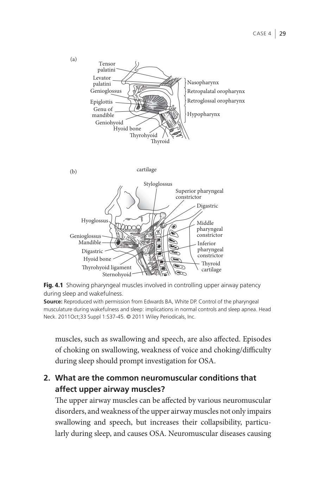

# Case 4 Unable to throw a cricket ball and could not breathe at night

<!-- pdf-page: 38 -->

### Case 4

### Unable to throw a cricket ball

### and could not breathe at night

A 56-year-old man was referred by an ENT surgeon for the management of suspected OSA. He had fluctuating nasal obstruction due to mild nasal septum deviation towards the left, but was not keen on surgical correction. He snored heavily seven nights a week and also had episodes of witnessed apnoeas. He had disturbed sleep with frequent arousals. He woke up unrefreshed from his sleep with marked daytime sleepiness—mainly affecting him post-lunch. He was not obese, but had put on approximately one stone in weight over the preceding two years. He worked as a chartered accountant, did not smoke and drank alcohol on a social basis.

He was diagnosed to have fascioscapulohumeral dystrophy (FSHD) at the age of 18 years when he could not throw a cricket ball. His muscle weakness had progressed and mobility has deteriorated gradually over the last five years. He was unable to get about independently and was usually accompanied by his wife. He had starting using a walking stick and was considering using a mobility scooter. His father had muscular dystrophy and his daughter has genetically confirmed FSHD.

His BMI was 26.5 and his collar size was 41.5 cm. On oral cavity examination, his Mallampati score was normal at 2. His pulmonary function tests showed normal forced vital capacity (FVC) of 5.03 litres (103.7% of predicted) and FEV1 was normal at 4.02 (101% of predicted). His resting oxygen saturations were normal at 96%. His daytime sleepiness score—ESS—was high at 15 out of 24. Neurological review confirmed peri-clavicular thinning of muscles and shoulder girdle atrophy with mild scapular winging on the right side. He had mild weakness of the

<!-- pdf-page: 39 -->

shoulder, elbow muscles and finger muscles, and bilateral foot drop with a high stepping gait. He did not have any retinal lens dysplasia and his blood pressure was normal at 123/84 mmHg. His routine blood test, full blood count, white cell count, ESR, urea and electrolytes, plasma glucose, serum lipids and thyroid function tests were all within normal limits. His chest X-ray was normal.

A sleep study confirmed severe OSA. His AHI was 47.9 with an oxygen desaturation dip rate of 39/hour and mean oxygen saturations during sleep of 94.7%. The apnoeas were mainly obstructive—the longest apnoea lasted for 87.7 seconds and the mean duration of apnoeas was 27 seconds. The total time spent below oxygen saturation of 90% was 2.8%, a total of 11 minutes. He was commenced on auto-CPAP and this completely corrected his sleep apnoea—the AHI normalized to 0.7. A CPAP compliance check showed that he used CPAP every night for a median duration of 7.3 hours. He noticed impressive improvement in his sleep quality which was refreshing and he was not sleepy during the daytime. He used to have early morning headaches, and these subsided. According to his wife, he had no further snoring or obstructive breathing.

<!-- pdf-page: 40 -->

Case 4 27

#### Questions

1 What is the role of upper airways muscles in pathogenesis of

OSA?

2 What are the common neuromuscular conditions that affect

3 How common is sleep apnoea in FSH muscular dystrophy?

upper airway muscles?

4 Does upper airway muscle training, strengthening or stimulation

have a role in the treatment of OSA?

<!-- pdf-page: 41 -->

#### Answers

#### 1. What is the role of upper airways muscles in pathogen­

#### esis of OSA?

Upper airway (pharyngeal) muscles have an important role in maintaining upper airway patency, both during wakefulness and sleep, to allow unobstructed breathing. There are four groups of upper airway muscles—the tongue, palatal, hypoid and pharyngeal muscles. The coordinated action of these muscles maintains patency of the upper airway during breathing. Tongue muscle contraction, notably genioglossus, keeps the tongue forward (protrusion) with an increase in oropharynx size and stiffens the tongue to prevent upper airway collapsibility. Palatal muscles open or close nasal airways and promote nasal or mouth breathing. Hypoid muscle contraction enlarges the upper airway by bringing the hypoid forward and down. Pharyngeal constrictors mainly help with swallowing. During wakefulness, the pharyngeal muscles are active and keep the upper airways open. However, during sleep or sedation (alcohol, sedatives and general anaesthesia), the muscle activity is depressed, resulting in upper airways narrowing and increases in resistance to airflow (see Figure 4.1). The upper airways are collapsible during sleep and prone to partial or complete obstruction. In people with a normal upper airway anatomy, upper airway collapse generates mechanoreceptor, hypercapnic and hypoxic stimuli to upper muscles during sleep to restore the patency of the upper airways and breathing. However, in patients with anatomically narrow upper airways, an increase in activity of the upper airway dilator muscles is not sufficient to overcome sleep-related upper airway obstruction. Upper airway muscles in patients with OSA are intrinsically normal—in fact, they work harder to keep the upper airways open. However, in patients with neuromuscular disorders causing muscle weakness, upper airways are vulnerable to collapse during sleep, even in the absence of any anatomical abnormality of the upper airways. In patients with upper airway muscle weakness due to disorders such as syringomyelia and motor neurone disease, other functions of the upper airway

<!-- pdf-page: 42 -->

Case 4 29

(a)

Tensor palatini Levator palatini Genioglossus

Nasopharynx Retropalatal oropharynx

Epiglottis Genu of mandible Geniohyoid Hyoid bone Tyrohyoid Tyroid

cartilage

(b)

Hyoglossus

Middle pharyngeal constrictor Inferior pharyngeal constrictor Tyroid cartilage Sternohyoid Tyrohyoid ligament Hyoid bone Digastric

Genioglossus Mandible

Retroglossal oropharynx

Hypopharynx

Styloglossus Superior pharyngeal constrictor

Digastric

muscles, such as swallowing and speech, are also affected. Episodes of choking on swallowing, weakness of voice and choking/difficulty during sleep should prompt investigation for OSA.

#### 2. What are the common neuromuscular conditions that

#### affect upper airway muscles?

The upper airway muscles can be affected by various neuromuscular disorders, and weakness of the upper airway muscles not only impairs swallowing and speech, but increases their collapsibility, particularly during sleep, and causes OSA. Neuromuscular diseases causing

<!-- pdf-page: 43 -->

weakness of bulbar muscles, such as amyotrophic lateral sclerosis, Duchene muscular dystrophy, myotonic dystrophy and myasthenia gravis, are often associated with OSA. Most sleep studies rely on the measurement of thoracic and abdominal movements during apnoea to differentiate between obstructive and central apnoea—cessation of airflow with thoracoabdominal effort/movement is characterized as obstructive apnoea and no movement as central apnoea. This may lead to misclassification of obstructive as central apnoea (pseudocentral apnoea). Sleep studies using oesophageal pressure monitoring can help to differentiate central from obstructive apnoea accurately.

#### 3. How common is sleep apnoea in FSH muscular

#### dystrophy?

FSH muscular dystrophy is an autosomal dominant muscular dystrophy and is caused by a deletion at chromosome 4 in 95% of patients. It is the third most common muscular dystrophy and affects 13,000 people in the UK. It causes progressive weakness of facial, neck, shoulder and limb muscles. Weakness of facial and neck muscles can cause OSA. Sleep studies in 51 consecutive patients with FSHD found sleep disordered breathing in 20 patients. Patients with FSH muscular dystrophy or muscle diseases affecting pharyngeal muscles should be screened for sleep disordered breathing routinely. Most patients present with shoulder muscle weakness and tend to have weakness of the facial muscles with a difficulty in pronouncing words. Extra ocular and pharyngeal muscles are speared in most patients at presentation; however, with the disease progression, neck and pharyngeal muscles become weak. The extra muscular manifestations include high-frequency hearing loss (75%), retina telangiectasia (60%) and atrial arrhythmia (5%).

#### 4. Does upper airway muscle training, strengthening

#### or stimulation have a role in the treatment of OSA?

A study from Switzerland found that four months of upper airway muscle training by playing a didgeridoo reduced apnoeas, snoring and daytime sleepiness in non-obese patients with mild to moderate OSA. Encouraged by this study, researchers from Brazil showed

<!-- pdf-page: 44 -->

Case 4 31

that oropharyngeal exercises—exercising the tongue, soft palate and facial muscles for 30 minutes every day—led to an improvement in OSA in 16 mildly obese patients with moderate degree OSA. German researchers attempted to train tongue muscles using electrical stimulation for 20 minutes twice a day. They found an improvement in snoring, but no effect on obstructive apnoea. Similarly, Japanese researchers attempted submental electrical stimulation following detection of apnoeas and found an improvement in some indices of sleep apnoea. It is not clear if electrical muscle stimulation caused the sleep disturbance rather than improving sleep quality. Overall, the concept of oropharyngeal exercises is based on the assumption that pharyngeal muscles are weak or can be overstrengthened despite the lack of evidence of upper airway muscle weakness in most OSA patients. Nevertheless, lifestyle advice of regular exercise and weight loss still remains helpful.

Upper airway muscles have an important role in keeping upper airways

#### Learning points

In OSA patients, anatomically narrow upper airways increase the work

open during sleep.

of upper airway muscles and make them work harder.

It is unlikely that upper airway muscles can be strengthened/over-trained

with oropharyngeal exercises; however, exercises such as playing a didgeridoo improve OSA.

Patients with neuromuscular disorders affecting upper airway muscles

Bourke SC Gibson GJ. Sleep and breathing in neuromuscular disease. Eur Respir J 2002

are at risk of OSA and should be investigated.

#### Further reading

Jun;19(6):1194–201. Review. Guimarães KC, Drager LF, Genta PR, Marcondes BF, Lorenzi-Filho G. Effects of oro­

pharyngeal exercises on patients with moderate obstructive sleep apnea syndrome. Am J Respir Crit Care Med 2009 May 15;179(10):962–6. Puhan MA, Suarez A, Lo Cascio C, Zahn A, Heitz M, Braendli O. Didgeridoo playing

as alternative treatment for obstructive sleep apnoea syndrome: randomised controlled trial. BMJ 2006 Feb 4;332(7536):266–70.
